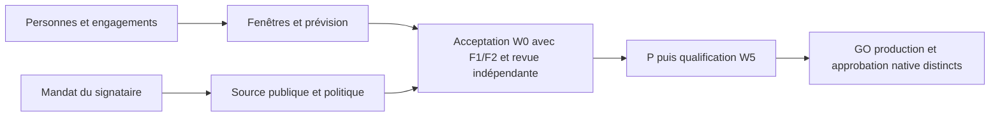

# W0 — décisions du propriétaire pour F3 et F4

> Réponses reçues le 19 octobre 2026 : [copie verbatim versionnée](../docs/baselines/app-cm-w0/owner-decisions.md). Les questions, options et recommandations ci-dessous sont historiques ; les réponses les remplacent. Q2 supprime le besoin de fenêtres et de réservation temporelle des slots puisqu'il n'y a pas d'utilisateurs. Q4 prévoit un enrôlement dédié ultérieur ; aucune clé n'est créée par ce dossier.

## 1. Décisions demandées

[FACT] La demande `AGENT_SIG:7f3a9c2e1b` réserve F3/F4 au propriétaire. Ce dossier prépare quatre réponses : **Q1 personnes et responsabilités ; Q2 fenêtres ; Q3 signataire ; Q4 source de clé et politique de confiance**. Aucun nom, créneau, mandat ou clé n'est adopté ici. Toutes les recommandations sont des **propositions**.

## 2. Contexte établi et inconnues

[FACT] La revue locale `.h2a/reviews/pr702_astra_r1.md`, F3/F4, sur `ce26bb090bf1d2a43a00d9c97671269e18152e52`, demande des engagements nominatifs et une identité de signature autorisée dès W0. Les [réservations](../docs/baselines/app-cm-w0/reservations.md) ne prouvent pas la disponibilité ; le [contrat P](../docs/baselines/app-cm-w0/promotion-contract.md) fixe le vérificateur mais ne choisit aucun signataire réel. Les lectures [cluster](../docs/baselines/app-cm-w0/cluster-readings.md) et [récupération](../docs/baselines/app-cm-w0/recovery-readings.md) ne ferment pas F1/F2.

[FACT] Le plan approuvé, SHA-256 `166e9bbf2c580ee61b3decc9c3a4c758db579a38783eb212cf80f0a3a43c816a`, §3, conserve la cible de bascule du **vendredi 23 octobre 2026**, puis 24 h d'observation ; échéance **dimanche 25 octobre à 23:59 America/Toronto**. Les disponibilités effectives, accords des personnes, attentes externes et identité/clé autorisée restent inconnus. Les personnes et délais ne peuvent être déduits des rôles SC/KO ni d'un port libre.

## 3. Enjeux et dépendances

[FACT] F3 touche les propriétaires de fichiers partagés, les migrations, l'infrastructure et la reprise. F4 fixe une autorité de sécurité ; la possession d'une clé ne suffit pas à établir son mandat. Le [registre B01–B08](../docs/baselines/app-cm-w0/authorization.md) maintient l'acceptation W0 ouverte.

## 4. Questions, options et conséquences

**Q1 — Qui accepte nominativement chaque responsabilité et chaque transfert de fichiers ?**

[FACT] Les réservations attribuent T1 migration/locks, T2 registre, T3 image/Makefile/CI/manifests, T4 catalogue, TG promotion après T3, T5 qualification. Elles ne fournissent pas les personnes ayant accepté. `0017` doit encore être rapproché des réservations non locales ; D2 garde `0012`–`0016`. KO fournit les reçus de l'infra externe ; cela ne désigne pas son opérateur réel.

| Option [JUDGMENT] | Avantage principal | Conséquence / limite | Condition de choix |
|---|---|---|---|
| Q1-A : répartir infra/migration/reprise et promotion entre personnes explicitement nommées | Disponibilité et suppléance réparties ; moins de cumul opérationnel | Davantage de coordination et de transferts ; chaque accord doit être recueilli | Plusieurs personnes compétentes et disponibles confirment leurs périmètres |
| Q1-B : nommer un opérateur principal cumulant plusieurs rôles, avec suppléant | Moins de transferts ; responsabilité opérationnelle lisible | Capacité et permissions concentrées ; un absent peut bloquer plusieurs étapes | Le cumul est accepté, les permissions restent bornées et les revues indépendantes préservées |

[JUDGMENT] **Proposition : Q1-A**, si les personnes sont disponibles ; Q1-B reste adapté si l'équipe est limitée et sa capacité est démontrée. Réponse attendue : nom + rôle/périmètre + accord durable + suppléant, pour infra, promotion, migration, sauvegarde/restauration, SC et les six slots ; préciser le dépôt/PR infra et qui confirme `0017`. Un rôle laissé sans personne reste ouvert.

**Q2 — Quelles fenêtres sont effectivement acceptées pour les six slots, les approbations, la bascule et le rollback ?**

[FACT] Le plan part du lundi 19 octobre 09:00 Toronto : 82,6 h sérielles + 26,6 h de réserve + 24 h d'observation = **133,2 h**, avant attentes critiques supplémentaires Δ. Son scénario avec réserve place la bascule le vendredi à 22:12 et la fin d'observation le samedi à 22:12 ; la marge publiée est 25 h 47 min. Ce calcul ne constitue pas une réservation humaine.

| Option [JUDGMENT] | Avantage principal | Conséquence / limite | Condition de choix |
|---|---|---|---|
| Q2-A : conserver le 23 octobre comme cible conditionnelle et réserver les fenêtres couvrant la prévision | Maintient l'objectif de la semaine et rend visibles les attentes | Peut demander une présence tardive ; tout décalage consomme la marge | Les personnes Q1 et le propriétaire confirment horaires et capacité |
| Q2-B : choisir la prochaine fenêtre réellement dotée et recalculer l'échéance | Aligne le calendrier sur la disponibilité et les preuves acquises | Peut reporter le résultat au-delà du 25 octobre ; nécessite un arbitrage explicite | La cible du vendredi ne dispose pas d'une couverture acceptable |

[JUDGMENT] **Proposition : Q2-A sous condition de confirmation**, sans promettre la date ; sinon Q2-B avec nouvelle échéance assumée. Réponse attendue : début/fin avec fuseau pour T1/T2/T3/T4/TG/T5, approbations, bascule/rollback et couverture d'observation ; nom du présent et du suppléant. SC recalcule depuis le début effectif et les attentes critiques non superposées : fin = début + 133,2 h + Δ. Départ de production au plus tard le 24 octobre 23:59 pour préserver 24 h avant l'échéance actuelle. Aucune fenêtre n'accorde le GO.

**Q3 — Qui reçoit le mandat de signer l'acceptation qualifiée, et pour quel périmètre ?**

[FACT] B05 demande une personne/instance h2a identifiée et un reçu durable d'autorisation du rôle. Le contrat maintient séparément l'approbation native de `rhanka` dans l'Environment `production`. Ni un auteur, ni un conducteur, ni le signataire fictif des vecteurs n'obtient ce mandat automatiquement.

| Option [JUDGMENT] | Avantage principal | Conséquence / limite | Condition de choix |
|---|---|---|---|
| Q3-A : désigner un délégataire d'acceptation autorisé, lié à une instance précise | Permet une disponibilité dédiée à la qualification | Délégation à borner, maintenir et révoquer ; autre personne à coordonner | Le propriétaire reconnaît la personne et son mandat par un reçu durable |
| Q3-B : le propriétaire assume explicitement la signature d'acceptation | Mandat direct, moins de délégation à administrer | Ajoute une dépendance à sa disponibilité ; signature et approbation native restent deux actes | Le propriétaire accepte cette charge et désigne son instance autorisée |

[JUDGMENT] **Proposition : Q3-A**, si un délégataire reconnu est disponible ; Q3-B convient si le propriétaire préfère garder cette responsabilité. Réponse attendue : identité de la personne, instance, dépôt/environnement/actions autorisés, durée du mandat et lien du reçu d'autorisation. Aucun nom n'est proposé comme déjà choisi.

**Q4 — Quelle source publique indépendante lie cette identité à la clé, et quelle politique de validité/révocation doit P appliquer ?**

[FACT] Le contrat P exige une clé publique SPKI PEM, l'empreinte SHA-256 du DER, une source d'export indépendante de l'enveloppe/branche candidate, un mandat vérifiable et une politique de validité/révocation. Aucune clé privée ne doit entrer dans ces reçus ou dans CI.

| Option [JUDGMENT] | Avantage principal | Conséquence / limite | Condition de choix |
|---|---|---|---|
| Q4-A : utiliser l'export public d'une identité existante autorisée, recoupé indépendamment | Évite de créer une identité supplémentaire ; continuité possible | Réutilisation, ancienneté et portée de la clé doivent être vérifiées | Provenance, mandat, empreinte et état de révocation sont confirmés |
| Q4-B : préparer une identité/clé dédiée sous responsabilité désignée, dans une action ultérieure autorisée | Sépare le rôle d'acceptation et son cycle de révocation | Enrôlement, garde, export et rotation ajoutent du travail/délai | Une clé existante ne satisfait pas la séparation ou la provenance attendue |

[JUDGMENT] **Proposition : Q4-A uniquement si les vérifications sont satisfaites** ; sinon Q4-B. Réponse attendue : source d'export public et canal de recoupement, empreinte SPKI DER SHA-256, reçu liant clé/instance/mandat, dates de validité, responsable/canal de révocation et règle de fraîcheur après attente d'approbation. Ne fournir aucun secret. L'installation du trust sur main protégé reste le travail P.

## 5. Recommandation et limites

[JUDGMENT] Les propositions Q1-A/Q2-A/Q3-A/Q4-A visent une couverture disponible et une provenance vérifiable, sans créer de mandat implicite. Le meilleur argument contre cet ensemble est sa charge de coordination : une petite équipe peut mieux assurer Q1-B/Q3-B ; une provenance douteuse rend Q4-B préférable. Une disponibilité insuffisante renverse Q2-A. Différer une réponse reste possible, avec W0 et les dépendances concernées ouverts.

## 6. Réversibilité, coûts et scénario d'échec

[JUDGMENT] Avant toute action, noms et fenêtres peuvent être révisés par de nouveaux accords ; aucune intervention n'est effectuée par ce dossier. Une clé déjà installée impose ensuite révocation, nouveau trust revu et revalidation des acceptations concernées. Les coûts humains/enrôlement et Δ sont inconnus tant que les personnes n'ont pas accepté.

[JUDGMENT] Pré-mortem : six mois plus tard, l'opération a échoué parce qu'une personne figurait sur le planning sans avoir accepté, qu'un cumul masquait son indisponibilité ou qu'une clé valide ne portait pas le mandat attendu. Les reçus nominatifs, fenêtres couvertes et liens de confiance servent à rendre ces hypothèses vérifiables. Pour l'auteur, reporter les inconnues serait plus rapide ; l'intérêt du propriétaire est de disposer d'une capacité confirmée et d'une autorité contrôlable, même si cela impose de revoir la cible.

## 7. Critères de validation attendus

| Critère [FACT : exigence de la revue / du plan] | Couverture proposée | Écart actuel |
|---|---|---|
| F3 : personnes engagées, transferts, `0017`, infra externe | Q1 et reçus d'acceptation | Noms/accords et rapprochement non fournis |
| F3 : six slots et fenêtres couvertes, prévision actualisée | Q2 et calcul depuis le départ effectif | Disponibilité et Δ non mesurés |
| F4 : signataire, mandat durable | Q3 | Identité et mandat non fournis |
| F4 : export indépendant, empreinte, validité/révocation | Q4 | Source/empreinte/politique non arrêtées |

## 8. Réponse minimale du propriétaire

[FACT] Décisions en attente. Pour chaque Q1–Q4 : indiquer l'option retenue ou une variante, les noms/horaires/références publics demandés, et ce qui reste à confirmer avec son responsable. Cette réponse permettra de préparer les reçus ; elle ne sera pas présentée comme une signature h2a, une autorisation de merge ou un GO de déploiement. L'auteur ne modifie pas Track, réservé au rédacteur racine désigné.
