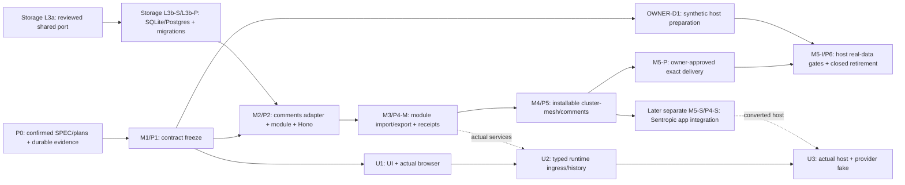

# Comments and annotations — two-lane delivery plan

**M2 REVIEW TREATMENT — M1 code built and frozen on `feat/comments-annotations-model` (PR #663, freeze 2dabe25ce), by [M2-DELTA](../evidence/owner-decisions.md#m2-delta-owner-answers).** The Lot 1 contract freeze is owner-closed; M2 relies on that unchanged contract with carried reserves recorded in the receipt. Earlier P0/M1 entry conditions remain provenance; do not repeat completed code work. M2–M5 evidence and confirmation of these treated bytes remain due.

## Authority, provenance and acceptance

This plan, [model branch template](BRANCH_P1_TEMPLATE.md) and [handoff](PLAN_HANDOFF.md) implement [SPEC §9.4](../../../spec/SPEC_EVOL_COMMENTS_ANNOTATIONS.md) under [TREAT2 and M2-DELTA's direct owner answers of 2026-10-11](../evidence/owner-decisions.md). [CONF2](../evidence/review-confirmations.md) confirmed the previous treatment with reservations; this revision treats MAJ-1 and m-A–m-I. CONF3 confirms the source SPEC c6d7a548d25746243b3904a20adea2d1b96360b3042445ba020a8204479ed967 with zero blocking, zero major and seven minor findings; see the [convergence receipt](../evidence/convergence.md). The earlier reviewed predecessor SPEC is `2e3083fc38ee5d9b3ca225823a794760245b6bc725321a4c802f77938c06463d`; the current prepared SPEC SHA-256 is **df6bea51d7c270f7f88602924ff68de7d90f24a58307b6b52d7093abd2f08b74**. Baseline HEAD is `dc95f7e4f88048e9671002827537cde4cb8149b7`, branch `spec/comments-annotations-port`. The previous plan `356f463a04668d7f4ed070a3e3a458684ab3b6e3da9a0e03179373cfe63c0880` is superseded; frozen sources and historical P0 dispositions are preserved, not reused as acceptance.

The owner's instruction is « j'autorise par défaut tout sauf question empêchant d'avancer ». **AUTH-M is supplied, conditionally effective:** the author treats every C6 and CONF2 finding; an identified Opus 5.5 max reviewer confirms the complete delta, dispositions and aligned SPEC/P/B/H on their resulting SHAs; convergence records predecessor and treated SHAs. “Passed” means GO or GO with reservations, no open BLOQUANT or MAJEUR due before M1. Disputed dispositions remain open. Any subsequent change receives affected-delta confirmation. Neither conductor nor i-cond arbitrates.

Before M1, implement the owner's « Branche doc comme base » choice: the documentation maintainer updates `spec/comments-annotations-port`'s BRANCH.md to cover the SPEC and `docs/comments-annotations/{evidence,plan}/**`, then commits the accepted SPEC, readable review/treatment and decision-reference extracts, `evidence/index.md` and the three aligned plans on that documentary branch. Pin its main ancestor and create `feat/comments-annotations-model` from the exact LAST commit of the ordered promotion series in the documentary BRANCH.md, recording its SHA. No merge to main precedes M1; evidence later merges with the P4-S-qualified code under the owner's merge gate, with actual delivery separately gated by OWNER-D2. Record source/document/review hashes, verbatim AUTH-M, current owner decisions and convergence; rewrite ignored authority links and confirm that delta before the final promotion commit. Index and extracts are English; authorized French owner quotations remain verbatim and source-hashed. Copy only the two approved register quotations and scope labels, no other private content or source path. E2/TR2's historical no-conservation attribution and backup prescriptions are superseded: carry that erratum in extracts, and have the interface maintainer supply it to the host and record acknowledgement with the freeze receipt before host preparation relies on E2. `.h2a/` remains ignored. The promotion files and documentary BRANCH.md are prepared here; bounded promotion-delta confirmation, Git recording and host communication remain due. Repository readers must resolve the entire evidence chain from the model's base commit. Model Lot 0 keeps that LAST series commit and its documentary ancestry unchanged through P4-S; any implementation-only rebase must preserve the anchor. BRCA-EX1 covers only the indivisible SPEC addition; other documentary additions use commits below 150 changed lines, including ordered plan fragments.

AUTH-M covers isolated synthetic implementation of P1/M1, P2/M2, P4-M/M3, P5/M4 candidate qualification and separately scoped P4-S/M5-S. U uses the default instruction with its own concrete scope after M1 freeze; no repeated AUTH-M, AUTH-U or STAGING-M vote is introduced solely for scheduling. Merge, publication, deployment, real-data handling and each real delivery remain owner-submitted with their concrete dossiers under OWNER-D2 and applicable operational authority.

| Work | Requested author / reviewer |
|---|---|
| SPEC, plan and contract-freeze convergence | Astra max; Opus 5.5 max confirmation review. |
| BUILD implementation | Vibe GLM 5.3 or Gemini 3.8 high; cross-review by the other. |
| Evidence recording | Preserve host, exact requested/declared model, effort, effective identity when verifiable, independence and reading limits. Metadata is resolved when available declarations, source hashes and unverifiable limits are recorded. AUTHOR-C6 declares Codex v0.162.1 / gpt-6-astra / max; CONF2 declares claude-opus-5-5 with requested max effort unverifiable by the reviewer, who also authored C6. AUTHOR-2E also records its own Codex v0.162.1 / gpt-6-astra / max header and final log digest; CONF3 declares the same reviewer model with requested max unverifiable and prior C6/CONF2 authorship. [Header evidence](../evidence/author-metadata.md) records their exact hashes and limits; no declaration is independent routing attestation. No agents launch in this task. |

**G2 a+c amendment, M2-DELTA with corrected M2-TREAT:** the owner moves `/pg` storage and canonical API implementation from comments to the cluster-mesh comments module. Comments remains the domain authority and keeps types, hashing, validation and conformance; chat-ui and unchanged contracts retain their boundaries; no annotations package. D4=C and the engram storage decision already establish cluster-mesh's shared storage abstraction. M2 consumes the same L3a port, L3b-S SQLite/L3b-P Postgres backends, generations and migrations through a comments adapter. The storage track owns the README correction and any additive comments capability; M2 adds local registry resolution without changing `GATED_OWNERS.comments.owner`, removing `'comments'` from `CLUSTER_MESH_GATED_MODULE_IDS` or narrowing its type. Module/h2a N/N-1 conformance stays required. Immo uses `createCommentsNamespaceModule` with a shared storage binding and its own full `ClusterMeshRuntime`/`createClusterMeshPlugin`; Sentropic comments application integration remains later M5-S. See [storage source/placement details](../evidence/owner-decisions.md#shared-storage-context-correction). Model ownership does not choose Immo UI reuse. OWNER-D1–D4, HOST-D3/HOST-D10 and ARCH-D11 retain their separate meanings.

**Eradication provenance:** the register's complete statements are « au passage prospect_notes doit être éradiqué merci, ton modele oublie de le proposer. faut éradiquer le modele légacy » and « prospect_note doit être éradiqué, et on devrait supprimer ce qui a été implémenté a date côté UI, ta proposition doit se faire sur la cible en supprimant ce qui a été fait n'importe comment a date assure moi l'invetaire d'éradication stp et planifie le ». Their spelling and punctuation are unchanged; register SHA-256: `4220358516eb87077568f33dcd6cfcc0e41dbd75a26fe5a82700de90e1e830fe`. On 2026-10-11 the owner's « Valider, citations exactes » answer through the conductor's AskUserQuestion validated the scope limited to `prospect_notes` and Immo's old notes system, exact quotation use and attribution of “sans conservation / no conservation” to i-cond. This supersedes the earlier relay-only provenance. Under the same TREAT2 answers, Immo's backups and their lifecycle are Immo's own domain and decision, outside this plan/SPEC. OWNER-D4 retains the conversion-report count for legacy rows not carried over. M2-DELTA removes backup/restore rehearsal from M2 and the path before Immo delivery; Sentropic's own cutover obligations remain only in the later separate P4-S track.

## Branch Scope Boundaries (MANDATORY)

Current M2 amendment only: edit the SPEC, these three plans, owner-decisions/index and append the local revision log. BRANCH.md and all other files remain unchanged; the broader historical promotion scope below does not enlarge this task. The root [BRANCH.md](../../../BRANCH.md) is the documentary branch's scope and ordered commit series.

- **Allowed Paths (document scope)**:
  - `spec/SPEC_EVOL_COMMENTS_ANNOTATIONS.md`
  - `docs/comments-annotations/evidence/**`
  - `docs/comments-annotations/plan/**`
  - `BRANCH.md`
- **Forbidden Paths**: code, infrastructure, `.track/**`, `.gitignore`, frozen inputs/reviews/snapshots and original local plans.
- **Conditional Paths**: ignored `.h2a/SPEC_REVISION_LOG.md`, append only under BRCA-EX2; never staged.

Files only: no Git command, Make/build/runtime test, service, real-data work, Track write, new worktree, subagent or external message. Branch/scope commands are deferred to the subsequent committer under the explicit mandate.

## Milestones, usable outputs and dependencies

P0 closes only with the confirmation and durable evidence above. The model path is **P0 → M1/P1 → M2/P2 → M3/P4-M → M4/P5 candidate → M5-P approved delivery → M5-I/P6 real adoption**. M5-S/P4-S is a separate Sentropic integration path; U is separate UI/runtime work. Neither is an M4/M5-P prerequisite. M2 entry additionally requires the reviewed independent shared storage port/comments capability (frozen L3a v4.1 §17.4 K1) and the selected qualified Postgres profiles actually consumed (frozen L3a v4.1 §17.5: not L3b-S SQLite, live generations, or Q). Record the implementing lead from [Question owner](../evidence/owner-decisions.md#question-owner), amend engram plan 09 L3b-P and SPEC §9 placement/forbidden clauses with storage maintainers, then pin the shared module/export/migration artifacts and qualification receipts. The injected-driver module serves Immo and the neutral fixture without app imports; a host-specific backend is not assigned to Immo. Pre-entry adapter preparation may use agreed port doubles, without claiming M2 entry or readiness.

| Milestone / evidence ID | Work and exit evidence | What the receiver can do |
|---|---|---|
| M1 / P1 / E-M1-01–03 | Complete canonical contracts, closed record/chain inventory, descriptors and server vectors; browser-safe root; reviewed freeze receipt. | OWNER-D1: prepare importer, API client, mappings and independent UI/test doubles on synthetic data after acknowledging the freeze. No installable-runtime claim. |
| M2 / P2 / E-M2-01–03 | Comments adapter on the independent shared cluster-mesh storage port (§17.4 K1) with the selected qualified Postgres profiles (§17.5), same shared generations/migrations, additive local registration and Hono API; canonical reload and atomic log/lifecycle conformance. No backup/restore rehearsal. | Immo binds directly through its full cluster-mesh runtime with injected shared storage/authority/context/registration/receipt ports; qualify both real backends without Sentropic comments application integration. |
| M3 / P4-M / E-M3-01–03 | Import/export, correction, recovery, conversion reports and unitary prepared receipts on M2, with actual HTTP/service/PG authorization. Hash-chained fragments stage across bounded requests/pages and publish atomically as complete units/groups; histories above 512 KiB and 1 MiB must round-trip without truncation. | Rehearse synthetic import/export and receipt reconciliation. Preparation invokes no provider and needs no chat-server, message, job or history integration. |
| M4 / P5 candidate / E-M4-02 / V0-M | Installable `@sentropic/cluster-mesh/comments` candidate plus its comments contract dependency, clean exact archives/assets/lock and synthetic neutral-host acceptance using the same full runtime/module/plugin path and the digest-pinned packaged conformance oracle (`@sentropic/comments/conformance` is not an existing export). | Install the module directly in Immo independently of Sentropic conversion, UI, browser parity and chat ingress. |
| M5-S / P4-S / E-M4-01, E-M5S-01 | Later separate track: complete existing Sentropic consumers/forced UI adapters, authoritative tenant, public runner, control outbox, G4 source, guarded closed cutover and restore. | Sentropic readiness before its breaking main merge/activation; never a delivery dependency for Immo. |
| M5-P / P5 delivery / E-M5P-01 | Owner approves the exact frozen-package dossier; receiver retrieves and retains identical bytes with complete locked install/rebuild/restore receipts. | Install that approved package through the recorded access/direct-copy path; no main merge or registry publication is needed for candidate production. |
| M5-I / P6 / E-M5I-01–02 | Host-owned first-entry authority, HOST-D3 mapping/removal evidence, received hashes and source reconciliation, closed conversion/retirement and canonical recovery; Immo backups remain outside this plan/SPEC. | Real adoption only in the authorized target. Later source lots use canonical services; retirement is not postponed. |
| U / P3 / U1–U3, E-M3-04 / V0-U | New panel/drawing, actual-browser corpus execution, typed runtime send/ingress/message/job/history/provider binding and actual-host UI acceptance. | UI integration where chosen; Immo reuse is undecided and has no automatic V2 decision gate. |

V1 is each host's real-data readiness gate. Former V2 legacy retirement belongs to the same closed P6 switchover before reopening, not a later period of old/new coexistence. C is archive-capability activation under effective policy, independent of M1 vector freeze. HOST-D10 concerns evaluation/learning only unless a bounded dependency is demonstrated.

**V0-M:** through the installed neutral host's real HTTP/service and shared SQLite/Postgres bindings, save and reload an exact revision/hash, add/revise pinned comments, review/contest with history, and prepare one annotation with selected structural/comment hashes into an immutable recoverable receipt. Exercise all five anchors, changed digest without capture, scope/type collisions, coherent batch failure/recovery/conflict, export completeness/revocation, lifecycle and G4. No panel, actual-browser run, chat ingress or provider fake belongs to this evidence set.

**V0-U:** the actual mounted Sentropic host demonstrates box/circle drawing, save without AI, exact reload/history, comment/review and selected-revision submission through controller, host/default transport, chat-server ingress and durable message/job/history to a deterministic provider fake. Later edits, revocation, tombstone and retry cannot substitute latest. Browser hash parity belongs here, owned by chat-ui maintainers.

## Contract freeze and branch/CI topology

At P1 exit, comments maintainers produce `docs/comments-annotations/contract/contract-v1.json`: source commit and hashes of public types/schemas/exports/ports/DTOs, including the adapter/HTTP declarations; M2-DELTA transfers their implementation/export inventory to the cluster-mesh comments module, provenance/body/mention/profile/capacity/quantizer descriptor, complete `revision-hash-v1` corpus and companion conformance evidence. P1 checks driver-agnostic declarations and import boundaries; implementations still due are marked unavailable. M1 code is built and frozen; `docs/comments-annotations/contract/contract-v1.json`, the freeze receipt and host acknowledgement exist on `feat/comments-annotations-model` (freeze `2dabe25ce`, PR #663) with carried reserves recorded in the receipt. Before M2 relies on an unchanged contract, establish this baseline with the comments-owned adapter/HTTP declarations, digest-pinned packaged conformance oracle and cluster-mesh implementation mapping directly in its initial inventory; no frozen path is being relabelled. M2/M3 then preserve its types, hashes, validation and conformance. Undeclared exports or changed signatures/wire/dependency boundaries require versioned realignment. Astra max/Opus 5.5 max convergence on that manifest creates the indexed freeze receipt; send the host-readable artifact and record acknowledgement to trigger OWNER-D1. Freeze follows implementation/server/root-safety checks, not a preliminary type sketch. Every later contract change, including before real hashes, needs a new version/manifest, review, affected tests and acknowledged host realignment; after real hashes Sentropic also supplies linked conversion.

Choose C6 M-3 option (a). **`feat/comments-annotations-model` starts from the exact LAST documentary promotion-series commit, accumulates P1/P2/P4-M and produces P5's candidate.** E22's workflow runs on push to main, PR targeting main or workflow_dispatch; within a triggered run, `packages/comments/**` selects API CI, which consumes it through `file:`; preserve the old API's exact signatures while adding canonical named exports. Inventory temporary exports and retain M1 adapter/HTTP declarations while recording M2-DELTA's new module export inventory. The one-model/one-router responsibility is the final post-P4-S state. During staging, implement the canonical API in `packages/cluster-mesh/src/hono/comments-router.ts`, mounted by the cluster-mesh plugin; preserve `packages/comments/src/hono.ts` signatures for the existing app. No translator, runtime switch, dual writer or old reader of canonical storage is added. Existing app regression tests exercise its unchanged old composition; neutral-host tests exercise only the new one. Both remain green; API CI is neither skipped nor waived. Lot 0 opens a draft PR targeting main, marked non-mergeable until P4-S and owner merge approval. Before the first source-changing PR CI evidence, select a working version on the reviewed breaking-minor line above the published registry version, update manifest/lock and satisfy enforce-package-bump. Recheck the registry comparison after any permitted rebase; this working version is neither published here nor M4's reserved candidate identity. PR open/synchronize events supply milestone CI; record the PR head and tested checkout SHA, and qualify candidate archives against the exact model commit.

M4 packs a clean identified commit on that model branch, with pinned base/parent and lockfile and completed model evidence. The archive may contain enumerated old exports; receiver qualification proves its canonical composition cannot reach them. The later separate **`feat/comments-annotations-sentropic`** track starts from that exact candidate commit, converts all existing consumers and removes temporary old exports/code/tests with canonical replacements before any breaking main merge, including `editThread(content, assignment)`; assignment cannot overwrite other authors' bodies. The new artifact has a distinct version/integrity and migration assessment; no candidate identity is reused. The model branch alone is not main-mergeable.

**`feat/comments-annotations-ui`** starts from the acknowledged M1 freeze with contract-conformant doubles and its own scope. Final U acceptance uses M3/M4 services and the actual converted Sentropic host; no reverse edge gates M4. Release maintainers on **`chore/comments-annotations-delivery` alone** own the candidate artifact job, workflow changes and delivery dossier. Scope that work separately; the model branch may change CI only for required neutral verification wiring, never duplicate the artifact job. Record the workflow revision and check out the exact qualified model commit for packing; no main merge/publication/deployment is a job side effect. CONF3 n-7 remains a delivery-maintainer obligation before P5/M4: name and qualify the actual branch workflow trigger without a main merge, recording workflow/run/source identity; do not presume branch pushes or off-default workflow_dispatch work. Until qualified, retain the separately authorized exact direct-copy route. Real handoff remains owner-submitted. Use repo-local `tmp/worktrees/<slug>`; create none here.

Lot 1 must align SPEC §4.6 before freeze: five count bounds typed in `units`, `paging: { defaultRecords: 50, cursorTtlSeconds: null }`, validated default/max, `specDigest` replaced by `specVersion`/`specSource`, reviewed and pinned micromark tokenizer with CommonMark 0.31.2 literal-region/mention vectors, and §7.2 fragment/root/receipt declarations. If a freeze was recorded meanwhile, version/review/acknowledge these changes through §9.1. This is planned code work, not a completed freeze.

## Contract requirements retained in both lanes

| Concern | Required model evidence | Later host/UI evidence |
|---|---|---|
| Records/history | SPEC §4.4's eleven closed record kinds, chain keys and typed links, plain discussions, different revision pins of the same annotation and immutable annotation primary resource identity. Mutable heads/tombstone projections are not hashed. Review chain is scoped per annotation across revisions; lifecycle and operation-audit events have separate chains. | UI separates discussion resolution from review; old validations remain attached to old hashes. |
| Structural revisions | Closed triggers: registration, explicit version rebinding, reanchoring, structural resource-association change preserving an annotation's primary identity; scope re-key creates linked new baselines. | Assignment, archive, replies and live-resource change alone cannot rebind a saved structure. |
| Scope/provenance/time | Opaque tenant/workspace hashes, observed/conversion/unknown source indicators, documentary actor versus registration/executor, unknown/gaps explicit; CommonMark descriptor, principal mentions, segmentation, profiles and numeric limits complete before freeze. | P4-S/P6 prove authoritative resolver/membership and reject shadow/alias before commands. Sentropic extracts timezone-free SQL values as text before driver Date coercion and proves process-timezone independence. |
| Hash/geometry | Pure independently checked server vectors; RFC 8785 UTF-8 SHA-256, record discriminator, no implicit NFC, code-point offsets, absence/null distinction, safe units. Decimal-string exact quantization to millionths, upward ties/negative zero; quantized box edges/collapse denial, complete non-square circle containment and crop/frame changes. Preserve every restored SPEC §4.4 corpus/behavior case. | PG reload parity in M2; actual browser in U. Draw/move/resize/remove/undo/redo/cancel, accessible keyboard/pointer/touch and immutable-frame reanchoring in U. |
| Authorization/G3/G4 | Unavailable targets, changed selection/capture, all-target access, expected-head CAS, unchanged/conflicting replay, denied or unconfigured authority with no effects; policy injection/default denial. Existing-review decisions bind exact hash; revision creation binds base/hash or absence/version plus proposed-content digest, never the future output hash. | Qualify current evidence and expiry/revocation; audit the human decision, optional agent proposal and executor/service/run separately. Default scope/admin flags never replace authenticated resource authority. Real policy values come from each host; synthetic fixtures are not defaults or Track/engram authority. |
| Import/export/receipts | Coherent units, typed annotation/discussion/review outcomes, partial batch snapshots, recovery, linked correction and copy/move without active validation transfer. Host-declared aggregate conversion report binds frozen inventory and arithmetic without per-exclusion details. | Frozen source = converted source units + authorized dispositions + count-only exclusions. Host attests source completeness; comments verifies declared arithmetic/results. |
| Lifecycle/events | Irreversible tombstone, separate reversible shared/personal archive, durable purge intent/jobs/receipts, policy/holds/shared-blob checks. Transactional change-log port, one dispatcher, durable cursor, retry/expiry/concurrent ordering. | Sentropic uses existing control outbox with durable allocation and authorized poison-event retry; Immo exclusions remain aggregate-only. A live tombstone is not proof of backup/export/recipient erasure. Sentropic owns its backup/restore rehearsal; Immo backups/lifecycle are outside this plan/SPEC. |
| Minimum scope | All five anchors, batch/export/correction and unitary preparation remain M requirements. Aggregate multi-annotation submission EX-I14 is outside baseline. | Automatic live DOM tracking, ellipses, rich dashboards and new native extension capture are separate extensions. No unproved support claim. |

## Implementation lots and file-level verification

All new names are proposals. Scope exact runner/fixture dependencies before BUILD; canonical additions do not disable old-app regressions during staging.

| Lot / owner concern | Files | Tests / exit evidence |
|---|---|---|
| M.A / M1 contracts | Comments `src/{types,guards,index,anchors,geometry,revisions,revision-hash,command-store,commands,reviews,lifecycle,submissions}.ts`; proposed `src/conformance/index.ts`, package exports/surface and contract descriptors/freeze manifest. | Existing `packages/comments/tests/{domain-schema,in-memory-crud,tenant-scoping,threading,thread-cascade,thread-summary,wire-events,hono}.spec.ts`; new `annotation-anchors.spec.ts`, `annotation-revisions.spec.ts`, `revision-hash.spec.ts`, `annotation-reviews.spec.ts`, `annotation-retention.spec.ts`, `annotation-conformance.spec.ts`, `conformance/{comments-conformance,in-memory}.ts`, `fixtures/revision-hash-v1.json`. Add `packages/comments/tests/conformance-exports.spec.ts`, `body-codec.spec.ts` and `fixtures/commonmark-0.31.2.json`; extend annotation-revisions capacity/type/default/TTL cases and fragment/root vectors in the public conformance corpus. Reuse one runner-neutral oracle from the digest-pinned packaged conformance oracle. Every kind/chain, closed trigger, decision binding and descriptor; server plus root safety, not browser. |
| M.B / M2 cluster-mesh module | Proposed `src/comments/{module,storage-adapter,storage-schema,change-log,cursors,dispatcher,purge}.ts`, `src/hono/comments-router.ts`, `src/compose/comments.ts`, `src/integrations/comments/index.ts`, `src/loaders/comments/index.ts`; additive local registry/catalog/contracts and package leaves. Depend on the reviewed independent shared storage port (frozen L3a v4.1 §17.4 K1: `packages/cluster-mesh/src/storage/*`) and the selected qualified Postgres profiles actually consumed (frozen L3a v4.1 §17.5: not L3b-S SQLite, live generations, or Q); propose `@sentropic/cluster-mesh/storage/postgres` module after lead assignment and upstream scope amendment; coordinate L6a `src/live-storage/registration.ts`, without implementing a second store. Shared changes stay on the storage track; the owner selects the implementing lead, storage retains architectural review and README ownership. Propose an optional comments peer, shared asset packaging and leaf sideEffects coverage. Exact paths/gates in template Lot 2. | `packages/cluster-mesh/tests/comments-{module,storage-adapter,storage-parity,migrations,events,retention,hono}.spec.ts`, `conformance/comments.ts`, `fixtures/comments/{sqlite,pg}/**`; use the digest-pinned packaged conformance oracle (`@sentropic/comments/conformance` is not an existing export). Keep existing modules/{registry,capabilities,namespace-loading,topology,topology-ranges}.spec.ts and conformance/h2a-contract.spec.ts green. Require storage-track `live-postgres-{contract,parity,recovery,exports}.spec.ts` evidence, installed injected-driver composition and no app/pg/Drizzle imports. Prove single local entry, lazy/disabled/peer behavior, full runtime/Hono auth, shared SQLite/Postgres parity, staged atomic publication, generation fencing/pinned reads, rollback and shared migration history/checksums/locks. No private backend, backup/restore rehearsal or Sentropic comments app binding. |
| M.C / M3 module import/export/receipts | New `packages/cluster-mesh/src/comments/{import,export,receipts,submissions}.ts`; extend the M2 router/services. Comments retains the contract; old comments `src/hono.ts` stays for staging. | Keep comments `hono.spec.ts`; add `packages/cluster-mesh/tests/comments-{import,export,receipts,submissions}.spec.ts`. Actual module HTTP/service/SQLite/Postgres, long-thread history above fragment/request/page limits, hash-chain completeness, bounded advancing continuation, invisible staging, all-at-once commit, corruption/missing fragment, crash/replay, revocation/CAS/fence failures, logical-unit report counts and partial groups. Retain correction, copy/move, G4 and provider-free unitary preparation. |
| M.D / M4 module candidate | Cluster-mesh manifest/README/CHANGELOG/migration note and comments contract manifest/surface evidence; root lock, `docs/comments-annotations-delivery.md`, `packages/cluster-mesh/tests/fixtures/comments/neutral-host/**`. | `packages/cluster-mesh/tests/comments-{exports,consumer-install,neutral-host-acceptance}.spec.ts`: clean exact module/contract archives and assets, dependency locks/integrity, V0-M, no legacy export reachability, reserved identities/integrity guard. Exercise Immo's full runtime/module/plugin path with the qualified shared storage bindings and the digest-pinned packaged conformance oracle (JS/types/assets; `@sentropic/comments/conformance` is not an existing export), with no imports from source/tests; qualify missing/incompatible/compatible optional peers. Existing API CI and h2a/module conformance stay green. |
| S.A / later separate M5-S binding/conversion | API comments instance/PG adapter/namespace/ports/cutover; `tool-service.ts`, `context-comments.ts`, `comment-summary-mapper.ts`, existing discussion calls in `chat-service.ts`, queue seeding, streams/sinks/metrics, transfers; public schema/runner/extension and separately scoped retirement; control schema/outbox writer/dispatcher/migration. | Existing API `{comments,comments-wire,pg-comment-store,pg-notify-comment-event-sink,cluster-mesh-comments-cutover,workspaces,import-export,cluster-mesh-transfers-cutover}.test.ts`, queue `queue.test.ts`, AI `comment-assistant.test.ts`; new `annotations.test.ts`, `annotations-migration.test.ts`, `annotations-lifecycle.test.ts`, queue `annotation-comments.test.ts`. Tenant resolver, text-time extraction, all consumers, deployment/boot/fence/restore, poisoned event and durable cursor checks. Pin exact existing outbox test files at entry. |
| S.B / later separate M5-S existing UI | Chat-ui comments types/host/state/utils/index/panel as forced; app `comment-host-adapter.ts`, comment utils/counts/types, AppChatPanel and affected initiative/organization/folder/dashboard callers. | Existing chat-ui `comments-module.spec.ts`; app `ui/tests/chat/comment-adapter.test.ts`, `ui/tests/utils/{comments,comment-counts}.test.ts`, `ui/tests/components/chat/AppChatPanel-boundary.test.ts`; E2E `04-tenancy-workspaces.spec.ts`, `07_comment_assistant.spec.ts`. Preserve current navigation/count/assignment and canonical root tombstone behavior. Inventory deletion/blob/cascade paths before scoping; no new drawing prerequisite. |
| U.A / U1 panel/drawing/browser | Chat-ui comments/shell and `src/annotations/{index,types,state,geometry-transform}.ts`, `AnnotationOverlay.svelte`; initiative page/detail, AppChatPanel, `annotation-host-adapter.ts`, locales; actual capture paths after inventory. | Existing comments/documents/attachments/context suites; new chat-ui `annotation-state.spec.ts`, `annotation-overlay.dom.spec.ts`, `revision-hash.browser.spec.ts`, `fixtures/annotations/map-snapshot.ts`; app `annotation-host-adapter.test.ts`. Actual-browser executor owned by chat-ui maintainers; accessibility, non-square transforms, saved frames/reanchoring and real host capture. |
| U.B / U2 typed runtime | Chat-ui `chat-core-host.ts`, `chatLoopController.ts`, `transport.ts`; app chat adapter/AppChatPanel; chat-server parser, API chat namespace/provider/chat/history/queue persistence. Replace touched source imports with qualified exports; scope chat-core only if an exact dependency is demonstrated. | New chat-ui `annotation-send.spec.ts`, app `annotation-submission-adapter.test.ts`, chat-server `annotation-submissions.spec.ts`, API/queue `annotation-submissions.test.ts`; existing host/controller/transport, chat-server wire/ports/capability/roundtrip, API bootstrap/write-order suites. Exact receipt through actual ingress/message/job/history/provider fake with delayed revocation/retry. |
| U.C / U3 actual host/artifacts | `e2e/tests/07-comments-annotations.spec.ts`, chat-ui and changed backend manifests/locks/docs. | V0-U and `packages/chat-ui/tests/annotation-consumer.spec.ts`; clean Svelte mounting, coherent comments/chat-ui/backend versions, deterministic exact provider input. This gate closes U only. |

The reuse path remains `+layout.svelte → ChatWidget → ChatPanel → AppChatPanel → ChatPanelShell → CommentsPanel/createCommentState`. Preserve composer, mentions, assignment, navigation and teardown. `AttachmentBand`, `MessageAttachments`, `ImageLightbox` and context labels are rendering/navigation primitives, not existing drawing or immutable identity.

## Migration, closure and recovery gates

The comments adapter contributes domain schema descriptors and host-driven linked conversion steps to the storage track's existing migration mechanism. L3a/L3b own the shared port, backends, generations, immutable assets and registered history; M2 must not add a separate store, runner or ledger. Prepare consumers offline; a test database does not authorize real-data rehearsal. After shared-storage qualification, M2 proves canonical parity on SQLite/Postgres, neutral-host extension bootstrap, atomic completion, packaged/applied checksums and predecessors. Lock order stays scheduling authority, subordinate conversion lock, then deterministic scope allocation locks. P5's guide documents shared bootstrap/upgrade/crash resume. M2-DELTA removes backup/restore rehearsal from M2 and the pre-Immo-delivery path; OWNER-D2's durable software copy and locked reinstall evidence remain unchanged.

For the later separate Sentropic P4-S track, the public Drizzle stream owns comments schema/conversion history; the existing control stream owns outbox infrastructure. Before main merge/restart, the operator must hold automatic deployment, record its approved release condition and establish robust disabled closure. API startup applies all pending public migrations: the first set must be schema-only. Deliver retirement separately only after common-service conversion and complete reconciliation under closure. Use separate scoped branches/artifacts to honor one public migration per branch; never hide an early DROP in generated DDL.

Missing/shadow/wrong-generation control state must fail closed through startup, requests, jobs, replica restarts and control restore. Disarm the legacy rollback checkpoint and inventory every mounted route/internal path before canonical activation. Remove all old model/adapters/direct SQL/AI/queue/event/transfer/lifecycle and forced UI paths while closed; no live fallback. Sentropic must rehearse backup/restore under Q4 and account for intervening writes; recovery after canonical writes is closed restore/reconversion or forward repair.

Bind the transactional change-log port to the existing outbox/dispatcher. Outbox maintainers own a durable allocation row in control, migrated through that existing stream and incremented in the same transaction as public mutation and outbox append; it survives compaction/restore. A failed row must expose a stalled scope, retain its ID/sequence and audit, and support authorized cause repair/retry before later sequences. Never skip/acknowledge lost events; other scopes continue. Qualify retry ceiling, crash/restart, concurrent appends, ordered recovery and deduplication.

**OWNER-D4 conversion evidence:** legacy rows not carried over are counted in the hashed conversion report, with opaque frozen-inventory reference, admissible-manifest digest, host completeness attestation and disjoint source-unit equation. Excluded Immo rows yield no per-row ID/date/hash/receipt in manifests, receipts, logs or exports produced with comments tooling, and no quarantine or invented hold may bypass the owner-approved legacy eradication. This adds no Immo backup prescription. Immo's backups and their lifecycle are its own domain and decision, outside this plan/SPEC and reopening evidence. Sentropic's own rehearsal belongs only to the later separate P4-S track. M2-DELTA removes it from M2 and all pre-Immo-delivery gates; CONF3 n-6's separation of host responsibilities remains.

## Candidate delivery and compatibility

OWNER-D2 selects a frozen verified package independent of Sentropic's application. Propose a candidate-only Actions bundle or authorized exact direct copy; record actual source commit, workflow/run/attempt/artifact identity where applicable, archive/bundle integrity, lock and complete assets/dependencies. No workflow, access grant or download is claimed here. M4 neutral acceptance qualifies the exact archived cluster-mesh/comments module with its comments contract dependency; P4-S and U evidence cannot replace it.

Reserve a unique prerelease on the reviewed breaking-minor line with a byte identity that cannot be reused. Publishing/packing guards reject a reserved version at different integrity; a changed build gets a new identity. P4-S removal of temporary exports gets another versioned baseline. The receiver retains verified archives, dependencies and manifest independently of Actions expiry, installs with full resolved/integrity locks and rechecks at rebuild/restore. Withdrawal names the exact bad version/integrity, obtains receiver acknowledgement and supplies a new reviewed/qualified package plus linked conversion if needed.

ARCH-D11 is B with additive-preferred. ARCH-12 recommends a compatible optional executor parameter in a patch, with behavioral CHANGELOG, and forbids Drizzle/pg leakage into the generic surface. The comments transaction handle and HTTP DTO/ports remain driver-agnostic. M2-DELTA explicitly moves `/pg` storage and API implementation to cluster-mesh; qualify its adapter isolation and module export mapping without changing M1 contracts. Cluster-mesh retains its own README policy: additive minor, incompatible major, N/N-1 support. The comments model replacement still requires its reviewed breaking minor. Require strict-tier packed export/wire surface comparison, reviewed bump class, BREAKING changelog, migration note and clean pack/install proof at P5 and P4-S. Use SPEC §3's in-document `comments-migration-note-v1` template for `packages/comments/MIGRATION.md`; `plan/MIGRATION_TEMPLATE.md` is absent at HEAD. Current missing changelog/gate implementations are future work with exact scope, not claims of enforcement. Inspect registry versions before choosing real numbers and after rebases; dependencies use plain semver. Proposal for surface review: cluster-mesh declares `@sentropic/comments` in `peerDependencies` with `peerDependenciesMeta.optional: true`; enabled comments composition requires the reviewed compatible pair, while root/disabled modules work without it. Packed files include the shared storage track's registered migration assets, with comments extensions reviewed in that mechanism; existing `sideEffects` globs cover integrations/loaders/compose leaves. The initial Lot 1 manifest relies on the digest-pinned packaged conformance oracle (`@sentropic/comments/conformance` is not an existing export per frozen L3a v4.1 §9.6/§17.4; export location and executable packaging are unverified); M4 verifies its emitted JS/types and required assets from the archive.

The compatibility matrix enumerates the comments contract, cluster-mesh/comments module/API/persistence/assets, installed chat-core/chat-ui, events and every contracts resolver, with ranges, exact resolution and integrity. No forced receiver UI upgrade for model import or unsafe deduplication. Contracts remains unchanged: assess the actual external-consumer trigger under ARCH-12 and record the applicable separate disposition, rather than presume graduation or exemption.

Before each actual delivery, present the owner the exact qualified manifest, retrieval/storage route, locked install/rebuild/restore proof, availability/withdrawal plan and effects. Receipt of identical durable bytes closes M5-P; model build success does not. A later registry source substitutes only with identical bytes/resolution; otherwise requalify a distinct version.

## Host policy and residual decisions

[Question owner](../evidence/owner-decisions.md#question-owner) leaves only the portable L3b-P implementing lead open: storage or comments team, with joint review and the same module/gates. This is a cross-team assignment before M2 entry, not a renewed model-ownership or OWNER-D2 vote; documentation is complete without inventing an answer.

| Future boundary / responsible role | Concrete dossier and what an uncovered answer settles |
|---|---|
| First real entry / host intake and data authority | Named source/target, scope, attribution and pre-registration redaction; settles permission to process those real records, including rehearsal. HOST-D3 is decided but needs implementation evidence. |
| Q3 / host review-policy authority | Capability/self-validation/quorum/contest/G4/archive-audience matrix using existing authority where available; any uncovered answer settles sensitive activation, not generic import or M1 vectors. |
| Q4 / host lifecycle authority | Canonical content/audit/capture/AI/export disposition, purge/holds, receipts and recovery. Sentropic's own backup lifecycle and cutover rehearsal apply only in the later separate P4-S track; Immo backups/lifecycle are outside this plan/SPEC and OWNER-D4 retains conversion counts. Any uncovered answer settles real lifecycle operation for that host. |
| OWNER-D2 / delivery and release operator | Exact dossier above, and separate merge/publication/deployment/cutover effects; settles that named action, not a standing approval. |
| Immo UI / host product owner, only when a concrete scope depends on it | Actual surface needs and available U evidence; choose shared panel, independent UI on the common model or hybrid if needed. No automatic V2 question or injection gate. |

## Execution discipline and measurement

During later authorized BUILD, use Make with RTK and ENV last; allocate exact branch-number API/UI/Maildev ports and verify ownership before stacks. Tests use isolated `test-*`/`e2e-*`, never dev. One local Docker build at a time and approximately two working agents reflect the owner's OOM instruction; no remote CI serialization or headcount formula follows. Do not launch agents in this documentation task.

Run harness branch checks before work and scope-check before every future commit. Preserve the documentary anchor through P4-S; rebase references below apply only to implementation-only rebases preserving its ancestry. Split logical changes into commits under 150 changed lines and at most 10–15 files, stage named paths then call make commit separately. One integrating writer owns each shared contract/schema/manifest/lock; use reviewed types on disjoint branches and rebase, never cherry-pick or partial main delivery.

Inspect existing Make recipes (`test-comments`, `typecheck-comments`, `pack-comments`, package/API/UI/E2E targets and lock/clean-install targets). Scope missing neutral PG/HTTP/archive runner wiring in M; actual-browser/chat-server/new UI runner work belongs to U; Sentropic runner/outbox/old-consumer regression scope belongs to S. Conditional infrastructure paths require a concrete BRxx-EXn with reason, impact and rollback; no default CI rewrite. Run affected checks, resolve failures and repeat only for changes or unresolved concerns. No timeout inflation or AI-flaky waiver substitutes for deterministic contract proof.

No measured calendar forecast is supplied. Record agent active wall intervals/rework, local build-slot wait, machine/CI processing, operator gestures and external authorization/data waits separately. Recalibrate at contract freeze, PG/API proof, independent candidate install, Sentropic consumer/cutover proof and U actual-host acceptance. Parallelism is not a divisor of effort.
