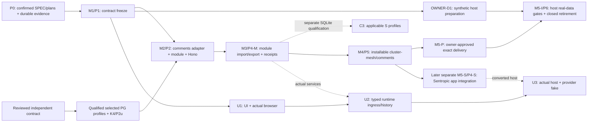

# Comments and annotations — two-lane delivery plan

**C0 ALIGNMENT — M1 is owner-closed at `2dabe25ce` (PR #663).** The [frozen-source alignment reference](../evidence/storage-alignment.md) governs this plan. Preserve M1 bytes and four reserves. The receipt does not attest manifest confirmation or host acknowledgement; M2 onward still needs qualification. Earlier P0/P1 promotion conditions are provenance.

## Authority, provenance and acceptance

This plan, [model branch template](BRANCH_P1_TEMPLATE.md) and [handoff](PLAN_HANDOFF.md) implement [SPEC §9.4](../../../spec/SPEC_EVOL_COMMENTS_ANNOTATIONS.md) under [TREAT2 and M2-DELTA's direct owner answers of 2026-10-11](../evidence/owner-decisions.md). [CONF2](../evidence/review-confirmations.md) confirmed the previous treatment with reservations; this revision treats MAJ-1 and m-A–m-I. CONF3 confirms the source SPEC c6d7a548d25746243b3904a20adea2d1b96360b3042445ba020a8204479ed967 with zero blocking, zero major and seven minor findings; see the [convergence receipt](../evidence/convergence.md). The earlier reviewed predecessor SPEC is `2e3083fc38ee5d9b3ca225823a794760245b6bc725321a4c802f77938c06463d`; the current prepared SPEC SHA-256 is **df6bea51d7c270f7f88602924ff68de7d90f24a58307b6b52d7093abd2f08b74**. Baseline HEAD is `dc95f7e4f88048e9671002827537cde4cb8149b7`, branch `spec/comments-annotations-port`. The previous plan `356f463a04668d7f4ed070a3e3a458684ab3b6e3da9a0e03179373cfe63c0880` is superseded; frozen sources and historical P0 dispositions are preserved, not reused as acceptance.

The owner's instruction is « j'autorise par défaut tout sauf question empêchant d'avancer ». **AUTH-M is supplied, conditionally effective:** the author treats every C6 and CONF2 finding; an identified Opus 5.5 max reviewer confirms the complete delta, dispositions and aligned SPEC/P/B/H on their resulting SHAs; convergence records predecessor and treated SHAs. “Passed” means GO or GO with reservations, no open BLOQUANT or MAJEUR due before M1. Disputed dispositions remain open. Any subsequent change receives affected-delta confirmation. Neither conductor nor i-cond arbitrates.

The M1 receipt records documentary anchor `90e7a9fd89c58178aa889d83dee7b1c3099f08ca`; preserve its ancestry and historical promotion evidence. Do not repeat P0/P1 authoring or claim missing host acknowledgement. Comments/interface maintainers still supply the exact manifest/receipt and erratum and record the required handoff. Later contract changes require review and acknowledged realignment. Actual delivery and M5-S integration keep their separate gates.

AUTH-M covers isolated synthetic implementation of P1/M1, P2/M2, P4-M/M3, P5/M4 candidate qualification and separately scoped P4-S/M5-S. U uses the default instruction with its own concrete scope after M1 freeze; no repeated AUTH-M, AUTH-U or STAGING-M vote is introduced solely for scheduling. Merge, publication, deployment, real-data handling and each real delivery remain owner-submitted with their concrete dossiers under OWNER-D2 and applicable operational authority.

| Work | Requested author / reviewer |
|---|---|
| SPEC, plan and contract-freeze convergence | Astra max; Opus 5.5 max confirmation review. |
| BUILD implementation | Vibe GLM 5.3 or Gemini 3.8 high; cross-review by the other. |
| Evidence recording | Preserve host, exact requested/declared model, effort, effective identity when verifiable, independence and reading limits. Metadata is resolved when available declarations, source hashes and unverifiable limits are recorded. AUTHOR-C6 declares Codex v0.162.1 / gpt-6-astra / max; CONF2 declares claude-opus-5-5 with requested max effort unverifiable by the reviewer, who also authored C6. AUTHOR-2E also records its own Codex v0.162.1 / gpt-6-astra / max header and final log digest; CONF3 declares the same reviewer model with requested max unverifiable and prior C6/CONF2 authorship. [Header evidence](../evidence/author-metadata.md) records their exact hashes and limits; no declaration is independent routing attestation. No agents launch in this task. |

**G2 a+c amendment, as qualified by frozen v4.1:** comments owns domain semantics and its frozen contract; cluster-mesh owns independent shared storage, reusable Postgres and module/API implementation. M2 consumes selected qualified PG profiles with K4/P2u roots active from C1a; C3 and live generations/Q remain separate. Preserve comments catalogue ownership, gated typing, one namespace and N/N-1 conformance. Immo composes its own full runtime/plugin with injected binding; M5-S and U remain separate. Cluster-mesh owns P lots; staffing and upstream plan amendments remain unverified.

**Eradication provenance:** the register's complete statements are « au passage prospect_notes doit être éradiqué merci, ton modele oublie de le proposer. faut éradiquer le modele légacy » and « prospect_note doit être éradiqué, et on devrait supprimer ce qui a été implémenté a date côté UI, ta proposition doit se faire sur la cible en supprimant ce qui a été fait n'importe comment a date assure moi l'invetaire d'éradication stp et planifie le ». Their spelling and punctuation are unchanged; register SHA-256: `4220358516eb87077568f33dcd6cfcc0e41dbd75a26fe5a82700de90e1e830fe`. On 2026-10-11 the owner's « Valider, citations exactes » answer through the conductor's AskUserQuestion validated the scope limited to `prospect_notes` and Immo's old notes system, exact quotation use and attribution of “sans conservation / no conservation” to i-cond. This supersedes the earlier relay-only provenance. Under the same TREAT2 answers, Immo's backups and their lifecycle are Immo's own domain and decision, outside this plan/SPEC. OWNER-D4 retains the conversion-report count for legacy rows not carried over. M2-DELTA removes backup/restore rehearsal from M2 and the path before Immo delivery; Sentropic's own cutover obligations remain only in the later separate P4-S track.

## Branch Scope Boundaries (MANDATORY)

This plan defines future work, not checkout permissions. The active branch's `BRANCH.md` supplies exact allowed/conditional paths. The earlier documentary promotion scope below is historical and does not authorize changes to frozen M1.

- **Allowed Paths (document scope)**:
  - `spec/SPEC_EVOL_COMMENTS_ANNOTATIONS.md`
  - `docs/comments-annotations/evidence/**`
  - `docs/comments-annotations/plan/**`
  - `BRANCH.md`
- **Forbidden Paths**: code, infrastructure, `.track/**`, `.gitignore`, frozen inputs/reviews/snapshots and original local plans.
- **Conditional Paths**: ignored `.h2a/SPEC_REVISION_LOG.md`, append only under BRCA-EX2; never staged.

Historical promotion was files-only. Current execution follows its separately authorized branch scope and Make-only validation; this plan asserts no new build, handoff or review result.

## Milestones, usable outputs and dependencies

P0/M1 are historical baselines. The remaining model path is **M2/C1/C2/M2-W → M3/C4/M3-S → M4-I candidate → M5-P delivery → M5-I adoption**. M2 entry requires the reviewed independent contract and selected qualified Postgres profiles (§17.5), exact assets and receipts. C3 qualifies SQLite separately; live generations/Q and optional restore witness R do not gate comments/Postgres. K/P maintainers record §18.1 plan amendments. Doubles remain preparation; no host-specific backend is assigned to Immo.

| Milestone / evidence ID | Work and exit evidence | What the receiver can do |
|---|---|---|
| M1 / P1 / E-M1-01–03 | Owner-closed manifest/receipt and unchanged corpus, with four reserves. | OWNER-D1 preparation still needs the exact-digest handoff evidence left unclaimed by the receipt; no runtime claim. |
| M2 / P2 / E-M2-01–03 | C1/C2/M2-W on selected qualified PG profiles; roots, exact-head reads, projections, operational lifecycle, package journal, registration and Hono API. | Full host runtime/plugin with injected storage/authority. C3/live/restore qualification remains separate. |
| M3 / P4-M / E-M3-01–03 | Comments-owned C4 transport/import/export and M3-S correction/submission/services on PG; atomic groups, recovery and histories above 512 KiB and 1 MiB. | Synthetic round trip and receipt reconciliation; no provider or Sentropic chat integration. C3 separately repeats applicable evidence on SQLite. |
| M4 / P5 candidate / E-M4-02 / V0-M | Installable `@sentropic/cluster-mesh/comments` candidate plus its comments contract dependency, clean exact archives/assets/lock and synthetic neutral-host acceptance using the same full runtime/module/plugin path and the digest-pinned packaged conformance oracle (`@sentropic/comments/conformance` is not an existing export). | Install the module directly in Immo independently of Sentropic conversion, UI, browser parity and chat ingress. |
| M5-S / P4-S / E-M4-01, E-M5S-01 | Later separate track: complete existing Sentropic consumers/forced UI adapters, authoritative tenant, public runner, control outbox, G4 source, guarded closed cutover and restore. | Sentropic readiness before its breaking main merge/activation; never a delivery dependency for Immo. |
| M5-P / P5 delivery / E-M5P-01 | Owner approves the exact frozen-package dossier; receiver retrieves and retains identical bytes with complete locked install/rebuild/restore receipts. | Install that approved package through the recorded access/direct-copy path; no main merge or registry publication is needed for candidate production. |
| M5-I / P6 / E-M5I-01–02 | Host-owned first-entry authority, HOST-D3 mapping/removal evidence, received hashes and source reconciliation, closed conversion/retirement and canonical recovery; Immo backups remain outside this plan/SPEC. | Real adoption only in the authorized target. Later source lots use canonical services; retirement is not postponed. |
| U / P3 / U1–U3, E-M3-04 / V0-U | New panel/drawing, actual-browser corpus execution, typed runtime send/ingress/message/job/history/provider binding and actual-host UI acceptance. | UI integration where chosen; Immo reuse is undecided and has no automatic V2 decision gate. |

V1 is each host's real-data readiness gate. Former V2 legacy retirement belongs to the same closed P6 switchover before reopening, not a later period of old/new coexistence. C is archive-capability activation under effective policy, independent of M1 vector freeze. HOST-D10 concerns evaluation/learning only unless a bounded dependency is demonstrated.

**V0-M:** installed comments/Postgres through the host's full runtime/plugin/HTTP path proves exact reload, pinned revisions, review/contest, preparation, lifecycle and complete long-history import/export. Replay C1a/C2/M2-W with `staged-units-v1` active and measure interactive-command contention. C3 is the separate SQLite qualification. UI/browser/chat ingress remain U.

**V0-U:** the actual mounted Sentropic host demonstrates box/circle drawing, save without AI, exact reload/history, comment/review and selected-revision submission through controller, host/default transport, chat-server ingress and durable message/job/history to a deterministic provider fake. Later edits, revocation, tombstone and retry cannot substitute latest. Browser hash parity belongs here, owned by chat-ui maintainers.

## Contract freeze and branch/CI topology

M1's frozen `contract-v1.json` and `freeze-receipt.md` already exist. They pin neutral adapter/HTTP declarations and the internal `packages/comments/tests/conformance/` corpus; they do not declare a packaged oracle or exact cluster-mesh registration/export mapping. C0 `storage-module-v1.json` separately records compatibility and unverified oracle packaging. Manifest confirmation and host acknowledgement remain as recorded in the receipt. C1/C2/M2-W and C4/M3-S preserve M1; M4-I qualifies the installed oracle after its separate packaging scope is selected. A new public contract/export needs version/review/acknowledged realignment.

Choose C6 M-3 option (a). **`feat/comments-annotations-model` starts from the exact LAST documentary promotion-series commit, accumulates P1/P2/P4-M and produces P5's candidate.** E22's workflow runs on push to main, PR targeting main or workflow_dispatch; within a triggered run, `packages/comments/**` selects API CI, which consumes it through `file:`; preserve the old API's exact signatures while adding canonical named exports. Inventory temporary exports and retain M1 adapter/HTTP declarations while recording M2-DELTA's new module export inventory. The one-model/one-router responsibility is the final post-P4-S state. During staging, implement the canonical API in `packages/cluster-mesh/src/hono/comments-router.ts`, mounted by the cluster-mesh plugin; preserve `packages/comments/src/hono.ts` signatures for the existing app. No translator, runtime switch, dual writer or old reader of canonical storage is added. Existing app regression tests exercise its unchanged old composition; neutral-host tests exercise only the new one. Both remain green; API CI is neither skipped nor waived. Lot 0 opens a draft PR targeting main, marked non-mergeable until P4-S and owner merge approval. Before the first source-changing PR CI evidence, select a working version on the reviewed breaking-minor line above the published registry version, update manifest/lock and satisfy enforce-package-bump. Recheck the registry comparison after any permitted rebase; this working version is neither published here nor M4's reserved candidate identity. PR open/synchronize events supply milestone CI; record the PR head and tested checkout SHA, and qualify candidate archives against the exact model commit.

M4 packs a clean identified commit on that model branch, with pinned base/parent and lockfile and completed model evidence. The archive may contain enumerated old exports; receiver qualification proves its canonical composition cannot reach them. The later separate **`feat/comments-annotations-sentropic`** track starts from that exact candidate commit, converts all existing consumers and removes temporary old exports/code/tests with canonical replacements before any breaking main merge, including `editThread(content, assignment)`; assignment cannot overwrite other authors' bodies. The new artifact has a distinct version/integrity and migration assessment; no candidate identity is reused. The model branch alone is not main-mergeable.

**`feat/comments-annotations-ui`** starts from the acknowledged M1 freeze with contract-conformant doubles and its own scope. Final U acceptance uses M3/M4 services and the actual converted Sentropic host; no reverse edge gates M4. Release maintainers on **`chore/comments-annotations-delivery` alone** own the candidate artifact job, workflow changes and delivery dossier. Scope that work separately; the model branch may change CI only for required neutral verification wiring, never duplicate the artifact job. Record the workflow revision and check out the exact qualified model commit for packing; no main merge/publication/deployment is a job side effect. CONF3 n-7 remains a delivery-maintainer obligation before P5/M4: name and qualify the actual branch workflow trigger without a main merge, recording workflow/run/source identity; do not presume branch pushes or off-default workflow_dispatch work. Until qualified, retain the separately authorized exact direct-copy route. Real handoff remains owner-submitted. Use repo-local `tmp/worktrees/<slug>`; create none here.

Lot 1 must align SPEC §4.6 before freeze: five count bounds typed in `units`, `paging: { defaultRecords: 50, cursorTtlSeconds: null }`, validated default/max, `specDigest` replaced by `specVersion`/`specSource`, reviewed and pinned micromark tokenizer with CommonMark 0.31.2 literal-region/mention vectors, and §7.2 fragment/root/receipt declarations. If a freeze was recorded meanwhile, version/review/acknowledge these changes through §9.1. This is planned code work, not a completed freeze.

## Contract requirements retained in both lanes

| Concern | Required model evidence | Later host/UI evidence |
|---|---|---|
| Records/history | SPEC §4.4's eleven closed record kinds, chain keys and typed links, plain discussions, different revision pins of the same annotation and immutable annotation primary resource identity. Mutable heads/tombstone projections are not hashed. Review chain is scoped per annotation across revisions; lifecycle and operation-audit events have separate chains. | UI separates discussion resolution from review; old validations remain attached to old hashes. |
| Structural revisions | Closed triggers: registration, explicit version rebinding, reanchoring, structural resource-association change preserving an annotation's primary identity; scope re-key creates linked new baselines. | Assignment, archive, replies and live-resource change alone cannot rebind a saved structure. |
| Scope/provenance/time | Opaque tenant/workspace hashes, observed/conversion/unknown source indicators, documentary actor versus registration/executor, unknown/gaps explicit; CommonMark descriptor, principal mentions, segmentation, profiles and numeric limits complete before freeze. | P4-S/P6 prove authoritative resolver/membership and reject shadow/alias before commands. Sentropic extracts timezone-free SQL values as text before driver Date coercion and proves process-timezone independence. |
| Hash/geometry | Pure independently checked server vectors; RFC 8785 UTF-8 SHA-256, record discriminator, no implicit NFC, code-point offsets, absence/null distinction, safe units. Decimal-string exact quantization to millionths, upward ties/negative zero; quantized box edges/collapse denial, complete non-square circle containment and crop/frame changes. Preserve every restored SPEC §4.4 corpus/behavior case. | PG reload parity in M2; actual browser in U. Draw/move/resize/remove/undo/redo/cancel, accessible keyboard/pointer/touch and immutable-frame reanchoring in U. |
| Authorization/G3/G4 | Unavailable targets, changed selection/capture, all-target access, expected-head CAS, unchanged/conflicting replay, denied or unconfigured authority with no effects; policy injection/default denial. Existing-review decisions bind exact hash; revision creation binds base/hash or absence/version plus proposed-content digest, never the future output hash. | Qualify current evidence and expiry/revocation; audit the human decision, optional agent proposal and executor/service/run separately. Default scope/admin flags never replace authenticated resource authority. Real policy values come from each host; synthetic fixtures are not defaults or Track/engram authority. |
| Import/export/receipts | Coherent units, typed annotation/discussion/review outcomes, partial batch snapshots, recovery, linked correction and copy/move without active validation transfer. Host-declared aggregate conversion report binds frozen inventory and arithmetic without per-exclusion details. | Frozen source = converted source units + authorized dispositions + count-only exclusions. Host attests source completeness; comments verifies declared arithmetic/results. |
| Lifecycle/events | Comments owns event meaning and operational tombstone/barrier semantics; intent/jobs require effective policy and purge authority. Kernel owns journal allocation, replay and checkpoints. | Package journal is the default. Sentropic's existing outbox is an optional qualified M5-S application binding. Immo backup lifecycle remains outside this plan. |
| Minimum scope | All five anchors, batch/export/correction and unitary preparation remain M requirements. Aggregate multi-annotation submission EX-I14 is outside baseline. | Automatic live DOM tracking, ellipses, rich dashboards and new native extension capture are separate extensions. No unproved support claim. |

## Implementation lots and file-level verification

Frozen v4.1 §17.4 controls the literal execution inventory; the [tracked reference](../evidence/storage-alignment.md) records its path aliases. Scope exact runners before BUILD and preserve old-app regressions. M1 files remain unchanged.

| Lot / owner concern | Files | Tests / exit evidence |
|---|---|---|
| M.A / M1 frozen baseline | Exact manifest source/export/corpus inventory, preserved byte-for-byte. | Replay unchanged server/hash/command corpus on PG in C1a. CommonMark and bounds remain carried qualifications; module settings/transport and installed oracle packaging are separate C0/C4/M4-I work. |
| M.B / M2 C1/C2/M2-W | §17.4 `src/comments/{index,descriptor,codecs,storage-adapter,transaction-context,request-context,storage-schema,queries,projections,postgres,lifecycle,coverage,purge,availability}.ts`, M2-W registry/compose/loader/integration/Hono paths, and PG comments projection assets. | `comments-{store,transactions,authority,queries,hashes,lifecycle,purge,coverage,module,router}.spec.ts`; PG frozen corpus, K2b denial case, roots, replay/CAS, query-only resync, conditional intent, service isolation and forged lifecycle refusal. P1/P2/P3 storage evidence uses `tests/storage/postgres-*.spec.ts`, `host-history.spec.ts` and `package-boundaries.spec.ts`. Existing modules/h2a suites remain green; no app/driver import or second migration history. |
| M.C / M3 C4/M3-S | §17.4 transport-contracts/fragment-codec/boundary-codec, import/receipts/import-bindings, export/export-boundaries/transfer, correction/submissions/services; `contract/transport-v1.json`. | `comments-{fragment-vectors,import,receipts,import-crashes,export,transfer,long-history,correction,submissions,services}.spec.ts`: PG bounded advancement, terminal completeness, recovery and atomic imported tombstone/barrier. C3 separately qualifies SQLite. |
| M.D / M4-I installed candidate | `tests/fixtures/comments-host/{package.json,package-lock.json,host.mjs}`, `evidence/installed-module.md`, exact archives/assets/lock and separately scoped packaged oracle. | `comments-{install,runtime-install,installed-roundtrip}.spec.ts`: installed PG/runtime/oracle, long-history round trip, C1a/C2/M2-W replay with staged units, contention, dependency closure and optional-peer cases. C3 owns `comments-sqlite-parity.spec.ts` separately. |
| S.A / later separate M5-S binding/conversion | API comments instance/PG adapter/namespace/ports/cutover; `tool-service.ts`, `context-comments.ts`, `comment-summary-mapper.ts`, existing discussion calls in `chat-service.ts`, queue seeding, streams/sinks/metrics, transfers; public schema/runner/extension and separately scoped retirement; control schema/outbox writer/dispatcher/migration. | Existing API `{comments,comments-wire,pg-comment-store,pg-notify-comment-event-sink,cluster-mesh-comments-cutover,workspaces,import-export,cluster-mesh-transfers-cutover}.test.ts`, queue `queue.test.ts`, AI `comment-assistant.test.ts`; new `annotations.test.ts`, `annotations-migration.test.ts`, `annotations-lifecycle.test.ts`, queue `annotation-comments.test.ts`. Tenant resolver, text-time extraction, all consumers, deployment/boot/fence/restore, poisoned event and durable cursor checks. Pin exact existing outbox test files at entry. |
| S.B / later separate M5-S existing UI | Chat-ui comments types/host/state/utils/index/panel as forced; app `comment-host-adapter.ts`, comment utils/counts/types, AppChatPanel and affected initiative/organization/folder/dashboard callers. | Existing chat-ui `comments-module.spec.ts`; app `ui/tests/chat/comment-adapter.test.ts`, `ui/tests/utils/{comments,comment-counts}.test.ts`, `ui/tests/components/chat/AppChatPanel-boundary.test.ts`; E2E `04-tenancy-workspaces.spec.ts`, `07_comment_assistant.spec.ts`. Preserve current navigation/count/assignment and canonical root tombstone behavior. Inventory deletion/blob/cascade paths before scoping; no new drawing prerequisite. |
| U.A / U1 panel/drawing/browser | Chat-ui comments/shell and `src/annotations/{index,types,state,geometry-transform}.ts`, `AnnotationOverlay.svelte`; initiative page/detail, AppChatPanel, `annotation-host-adapter.ts`, locales; actual capture paths after inventory. | Existing comments/documents/attachments/context suites; new chat-ui `annotation-state.spec.ts`, `annotation-overlay.dom.spec.ts`, `revision-hash.browser.spec.ts`, `fixtures/annotations/map-snapshot.ts`; app `annotation-host-adapter.test.ts`. Actual-browser executor owned by chat-ui maintainers; accessibility, non-square transforms, saved frames/reanchoring and real host capture. |
| U.B / U2 typed runtime | Chat-ui `chat-core-host.ts`, `chatLoopController.ts`, `transport.ts`; app chat adapter/AppChatPanel; chat-server parser, API chat namespace/provider/chat/history/queue persistence. Replace touched source imports with qualified exports; scope chat-core only if an exact dependency is demonstrated. | New chat-ui `annotation-send.spec.ts`, app `annotation-submission-adapter.test.ts`, chat-server `annotation-submissions.spec.ts`, API/queue `annotation-submissions.test.ts`; existing host/controller/transport, chat-server wire/ports/capability/roundtrip, API bootstrap/write-order suites. Exact receipt through actual ingress/message/job/history/provider fake with delayed revocation/retry. |
| U.C / U3 actual host/artifacts | `e2e/tests/07-comments-annotations.spec.ts`, chat-ui and changed backend manifests/locks/docs. | V0-U and `packages/chat-ui/tests/annotation-consumer.spec.ts`; clean Svelte mounting, coherent comments/chat-ui/backend versions, deterministic exact provider input. This gate closes U only. |

The reuse path remains `+layout.svelte → ChatWidget → ChatPanel → AppChatPanel → ChatPanelShell → CommentsPanel/createCommentState`. Preserve composer, mentions, assignment, navigation and teardown. `AttachmentBand`, `MessageAttachments`, `ImageLightbox` and context labels are rendering/navigation primitives, not existing drawing or immutable identity.

C4's explicit transport extensions are `prepareImportFragment`, `inspectPreparedImport`, `commitPreparedImport`, `prepareExportBoundary`, `continueExport`, `readExportFragments` and `recoverBatchReceipts`. They use separate versioned envelopes and preserve frozen DTO fields and `CanonicalCommandStore`.

## Migration, closure and recovery gates

C1b contributes PG projection assets at `packages/cluster-mesh/assets/storage/postgres/comments/{001-projections.sql,manifest.json}`. P2b-M/P3 qualify host-history attachment, checksums, predecessors, actual-schema reconciliation and crash resume under one host migration authority. Reusable backend code stays at `src/storage/postgres/`; no second runner/ledger. M2 proves PG canonical parity and root publication; C3 is separate. Preserve scheduling/conversion/scope lock order, offline preparation and host data authority. No mandatory restore witness or rehearsal gates Immo delivery.

For the later separate Sentropic P4-S track, the public Drizzle stream owns comments schema/conversion history; the existing control stream owns outbox infrastructure. Before main merge/restart, the operator must hold automatic deployment, record its approved release condition and establish robust disabled closure. API startup applies all pending public migrations: the first set must be schema-only. Deliver retirement separately only after common-service conversion and complete reconciliation under closure. Use separate scoped branches/artifacts to honor one public migration per branch; never hide an early DROP in generated DDL.

Missing/shadow/wrong-generation control state must fail closed through startup, requests, jobs, replica restarts and control restore. Disarm the legacy rollback checkpoint and inventory every mounted route/internal path before canonical activation. Remove all old model/adapters/direct SQL/AI/queue/event/transfer/lifecycle and forced UI paths while closed; no live fallback. Sentropic must rehearse backup/restore under Q4 and account for intervening writes; recovery after canonical writes is closed restore/reconversion or forward repair.

For the optional Sentropic M5-S outbox binding, qualify the same-log transaction contract and staged visibility. Outbox maintainers own durable allocation, ordered retry and poisoned-event recovery without skips. The default package journal already supplies generic replay/checkpoints; application outbox qualification cannot become an M2 dependency.

**OWNER-D4 conversion evidence:** legacy rows not carried over are counted in the hashed conversion report, with opaque frozen-inventory reference, admissible-manifest digest, host completeness attestation and disjoint source-unit equation. Excluded Immo rows yield no per-row ID/date/hash/receipt in manifests, receipts, logs or exports produced with comments tooling, and no quarantine or invented hold may bypass the owner-approved legacy eradication. This adds no Immo backup prescription. Immo's backups and their lifecycle are its own domain and decision, outside this plan/SPEC and reopening evidence. Sentropic's own rehearsal belongs only to the later separate P4-S track. M2-DELTA removes it from M2 and all pre-Immo-delivery gates; CONF3 n-6's separation of host responsibilities remains.

## Candidate delivery and compatibility

OWNER-D2 selects a frozen verified package independent of Sentropic's application. Propose a candidate-only Actions bundle or authorized exact direct copy; record actual source commit, workflow/run/attempt/artifact identity where applicable, archive/bundle integrity, lock and complete assets/dependencies. No workflow, access grant or download is claimed here. M4 neutral acceptance qualifies the exact archived cluster-mesh/comments module with its comments contract dependency; P4-S and U evidence cannot replace it.

Reserve a unique prerelease on the reviewed breaking-minor line with a byte identity that cannot be reused. Publishing/packing guards reject a reserved version at different integrity; a changed build gets a new identity. P4-S removal of temporary exports gets another versioned baseline. The receiver retains verified archives, dependencies and manifest independently of Actions expiry, installs with full resolved/integrity locks and rechecks at rebuild/restore. Withdrawal names the exact bad version/integrity, obtains receiver acknowledgement and supplies a new reviewed/qualified package plus linked conversion if needed.

ARCH-D11 is B with additive-preferred. ARCH-12 recommends a compatible optional executor parameter in a patch, with behavioral CHANGELOG, and forbids Drizzle/pg leakage into the generic surface. The comments transaction handle and HTTP DTO/ports remain driver-agnostic. M2-DELTA explicitly moves `/pg` storage and API implementation to cluster-mesh; qualify its adapter isolation and module export mapping without changing M1 contracts. Cluster-mesh retains its own README policy: additive minor, incompatible major, N/N-1 support. The comments model replacement still requires its reviewed breaking minor. Require strict-tier packed export/wire surface comparison, reviewed bump class, BREAKING changelog, migration note and clean pack/install proof at P5 and P4-S. Use SPEC §3's in-document `comments-migration-note-v1` template for `packages/comments/MIGRATION.md`; `plan/MIGRATION_TEMPLATE.md` is absent at HEAD. Current missing changelog/gate implementations are future work with exact scope, not claims of enforcement. Inspect registry versions before choosing real numbers and after rebases; dependencies use plain semver. Proposal for surface review: cluster-mesh declares `@sentropic/comments` in `peerDependencies` with `peerDependenciesMeta.optional: true`; enabled comments composition requires the reviewed compatible pair, while root/disabled modules work without it. Packed files include the shared storage track's registered migration assets, with comments extensions reviewed in that mechanism; existing `sideEffects` globs cover integrations/loaders/compose leaves. C0 separately declares the unverified digest-pinned packaged conformance oracle (`@sentropic/comments/conformance` is not an existing export per frozen L3a v4.1 §9.6/§17.4; export location and executable packaging are unverified); M4 verifies its emitted JS/types and required assets from the archive.

The compatibility matrix enumerates the comments contract, cluster-mesh/comments module/API/persistence/assets, installed chat-core/chat-ui, events and every contracts resolver, with ranges, exact resolution and integrity. No forced receiver UI upgrade for model import or unsafe deduplication. Contracts remains unchanged: assess the actual external-consumer trigger under ARCH-12 and record the applicable separate disposition, rather than presume graduation or exemption.

Before each actual delivery, present the owner the exact qualified manifest, retrieval/storage route, locked install/rebuild/restore proof, availability/withdrawal plan and effects. Receipt of identical durable bytes closes M5-P; model build success does not. A later registry source substitutes only with identical bytes/resolution; otherwise requalify a distinct version.

## Host policy and residual decisions

Frozen §17 assigns reusable Postgres to cluster-mesh, with engram and comments co-review. The [historical assignment question](../evidence/owner-decisions.md#question-owner) does not reopen that ownership. Staffing, upstream plan amendments and qualification receipts remain unverified.

| Future boundary / responsible role | Concrete dossier and what an uncovered answer settles |
|---|---|
| First real entry / host intake and data authority | Named source/target, scope, attribution and pre-registration redaction; settles permission to process those real records, including rehearsal. HOST-D3 is decided but needs implementation evidence. |
| Q3 / host review-policy authority | Capability/self-validation/quorum/contest/G4/archive-audience matrix using existing authority where available; any uncovered answer settles sensitive activation, not generic import or M1 vectors. |
| Q4 / host lifecycle authority | Canonical content/audit/capture/AI/export disposition, purge/holds, receipts and recovery. Sentropic's own backup lifecycle and cutover rehearsal apply only in the later separate P4-S track; Immo backups/lifecycle are outside this plan/SPEC and OWNER-D4 retains conversion counts. Any uncovered answer settles real lifecycle operation for that host. |
| OWNER-D2 / delivery and release operator | Exact dossier above, and separate merge/publication/deployment/cutover effects; settles that named action, not a standing approval. |
| Immo UI / host product owner, only when a concrete scope depends on it | Actual surface needs and available U evidence; choose shared panel, independent UI on the common model or hybrid if needed. No automatic V2 question or injection gate. |

## Execution discipline and measurement

During authorized BUILD, use Make with RTK and ENV last, isolated test environments and exact assigned ports. Sequence local Docker builds; record processing and waiting separately. Historical documentation-only launch restrictions do not define future implementation scope.

Run harness branch checks before work and scope-check before every future commit. Preserve the documentary anchor through P4-S; rebase references below apply only to implementation-only rebases preserving its ancestry. Split logical changes into commits under 150 changed lines and at most 10–15 files, stage named paths then call make commit separately. One integrating writer owns each shared contract/schema/manifest/lock; use reviewed types on disjoint branches and rebase, never cherry-pick or partial main delivery.

Inspect existing Make recipes (`test-comments`, `typecheck-comments`, `pack-comments`, package/API/UI/E2E targets and lock/clean-install targets). Scope missing neutral PG/HTTP/archive runner wiring in M; actual-browser/chat-server/new UI runner work belongs to U; Sentropic runner/outbox/old-consumer regression scope belongs to S. Conditional infrastructure paths require a concrete BRxx-EXn with reason, impact and rollback; no default CI rewrite. Run affected checks, resolve failures and repeat only for changes or unresolved concerns. No timeout inflation or AI-flaky waiver substitutes for deterministic contract proof.

No measured calendar forecast is supplied. Record agent active wall intervals/rework, local build-slot wait, machine/CI processing, operator gestures and external authorization/data waits separately. Recalibrate at contract freeze, PG/API proof, independent candidate install, Sentropic consumer/cutover proof and U actual-host acceptance. Parallelism is not a divisor of effort.
