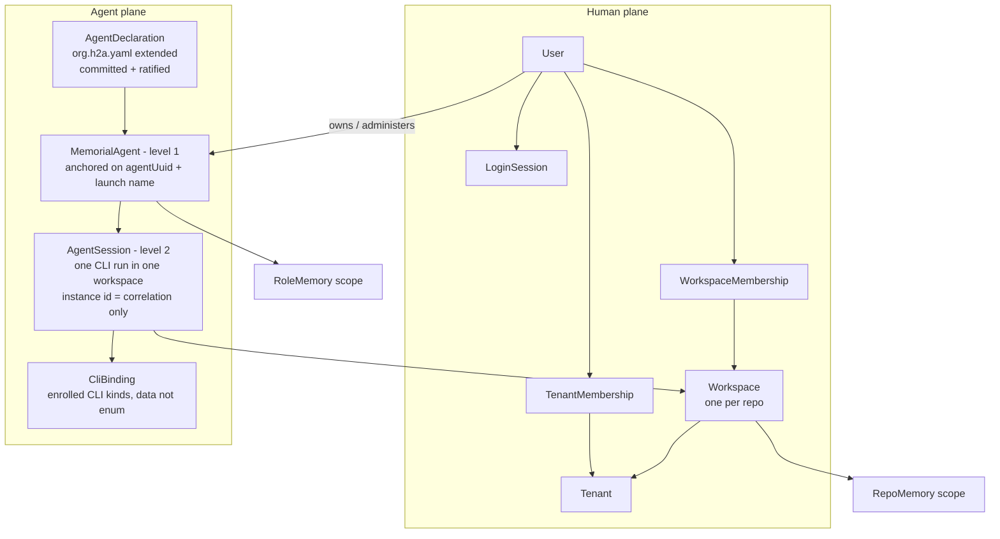

# Cluster-Mesh Identity and Agents — Evolution Specification (draft, revision r2)

Status: **draft for owner review, revision r2**. Predecessor: r1, SHA-256
`be5d45741d13180b9dbc460416e5d566d423aa711e061d9771fef974ef8c6bd0` (the hash all
three r1 reviews verify, §0.2). This document specifies a target; it claims no
implementation, runtime qualification, review approval or release for any part of
it. English is the document language; §10 (remaining owner questions) is in plain
French. No time or effort estimate appears anywhere; the only durations named are
frozen producer protocol bounds. §12 maps every finding of the three r1 reviews to
the sections that close it.

## 0. Authority, evidence and reading conventions

### 0.1 Binding owner direction

Binding input: owner record of 2026-10-30, `owner-answers-20261030.md`, SHA-256
`b53b6e189b18d2002db456655e7348edbac214dd05302fa05b43b1b4f446e606`. It is never
reinterpreted; extensions of it are labelled as extensions.

| # | Owner answer (normalised) | Applied |
|---|---|---|
| Q1 | Rights are rechecked at every memory call. | §2.7, §6.2, ID-INV-07 |
| Q2 | The local memory service authenticates through a cluster-mesh **agent auth**. | §2.5, §6.1, §6.2 |
| Q3 | The memory-host layer is carried **locally by cluster-mesh**. | §2.9, §6.1 |
| Q4 | The local service registry (rights/keys) lives **in cluster-mesh**. | §2.8, §6.1 |
| Q5 | Authorisation is per **h2a agent (role)** at the first level, not per CLI. Cluster-mesh keeps the sessions and manages the agent associations above them. | §2.4, §2.6 |
| Q6 | Local storage is **SQLite**. | §2.9, §6.3 |
| Q7/Q8 | « Effacer sans 2fa mais avec une escalade (demande a l utilisateur). Tracabilité requise » — forget/withdraw without 2FA, through an escalation to the user, traceability required. | §7 |
| Q9 | Access goes through the h2a role. The h2a roles become an integral part of cluster-mesh **as agents**: bound to one or more CLIs, with role memory + repo memory, owner-manageable through cluster-mesh, framed by h2a. | §2.4, §2.5, §8 |
| Q10 | Spaces are per repo. Codex and Claude are CLIs, not agents. By default every workspace can use every CLI. Authorised agents are those **declared and committed in each project** (« déclarés commité »). Two agent levels — role/memorial (same role across sessions, CLIs, efforts) and session/CLI — both carry ids. h2a controls the first authorisation level (which role may use which CLIs, models, MCP rights); Sentropic/cluster-mesh associates both levels and enforces authorisations at both, including a pass-through or general CLI-level policy without an h2a role. | §2.3, §2.4, §2.6 |
| Q11 | On any relevant change, the tool catalogue is **invalidated immediately**. | §2.7, ID-INV-09 |
| App | « Je vois pas comment app peut fonctionner sans que cluster mesh gere utilisateurs workspaces et roles agents h2a » — cluster-mesh takes 100 % of user management for the app; h2a agents use the Sentropic agentic frame even when running in a CLI. | §1, §5, §8 |

Two readings are **labelled spec extensions**, not verbatim owner statements: (i)
Q1 answers for *memory* calls; §2.7/F15 generalise the per-call recheck to every
actionable call because one decision producer serves both planes. (ii) Q6 answers
for *memory* storage; §2.9 extends SQLite to the local identity stores so the
local placement runs one storage profile. Neither extension weakens the verbatim
answer in its own domain.

One ordering input is **not** owner wording and is not presented as such: the r2
authoring packet directs that a local single-owner slice deliver memory through
the agent runtime **before** the hosted milestones (memory in agents is the
priority). §9 is ordered accordingly.

The relayed owner request on Sentropic artifacts / decision dossiers through
cluster-mesh (same record) is related, not core scope: §9.4 states the
reconciliation with the artifacts specification; artifact delivery stays there.

### 0.2 Evidence pins

| Input | Exact identity used |
|---|---|
| App user-management gap (functions with `file:line`) | `.tmp/app-cm-users/gap.fr.md`, SHA-256 `854e1d2096a8214ac601f925dbc11b4b44f475ec34dfe9d99b0f8d5519521891` |
| Memory host-composition spec r3 (“host spec r3”) | `.tmp/memory-host-composition/spec.md`, SHA-256 `e5e112b9d982b63d267ecfdc209c26e096b60190ac058960bc5ddd5251cce182` |
| SQLite canonical-memory plan r3 (“SQLite plan r3”) | `.tmp/memory-sqlite/plan.md`, SHA-256 `60de35bc74971526095805eec4041d5691bc12b08debeb44da30bb0b859735ea` |
| Engram producer issuance contract (“IC”) | `/home/antoinefa/src/graphify/.graphify/scratch/design/memory-skill/PRODUCER-ISSUANCE-CONTRACT.md`, SHA-256 `1e8331af54d826dff92625cb9bdb6b8de9fd4c42622280a49380dafa7e5f76cf` |
| Cluster-mesh federation spec r3 | `.tmp/cm-federation/SPEC_EVOL_CLUSTER_MESH_FEDERATION.draft.md`, SHA-256 `e46cfcc3479979f540ff65244f42b153a8a116c90e63778db1c70f1325f98d9e` |
| Central control-plane spec (r13 line) | `spec/SPEC_EVOL_CLUSTER_MESH_CENTRAL_CONTROL_PLANE.md` on `origin/main` (absent from the r1 authoring checkout), blob SHA-256 `93e9847fc10a9160ac33fe5c5a0d61fc26f22b5b567f49ea05a313f87fc64685`, 527 lines |
| Code baseline (sentropic) | `origin/main` = `1178e9c76644bda7ab9c9959cef098d23d10e588` (2026-10-30), `@sentropic/cluster-mesh` 0.24.0. All unprefixed `file:line` anchors refer to this baseline unless a branch is named; r2 does not silently re-baseline them. |
| App replan | `.tmp/app-switch-week/plan-v2.md`, SHA-256 `cf681ae4308184e050b46d092083d155c551c46b9cd88c765b3819b36950596f` (W4.a at its line 146) |
| App integration PR | [PR #837](https://github.com/rhanka/sentropic/pull/837) `feat/app-cm-integration`. Observed at r1 authoring: OPEN, mergeable `CONFLICTING`, head `10d289560bfe76e79ab796960d0bef0fdfdaf5c8`; PR body still named head `95a92bc3…`. Observations, not merge-time facts. |
| h2a role frame | `spec/SPEC_EVOL_H2A_ROLES_SCOPES.md` (RATIFIED 2026-07-14) and `spec/SPEC_DECISION_ROLE_STRUCTURE_H2A.md` (RATIFIED 2026-06-11), both in the **sentropic** repository on `origin/main`. The h2a repository has no `spec/` tree for these; its root carries `SPEC.md`. |
| r1 reviews closed by r2 (§12) | Muse Wonder review `.h2a/reviews/cm-identity-agents_muse_r1.md`, SHA-256 `896759eea561299eaba3486fd95be47388ff7816ea88845427a8cc7cd309851a` (required changes 1–6, cited **MU-1…MU-6**); cross-review `/home/antoinefa/src/h2a/tmp/h-cond/rv-cmid-w-last.md`, SHA-256 `5f423d88d1276913b45b6f1453ba643e0116c9b9d9ff11552213f90851feb242` (items **W-P1/P2/P3**); cross-review `/home/antoinefa/src/h2a/tmp/h-cond/rv-cmid-s-last.md`, SHA-256 `5556e2eb9ba4ec20a0ffc3099b04d1a560833f9d838e8ccfb39d2d0973c118ba` (items **S-P1/P2/P3**). All three verify the r1 hash above. |
| Artifacts specification r2 (junction §9.4) | `/home/antoinefa/src/h2a/tmp/h-cond/spec-artifacts-cm-w.md`, SHA-256 `c1850a26bfe8b3e99ebb2da0f4fd00676276567bef78b9a07cd18b188fbdb0bc`. It pins this spec's r1 hash; §9.4 asks it to re-pin r2. |
| Memory consumer-context analysis (blocker-3 vectors) | `.tmp/memory-mcp-builtin/consumer-context.md`, SHA-256 `4e471f0a3359e5d7027c55048b478ee0f59604d1987ad363ded0b889b9a229a5` |
| #354 blocker list (numbering source, §8.2) | `/home/antoinefa/src/h2a/tmp/h-cond/mem-l2-r3-last.md`, SHA-256 `39b685f506120ee750c1dcf630f8c6b863810cee2ce41edc732ebbe2988d33f0` (« Bloqueurs producteur » 1–4). Lane heads recorded there: h2a [PR #354](https://github.com/rhanka/h2a/pull/354); sentropic [PR #844](https://github.com/rhanka/sentropic/pull/844) at `44dd0102d28cc399cd5c360599142c8e45a6acf3`. Observations, not merge-time facts. |
| h2a code anchors | Cited as `H:…` at symbol level (no line number), from the cross-reviews' h2a snapshot (`d7707fdc9` per the artifacts spec §0) so they stay findable if a line moved. Exact h2a commit is re-pinned at M0. |

**Authoring-copy discrepancy, recorded.** The working copy handed to r2 at
`.tmp/cm-identity-agents/r1.md` hashes `8e47f84b…` at r2 authoring and already
self-describes as “revision r2”; it is not byte-identical to the reviewed r1
(`be5d4574…`). This revision closes the three reviews against the reviewed r1
content; where the working copy already contained a correction, r2 retains it
only after checking it against the finding (§12). No claim in r2 depends on the
working copy's hash.

### 0.3 Reading conventions

- **CURRENT** = verified on a pinned baseline at the cited anchor. **TARGET** =
  required by this spec; not implemented unless a CURRENT anchor says so.
  **Source-gap** = evidence needed to decide was not in the pinned inputs.
- A named port, table, file or route in a TARGET paragraph is a contract locator,
  not a claim that the file exists.
- “Agent” never means a CLI. A CLI never carries an identity of its own (Q10).
- `H:` anchors name files in the h2a repository under `packages/h2a/src/…`
  unless a fuller path is given; unprefixed anchors are sentropic-side.
- Statements depending on an unanswered §10 question are marked
  **conditional (Q-x)** inline, and the body assumes the §10 default. The body
  never pre-decides a §10 question silently.
- “Activation” of an agent means the mechanical result of a verified, ratified
  declaration import (§2.4). It is never a second approval act.

### 0.4 One counting discrepancy, resolved here

The original authoring packet says “the 14 missing cluster-mesh functions”. The
pinned gap document enumerates **15** numbered functions in its §4. This spec
covers all 15, numbered `F01`–`F15` in the gap document's order (§5). Dropping
one to match the packet's count would silently under-specify the 100 % target.

## 1. Objective, non-goals and relation to the r13 line

**Objective.** `@sentropic/cluster-mesh` becomes the single owner of identity for
the app **and** the agentic layer: human users, tenants, per-repo workspaces,
both membership levels, roles, login sessions, agents at both id levels, CLI
bindings, and the authorisation decision produced fresh for every request. The
app keeps business data only (documents, chats, dossiers). The same model runs
in two placements:

- **Hosted** (app at `sentropic.sent-tech.ca`): one cluster-mesh composition on
  PostgreSQL through the existing cluster-mesh storage.
- **Local** (one owner's workstation, delivered first, §9 L-slice): one local
  cluster-mesh instance on SQLite, carrying the memory-host layer (agent auth,
  ownership attestation, rights/key registry) per Q2/Q3/Q4/Q6.

**Non-goals.** No second memory engine (engram keeps canonical memory semantics;
r13 D8 stands). No provider secret, OAuth token, private key or connector
credential enters the identity stores — only key *bindings* and public
verification material (§2.8). No h2a protocol redesign: h2a keeps collaboration
semantics and remains the framing authority for roles (§8); this spec asks h2a
for exposed contracts, not new collaboration semantics — the one deliberate
exception is the *new authorisation vocabulary* of §2.6/§8.1 H1, named as new
h2a work. No federation delivery (§9 hosted M5 fixes identity objects only). No
artifact or dossier delivery (§9.4). No permanent dual writer, dual route or
compatibility fallback after any cutover (r13 D11; COMMON-RULES).

**Amendment to r13, made explicit.** r13 states that existing public domain
tables remain authoritative for auth and that `packages/cluster-mesh` “owns no
application persistence”. For **identity data only**, this spec supersedes both:
identity records get cluster-mesh-owned stores (§2.9), migrated once from the app
tables, after which the app tables and the app-implemented membership port are
deleted (§5). D1=B is preserved: provider packages still never import
`@sentropic/cluster-mesh`; they consume the neutral `VerifiedInvocationContext`
(§3). What changes is who *produces* that context and who owns its records.

**Disposition of the r13 single-migration rule.** r13 allows one migration
(`api/drizzle/control/0007_cluster_mesh_r13.sql`) and no migration generated
after it is accepted; later lots must reuse existing domain tables or stop as a
source-gap (r13 lines 46, 287–301). The §2.9 identity stores **do not fit that
rule**: `0007` exists on the baseline followed by later control migrations, so
folding identity tables into `0007` before acceptance is not available. The
disposition is a **formal amendment of the r13 rule limited to the identity
domain**: exactly one identity migration per storage profile (hosted PostgreSQL
control schema; local SQLite schema set) under the r13 D11 protocol, and no
other lot may cite this amendment to add a table. M0 (§9) must prove this on the
exact baseline: `0007` accepted state, migration rehearsed on an isolated copy
with id-preserving row proof, and the **D11 rollback checkpoint recorded before
any legacy identity table is deleted**. If that proof instead shows the records
fitting an existing not-yet-accepted migration at merge time, the amendment is
withdrawn in favour of that fit and §12 records the switch. Silently adding
tables under either reading is forbidden.

## 2. Target model

### 2.1 Entity map



### 2.2 Human plane: users, tenants, memberships

| Entity | Identity and lifecycle (TARGET) | CURRENT app anchor (replaced, §5) |
|---|---|---|
| `User` | One account per person; globally unique email; `accountStatus` includes `pending_admin_approval`; global role `admin_app\|admin_org\|editor\|guest`. | `api/src/db/schema.ts:147-161`; `api/src/middleware/rbac.ts:12-13` |
| `IdentityProof` | WebAuthn credentials/challenges, email codes, magic links, social federation links (`identities`). Proofs authenticate; they never authorise by themselves. | `api/src/db/schema.ts:169-270` |
| `Tenant` | Organisation; immutable slug is the `tid` source; status `active\|suspended\|offboarded`. | `api/src/db/schema.ts:880-888` |
| `TenantMembership` | One row per (user, tenant); status `invited\|requested\|approved\|rejected\|suspended`; tenant role `member\|admin`; decision carries author + timestamp. The **second approval**, distinct from account approval. | `api/src/db/schema.ts:892-916`; `api/src/services/auth/tenant-membership.ts:90-186` |
| `Invitation` | Single-use `sit_` token consumed atomically at registration; email proof + device enrolment input. | `api/src/db/schema.ts:245-259` |
| `LoginSession` | Issued/validated/refreshed/revoked login session (cookie/token, MFA state). Distinct from any agent, conversation or PTY session (§2.7). | `api/src/db/schema.ts:186-203`; `api/src/services/session-manager.ts:98,157,426` |

Invariant carried over: tenant identity (`tid`) derives **only** from an approved
tenant membership, never from a caller-supplied workspace id or parameter
(CURRENT: `packages/cluster-mesh/src/boundaries.ts:39-65`,
`api/src/db/schema.ts:876-879`). What changes is the record owner: cluster-mesh
reads its own store instead of an app-injected port.

### 2.3 Workspaces: one space per repo; workspace-id mapping

TARGET (Q10). A `Workspace` is the per-repo space:

- `workspaceId`: opaque, allocated by cluster-mesh at enrolment. The deterministic
  reference `ws:sha256:<digest>` (CURRENT `deriveWorkspaceReference`,
  `packages/cluster-mesh/src/boundaries.ts:33-37`) remains the external form.
- `repoIdentity`: approved canonical repository identity (normalised remote set +
  approved filesystem aliases). A path, directory name or `ws:` hash is a
  discovery hint, never the identity (federation spec §5.1 rule).
- **Uniqueness.** At most one workspace per (**tenant × placement × canonical
  `repoIdentity`**). Enrolling the same repo again creates nothing: stable
  conflict `workspace_already_enrolled` returning the existing `workspaceId`.
  Clones and linked worktrees reach that one workspace only through an **approved
  alias** on the existing record (verified mapping, F08); path resemblance maps
  nothing. Pre-existing duplicates: M0 inventories them; each duplicate set merges
  into the earliest-created workspace id (memberships, agent activation records
  and memory-scope bindings repointed, every repoint audited) and the emptied
  records are deleted in the same lot. No duplicate survives a milestone boundary.
- `tenantId`: exactly one owning tenant; inherited by every membership, agent
  session and memory scope under the workspace; rechecked, never re-derived.
- `WorkspaceMembership`: per (user, workspace) `viewer|commenter|editor|admin`;
  creator becomes `admin` (CURRENT semantics `api/src/db/schema.ts:858-871`).
- CLI access: **by default a workspace may use every enrolled CLI** (Q10). Any
  restriction is an explicit policy record (§2.6), never an absence side effect.

Three workspace ids exist and are never substituted for each other:

| Id | Derivation | Portability | Role |
|---|---|---|---|
| cluster-mesh `workspaceId` (+ `ws:sha256:` reference) | Allocated at enrolment; bound to canonical `repoIdentity` | Portable | **Authoritative** in every cluster-mesh record, decision, audit entry, memory binding and federation link |
| h2a workspace id `ws:<uuid>` | `deriveWorkspaceId`: SHA-256 over `machineId ‖ realpath`, UUID-shaped (CURRENT `H:identity.ts`) | **Not portable by design** (machine salt): same repo, two machines or two checkouts ⇒ two ids | Machine-local grouping only: presence, conductor resolution, inbox routing on that machine |
| h2a durable workspace id `ws:<sha256hex>` | `computeDurableWorkspaceId` over root-commit set + worktree name (CURRENT `H:runtime/identity/workspace-id.ts`) | Portable across clones/machines | *Hint* for proposing a mapping; never the presence ref, never an authority |

**Mapping contract (TARGET).** The local cluster-mesh instance owns a
`WorkspaceIdMapping` record per (**machine, h2a `ws:<uuid>`**) → cluster-mesh
`workspaceId`, created only when the checkout's verified `repoIdentity` equals
the enrolled workspace's (durable id and realpath are proposal inputs, never
proof). One cluster-mesh workspace may accumulate several h2a ids (per
machine/checkout); one (machine, h2a id) maps to at most one cluster-mesh
workspace — a second mapping to a different workspace is a conflict requiring
owner recording, never an overwrite. Presence, conductor claims and inbox
records keep carrying the **h2a id** (machine-local liveness); once mapped they
*additionally* carry the cluster-mesh `workspaceId` as correlation. Cluster-mesh
decisions, audit and memory bindings carry **only** the cluster-mesh id (h2a id,
if present, as correlation). An unmapped h2a workspace id authorises nothing
cluster-mesh-side: level-2 opening under it refuses until the repo is enrolled
and mapped (§2.4 seam 1).

Existing app workspaces without a repo identity are a migration case, not a
second workspace kind: bound to a repo identity at migration or explicitly
recorded repo-less (§10 Q-A), with no agents and no repo memory while repo-less.

### 2.4 Agent plane: two id levels

**Level 1 — `MemorialAgent` (the h2a role as a cluster-mesh agent).**

- Id `agent:<stable-id>`, allocated once, stable across sessions, CLIs, models
  and efforts (Q10).
- **Anchor: the h2a perennial identity — `agentUuid` + launch-name binding —
  never the per-conversation instance id.** CURRENT facts: an h2a instance id
  (`host:label:uuid12`) is minted per conversation and the durable actor handle
  is its launch name (`H:org.h2a.yaml` header, “WHY `instance:` CARRIES A BARE
  NAME”); the perennial identity is `agentUuid`, reclaimed across conversations
  only with proof-of-possession of the bound ed25519 key (CURRENT
  `H:runtime/identity/bindings.ts`: `H2AIdentityBinding.agentUuid`,
  `findBinding`, `reclaimOrMint`). TARGET record fields: `memorialAgentId`,
  `agentUuid`, `launchName` (durable `h2a run --name`), org actor key (§2.6),
  key-set revision (H2/H4), association revision. A conversation's instance id
  is **level-2 correlation** (§3); two conversations reclaiming one `agentUuid`
  are two level-2 sessions of one memorial agent; a conversation that cannot
  prove possession mints a different identity h2a-side and cannot attach here.
- It **is** an h2a role made integral to cluster-mesh (Q9): it references the
  **org actor + scope** (h2a remains framing authority, §8) and the key identity
  acting for it. A scope never signs; a mandated instance signs
  (`SPEC_DECISION_ROLE_STRUCTURE_H2A.md` §2, sentropic repository).
- Owned/administered by exactly one `User` in exactly one tenant
  (**conditional (Q-B)**, default applied); the owner manages it through
  cluster-mesh (create, bind, suspend, offboard, rotate keys) — Q9.
- Carries: key set (h2a NHI, §2.8), role-memory binding (§2.5), purpose grants
  (§6.2), H1 policy reference (§2.6). The engram `agent_id` for every memory
  call under this agent is the `memorialAgentId`; `agentUuid` is carried in the
  association record and the connection-proof preimage (§6.2), never substituted
  for `agent_id`.
- **Estate migration.** M0 inventories h2a bindings/registrations
  (`H:runtime/identity/bindings.ts` `listBindings`, local-files store): one
  `MemorialAgent` per distinct `agentUuid` carrying a launch-name binding.
  Registrations without a perennial binding, and launch names claimed by two
  `agentUuid`s, go to an owner resolution queue — **never auto-merged**. Until
  resolved, an entry has no level-1 record and runs only under pass-through
  (§2.6) where a recorded policy exists.
- Lifecycle `declared → enrolled → active ⇄ suspended → offboarded`;
  `offboarded` is terminal and triggers F14. Existing h2a NHI offboard semantics
  are reused (CURRENT seam `packages/cluster-mesh/src/nhi.ts:13-33`).

**Level 2 — `AgentSession` (one CLI run).**

- Id `agent-session:<id>`, distinct from the level-1 id, the h2a instance id,
  any CLI-native conversation id and any SDK session id (correlation data only,
  as in host spec r3 §2). Binds: one `MemorialAgent` (or none — pass-through),
  one `Workspace`, one `CliBinding` (CLI kind + model + effort + client
  enrolment), the h2a instance id and `agentUuid` proven for this conversation,
  one runtime registration (generation, custody, PTY reference per r13),
  association revision, validity window.
- Cluster-mesh **keeps the sessions and manages the associations** (Q5): opening
  requires a live level-1 association check; suspending level 1 invalidates its
  level-2 sessions at the next call boundary (§2.7).
- **Execution seams (normative).** Cluster-mesh authors the level-2 record; the
  h2a runtime spawns. (1) **Before spawn:** the runtime runs a launch-authorisation
  check. CURRENT `H:runtime/governance/launch-check.ts` is a read-only conductor
  launch *recommendation* (“h2a does NOT spawn anything”); it performs no
  authorisation and must not be silently overloaded. TARGET: that module gains a
  distinct exported launch-authorisation check (exact export name frozen at M0
  with the h2a lane) which asks the local cluster-mesh instance for a decision
  over a **typed port using published contract types only** — the runtime never
  imports cluster-mesh internals (D1=B). Refusal (agent not active, not
  ratified-declared in this workspace, workspace unmapped, CLI/model/effort
  outside the H1 ceiling, policy unavailable) means **no process spawns** and no
  level-2 record opens. (2) On an allowing decision cluster-mesh opens the
  `AgentSession` and returns its id + association revision; only then does
  `h2a run` spawn. Presence (CURRENT `H:runtime/mcp/sessions.ts`) is liveness
  evidence written by the runtime; it never opens, extends or resurrects a
  level-2 record. (3) **Per call:** the daemon dispatch seam (on the #354 lane,
  `participant.call` in `runtime/mcp-central.ts`) receives the F15 allowed tool
  set + `policyRevision` for that call and refuses an out-of-set tool **in the
  daemon, before any provider dispatch**, consuming the decision through the
  typed contract without importing cluster-mesh internals or recomputing
  identity (§4.1). This depends explicitly on the #354 lane merging; H3 evidence
  exists only on that lane, not on h2a `origin/main` (no `mcp-central-*` modules
  there at r2 authoring). (4) Closing: process exit, owner/cluster-mesh close,
  or F14 cascade closes the record; presence expiry marks liveness stale and the
  next call refuses, but cluster-mesh closes the audit record.
- The CLI is a replaceable executor; CLI kinds are **enrolment data, not a
  closed enum in this spec**. CURRENT `h2a run` executor shortcuts on h2a
  `origin/main` cover more kinds than the central-attachment hosts (for example
  codex, claude, agy, gemini, mistral, vibe, opencode and shell at
  `H:cli-command-map.ts` `RUNTIME_VERBS`, and additionally enrolled kinds) — this
  spec asserts no exhaustive list; M0 reads the set as enrolment data. Only the
  central-attachment subset (`SUPPORTED_CENTRAL_HOSTS` = claude, codex, agy,
  muse, vibe on the #354 lane) can carry H3 admission evidence and therefore
  memory. An `AgentSession` outside central attachment records
  `attachment: 'none'` and its posture is explicit: catalogue and memory surfaces
  requiring verified attachment are **unavailable** for that session, never
  silently downgraded. One memorial agent may run under several CLIs over time;
  concurrent level-2 sessions are distinct records.
- **Sub-agents.** An h2a sub-agent (`<parentInstance>~<name>`, capability subset
  of its parent, CURRENT `H:subagents.ts` `capabilities-exceed-parent`) is an
  executor **under** the parent's level-2 session: no level-1 record, no level-2
  record, no key identity of its own. Its calls run under the parent
  `AgentSession` inside the parent capability ceiling, sub-agent address as
  audit correlation. Memory **purpose is not inherited automatically**: a grant
  names whether sub-agent execution may use it; absent explicit allowance,
  sub-agent memory calls refuse `purpose_not_granted` while parent calls proceed.

**Declaration in the project (Q10) — `org.h2a.yaml` extended, never a parallel
declaration.** An agent is authorised in a workspace only if declared and
committed in that project. h2a already has the committed org manifest with
`validateOrgManifest` (CURRENT `H:org.ts`, `H:org-parse.ts`, manifest at the h2a
repo root) and a propose/ratify lifecycle (coach propose → PRINCIPAL
`org-ratified`). TARGET is a **versioned schema extension of that manifest**:
per org actor, the memorial-agent declaration fields (launch name, `agentUuid`
enrolment reference or enrolment request, org actor key + scopes, H1 policy
reference, memory scopes requested, declaring owner). No second declaration
format is created; a project without `org.h2a.yaml` adopts that file. The exact
schema delta is frozen and co-signed at M0 (§10 Q-C records this with its
default; there is no “new file” alternative left open in the body).

Ratification is the approval, and a measured gap must close: the manifest header
records that `h2a org provision` today accepts any file passing
`validateOrgManifest` **without checking ratification** (`H:org.h2a.yaml`
header). Under this spec that is a defect on the critical path: cluster-mesh
import **refuses an unratified manifest** (no valid `org-ratified` signature by
the PRINCIPAL key, verified through H2), and closing the h2a-side provision
check is a named M0/L1 deliverable (§8, §9). **No approval beyond Q10:** r1 added
a second cluster-mesh-side owner approval; Q10 states none, so r2 removes it
everywhere (model, milestones, invariants, §10 Q-C). Import is mechanical:
verify ratification, key bindings (H2/H4) and workspace identity, then activate
exactly what the ratified manifest declares. No approval step, screen or queue
may be interposed as a grant condition. Anti-spoofing rests on the ratification
signature + key proof-of-possession + repo-identity mapping: an unsigned or
unratified edit still creates no rights (host spec r3 §2 rule kept), and
removing an actor from the ratified manifest suspends that agent at re-import.
A declaration names org actors (bare launch names), never a per-conversation
instance id.

### 2.5 Memory bindings: role memory + repo memory

Two engram scope kinds, each scope instance its own canonical store (`store_id`
↔ one scope, SQLite plan r3 §4):

| Scope | End-state binding (**conditional (Q-I)**, default applied) | Authorisable to |
|---|---|---|
| Role memory | (tenant, memorial agent) — one store, used from any workspace where the agent is active | That agent's sessions, under a purpose grant naming the scope |
| Repo memory | (tenant, workspace) | Any memorial agent active in that workspace, under a purpose grant naming the scope; humans only through owner administration, never through an agent surface |

**Qualification restriction.** The end-state role-memory binding does not yet fit
the producer/host scope model: host spec r3 binds an immutable
tenant/workspace/store/scope tuple (§3.1 `scopeBinding`), and the producer local
profile treats storage scope as a tenant/workspace pair (IC local-profile
decision 2). An agent-dimension scope is therefore **unclassified** today.
Required item **R4-13** (§6.4) classifies it — tuple carrying, plan compilation,
concurrent-open fencing — with acceptance: *write role memory in repo A, read the
same store in repo B, store/scope bijection and fencing intact.* Until R4-13 is
qualified, the first local slice binds role memory per (**tenant, memorial
agent, workspace**) and labels every surface/record with that restriction. No
slice may claim cross-repo role memory before R4-13 acceptance. Repo memory is
unaffected. Neither scope is selectable by tool argument: scope resolves from
the enrolled binding (host spec r3 §3.1, unchanged). Cross-scope reads and
role-memory access by another memorial agent of the same owner refuse (§6.2).

### 2.6 Authorisation: two levels, enforced at both; the new policy vocabulary

**Why a new vocabulary is required.** CURRENT h2a has **no** field expressing
CLI/model/effort/MCP rights by role: `H2ARole` is six governance values
(`PRINCIPAL, EXECUTIF, CONDUCTOR, AGENTS, CONTROL, MANDATAIRE`, CURRENT
`H:types.ts` `H2A_ROLES`); registrations carry `roles[]` (multiple) +
`capabilities[]`; `capabilities[]` is consumed only as the sub-agent ceiling and
the comprehension-attestation right (CURRENT comment on
`H2AActorRegistration.capabilities`). The owner's “qu'un archi” (Q10) names an
**org actor** (`arch`: governance role `AGENTS` + `mandateRights` in
`H:org.h2a.yaml`), not an `H2ARole` value. TARGET therefore defines a **new,
signed, versioned role/scope policy vocabulary** — new h2a work (H1, §8.1), not
an export of anything existing:

- **Key:** (org actor launch name, scope). Exactly one policy document per
  (actor, scope). Governance `H2ARole`s and `mandateRights` remain a separate
  layer checked for governance acts; they are never the policy key.
- **Fields:** format + version; actor; scope; governance roles asserted (audit
  display only); `allowedCliKinds`; `allowedModels`; `effortCeiling`;
  `mcpRights` (tool names + connector classes); `memoryScopes` (`role`/`repo`);
  drive/consent class (§8 cadre agentique); validity window; monotonic revision;
  signer (mandated instance). Wire shape: §8.1 H1.
- **Multi-role instances:** several governance roles still resolve exactly one
  policy by org actor key; multiplicity never takes a union of policies. No
  policy document for (actor, scope) ⇒ level-1 authorisation in that scope
  refuses (pass-through remains the only alternative, under its own record).
- **Dynamic conductor:** conductor status (claim-based election, then role-based,
  CURRENT `H:runtime/governance/conductor.ts` `conductorFor`) never changes the
  policy key nor widens the ceiling; calls as conductor record the claim
  reference as correlation (H5).

**Level 1 (h2a-framed).** Per (actor, scope): allowed CLI kinds, models, effort
ceiling, MCP rights, memory scopes. h2a publishes it signed and revisioned (H1);
cluster-mesh imports and enforces it. A level-2 request outside the ceiling
refuses before any provider effect (and before spawn, §2.4 seam 1).

**Level 2 (cluster-mesh).** The concrete session — this CLI, model, workspace,
tool call. Cluster-mesh associates level 2 to level 1 and enforces at both
levels (Q10). Effort is a level-2 attribute bounded by the level-1 ceiling; it
never redefines the memorial agent.

**Pass-through / no h2a role (Q10).** A CLI run with no memorial agent is
admitted only under an explicit **general CLI policy** recorded per workspace
(or per tenant as its ceiling): allowed CLI kinds, models, connector/tool
rights. There is no implicit pass-through: absence of both a level-1 association
and a general policy record is a refusal. Pass-through sessions get no role
memory (no memorial identity exists) and repo memory only if the general policy
grants it under an owner purpose (§6.2 — currently disabled, R4-05). Default
content of the general policy: §10 Q-D.

### 2.7 Fresh decision per call; immediate invalidation; session authorities

Every actionable call re-resolves: account active, the session authority for its
input kind (below), tenant membership approved + tenant active, workspace
membership + role, level-1 activation, level-1 ceiling, purpose grant, policy
revision (Q1, extension per §0.1). Output: the `VerifiedInvocationContext` plus
the exact allowed tool set for this call (§3), or a stable refusal.

**Session authorities are distinct per input kind** (the W4.a distinction must
not collapse into one “session live” check; CURRENT statement on
`origin/feat/app-cm-integration`,
`api/src/services/catalog/request-authority.ts:8-11`): every F15 decision record
names which authority was evaluated.

| Input kind | Session authority | Effect of its revocation/expiry |
|---|---|---|
| First-party HTTP request | `LoginSession` (F05) | New HTTP requests refuse. Does **not** stop a running verified turn. |
| Conversation turn (chat) | Verified conversation/chat session bound to (account, workspace) | Conversation, account or either-membership revocation stops the next turn; **login expiry/logout alone does not**. |
| Agent-plane call | `AgentSession` (level 2) + live level-1 association | Closing level 2, suspending level 1, or revoking the acting key stops the next call. |
| Runtime/PTY actuation | Runtime registration (custody/generation) | Liveness/custody only; never substitutes for any authority above. |

Changing any row is an owner-visible behaviour change; it may not arrive as an
F15 side effect. §9 acceptance covers HTTP expiry, logout during a running turn
(turn continues), and chat-session revocation (turn stops) explicitly.

Any change to a record above advances the policy revision and **invalidates the
tool catalogue immediately** (Q11): cached catalogues, compiled plans and
discovery results keyed on the old revision stop being servable at once. No
TTL grace exists for revocation-class changes (suspension, offboard, membership
rejection, key revocation). A mid-flight change does not rewrite a settled
result; it refuses the *next* call and any uncommitted effect revalidates at its
effect boundary (engram engine revalidation is the memory instance, IC B.1).

**H1 policy revocation — three named mechanisms.** (1) *Channel:* an H1 policy
is revoked by a new signed revision or an explicit signed revocation record
(§8.1), visible through the H2 registry revision; cluster-mesh refuses any
policy whose signature, validity window or revision chain does not verify
against H2. (2) *Unavailability:* if the current H1 policy for (actor, scope)
cannot be obtained or verified, level-1-mode calls **fail closed**
(`policy_unavailable`); a stale cached policy is never served past a
revocation-class change; pass-through calls are unaffected. (3) *Plan
generation:* the cluster-mesh decision producer owns `policyRevision`; every
identity/policy change advancing it invalidates the daemon's compiled plan for
the affected agent/session set — the daemon recompiles under the new revision
before serving another call, and a call stamped with a superseded revision
refuses (§4.1). The daemon never increments the revision itself.

### 2.8 Keys, ownership attestation, rights registry — one writer per placement

Human proofs: §2.2. Agent keys are h2a NHI ed25519 keys: the private key never
leaves its custodian; the public binding (actor, `agentUuid`, key id,
fingerprint, validity, revocation revision) is registered in the key/rights
registry (Q4).

r1 contradicted itself (“h2a records are projections” of the cluster-mesh
registry vs “h2a owns key lifecycle”). CURRENT fact: the h2a local-files store
**is** the registry today (records and `registerInstance` in
`H:runtime/local-files/store.ts`, exposed as `h2a_register_instance`). TARGET —
**one writer per placement, never two writable copies of one record:**

- **Local:** the h2a local store remains **sole writer** of instance/key
  lifecycle records; `h2a_register_instance` stays the local registration
  writer. The local cluster-mesh instance keeps a **verified read projection**
  (via H2, keyed by registry revision) for its decisions; it writes no key
  lifecycle records.
- **Hosted:** the cluster-mesh identity store is **sole writer**; hosted agent
  registration goes through cluster-mesh `/agents` enrolment (§4) and h2a
  surfaces consume the same H2 read contract against it. `h2a_register_instance`
  pointed at a hosted root is not a registration path (refuses or absent —
  posture frozen at M0; dual writing forbidden either way).
- Federation links (hosted M5) exchange revisions between the placements'
  registries; the origin writer keeps authority for its own instances
  (federation §4.4 read per placement + link).

Ownership attestation: (owner user ↔ memorial agent ↔ key set) is attested by the
enrolment act (owner-authenticated; local L1, hosted M4) and re-attestable via
NHI attest; SPIFFE/JWKS export of *public* keys reuses CURRENT `exportBundle`
(`packages/cluster-mesh/src/nhi.ts:17-22`). Locally the registry lives in the
local cluster-mesh instance (Q3/Q4) under a protected service identity, with
host spec r3 §2 OS-boundary rules unchanged (issuer keys and grant-issuing
authority are never agent-readable). Key revocation binds into §2.7: next call
under that key refuses; retained public evidence keeps historical signature
verification possible.

### 2.9 Stores and placements

One logical schema, two profiles, one author per record class per placement:

| Record class | Hosted | Local | Author |
|---|---|---|---|
| Users, proofs, invitations, login sessions | cluster-mesh PostgreSQL | cluster-mesh SQLite (single-owner subset, same contracts) | cluster-mesh identity domain (§4) |
| Tenants, both memberships, workspaces | same | same | same |
| Memorial agents, imported declarations, agent sessions, CLI bindings, policies, purpose grants | same | same | same |
| Key/rights registry records, audit/evidence ledger, escalation records (§7) | same, per §2.8 writer rule | same, per §2.8 writer rule | per §2.8 |
| Engram canonical memory stores | existing qualified PostgreSQL path | SQLite, one file per store (SQLite plan r3) | engram via host composition (§6) |
| App business data | app database (unchanged) | N-A | app |

SQLite local is not a reduced security model: same fail-closed checks,
migrations and refusal corpus; only backend and tenant cardinality differ
(**conditional (Q-H)**, default applied). The local SQLite identity profile
lands **first** (§9 L-slice) under the same contracts the hosted milestones
later generalise; it never becomes a divergent second model.

## 3. Verified context: produced by cluster-mesh from its own stores

CURRENT neutral shape (`packages/contracts/src/verified-invocation-context.ts:28-40`):
`invocationId, correlationId, generationId, principal, workspace, scopes,
policyRevision, registration?, custody?, issuedAt`,
`VerifiedPrincipalRef.kind: 'human' | 'workload'`. TARGET extension, still
neutral in `@sentropic/contracts`, references and decisions only (never
credentials), as a **closed discriminated union**:

```ts
export interface VerifiedTenantRef {
  readonly tenantId: string;            // approved-membership source value (tid)
  readonly membershipRevision: string;
  readonly tenantRole: 'member' | 'admin';
}
export interface VerifiedRoleAgentRef {  // level 1 present
  readonly policyMode: 'role';
  readonly memorialAgentId: string;      // level 1; the engram agent_id value
  readonly agentUuid: string;            // h2a perennial anchor
  readonly h2aActor: string;             // org actor launch name (H1 policy key)
  readonly h2aScope: string;
  readonly governanceRoles: readonly string[]; // asserted H2ARole values, audit only
  readonly associationRevision: string;   // L1<->L2; §6.2 proof input
  readonly agentSessionId: string;       // level 2
  readonly cliKind: string;              // executor, not an identity
  readonly model?: string;
  readonly effort?: string;
}
export interface VerifiedPassthroughAgentRef {
  readonly policyMode: 'passthrough';    // NO level-1 field exists on this branch;
                                         // no placeholder may stand in for one
  readonly agentSessionId: string;
  readonly cliKind: string;
  readonly model?: string;
  readonly effort?: string;
  readonly generalPolicyRef: string;     // the explicit record admitting this run
}
export type VerifiedAgentRef = VerifiedRoleAgentRef | VerifiedPassthroughAgentRef;
// VerifiedInvocationContext gains:
//   readonly tenant: VerifiedTenantRef;
//   readonly agent?: VerifiedAgentRef;
```

Rules. (1) App calls: `principal.kind === 'human'`. Agent-plane calls: principal
remains the **owner user**, `agent` names the executor chain — one human
principal, distinct executor identity (host spec r3 §2.1: `sub` = owner,
`agent_id` distinct). A `workload` principal never reaches an agent-facing
surface. (2) `scopes` is the **intersection** granted for this call: global role
∩ tenant role ∩ workspace role ∩ level-1 ceiling (or general policy) ∩ purpose
grant; domain routers still apply their own rules (r13 D2). (3) `policyRevision`
is the identity policy revision at decision time — distinct from memory
activation generation and policy epoch (§6.2); never substituted. (4) Production
is a cluster-mesh ingress act over its own stores; no field is copied from
caller input (`tenantId` from the approved membership row, `memorialAgentId`
from the live association, `cliKind` from the enrolled `CliBinding`, never from
CLI self-report). (5) The union is closed: a `role` ref missing any level-1
field, or a `passthrough` ref carrying any level-1 field (including `''` or a
synthetic id), fails validation. M0 acceptance includes a type test building a
pass-through context with **no placeholder ids** and a runtime refusal for a
foreign-substituted `memorialAgentId`.

## 4. Architecture and namespace placement

The identity domain is a **cluster-mesh module set** — stores + fresh-decision
producer + key/rights registry projection + escalation/audit ledger — built on
the existing cluster-mesh storage kernel (`packages/cluster-mesh/src/storage/**`,
PostgreSQL and SQLite backends CURRENT there) and mounted through the existing
plugin by the r13 composition roots (product API, auth-idp, local instance).
The local placement is the same module set composed as the local cluster-mesh
instance (Q3) on the SQLite profile.

Namespace placement (r13 single authors kept; no thirtieth namespace):
`/auth` + `/oauth` keep wrapping the real `auth-hono` factories (r13 D13 rows
8–9); their user/credential ports (CURRENT `packages/auth-hono/src/ports.ts:63-69`)
are implemented by the identity stores in both roots instead of app tables.
`/workspaces` absorbs `/tenants` (row 19): author for tenants, both
memberships, workspace enrolment and `WorkspaceIdMapping`. `/admin` (row 25):
account administration + tenant-resolution metrics. `/session` (row 7) owns
login sessions **and** level-2 agent sessions as explicit, distinct
sub-resources. `/cli` (row 12) keeps delegating drive/wake to `/session` and
serves `CliBinding` enrolment. `/agents` (row 11) is re-scoped: CURRENT product
module owns prompt/agent templates (`api/src/routes/namespaces/agents-ports.ts:5-26`);
TARGET adds memorial-agent administration (owner management, ratified
declaration import) while templates stay a distinct sub-resource — the two
meanings of “agent” never share records. `/mcp`, `/catalog`, `/resources`,
`/memory` consume the decision producer's output. Screens (F11) are
cluster-mesh-owned UI modules mounted/projected by the roots; a root may theme,
never fork behaviour (the r13 “static IdP screens remain root-owned” line
becomes root-projection; §10 Q-E).

### 4.1 Call sequence

Step 0 (agent plane only): a level-2 session must already exist via the
pre-spawn launch-authorisation seam (§2.4). There is no spawn-first,
authorise-later path. Then, both planes: (1) ingress authenticates the
transport proof (login session, device code, agent key proof, or RFC 8693
exchange where configured — CURRENT gated seam
`packages/cluster-mesh/src/trust.ts:26-38`); authentication yields a *claimed*
subject only. (2) The decision producer loads from identity stores: account,
session authority per input kind, tenant membership, workspace + membership,
level-1/level-2 association, policies, purpose; any missing/revoked/stale
record refuses with a stable reason before any provider call (r13 D12). (3) It
emits the `VerifiedInvocationContext` (§3) and this call's allowed tool set,
stamped with `policyRevision`; for memory calls the **host context resolver**
(§6.2) turns that output into the closed `StpConnectorContext` +
`MemoryInvocationBindingV1`, fed by H3 evidence, never caller self-report.
(4) The router executes under that context; effect boundaries revalidate the
revision. On the agent plane the enforcement point is the **daemon dispatch
seam** (§2.4 seam 3): the tool set travels with the call, the daemon refuses
out-of-set tools before provider dispatch, consumes only the typed contract,
does not import cluster-mesh internals, does not recompute identity. (5) An
acted/verified receipt is recorded (r13 D5); audit links subject, both agent
levels where present, the session authority evaluated, workspace, tool, outcome.

## 5. The functions moved into cluster-mesh (F01–F15)

Numbering follows gap document §4 (§0.4). Per function: the cluster-mesh
**contract**, the **app code replaced**. General cutover rule (no legacy
fallback): one data migration into the cluster-mesh store, one author switch
per namespace under the r13 D11 protocol, then deletion of the app table /
service / route in the same lot that proves the replacement. The CURRENT
app-implemented membership port (`api/src/services/cluster-mesh-adapter.ts:113-122`,
feeding `ValidatedMembershipPort` at `packages/cluster-mesh/src/boundaries.ts:17-19`)
is deleted in F06/F12; `createBoundaryDomain` is rewired to the internal store
and the port type leaves the public surface in the same release. Local L-slice
subsets (§9) implement these contracts for the single-owner profile; hosted
milestones own the app-data migration and the deletions.

**F01 — Tenant registry and lifecycle.** `/workspaces` tenant sub-resource:
`create, get, list, suspend, offboard`; `active|suspended|offboarded`; slug
immutable; offboard refuses while approved memberships with live sessions exist
unless forced via F14; errors: slug conflict, `tenant_not_active`. Replaces
`tenants` (`api/src/db/schema.ts:880-888`). Source-gap: no tenant-creation route
exists in `api/src` (seed/migration inferred) — F01 creates the administered
path; seed-only creation is deleted.

**F02 — User accounts and lifecycle.** `/auth`: `register` (born
`pending_admin_approval`, except the first-admin bootstrap CURRENT at
`api/src/routes/namespaces/auth/registration.ts:294`), `approveAccount, disable,
reactivate, delete, getSelf, disableSelf, deleteSelf`; implements the
`auth-hono` user port (`packages/auth-hono/src/ports.ts:63-69`) from the identity
store. Replaces `users` (`api/src/db/schema.ts:147-161`), account creation
(`registration.ts:294-296`), self-service routes
(`api/src/routes/namespaces/auth/account.ts:33,76,100`). Account approval (first
approval) never implies tenant membership approval (F06).

**F03 — Identity proofs.** `/auth`: WebAuthn register/assert with challenge
custody and counter checks; email-code/magic-link issue/verify (single-use,
expiring); social federation link/unlink. Proof returns an authenticated
subject candidate only; §4.1 step 2 decides. Replaces proof tables
(`api/src/db/schema.ts:169-270`) and `api/src/services/auth/federation/registry.ts`.
IdP *login* federation stays distinct from instance enrolment (federation §8.1).

**F04 — Invitations and device enrolment entry.** `/auth` + `/session` device
sub-resource: `issueInvitation` (single-use `sit_`, optional tenant/workspace
binding, expiry), atomic `consume` at registration, `revoke`, and the
device-code issue/poll/approve triplet implemented cluster-mesh-side. Replaces
`api/src/db/schema.ts:245-259`, `registration.ts:21-35,222-228` and the injected
device port (CURRENT `packages/cluster-mesh/src/device.ts:24-41`;
`src/hono/session-contracts.ts:15-19`); the port becomes an internal call and
`gated` device behaviour leaves the identity-enabled composition.

**F05 — Login sessions.** `/session`: `create, validate, refresh, revoke,
revokeAllForUser, list`; MFA/step-up state as evidence fields, never
self-asserted flags. The CURRENT handler-injection contract
(`src/hono/session-contracts.ts:6-13`) is implemented by the identity domain in
both roots; the IdP projection stays a projection. Replaces
`api/src/db/schema.ts:186-203`, `api/src/services/session-manager.ts:98,157,426`.
Boundary: login sessions, verified conversation sessions, level-2 agent
sessions and runtime/PTY registrations are four records with the §2.7
authorities; `revokeAllForUser` on login sessions does not by itself revoke a
verified conversation.

**F06 — Tenant membership, full decision cycle.** `/workspaces`: `request`
(anti-enumeration response, per-user/per-tenant ceilings CURRENT at
`tenant-membership.ts:13-35`), `decide` (approve/reject/suspend, author +
timestamp), authorised `list`, internal `resolveApproved(workspaceId, userId)`;
`invited|requested → approved|rejected`, `approved ⇄ suspended`, every
transition audited. Replaces
`api/src/services/auth/tenant-membership.ts:58-71,90-204`,
`api/src/routes/namespaces/workspaces/product-tenants.ts:35-97`; supersedes the
read-only `ValidatedMembershipPort`
(`packages/cluster-mesh/src/boundaries.ts:17-19`). This is the central gap:
cluster-mesh moves from *verifying an injected approval* to *owning the
request, the decision and the record*.

**F07 — Tenant roles.** Tenant role `member|admin` on the membership record;
“tenant admin = approved membership with role `admin`, or global `admin_app`”
evaluated by the decision producer as `VerifiedTenantRef.tenantRole` (§3).
Replaces `api/src/db/schema.ts:903`, `tenant-membership.ts:58-71`; closes the
CURRENT shape gap (`ValidatedTenantMembership` has no role,
`packages/cluster-mesh/src/boundaries.ts:11-15`).

**F08 — Workspaces and workspace memberships.** `/workspaces`:
`enrolWorkspace` (repo identity + tenant binding) enforcing §2.3 uniqueness —
second enrolment of the same (tenant × placement × `repoIdentity`) returns
`workspace_already_enrolled` with the existing id, creating nothing;
`addMember, setRole, removeMember` (`viewer|commenter|editor|admin`,
creator-becomes-admin); alias approval for renamed/moved repos and
clones/worktrees (verified mapping onto the one workspace, never a grant by
path resemblance); ownership of `WorkspaceIdMapping` records (§2.3). Replaces
`api/src/db/schema.ts:858-871`,
`api/src/routes/namespaces/workspaces/product-workspaces.ts:57,280-300`,
`product-ports.ts:32-36`; extends `BoundaryDomain` (CURRENT: reference
derivation only, `packages/cluster-mesh/src/boundaries.ts:33-37`) and the
CURRENT handler-injected router
(`packages/cluster-mesh/src/hono/workspaces-router.ts:5,58`).

**F09 — Global role and RBAC inputs.** Global role
`admin_app|admin_org|editor|guest` on the user record; `isAdminApp`/`isAdminOrg`
become decision-producer outputs folded into `scopes` (§3 rule 2). Roles are
data; no general policy language is added. Replaces
`api/src/db/schema.ts:151`, `api/src/middleware/rbac.ts:12-13,128-138`; app
middleware reading role tables is deleted — routers read the context.

**F10 — Account administration.** `/admin`: `listUsers,
approveAccount(withRole), disable, reactivate, delete` with self-action and
admin-on-admin prohibitions (CURRENT
`admin-product-authority.ts:91-114,158,190,225,254-271`), plus F06 decision
queues and §2.4 agent administration on the same RBAC-gated surface. Replaces
the account surface of `api/src/routes/namespaces/admin-product-authority.ts`.
Non-identity business admin stays app-owned; F10 moves identity administration
only.

**F11 — User and admin screens.** Cluster-mesh-owned screen modules: login,
registration, account self-service, admin users, **tenant-membership decision**
(absent in CURRENT app UI — searched, gap §2), workspace members, memorial-agent
management (bindings, keys, sessions, suspensions), escalation inbox (§7).
Roots project/mount them; theming allowed, behaviour forks not. Replaces
`ui/src/routes/auth/login/+page.svelte`,
`ui/src/routes/auth/register/+page.svelte`,
`ui/src/lib/components/AdminUsersPanel.svelte:54,69-80`.

**F12 — Tenant resolution and switch-over modes.**
`resolveAuthoritatively(workspaceId, userId)` over identity stores (workspace →
tenant, approved membership, tenant active), divergence metrics, and
`alias|shadow|strict` as **transition tooling with a deletion date in the lot
plan**. In the steady state only authoritative resolution exists; `shadow` may
measure divergence during the F12 cutover, then the mode machinery is deleted
in the same programme (gap §5 records why a permanent split is unacceptable).
Replaces `api/src/services/tenancy/resolve-tenant.ts:76-209`,
`api/src/config/env.ts:208` (`TENANT_RESOLUTION_MODE`),
`admin-product-authority.ts:31-33`; extends `createBoundaryDomain`
(`packages/cluster-mesh/src/boundaries.ts:40-65`) to resolution over its own
store, keeping `TenantBoundaryError`. Cache rule: membership-revision keyed,
invalidated per §2.7; a cached `tid` never outlives a membership decision.

**F13 — `tid` emission and OAuth tenant legs.** `/oauth`: `tid` derived at token
issuance from the approved membership read in the same transaction boundary;
consent records and service-client tenant bindings tenant-scoped in TARGET
mode; authorised `listTenantOAuthClients(tenantId)`. Replaces
`api/src/routes/auth/oauth.ts:223-244`,
`api/src/services/auth/consent-store-adapter.ts:35`,
`service-tenant-adapter.ts:26`, `tenant-membership.ts:188-204`. RFC 8693 keeps
its contract and never mints a `tid` (extends
`packages/cluster-mesh/src/trust.ts:26-38`); exchanged tokens re-enter §4.1 like
any proof. `/oauth` still owns no user CRUD.

**F14 — Cascading revocation of a person (and of an agent).**
`revokePerson(userId, mode: disable|delete)`: one audited cascade — login
sessions revoked, remote/reader sessions revoked, connector grants suspended,
level-2 sessions of owned memorial agents closed, purpose grants invalidated,
catalogue invalidated (§2.7); each step receipted; partial failure leaves
remaining steps queued and visible, never silently skipped.
`offboardAgent(agentId)`: NHI offboard via the h2a seam, key revocation, session
closure, purpose invalidation, memory-scope authority withdrawal (data
disposition follows §7, not silent deletion). Replaces
`api/src/routes/namespaces/admin-product-authority.ts:19-27,190-225`. The
CURRENT cluster-mesh revocation seam (gated, node-scoped,
`packages/cluster-mesh/src/membership.ts:31-52`) **stays gated**: F14 is
single-placement; cross-instance revocation belongs to federation §4.3.

**F15 — Fresh authorisation decision per request.** The §4.1 producer: one fresh
read set — account active, **the session authority named for the input kind**
(§2.7 table; first-party HTTP vs verified conversation turn vs agent session,
never an undifferentiated “session live”), workspace membership + role, tenant
membership approved, tenant active, level-1/level-2 state, policies, purpose —
producing context, scopes and the allowed tool set, or a stable refusal
yielding an **empty tool set** (the CURRENT `catalog: unavailable` equivalent,
never a partial catalogue). Login expiry/logout alone never empties a running
turn's tool set; conversation/account/membership revocation does (W4.a,
preserved). Replaces the PR #837 branch implementation
`api/src/services/catalog/request-authority.ts:13-45` on
`origin/feat/app-cm-integration` (SQL join over `users`, `workspace_memberships`,
`tenant_memberships`, `tenants` with `account_status='active'`,
`tm.status='approved'`, `t.status='active'`) and its `chat-service.ts` callers;
the query moves into the identity domain over cluster-mesh stores and the
app-side identity SQL is deleted with the tables (F02/F06/F08). W4.a's rule “no
approved tenant membership ⇒ no server tools” becomes the steady-state rule in
every mode, because the modes are deleted by F12. §9.3 states the PR #837 gate.

### 5.1 What the app keeps

Business data and routers (documents, chats, dossiers, business objects),
consuming `VerifiedInvocationContext` and cluster-mesh screen modules. No
identity table, write path or identity-reading SQL. Historical ids inside
business rows remain foreign references to cluster-mesh-owned ids; the
migration preserves id formats so business rows are not rewritten.

## 6. The memory-host layer on this model (host spec r3 mapping + required r4)

### 6.1 Mapping: host spec r3 authorities → cluster-mesh identity records

Host spec r3 §2 defines eight durable authorities for a “single-owner local h2a
composition”; its line 37 assigns host authorities to h2a, the backend opener to
cluster-mesh, producer contracts to engram. Q2/Q3/Q4 move the host authorities
into a **local cluster-mesh instance**:

| Host spec r3 §2 authority | Cluster-mesh record (this spec) | Change vs r3 |
|---|---|---|
| Owner identity | `User` (owner) + F03 proofs + enrolment evidence; local issuer identity is a property of the local instance | Supplier: local cluster-mesh, not an h2a host component |
| Tenant membership | F06 `TenantMembership` (one tenant locally; same contract hosted), checked every call | Store owner only |
| Workspace enrolment | F08 `Workspace` per repo (§2.3) + approved aliases + `WorkspaceIdMapping` | r3 “initially one workspace” (D1) becomes one **per repo**, each enrolled |
| Agent/client/session | `MemorialAgent` L1 (anchored on `agentUuid` + launch name; enrolled `agent_id` source) + `AgentSession`/`CliBinding` L2 (enrolled `mcp_client_id` + attachment) + F05 | Two-level split is new; instance/native/SDK ids stay correlation |
| Policy and purpose | Identity policy records + per-**memorial-agent** purpose grants (§6.2) | Purpose binds to L1 (+scope), inherited by L2 — not re-granted per CLI session |
| Credential and evidence | F15 issues/verifies per-call credentials + three receipts; evidence ledger in identity stores | Supplier moves; r3 §2.2 freshness kept verbatim (Q1) |
| Activation | Cluster-mesh generation/registry; compiled plan/generation per r3 §3.1 E-row | Invalidation triggers now include identity changes (§2.7) |
| Operational (reservations, audit, confirmations, key custody, coverage, pages) | Identity operational stores + §7 escalation ledger, local instance | Confirmation store becomes §7 records (R4-06 regime rules apply) |

The seven activation components of r3 §3.1 keep their closure conditions; only
suppliers move: components 2 (grant registration), 3 (per-call resolver) and 7
(receipt issuance/verification) are supplied by the **local cluster-mesh
identity domain**; component 1 (storage opener) stays cluster-mesh storage work;
component 6 (`purpose_ref` source) is served by the cluster-mesh session
surface (§6.2), not a new h2a control operation. No `not covered` component is
promoted to delivered by this mapping.

### 6.2 Per-call memory authorisation; the host context resolver

A memory call enters through §4.1 like any agent-plane call: agent auth is
**cluster-mesh agent auth** (Q2) — the level-2 key proof verifies against the
§2.8 registry projection, then F15 rechecks L1 activation, the L1 ceiling
(memory scopes included), workspace enrolment/mapping and purpose **at every
call** (Q1). The visible MCP catalogue is the post-decision tool set; revocation
invalidates it immediately, including an open session's next call (Q11).

Purpose (r3 §4.1 re-pointed): the owner grants purposes per memorial agent +
scope, naming the §2.4 sub-agent allowance explicitly. At level-2 opening, the
cluster-mesh session surface returns the non-secret session description
(workspace reference, current `purpose_ref` per granted scope, permitted tool
names, escalation-collection availability (§7.4), expiry) — the r3 §4.1 shape,
served by cluster-mesh. A purpose copied from another agent, workspace or an
expired grant refuses; model text never authorises a purpose.

**The host context resolver (to build; closes #354 blocker 3 as specified
work).** The builtin constructs nothing: `requireTrustedInvocationContext`
(`packages/mcp-platform/src/memory/invocation-context.ts:41-76` on the #844
snapshot) requires `auditId`, `principal.{sub,tenantRef,authTime}`, aligned
`tenantRef`, then the complete closed `MemoryInvocationBindingV1` — while the
real central attachment (`{context, participant}`, `mcp-central-context.ts:15-26`
on the #354 lane) carries **none** of those authorities (producer blocker 3,
§0.2 numbering source; field proof in the consumer-context analysis). TARGET
component: `resolveContext(tool, args, signal) → StpConnectorContext`, owned by
the **cluster-mesh identity domain** (the local instance in the first slice),
fed per call by the F15 output (§3) + H3 evidence + activation state. Production
dispatch seam (chosen): direct
`runtime.server.callTool(name, args, ctx, envelope?, signal?)` with the
request-local resolved context; the `registerEngramMemoryTools` callback route
is admissible only if its request-aware carrier lands per the consumer-context
§4 items. One seam per milestone, never both live. Normative field mapping
(R4-12; closed binding per IC pin `1e8331af…`; never caller input):

| Binding/context field | Cluster-mesh source |
|---|---|
| `sub`, `principal.sub`, `claims.sub` | Owner `User` id of the memorial agent (§3 rule 1) |
| `tid`, `tenant_id`, `tenantRef`, `tenant_resolution_source='authoritative_membership'` | F06 approved membership read for this call (literal set only after that read) |
| `claims`, `claims_provenance_receipt` | Claim-name set verified this call; receipt issued per call by the resolver over (sub, tid, membership revision, `policyRevision`, key-set revision) inside the 30 000 ms window |
| `tenant_membership_receipt` | Issued per call over the F06 record (member, tenant, status, decision author/time, revision) |
| `principal_namespace`, `principal_id` | Identity-domain principal mapping for the owner user (never the instance id) |
| `agent_id` | `memorialAgentId` (level 1) |
| `mcp_client_id`, `connector_instance_ref` | Level-2 `CliBinding` client enrolment |
| `logical_session_ref` | The `AgentSession` id; native/presence/SDK session ids never substituted |
| `transport_attachment_ref` | H3 admitted attachment ref (`attachment:'none'` sessions have no memory path) |
| `connection_proof_digest` | Resolver-issued digest whose preimage links: admitted attachment + transport epoch (H3), **L1↔L2 association revision**, `agentUuid`, key-set revision, workspace-mapping revision. A transport MAC alone is never copied in as this receipt |
| `store_id`, `scope_ref` | Enrolled `scopeBinding` for the resolved scope (repo: tenant×workspace; role: §2.5 restriction until R4-13) |
| `purpose_ref` | Current grant for (agent, scope); sub-agent calls only under its explicit allowance |
| `active_generation`, `policy_epoch`, `expected*` pair | Activation authority's current values — distinct from `policyRevision`, never substituted |
| `audit_id`, `correlation_ref` | Per-call audit ref + admitted-request correlation bridged through the daemon seam (the signed request id must survive dispatch, §8.2) |
| `neutral_credential` (+ `neutral_context_ref?`) | Issued per call by the credential authority against the current grant set — never the storage neutral grant, never a connection MAC (r3 §3.3 separation kept) |
| `elicitation_ref?` | Only from a qualified §7 assurance path; absent otherwise (§7.2 mints nothing pre-qualification) |
| `deadline_at`, `issued_at`, `cancellation_ref` | Resolver-issued per call inside the 30 000 ms window, bound to the caller's real cancellation signal (§8.2) |
| Literals (`publisher_id`, `provider_id`, `connector_id`, `selected_source_id`, `channel_binding`, `transport_scopes`) | Copied from the verified selected provider/activation; `channel_binding` states the actual verified chain only |

Acceptance is by replay, not inspection: L2 (§9) replays the blocker-3 vectors
(consumer-context field tables) against the built resolver — every field present
from its named source, and refusal with **zero provider calls** for
cross-tenant, cross-agent, stale-association, stale-key-revision and
unmapped-workspace substitution; the central attachment alone must still refuse.
The 30 000 ms window, r3 §3.3's three-authority separation and §3.2's
per-invocation store lifecycle are not redesigned here.

Pass-through sessions have no level-1 identity: no role memory, no purpose
inheritance. Repo memory would require a purpose granted to the general CLIP
policy — read: general CLI policy — by the owner; whether the frozen binding
admits a conforming no-role `agent_id` is a producer question, **source-gap**
until PW work confirms one. Until then pass-through memory access stays
**disabled** (R4-05); the §3 union makes a placeholder-id workaround
unrepresentable.

### 6.3 Storage: SQLite local, per-store files

Adopted unchanged from SQLite plan r3: embedded-local-linux-sqlite profile, one
SQLite file/kernel/owner per memory store (`store_id` ↔ one authorised scope),
per-invocation store/facet/provider lifecycle behind persistent transport,
host-only grant registration, five-profile qualification corpus, per-store
`MemoryHostStorageReceiptsV1`. Role-memory and repo-memory stores are separate
files/compositions; the local instance indexes per-store receipts and invents
no umbrella store. h2a store independence invariants
(`independent_from_sentropic: true`, `cross_host_memory_calls: false`) stand.
Identity stores (§2.9) are **not** engram canonical stores and never share a
file or transaction with them.

### 6.4 Required r4 change list for the host-composition spec

r3 remains the pinned input until an r4 is written and re-pinned by hash; “revise”
never upgrades r3 evidence labels (`ESTABLISHED`/`PROPOSED`/`not covered`).

| ID | r3 location | Required r4 change | Source |
|---|---|---|---|
| R4-01 | Title, D1, line-37 split | Host = **local cluster-mesh instance**; replace “h2a supplies the production host authorities…” with the §6.1 mapping. h2a's remaining host duties are the §8 contracts. | Q2, Q3 |
| R4-02 | §2 rows Owner / Credential / Policy-purpose | Records in identity stores / key-rights registry (local instance); OS-boundary text unchanged. | Q3, Q4 |
| R4-03 | D1 + §3.1 + Q10 disposition | **One enrolled workspace per repo**; “initially one” demoted to a first-qualification bound (L7-L stays partial). Routing acceptance names ≥2 repos. | Q10 |
| R4-04 | §2 Agent/client/session, §4.3 | Two id levels: `agent_id` = memorial agent, itself anchored on `agentUuid` + launch-name binding (§2.4), never an instance id; CLI/model/effort and instance id move to L2/correlation; association revision + `agentUuid` + key-set revision join the connection-proof preimage (PW1 vectors updated). | Q5, Q10 |
| R4-05 | New subsection after §4.1 | Pass-through memory posture of §6.2: disabled until a conforming producer binding value exists; explicit producer-work input (extends PW3). No invented `agent_id`. | Q10 |
| R4-06 | D6, §5.1, §5.3, L5-P/L5-F, Q7/Q8 | Record §7 escalation as owner direction **without** relaxing producer posture: until an assurance path (PW5 or OIDC/2FA) qualifies, producer withdraw/forget stay **disabled and absent from discovery** (IC per-tool statement); pre-qualification collection only on the distinct §7.2 cluster-mesh surface, creating no elicitation and no engram reservation. State explicitly: an r4 **cannot amend the producer profile**. | Q7/Q8 |
| R4-07 | §3.1 E-row + §6.2 | Invalidation trigger set includes identity changes (membership decision, suspension/offboard, key revocation, purpose change), immediate; descriptor lifetime binds to `policyRevision`. | Q11 |
| R4-08 | §4.1 + L4 | Purpose per memorial agent + scope, delivered by the cluster-mesh session surface at L2 opening; h2a control-surface work leaves the critical path (attachment admission only). | Q5, Q9 |
| R4-09 | §11 Q1–Q11 | Mark each question answered by the 2026-10-30 record with its chosen option (Q1 per-call, Q2 cluster-mesh agent auth, Q3 local cluster-mesh, Q4 registry in cluster-mesh, Q5 role first level / sessions in cluster-mesh, Q6 SQLite, Q7/Q8 escalation without 2FA + traceability (§7.1 regime), Q9 h2a roles as cluster-mesh agents, Q10 per-repo / default-CLI / committed declarations, Q11 immediate invalidation). Delete defaults-without-answer text for answered items. | owner record |
| R4-10 | §9 lots L1, L4, L6 owners | Owners move “h2a host” → “cluster-mesh identity domain (+ h2a §8 contracts)”; acceptance gains two-level cases (same agent, two CLIs; CLI swap; pass-through refusal). | Q5, Q9, Q10 |
| R4-11 | §1 inputs | Re-pin: add this spec (path + SHA-256 at r4 freeze) and the owner record as binding inputs; keep IC and SQLite pins unless they move. | process |
| R4-12 | New normative annex | The host context resolver as a buildable component: `F15 → resolveContext() → StpConnectorContext + MemoryInvocationBindingV1`, field by field exactly as §6.2 (receipts issued per call by the resolver; preimage incl. association revision + `agentUuid` + key-set revision; `agent_id` = L1; chosen dispatch seam). Blocker-3 replay vectors are its acceptance corpus. | blocker 3; Q1, Q2, Q5 |
| R4-13 | §3.1 `scopeBinding` + §4.3 | Classify the agent-dimension (role-memory) scope vs the tenant/workspace/store/scope tuple and the producer tenant/workspace pair: extension or explicit restriction, plan consequences, fencing. Until qualified, mandate the §2.5 interim binding (tenant×agent×workspace, labelled); acceptance = write in repo A, read the same store in repo B, bijection + fencing intact. | Q9, Q10 |

No other r3 section needs semantic change (§§3.2–3.5, §5.2, §6, §8 PW1–PW4 carry
over). PW5's status is decided at M0 (§7.1, §10 Q-F); r4 records that decision —
it does not pre-authorise the programme and never presents collection as execution.

## 7. Forget/withdraw: escalation to the user, with full traceability

### 7.1 Boundary, and the default that makes Q8 executable in the first slice

Owner direction (Q8): erase **without 2FA, with an escalation** (a request to
the user), traceability required. Producer fact (IC §C; host spec r3 §§5.1–5.3,
D7): under the frozen engram contract, `engram_memory_withdraw` and
`engram_memory_forget` execute only behind a verified continuation whose
assurance profile is enrolled OIDC/2FA (`sent-tech.ca`). A non-2FA profile is
**outside that frozen contract**: it requires the coordinated producer +
consumer contract/verifier change and new qualified release named PW5; no
addendum, flag or cluster-mesh-side decision authorises it.

r1 left Q8's “sans 2FA” meaning existing only on a PW5 path whose default was
“not launched” — every approved escalation ended with zero effect. **r2 reverses
that default:**

- **M0 records the owner's explicit Q-F decision (§10 Q-F). Default without an
  answer: PW5 is launched as part of the first local slice** (coordinated
  producer + consumer programme, new qualified release; slice step L3, §9).
  Q8 execution in the owner's terms (escalation decision as assurance, no 2FA)
  switches on when PW5 **qualifies inside that slice**; the slice is not
  complete, and may nowhere be presented as “Q8 delivered”, before that.
- If the owner explicitly declines or defers PW5 at M0, the executable fallback
  in the same slice is the **OIDC/2FA profile** (r3 §5.2/§5.3), the same inbox
  collecting the step-up evidence. That fallback is a **labelled deviation from
  Q8's “sans 2FA” wording** on every surface and report — never recorded as
  Q8-as-stated.
- With **neither** path qualified (only before slice completion, or if the owner
  refuses both at M0): requests are collected, decided and traced, but execution
  refuses `assurance_unavailable`, the request stays `approved_unexecutable`,
  displayed exactly as **« approuvé, non exécutable sans parcours d'assurance »**
  — visible, never silently dropped, never executed by a workaround (no direct
  store edits, no local `approved: true`). A milestone in that state delivered
  escalation *collection*, not Q8. **No milestone may be presented as “Q8
  delivered” while in that state.**

### 7.2 Flow — two regimes, kept strictly separate

**Collection regime (no assurance path qualified yet).** Producer
withdraw/forget tools are absent from discovery (§7.4). An agent or the owner
files a request on a **distinct cluster-mesh escalation surface** (not a producer
tool name, not in the engram catalogue). Collection creates the §7.3 record and
nothing else: **no `elicitation_ref` is minted, no engram reservation is
created** — the frozen producer profile has no conforming object for either.
Owner approval lands in `approved_unexecutable` (wording above); when a path
later qualifies, execution still requires the fresh reserve→confirm sequence
below against the same recorded decision. Collection never becomes execution by
ageing.

**Execution regime (PW5 qualified, or OIDC/2FA fallback in force).** Host spec
r3 §5.3 refuse-then-retry, steps 1–10 unchanged: (1) agent calls the producer
tool (now discoverable); F15 fresh decision; escalation record + pending
`elicitation_ref` created; (2) first engram call reserves only and returns
`pending_confirmation` + exact `operation_digest` (or a refusal); (3) the owner
inbox (F11) presents: agent (L1 + L2 + CLI kind), workspace, scope (role/repo),
target, digest, consequence text — withdraw (pending candidate) and forget
(admitted record) are distinct operations with distinct text, never merged into
a generic “delete”; (4) the owner decides approve/deny from an authenticated
cluster-mesh session (F05) on a surface the agent cannot reach with its own
credentials (qualification must show the agent cannot invoke the approval
endpoint as the owner, r3 §2 OS-boundary rule); (5) on approval,
`attachConfirmation(reservation, continuation)` → `authorised_uncommitted`;
agent retries same-key; execution under a fresh decision with the confirm
verdict rechecked before/after claim; settled envelope (effect or canonical
refusal) recorded; (6) on deny/expiry: terminal record, reservation unexecuted,
agent informed.

Additional rules: the approver is the **owner of the memorial agent and of the
scope**; if they differ (repo memory in a shared workspace) the workspace
`admin` set approves and the record names which. An agent never approves,
escalates to itself, or sees another agent's items. The digest the owner saw is
the digest executed; any change re-escalates. Undecided items expire under the
recorded host policy (terminal `expired`, no effect); approved continuations
keep producer bounds (≤300 s affirmative validity; execution inside a fresh
≤30 s binding); ageing past those bounds needs a fresh owner decision on the
same durable operation, never a silent extension. Denial, owner absence and
expiry cause no effect and are traced.

### 7.3 Traceability record set (mandatory, append-only)

Every escalation writes, in the escalation/audit ledger (§2.9), a hash-linked
chain — request, reservation, presentation, decision, attachment, execution
outcome, cleanup status — each carrying at minimum: `escalationId, createdAt,
actorAgent{L1 id, L2 session id, cliKind, model}, ownerUserId, tenantId,
workspaceId, scopeKind(role|repo), storeId, tool(withdraw|forget), targetRef,
operationDigest, reservationRef, idempotencyKey, policyRevision,
decision{byUserId, at, approve|deny, assuranceProfile, evidenceRefs}, state,
execution{attemptedAt, resultEnvelopeAuditId, outcomeClass},
cleanup{surfaces[], status per surface}`.

Records are append-only; corrections are new records referencing the corrected
one. Redaction follows r3 §6.1 (no raw credentials/keys/tokens or complete
private payloads; no low-entropy payload hashes in any shared stream). The
owner lists/exports the full chain per agent, workspace and target (F11
history); an agent reads only the *status* of its own requests. A settled
execution whose audit append fails is still settled: outcome preserved and
reconciled, never reported as “nothing happened”, never retried under a new
idempotency key.

### 7.4 Discovery posture

Producer-tool posture is binary and producer-owned: `unavailable` — tools
**disabled and absent from discovery** until an assurance path qualifies (IC
per-tool statement) and whenever no scope grant exists — or `executable` (path
qualified + grant current). There is **no listed-but-non-executable posture**:
r1's `escalation_available` listing is removed; a host-side spec cannot amend
the frozen producer profile (R4-06). Separately, F15 computes the
`request_collection` availability of the §7.2 collection surface (grant-dependent,
own surface name, own refusal reasons), shown in the session description (§6.2)
so an agent never discovers the boundary only by failing; it is never presented
as a memory tool. Stronger policy gates are never cleared to improve either
posture (IC local-profile rule, kept).

### 7.5 Effect semantics and propagation

Effects are engram's canonical lifecycle operations; cluster-mesh adds no second
deletion path. Logical exclusion (no longer returned, derived surfaces
invalidated, recapture guards) is reported separately from physical purge
status, using federation §7.4 vocabulary (`purge-requested → purging → complete
| retained-by-contract | held | unreachable | failed`). A `complete` claim
requires the separately qualified disposal contract; until then the actual
state is returned. Where a federation link copied the record, origin-side
forget publishes the lineage tombstone (federation §7.4); the escalation gains
one `cleanup` entry per recipient and stays open until each is acknowledged,
retained-by-contract or unreachable. Forgetting an *imported* copy suppresses
that copy and records a local import denial; it does not delete the origin.
Inbox wording distinguishes the two before the owner decides.

## 8. Responsibility split: cluster-mesh, h2a, engram

| Concern | cluster-mesh | h2a | engram |
|---|---|---|---|
| Users, tenants, memberships, workspaces, login sessions | **Owns** records, decisions, screens (F01–F15) | — | — |
| Role semantics (mandate/signing invariants, D0/D1/D2 classes) | Consumes; never redefines | **Owns** (`SPEC_DECISION_ROLE_STRUCTURE_H2A`, `SPEC_EVOL_H2A_ROLES_SCOPES`, sentropic repo) | — |
| Level-1 policy ((actor, scope) → CLIs/models/efforts/MCP rights/memory scopes) | Imports, versions, **enforces** | **Authors + signs** the new vocabulary (H1) | — |
| Memorial agents, imported declarations, L2 sessions, CLI bindings, associations | **Owns** (Q5); pre-spawn + per-call decisions at §2.4 seams | Perennial identity (`agentUuid` bindings), key identity + admission (H2, H3); spawns only on an allowing decision | — |
| Committed declaration (`org.h2a.yaml` extended) | Imports ratified only; refuses unratified; no approval beyond ratification | Owns schema + `validateOrgManifest` + propose/ratify; closes the provision-without-ratification gap | — |
| Workspace-id mapping (§2.3) | Owns `WorkspaceIdMapping` + authoritative id | Owns `deriveWorkspaceId` + durable-id hint; presence/conductor/inbox keep the h2a id | — |
| Agent keys (NHI) | Hosted: sole registry writer. Local: verified read projection only | Local: sole registry writer (local-files store, `h2a_register_instance`); owns lifecycle semantics; private keys stay with custodians | — |
| Fresh decision + verified context + tool set; host context resolver (§6.2) | **Owns** (F15) | Supplies admission inputs (H3); fabricates no authority | Revalidates at its boundaries |
| Memory canonical store, admission/lifecycle, producer receipts | Host composition: opener, grant registration, resolver, ports | Attachment/transport for CLI agents | **Owns** semantics + contracts (IC, PW1–PW5) |
| Escalation UX + traceability (§7) | **Owns** | — | Owns continuation shape/verifier; PW5 for the non-2FA profile |
| Collaboration semantics (negotiations, loops, conductor, drive-consent meaning) | References by id; never duplicates | **Owns** | — |
| PTY actuation, generations, logical MCP singleton | **Owns** (r13) | PTY host adapter, thin stdio bridge | — |

**The “cadre agentique” for CLI agents (normative).** The owner record requires
h2a agents to use the Sentropic agentic frame even in a CLI. Concretely, for any
CLI run, checked by cluster-mesh — not by the CLI: (i) the run executes only
inside an opened L2 `AgentSession` (§2.4); a CLI process without one is outside
the frame and reaches no cluster-mesh surface; (ii) driving that session
(drive/wake/actuation via `/cli` → `/session`, including peer-driven CLI)
requires a current **drive-consent binding**: h2a drive-consent semantics
(pair/time-scoped, journal-authoritative — CURRENT `H:runtime/drive/consent.ts`,
pair `drive-consent:<hash(from,to)>`, action `drive.instruction`) evaluated as a
consumed contract at the actuation boundary, **in addition to** the F15 decision
naming both id levels; an EXACT-class refusal (`consent-revoked`,
`consent-refused`, …) stops actuation with that named reason;
`consent-unavailable` infers nothing (retry, never grant); (iii) every
drive/wake receipt records (driving principal or memorial agent, driven memorial
agent, driven L2 session, consent grant/request id, outcome). Where: the
cluster-mesh `/session` drive boundary sentropic-side, and the h2a drive path
for h2a-local actuation, both over the same consent projection (the journal
remains the consent authority there). Removing any of (i)–(iii) means the run is
no longer inside the Sentropic agentic frame.

### 8.1 What h2a must expose — wire shapes H1–H4 (plus H5)

Each item is a contract h2a publishes and cluster-mesh consumes; none requires
h2a to import cluster-mesh (D1=B). All shapes below are **TARGET**: fields are
normative; exact serialisation, canonical-byte rules and format literals are
frozen and **co-signed at M0** (see the M0 gate at the end of this section).
Signatures are ed25519 over the canonical bytes of the document excluding the
`signature` field, by a mandated instance key verifiable through H2. Unknown
fields, unknown versions, stale revisions and bad signatures refuse. No shape
carries a private key, token or credential value.

**H1 — Signed role/scope policy (the §2.6 vocabulary).**

```ts
interface RoleScopePolicyV1 {
  format: 'h2a.role-scope-policy/v1';        // TARGET literal, frozen at M0
  policyId: string;
  actorLaunchName: string;                   // key part 1: org actor
  scope: string;                             // key part 2
  governanceRoles: readonly string[];        // asserted only, never keying
  allowedCliKinds: readonly string[];
  allowedModels: readonly string[];          // empty = none; wildcard semantics
                                             // only via an explicit M0-frozen token
  effortCeiling?: string;
  mcpRights: { tools: readonly string[]; connectorClasses: readonly string[] };
  memoryScopes: readonly ('role' | 'repo')[];
  driveConsentClass: string;                 // §8 cadre agentique
  signingClass: 'D0' | 'D1' | 'D2';
  validFrom: string; validUntil?: string;
  revision: number;                          // strictly increasing per (actor, scope)
  supersedes?: string;
  signerInstance: string; signerKeyId: string;
  signature: string;
}
interface RoleScopePolicyRevocationV1 {
  format: 'h2a.role-scope-policy-revocation/v1';
  actorLaunchName: string; scope: string;
  revokedRevision: number;                   // highest revision revoked
  revokedAt: string; reason: string;
  signerInstance: string; signerKeyId: string;
  signature: string;
}
```

Signing/revocation authority: a mandated instance under the role-structure
spec, key custody on the h2a side. Revision/revocation authority is the signer
set verifiable via H2; cluster-mesh accepts only the highest verified revision
and treats any gap, downgrade or unknown signer as `policy_unavailable`
(§2.7). Consumption failures in CURRENT code are the starting point: today only
role/scope *names* exist (registrations; NHI attest role/scope at
`packages/cluster-mesh/src/nhi.ts:14`) — the document, its vocabulary and its
revocation channel are new h2a work (`types.ts`, `org.ts`/`org-parse.ts`, CLI
export surface, exact modules at M0).

**H2 — Instance/key registry verification surface (typed read port).**

```ts
interface RegistryKeyViewV1 {
  keyId: string; fingerprint: string;
  state: 'active' | 'rotated' | 'revoked';
  validFrom: string; validUntil?: string; revokedAt?: string;
}
interface RegistryInstanceViewV1 {
  format: 'h2a.registry-instance/v1';
  registryRevision: string;                  // revision this view was read at
  agentUuid: string; launchName?: string;
  instances: readonly string[];              // per-conversation ids, correlation
  keys: readonly RegistryKeyViewV1[];
  roleScopeBindings: readonly { actorLaunchName: string; scope: string;
    governanceRoles: readonly string[] }[];
  offboardTombstone?: { offboardedAt: string; reason: string };
}
interface RegistryReaderV1 {                 // the port, both placements (§2.8)
  currentRevision(): Promise<string>;
  getInstance(agentUuidOrInstance: string): Promise<RegistryInstanceViewV1 | null>;
  listChangesSince(revision: string): Promise<readonly RegistryInstanceViewV1[]>;
}
```

This port — not shared files — is how federation §4.4's single authoritative
registry (per §2.8 placement) is consumed. CURRENT partial seam: NHI
attest/offboard/export are mapped as CLI shell-outs
(`packages/cluster-mesh/src/nhi.ts:34-71`); TARGET is this typed port with the
same semantics (the CLI mapping may remain an implementation of it, never the
contract). Authoring side per §2.8 writer rule.

**H3 — Session admission evidence (inputs only).**

```ts
interface SessionAdmissionEvidenceV1 {
  format: 'h2a.session-admission/v1';
  agentUuid: string; instanceId: string;    // instanceId is correlation
  launchName: string;
  attachmentRef: string; transportEpoch: string;
  centralHost: string;                       // SUPPORTED_CENTRAL_HOSTS member
  verdict: 'admitted';
  admittedAt: string;
  signedRequestId: string;                   // correlation bridged to dispatch
  evidenceDigest: string;                    // over the fields above
}
```

Exported from the #354 central attachment (`runtime/mcp-central-context.ts`,
`mcp-central-attachment.ts` on that lane) so the cluster-mesh resolver can hash
the inputs into the connection proof (host spec r3 §2.2 host-verified
construction). H3 asserts **no** tenant, workspace, membership, scope, purpose
or audit authority, and never turns a MAC or display name into a receipt.

**H4 — Role-agent attestation (level-1 enrolment evidence).**

```ts
interface RoleAgentAttestationV1 {
  format: 'h2a.role-agent-attestation/v1';
  agentUuid: string; launchName: string;     // the L1 anchor (§2.4)
  actorLaunchName: string; scope: string;    // the H1 policy key
  attestingInstance: string;                 // correlation; not the anchor
  keySetRevision: string; keyIds: readonly string[];
  issuedAt: string; expiresAt?: string;
  signerInstance: string; signerKeyId: string;
  signature: string;
}
```

Stored by cluster-mesh as the L1 enrolment evidence (§2.8). Re-attestation is
required on key rotation; revocation is visible through the H2 revision (a
superseded `keySetRevision` refuses at the next call, §2.7).

**H5 — Conductor/loop references (read-only).** Stable ids for conductor claims
and objective loops (`{format, kind: 'conductor-claim'|'objective-loop', ref,
workspaceId? /* h2a id */, recordedAt}`) so audit/escalation records can
reference collaboration context without owning it. Optional for identity;
required before any cluster-mesh surface displays loop/conductor state as
current. What h2a does **not** expose: user/tenant/workspace management,
memory stores, or a second session registry — L2 sessions are cluster-mesh
records; h2a presence is advisory liveness, never identity.

**M0 gate for H1–H4.** M0 closes **only** on co-signed shapes: (a) the four
shape documents + canonicalisation/signature rules + format literals, recorded
by content hash and co-signed by the h2a lane and the cluster-mesh lane; (b)
test vectors both sides replay (valid signature; bad signature; unknown field;
unknown version; stale/downgraded revision; revoked policy; superseded key-set
revision — each refusing with the named reason); (c) the signer/custody and
revision/revocation authorities named per shape above; (d) for H2, a typed-port
implementation commitment beyond the `nhi.ts:34-71` shell-out seam. Implementation
is not required at M0; unsigned or “agreed in principle” shapes do not close M0
and block L1 and hosted M4.

### 8.2 Engram boundary and the four #354 producer blockers

No engram change is required by §§2–5 as *identity* work: identity objects enter
engram only through the closed binding (r3 §4.3). That sentence does **not**
mean “no producer work gates memory”: the memory milestone depends on the four
producer blockers below (numbering from the §0.2 source) and on IC's PW1–PW4
addenda/API (receipt profiles, lifecycle co-signature, purpose + confirmation
sequences, plan builder) and PW5 (§7.1), plus the pass-through `agent_id`
question (R4-05). Cluster-mesh must not invent producer profile strings, receipt
preimages or assurance values meanwhile.

| # | Blocker | Owner | Acceptance line (gate for L2, §9) |
|---|---|---|---|
| 1 | Builtin not published: subpath `@sentropic/cluster-mesh/mcp/memory` (`ERR_PACKAGE_PATH_NOT_EXPORTED` on 0.22.4) and `createEngramMemoryWireManifest` missing; memory selection refuses meanwhile | Sentropic lane ([PR #844](https://github.com/rhanka/sentropic/pull/844)) | Packed-consumer install imports the subpath + manifest builder from the published version both lanes pin; selecting memory no longer refuses for a missing export; the pin is recorded in L2's lock/descriptor digests |
| 2 | Wire descriptors pre-fix: `outputSchema: { oneOf: […] }` without `type: "object"` (engram 0.22.0), rejected by SDK 1.32.1 (`outputSchema.type: expected "object"`) | Producer lane (engram descriptors via the [PR #844](https://github.com/rhanka/sentropic/pull/844) lane); **this corrects any “no engram change required” reading for memory** | SDK 1.32.1 accepts every shipped descriptor unchanged on the h2a side (no consumer rewrite); the #354 non-test witness for this blocker turns into a passing test and is deleted as a witness |
| 3 | No verified invocation context at dispatch: `requireTrustedInvocationContext` vs the authority-free central attachment | Cluster-mesh identity domain — **the host context resolver of §6.2 / R4-12 (to build)**; h2a supplies H3 inputs only | §6.2 replay corpus passes; attachment-only calls still refuse with zero provider calls |
| 4 | Lifecycle: the builtin's `runtime().close()` (`memory.ts:13-16` on the #844 snapshot) belongs to host-pool teardown, not to attachments — documented, not wired | Sentropic host composition (builtin host pool); h2a daemon pool is the consuming acceptance side | Attachment close/reopen re-serves without closing the runtime; host-pool teardown calls `runtime().close()` exactly once; drivers stay isolated across close/reopen |
| — | h2a-side dispatch fixes proven by the consumer-context analysis (distinct from producer blockers 1–4): full business envelope must survive `participant.call` (`runtime/mcp-central.ts` on the #354 lane) instead of being reduced to `output`; `extra`/cancellation signal must be forwarded, not discarded; native runtime descriptors (with runtime metadata) must replace the reduced manifest mapping that drops annotations/profile metadata | h2a lane ([PR #354](https://github.com/rhanka/h2a/pull/354)) | Envelope/audit correlation identical at provider boundary and in the daemon receipt; cancelling a call reaches the provider within the same invocation and leaves a recorded cancellation outcome; advertised descriptors carry the runtime metadata and pass blocker 2's acceptance unchanged |

## 9. Milestones (local slice first), acceptance, and PR #837

Ordering rule (r2): **a LOCAL single-owner SQLite slice delivers memory through
the agent runtime FIRST** — before the hosted milestones (WebAuthn/social login,
OAuth, screens) — because memory in agents is the stated priority. The local
slice implements the *same contracts* (§§2–8) for the single-owner profile; the
hosted milestones then generalise those contracts and own the app migration +
deletions. Local-first never means a divergent local-only model, a second
writer, or weaker checks. Every milestone ends with its replaced code deleted
(where it replaces code), `make scope-check` clean, and its acceptance recorded
against the exact candidate. Tests follow COMMON-RULES (`ENV=test-*`/`e2e-*`
last, never `dev`). No milestone authorises production identity write paths
before its acceptance closes.

### M0 — Freeze contracts, pins, decisions, and the r4 host spec

- Scope: this spec frozen by hash; host spec r4 written per §6.4 and re-pinned;
  §3 contracts extension typed with refusal corpus; identity store schema +
  one-way migration design (id-preserving, §5.1) for both profiles;
  `org.h2a.yaml` schema extension (§2.4) frozen; **H1–H4 co-signed wire shapes +
  vectors (§8.1 gate)**; §1 r13-migration disposition proof; estate inventory
  (§2.4 bindings) and duplicate-workspace inventory (§2.3); existing tenant-row
  provenance inventory (F01 source-gap); **the owner's Q-F decision recorded**
  (default: PW5 launched in the L-slice, §7.1) and the Q-G position recorded
  (§9.3 — no acceptance is inferred); #354 blockers 1–4 owners confirmed (§8.2).
- Acceptance: §3 type tests reject unknown fields, foreign tenant/agent
  substitution, and build a pass-through context with no placeholder ids; §8.1
  vectors replay on both sides; migration rehearsal on an isolated copy proves
  row counts/ids and both approval states survive, with the **D11 rollback
  checkpoint recorded before any deletion is authorised**; a written deletion
  list per F-item exists. No behaviour change is claimed at M0.

### L1 — Local identity + agent slice (single owner, SQLite)

- Scope: local cluster-mesh instance with the SQLite identity profile: owner
  user + one tenant enrolment (**conditional (Q-H)**), local subsets of F01/F02
  (owner account), F06/F08 (approved membership, per-repo workspace enrolment +
  uniqueness + `WorkspaceIdMapping`), F15 local decision producer; memorial
  agents created from the estate inventory and activated **only** by verified
  import of a ratified extended `org.h2a.yaml` (§2.4 — no approval beyond
  ratification); the h2a-side provision-must-check-ratification fix; H1 import +
  ceiling enforcement, H2 read projection (§2.8 local writer rule), H4
  enrolment evidence; §2.4 execution seams wired (launch-check before spawn over
  the typed port; L2 records in `/session`; `CliBinding` in `/cli`; daemon
  per-call enforcement consuming the typed contract); pass-through general CLI
  policy records (§10 Q-D default); F14 local cascade subset (agent offboard,
  key revocation). Depends on M0 and on the #354 lane for seam 3 / H3.
- Acceptance (real CLI runs, temporary roots): an unratified or unsigned manifest
  grants nothing; a ratified declaration activates exactly the declared actors
  with no further approval step; removing an actor + re-import suspends it at the
  next call; spawn refuses before any process exists for (unknown agent,
  unmapped workspace, CLI/model/effort outside the H1 ceiling,
  `policy_unavailable`); one memorial agent under two CLIs keeps one L1 id and
  continuous audit naming both levels; instance-id substitution for
  `memorialAgentId` refuses; second enrolment of the same repo returns
  `workspace_already_enrolled`; a clone opens the workspace only after approved
  alias; presence expiry alone never opens or revives an L2 record; a revoked
  key and a suspended L1 each refuse at the next call; pass-through runs only
  inside a recorded general policy and is visibly `passthrough` in audit.

### L2 — Memory through the agent runtime (local placement)

- Scope: the host context resolver (§6.2 / R4-12) built and wired to the chosen
  dispatch seam; host spec r4 lots L0–L7 as re-owned by R4-10, on L1 records;
  SQLite plan r3 backend programme consumed, not re-planned; role/repo memory
  scopes under the §2.5 restriction (role store per tenant×agent×workspace,
  labelled) until R4-13 qualifies; purpose delivery at L2-session opening
  (§6.2). **Prerequisites, each with its §8.2 acceptance line met first:**
  blockers 1, 2, 4 and the h2a dispatch-fix row; blocker 3 is closed by this
  milestone's resolver, not assumed. No hosted milestone (M1–M4) is a
  prerequisite of L2.
- Acceptance: r4 L7-L criteria verbatim (labelled *partial: local profile*)
  extended by R4-03/R4-10: §6.2 blocker-3 replay passes (every field from its
  named source; cross-tenant/cross-agent/stale-association/stale-key/
  unmapped-workspace substitutions refuse with zero provider calls); same
  memorial agent on two CLIs with one purpose lineage; repo A's memory
  unreachable from repo B sessions; role memory unreachable by a second memorial
  agent of the same owner; a sub-agent memory call refuses without the explicit
  grant allowance (§2.4); pass-through memory refuses (disabled, R4-05); per-store
  `MemoryHostStorageReceiptsV1` present for every opened store; a policy
  revocation / key revocation / suspension mid-session refuses the next call and
  invalidates the catalogue immediately (§2.7). L7-F (full six tools) remains
  gated on L3.

### L3 — Q8 executable in the first slice (§7 completion gate)

- Scope: escalation records + owner inbox (F11 local slice) + §7.4 postures +
  refuse-then-retry wiring; execution per the M0-recorded Q-F decision:
  **default: PW5 launched as part of this slice** (producer + consumer programme,
  new qualified release) so approval executes in Q8's terms; if Q-F recorded a
  decline/deferral, the OIDC/2FA fallback executes instead, labelled as a Q8
  deviation everywhere (§7.1).
- Acceptance: approve/deny/expire/owner-absence each leave the §7.3 chain
  complete and hash-verifiable; an altered digest refuses; replaying an old
  approval under a new key refuses; an executed forget stops disclosure at the
  next read with per-surface cleanup states and no premature physical
  `complete`; before qualification, 100 % of executions refuse
  `assurance_unavailable` with 0 effects and the
  « approuvé, non exécutable sans parcours d'assurance » wording; **the L-slice
  may be reported “Q8 delivered” only after an execution in the recorded regime
  passes** — collection alone never earns that label.

The hosted milestones below generalise L1–L3's contracts; they do not re-invent
them, and memory value does not wait for them.

### Hosted M1 — Users, proofs, invitations, login sessions (F02, F03, F04, F05)

Identity stores live in both hosted roots (PostgreSQL); `/auth` ports served by
cluster-mesh; device triplet internal; F11 login/register/self-service screens;
app `users`/proof/session tables migrated then deleted (D11 checkpoint from M0
covers the migration). Acceptance: registration → pending → approval → login
(WebAuthn + magic link + one social link) from the same stores on product and
IdP roots; invitation consumed exactly once under concurrency; revoke-all
effective on the next HTTP call and, per §2.7, not presented as stopping a
running verified turn; no app identity write path remains (mechanical search).

### Hosted M2 — Tenants, both memberships, workspaces per repo (F01, F06, F07, F08)

Tenant registry + decision cycle + roles hosted; workspace enrolment with repo
identity for every existing app workspace (bound, or recorded repo-less per
Q-A); membership decision screen; duplicate merge per §2.3 executed from the M0
inventory. Acceptance: gap-§1 scenario end-to-end (account approved ≠ membership
approved; `requested` refused with the stable reason); anti-enumeration shape
preserved; **second enrolment of the same repo → `workspace_already_enrolled`;
clones/worktrees join only via approved alias; distinct repos stay distinct;
no duplicate workspace remains**; renamed-on-disk repo keeps identity only via
approved alias.

### Hosted M3 — Resolution, `tid`, administration, cascade, fresh decision (F09, F10, F12, F13, F14, F15)

Authoritative resolution + metrics; mode machinery deleted after cutover
measurement; OAuth `tid` from internal reads; admin surface; F14 person/agent
cascades; F15 serving chat/catalogue/MCP (the W4.a replacement).
Acceptance: forged workspace/tenant ids never yield a `tid`; mid-session
membership suspension empties the tool set on the next call; **§2.7 session
authorities proven separately — HTTP session expiry refuses new HTTP calls only;
logout during a running verified turn leaves the turn's tool set intact;
revoking the conversation (or account, or either membership) empties it on the
next turn**; cascade receipts enumerate every step including one injected step
failure left visible; divergence metrics show zero unexplained cases before mode
deletion; `TENANT_RESOLUTION_MODE` and the app-side request-authority SQL are
gone.

### Hosted M4 — Agents at hosted scale (§2.4–§2.6, H1–H4)

Memorial-agent owner management (screens), hosted `/agents` enrolment as the
§2.8 hosted writer, ratified declaration import, L2 lifecycle, `CliBinding`
enrolment, H1/H2/H4 wired into hosted F15, pass-through policies — the L1
contracts on the hosted stores. Acceptance: the L1 agent corpus re-run hosted
(two CLIs/one L1 id; out-of-ceiling model refused before spawn; undeclared or
unratified agent refused with valid keys; removal + re-import suspends;
pass-through visibly `passthrough`; suspension closes L2 at the next call; key
rotation invalidates the old key at the next call); `h2a_register_instance` at a
hosted root is not a registration path (M0-frozen posture proven).

### Hosted M5 — Federation alignment (identity objects only)

Expose this spec's objects to the federation enrolment model: links reference
F08 workspaces, F06 memberships and §2.4 agents as endpoints; §2.8's one-writer
rule verified against federation §4.4; no synchronisation implemented here.
Acceptance: an enrolled link resolves both ends' (tenant, workspace, agent)
tuples from authoritative records only (path/name/`ws:` lookalikes refuse); a
key revoked on either side is visible to both verifiers at the next effect
boundary (federation F2 identity portion).

### 9.3 Impact on app PR #837 — what must land before it can merge

Facts (observed at r1 authoring; re-verify at merge time): PR #837 integrates
the app artifact host + W4.a/W4.b catalogue context. It moves **no** user
management into cluster-mesh: W4.a hardens the *read* of app-owned tables
(§5 F15), which F15 later re-implements over cluster-mesh stores. The PR body
records three pre-merge gates: item 2 (explicit owner product acceptance that
approved tenant membership is required for every chat server tool, including in
`TENANT_RESOLUTION_MODE=shadow`), item 3 (migration `0020` rehearsal on the exact
W0 baseline dump), item 4 (final-head consensus review + native approval). The
head has since moved (`10d289560…`) and GitHub reported `CONFLICTING` at r1
authoring; the body still named the older head.

Consequences. (1) **Item 2 is not answered by the 2026-10-30 record** (an
ownership direction, not acceptance of interim behaviour on app tables). It
remains an explicit owner gate (§10 Q-G), recorded at M0: either (a) the owner
explicitly accepts item 2 **as an interim** whose read F15 will replace, and the
PR merges on its own gates; or (b) the owner does not, and W4.a is reworked onto
hosted M3/F15 before merge — preconditions then exactly: hosted M1+M2 (records),
hosted M3's F15 replacing `request-authority.ts`, deletion of the branch's
identity-table SQL. **Merging on the assumption that the 100 %-direction implies
item-2 acceptance is not an available outcome**, and no merge statement may
record acceptance as implied by that direction. (2) Items 3 and 4 are unaffected
and close on their own evidence (exact-head CI after `git rebase origin/main` +
`git push --force-with-lease` on the PR branch only, per COMMON-RULES; rehearsal
receipt on the exact dump; final-head consensus + native approval by a
non-author account). (3) The L-slice changes nothing for #837 (local agent
placement, not the hosted app read). (4) After any merge, the CURRENT fact
remains: the app owns the tables and cluster-mesh consumes `resolveApproved`
via `api/src/services/cluster-mesh-adapter.ts:113-122` until hosted M2/M3 delete
that seam; a merge must never be recorded as “cluster-mesh manages app users”.

### 9.4 Junction with the artifacts specification (reconciliation)

r1 §9.4 deferred artifacts to federation lots and made them depend on this
spec's F08/agents/F15-on-every-read. The artifacts specification r2 (§0.2) plans
local-first delivery and states “artifacts must not wait for memory” (its M0).
**That prerequisite order is withdrawn; the reconciliation is:**

1. **No identity milestone gates artifacts' local delivery.** Artifacts
   milestones M1/M2 (in the artifacts spec's numbering) require neither this
   spec's L-slice nor any hosted milestone. Their local single-owner composition
   is a **named transitional profile**: `createInvocation` derives
   (actor, storage scope) from an explicit operator-configuration mapping over
   the admitted central attachment (artifacts spec §6.1 “interim”), with every
   receipt and sidecar labelled interim (`policyMode: "passthrough"`-equivalent
   labelling per its §5.2). Unmapped principals refuse. This spec's lots carry
   **no artifact endpoint, no artifact surface and no dossier behaviour**.
2. **One `createInvocation` author per endpoint per phase — never two.** Phase
   A: the transitional operator mapping above is the sole derivation. Phase B:
   once this spec's identity records exist on that endpoint (local: L1;
   hosted: M1–M4 as relevant), `createInvocation` derives from the **F15
   verified context** (§3), and the operator mapping is **deleted in the same
   cutover lot** — not kept as a fallback (mirroring artifacts §6.1 and this
   spec's one-author rule). Interim receipts are never re-labelled as
   identity-cutover evidence; artifacts M2's double acceptance (interim run,
   then target run) stands and neither run substitutes for the other. F15 on
   every artifact read is therefore the **end-state rule**, not a prerequisite
   for artifacts' first local delivery.
3. **Feedback addressing joins to this spec's two id levels.** The dossier
   addressee is the originating **memorial agent (L1)**; delivery runs through
   one of its **L2 sessions** (artifacts §5.6 rungs 1–3). In the sidecar,
   `origin.agent.memorialAgentId` + `origin.agent.agentSessionId` are the
   address; `origin.instance` and `origin.routeRef` are delivery-resolution
   inputs/correlation only — never identity, never a substitute L1. Interim
   instance-only dossiers keep rung-4 legacy resolution, are labelled interim,
   and are never retroactively attributed to a memorial agent (artifacts §5.2).
   CLI kind/model/effort stay correlation data (invariant 10 there = ID-INV-02
   here).
4. **Re-pin obligations on the artifacts spec's next revision** (proposed
   reconciliation; until then, this spec governs the identity side): re-pin
   `ID:` from r1 `be5d4574…` to this r2 hash; replace its quotations of r1's
   extra owner activation (its §1.7 and invariant 11 “declared+committed, then
   activated [by the owner]”) with this spec's rule — **ratified committed
   declaration + mechanical verified import, no approval beyond ratification
   (§2.4)**; align its sidecar `h2aRole`/`h2aScope` fields and its `ID:§3`
   quotation to the §3 discriminated union (`h2aActor`, `h2aScope`,
   `governanceRoles`, `policyMode` union with no placeholder in pass-through);
   update its milestone-dependency wording (“`ID:` M2/M4 local slices”) to this
   spec's L1/L2 names. Its §9 references to this spec's §10 questions (Q-A, Q-B,
   Q-C, Q-D) remain valid; Q-C's default is now the extended `org.h2a.yaml`
   (§10), which fixes the declared+committed mechanics both specs consume.
5. Federation scope is unchanged and shared: dossier byte/annotation movement
   between associated instances remains the artifacts spec's explicit
   copy/push operations on federation enrolment records (its M4); this spec's
   only join point is hosted M5 (identity objects as link endpoints). Neither
   spec claims a federation synchronisation class for artifacts that the
   federation spec does not define.

## 10. Questions restantes au propriétaire

Chaque question donne une recommandation et un défaut. **Le défaut est toujours
la recommandation** quand la question porte sur la conception : sans réponse,
c'est la recommandation qui s'applique. Quand la question demande votre
acceptation d'un comportement déjà livré ou le lancement explicite d'un
programme, la recommandation dit exactement ce qu'une réponse « oui » déclenche
et ce que le silence produit — rien n'est déduit de vos réponses du 2026-10-30
au-delà de ce qu'elles disent. Aucun défaut n'active quoi que ce soit en
production : ils fixent la conception et l'ordre des jalons.

### Q-A — Que faire des espaces app actuels qui ne correspondent à aucun dépôt ?

La règle cible est « un espace par dépôt ». L'app actuelle a des workspaces sans
identité de dépôt.

- **Recommandation :** rattacher chaque workspace existant à un dépôt lors de la
  migration ; ceux qui ne correspondent à rien sont marqués « sans dépôt » dans
  un registre visible, sans agents ni mémoire de dépôt, jusqu'à rattachement ou
  fermeture par vous.
- **Défaut sans réponse :** la recommandation ci-dessus.

### Q-B — Un même agent mémoriel peut-il servir plusieurs organisations (tenants) ?

Le corps de la spec (§2.4, marqué conditionnel Q-B) suppose un agent par tenant.

- **Recommandation :** garder un agent mémoriel par tenant ; le même rôle dans
  deux tenants = deux agents distincts, clés et mémoire de rôle séparées.
- **Défaut sans réponse :** la recommandation ci-dessus ; aucun partage d'agent
  entre tenants.

### Q-C — Déclaration des agents : confirmez-vous l'extension du fichier `org.h2a.yaml` existant ?

Votre réponse Q10 dit : les agents autorisés sont ceux « déclarés commité dans
les projets ». h2a a déjà ce fichier commité (`org.h2a.yaml`), avec une
validation et un cycle de proposition/ratification par signature. La spec
*étend* ce fichier au lieu d'en inventer un second (§2.4). La ratification
signée est alors l'approbation : **aucune approbation supplémentaire dans
cluster-mesh** — l'import vérifie la signature, les clés et le dépôt, puis
active exactement ce qui est déclaré. Un fichier commité non ratifié ne crée
aucun droit. Le schéma exact de l'extension est figé et co-signé au jalon M0.

- **Recommandation :** étendre `org.h2a.yaml` comme ci-dessus, sans second
  format et sans approbation au-delà de la ratification.
- **Défaut sans réponse :** la recommandation ci-dessus.

### Q-D — Sans rôle h2a (mode pass-through), quels droits par défaut pour une CLI ?

Votre réponse Q10 demande une politique générale au niveau CLI quand il n'y a
pas de rôle h2a (§2.6). Son contenu par défaut reste à fixer.

- **Recommandation :** par défaut, lecture du catalogue et outils sans effet de
  bord ; aucun accès mémoire (désactivé de toute façon tant que la question
  producteur n'est pas tranchée, §6.2), aucun connecteur, aucun outil
  d'écriture. Tout droit supplémentaire est un enregistrement explicite par
  workspace.
- **Défaut sans réponse :** la recommandation ci-dessus ; sans politique
  enregistrée, le pass-through est refusé.

### Q-E — Les écrans (login, admin, agents, escalades) sont-ils fournis par cluster-mesh partout ?

La spec fait de cluster-mesh le propriétaire des écrans d'identité (F11),
projetés par chaque racine (app, IdP, instance locale), au lieu d'écrans
« statiques » propres à chaque racine.

- **Recommandation :** oui — mêmes écrans partout, thème adaptable par racine,
  comportement identique ; l'app ne maintient plus ses propres écrans
  login/admin.
- **Défaut sans réponse :** la recommandation ci-dessus.

### Q-F — Oubli sans 2FA : lancer le programme engram PW5 dès la première tranche locale ?

Votre réponse Q8 veut l'effacement sans 2FA, avec escalade vers l'utilisateur et
traçabilité. Le contrat engram actuel ne peut pas l'exécuter sans parcours
d'assurance : il faut un programme coordonné des deux côtés (PW5, nouvelle
version qualifiée). La spec tranche l'ordre (§7.1, jalon L3) : **PW5 fait partie
de la première tranche locale**, pour que « approuvé » veuille dire « exécutable
dans vos termes » dès cette tranche. Si vous refusez ou repoussez PW5, la même
tranche exécute via le parcours 2FA existant, affiché partout comme un écart par
rapport à Q8. Sans aucun des deux parcours, une demande approuvée reste :
« approuvé, non exécutable sans parcours d'assurance » — jamais présentée comme
livrée. Votre décision est enregistrée au jalon M0.

- **Recommandation :** lancer PW5 dans la première tranche locale (jalon L3),
  sans contournement en attendant.
- **Défaut sans réponse :** la recommandation ci-dessus — PW5 est considéré
  lancé dans la tranche ; M0 enregistre ce défaut faute de réponse contraire.

### Q-G — PR #837 : acceptez-vous explicitement le comportement intérimaire W4.a ?

La PR durcit la lecture des tables app (pas de membership approuvé = pas d'outils
serveur pour le chat, même en mode shadow) sans transférer la gestion des
utilisateurs. Votre direction du 2026-10-30 ne vaut pas acceptation de cet
intérim (§9.3) : il faut votre réponse explicite, enregistrée au jalon M0.
Si vous acceptez, la PR peut merger comme intérim quand ses deux autres gates
sont fermées (répétition de migration sur le dump exact ; revue + approbation
sur le head final), et son code sera remplacé au jalon hébergé M3. Si vous
n'acceptez pas, la tâche est retravaillée directement sur le décisionnaire
cluster-mesh (jalon M3) avant tout merge.

- **Recommandation :** répondre explicitement à cette question ; avec un « oui »,
  accepter W4.a comme intérim (il applique déjà la règle cible) selon les gates
  ci-dessus. Ne jamais déduire cette acceptation de la direction « 100 % ».
- **Défaut sans réponse :** conforme à la recommandation de ne rien déduire —
  aucune acceptation intérimaire ; la PR ne merge pas sur ce point et W4.a est
  retravaillé sur le jalon hébergé M3.

### Q-H — Instance locale : confirmez-vous le tenant unique au démarrage ?

Le premier profil local qualifié est mono-propriétaire ; le modèle de données
est le même en local et en hébergé (§2.9, marqué conditionnel Q-H).

- **Recommandation :** démarrer avec un tenant unique créé à l'enrôlement, sans
  cas spécial dans le code : les écrans multi-tenant restent simplement vides
  au-delà de ce tenant.
- **Défaut sans réponse :** la recommandation ci-dessus.

### Q-I — La mémoire de rôle suit-elle l'agent d'un dépôt à l'autre ?

La cible (§2.5, marquée conditionnelle Q-I) est : une seule mémoire de rôle par
agent, utilisable dans tous ses dépôts ; la mémoire d'un dépôt ne sort jamais du
dépôt. Le contrat producteur actuel ne sait pas encore la représenter : tant
qu'elle n'est pas qualifiée (point R4-13), la première tranche garde une mémoire
de rôle par dépôt, avec cette limite affichée sur chaque surface.

- **Recommandation :** oui en cible, avec la restriction temporaire affichée
  ci-dessus ; un dépôt peut restreindre le périmètre par purpose si nécessaire.
- **Défaut sans réponse :** la recommandation ci-dessus, restriction temporaire
  comprise.

## 11. Invariants and source gaps

### 11.1 Invariants (ID-INV)

1. `tid` comes only from an approved tenant membership in the cluster-mesh store
   — never from request input, a workspace id, or a copied token claim.
2. A CLI is never an agent and never an identity; every agent-plane record names
   a level-1 memorial agent or the explicit `passthrough` mode.
3. Both id levels appear in every audit/escalation record where they exist;
   neither is substituted by a CLI-native, SDK, conversation or h2a instance id.
4. An agent acts in a workspace only if declared and committed there in the
   ratified extended `org.h2a.yaml` and verified at import (§2.4). Ratification
   is the approval; **no further approval step exists**; an unratified file
   grants nothing.
5. By default every workspace may use every enrolled CLI; any restriction is an
   explicit, audited policy record.
6. Level-2 requests (and spawns) outside the level-1 H1 ceiling — CLI, model,
   effort, MCP right, memory scope — refuse before any provider effect. The H1
   key is (org actor launch name, scope); governance roles never key or widen it.
7. Rights are rechecked at every actionable call (F15), naming the session
   authority evaluated (§2.7); authentication alone never authorises.
8. Pass-through exists only under an explicit general CLI policy record; absence
   of both association and policy is a refusal; a pass-through context carries
   no level-1 placeholder (§3).
9. Any identity change invalidates catalogues/plans/discovery immediately; H1
   unavailability fails closed in `role` mode; no revocation waits for a TTL.
10. Role memory and repo memory are distinct stores/scopes; neither is
    selectable by tool argument; cross-scope and cross-agent access refuse.
    Cross-repo role memory is claimed only after R4-13 acceptance.
11. Private keys never enter cluster-mesh stores; exactly one writer per
    placement serves every verifier through H2 (§2.8).
12. Forget/withdraw execute only through §7; until an assurance path qualifies,
    producer tools are absent from discovery, executions are
    `assurance_unavailable` with zero effects, and approvals are labelled
    « approuvé, non exécutable sans parcours d'assurance » — never a workaround,
    never presented as delivered.
13. No app identity table, write path or identity-reading SQL survives its
    hosted milestone; no dual author exists at any milestone boundary, including
    the §9.4 transitional artifact mapping after its cutover.
14. Provider packages never import `@sentropic/cluster-mesh` (D1=B); the h2a
    runtime consumes launch and per-call decisions only over typed contract
    ports and imports no cluster-mesh internals (§2.4); h2a role semantics are
    consumed through H1–H5, never redefined cluster-mesh-side.
15. Identity stores and engram canonical stores never share a file, a
    transaction or a success log.
16. At most one workspace exists per (tenant × placement × `repoIdentity`); the
    cluster-mesh `workspaceId` is the only authoritative workspace id in
    decisions, audit and memory bindings; h2a `ws:<uuid>` is machine-local
    liveness/correlation, mapped only through `WorkspaceIdMapping` (§2.3).
17. A memorial agent is anchored on `agentUuid` + launch-name binding; the
    engram `agent_id` is always the `memorialAgentId` (§2.4, §6.2).
18. A sub-agent has no identity in this model: it executes under the parent's L2
    session and capability ceiling and inherits no memory purpose unless the
    grant says so explicitly (§2.4).

### 11.2 Source gaps carried, not closed by this draft

- Pass-through memory binding: whether the frozen engram binding admits a
  conforming no-role `agent_id` is unverified (§6.2, R4-05). Posture: disabled.
- Tenant creation CURRENT path: no route found in `api/src` (gap §2); F01
  specifies the replacement, but existing tenant-row provenance is inventoried
  at M0 before migration.
- H1–H4 are specified as wire shapes in §8.1 but are **not yet published,
  implemented or co-signed contracts**: serialisation, format literals and
  vectors freeze at M0 under the §8.1 gate; the CURRENT `h2a nhi` CLI mapping
  (`packages/cluster-mesh/src/nhi.ts`) evidences semantics, not the typed port.
  The `org.h2a.yaml` schema delta likewise freezes at M0. The exact
  launch-authorisation export name in `H:runtime/governance/launch-check.ts`
  freezes at M0 with the h2a lane.
- Host spec r4 does not exist; §6.4 is the required change list (incl. R4-12,
  R4-13). Until r4 is written and re-pinned, host spec r3 + this draft read
  together are the authority, with r3's `not covered` components still
  `not covered`.
- The four #354/#844 producer blockers and the #354-lane dispatch fixes (§8.2)
  were open at the recorded lane heads; their state is re-read at L2 entry,
  never inherited from this draft. PR #837's head/mergeability likewise (§9.3).
- Physical purge of forgotten memory remains gated on the separately qualified
  engram disposal contract (federation §7.4); §7.5 per-surface status is the
  interim factual report.
- The artifacts specification still pins r1 and quotes r1's extra approval and
  pre-union context fields until its next revision applies §9.4 item 4.

### 11.3 Source ledger

Binding owner record, gap document, host spec r3, SQLite plan r3, producer
contract, federation spec r3, central control-plane spec, app plan v2, PR #837,
the three r1 reviews, the artifacts specification r2, the consumer-context
analysis and the #354 blocker list: §0.2. Sentropic code anchors are
`origin/main` `1178e9c76644bda7ab9c9959cef098d23d10e588` unless a branch is named
inline; h2a anchors are `H:` symbol-level (§0.2). This revision was authored
from those inputs and a full re-read of r1 plus the three reviews; it executed
no tests and claims no implementation, review or acceptance for any TARGET
behaviour.

## 12. Change log — every r1 review finding mapped to r2 sections

Finding ids are each review's own (MU-1…MU-6 = the Muse review's “Required
changes” 1–6, §0.2). “Retained” marks WORKING-COPY text (§0.2 discrepancy)
re-checked against the finding and kept; all other rows are r2 rewrites or
additions relative to the reviewed r1.

| Finding | Closure in r2 |
|---|---|
| MU-1 Pass-through context unrepresentable (§3 required L1 fields, then said absent) | §3 closed discriminated union `VerifiedRoleAgentRef \| VerifiedPassthroughAgentRef`, rule 5, M0 type test with no placeholder ids; §6.2, ID-INV-08 (retained, re-checked) |
| MU-2 Role-memory (tenant×agent) vs producer tenant/workspace scope tuple | §2.5 qualification restriction + interim binding + write-A/read-B acceptance; R4-13 (§6.4); §9 L2; §10 Q-I reworded with the restriction (retained; Q-I aligned in r2) |
| MU-3 Producer withdraw/forget listed / reservation before qualification | §7.2 two regimes (collection mints no elicitation, no reservation); §7.4 binary posture, `escalation_available` removed; R4-06 states r4 cannot amend the producer profile (retained) |
| MU-4 W4.a session-authority distinction collapsed in F15 | §2.7 per-input-kind authority table; F05 boundary; F15 names the evaluated authority; **§9 hosted M3 acceptance: HTTP expiry, logout during a turn, chat revocation as separate cases (added in r2)**; ID-INV-07 |
| MU-5 No one-workspace-per-repo uniqueness rule or duplicate tests | §2.3 uniqueness + `workspace_already_enrolled` + duplicate-merge disposition; F08; **acceptance in §9 L1 (same-repo, clone/alias, distinct repos) and hosted M2 (added in r2)**; ID-INV-16 |
| MU-6 r13 single-migration disposition missing | §1 formal identity-domain amendment + withdrawal condition; **§9 M0 acceptance proves `0007` state, rehearsed migration, D11 checkpoint before deletion (completed in r2)** |
| W-P1-1 L1 anchored on per-conversation instance id | §2.4 `agentUuid` + launch-name anchor, instance as L2 correlation, estate migration (no auto-merge), `agent_id = memorialAgentId` (§6.2); §2.1, §3, §6.1, §8.1 H4, ID-INV-17 (retained) |
| W-P1-2 H1 policy key undefined; `H2ARole`/`capabilities[]` cannot express CLI/model rights | §2.6 new signed versioned vocabulary keyed (org actor launch name, scope), field list, multi-role rule, dynamic-conductor rule; §3 (`h2aActor`, `governanceRoles` audit-only); **§8.1 H1 wire shape (rewritten in r2)**; ID-INV-06 |
| W-P1-3 Committed declaration reinvented instead of `org.h2a.yaml` | §2.4 versioned extension of `org.h2a.yaml` + `validateOrgManifest` + ratify lifecycle, provision-without-ratification defect named with M0/L1 fix; no second format; **§10 Q-C rewritten to that single choice (r2)**; §8 table, §9 M0/L1 (retained + completed) |
| W-P1-4 cluster-mesh ↔ h2a workspace-id mapping absent | §2.3 three-id table (`ws:sha256:` vs non-portable `sha256(machineId‖realpath)` `ws:<uuid>` vs durable hint) + `WorkspaceIdMapping` contract incl. which id presence/conductor/inbox vs decisions/audit/memory carry; F08; ID-INV-16 (retained) |
| W-P1-5 Sessions/enforcement without execution seams; H3 absent on `origin/main` | §2.4 seams 1–4: new launch-authorisation export in `H:runtime/governance/launch-check.ts` (existing conductor recommendation not overloaded), typed port, no-spawn-on-refusal, who opens/closes L2; daemon per-call enforcement; explicit #354-lane dependency for seam 3/H3; §4.1 steps 0/4, §9 L1; ID-INV-14 (retained) |
| W-P1-6 Key-registry authority contradictory (§2.8 vs §8) | §2.8 one writer per placement (local: h2a store + `h2a_register_instance`, cluster-mesh read projection; hosted: cluster-mesh store, `h2a_register_instance` not a registration path, posture M0-frozen); §8 table; §8.1 H2; ID-INV-11 (retained) |
| W-P1-7 Memory delayed behind hosted M1–M4 | **§9 reordered in r2: M0 → L1/L2/L3 local single-owner SQLite slice (identity subset, memory through the runtime, Q8) → hosted M1–M5**; §0.1 ordering note (labelled packet direction, not owner wording); §1 placements; §2.9; L2 explicitly not gated on hosted milestones |
| W-P1-8 Contradiction with the artifacts plan (identity prerequisites vs local-first, “must not wait for memory”) | **§9.4 rewritten in r2**: prerequisites withdrawn, named transitional operator mapping, one `createInvocation` author per phase with deletion at cutover, feedback joined to L1/L2 (`origin.instance`/`routeRef` = resolution/correlation), re-pin obligations; §0.1, §1 non-goals, ID-INV-13 |
| W-P2-1 #354 blockers 1/2/4 and h2a dispatch fixes untracked (no owner/acceptance) | **§8.2 table added in r2** (blockers 1, 2, 4 + envelope/signal/descriptor dispatch-fix row, owner + acceptance each); §6.2 names the chosen dispatch seam (`server.callTool` direct) and the conditions for the `registerEngramMemoryTools` route; §9 L2 prerequisites cite §8.2 |
| W-P2-2 Approval added beyond Q10 « déclarés commité » | §2.4 “ratification is the approval; no approval beyond Q10”, mechanical import; **r2 also removes the surviving remnants: §10 Q-C rewritten, ID-INV-04 rewritten, §9 L1/M4 acceptance reworded (no “owner-activated” grant condition), §0.3 definition of activation** |
| W-P2-3 §10 questions pre-decided in the body (Q-B, Q-I, Q-H) | §0.3 conditional-marker rule; markers at §2.4 (Q-B), §2.5 (Q-I), §2.9/§6.1 (Q-H); §10 intro; pending-dependent statements carry **conditional (Q-x)** everywhere else (retained; Q-I/Q-H wording aligned in r2) |
| W-P2-4 Sub-agents absent from the model | §2.4 sub-agent paragraph (under parent L2, capability ceiling, audit correlation, purpose not inherited by default); §6.2 purpose row + L2 acceptance refusal case; ID-INV-18 (retained) |
| W-P2-5 CURRENT CLI set wrong (central hosts passed off as the executor set) | §2.4: kinds are enrolment data, wider-than-central examples, **no exhaustive CURRENT list asserted** (executor sets differ between snapshots; M0 reads the set), `attachment: 'none'` posture (retained, tightened in r2) |
| W-P2-6 H1 revocation channel, policy-unavailable behaviour and daemon plan generation not stated | §2.7 three named mechanisms (signed revision/revocation via H2 revision; fail-closed `policy_unavailable`; producer-owned `policyRevision` invalidates the compiled plan); §8.1 H1 revocation shape (retained + shape added) |
| W-P3-1 Role-spec pin does not name the repository | §0.2 row: both specs in the **sentropic** repository; h2a repo has no `spec/` tree (retained) |
| W-P3-2 Unlabelled generalisations (Q1 → F15, Q6 → identity stores); Q3 mis-reference | §0.1 labels both as spec extensions; §0.1 table corrected (Q3 → §2.9/§6.1; Q2 also → §6.2) (retained) |
| W “Ce que h2a doit livrer” (6 bullets) | §8.1 H1 (new vocabulary + revocation), H2/H4 (typed registry reads + `agentUuid` attestation), H3 (admission inputs, no fabricated context), §2.3 mapping + §2.4 `agentUuid`/launch-name anchor, §2.4/§4.1 seams without cluster-mesh internals + §8.2 dispatch-fix row, §2.4 `org.h2a.yaml` extension |
| S-P1-1 Q8 not executable by default (default = PW5 not launched) | §7.1 default reversed: PW5 launched as part of the first slice, “Q8 delivered” label forbidden until a qualified execution, exact « approuvé, non exécutable sans parcours d'assurance » wording, OIDC/2FA fallback labelled as a Q8 deviation; **§9 L3 + §10 Q-F aligned to that default (r2; r1's “PW5 non lancé” default removed)**; ID-INV-12 |
| S-P1-2 #354 blocker 3 never required as wire construction (`F15 → resolveContext() →` closed binding) | §6.2 host context resolver as a component **to build** + normative field table (sub/tid/claims, per-call receipts, preimage incl. L1↔L2 association revision, `agent_id` = L1) against IC pin `1e8331af…`; R4-12; **§9 L2 acceptance replays the blocker-3 vectors**; §8.2 row 3 (retained; milestone reference corrected to L2 in r2) |
| S-P2-1 H1–H4 without wire shapes; M0 “agreed” too weak | **§8.1 rewritten in r2 with H1–H4 wire shapes** (signer, custody, revision/revocation authority; H2 as typed port beyond the `nhi.ts:34-71` shell-out seam) **and an M0 gate that closes only on co-signed shapes + replayed vectors**, blocking L1 and hosted M4; §9 M0; §11.2 |
| S-P2-2 #354 blockers 1–2 ignored, hidden under “no engram change required” | **§8.2 added in r2**: blockers 1–2 as L2 prerequisites with owners/acceptance, including the explicit correction that blocker 2 is producer (engram-descriptor) work; §9 L2 prerequisite list |
| S-P2-3 Authority contradiction with the artifacts spec §6.1 (`createInvocation` source) | §9.4 junction note: transitional single-owner operator composition named, switch to F15 derivation at the identity cutover with deletion of the mapping, this spec's lots carry no endpoint/artifact (same closure as W-P1-8, stated for both findings) |
| S-P2-4 « Cadre agentique » for CLI agents without normative content | §8 normative frame: L2-only execution, drive-consent binding (pair = `drive-consent:<hash(from,to)>`, journal authority, EXACT-class vs `consent-unavailable` handling), verification point (`/session` drive boundary + h2a drive path), drive/wake receipts (retained) |
| S-P2-5 Q-G recommendation vs default (interim acceptance recommended, refusal defaulted) | **§10 Q-G rewritten in r2**: recommendation = explicit recorded choice (a “yes” accepts the interim under §9.3's gates), default = nothing inferred, no merge on that point; §9.3 forbids recording acceptance as implied by the 100 %-direction; M0 records the position. The same recommendation=default alignment pass was applied to Q-A…Q-I (§10 intro) |
| S-P3-1 Milestones: M1 front-loads screens/social before agent value | §9 ordering (closure shared with W-P1-7): critical path M0 → L1 → L2 → L3 stated, hosted F03/F11 work (hosted M1) after agent/memory value; federation dependency limited to hosted M5 |
| S-P3-2 Pass-through memory “disabled” is correct — keep as is | Kept unchanged: §6.2 disabled + source-gap, R4-05, §10 Q-D, §11.2 |
| S “Ce que h2a doit livrer” (H1–H5 + M0 co-signature) | §8.1 H1–H5 shapes with the cited module starting points, M0 co-sign gate incl. R4-12 mapping and L1-policy inputs; D1=B and presence-is-liveness restated at §2.4, §4.1, §8.1, ID-INV-14 |

End of revision r2.
