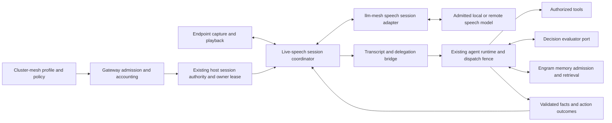

# Full-duplex speech sessions in the LLM mesh

2026-10-28 · Study complement, Round 2 · Author: Codex, GPT-6 Astra, max · Status: proposed architecture, not an implementation decision.

This complements [Live speech across Sentropic, h2a and cowork](../live-stt/spec-plan.md), revision 3, SHA-256 `5a666faa9e1856245ef94b19988cb08514e6e1aeac32918715c07f8ce4a24c61`. The new question is how speech-native conversation, including Block's Dessa, fits the existing mesh and agent system while listening continues during speech. The existing local/cloud selection, interruption, permissions and accounting requirements still apply. This study contains no effort or delivery estimates.

**Recommendation:** after M1, take the narrow variant C1 in §9: version the existing `@sentropic/llm-mesh/speech` session port and cluster-mesh profiles within the already planned **L11 GPT-Live** and **L12 Gemini Live** work. Give each admitted voice session one accountable owner and a pinned execution route; keep agent actions, Decision evaluation and engram memory under their existing authorities. The S-lots below describe extensions and acceptance obligations, not twelve additional mandatory delivery lots. Moshi Rust is an optional English-only conversation research experiment, not the recommended local engine for French users or tool-backed work. Dessa remains an access-gated candidate, with no dependency on it in the core path.

The architectural challenge is broader than streaming audio. A conversational model holds acoustic and conversational state across overlapping input and output, while tools, authorization, memory and accounting have different lifecycles. A transport reconnect, restoration of model context, continuation of an agent task and recovery of an external effect are four different operations. None implies the others succeeded.

## 1. Evidence, including a correction to the Dessa access claim

### 1.1 Evidence conventions

All web observations below were made on 2026-10-28. **Source-verified** means the cited source states the claim; it does not mean Sentropic reproduced the behavior. Every unresolved factual assertion is labelled **`unverified`**. Design choices below are explicitly proposals or requirements, not claims about shipped behavior. No microphone capture, inference, model download, paid qualification or runtime test was performed.

The three supplied secondary sources were opened: [Let's Data Science][D2], [Voice AI Space][D3] and [Nic's notes][D4]. The official [Block Dessa page][D1] could not be retrieved by the web reader, but a direct HTTPS fetch succeeded. Its [saved HTML](sources/block-dessa.html) has SHA-256 `c90aedd97f4930bbf7d9e7aa68341dfd7a95648744203c26415b11fd27cd0c41`; a [text extraction](sources/block-dessa.txt) is also retained. A fresh Round 2 HTTPS fetch produced the same hash. The HTML is evidence, not application code to execute.

| Requested fact | Finding and evidence | Treatment in this study |
|---|---|---|
| “Dessa” means Block's speech model | Source-verified on Block's product page. [D1] | Use that identity; do not conflate it with earlier products bearing the name. |
| Announced on 2026-10-23 as a research preview | D2 dates the announcement to October 23. D3, published October 24, explicitly reports an October 23 announcement as a research preview. D4 is dated October 23 but dates the announcement only to October 2026. Neither D2 nor D4 uses “research preview”. The retrieved official page has no dated announcement. | October 23 is corroborated by D2/D3; the preview characterization is attributed to D3 only. Exact primary announcement timestamp and formal preview terms: **`unverified`**. |
| Listens and talks simultaneously; backchannels | Block explicitly describes full duplex and short listener responses. [D1] | Source-verified vendor description; independent behavior, languages and failure rates: **`unverified`**. |
| Trained from scratch on conversation audio only, without text or a pretrained model | Explicit vendor statement. [D1] | Source-verified claim; training provenance and independent reproduction: **`unverified`**. This does not establish whether a future inference API will accept text instructions. |
| Faster than real time on laptop-class hardware | Block states faster-than-real-time inference and local operation on a MacBook Pro M4 Max or better. [D1] | Source-verified statements. Measured end-to-end latency, memory, quantization, thermal behavior and concurrent capacity: **`unverified`**. Do not turn throughput into a response-latency number. |
| Early access for a small group of safety researchers | Explicitly described by Block. [D1] | The program is announced. Access granted to us, a working enrollment path, and independent researcher results: **`unverified`**. |
| Public waitlist is open | D3 and D4 assert a waitlist. The retrieved official HTML marks waitlist controls as hidden placeholders; its launch notice and click handler say links/sign-up are coming later. [D1], [saved HTML](sources/block-dessa.html). | **`unverified` and contradicted by the retrieved official page as an operational signup claim.** Do not report that anyone can currently join through that page. |
| No API, pricing or weights announced; no benchmark numbers | No developer API contract, tariff, weight artifact or benchmark table was found on the retrieved official page. D3 explicitly reports no announced API, price or weights; D2 distinguishes demonstrations from independent benchmarks. D4 also reports absent API/pricing and no announced open weights. | Availability remains **`unverified`** beyond this source set. D1's curated recordings, including Dessa talking with GPT-Live-1, are demonstrations, not comparative benchmarks or an endorsement by that model's developer. No endpoint, price, model identifier, license or performance number is inferred. |
| A Download control indicates a release artifact | D1 visibly labels a launch control “Download”; the HTML gives it `data-placeholder="Download"` under the same coming-soon notice. | The control is source-verified. A future downloadable artifact is a possible interpretation; its nature, availability and native-runtime compatibility are **`unverified`**. It is not a usable weight/runtime distribution. |

Dessa's text conditioning, transcript output, tool calling, context import/export, resume protocol, maximum session length, language coverage, retention terms and distributable runtime are all **`unverified`**. “Audio-only training” is not evidence for any of these interface properties. The pure-audio analysis in §6 is therefore conditional, not an assertion that an unpublished Dessa API has those limitations.

### 1.2 Repository evidence and what is already integrated

The root checkout is at `97fe9f53e8079694e35771227c11544ce8658316`; its local `main` is also stale relative to the voice work. The locally available `origin/main` reference is `5e986a0b6cd2dfecfbde6a588d30055271124696`. Source inspection below uses that **pinned reference**, extracted under [sources/main/packages](sources/main/packages), not the old root files. This is not a claim about deployment or the latest remote state. `harness check branch` passed on the root; no branch source was edited.

| Existing lot / seam | Verified in the pinned main history and source | Complement boundary |
|---|---|---|
| L1, PR #754; L1c, PR #757 | [Speech contracts](sources/main/packages/llm-mesh/src/speech/contracts.ts) already define `SpeechAdapter.open`, `SpeechSession.write/command/close`, events, `native-duplex`, `duplex` bindings and five placements. [Configuration](sources/main/packages/cluster-mesh/src/speech/config.ts) and [projection](sources/main/packages/cluster-mesh/src/speech/projection.ts) pin profiles, policy and egress. | Extend these contracts; a second speech router or selection surface would duplicate delivered work. |
| L2, PR #776 | [Coordinator contract](sources/main/packages/live-speech/README.md) and [session core](sources/main/packages/live-speech/src/core/session.ts) provide durable submission identities, fences, tombstones, effect uncertainty and generation rotation over host storage. | Preserve the action safety kernel. Do not manufacture an agent turn for every backchannel. |
| L3, PR #781; L4, PR #788 | [Local STT](sources/main/packages/live-speech/src/node/local-stt.ts), pinned worker models, [capture](sources/main/packages/live-speech/src/node/capture.ts), device and terminal control sources exist. | Reuse device ownership, mute and bounded transport seams; continuous S2S framing has different timing needs from endpointed transcription. |
| L6a, PR #799 | [Voice loop](sources/main/packages/live-speech/src/node/voice-loop.ts) chunks text, synthesizes and plays one narration, with cancellation and stale-epoch checks. | This is the cascade baseline, not a full-duplex inference loop. Its host must still wire it to the coordinator. |
| L8, PR #798 | [Admission](sources/main/packages/llm-gateway/src/speech/admission.ts), [usage](sources/main/packages/llm-gateway/src/speech/usage.ts) and [settlement](sources/main/packages/llm-gateway/src/speech/settlement.ts) support speech units, durable host ledger ports, ceilings and deduplicated adjustments. | Add session-level parent accounting, renewal and recovery semantics; do not build a voice wallet. Host deployment of these ports remains **`unverified`** here. |
| L9, PR #804; L13, PR #809 | [OpenAI transcription](sources/main/packages/llm-mesh/src/speech/openai-transcription.ts) and [Mistral transcription](sources/main/packages/llm-mesh/src/speech/mistral-transcription.ts) exist. Both transcription capabilities declare `nativeDuplex: unsupported`. L13 also supplies TTS selection/request construction; that is not evidence of an executed synthesis path. | Existing STT or TTS support does not qualify an S2S route. |
| Decision | [Evaluator descriptor](sources/main/packages/llm-mesh/src/decision/descriptor.ts) and [result validation](sources/main/packages/llm-mesh/src/decision/adapter-result.ts) separate selected identity, accepted served identities, evidence and typed verdicts. | Reuse the qualification discipline, not the Decision request schema for audio. |
| Engram binding | [Memory assembly](sources/main/packages/cluster-mesh/src/engram-memory/contract.ts) exposes scoped storage contracts; [commit replay policy](sources/main/packages/cluster-mesh/src/engram-memory/replay-policy.ts) distinguishes reuse from conflicting intent. | Provider acoustic state is not durable engram memory. Voice capture needs an explicitly supported memory carrier and host admission. |

The source catalogue's default `speechEngineCatalogue` is empty; availability is supplied by qualified host composition. A type or merged adapter does not establish an admitted route. Installed h2a consumer versions, microphone qualification, production persistence and end-to-end acceptance are **`unverified`** in this complement.

The [r1](../live-stt/review-opus-r1.md), [r2](../live-stt/review-opus-r2.md) and [r3](../live-stt/review-opus-r3.md) reviews are baseline evidence. Their findings about pre-start cancellation, effect barriers, tool-result pairing, bounded synthesis and native-build provenance still constrain this work. Their approvals do not approve this complement; independent review of this proposed extension remains an implementation entry gate.

### 1.3 Relationship to spec r3 and M1

Spec r3 already defines `native-duplex` and schedules **L10 OpenAI Realtime, L11 GPT-Live delegation and L12 Gemini Live after M1** (§§2, 11). L11 already requires independent voice/backend cancellation, late-result handling and session-second billing. L12 already requires interrupted-output handling, tool cancellation, late `FunctionResponse` suppression, balanced history, reconnect and usage. These are existing obligations, not new discoveries or replacement adapters.

| Existing scope | Complement mapping and actual delta |
|---|---|
| L1/L1c speech port and selection; L2 coordination; L8 accounting | S1–S4 add overlap/backchannel policy, speech-generation identities independent of action turns, session-parent accounting and explicit recovery modes. Reuse the delivered kernels and extend only their missing contracts. |
| L10 OpenAI Realtime | Remains its own planned post-M1 adapter. Consume applicable shared contract changes without claiming that its conversational behavior equals GPT-Live or Dessa. No duplicate S-lot. |
| L11 GPT-Live delegation | **S5 extends L11** in the same implementation scope: qualify continuous conversation, the new session parent and routine context/connection transitions while preserving L11's cancellation and billing gates. |
| L12 Gemini Live | **S8 is folded into L12**: use Gemini as the second provider to test the common contract, planned rotation/resume and late-result suppression. Client/platform delivery stays in the corresponding r3 surface lots. |
| Local STT/TTS, Decision/memory and later room surfaces | Local S2S research (S6), speech-specific Decision/engram bindings (S7), multiparty/recording (S9) and conditional Dessa qualification (S10) are separately gated extensions. They are not prerequisites to L11/L12. |

**Sequencing proposal:** S0's read-only evidence reconciliation can happen before M1. All S1–S11 implementation and runtime qualification follow accepted M1, like L10–L12; they do not enlarge M1 or displace its unfinished controller, publication and qualification path. M1 acceptance is **`unverified`** here. S11 applies to each delivered slice rather than waiting for every optional extension. The new research question is continuous overlap and session semantics, including local S2S; it is not whether r3 should first acquire a native-duplex option.

## 2. What full duplex changes

Full duplex has three separable meanings: a transport carries both directions simultaneously; an inference engine consumes incoming sound while generating outgoing sound; and a conversation policy allows useful overlapping speech. A WebSocket supplies only the first. A cascade with an always-on microphone and barge-in can listen during playback, but its response is still mediated by recognized text, agent generation and synthesis.

| Concern | Current cascade with barge-in | Proposed speech-native mode |
|---|---|---|
| Turn-taking | Commit a final input, run the existing agent, synthesize its answer; qualified speech interrupts the active turn under r3. | Keep a continuous acoustic timeline. Model speech can begin before an utterance is finalized; business intents still require explicit commitment outside that timeline. |
| Backchannels | An added acknowledgement policy can produce short audio, but r3's core is organized around turns. | Listener responses and user acknowledgements can overlap speech. They must not automatically create a task, grant permission or consume an agent-turn unit. |
| Interruption | Stop playback, fence execution, cancel and reconcile the active turn. | Distinguish yielding the conversational floor, correcting a task and explicitly stopping work. Stop retains the full r3 behavior. |
| Information | Text preserves words but can omit timing, prosody, laughter and hesitation; extra detectors can preserve selected cues. | Audio can condition the model directly. Better understanding of a particular cue is a model-specific claim requiring evaluation, **`unverified`** for our workloads. |
| Latency | Endpointing, STT finalization, agent response and TTS startup contribute, although streaming can overlap some stages. | A native model can remove mandatory transcript and synthesis boundaries from casual speech. Tools and reasoning still have their own latency; a quick acknowledgement is not a completed answer. |
| Auditable history | Text and tool calls are explicit objects. Playback still needs a heard-prefix record. | Audio, captions, tool facts and what was actually played need separate records. A generated transcript is not an exact recording of user intent or delivered sound. |

“Without interruption” should mean that listening and the conversation can continue across ordinary overlap. It cannot mean that Stop is ignored, that connectivity is guaranteed, or that an external action continues after its authorization is revoked.

**Proposed interaction profiles:** `barge-cancel` is a proposed name for r3's existing cancel-on-barge behavior; it is not a profile name found in the spec or inspected code. Preserve that behavior and add an explicitly selected `conversational-overlap` profile for qualification. In the latter, ordinary overlap may leave the voice engine listening and responding while new consequential dispatch is held until the input's meaning and applicable authorization are resolved. Existing in-flight effects remain tracked. A verified task correction supersedes its intent revision and fences affected work; a backchannel creates no action. Any ambiguous classification leaves the dispatch hold closed. This changes the mapping from VAD to cancellation and therefore needs owner ratification; it is not a silent reinterpretation of r3.

PTT/Stop controls remain immediate local controls. Provider VAD, a text classifier or Decision must never be on the critical path for those controls. A spoken stop command can add another path, but recognition and its latency need qualification. Keep “Stop speaking”, “Stop this task” and “Close microphone/session” distinct where the UI offers them; the existing all-stop control retains its broad meaning.

Measure latency from acoustic fixture ground truth and separately report capture/echo processing, transport, model startup, first appropriate backchannel, first useful answer, tool completion and actual playback. Measure correction reaction and post-Stop leakage independently. Real-time factor below one says the engine keeps up with the stream; it does not establish any of those response latencies. No Dessa latency value is inferred here.

## 3. Available candidates and their limits

These are documented candidates, not Sentropic-qualified routes. Account access, current regional availability, the exact served implementation and performance on our machines are **`unverified`** until admission and qualification. A published name must never become an implicit default.

| Candidate | Source-verified availability and duplex evidence | Strong fit | Limitation / gate |
|---|---|---|---|
| **Dessa / Block** | Official speech-to-speech/full-duplex description; restricted early-access announcement. [D1] | Tests the pure speech-native architectural case and possible laptop execution. | No usable public developer contract established. Text/control/tool channels, runtime, price and license: **`unverified`**. Candidate only. |
| **Moshi / Kyutai**, local tuple `kyutai/moshiko-candle-q8` | Public full-duplex architecture, weights and Rust/Candle path with CUDA/Metal options. [K1], [K2] **Source-verified model-card limits: English-only documented coverage, no tool access, limited complex-task ability and research-only intended use; professional use is discouraged.** [K3] | Optional conversation-only research comparator for native runtime and overlap behavior. | Not a French/tool-capable product candidate. A published Rust path is not a build receipt. Laptop performance, dynamic context injection and exact resume remain **`unverified`**; lack of tools is a documented limit. |
| **PersonaPlex-7B-v1 / NVIDIA** | Public code and gated weights; simultaneous listening/speaking, text role prompts and voice conditioning. The card identifies a Moshi/Moshiko base and an English input/output use case. [N1], [N2] | Controlled-persona full-duplex comparator; shows that full duplex need not mean text-free. | Documented PyTorch/Python serving targets Linux and NVIDIA A100/H100 hardware. These are listed targets, not proven minimum requirements. A native laptop runtime and French support are **`unverified`**. Excluded from our local delivery under 0 Python; its Moshiko lineage does not establish Moshi Rust compatibility. |
| **GPT-Live 1 / OpenAI**, `gpt-live-1` | Official API model and guides describe concurrent listening/speaking and client delegation to an application-owned backend. Documented tariff: **USD 0.05 per session minute, billed per second**, with backend use separate. [O1], [O2]. | Closest documented fit for continuous speech around the existing agent runtime. Text context and delegation channels are available. | Client delegation still requires our context, action and cancellation ownership. Documentation offers an API model name, not proof of immutable weights. Our entitlement and served-version assurance: **`unverified`**. |
| **Gemini Live**, documentation example `gemini-3.8-live` | Official docs expose continuous audio over stateful WSS, audio transcripts, tool use, barge-in and resumption handles. [G1], [G2]. | A second remote adapter with materially different session recovery semantics and JavaScript support. | Bidirectional streaming and barge-in do not by themselves establish equivalent backchannel/overlap behavior to Dessa or Moshi; that behavior and exact tariff here are **`unverified`**. |
| **Amazon Nova Sonic family**, including Nova 2 Sonic `amazon.nova-2-sonic-v1:0` | Bedrock documents Nova 2's dedicated `InvokeModelWithBidirectionalStream` full-duplex path, distinct from ordinary Invoke/Converse; the same compatibility page also lists **Nova 2.5 Sonic**. [A1] JavaScript is among the SDKs for bidirectional streaming. [A2] | Tests that the neutral port accommodates a transport and account system unlike the other providers. | AWS credentials, region, entitlement, pricing and lifecycle need qualification. Those deployment facts and overlap quality are **`unverified`** here. Nova 2.5 is a separate candidate: its exact protocol/model binding and suitability remain **`unverified`** in this study, not inherited from Nova 2. |

L10 OpenAI Realtime, L11 GPT-Live and L12 Gemini Live already belong to r3's post-M1 native-duplex scope (§1.3). Moshi and PersonaPlex have primary full-duplex descriptions; GPT-Live supplies a documented full-duplex API plus a backend bridge. Gemini and Nova add interoperability evidence without implying identical conversational policy. Existing STT/TTS routes are not relabelled S2S solely because they stream.

**License and intended use are separate evidence.** The Moshi weights are published under CC-BY-4.0 and the Rust backend under Apache-2.0. [K1], [K3] The model card's research-only intended use is not a different “research-only license”. Record both the artifact license obligations and the stated use limitations; permissive licensing does not establish suitability for professional tasks. No commercial deployment clearance is claimed here.

The revised recommendation starts with **GPT-Live client delegation in S5/L11**, then **Gemini portability in S8/L12**, after M1. French conversation and action correctness must pass qualification for each selected remote tuple; they are **`unverified`** here. **French local S2S is a `source-gap`: no candidate satisfying French conversation, an action bridge, acceptable use terms and a 0-Python local runtime has been identified in the inspected sources.** Its availability remains **`unverified`**, not globally disproved. S6 may investigate English conversation-only Moshi as research, but cannot close that gap. Keep the selectable cascade as the local action path, subject to its existing French/English acceptance gates; never substitute cloud processing silently.

## 4. Entering llm-mesh as an explicit session capability

### 4.1 Extend the delivered seam

The new capability class is conceptually `speech-session`: streaming audio input, streaming audio output and concurrent control over a long-lived invocation. It sits beside text generation and typed Decision evaluation. Existing `SpeechAdapter`/`SpeechSession` already establish this shape, so the next change is a versioned extension and qualification, not a replacement API.

Keep `GenerateRequest` and `StreamResult` for their current purpose. One text output iterator cannot represent simultaneous writes, independent control acknowledgements, playout accounting and session recovery. An audio input modality on a chat descriptor does not qualify audio output or a duplex session.

| Descriptor area | Required proposal |
|---|---|
| Identity | Provider, public model name, wire model, accepted served identities, model/artifact revision, adapter/protocol revision, codec model revision, execution placement and trusted host/resource reference. For local inference, include weight/config/quantization and binary digests. |
| Capability class | Declare chat, transcription, synthesis, duplex session and Decision independently. Preserve the existing supported/partial/unsupported/unknown semantics; only evidenced support satisfies a required feature. |
| Conversational behavior | Separate continuous input, simultaneous generation, backchannel handling, local output suppression and provider context correction. Do not compress these into one `nativeDuplex` flag. |
| Semantic bridge | Independently declare input/output transcripts, trusted instruction channel, context seeding, mid-session factual updates, tool/delegation events and result ingestion. Include provenance and acknowledgement semantics. |
| Lifecycle | Distinguish transport reattach, provider-native resume, stored-session fork, context-seeded replacement and no recovery. Declare eligibility, expiry, state retained and replay rules for each. A single boolean `resume` cannot describe this. |
| Media/resources | Supported formats, rates, frame cadence, silence/clock requirements, channels, queue limits, language/voice selectors, maximum session/context constraints and concurrency/resource requirements. |
| Commercial/data policy | Native billable dimensions, price authority/revision, expiry, region, entitlement, artifact licenses, stated intended-use limits, retention/training policy and permitted egress. Unknown is not zero-cost, unrestricted use or zero-retention. |
| Qualification | Versioned evidence per exact tuple, test scope, date/expiry and identity assurance level. Conversation-only, action-integrated and multiparty qualification are distinct. |

Maintain unadmitted candidates in discoverable configuration with their reason codes. Dessa must not get invented executable bindings. Client selection goes through the L1c profile and projection; credentials stay in custody. Every extension must update the closed profile validators and optional-module/export contracts coherently, rather than smuggling fields into `providerOptions`.

### 4.2 Admission and served-model verification

Proposed admission sequence:

1. Resolve authenticated tenant/workspace/principal, selected profile digest, target session, source/controller generation and consent. Check the complete path's egress, including transcript taps and side models.
2. Negotiate the exact tuple and features required by its use: conversation-only may lack tools; an action-integrated profile requires a trustworthy semantic bridge and a fenced runtime. Reserve capacity, entitlement and a bounded worst-case cost before opening a paid session.
3. Acquire the existing host authority's session-owner lease and bind an attempt identity before dispatch. Opening retries must not create duplicate upstream sessions when creation acknowledgement is lost.
4. Validate the provider handshake or trusted local worker identity before forwarding microphone content or releasing output. Compare actual evidence against the descriptor; record requested, resolved and served identity separately.
5. Publish an admission receipt and enable media only after the relevant gates pass. Recheck on replacement/resume, credential/lease renewal and any reported engine or model transition.

A response echoing our requested alias is not independent served-model evidence. A provider-authenticated model identifier establishes only the identity granularity its contract supports; it is not cryptographic proof of weights. A local artifact hash establishes the file identity only when the trusted worker demonstrates it loaded that artifact. Proposed identity statuses distinguish these cases from `unknown` and `mismatch`.

**Fail closed:** if a profile requires a pinned served revision and the provider exposes only an unresolved mutable alias, the profile is unavailable. A deliberately weaker, separately approved qualification profile may evaluate the service, but cannot label the result production-qualified. Identity mismatch closes the route, fences new action dispatch and settles costs already incurred. Never replace missing served metadata with the request value.

This strictness is a proposed S2S gate, not a claim that every existing speech adapter implements it: the inspected L13 handler rejects an unexpected reported model but permits an omitted model field. Decision's [closed result validator](sources/main/packages/llm-mesh/src/decision/adapter-result.ts) supplies a useful stricter precedent; extending voice qualification is its own scoped change.

### 4.3 Pricing, reservations and receipts

Use L8's accounting units and durable ledger ownership. A session parent links separate speech, optional ASR, Decision, memory-related inference and backend-agent operations; existing backend charges are referenced, never charged again as speech. Audio tokens, text/cache tokens, admitted audio seconds, connected seconds and characters remain distinct. Silence, unheard generated audio and backchannels can be billable according to the pinned tariff.

The current L8 `SpeechOperation` requires backend/coordinator submission references. A voice session can open before any action exists and span many action turns. **Required extension:** represent a voice-session admission parent and independently authorized child action receipts. Do not fabricate a native turn, zero-cost token stream or unlimited backend entitlement to fit the present fields. A backchannel can incur speech cost without consuming a new agent turn; actual backend submissions obey the allocator's current policy.

Start with a fixed, bounded session reservation. Add atomic renewals only with durable owner-lease checks, price validity and daily/total budget checks. Reserve shutdown and reporting lag in the ceiling; stop before headroom is exhausted. A UTC-day transition requires correctly attributed liability or a controlled close/reopen, not charging an arbitrarily long session entirely to its opening day. Reconnect attempts retain their own liabilities while sharing the conversation cap. Never release a possibly active provider connection merely because a local lease expired.

An application timeout alone is not a bound on upstream billing. Admission needs an enforceable provider limit or a verified worst-case liability that includes an orphaned connection until expiry. If that bound cannot be established, the paid route cannot satisfy the existing hard cap and remains unavailable. A user cancellation is a neutral route-health outcome, not evidence that a healthy provider/account should be quarantined.

Normalize cumulative versus incremental usage, deduplicate events, settle once and append signed true-up adjustments against the original entry. Missing final usage retains uncertainty and conservative liability. Stop and close require no new quota admission. The prior campaign ceiling remains **USD 5 per UTC day and USD 20 total**, shared across providers and retries; this study spends none and creates no new allowance.

A proposed session receipt binds: logical conversation and voice session; connection/provider attempt; owner/controller epochs; target; profile digest; selected/resolved/served identities and their evidence; placement/region; formats and semantic bridge; consent/egress/retention revisions; budget/lease references; billable units and uncertainty; output generation and playout progress; action/Decision/memory receipt references; close reason and recovery lineage. Keep audio, transcript bodies, credentials and raw tool arguments out of control and usage logs.

## 5. The session architecture challenge

### 5.1 Ownership and route affinity

The diagram expresses ownership. Local media need not traverse a central server. Cluster-mesh selects and projects configuration; llm-gateway owns admission/accounting; llm-mesh translates the provider protocol; live-speech handles media and coordination; the existing target authority controls execution. The session host may run on an endpoint, companion or trusted server. Required host extensions must use existing authority/storage mechanisms, not create another independent session registry.

Route selection happens **at session admission**, then binds provider/model, account, region, worker, codec, context and lease. Do not route each audio frame or utterance through ordinary request retries or alternate accounts. Load balancing uses active sessions and reserved state/resource capacity, not only request throughput. Workers drain existing sessions during deployment; a restarted pod cannot claim it restored model state because it recovered a route key.

A gateway can route an authenticated session handle to its current owner. That owner serializes control transitions and renews a fenced lease. Routing affinity is insufficient without authoritative ownership: two connections surviving a partition must not both dispatch tools. Existing runtime gates check current ownership/action epochs; media workers reject obsolete epochs. If a provider cannot be remotely fenced, old media may consume resources until disconnection is confirmed, but obsolete output cannot play and obsolete callbacks cannot create effects.

Initially prefer a trusted relay or local companion with a controllable data path. Direct browser-to-provider media is a later placement option requiring constrained credentials, server-side control/usage observation and revocation evidence. A server sideband alone does not prove it can suppress audio already delivered to an uncontrolled player.

### 5.2 Separate identities and state lifetimes

| State | Owner and lifetime | Recovery rule |
|---|---|---|
| Logical conversation / target agent session | Existing application/native-runtime authority; may span voice connections | Restore confirmed task state and permissions from this authority, not from a speech model's recollection. |
| Voice session and provider engine state | Session owner plus one admitted provider/worker attempt | Sticky while alive. Acoustic codec state, caches and conversational timing are nonportable unless a qualified export/resume protocol proves otherwise. |
| Owner lease / controller epoch | Trusted host authority with atomic fencing | A replacement controller must acquire authority and invalidate the old owner before sending controls or admitting effects. |
| Transport connection epoch | Coordinator and authenticated transport | Increment on reconnect; reject old media/control frames. This does not by itself change the logical conversation or repair model context. |
| Audio segment / output generation | Media coordinator | Independent input/output sequence numbers and clocks; acknowledged samples actually rendered. Discard stale queued output without replay. |
| Committed intent revision / action epoch | Existing agent coordinator and runtime | Corrections and cancellation fence dispatch; effect receipts and unresolved barriers survive all reconnects. |
| Transcript projection | Explicit ASR/provider source and application history owner | Revisable hypothesis until committed. Preserve speaker, interval, provenance and corrections; never submit the same input twice. |
| Durable memory | Engram authority | Admit selected, scoped facts with provenance and retention. Never serialize a model cache as a substitute. |

The present `SpeechOutputFrame` requires `turnId` and `turnEpoch`. Continuous S2S can produce a listener response with no backend turn. A versioned extension must provide **speech generation/segment identity separately from optional action-turn references**. Use the speech generation to reject stale audio, and the action epoch to reject stale tool work. Reusing one counter for both would either cancel useful conversation whenever an action changes, or let old work survive a media reset.

Proposed lifecycle: `requested → admitted → connecting → active`, then `draining → closed`; failures enter `recovering` or `failed`. Microphone mute, output mute and an action cancellation barrier are orthogonal states. Closing a voice session does not silently cancel an independently detached task, and muting audio does not authorize ongoing work. The selected policy must say which bound tasks close with the session; existing r3 cancellation remains the default for attached work.

### 5.3 Reconnect, resume, replacement and handoff

These are **routine lifecycle paths as well as fault recovery**. Gemini documents connections lasting around **10 minutes**, audio-only sessions limited to **15 minutes without compression**, and resume tokens valid for **2 hours after the last session termination**. Compression and resumption solve different limits. [G2] GPT-Live replaces its voice engine inside the running session when context use exceeds **90%**, carrying startup instructions and bounded summarized/recent history. [O3] Connection rotation and context replacement must therefore work during sustained conversation and active backend work, not only after a crash. These are provider protocol limits, not delivery estimates.

| Event | Required behavior |
|---|---|
| Planned provider connection rotation or in-session engine replacement | Prepare for documented close warnings/context transitions; preserve the session parent, authoritative task facts and effect journal. A new transport gets a new connection epoch; an internal engine replacement does not automatically create a new transport, conversation or action. Reconcile available identity/context evidence and current result routing, bound any overlapping liability, and suppress obsolete audio/callbacks. If continuity cannot be established, report the gap. |
| Endpoint loses its socket, owner/provider session survives | Stop local output and bound/drop new capture. Reauthenticate, prove ownership/consent, increment connection epoch, reconcile input consumption and actual playout, then reattach only if the adapter supports it. No catch-up playback of stale speech. |
| Provider offers native resume | Bind the opaque handle to tenant, principal, provider/account, model and policy; protect it as a credential. Check eligibility/expiry and acknowledged input boundaries. Only resend an explicitly unconsumed range when the protocol guarantees deduplication. |
| Provider offers a saved-session fork | Create a new provider session/attempt and receipt lineage. Require the recording and retention consent that made the fork possible. Restore current action status separately; old approvals are not inherited by the fork. |
| Provider state is lost, text context can be seeded | Open a visibly new session with a bounded, provenance-labelled summary of confirmed facts, unresolved effects and heard output. Report context loss; do not promise identical acoustic state, personality or timing. |
| Pure audio state is lost and no qualified context import exists | Close the attempt, preserve application task facts and offer a fresh conversation. Exact continuation is unavailable. Do not replay the whole recording into the microphone as automatic recovery. |
| Tool result arrives after disconnect or correction | Update the original operation journal. Deliver a filtered status only to the current authorized task revision. Never revive a cancelled action or announce an outdated success. |
| Owner changes, route changes or credentials expire | Fence the previous owner, reconcile effects, settle its attempt and establish the new admitted binding. Preserve required consent and cost limits. Transparent live migration is **`unverified`** for the candidates and is not a baseline promise. |

Provider mechanisms demonstrate why a single recovery flag is insufficient. Alongside its internal engine replacement, GPT-Live documents new sessions seeded with text and forks from completed stored recordings; forking is unavailable with its documented Zero Data Retention setting. [O3] These differ from Gemini's native resumption and compression. [G2] None restores an application's missing effect journal or implies preservation of every earlier acoustic detail.

A partial TCP write or a successful socket reconnect does not tell us what audio the model consumed. If a provider has no trustworthy consumption cursor, record an input gap and ask for the missing detail instead of risking duplicate intent. Use idempotency and query-by-action-ID for external effects; do not claim exactly-once delivery over an arbitrary network.

### 5.4 Media correctness under continuous listening

Keep bounded, independent input/output queues and prioritize control traffic. Preserve acoustic time through negotiated frame timestamps and explicit gaps. Some continuous models need silence frames or a steady codec clock; dropping all VAD-negative input is not automatically valid. Qualify an adapter's padding, silence and discontinuity semantics before applying cascade optimizations.

Use echo cancellation with a reference to the audio actually rendered, not merely generated; the model must not treat its own output as a new user. Distinguish a near-end acknowledgement from playback echo. Headsets are the first qualification surface; speakerphone and multiple capture devices require their own evidence. Clock drift, resampling, jitter and dropped frames need observable counters. Existing queue limits provide starting bounds, not proof that every codec tolerates those bounds.

Generated, received, queued, rendered and understood are different states. Record the rendered prefix with uncertainty. A truncated caption cannot prove a word was heard without alignment. If an engine cannot correct its context after locally suppressed output, disclose possible context divergence and require a qualified resynchronization or new session before action-related conversation continues.

## 6. Speech-native conversation, tools, Decision and memory

### 6.1 Three semantic integration levels

| Level | Mechanism | Consequence |
|---|---|---|
| Native structured bridge | Provider exposes delegation/tool events, context updates and result ingestion | Translate into one application-owned intent and the existing runtime. Provider-generated tool names/arguments are proposals subject to normal policy. |
| Transcript side channel plus controlled result ingress | Tap input audio/transcripts to a text model; send validated facts back over a qualified context/text channel | Supports a hybrid agent while speech remains native. Adds cost, egress and alignment issues; the side model does not gain execution authority. |
| Audio-only interface with no trusted result/context ingress | A separate ASR/text runtime can understand user audio, but has no reliable privileged path back into the speech model | Conversation-only is feasible in principle. Grounded action narration and memory injection are **`unverified`**. Use an explicit controlled TTS/text handoff for actions, or leave the candidate unadmitted for that use. |

An ASR tap solves only **audio → text**. It does not solve **trusted state → speech model**. Synthesizing a tool result into a model's audio input is a possible research experiment, not a dependable control channel: roles, quoting, acknowledgement, echo handling and resistance to competing speech must be established. “Trained without text” neither proves nor rules out a future text/control side channel for Dessa.

The preferred hybrid has one voice conversational front end and one existing action authority. A bridge model may extract or clarify intent; it must not become a second autonomous executor beside Codex, Claude, Muse, chat-core, flow or cowork. Select the backend through the existing routing/custody path. For GPT-Live, prefer **client delegation** so the current mesh/runtime remains in charge; provider-managed backend delegation would need a separately qualified accounting and control integration. [O2]

### 6.2 Commit one intent and preserve cancellation

Proposed flow:

1. Associate input audio, transcript revisions and any native delegation with one source interval and logical input identity. For continuous streams, an application-defined intent boundary can span multiple caption fragments.
2. Establish a committed semantic request and a task revision using the current trusted history/confirmation policy. Partial captions may update the display; the initial action pilot does not dispatch tools from speculative fragments.
3. If native delegation and an ASR tap both recognize the request, deduplicate them into that same intent. Allocate the coordinator epoch/submit key before runtime start, preserving L2's pre-start cancellation tombstone behavior.
4. Resolve applicable policy and dispatch through the existing runtime gates. Every enabled tool class must be covered. Tool results retain call IDs and truthful terminal/unknown outcomes; history writes remain with the runtime owner.
5. Return only validated, appropriately scoped facts or status to the voice model, with action ID and task revision. A statement that work completed requires authoritative completion evidence, not a plausible speech response.
6. On correction or Stop, fence affected actions, clear applicable output generations and retain unresolved-effect barriers. A late result updates the journal; it cannot implicitly resume a cancelled task.

GPT-Live's own documentation explicitly separates speech interruption from backend cancellation and warns that transcript fragments are not complete turns. [O2] The Sentropic adapter must enforce r3's stronger task-cancellation behavior where selected. A voice engine continuing to listen does not weaken the tool dispatch fence.

The uncertainty barrier is unchanged: unresolved effects deny new mutations; only the existing explicitly allowed recovery/status operations remain. Typed, authenticated risk acceptance is still required for the r3 escape path. A spoken “yes”, a backchannel, inferred emotion, a timeout or a Decision score cannot release it.

### 6.3 Decision is an evaluator, not the floor controller

Use the existing Decision port for bounded semantic checks where a calibrated criterion is useful: for example, whether a finalized request is complete enough for a specified workflow, or whether a proposed summary is supported by its cited action outcomes. Bind requests to committed evidence, criterion revision, evaluator identity, policy and task revision. Retain Decision's own receipt, usage and served-model checks.

New speech-derived criteria and their readiness are **`unverified`** until qualified on the applicable languages, overlap and ASR error distribution. A refusal, timeout or unavailable evaluator is not a negative verdict and never a permission grant. Do not run Decision per audio frame or make Stop depend on it. It can advise a semantic transition; authenticated authorization and dispatch policy remain deterministic host responsibilities.

The [existing Decision/engram joint study](../decision-engram-concertation/joint-r2.md) separates domain criterion ownership, Decision readiness and engram evidence stewardship. Preserve that split. Model confidence, emotion recognition and memory admission do not establish user consent or ground-truth correctness.

### 6.4 Engram memory and conversation context

Keep three layers explicit: transient acoustic/model state; application conversation/task history; durable, governed memory. The speech model's cache is the first layer. It cannot be the canonical store for completed actions, user permissions or durable memories.

Proposed memory flow: create a candidate from a committed, attributed utterance or confirmed outcome; attach source interval, transcript/model provenance, correction status, purpose, scope and consent; pass it through the existing engram capture/admission path. Backchannels, incomplete hypotheses and inferred emotions do not become persistent facts by default. A later transcript correction yields a traceable correction/supersession using supported memory semantics, not an overwrite that reexecutes the original request.

Retrieval uses the current principal, tenant/workspace, purpose and audience before context is sent to either model. Return a bounded set of authorized facts with source references. Inserting retrieved text into a side model and sending its summary to a cloud speech model are separate disclosures. Treat retrieved content as data, not instructions. Revocation/expiry must affect later retrieval, context refresh and authorized disclosure.

Use the established replay identities for writes: retrying the same admitted memory intent reuses its result; a different intent under that identity conflicts. Memory write retries must not rerun inference or an external action. No new “voice memory” store is introduced. A specific voice record carrier and deployed engram write host remain **`unverified`** here and are an explicit integration gate.

If a model cannot accept trusted context, memory can still inform the text agent and UI. It cannot be advertised as available inside that speech-native conversation. Replaying recordings to imitate memory raises additional disclosure and role-confusion problems and is outside the baseline.

### 6.5 What the model may say versus what the system knows

Native speech may be audible before a transcript-based check finishes. A side-channel checker cannot retroactively prevent disclosure. Keep secrets and unnecessary tool payloads out of the speech model's context. For action confirmations or other statements requiring exact facts, select a qualified controlled-output channel, buffer and validate where feasible, or use a clearly signalled TTS/text handoff. Unconstrained native speech cannot promise an unspoken-content filter merely because a transcript tap exists.

Maintain one audible-output arbiter so native audio and deterministic narration do not talk over each other. Give task state an authoritative visible surface. Distinguish “working”, “completed”, “cancel requested”, “stopped” and “outcome unknown” in both the bridge and UI; never smooth over uncertainty to preserve conversational fluency.

## 7. Multiparty, consent, recording and privacy

Full duplex describes concurrent directions, not support for many authorized speakers. Multiparty task behavior of the candidates is **`unverified`**. Start with one authenticated controller and one listener/model stream; model the future room layer explicitly rather than treating a microphone mix as one trusted user.

For a future room, each endpoint has a participant identity, audio track, consent revision and controller role. Diarization or recognizing a familiar voice is not authentication. Only the authorized controller can commit consequential intent; another participant's “yes” cannot approve it. Define floor policy, add/remove events, simultaneous speech handling, and whether the provider gets a mix or separate tracks. Keep per-track timing and do not infer agreement from overlapping acknowledgements.

Shared output requires an authorized audience. Retrieve/disclose only information permitted for the people who can hear it; sensitive material may need private delivery. A new participant can invalidate the current disclosure scope. Consent to join, audio processing, a cloud provider, recording, transcription and durable memory are separate choices. One person's consent does not grant another's recording permission; any jurisdiction-specific legal requirements remain **`unverified`** until reviewed for the actual deployment.

Default recording off, with bounded transient buffers. Use separate visible capture, remote-processing and recording indicators and immediate local mute. Retain minimal control/accounting receipts without content. Where text history is retained for continuity, give it an explicit retention and deletion policy; “no audio recording” does not imply “no personal data stored”. Redact diagnostics and protect context snapshots and resume/fork handles.

Recording requires a defined purpose, participating-user consent, encryption, scoped access, expiration and deletion covering transcripts/derived artifacts as well as audio. A provider's website privacy notice is not a speech API processing contract. Unknown provider retention blocks profiles requiring guaranteed local processing or specified retention. A cloud transcript tap makes an otherwise local S2S path nonlocal for those samples.

Stored-session recovery is a product tradeoff. GPT-Live's documented fork mechanism requires a completed stored recording and is unavailable under its stated ZDR configuration. [O3] The default recommendation is context-seeded replacement with explicitly governed text history, rather than enabling audio storage merely to improve recovery. If even text retention is forbidden, continuity must be limited accordingly.

## 8. Local and remote execution under the 0-Python constraint

The constraint applies to everything Sentropic installs, builds, converts, packages, tests, provisions or operates: **0 Python**. A wrapper around an interpreter-based worker, or moving that worker to a Sentropic-operated remote host, does not satisfy it. A third-party API may use an undisclosed internal stack; we require only documented non-Python clients on our side and make no claim about that provider's internals.

| Placement | Proposed deployment | Required evidence |
|---|---|---|
| Endpoint-native / local companion | Node/TypeScript control with a pinned Rust/C++/Swift native engine, isolated process/worker and platform audio APIs or vetted binaries | Reproducible install/build/run without the prohibited interpreter or transitive installer; artifact provenance, license, GPU/runtime compatibility, bounded memory, cancellation, thermal and audio-device tests. |
| Browser-local | WASM/WebGPU only if the exact model/runtime is qualified | Complete runtime and model compatibility is **`unverified`** for these S2S candidates; not inferred from an available browser demo. |
| Cluster-hosted | Same qualified native engine, with capacity reservations and tenant isolation on trusted workers | Network latency and scope/egress enforcement; one session's cache, audio or conditioning cannot leak into the next. |
| Cloud relay | TypeScript transport adapter to a documented external API, with server-owned credentials and control | Price, account, region, retention, served identity, usage, cancellation and recovery qualification. No client-held long-lived credential. |

Moshi documents a Rust backend and Metal support, making it a concrete **research** runtime investigation path under the language/use limits in §3. Its MLX instructions using Python are not an admissible shortcut. Use already published compatible weights, pinned to revision/digest; qualify any conversion requirement before selecting a runtime. The repository's description of the Rust implementation as suitable for production does not override the model card's intended-use limits. [K1]–[K3] PersonaPlex's documented Python/PyTorch server and A100/H100 targets do not establish a native laptop path, even with its Moshiko ancestry. [N1], [N2]

Dessa's M4 Max statement and visible Download placeholder motivate checking for a future distributable artifact. The retrieved page supplies no usable download or native-runtime contract; the artifact's nature, runtime dependencies and memory requirement remain **`unverified`**. [D1] Do not extrapolate to our Linux headset target, Windows cowork devices, browser execution or a laptop running a speech engine and local text agent concurrently. Admission must account for the combined resident models, codec/AEC, context cache and active sessions. Local inference has no external speech API bill, but it still consumes capacity and can exhaust device resources.

Native qualification should use a minimal environment without the prohibited interpreter, fail on hidden conversion/install invocations, inventory dependencies, pin all artifacts and run inference with network access disabled after provisioning. Fixtures and analysis tooling use Node/TypeScript or vetted native audio utilities. We do not download or run any candidate in this study.

## 9. Options and recommended direction

| Option | Strongest case for | Strongest case against | Recommendation |
|---|---|---|---|
| A. Complete the current cascade only | Maximum reuse; explicit text/tool/history semantics; existing local/cloud choices and fences; deterministic narration of confirmed results. | Does not answer the new continuous speech-native behavior question; text boundaries still constrain interaction. | Complete and qualify it as the r3 product baseline, then add the S2S capability after M1. |
| B. Make Dessa the next required voice engine | Directly investigates the owner's named model and speech-only training claim; possible local deployment. | Access, runtime, tools, pricing, retention and recoverability are not established. Would make architecture delivery depend on unpublished interfaces. | Keep a bounded candidate dossier; never place it on the required dependency path. |
| C. Generalize the existing speech-session port; S2S conversation plus existing text-agent authority | A common architecture for local and remote candidates, preserving tools, Decision, memory, receipts and controlled Stop. | **Scope and sequencing are the strongest objection:** twelve S-labelled areas could become a second program alongside already planned L10–L12 and divert owners from unfinished M1 acceptance. The local proposal currently rests on English-only, research-only, tool-less Moshi. [K3] Semantic bridging, dual lifecycles and stale-result discipline add complexity; no trusted ingress means no fully grounded hybrid. | Retain as the architectural direction; do not activate the whole set as one required increment. |
| C1. Version the speech contract inside L11/L12; defer the other extensions | Uses r3's existing post-M1 provider lots to prove the minimum shared session, accounting, overlap and action contracts. Avoids making speculative local research or room/memory work block those adapters. | Does not deliver French local S2S, speech-specific memory or multiparty support; deferral leaves explicit capability gaps and later evidence may require another contract revision. A common port alone does not prove portability. | **Recommended first delivery:** S1–S4's necessary deltas, S5/L11, S8/L12 and per-slice S11 acceptance, all after M1. |
| D. Let a capable S2S provider own reasoning/tools/history end to end | Fewer application bridges and possibly better conversational coherence; a valid option when the provider exposes the needed contracts. | Can bypass mesh custody, quotas, native-runtime permissions or memory ownership; ties recovery and billing to a provider. Those integrations are **`unverified`** here. | Consider only after equivalent control and accounting proofs; no automatic provider-hosted tool execution. |
| E. Native S2S for social conversation, controlled cascade/TTS handoff for actions | Works around missing trusted result ingress; can include an admissible local speech model while preserving exact action outcomes. | Audible mode changes, duplicated context and reduced conversational continuity. Both outputs need one arbiter. Handoff does not remove the model's language or intended-use limits. | Bounded alternative when C's bridge gate fails but the model is otherwise admissible for the selected use; show the mode change and preserve profile selection. |

Proceed with **C1 as the first slice of C**, after accepted M1. Preserve both `chained` and `native-duplex` as intentional modes. Prove the necessary owner, media/action, recovery and accounting extensions with deterministic fixtures, then qualify GPT-Live within L11 and Gemini within L12 using the same versioned port. French/English and action acceptance remain per-tuple gates. Defer S6, S7 and S9 from this slice; S6 is optional English conversation research and does not discharge the French local S2S gap. S10 starts only when Dessa access evidence exists. The local/cloud choice remains binding, with the cascade retaining the local action path; this staging does not claim delivery of every S2S placement.

## 10. Proposed lots, dependencies and acceptance

These are study work packages, not branch activation or Track writes. Existing L numbers are not renumbered. **S0 may run as read-only preparation before M1; all implementation and runtime qualification in S1–S11 require accepted M1.** S1–S4 are shared contract/acceptance deltas scoped into L11/L12, S5 extends L11, and S8 is folded into L12. They are not counted as a second set of provider deliveries. S6/S7/S9 are deferred extensions under C1; S10 is conditional; S11 closes each admitted slice. Each implementation needs a scoped branch plan; no durations are assigned. Roles identify the responsible concern, not named staffing commitments.

| Lot | Scope and responsible concern | Dependencies | Observable acceptance |
|---|---|---|---|
| **S0 — Reconcile and freeze evidence** | Voice/mesh maintainers: reconcile current main, deployed consumers and remaining r3 gates; freeze primary sources and candidate language, tool, license and intended-use records. | This study; may precede M1 as read-only work | Exact source/export/consumer versions; delivered versus qualified status; French local S2S `source-gap` retained. S5→L11 and S8→L12 are explicit; no duplicate adapter or reopened M1 scope. |
| **S1 — Version the session contract** | llm-mesh + cluster-mesh: extend `speech/contracts.ts`, `speech/capabilities.ts`, profile validation/projection and exports. Separate speech segments/generations from action turns; define semantic bridge and recovery modes. | S0 and accepted M1 | Contract tests reject unknown required capabilities, unauthorized tuples, stale profiles and fake turns; chained consumers retain their explicit semantics. No provider-specific field is required by every adapter. |
| **S2 — Session ownership and recovery** | live-speech + host authority: fenced owner lease, affinity, connection epochs, lifecycle, bounded media, close/recovery journal. | S1 | **Planned connection rotation and in-session context/engine replacement under sustained audio and active backend load**, plus partition, duplicate-open, lost-ACK, owner-loss, expired-handle and stale-output fixtures. Prove one current controller, preserved action journals, correct attempt/usage lineage, no blind replay and visible gaps. |
| **S3 — Session admission and accounting** | llm-gateway/allocator: session-parent receipts, capacity, native tariff dimensions, bounded holds, renewal/day boundaries and served-identity policy. | S1; integrates with S2 | No microphone egress before admission; missing identity/price/ledger refuses; renewals and reconnects cannot exceed shared caps or double-charge; Stop works at exhausted quota. |
| **S4 — Semantic bridge and action safety** | Runtime owners + live-speech: one intent per source input, optional transcript tap, task revisions, result ingress, output arbiter and existing fence integration. | S2, S3; qualified target runtime | Duplicate delegation/tap produces one submission; pre-start Stop, correction, late result, unknown effect and new-turn reissue tests pass. Backchannels never authorize actions. |
| **S5 — Extend L11: GPT-Live delegation** | llm-mesh adapter owner: extend **spec r3 L11**, using `speech/openai-live.ts` and its configurable native-duplex/client-delegation binding. | S1–S4; existing L11 L8/L5 and admission gates; entitlement/data policy | Preserve L11's independent voice/backend cancel, late-result suppression and session-second billing. Add overlap/backchannels, session-parent receipts, context replacement under load and explicit recovery/retention behavior. French/English, served identity and action tests pass per tuple. |
| **S6 — Optional local conversation research** | Native runtime/voice maintainers: Moshi Rust with pinned `moshiko-candle-q8`, artifact license notices and resource admission; **English-only, conversation-only, research-use qualification**. [K3] | S1–S3; separate research selection; deferred under C1 | 0-Python install/build/run receipt; simultaneous input/output and echo checks on the target device. Record the documented language/use/tool limits. No action integration, French qualification or professional deployment claim; no silent cloud substitution. A future French/action candidate needs a separate evidenced tuple and S4. |
| **S7 — Decision and engram binding** | Decision, engram and runtime maintainers: supported voice evidence carrier, scoped retrieval, governed memory candidates and bounded semantic evaluations. | S4; supported memory host and criterion readiness | ASR corrections retain lineage; no partial/emotion becomes an admitted fact by default; cross-scope retrieval refuses; memory retry does not repeat tools/inference; evaluator failure creates no approval. |
| **S8 — Fold into L12: Gemini portability** | llm-mesh + client owners: **spec r3 L12 Gemini Live**, using `speech/gemini-live.ts` and the same versioned port. Existing CLI/app/cowork lots retain their surface ownership. | S1–S4, S5 comparison baseline and existing L12 gates; relevant r3 surface/controller lots for each client | Preserve L12's interrupted audio, tool cancellation, late `FunctionResponse` suppression, balanced history, async state and usage tests. Add planned rotation/resume, session-parent receipts and per-tuple French/English/overlap qualification; one selector and pinned consumer artifacts. No dependence on S6. |
| **S9 — Multiparty and optional recording** | Session/client + privacy owners: participant tracks, controller roles, audience scope, recording policy and recovery choices. | S2, S4, S7; separate owner choices | Joining/leaving and consent revocation update disclosure scope; a guest cannot approve a mutation; per-track overlap and deletion/retention evidence pass. No inference from diarization to identity. |
| **S10 — Dessa qualification when accessible** | Candidate/runtime owner: inspect actual license, runtime/API, model identities, pricing, text/control channels and data terms. | Access evidence plus S1–S3; S4/S7 only for supported uses | Apply the same conversation/action/native-build gates, including language and intended-use evidence. No invented API and no exception solely because the model was named in the request. Not a dependency of S1–S9 or first-slice S11. |
| **S11 — Acceptance and adversarial review** | Voice/runtime maintainers and independent architecture/control reviewers | Accepted M1; applicable slice and existing r3 gates; C1 does not wait for S6/S7/S9/S10 | Reconciled reviews plus evidence for the exact selected tuples; owner acceptance distinguishes merged source, published package, deployed host and qualified interaction. Deferred capability gaps remain explicit. |

The qualification matrix must include: simultaneous input/output; natural backchannels; user corrections before and after an effect commits; explicit Stop during session open and during runtime start; output suppression with continued listening; echo and packet gaps; planned provider rotation/context replacement during active tools; two owners after partition; credential/budget expiry; provider/model change; missing consumption cursor; stale transcript/delegation/result; doubled memory capture when memory is enabled; loss of durable accounting; and recovery with recording forbidden. Measure useful conversation and action correctness separately, including French/English for product tuples. S6's English research result never counts as French acceptance. Provider-native and chained modes must both retain the applicable r3 cancellation invariants.

## 11. Owner questions for the next design step

These are pending decisions, not prerequisites to reading this completed study. Prior answers requiring multiple providers/models, local and cloud placement, both mic modes, cluster-mesh selection and the existing qualification cap remain binding and are not reopened.

1. **What should ordinary overlap do to work already underway?** A: retain r3's cancel-on-barge behavior everywhere. B: add an explicit conversational-overlap profile where backchannels preserve conversation, corrections fence affected work and Stop always cancels (**recommended for the new pilot**, with conservative dispatch holds). This changes a product behavior, so it needs an explicit choice.
2. **Should an English-only local research comparison be included after M1?** Moshi's card documents no tools and research-only intended use; its CC-BY-4.0 weights do not establish French or professional suitability. [K3] A: keep S6 deferred and use the local cascade for French/action work while the local S2S `source-gap` remains explicit (**recommended**). B: add a separately labelled English conversation-only research experiment, with an explicit controlled action handoff outside Moshi. Neither choice qualifies Moshi for the French product or assumes Dessa has a text interface.
3. **What continuity may be traded for data minimization?** A: recording off; retain only expressly permitted text/task context and show any lost context after reconnect (**recommended**). B: opt-in recorded-session recovery where provider terms and participant consent permit it. If text retention is also disallowed, choose the corresponding reduced-continuity profile.
4. **When should multiparty become an acceptance requirement?** A: qualify the single-controller path first while reserving participant/track identities in the contract (**recommended**). B: require shared-room controller and audience semantics in the first S2S acceptance. This affects which profiles can be called qualified, not the underlying 0-Python or fail-closed requirements.

## 12. Source register and verification record

Primary sources support protocol and product claims; secondary reporting is explicitly identified. Source publication is not a Sentropic performance or access test. Local evidence is pinned to the commit in §1.2. Inspection covered the voice spec and review safety findings, merged speech/configuration/accounting code, Decision identity validation and engram replay/binding contracts. This revision addresses the [Opus r1 review](../../.h2a/reviews/voice_s2s_study_opus_r1.md); it has been checked by the author, with no new peer approval, consensus or runtime qualification claimed.

| Ref | Source and scope |
|---|---|
| D1 | [Block: Dessa][D1]. Official product statements and current access placeholders; saved HTML/text alongside this study. |
| D2 | [Let's Data Science: Block introduces Dessa][D2]. Secondary reporting dated October 23; supports the announcement day, not the “research preview” wording. |
| D3 | [Voice AI Space: Block launches Dessa][D3]. Secondary reporting dated October 24; source for the October 23 “research preview” characterization. Waitlist assertion checked against D1. |
| D4 | [Nic's notes: Dessa][D4]. Secondary notes dated October 23; announcement described only as October 2026, with no “research preview” wording. Also asserts a waitlist. |
| K1 | [Kyutai Moshi repository][K1]. Architecture, release artifacts and licenses; fetched README blob `36ec8a5f46c18bf048a4ba225a30430eeffe110a`. |
| K2 | [Kyutai Moshi Rust backend][K2]. Native backend, CUDA/Metal options; fetched README blob `48f17b43c5244725241231853566e7e31e7fb2fe`. |
| K3 | [Kyutai Moshiko Candle q8 model card][K3]. English coverage, absent tool access, limited complex-task ability, research-only intended use and CC-BY-4.0 weight license; checked directly in Round 2. |
| N1 | [NVIDIA PersonaPlex repository][N1]. Full-duplex description and documented serving stack. |
| N2 | [NVIDIA PersonaPlex-7B-v1 model card][N2]. Dual-stream behavior, role/voice conditioning, Moshiko base, English use case, PyTorch/Linux A100/H100 targets and model license/access conditions. |
| O1 | [OpenAI GPT-Live 1 model][O1]. Full-duplex API model, session-duration pricing and capabilities. |
| O2 | [OpenAI GPT-Live delegation][O2]. Client delegation, transcript context, application authority and independent backend cancellation; [saved documentation](sources/openai-live-delegation.md). |
| O3 | [OpenAI GPT-Live session management][O3]. Context, in-session engine replacement above 90% usage, replacement sessions and recorded forks; [saved documentation](sources/openai-live-conversations.md). |
| G1 | [Google Gemini Live overview][G1]. Continuous media, WSS, transcripts/tools and JavaScript path. |
| G2 | [Google Gemini Live session management][G2]. Model example, compression, approximately 10-minute connections, 15-minute uncompressed audio-only sessions and 2-hour resumption-token validity. |
| A1 | [AWS Bedrock API compatibility][A1], bidirectional-stream section. Nova 2 Sonic model identifier, transport and authentication distinction; the compatibility table also lists Nova 2.5 Sonic. |
| A2 | [AWS Nova bidirectional streaming][A2]. SDK support; this page identifies itself as the Nova v1 guide, so no v2-specific behavior is inferred from it. |

[D1]: https://block.xyz/dessa
[D2]: https://letsdatascience.com/news/block-announces-dessa-a-speech-to-speech-ai-model-trained-on-93e9a803
[D3]: https://www.voiceaispace.com/articles/block-launches-dessa-a-full-duplex-speech-model-trained-only-on-audio
[D4]: https://notes.nicolasdeville.com/ai/dessa/
[K1]: https://github.com/kyutai-labs/moshi
[K2]: https://github.com/kyutai-labs/moshi/blob/main/rust/README.md
[K3]: https://huggingface.co/kyutai/moshiko-candle-q8
[N1]: https://github.com/NVIDIA/personaplex
[N2]: https://huggingface.co/nvidia/personaplex-7b-v1
[O1]: https://developers.openai.com/api/docs/models/gpt-live-1
[O2]: https://developers.openai.com/api/docs/guides/live-delegation
[O3]: https://developers.openai.com/api/docs/guides/live-conversations
[G1]: https://ai.google.dev/gemini-api/docs/live-api
[G2]: https://ai.google.dev/gemini-api/docs/live-api/session-management
[A1]: https://docs.aws.amazon.com/bedrock/latest/userguide/models-api-compatibility.html
[A2]: https://docs.aws.amazon.com/nova/latest/userguide/speech-bidirection.html

## Round 2

Revised on 2026-10-28 against [Opus review r1](../../.h2a/reviews/voice_s2s_study_opus_r1.md), verdict `CHANGES`. The original bytes are preserved in [study-r1.md](study-r1.md), SHA-256 `e4e4c6153d1ee937ef325c6d98d4e0fae18836069a0e7aa3a0d2143a8a60a99e`.

| Review item | Disposition in this revision |
|---|---|
| F1 — Moshi sourcing and recommendation | Accepted. K3 supplies verified language/tool/use limits; §3 separates intended use from the published license and records the French local S2S `source-gap`. The opening recommendation, §§8–10, S6 and owner question 2 now restrict Moshi to optional English conversation research. |
| F2 — Announcement attribution | Accepted. D2/D3 support the day; only D3 supplies “research preview”. D4 supplies only the month in its announcement text and also asserts the waitlist. Corrected §1.1 and the source register. |
| F3 — Official-page signals | Accepted. Added the Download placeholder with its unknown artifact/runtime meaning and the curated Dessa/GPT-Live-1 recordings as demonstrations, not benchmarks (§§1.1, 8). The fresh D1 fetch matches the retained HTML hash. |
| F4 — Routine rotation | Accepted. §5.3 treats provider connection limits and context-driven engine replacement as normal operation. S2 and the qualification matrix now require planned transitions under sustained audio and active backend load. |
| F5 — Existing r3 scope and M1 | Accepted. §1.3 maps the existing native-duplex work and isolates the delta. S5 extends L11; S8 is folded into L12; all implementation follows accepted M1. `barge-cancel` is explicitly a proposed profile name. |
| F6 — Symmetry of option C | Accepted. §9 adds scope/sequencing and local-candidate objections, then offers C1 as the recommended narrow first delivery within L11/L12. Deferred extensions remain visible and cannot block that slice. |
| Candidate minor items | Accepted. §3 and the source register now mention Nova 2.5 Sonic, plus PersonaPlex's Moshiko base and A100/H100 targets; no compatibility or laptop-performance claim is inferred. |

Verification: source rechecks and reconciliation with spec r3 and the pinned code only. No model installation, inference, microphone capture, cloud spending, implementation or Track mutation occurred. The revision remains a study pending independent review and owner design choices; it does not claim approval of the revised artifact.
