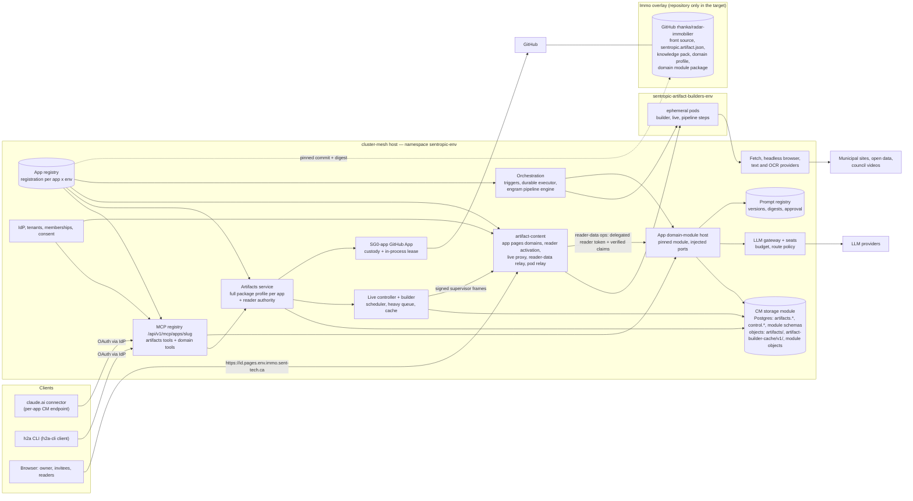

# CM-first artifacts and immo on cluster-mesh — cluster-mesh as the single host, apps as clients

## Amendment 13:52 (r3) — changelog

Owner inputs integrated (verbatim, authoritative, 2026-11-08):

- ~13:52: « Artefact a sa lib c ok. Mcp aussi mais tout a une raison d'être. Immo ne doit plus rien consommer hors cluster mesh. Même les détections de signaux doivent être dessus. »
- ~13:25, card rhanka/radar-immobilier#1041, relayed by i-cond at 13:58: « Tu dois basculer majoritairement sur cluster mesh toutes les fonctions, même la détection de signaux et la gestion des prompts associés. Pour l'orchestration ce devrait être vu avec sentropic. Manque probablement des fonctions de pipeline engram, de DAG, etc. » (the launch packet quotes « Il manque probablement … »; the card text is used here).
- ~14:05: « Artefact sera livré dans app avec la convergence. »
- ~14:08: « artefact doit sérialiser aussi bien en db que s3 via cluster mesh »
- ~14:12: « On a une putain de conception générale, je vois pas comment on va s'en sortir si tout est ad hoc comme ça. Immo doit utiliser notre sérialisation de données. »

Changes from r2:

1. §0.3 (new): the raison d'être of every kept component, starting with the `@sentropic/artifacts` library and the `artifacts_*` MCP surface, and what each one is not.
2. Scope widened from artifacts to every runtime capability Immo uses (§0.2 points 4–7). §12 (new) inventories Immo's consumptions outside CM with file:line and maps each one to a CM provider (existing or to build) and its wagon.
3. §13 (new) « Signal detection on cluster-mesh »: what runs where, data ownership (Immo authority, CM custody, Engram semantics), scheduling, versioned prompts, MCP tools (`search_signals`, `query_zoning_events`, …) served by CM.
4. §14 (new): what CM offers today for orchestration, with file:line (workflows and DAG, schedules, retries and resume, queues including the W8 heavy-phase queue, agent registry, prompts and catalog, LLM seats, MCP registry, memory), and the gaps to host Immo's pipeline.
5. §15 (new): co-preparation plan of the Focus decision dossier (views ACTUEL / TRANSITION / CIBLE), with Engram (gr-conductor) owning the pipeline/DAG part, and the questions to gr-conductor.
6. §2.4 (new): artifacts persist through CM storage bindings with two first-class backends, DB and S3: ports, default placement, per-deployment selection, DB row ↔ object consistency, migration between backends, never-delete across both.
7. §16 (new): « Conformance to the general design » (MODULE_STORAGE common rule CR-1..CR-5, DATA_ARCHITECTURE axes A–E, DATA_LIFECYCLE, DATA_MODEL, governance r11, the `storage-module-v1.json` manifest pattern) and the gaps to fill IN the general design (GD-1..GD-17), never by an ad hoc workaround.
8. §17 (new): profile mapping of every row of Immo's data-storage conformance inventory to a CM storage surface, profile set and leaf, with the lot ids i-cond turns into Immo migration lots.
9. §6 rewritten: the CM-first phases ride the convergence trains T1 … T5 instead of a parallel programme. This is a proposal for the s-archi verdict (owner, 08/11 ~13:25: no plan decision without an architect at max effort).
10. §10: D1 scope widened, D6 closed (the interim fix merged as #967, `a1b4c3839`, merge `e9f272c94`), D7 and D8 amended, D10–D16 added. Decision ids are stable.
11. §2.1, §2.2, §3.1, §3.3, §3.5, §4.4, §7.3 amended: Immo keeps no runtime in the target (front source, knowledge, domain profile, and a pinned domain module executed by CM where needed, D10). The reader-data relay targets the CM-hosted domain module once Immo's API is retired.
12. §5.3 updated with tonight's facts: the CM preprod object placement is the in-namespace RustFS store qualified on `GetPublicAccessBlock`; OVH stays a read-only copy source. §5.7 extends the never-delete rule to the DB blob table, every placement, placement migration and every Immo family migration.
13. Removed: the reading-time line of the owner dossier (COMMON-RULES: no time estimates).
14. Argon counter-review of the amended sections: §19.2.

## Status and authority

- **Status:** design specification **r3** (paper). r1 → r2: Argon REQUEST-CHANGES integrated (§19.1). r2 → r3: owner amendment 13:52 and the addenda 13:58, 14:05, 14:08 and 14:12, counter-reviewed by Argon (§19.2). No code, cluster, Track or GitHub change is made by this document. Build only on the owner decisions of §10 and, for any plan, train or wagon, on the s-archi verdict at max effort.
- **Authority:** the owner targets of 2026-11-08 (§0.1); then the general design (§16): this spec conforms to it and lists its gaps instead of working around them; then the frozen contracts it amends only on the subject of hosting (§8); then every unlisted clause of those contracts.
- **Author / review:** Claude Opus 5.5 (max) authored r1–r3. Gemini Argon (`gemini-4-argon`, effort high; `max` is not offered for this model) counter-reviewed r1 (`.tmp/rv/cm-first-artifacts-argon.md`) and r3 (`.tmp/rv/cm-first-artifacts-argon-r3.md`).
- **Evidence baseline:** Sentropic `origin/main` `c22163106` (#965) for r2 citations and `e9f272c94` (#967) for r3 citations; the only change between them is `api/src/services/artifacts/live/postgres.ts` (#967). Read from `tmp/worktrees/main-ro`. Immo `origin/main` `6de7892ec` (#1040), read with `git show`/`git grep` (no checkout changed). Immo conductor inventories `radar-immobilier tmp/conductor/cm-first/immo-inventory-outside-cluster-mesh.md` and `immo-data-storage-conformance.md` (read 08/11). Card rhanka/radar-immobilier#1041 (read with `gh issue view`). Night reports under `.tmp/rv/` (source ledger §18).
- **Reading convention:** `[FACT]` = verified in a cited source; `[JUDGMENT]` = design choice; `unverified` / `source-gap` = not established. "CM" = the cluster-mesh host, i.e. the Sentropic API + `artifact-content` deployment composing `@sentropic/cluster-mesh` in namespace `sentropic-<env>`. "Immo" = radar-immobilier.
- **Estimates:** no human-effort or time estimate is given (COMMON-RULES). Only measured machine waits appear (§6).

## 0. Owner target (verbatim) and reading

### 0.1 Verbatim

Owner, 2026-11-08 ~13:18 (authoritative):

> « Artefact et son mcp sont embed dans cluster mesh. Et immo le custo en surcouche a minima (devrait juste exposer la partie front spécifique et knowledge d archi) »

Owner, 2026-11-08 ~13:15:

> « artefact la logique github et tout doit etre embed first dans cluster mesh … tu as juste rien conçu »
> « app c pas la bascule complete cluster mesh ?? … demandé depuis des lustres » ; « On a fait un decision dossier pour A et des spec »

Owner, 2026-11-08 ~13:25 (card #1041), ~13:52, ~14:05, ~14:08, ~14:12: quoted in the changelog above.

### 0.2 Reading applied by this spec

1. **One host.** CM is the only runtime host of the artifacts capability: the `artifacts_*` MCP surface (including `git_*`, `live_*`, invitations, uploads, sharing), every artifacts store (artifacts, releases, ACL, consents, reader authority, drafts, git bindings, invitations, build ledger), the git port and GitHub App custody/lease, the live controller, builder pods, content edge, identity/consent/tenancy.
2. **Apps are clients.** An app (Immo first) is a registered client of the CM app registry. In the target it keeps no runtime: its front source, its architecture and domain knowledge, its domain profile and, only where it cannot be declarative, a pinned domain module executed by CM (§3.3, D10). No artifacts table, migration, MCP tool, content host, reader authority, S2S client, draft key or live edge stays in the app.
3. **« bascule complète »** is read with the app-cm programme inventory (`.tmp/rv/app-cm-inventory.md`): programme W (app = CM host of artifacts) and programme A (identity carried by CM). This spec extends W from "the Sentropic app is a second host" to "CM is the single host for every app" and depends on A for tenancy (§8). « decision dossier pour A » is read as programme A's dossiers and specs (identity), per that inventory §1.2.
4. **Every kept library and surface has a stated raison d'être** (13:52): `@sentropic/artifacts` stays a library and its MCP stays a defined surface; §0.3 states why each exists and what it is not.
5. **Immo consumes nothing outside CM** (13:52, 13:25). Every runtime capability Immo uses is provided by CM: artifacts, MCP, identity and consent, GitHub, LLM and seats, storage (DB and objects), scheduling, document fetch, text extraction and OCR, prompts, the signal detection pipeline and the domain tools that serve its results (§12, §13). « majoritairement » is read as: generic functions move to CM or Engram; what stays Immo's is content (ontology profile, prompts, source registry, scoring rules, tool wording, front source) and, where it cannot be declarative, a pinned domain module that CM executes (D10).
6. **Delivered by the convergence** (14:05). The artifacts capability (library + MCP + live + git) is delivered inside the Sentropic app by the app ↔ CM convergence trains (T4 / T4-prod / T5 of `.tmp/rv/app-cm-inventory.md` §4, held by `.tmp/rv/app-plan-archi-verdict.md`), not by a parallel programme (§6).
7. **One serialization** (14:08, 14:12). Artifacts persist through CM storage bindings with DB and S3 as first-class backends (§2.4). Immo's own data (signals, documents, ledger, ontology, geo, prospects) uses the same CM module storage contract and lifecycle (§16, §17). There is no app-specific persistence. Where the general design has a gap, the gap is filled in the general design (§16.2).

### 0.3 Components and their raison d'être

| Component | Raison d'être | It is not | Runtime consumers in the target |
|---|---|---|---|
| `@sentropic/artifacts` (library, 0.2.x) | The single implementation of the frozen artifacts contracts (G0 v3, A-LIVE v2: records and CAS publication, ACL and consent, lifecycle and GC, git port, live store, build receipts), host-neutral with injected ports (records store, CM blob/object bridge port, KV, forge). The semantics are versioned and tested once and reused by every composition without a fork | A host, a store, a deployment, a placement-routing engine, a runtime dependency of an app | CM only (API + `artifact-content`); tests and local compositions (SQLite stores, local blob store `packages/artifacts/src/adapters/local-blob.ts:31`) |
| `artifacts_*` MCP surface (31 tools) | The agent-facing contract of artifacts: exact names, frozen definitions including each app's wording, schemas, error vocabulary. Its stability keeps claude.ai « Always allow » grants valid (`radar-immobilier packages/immo-mcp/src/registry/artifact-provider.ts:46-80`) and h2a calls stable. Served only by the CM MCP registry, compiled per app registration, authorized per mutability with CM scopes | An app-hosted server; a second authorization system | claude.ai, h2a, agents, through the CM per-app endpoint (§4.1) |
| MCP kernel (`@sentropic/mcp-platform` registry, `@sentropic/cluster-mesh/mcp` facade) | One registration, selection and compilation semantics for every provider (artifacts builtin, Engram memory, an app's domain tools): exact names, deny on collision, deny-as-missing (`packages/cluster-mesh/src/mcp/registry.ts:1-12`, `packages/mcp-platform/src/registry.ts:373`) | A provider; an authorization server | CM host |
| CM storage kernel (`@sentropic/cluster-mesh/storage`, `./storage/postgres`, `./storage/sqlite`, `packages/cluster-mesh/package.json:59-67`) | The neutral serialization of the general design: three surfaces (`transactional`, `analytical`, `live-graph`), eleven profiles, common rule CR-1..CR-5, and the structural object/blob placement bridge (`db`, `s3`, `db+s3`) with qualification-bound admission (MODULE_STORAGE `:376-398`). Every module (comments, Engram memory, artifacts, an app's domain data) persists through one contract with host-injected drivers | A database; an owner of app schemas | CM host; each module declares a manifest |
| Engram (`@sentropic/engram`) | Semantics: profiles, extraction, receipts, memory; target owner of the pipeline/DAG contract (§15.3) | A service, a scheduler process, a store of app business data (`docs/governance/study.md:83`) | Executed in process by CM |
| `@sentropic/flow` (0.2.1) | The product workflow runtime: definitions, transitions, fan-out and joins, job queue (`spec/SPEC_WORKFLOW_RUNTIME.md:144-175`) | Today a cross-app pipeline engine: no leases, no schedules, single replica (`packages/flow/src/job-queue.ts:4-6`) | CM product workflows |
| `@sentropic/llm-mesh` / `@sentropic/llm-gateway` | One LLM access path with seat custody, budget admission and settlement (`api/src/routes/namespaces/gw.ts:1-42`) | A keyring held by an app | CM host; app workloads through CM (§12) |
| Immo overlay | Front source and descriptor, knowledge pack, domain profile (ontology, prompt content, source registry, scoring rules, tool wording), approval realm and, where needed, a pinned domain module (D10) | A runtime, a store, an MCP server, a credential holder | Read by CM at pinned commits and digests |

# PART A — Artifacts on cluster-mesh

## 1. Problem: the D0 topology and tonight's seams

### 1.1 Current topology [FACT]

- Immo hosts its own artifacts: « Host composition of the git mode (D0: immo composes the package locally) » (`radar-immobilier packages/artifacts-host/src/git-mode/compose.ts:32`). It owns git bindings, live drafts, draft keys, invitations, the host build ledger, its release store (Immo DB schema `artifacts`, drizzle `0015`–`0042`), its reader authority (`api/src/artifacts/reader-storage.ts` reads `artifacts.artifacts`, `artifacts.releases`, `artifacts.artifact_access` and Immo `account_users` to compute reader rights) and a bucket `radar-immobilier-artifacts-preprod` on OVH Object Storage (`deploy/overlays/preprod/patch-immo-mcp-config.yaml`).
- Immo's MCP server serves domain tools and artifacts tools behind a local registry with « no-central-registry-request » (`packages/immo-mcp/src/registry/mcp-registry.ts:21`). The claude.ai preprod connector lists 31 `artifacts_*` tools and 12 domain tools (tool list observed in this session, 2026-11-08). Immo serves its own frozen tool summaries, not the package descriptions (`packages/immo-mcp/src/registry/artifact-provider.ts:46-80`, §4.1).
- Immo serves its pages itself: Ingress hosts `*.pages.preprod.immo.sent-tech.ca`, `*.preprod.immo-pages.sent-tech.ca` and `*.pinned.preprod.immo-pages.sent-tech.ca` → `radar-api` (`deploy/overlays/preprod/artifact-content-ingress.yaml`). Content routing is one UUID label per base, artifact or release id, the `.pinned.` form never routes (owner decision 2026-11-02; same rule in the package, `packages/artifacts/src/content/routing.ts:1-27`).
- CM provides three remote services to that host (decision D0, `.tmp/rv/alive-enablement-plan.md` §1): the SG0-app lease broker (`POST /github-app/broker/lease|verify`), the builder/live service (`/api/v1/artifacts/builder`, host build API + host live API + two-step SG4b handoff calling back `https://preprod.immo.sent-tech.ca/api/v1/artifacts/live-host/v1/*`), and the live edge relay (`api/src/services/artifacts/live/README.md`, « For a remote host (D0) »).
- Artifacts are **preprod-only on the Immo side**: the prod base manifests (`deploy/k8s/30-api.yaml`, `40-immo-mcp-http-deploy.yaml`) carry no `ARTIFACTS_*` key; only `deploy/overlays/preprod` does.
- CM hosts a small artifacts surface for the Sentropic product (programme W, merged via #837): APP-P1 profile with four tools (`packages/artifacts/src/profile/radar.ts:7`), a commit policy approving only `ensure`/`publish` (`api/src/services/artifacts/authorization.ts:78-79`), package migrations `0001`–`0008` only (`api/src/services/artifacts/host-storage.ts:19-45`), UUID-only scope mapping (`api/src/services/artifacts/composition.ts:46`), a registry pinned to APP-P1 and one invoke scope (`api/src/services/mcp/cluster-registry.ts:25-56`).
- In CM preprod the API artifact host is **closed**: « the api artifact host stays CLOSED on this tier … no APP_ARTIFACT_S3_* credential is minted in Secret/sentropic-api » (`deploy/k8s/overlays/preprod/patch-api-config.yaml:117-122`, s-conductor decision 2026-11-08); `artifact-content` serves content with a read-only credential and refuses every non-GET/HEAD request except `/_reader/activate` (`apps/artifact-content/src/host.ts:138`).

### 1.2 Seam ledger of 2026-11-07/08

| # | Seam | What broke | Source | In CM-first |
|---|---|---|---|---|
| S1 | Immo → CM service token (issuer/resource) | Broker and builder guards expected the product host as `iss`/`aud` (http vs https); Immo calls got 403 | `.tmp/rv/broker-issuer-fix.md`; #963 | **Removed**: no service identity between hosts |
| S2 | Binding owner carried host → builder | The builder's binding view is « generation and owner of the host's last reconcile » (`api/src/services/artifacts/live/product-builder.ts:113`); owner mismatch (packet; details `unverified`) | packet | **Removed**: one binding store |
| S3 | Draft staging over HTTP | Remote rows adapter never persisted (`postgres.ts:72` at `c22163106`); every seal 204 lost; `control.artifact_host_kv` = 0 rows in preprod | `.tmp/rv/draft-not-staged.md` | Fixed on main by #967 (`a1b4c3839`, merge `e9f272c94`) for D0; **removed** by CM-first (drafts and controller share one database) |
| S4 | GitHub branch resolution | `/commits/{ref}` 422 mapped to `git_ref_not_allowed` | `.tmp/rv/fix-github-forge-resolve.md`; #965 (0.2.23) | Unchanged: package defect, host-independent (fixed) |
| S5 | Advisory lock + tree walk in `live_status` | `git_live_draft_unavailable` inside the Immo DB transaction | same report; R2 → 0.2.24 | Package fix still required; the Immo-DB migration/grant drift class disappears |
| S6 | Tenant membership for consent | Offline consent failed on missing CM membership after A4 | night plan 08:59; `.tmp/rv/tenant-memberships-gap.md` | Single realm (§3.7); bootstrap still required (T1 wagon `fix/cm-first-member-bootstrap`, branch now on origin) |
| S7 | Passkey RP parity | Credentials stamped with the API RP ID | `.tmp/rv/idp-passkey-diag.md` | Unchanged: identity (programme A) |
| S8 | Cross-repo package pins | Every package fix needed an Immo bump and APP-P1 digest pins | night plan 11:50 | **Removed for artifacts**: only CM consumes `@sentropic/artifacts` |

[JUDGMENT] S1, S2, S3 and S8 exist only because two processes own halves of one transactional capability. CM-first deletes those seams. S4/S5 stay on the package train; S6/S7 stay in programme A.

### 1.3 Why D0 was chosen, and why its premise falls

D0 rejected "H2" (CM hosts Immo's live state) because « Sentropic hosting immo's live state breaks the atomic publication transaction (`api/src/services/artifacts/live/ports.ts:68`) and needs immo's ACL and release state on every call » (`.tmp/rv/alive-enablement-plan.md` §1, §8). Both objections assume the release store stays in Immo. CM-first moves the release store, ACL, reader authority and bindings too, so the controller's publication port can again write release, index, receipt and publication baseline in **one** transaction of the CM database (§2.3). H3 (a second controller service account with pod ingress from Immo) stays rejected.

## 2. Target architecture

### 2.1 Diagram



In the target no CM → app call remains: CM reads the app repository at pinned commits (front, knowledge, profile, domain module) through the GitHub App, and every domain operation runs in CM. During the transition (§15.2), the reader-data relay and the domain tools may still reach the Immo API and the Immo MCP with user-delegated, short-lived tokens (audience = the app API, CM-verified claims, no service identity, no callback into the app), as r2 specified.

### 2.2 Ownership matrix

| Concern | CM | App (Immo) |
|---|---|---|
| `artifacts_*` MCP tools (all, incl. `git_*`, `live_*`, invitations) | hosts, compiles per app, authorizes | selects the profile and its tool wording in the registration |
| Artifacts/release/ACL/consent/lifecycle stores, reader authority | yes, through CM storage bindings (§2.4) | reader profile values (name, policy revision, capabilities) |
| Drafts, live runtime, invitations, build ledger | yes | no |
| Draft and cursor keys, App keys, webhook secrets | custody | none |
| Git port, GitHub App enrollment, leases | yes (in-process) | repo registry values (G0 §2.1 shape) |
| Builder pods, cache, heavy queue | yes | `sentropic.artifact.json` + `build:artifact`, executor policy value |
| Content edge for the app pages domains, reader activation broker, consent and confirmation screens | yes (app branding from registration) | brand strings |
| Knowledge pack | loads from app repo at a pinned commit, caches, serves | authors the files |
| Domain data (signals, documents, ledger, ontology, geo, prospects) | custody and operation: CM storage module, lifecycle enforcement, backups (§16, §17) | data authority: types, schemas, retention values, access policy, legal basis (APP_MCP_PROVIDER_PLATFORM §2.2) |
| Signal detection pipeline | executes: triggers, durable executor running the Engram engine, step pods, LLM/fetch/OCR providers (§13) | domain profile: ontology, prompt content, source registry, classification and scoring; pinned module where not declarative (D10) |
| Domain MCP tools and reader-data operations | serves them (per-app endpoint, content edge) and runs their handlers (§4.4) | tool definitions and wording; handler code inside the pinned module (D10) |
| Prompts | versioned registry, digests, approval, promotion (§13.4) | prompt content and evaluation sets |
| LLM, seats, budget | gateway, seat custody, admission, route policy | route policy values per step |
| Tenancy, membership record, roles | record and enforcement | approval realm: decides members and roles through CM |
| UI | embeddable artifact panel (W4.c), CM screens; target: builds and serves the app front (D15) | front source; its pages embed artifact views |

### 2.3 Co-located composition (replaces D0)

CM composes the package once per registration, in process, with the ports D0 fed over HTTP:

| Port / part | D0 (today) | CM-first |
|---|---|---|
| `GitInstallationLeasePort` | Immo HTTP client to `/github-app/broker/lease` with an S2S token (`lease-broker.ts`) | in-process call into the SG0-app custody of `github-app-host.ts`, as the builder already does for its reads (« Forge reads through the in-process SG0-app lease », `api/src/services/artifacts/live/forge-lease.ts:30`); no broker route |
| Package `LiveWorkerPort` | Immo HTTP client to `/v1/live/reconcile|stop|grant` (`live-grant.ts`) | existing in-process bridge `createLiveWorkerBridge` (`api/src/services/artifacts/live/bridge.ts`) |
| Controller `drafts` | pages pushed by the host into `remote-drafts.ts` | read from the package `LiveStore` (`artifacts.live_drafts`, `live_draft_objects`) in the same database, with the CM-held keyring |
| Controller `invitations` | state pushed with each reconcile (`remote-live.ts`) | read from `artifacts.live_invitations` / `live_invitation_epochs` |
| Controller `jobBinding` | host-pushed coordinates (`forge-binding.ts` remote admit) | read from `artifacts.git_bindings` at the job's generation |
| Controller `publication` | two-step cross-host SG4b handoff (`handoff-publication.ts`) with host receipts | **new adapter to build** (`createLocalPublication`, indicative name): `job()` resolves the pending job from the CM build ledger; `commit({client})` writes release, index, receipt and B2 baseline with the package store **on the same `PoolClient`** as the controller's `LiveStore.transaction` (schemas `artifacts` and `control` live in the same CM database). This is the port's own contract (« Atomic SG4 release/index/receipt writes in the supplied store transaction; never network publication here », `ports.ts:89-94`); no implementation exists today [FACT, Argon A1] |
| Service composition | `createBuilderService` = controller + host APIs + remote rows (`service.ts:71-108`, used by `product-builder.ts:98-136`) | **replaced** by a co-located composition that keeps `createArtifactLiveService`, `createBuildJobs`, `createLiveScheduler` and the build-only path, and wires the local ports above; only the remote parts are deleted (§7.2) |
| Live edge gate | Immo content host evaluates A-LIVE §8.2 and forwards with a signed host assertion (`live-edge-forward.ts`) | `artifact-content` evaluates §8.2 itself (owner, invitee, code role, consent) and proxies to the pod |

**Non-atomic boundaries that remain, all inside CM** (each already has a durable intent; CM-first changes their location, not their nature):

| Boundary | Protection | CMF-3 fixture |
|---|---|---|
| Package live store (`artifacts.live_*`) vs controller runtime (`control.artifact_host_kv` `artifact-live-runtime/v1`) | Durable package ACK first, then the bridge reconciles toward it with session/lease/route fences; boot-time recovery of interrupted intents | Crash between package ACK and controller reconcile; replay of an old command |
| Object writes before the DB commit | `artifacts.object_intents` + explicit GC (`lifecycle.ts`); create-only puts (§2.4.4) | Existing publication crash fixtures on the co-located path, on both placements |
| GitHub ref CAS vs DB | `artifacts.git_attach_intents`, G0 §3.1 recovery | Existing commit/attach crash fixtures |
| Supervisor candidate vs publication | Sealed candidate digest, attempt fence, single-use job | Crash after seal, before publication commit |

Unchanged: the controller state machine, supervisor transport, pod placement and VAP, dependency cache, heavy-phase queue, idle rules, A-LIVE amendment 1 (no absolute lifetime) and Immo reservations R1–R4 (`.tmp/concertation-git-artifact/a-live-v2-signature-immo.md`). Builder-attested provenance (A-LIVE §8.4) is kept: the supervisor seals the candidate; the receipt is signed with the builder key (`ARTIFACT_BUILDER_HANDOFF_SIGNING_KEY_JSON`, kept); host receipt keys lose their purpose (§7.2).

### 2.4 Artifacts storage through cluster-mesh: DB and S3 backends

Rule (owner 14:08, 14:12): artifacts persist only through CM storage bindings, never through an app-local store. Two backends are first-class: a DB backend (Postgres first, SQLite for local and self-host) and an S3 backend (object placement). The general design already allows both: records belong to the transactional surface, and « S3/object storage is a possible placement for data of any surface, not their common control plane » (`spec/SPEC_EVOL_CLUSTER_MESH_MODULE_STORAGE.md:155-156`); an object is « an addressable immutable logical payload/version, including a SQL row version » (`:186-187`), so blob bytes stored in a DB row are conformant.

To avoid inventing a parallel storage subsystem inside `@sentropic/artifacts` [Argon r3 B2], the dual-backend (`db`, `s3`, `db+s3`) blob/object bridge and qualification-bound placement binding live in `@sentropic/cluster-mesh/storage` as the MODULE_STORAGE structural object bridge (`spec/SPEC_EVOL_CLUSTER_MESH_MODULE_STORAGE.md:376-398`, lots L12–L18, GD-3/GD-4), and `@sentropic/artifacts` consumes that bridge structurally without owning backend selection or composite routing. Under MODULE_STORAGE `:172-173` (« Existing installations are not retroactively conformant »), `T4a` ships the CR-1/CR-2/CR-4 blob bridge and DB placement on top of package migrations `0001`–`0014`, while full one-way `CommonStorageModule` activation for the `artifacts` module waits for `GD-1`–`GD-3` qualification [Argon r3 B8].

#### 2.4.1 Ports

```ts
// Defined in @sentropic/cluster-mesh/storage (MODULE_STORAGE :376-398, common-contract.ts:204-208)
// and consumed structurally by @sentropic/artifacts.
interface ArtifactRecordBinding {
  backend: 'postgres' | 'sqlite';
  adapter: { id: string; version: string; configDigest: string; qualificationRef: string };
}

// Object placement of digest-addressed blobs. Evolves today's PublicationBlobStore
// (packages/artifacts/src/server/publication.ts:58-70). Key discipline unchanged:
// artifacts/<scope>/blobs/sha256/<64 hex> (packages/artifacts/src/adapters/s3.ts:22).
type BlobKey = string;
interface ArtifactBlobPort {
  /** CR-1: caller buffer is cloned before verification; sha256(bytes) must match the key digest
   *  before any I/O; create-only at the storage concurrency boundary (S3 If-None-Match: "*",
   *  DB ON CONFLICT DO NOTHING); identical bytes are idempotent via read-back verification,
   *  different bytes fail closed without touching the existing object. */
  putBlob(key: BlobKey, bytes: Uint8Array): Promise<{ created: boolean }>;
  /** CR-2: the adapter verifies digest and byte length before returning bytes as verified. */
  getBlob(key: BlobKey): Promise<Uint8Array | undefined>;
  getBlobRange?(key: BlobKey, start: number, endInclusive: number): Promise<Uint8Array | undefined>;
  headBlob(key: BlobKey): Promise<{ bytes: number } | undefined>;
  /** CR-4 (common-contract.ts:204-208): bounded by item count, encoded bytes, and work/deadline
   *  budget; continuation cursor is opaque, scope-bound, and integrity-protected. */
  listKeys(
    prefix: string,
    page: { maxItems: number; maxEncodedBytes: number; continuation?: string },
  ): Promise<{ keys: BlobKey[]; continuation?: string }>;
  /** CR-5: maintain right only, package lifecycle path only (AP-1, §5.7). */
  deleteBlob(key: BlobKey, grant: MaintainGrant): Promise<void>;
}

interface ObjectBindingRef { bindingId: string; bucket: string; qualificationRef: string } // secret references only

interface ArtifactStoragePlacement {
  records: ArtifactRecordBinding;
  blobs:
    | { mode: 'db' }                                                  // DB placement (package migration 0014)
    | { mode: 's3'; object: ObjectBindingRef }                        // object placement
    | { mode: 'db+s3'; inlineMaxBytes: number; object: ObjectBindingRef }; // small blobs in DB, the rest in S3
  builderCache: { mode: 'off' } | { mode: 's3'; object: ObjectBindingRef }; // derived, rebuildable
}
```

DB placement and publication/GC/staging/content wiring (`packages/artifacts/migrations/0014_db_blob_placement.sql`, following `0013_live_invitations.sql`) [Argon r3 B2]:

1. **Preparation before finalization (`publication.ts:648-658, 707-710`).** During publication preparation, `blobs.putBlob(key, bytes)` runs **before** `unit.registerBlob(storageScopeId, digest, size)` runs inside the finalization transaction (`:486-491`, `:708`). Therefore `artifacts.blob_bytes(storage_scope_id TEXT NOT NULL, digest TEXT NOT NULL, bytes BYTEA NOT NULL, created_at TIMESTAMPTZ NOT NULL DEFAULT now(), PRIMARY KEY (storage_scope_id, digest))` has **no** foreign key to `artifacts.blobs` (prepared blobs exist in `blob_bytes` before `registerBlob` commits, protected from GC by `artifacts.object_intents` and `artifacts.blob_pins`). The DB blob adapter parses `(storage_scope_id, digest)` (`digest = 'sha256:<hex>'`) from `artifacts/<scope>/blobs/sha256/<hex>` via `blobDigestOfKey`. Migration `0014` also adds `placement TEXT NOT NULL DEFAULT 'object' CHECK (placement IN ('object','db'))` to `artifacts.blobs` (`0001_artifacts.sql:52-58`), and `registerBlob` records `'db'` when `mode === 'db'` or (`mode === 'db+s3'` and `size <= inlineMaxBytes`), else `'object'`. Existing rows read as `'object'`. The runtime role has `SELECT, INSERT` only on `blob_bytes`; `DELETE` is granted only to the lifecycle maintenance role (CR-5, AP-1).
2. **Upload staging (`uploads.ts`, `gc.ts:338-426`).** `StagingStore` writes temporary upload buffers under `artifacts/<scope>/staging/<uploadId>` (not digest-addressed) and sweeps them via `createUploadSweeper`. It stays a separate port from `ArtifactBlobPort`: in `s3` and `db+s3` modes it uses the object store prefix; in `db` mode it uses a dedicated TTL-swept table `artifacts.upload_staging_bytes(storage_scope_id, upload_id, bytes, updated_at)` in `0014`, never `artifacts.blob_bytes`.
3. **Composite `db+s3` routing and GC (`gc.ts:184-187, 258-303`).** The CM composite blob adapter routes `putBlob(key, bytes)` to `artifacts.blob_bytes` when `bytes.byteLength <= inlineMaxBytes` and to S3 otherwise. On `getBlob`/`headBlob`, it checks the registered placement (or probes DB then S3 for prepared-but-unfinalized blobs). On `listKeys(prefix, page)`, it returns the bounded ordered union of keys from `artifacts.blob_bytes` (formatted as `artifacts/<scope>/blobs/sha256/<hex>`) and the S3 prefix under a single integrity-protected continuation cursor. On `deleteBlob(key, grant)`, executed under the `createPostgresDeletionClaimStore` advisory digest lock (`gc.ts:184-187`), it deletes from `artifacts.blob_bytes` and/or S3 so neither an orphan DB row nor an orphan S3 object can survive GC.
4. **Content edge (`apps/artifact-content`).** `apps/artifact-content/src/runtime.ts` is wired with the same read-only CM composite blob adapter (`db`, `s3`, or `db+s3`). In `CMF-S2`, `deploy/ci/artifact-content/object-store/artifact-content-db-role.sql` is updated to grant the read-only `artifact-content` DB role `SELECT` on `artifacts.blobs` and `artifacts.blob_bytes` (closing its documented privilege gap).

Version line: the port changes stay additive on the 0.2.x line that cluster-mesh pins (`ARTIFACTS_RANGE = '>=0.2.0 <0.3.0'`, `packages/cluster-mesh/src/modules/catalog.ts:16`). The unbounded `listKeys` and the ungated `deleteBlob` are deleted once their last consumer outside CM (Immo, until CMF-11) is gone (no legacy fallback).

#### 2.4.2 What goes where by default

| Data | Default placement | Notes |
|---|---|---|
| Catalog and current pointers, releases and manifests, access/consent and their events, drafts and draft objects (encrypted envelopes), git bindings, release index and attach intents, invitations and epochs, upload sessions and pages, idempotency keys and operation receipts, object intents, blob registry rows, quotas | DB: `artifacts.*`, `artifact_host.*` and the artifact namespaces of `control.artifact_host_kv` | Transactional surface. Postgres in cluster environments, SQLite for local and self-host (package SQLite adapters exist: `packages/artifacts/src/adapters/sqlite-store.ts`) |
| Release blobs, assets, bundles, knowledge-pack bundles | `s3` in cluster environments; `db` in DB-only deployments; `db+s3` when a registration sets an inline threshold | Digest-addressed under `artifacts/<scope>/blobs/sha256/<hex>`; a knowledge bundle is a scope blob plus a DB row `(repoId, commitSha, digest)` (§3.4) |
| Upload staging buffers (`artifacts/<scope>/staging/<uploadId>`) | `s3` in `s3`/`db+s3` deployments; `artifacts.upload_staging_bytes` in `db`-only deployments | Ephemeral staging (`StagingStore`), swept by `createUploadSweeper` (`gc.ts:338-426`) |
| Builder dependency cache | `s3` under `artifact-builder-cache/v1/` with its own bucket and credential (`api/src/services/artifacts/live/cache-storage.ts:13-23`, `:41`, `:123`), or `off` | Derived and rebuildable, not artifact data; still a protected prefix (AP-1). DB-only deployments run builds without a shared cache |

#### 2.4.3 How a deployment chooses DB-only, S3 or both

- The CM host configuration of each environment lists the qualified bindings and the modes it offers (indicative key `APP_ARTIFACT_STORAGE_JSON`: records binding, object bindings, allowed blob modes, bounds of `inlineMaxBytes`). Admission is qualification-bound: each binding names its exact adapter, version and configuration digest and a passing qualification record (MODULE_STORAGE `:382-398`). Today the preprod RustFS store is qualified on the private-bucket check; MinIO answers 501 and Scaleway fr-par 405 (`deploy/ci/artifact-content/object-store/README.md:9-14`); OVH is `unverified`.
- Each registration selects `storage.placement` among the modes its environment offers (§3.1). An unknown binding, an unqualified tuple or a mode the environment does not offer refuses that registration at boot; the other registrations keep running.
- Changing the mode of an existing scope is a placement migration (§2.4.5), never a configuration flip.

#### 2.4.4 Consistency between DB rows and objects

- The DB is the single publication authority (CR-3: « For S3 payload placement, objects are prepared first and the same SQL-controlled publication decision makes them visible », MODULE_STORAGE `:270-275`).
- Write path [Argon r3 B3]: (1) record an `artifacts.object_intents` row, which protects prepared objects from GC; (2) `putBlob` clones the caller byte buffer before verification (`MODULE_STORAGE:207`) and checks, before any I/O, that `sha256(bytes)` equals the `<hex>` digest named by `key` (mismatch fails closed immediately); it then performs a conditional create at the storage concurrency boundary: on S3 with `PutObject` + `If-None-Match: "*"` (required by the object-store qualification record; if the precondition returns `412 Precondition Failed` because the key already exists, the adapter calls `getBlob`/`headBlob` to verify that the stored object has the exact byte length and SHA-256 and returns `{ created: false }`, never issuing an unconditional overwrite), and on DB with `INSERT INTO artifacts.blob_bytes(storage_scope_id, digest, bytes) VALUES ($1, $2, $3) ON CONFLICT (storage_scope_id, digest) DO NOTHING` followed by a length and SHA-256 verification on conflict (CR-1, `MODULE_STORAGE:199-205`); (3) one DB transaction commits release rows, the current pointer, `artifacts.blobs` rows with their `placement` (`'db'` or `'object'`), and receipts; (4) the intent is closed after the commit.
- A failure before step (3) leaves nothing visible; the prepared object becomes collectable by the lifecycle GC only after its intent protection is released (CR-3, MODULE_STORAGE `:282-285`).
- Read path: digest → blob row → placement; the reader checks digest and length before serving bytes as verified; a missing, truncated or wrong-digest object fails closed (CR-2). Whether today's content handler verifies every read is `unverified`; CMF-S1 adds the check.
- Gaps closed by CMF-S1: the S3 `putBlob` writes unconditionally and checks only the key pattern, not the digest of the bytes (`packages/artifacts/src/adapters/s3.ts:39-44`; the local adapter already verifies SHA-256 on put, `local-blob.ts:4-6`, `:26-27`; MODULE_STORAGE `:484`, « The create-only gap stays open »), and `listKeys` returns an unbounded list (CR-4).
- Digest addressing makes identity exact across placements: the same key names the same bytes in DB and in S3.

#### 2.4.5 Migration between backends

- Maintenance operation (indicative `placement-migrate`), maintain right only (CR-5), bounded pages (`CommonBoundedPage`, CR-4), resumable from a durable cursor: copy each blob to the target placement, verify length and SHA-256, then switch `artifacts.blobs.placement` in one DB transaction per bounded batch with a receipt (CR-3). The reverse direction is the same operation.
- The migration never deletes the source copy. Collecting it is a separate maintenance act, owner-approved, after an AP-3 count and digest report on the target.
- Same tool family and report as §5.5 (Node/TS and native binaries, make targets, no Python).

#### 2.4.6 Never-delete, off-PVC backup and PVC sizing across both backends

- AP-1..AP-4 (§5.7) cover `artifacts.blob_bytes`, `artifacts.upload_staging_bytes`, and every object placement (the `artifacts` bucket of each environment, the builder cache prefix), in addition to the r2 surfaces.
- Off-PVC backup and durability [Argon r3 B4]: `deploy/k8s/base/70-pgbackup-cronjob.yaml` runs `pg_dump` only and does not back up RustFS/S3 (`spec/SPEC_EVOL_DATA_ARCHITECTURE.md:139-140`), while preprod RustFS runs as a single-replica Deployment on one `5Gi` PVC (`deploy/k8s/overlays/preprod/artifact-object-store/store.yaml:48, 108-116`). Enabling objectVersioning inside the same `5Gi` PVC does not protect against PVC or node loss. Therefore `CMF-1o` requires a scheduled off-PVC backup/replication job (`s5cmd sync` to an off-cluster/off-PVC backup bucket with object lock/retention, verified by `restore-witness-v1`) in addition to the Postgres backup CronJob (`70-pgbackup-cronjob.yaml`) and AP-2 on any whole-database restore.
- Explicit PVC capacity and quota prerequisites [Argon r3 B4]: CM base Postgres provisions a `1Gi` PVC (`deploy/k8s/base/20-postgres.yaml:99-100`), preprod RustFS provisions a `5Gi` PVC (`store.yaml:108-116`), and `sentropic-preprod` is at `4/4` PVC count quota (`deploy/ci/artifact-content/object-store/README.md:45-47`). Before enabling `db` or `db+s3` blob placement in cluster environments or migrating `T5c` domain families, the CM Postgres PVC must be resized above `1Gi` (in-place PVC expansion, zero additional PVC count); before copying Immo's artifact blobs (`CMF-10`) or raw documents (`IMM-D04`), the RustFS PVC must be sized against the measured corpus + backup/versioning headroom (in-place PVC expansion or quota increase with k8s).
- Placement migration keeps its source (§2.4.5). Only the package lifecycle (owner-initiated purge per artifact) deletes artifact bytes; DATA_LIFECYCLE DL-10 real delete for PG and S3 applies to that path only.

#### 2.4.7 Tonight's facts reused

- The preprod CM object store is RustFS 1.0.4 in `sentropic-preprod`, digest-pinned, on a 5Gi `block-standard` PVC, qualified on `GetPublicAccessBlock` (all four flags true), with buckets `artifacts` (read principal of `artifact-content`) and `artifact-builder-cache` (read-write principal of the API), rotation at most every 90 days (`deploy/k8s/overlays/preprod/artifact-object-store/store.yaml:1-12`; `deploy/ci/artifact-content/object-store/README.md:3-21`, `:35-40`).
- Key discipline `artifacts/<scope>/blobs/sha256/<hex>` is enforced before any I/O (`packages/artifacts/src/adapters/s3.ts:22`, `:30-34`).
- The builder cache store has its own bucket and credential under `artifact-builder-cache/v1/` (merged #954).
- The API host storage installs package migrations `0001`–`0008` (`api/src/services/artifacts/host-storage.ts:19-45`); the package on `origin/main` ships `0001`–`0013` (`packages/artifacts/migrations/0001_artifacts.sql` through `0013_live_invitations.sql`). CMF-1 installs `0009`–`0013`; CMF-S2 adds `0014` (`0014_db_blob_placement.sql`).
- The CM API holds no write credential on the preprod `artifacts` bucket (`patch-api-config.yaml:117-122`); CMF-1o mints it (owner gate).
- Capacity: the `5Gi` RustFS PVC (`4/4` namespace PVC quota) and the `1Gi` base Postgres PVC compared with Immo's artifacts bucket and Immo's document corpus are `unverified` (measured and resized in-place in CMF-1o before any copy; documents are §17 row 4).

## 3. Contract between CM and an app

### 3.1 Registration record

Host configuration, never an MCP surface (the G0 §2.1 rule). One record per app instance (app × environment). Source of truth: a reviewed configuration file in the Sentropic deploy overlay (indicative key `APP_ARTIFACT_REGISTRATIONS_JSON`, same pattern as `ARTIFACT_BUILDER_REPOSITORIES_JSON`), validated at boot, projected into `control.app_instances` (`api/src/db/control-schema.ts:207-236`) for catalogue status. Values come from the app owner through a reviewed PR; CM never reads them from the app at runtime.

```ts
interface AppArtifactsRegistration {
  appInstanceId: string;          // control.app_instances.id (APP_CATALOG Q2 vocabulary)
  appSlug: string;                // 'radar-immobilier'
  environment: 'preprod' | 'prod';
  tenantId: string;               // CM tenant of the instance (§3.7); pins OAuth tid (§3.2)
  workspaceId: string;            // shared app workspace in that tenant
  storage: {
    storageScopeId: string;       // native: UUID minted by CM; imported: exact legacy id (§5.2)
    origin: 'native' | 'imported';
    quotaBytes: number;
    actorQuotas?: { maxBytes: number; ratePerWindow: number; windowSeconds: number };  // Immo general mode
    placement: 'db' | 's3' | 'db+s3';    // among the modes the environment offers (§2.4.3)
    inlineMaxBytes?: number;             // db+s3 only, within the environment bounds
  };
  profile: { selectedCapabilities: string[]; profileDigest: string; manifestDigest: string };
  presentation: { toolSummaries: Record<string, string>;   // app wording of served descriptions (§4.1)
                  toolDefinitionsDigest: string };         // hash of the served definitions, frozen
  mcp: { resource: string; clientIds: string[] };          // §4.1
  viewAddress: {                  // SPEC_PROPOSAL_ARTIFACT_VIEW_HOSTING §2, both H1 modes
    mode: 'app-subdomain' | 'distinct-domain'; appOrigin: string;
    contentBaseDomains: string[]; // every routed base, e.g. pages.preprod.immo.sent-tech.ca, preprod.immo-pages.sent-tech.ca
    nonRoutingHosts: string[];    // hosts kept on TLS/Ingress that answer 404, e.g. *.pinned.preprod.immo-pages.sent-tech.ca
  };
  embedding: { frameAncestors: string[] };                 // exact same-environment https app origins
  repos: HostRepositoryRegistryEntry[];                    // G0 §2.1 shape, unchanged (Immo: A1 values)
  build: { descriptorPath: 'sentropic.artifact.json'; recipe: 'build:artifact';
           executorPolicy: 'sandbox-only' };               // Immo's current host policy (withHostGitPolicy)
  git: { committer: { name: string; email: string };
         humans: { principalId: string; name: string; email: string }[] };   // GitHumanDirectory
  knowledge: { repoId: string; commitSha: string; path: string; digest: string };   // §3.4
  readerData: {
    profile: { name: string; policyRevision: string; capabilities: string[] };     // Immo: radar-baskets, basket-read-v3
    upstream: string; audience: string;   // transition: the Immo API; target: the CM domain-module host (§3.5)
    operations: { name: string; method: 'GET' | 'POST'; capability: string; consentScope?: string;
                  maxRequestBytes: number; maxResponseBytes: number }[];
  };
  consent: { brand: string; title: string; supportUrl?: string; declaredScopes: string[] };
  roles: { codeRight: string };                            // CM tenant role carrying code rights
  domain?: {                                               // target only (§13, D10–D13); absent during T4a
    storageModule: { moduleId: string; manifestDigest: string };          // §17, GD-1/GD-2
    profile: { ontology: string; sources: string; scoring?: string };     // pinned digests (engram profile bundles)
    prompts: { promptId: string; version: string; digest: string }[];     // CM prompt registry (§13.4)
    module?: { package: string; version: string; integrity: string };     // D10, executed by CM
    pipelines: { id: string; schedule: { cadence: string; timeZone: string; suspend: boolean };
                 llmRoutes: { step: string; routePolicy: string }[] }[];  // §13.5
    tools: { definitionsPath: string; definitionsDigest: string };        // Immo domain tools (§4.4)
  };
  revision: string; reviewedBy: string[];                  // integrity metadata only, never authority
}
```

Validation (fail closed: boot refuses the registration, other registrations keep running): unknown app instance or tenant mismatch; slug/environment/content-domain collision with another registration; imported scope id not matching `^[A-Za-z0-9_-]+$`, already bound elsewhere, or colliding with reserved internal namespaces of `control.artifact_host_kv` (anything starting `app-artifact-` or `artifact-`, or containing `/`) [Argon A8]; profile digest not matching the compiled selection; served-definitions digest mismatch; repo entry outside the enrolled GitHub App installations, or a repo locator already bound to another registration of the environment (`github-app-host.ts:188-198` keeps one scope per locator) [Argon A10]; knowledge digest mismatch; reader-data upstream not an approved https origin of the same environment; `frameAncestors` or `appOrigin` not exact https origins of the same environment; storage placement not offered by the environment (§2.4.3); and, when `domain` is present: storage module manifest not admitted, a profile or prompt digest not found or not approved, module integrity mismatch, invalid schedule descriptor, unknown route policy.

### 3.2 Scopes and identities

| Item | Rule |
|---|---|
| Storage scope | One per registration; every artifacts read/write is qualified by it; CM binds (tenant, workspace) → scope from the registration, not from the UUID minting path |
| Principal ids | IdP subjects (`sub`), the same id space in Immo and CM per environment [FACT: Immo stores IdP subs (`IMMO_ARTIFACTS_GIT_CODE_READERS`); the same owner sub is the CM preprod account, night plan 04:00] |
| MCP resource | per app: `https://<cm-api-origin>/api/v1/mcp/apps/<appSlug>` (indicative path, fixed in CMF-4); tokens are audience-bound to it |
| OAuth tenant (`tid`) | pinned to `registration.tenantId` at consent and token issuance for that resource; a user approved in several tenants (owner, Farid, Steve are already members of `sentropic`, `.tmp/rv/tenant-memberships-gap.md`; `listApprovedTenantIds`, `api/src/services/identity/cm-oauth-tenancy.ts:27`) always receives the app's tenant for the app resource [Argon A9] |
| OAuth scopes | explicit artifact read and write scopes per tool mutability, plus discovery and `offline_access`; artifact tools never borrow a domain scope (rule kept from `mcp-registry.ts`) |
| Service identities | **Target (`T5d`):** none between CM and an app; scheduled pipelines run inside CM under an in-process CM app workload principal bound to `(tenantId, workspaceId, appInstanceId)` (GD-14), never under an app-held credential. **Transition (`T5a` only, before `T5d` cutover):** if an Immo CronJob calls CM `/api/v1/gw` or the CM prompt/email providers before its pipeline execution moves to CM in `T5d`, it authenticates with a single time-boxed, scope-pinned confidential `service_clients` binding (`api/src/db/schema.ts`, `spec/DATA_MODEL.md:281-290`) restricted to `(tenantId, workspaceId, appInstanceId)` and revoked at `T5d` alongside the artifacts S2S client [Argon r3 B1]. No CM → Immo service identity or write back-channel is ever introduced |

### 3.3 What the app keeps

1. **Front:** its UI source in its repository (the artifact build input under A1), its descriptor and build script, and its pages that embed artifact views (§3.6). In the target CM builds and serves the front (D15).
2. **Architecture knowledge:** the knowledge pack files (§3.4).
3. **Domain knowledge:** ontology profile, source registry (cities, adapters configuration), prompt content and evaluation sets, classification and scoring rules, domain tool definitions and wording, as pinned, digest-verified content (§13).
4. **Domain module, only where the domain cannot be declarative (D10) [Argon r3 B5]:** a package built from the enrolled app repository at a pinned commit, pinned by exact version and SHA-256 integrity digest in `registration.domain.module`, and executed by CM in an isolated worker/step pod or compartment with **zero ambient authority** (no raw `pg.Pool`, no `process.env`, no filesystem credentials, no arbitrary outbound `fetch`). It receives only scope-pinned CM port handles injected per invocation (storage-module grants bound to `(tenantId, workspaceId, storageScopeId)`, LLM gateway, prompt registry, fetch provider, OCR provider) under strict per-invocation CPU, memory, payload-byte, and wall-clock deadline ceilings (CR-5, MODULE_STORAGE `:340-348`, GD-15).
5. **Approval realm:** who belongs to the app tenant and with which role, exercised through CM (§3.7).
6. **Registration values:** the record of §3.1, including the presentation overlay (tool summaries, consent brand, embedding origins), the reader profile, the storage placement choice, the schedules and route policies.

The app keeps the **data authority** over its domain data (types, retention values, access policy, legal basis: APP_MCP_PROVIDER_PLATFORM §2.2, `spec/SPEC_EVOL_APP_MCP_PROVIDER_PLATFORM.md:114-122`); CM holds custody and operation (§13.2). In the target the app keeps no runtime, store, MCP server or credential. During the transition the Immo API and its data stay until each family moves (§15.2).

### 3.4 Knowledge pack

- Files under one directory of the app repository (indicative `artifact-knowledge/`): authoring guide, API guide, templates and starters, design-kit assets (Immo: `api/src/artifacts/design-assets/*`, `design-kit.ts`, `map-kit.ts`, the content of `packages/immo-mcp/src/registry/{artifact-authoring-guide,framework-starters,starter-files}.ts`).
- CM reads it once per registration change at the registered full commit SHA through the existing GitHub App lease, verifies the registered digest, and stores the verified bundle as a scope blob with a DB row keyed by `(repoId, commitSha, digest)` (§2.4.2) [Argon A12]. Serving (`artifacts_get_template`, `artifacts_get_api_guide`, the content design path) reads the stored bundle; boot and serving never depend on GitHub reachability. A new pack version = a reviewed registration change (new SHA + digest).
- The domain profile (ontology, source registry, scoring) and the domain tool definitions follow the same rule: pinned commit, verified digest, stored copy (§13).

### 3.5 Reader authority and reader-data operations (Data = C)

- **Reader authority moves to CM.** Immo's `reader-storage.ts` is artifacts-host runtime, not domain data [FACT, Argon A2]: it resolves releases and files, evaluates the ACL with `evaluateAccess` and computes reader capabilities from `artifacts.*` and the approval table. In CM, the same evaluation runs on CM stores and CM membership; the app supplies only `readerData.profile` (Immo: `radar-baskets`, `basket-read-v3`, capabilities `signals.protected-read`, `geo.read`).
- **Reader identity for the relay (new work).** Today the content origin holds only a content grant cookie (`__Host-artifacts_grant`, claims principal/artifact/release), and `artifact-content` refuses every non-GET/HEAD request except activation (`apps/artifact-content/src/host.ts:138`) [FACT, Argon A2]. CM-first adds: at `/_reader/activate`, CM's activation broker (on the CM origin, with the reader's IdP session) records a server-side view session (encrypted, bound to the ticket, reader, artifact, release, channel and expiry). For a registered operation, the relay asks the IdP's token-exchange issuer binding (`TokenExchangeIssuer.verify/mint`, `packages/cluster-mesh/src/token-exchange.ts`; CM and the IdP are the same trust domain) for a short-lived reader token, audience = the operation's upstream, carrying CM-verified claims `{readerSub, artifactId, releaseId, tenantId, workspaceId, storageScopeId, capabilities, policyRevision, authorizationVersion, operation}`. No cookie, bearer or session reaches the upstream; no service-account fallback.
- **Upstream side (transition HTTP hop vs target in-CM domain module) [Argon r3 B5].** Transition (`T4a`–`T5c` only): Immo's reader operations (`reader-geo.ts`, `reader-coherent-city.ts`, tile proxy, basket reads) and published writes (`pw_write_*`) are HTTP domain endpoints in the Immo API that verify the delegated reader token and trust the CM claims for artifact existence, release, ACL and capability. They never query an `artifacts.*` table (the Immo copy is frozen after cutover). `pw_write_*` keeps its rows; its authority fences and receipt links are re-based on the claims (CMF-7). Target (`T5d`): the cross-host HTTP hop is retired; the same operations are in-CM handlers of the isolated CM domain-module host (§3.3 point 4, GD-15) over CM-stored Immo data (§13, §17 row 17) with fail-closed `(tenantId, workspaceId, storageScopeId)` binding so a reader of artifact `A` can never query another tenant or workspace; the relay contract (claims, capability gate, controls) is unchanged. Precedent for delegated tokens on the same IdP: Immo's MCP already exchanges the human bearer for an API token (`packages/immo-mcp/src/exchange-client.ts:35`, `exchange-config.ts:11`).
- **Relay controls** [Argon A13, r3 B5]: exact operation map (no path concatenation to the upstream); mutating calls require `Origin` equal to the content origin plus a custom request header; bounded request and response bodies, per-invocation deadline, and per-reader rate limits; upstream `Set-Cookie` stripped; prod/preprod separation; every write attributed to reader + artifact + release + operation; tenant/workspace/scope pinned from the artifact registration. Unknown operations fail closed.

### 3.6 UI embedding

- Artifact views are opened by link or embedded by iframe from the origins in `embedding.frameAncestors` (exact, same-environment https origins); content headers allow exactly those ancestors (today they deny framing). Same-site placement under `sent-tech.ca` keeps the host-only grant cookie usable in the frame.
- The owner's live view is the stable artifact URL while the session is ready (A-LIVE §5.2); the app embeds that URL, nothing else.
- Listing, history and opening inside the app use the embeddable CM artifacts panel (programme W lot W4.c). The confirmation screens the tools reference (two-step delete confirmation, reader opening and consent) are CM screens with the app's branding, embedded in or opened from the app; their state lives in CM.

### 3.7 Tenancy, membership and approval realm

- [JUDGMENT, decision 3] One CM tenant per app instance (Immo: `radar-immobilier` per environment). Membership in that tenant is the single record that admits a person to the app's artifacts (MCP consent, people directory, code role, invitations, reader rights).
- The app keeps the decision: its admins approve members and grant `roles.codeRight` through CM's membership administration. No second approval table is synchronized for artifacts.
- Migration seeds the tenant from Immo's approved accounts that appear as artifact principals or readers, and the code role from `IMMO_ARTIFACTS_GIT_CODE_READERS`, **before** the fence; the first-member bootstrap (T1 wagon `fix/cm-first-member-bootstrap`, now pushed to origin) is a prerequisite.
- Immo's `account_users` keeps gating Immo domain data until Immo domain data and its handlers move to CM (§17 rows 13–14). Accepted as transitional only with the seeding above and one admin flow (risk R7).
- App-cm verdict A1 (`fix/oauth-consent-optional-tid`, T1) changes how consent is keyed for non-tenant clients; the per-app connector is tenant-bound and keeps requiring an approved membership.

## 4. MCP access

### 4.1 Per-app CM endpoint

- CM serves `…/api/v1/mcp/apps/<appSlug>` per registration: protected-resource metadata, IdP as authorization server, tenant pinned (§3.2), the registration's compiled profile. The served definitions are byte-identical to what Immo serves today. [FACT] Immo serves its own frozen summaries (`STABLE_TOOL_SUMMARIES`, e.g. « Create a Radar page and return its binding. »), because « claude.ai resets the owner's per-tool "Always allow" grant whenever a description changes » (`radar-immobilier packages/immo-mcp/src/registry/artifact-provider.ts:46-80`), plus a fixed optimistic-concurrency description (`:97-131`). These wordings move into `presentation.toolSummaries` and CM applies them at compile time.
- `artifacts_delete` (« after owner confirmation in the IMMO application ») and `artifacts_lookup_people` (« approved IMMO accounts ») stay true with the embedded CM confirmation screen (§3.6) and the tenant membership directory (§3.7). Their wording is not changed.
- CM generalizes what is hardcoded today for APP-P1 [Argon A3]: write classification (`composition.ts:95`), the commit policy approving only `ensure`/`publish` (`authorization.ts:78-79`), the APP-P1 digests and single invoke scope (`cluster-registry.ts:25-56`), the per-client allowlist (`transport.ts`), and per-capability quota/rate hooks.
- The generic `/api/v1/mcp` endpoint keeps serving the Sentropic product only. App artifacts are reachable through their per-app endpoint only (h2a included); no `workspaceRef` across tenants is introduced [Argon A9, A14].

### 4.2 claude.ai

- The claude.ai client `sentropic-mcp` stays read-only (« DEC-116 parity », `api/src/services/mcp/client-policy.ts:3-19`).
- [JUDGMENT, decision 2] Each per-app endpoint gets its own claude.ai client row (public, PKCE, refresh, write), restricted to tenant members. Users add one connector per app (« Radar immobilier — artefacts »). The Immo connector keeps the domain tools until T5d.
- At cutover the artifact scopes are removed from Immo's protected-resource metadata and the Immo MCP client's refresh tokens carrying them are revoked, so no client keeps a cached artifacts tool list pointing at Immo [Argon review Q8].

### 4.3 h2a and Engram

- h2a uses its owner-delegated `h2a-cli` client against the per-app resource; no Immo endpoint is involved.
- Engram memory ships as a sibling provider in the same CM registry (cluster-mesh `engram-memory` module surface, `packages/cluster-mesh/src/engram-memory/contract.ts:1-5`; app lot W6 depends on E11). The owner's earlier ask « h2a + engram MCP through the cluster-mesh registry » is quoted from the launch packet only (`source-gap` for the original message).

### 4.4 Domain tools served by CM (amended, D8)

- **Target (`T5d`).** CM serves Immo's domain tools (`search_lots`, `search_signals`, `list_documents`, `read_document_excerpt`, `get_pv_pdf`, `query_zoning_events`, … defined in `packages/immo-mcp/src/fixtures/immo-tools.v1.json:14-396`; 12 observed on the claude.ai connector) on the same per-app endpoint as the artifacts tools, with their frozen definitions (digest in `domain.tools`, §3.1). Exact public names; a collision aborts compilation (registry spec §2.3). Handlers run in the isolated CM domain-module host (§3.3 point 4, GD-15: pinned package version + SHA-256 integrity digest, zero ambient authority, CPU/memory/payload/deadline ceilings) against CM-stored Immo data with read grants fail-closed to `(tenantId, workspaceId, storageScopeId)` (CR-5); writes, if any, follow the module's write and publish grants. The public Immo MCP connector is retired (one connector per app, hosted by CM).
- **Transition only (`T4a`–`T5c`).** While a tool's data is still in Immo, the per-app endpoint may federate Immo's MCP as a provider: calls forwarded with an RFC 8693 exchanged user token (no passthrough), Immo's MCP reachable only in-cluster (r2 §4.4). Each tool leaves federation when its data family has moved (§17), and the cross-host federation hop disappears completely in `T5d` [Argon r3 B5].
- The domain tool definitions stay Immo's knowledge (APP_MCP_PROVIDER_PLATFORM §2.2: « Domain resources/tools/prompts and schemas »); serving, sessions, OAuth and authorization are CM core (§2.1 of the same spec, `:93-112`).

## 5. Data migration (Immo preprod → CM preprod)

### 5.1 Inventory and mapping

Immo's artifacts schema mirrors the package migrations plus host-specific tables [FACT: table lists of Immo `api/drizzle/0015`–`0042` vs `packages/artifacts/migrations/0001`–`0013`].

| Family | Immo tables (migration) | CM target | Handling |
|---|---|---|---|
| Core | storage_scopes, artifacts, releases, artifact_current, blobs, uploads, object_intents, idempotency_keys (0015) | package 0001 | copy 1:1; `storage_scopes.org_id` → CM tenant id (checked by `composition.ts:48-50`); `blobs.placement` = `object` (§2.4.1) |
| Lifecycle | artifact_access, artifact_sources, blob_ref_holders, blob_pins (0016) | package 0002 | copy 1:1 |
| Coordinator | operation_keys, operation_receipts (0024) | package 0003 | copy 1:1 (replay safety) |
| Metadata | columns of 0029 | package 0005 | copy |
| Sharing | artifact_access_events + access_mode (0032) | package 0006 | copy; equal CHECK semantics verified first |
| Uploads | staged_files (0033), upload_pages (0035) | package 0007, 0009 | open sessions closed at fence; committed rows copied |
| Reader consent | reader_consents, reader_consent_events (0034) | package 0008 | copy; every scope must be in `consent.declaredScopes` |
| Git | git_bindings, git_binding_events, git_release_index (0036), git_attach_intents (0040) | package 0010, 0012 | copy; `installationRef` unchanged; `git_release_index` keeps `receipt_id`, `job_id`, `verification` (provenance in the canonical store) |
| Live | live_drafts, live_draft_objects, live_commands, live_commit_quota (0037), live_invitations, live_invitation_epochs (0042) | package 0011, 0013 | copy; every session DORMANT at fence; drafts stay encrypted (§5.4) |
| Build ledger | host_build_jobs, host_build_receipts (0039) | CM ledger is the KV namespace `artifact-build-jobs/v1` (`api/src/services/artifacts/live/postgres.ts:8`), no receipt table [FACT, Argon A1] | pending jobs cancelled at fence; signed receipt payloads archived and imported into a CM evidence namespace (indicative `artifact-host-receipts/v1`) keyed by `receipt_id`, so every index row keeps a verifiable receipt; no package migration added |
| Host policy/quotas | host_policy, host_quotas, host_failures (0024), host_actor_quotas, host_actor_rate (0025) | registration + CM `quota/v1` | limits → registration (`storage.actorQuotas`); used bytes recomputed from blobs; failures and rate windows archived, not imported |
| Ephemeral | reader_tickets (0026/0031), delete_confirmations (0028) | — | not imported; readers re-activate; a delete awaiting confirmation at fence is confirmed again on CM |
| Domain (later, §17) | pw_write_* (0027), admission_sync_* (0030), account_users | — | not migrated with artifacts; `pw_write_*` re-based on CM claims (§3.5), then moved with §17 row 17 |
| Objects | `radar-immobilier-artifacts-preprod`, keys `artifacts/<scope>/blobs/sha256/<hex>` (`packages/artifacts/src/adapters/s3.ts:22`) | CM object placement of the environment, same keys (§5.3) | copied and sha256-verified; source untouched |
| CM D0 state | `control.artifact_host_kv` namespace `artifact-live-remote/v1` (`postgres.ts:9`), CM build jobs of the remote host | — | counted, archived, then removed with the D0 code |

CM preprod first installs package migrations `0009`–`0013` (today only `0001`–`0008`), then `0014` (§2.4.1).

### 5.2 Identity preservation rules

- Artifact, release, binding, invitation and upload ids are kept verbatim; the import refuses any collision with existing CM rows.
- The storage scope id `radar-immobilier-preprod` is kept verbatim [JUDGMENT, confirmed by Argon]: it appears in object keys, in draft encryption associated data (A-LIVE §6) and in idempotency key derivation (`composition.ts:58`). CM accepts it only as an `imported` scope declared in the registration (exact match, reserved-namespace rule of §3.1); the UUID rule of `composition.ts:46` keeps applying to native scopes.
- `storage_scopes.org_id` is rewritten to the CM tenant id on import and back to `radar-immobilier-preprod` on reverse (Immo checks `ARTIFACTS_ORG_ID`); no key or associated data binds `org_id` (Argon review Q2).
- Principal ids are kept; each must resolve to a CM account of the environment, else the row is quarantined (kept in the archive, listed in the report), never dropped silently.
- Stable URLs keep their hosts: CM serves every base of `viewAddress.contentBaseDomains` with the single-label rule, and keeps `*.pinned.preprod.immo-pages.sent-tech.ca` answering 404 as today [Argon A5].
- The SG0-app enrollment (preprod ref `enroll_d6fac2e1…`, `.tmp/rv/enrollment-ref.txt`) and the git bindings keep matching the same `{storageScopeId, repoId, installationRef}` tuple, so no re-enrollment is expected; CMF-9 checks the stored enrollment target (`unverified` until then).
- Content grants and activation tickets are signed with the content host's own secret; Immo-issued grant cookies stop being accepted and readers activate once more. Expected, not a data loss.

### 5.3 Object store

[JUDGMENT, decision 7, changed after Argon A6, updated in r3] Objects are **copied** into the CM object placement of the environment under the same keys, not adopted in place:

- The CM preprod placement is the in-namespace RustFS bucket `artifacts`, already qualified on `GetPublicAccessBlock` (§2.4.7). OVH stays the read-only copy source, so OVH needs no private-bucket qualification for the copy (this supersedes r2 R15 for the target placement).
- Copy everything before the fence (objects are immutable and content-addressed), copy the delta inside the fence, verify every sha256. The Immo bucket stays untouched as part of the archive (decision 4).
- At the fence, Immo's object-store credential is downgraded to read-only and Immo's artifact GC jobs are stopped, so no second writer exists during observation [Argon A6].
- CM keeps one artifacts bucket per environment (keys are scope-qualified), so no per-app blob router is needed and AP-1 is enforced in one place, under Sentropic custody.
- CMF-1o: mint the API write principal on `artifacts` (owner gate, rotation cycle documented with k8s), measure the corpus against the `5Gi` RustFS PVC (`4/4` namespace PVC quota, `deploy/ci/artifact-content/object-store/README.md:45-47`) and the `1Gi` base Postgres PVC (`deploy/k8s/base/20-postgres.yaml:99-100`), resize PVCs in place or adjust quota before the copy, and configure scheduled off-PVC backup/replication of the object store in addition to object versioning (§2.4.6) [Argon A7, r3 B4].
- A registration with `placement: 'db'` imports blob bytes into `artifacts.blob_bytes` instead (after resizing the CM Postgres PVC above `1Gi`); same verification report.

### 5.4 Keys

- Live draft keyring (`IMMO_ARTIFACTS_LIVE_DRAFT_KEYS`): moved into CM custody by name (never printed). During the observation window CM keeps sealing with that same key version, so a reverse import stays decryptable by Immo; CM introduces its own version only after the cleanup GO [Argon A4]. Old versions retire when the last draft sealed with them expires (7-day retention, A-LIVE §6). This is an owner-reserved secret move (night plan 00:32: Secret-Store Writes refused to lanes).
- Cursor MAC key: CM mints its own; Immo-issued pagination cursors become invalid (clients re-list).
- No GitHub App material moves (already in CM custody).

### 5.5 Procedure, tool and reverse

Tool: Node/TS with native `pg_dump`/`psql` and `s5cmd` (no Python), as make targets (indicative `make cm-artifacts-migrate PHASE=export|transform|import|verify|reverse … ENV=<env>`). Properties: read-only role on the source; one transaction per family plus a final verification; idempotent and resumable; never deletes the source; bidirectional.

1. Rehearse on restored copies of both databases in an isolated environment; record machine time and the report.
2. Pre-copy objects; seed CM memberships (§3.7).
3. Fence: Immo artifacts tools and routes disabled by configuration; live sessions stopped (draft checkpoints durable); pending build jobs cancelled; upload sessions closed; Immo object credential read-only; Immo GC stopped.
4. Export, transform, import, delta copy, verify.
5. Switch: certificates for all three pages hosts are issued in the CM namespace **before** the window; the Immo Ingress rules are removed before the CM rules are created (same Traefik LB, no DNS record change expected — to confirm by k8s), so Traefik never sees two backends for one host; the per-app connector is published; Immo artifact scopes and refresh tokens are revoked (§4.2).
6. Observe; cleanup (§7) only after owner GO.

Verification report (blocking): equal counts per family; equal canonical row digests; every release file resolves to an object with the matching sha256 in the CM placement; every index row has its receipt; every principal resolves or is quarantined; draft count = decryptable draft count (no plaintext logged); smoke of a sample of stable and release URLs on every base; owner UAT (§6).

**Reverse** (rollback after CM writes) [Argon A4]: (1) fence CM writes and stop every live pod (DORMANT, drafts checkpointed); (2) export the scope's CM rows created or changed since cutover; (3) transform: `org_id` back to `radar-immobilier-preprod`, drafts unchanged (sealed with the shared key version, §5.4), objects created on CM copied back to the Immo bucket; (4) import into Immo; CM git publications are imported with their index rows and their receipts as archived evidence. The rehearsal must prove that Immo serves such releases; if it does not, the documented rollback point is "before the first CM git publication" and the owner UAT runs git publication last. (5) Re-point Ingress and connector to Immo; unfence Immo. Nothing is deleted on either side.

### 5.6 Production

Immo prod has no artifacts host [FACT §1.1]. The prod registration starts with a native scope; the execution step still checks read-only that Immo prod has no `artifacts` rows before declaring "nothing to migrate".

### 5.7 Artifact data preservation contract

Owner (2026-11-08 ~06:30, night plan): « faites attention si une pr change le code ca doit pas supprimer les données d'artefact … il faut pouvoir faire des maj de preprod en gardant les artefact preprod, tout en ayant à terme la restauration historique prod preprod ».

Protected surfaces [Argon A7, extended in r3]: `artifacts.*` including the DB blob table `artifacts.blob_bytes` and `artifacts.upload_staging_bytes` (§2.4.1); `artifact_host.*` (activation namespaces, tickets, browser flows, `host-storage.ts:10-12`); the artifact namespaces of `control.artifact_host_kv` (`app-artifact-scopes/v1`, per-scope `quota/v1`, `artifact-live-runtime/v1`, `artifact-build-jobs/v1`, `artifact-dependency-cache/v1`, `artifact-live-heavy-queue/v1`, the evidence namespace); `control.github_app_enrollments` (`control-schema.ts:1137-1157`); the artifact asset rows of `public.__drizzle_control_migrations` (without them `installArtifactPackageAssets` refuses to boot, `host-storage.ts:68-96`); every object placement: prefixes `artifacts/` and `artifact-builder-cache/v1/` in every bucket, the RustFS PVC of each environment, and the off-PVC backup bucket (§2.4.6).

- **AP-1** Only the package lifecycle (owner-initiated delete/purge per artifact) and the cache's own quarantine policy delete protected data. No migration, job, restore or PR drops or truncates a protected table, deletes a protected KV namespace or object prefix, or deletes an artifact bucket or PVC. Enforced by a CI guard in both repos (positive and negative fixtures) and by database privileges (schema owned by a dedicated role; migration and restore roles without DROP on it — to qualify).
- **AP-2** Any whole-database restore of a CM environment (A4 rollback, disaster recovery) exports the protected surfaces before and re-imports them after, with the same tool and report. This matches the A4 runbook rule « If that loss is not authorized, remain fenced and obtain the owner's recovery decision; do not discard those writes » (`docs/runbooks/preprod-a4-cutover.md:95`).
- **AP-3** Every migration or restore emits counts per protected family before and after; any decrease fails the job.
- **AP-4** [FACT] Immo's prod → preprod restore drops every non-system schema before replay (`radar-immobilier deploy/cutover/atomic-restore.sh:40-58`), so it would erase Immo's preprod `artifacts` rows. Its workflow `bascule-preprod.yml` (cron `0 4 * * *`) is `disabled_manually` (GitHub API read, 2026-11-08); its last scheduled runs (25–30 Oct) failed. It stays disabled until decision 4 is closed, and an immutable archive is taken first (CMF-0b).
- **AP-5** (r3) A placement migration (§2.4.5) keeps its source; collecting the source is a separate owner-approved maintenance act after an AP-3 report.
- **AP-6** (r3) Every Immo family migration of §17 follows the same no-delete-source rule: copy/backfill/verify/switch (DATA_ARCHITECTURE §3.4 Tier 2, `spec/SPEC_EVOL_DATA_ARCHITECTURE.md:292-300`), the Immo source kept read-only until the owner closes its retention. The general-design form of this rule is GD-5 (§16.2).

### 5.8 Prod → preprod restore of CM

[JUDGMENT, decision 5] Preprod artifacts belong to preprod. A future historical prod → preprod restore of the CM database excludes every protected surface of §5.7. If historical prod artifacts are later wanted in preprod, they are imported additively into a read-only `prod-mirror` scope per app, never overwriting a preprod row; that option needs the repo-to-scope model of `github-app-host.ts` extended beyond one scope per locator [Argon A10]. G7 (identity replica sync) does not touch artifacts.

## 6. Phased plan inside the convergence trains

This section is a **proposal** for the s-archi verdict (owner, 08/11 ~13:25: « Aucune decision de plan sans competence architecte en ia max »); s-conductor adopts a plan only after that verdict. Owner placement (14:05): the artifacts capability is delivered inside the app ↔ CM convergence trains, which are the single carrier of the programme W remainder, the CM-first artifacts and MCP, and the « Immo consumes nothing outside CM » providers (`.tmp/rv/app-plan-archi-verdict.md`, update ~14:08). Machine waits measured on 2026-11-08: train CI ≈ 15 min per head, preprod repin ≈ 10 min, deploy-preprod ≈ 15 min; migration machine time is measured at the CMF-9 rehearsal (`unverified`); observation windows are proposals. Wagons push branches only; trains carry versions and the single CI (COMMON-RULES). `@sentropic/artifacts` stays in 0.2.x.

### 6.1 Train map

| Train | Status | CM-first content (this spec) | Convergence content (app-cm) | Depends on | Gate |
|---|---|---|---|---|---|
| T1 — prod A4 code prerequisites | adopted, running | CMF-0a is the T1 wagon `fix/ci-preprod-auto-repin` + artifacts data guard (inventory §3.1.10); its scope covers every protected surface of §5.7 | the 8 wagons of the verdict | — | s-conductor |
| — (no train) | | CMF-0b Immo archive (i-cond operates its own backups); CMF-0c **done** (#967) | | — | i-cond |
| **T4a — convergence: artifacts on CM, preprod** (proposed carve-out of held T4) | proposed | CMF-1o, CMF-1, CMF-S1, CMF-S2, CMF-S3, CMF-2 … CMF-6, then CMF-7 … CMF-10 (Immo preprod cutover), then CMF-11/CMF-12 after the owner GO | W3.e (inside the CMF-5 fixtures), W4.c (the embeddable panel, r2 CMF-14) | A4 preprod (executed 08/11); A-LIVE amendment 2 co-signed before CMF-3 merges; **not** T3, because prod artifact flags stay `0` (s-archi to confirm) | s-conductor merge rule; owner gates CMF-1o, CMF-10, CMF-11/12 |
| T4b — W remainder | held | — | W0-close.e/B08, W5.a, W5.k, W5.b, W5.c, W5.d | T3 | s-conductor; owner Q4 key |
| T4-prod — artifacts in prod | held | CMF-16 (prod registration, native scope) + verdict A6 live prod gates | W5.e | T3, T4a observed, T4b, OD-SUBSTRATE, W5 answer | owner single gesture |
| **T5a — CM providers for Immo, no data move** | proposed | CMP-L1 LLM gateway for app workloads (wire `pool`/`authResolver`/`dispatch` in `gw.ts`, app workload principal, per-app budget partition, route policy: GD-14, plus time-boxed scope-pinned `service_clients` binding if Immo CronJobs call `/api/v1/gw` before `T5d`, §3.2); CMP-L2 seats into CM custody, Immo keyring PVC retired; CMP-P1 prompt registry v1 (GD-7) with Immo prompts registered by digest; CMP-E1 multi-app transactional email provider port through CM | W6 (memory provider, after E11) | T4a registration loader; programme A tenancy | s-archi verdict; owner secret moves |
| **T5b — orchestration on CM** | proposed, gated on the Focus dossier (§15) | CMO-1 triggers (GD-8); CMO-2 durable step executor with leases, heartbeats and dead letters (GD-9) running the Engram engine (GD-17); CMO-3 step pods (heavy-phase queue pattern); CMP-F1 fetch/egress + headless browser provider (with SSRF + redirect DNS re-verification); CMP-O1 text/OCR provider behind the Engram port; run manifest and coverage on CM storage. Validated on CM rehearsal/test scopes (no CM → Immo write back-channel, [Argon r3 B1]) | M4 (hosted agents: detector agent registration, #1039) | Focus dossier decided; Engram pipeline release | s-archi verdict; owner |
| **T5c — Immo data on CM storage** | proposed, gated on the general-design lots of §16.2 | CMS-M1 app-module admission (GD-1, GD-2, GD-15); GD-3, GD-6, GD-10, GD-12, GD-13 as each family needs them; IMM-D lots of §17 (copy/backfill/verify/switch, never delete source) | — | T5a; T5b for pipeline-written families | owner GO per family move |
| **T5d — cutover of signal detection and domain tools** | proposed | production pipeline runs cut over to CM (in-process app workload principal, writing directly to `T5c` CM storage families; any `T5a` transition `service_clients` binding revoked); domain tools served by CM (§4.4); reader-data operations on the in-CM domain module (§3.5); Immo runtime retired after observation and owner GO (§7.3) | L1–L3, M5 as in the inventory | T5a–T5c | owner GO |

Order: T1 → (T4a ∥ T1-ops → T2 → T3) → T4b → T4-prod; T5a after T4a's registration loader; T5b after the Focus decision; T5c family by family; T5d last. T4a can merge before T3 because it changes preprod only (s-archi to confirm).

### 6.2 Wagons of T4a (artifacts on CM, preprod)

| Wagon | Content | Acceptance | Rollback |
|---|---|---|---|
| CMF-1o open the CM host (ops, owner gate) | Mint the CM API's write principal on the preprod `artifacts` bucket (RustFS) and its quota (secret write reserved to the owner; rotation cycle documented with k8s); measure the Immo corpus against the `5Gi` RustFS PVC (`4/4` PVC quota) and `1Gi` base Postgres PVC, and resize PVCs in-place before the copy; enable object versioning AND scheduled off-PVC backup/replication (§2.4.6) | `APP_ARTIFACT_HOST_ENABLED=1` boots; publish/read round-trip on a test registration; private-bucket check passes with the API credential; off-PVC backup verified | Credential revoked; flags off |
| CMF-1 schema | Install package `0009`–`0013` in CM (host-storage assets, sha256 receipts) + grants | Fresh DB and restored CM preprod copy; idempotent re-run; no existing row changed | Additive; flags off |
| CMF-S1 blob port (`@sentropic/cluster-mesh/storage` + `@sentropic/artifacts`) | CM structural object/blob bridge (`ArtifactBlobPort`): pre-I/O buffer clone + SHA-256 check, conditional create-only `putBlob` (`If-None-Match: "*"` on S3, `ON CONFLICT DO NOTHING` on DB), digest-verified reads, `CommonBoundedPage` `listKeys` (`maxItems`, `maxEncodedBytes`, `continuation`) for S3 and local adapters (CR-1, CR-2, CR-4) | Identical retry idempotent; different bytes refused without overwrite; wrong digest or truncated object fails closed; bounded pages with scope-bound integrity-protected continuation | Revert (0.2.x patch) |
| CMF-S2 DB & composite placement (`@sentropic/cluster-mesh/storage` + `@sentropic/artifacts`) | Package migration `0014` (`blobs.placement`, insert-only `blob_bytes` without FK to `blobs` so preparation-phase `putBlob` succeeds before `registerBlob`, and `upload_staging_bytes` for DB-mode `StagingStore`); CM composite `db+s3` adapter unioning `listKeys` and coordinating `deleteBlob` across DB+S3 under the advisory digest lock; `artifact-content` wired with the composite read adapter and granted `SELECT` on `artifacts.blobs` and `artifacts.blob_bytes` (§2.4.1) | Contract tests on Postgres and SQLite; `db`, `s3`, `db+s3` publication + GC + `artifact-content` round-trips; refusal of a mode the environment does not offer; existing rows read as `object` | Additive; mode off |
| CMF-S3 placement migration | `placement-migrate` both directions with AP-3 counts and receipts; never deletes the source | Rehearsal on a copy: counts and digests equal, source intact, resume after a crash mid-batch | Tool is read-only on its source |
| CMF-2 registration + generalization | §3.1 record: loader, validation, `control.app_instances` projection, imported-scope binding with reserved-namespace rule, per-app profile and served-definitions digests; generalize `composition.ts:95`, `authorization.ts:78-79`, `cluster-registry.ts`, `transport.ts` to the full profile; per-capability quotas and rates (`storage.actorQuotas`) | Contract test for every refusal of §3.1; each of the 31 tools authorized per mutability; a bad registration is refused alone; quota and rate refusals equal Immo's | Registration disabled |
| CMF-3 co-located live/git | §2.3: co-located composition replacing `createBuilderService` (keeps `createBuildJobs`, `createLiveScheduler`, build-only); `createLocalPublication` on the shared `PoolClient`; local drafts/invitations/jobBinding; in-process lease for GitPort writes; reader authority on CM stores | A-LIVE §5.4 races and §5.5 crash matrix plus the four §2.3 boundary fixtures; HMR ≤ 2 s warm (A-LIVE §5.2) on a test registration bound to the `rhanka/sentropic` enrollment (one scope per locator); idle build/publish rules incl. the §5.3.1 counterexample; R1–R4; no outbound call to `/api/v1/artifacts/builder` or `/github-app/broker/*` | Flags off |
| CMF-4 per-app MCP | §4.1/§4.2 endpoint, PRM, tenant pinning, scopes, tool summaries, claude.ai client row (decision 2) | `tools/list` equals Immo preprod's served definitions byte for byte; 401 wrong audience; 403 non-member; a multi-tenant user gets the app `tid`; `sentropic-mcp` unchanged | Endpoint disabled |
| CMF-5 content + relay (+ W3.e) | Multiple content bases and non-routing hosts per registration; knowledge assets path; reader activation broker with server-side view session and branding; live gate A-LIVE §8.2; reader-data relay with delegated reader token and claims (§3.5); frame ancestors; the W3.e HTTPS sibling-origin isolation E2E | Link-continuity fixtures on every base; CSP/frame tests; relay refuses passthrough, unknown ops, cross-origin mutation and oversized bodies; consent required; live owner-only by default, invitee revocation closes sockets; W3.e passes | Flags off |
| CMF-6 knowledge loader | §3.4 with stored verified bundle | Digest mismatch refused; pinned SHA only; served with GitHub unreachable | Registration revision reverted |
| W4.c embeddable panel (r2 CMF-14) | CM artifacts panel and screens for embedding (§3.6) | UI tests; frame ancestors respected | Revert |
| CMF-7 (immo) | Knowledge pack files; reader-data and published-write endpoints verifying the delegated token and CM claims, with no `artifacts.*` query; per-file classification of `api/src/artifacts/` recorded | Immo tests; CMF-6 loads the pack; relay e2e on preprod; grep guard: no `artifacts.` SQL in the kept endpoints | Revert |
| CMF-8 (sentropic + ops) | Immo preprod registration (A1 values, all content bases, reader profile and ops, consent scopes, imported scope, tool summaries, placement); tenant `radar-immobilier` + memberships + code role (decision 3); first-member bootstrap | Registration valid; owner, Farid, Steve resolve as members; offline consent passes for the owner with the app `tid` | Disable registration |
| CMF-9 (sentropic) | Migration tool §5.5 incl. reverse; rehearsal on restored copies | Full blocking report green on the rehearsal; reverse rehearsed after a CM write and after a CM git publication | Tool is read-only on its source |
| CMF-10 (ops: s-conductor, i-cond, k8s; owner gates) | Pre-copy → fence → final migration → switch (§5.5); keyring move (owner) | Owner UAT through MCP only, ordered: list existing artifacts; open the same stable and release URLs on every base; reader opens a release with consent; a pre-cutover draft restored; live edit → HMR; `git_commit`; idle build; publish; the four variants | Before any CM write: re-point Ingress/connector, unfence Immo (its copy untouched). After CM writes: reverse (§5.5). Nothing deleted |
| CMF-11 (immo) | Delete the artifacts runtime (§7.1) | Immo CI green; guard: no `@sentropic/artifacts` import, no artifacts route, no `artifacts.` SQL | Revert PR (data unaffected) |
| CMF-12 (sentropic) | Delete the D0 remote seams (§7.2) | CI green; guard: no remote-host route or config key; owner UAT subset | Revert PR |

CMF-11/CMF-12 start only after the observation window and an owner GO, because they close the rollback path to the Immo host. Gate of T4a: CI green on the exact train head + review APPROVE (s-conductor merge rule) + s-archi verdict on this plan.

### 6.3 Wagons of T4-prod and T5

- **T4-prod:** CMF-16 prod registration (native scope, `pages.immo.sent-tech.ca`), activation flags, prod claude.ai client; read-only check that Immo prod has no artifacts rows; the verdict A6 prod live gates (prod key rings, prod netpol, prod `ARTIFACT_BUILDER_*`, per-node accounting of the shared d2-4 pool). Preconditions: programme A prod cutover (T1–T3), OD-SUBSTRATE closure with the Q1 receipts for live in prod, the owner's answer on W5, a prod GitHub App enrollment for the target repo, CMF-1o equivalent for prod. Acceptance: owner prod UAT + 24 h observation. Rollback: flags off; data retained.
- **T5a–T5d:** wagons named in §6.1; their content is specified in §12 (providers), §13 (signal detection), §14 (orchestration gaps), §16.2 (general-design lots) and §17 (family lots). Each T5 wagon gets its acceptance when the Focus dossier (§15) and the general-design lots it depends on are decided; this spec does not freeze them.
- **CMF-15** (CM restore rule of §5.8 in the backup/restore tooling, with AP-3 counts) rides the first train that touches the CM restore tooling.

## 7. Deleted afterwards (no legacy fallback)

### 7.1 Immo (CMF-11)

- `packages/artifacts-host/**`.
- Artifacts runtime in `api/src/artifacts/`: content host and serving (`content-host.ts`, `content-serve.ts`, `content-isolation.ts`, `content-config.ts`), reader authority and tickets (`reader-storage.ts`, `reader-opening.ts`, reader ticket modules), release files, control routes and caches, `live-edge-forward.ts`, `live-host-route.ts`, `upload-page-route.ts`, design-kit serving. Kept as domain endpoints until T5d (re-based in CMF-7): reader-data operations, tile proxy, published writes.
- `packages/immo-mcp` artifact wiring (`registry/artifact-*`, artifact parts of `stateful-composition.ts`; starters moved to the knowledge pack).
- Deploy: `deploy/overlays/preprod/artifact-content-*`, `patch-artifacts-*`, `artifacts-activation.mk`, every `ARTIFACTS_*` / `IMMO_ARTIFACTS_*` key and the matching Secrets (S3, draft keys, cursor key, service client) once CM custody is confirmed; `tools/artifact-host.mk`, `tools/mcp-p0b*`, `tools/make/artefacts-a5-*`.
- IdP: the Immo host's S2S service client (scopes `github-app:broker`, `artifacts:builder`) revoked.
- Not deleted: drizzle migration files (forward-only journal), the `artifacts` schema data and the bucket (archive, decision 4).

### 7.2 Sentropic (CMF-12)

- `api/src/services/artifacts/live/`: `host-build-api.ts`, `host-live-api.ts`, `host-live-body.ts`, `remote-host.ts`, `remote-live.ts`, `remote-drafts.ts`, the cross-host `handoff-publication.ts`, the remote admit of `forge-binding.ts`, `builder-mount.ts`, `createPostgresRemoteLiveRows` (`postgres.ts`, fixed by #967 for D0 and deleted here), and the remote parts of `createBuilderService` (the service itself is replaced by the co-located composition of CMF-3, which keeps `createBuildJobs`, `createLiveScheduler` and the build-only path).
- `api/src/routes/artifacts-builder.ts`; the broker routes `/github-app/broker/lease|verify` and broker bindings in `github-app-host.ts` (`:86-87`, `:112-113`, `:208-216`) and the package broker endpoints they mount.
- `OAUTH_SERVICE_ISSUER_URL` and `resolveOAuthServiceIssuer` (only consumers: `routes/github-app.ts:48-49`, `routes/artifacts-builder.ts:37-38`), `ARTIFACT_BUILDER_HOST_BINDINGS_JSON`, `ARTIFACT_BUILDER_REMOTE_HOST_URL`, `GITHUB_APP_BROKER_BINDINGS_JSON`, `ARTIFACT_BUILDER_HOST_RECEIPT_KEYS_JSON`.
- Remote-host exports of `@sentropic/artifacts/live-host` without remaining consumer (package train; `candidateDigest` stays); README remote-host sections.
- Kept: controller, supervisor, relay, pods, cache, heavy queue, builder signing key, SG0-app enrollment and custody, content host, reader activation, consent.

### 7.3 Immo runtime retirement (T5d)

After each family has moved (§17) and after the observation window and an owner GO: the Immo API deployment and its HPA (`deploy/k8s/30-api.yaml`, `55-radar-api-hpa.yaml`); the CronJobs (`34-refresh-cronjob.yaml`, `34-refresh-pending-watchdog.yaml`, `35-consistency-snapshot-cronjob.yaml`, `35b-populate-geo-cronjob.yaml`) and the one-shot Jobs that write state (`31-…`, `32-…`, `33-…`, `35a-…`, `37-…` … `42-…`); `packages/immo-mcp` and `40-immo-mcp-http-deploy.yaml`, `41-immo-mcp-ingress.yaml`; the keyring PVC (`34-refresh-keyring-pvc.yaml`) after CMP-L2; the Obscura service (`35-obscura.yaml`) after CMP-F1; the Immo backup CronJobs (`deploy/ci/backup/*`) once the data is covered by the CM database backups. Not deleted: the Immo Postgres data and the Immo buckets, which become a read-only archive (decision 4 pattern, AP-6); drizzle files; archives. The UI pod (`50-ui.yaml`) leaves when CM serves the front (D15).

## 8. Reconciliation with existing decisions and specs

| Source | What stands | What changes |
|---|---|---|
| Owner live decisions 2026-11-05 items 1–8 (`owner-decisions-2026-11-05-live.md`) | All | Item 7 (« all of this is SENTROPIC's … Immo provides only the descriptor, the A1 registry value and the reader data ops ») becomes true at runtime, not only in the package |
| G0 v3 frozen (`4c405c8f…`) | Tool definitions (incl. `executor` enum `caller`/`ci`/`sandbox`, `G0-FROZEN-v3.md:222`), records, CAS, conflicts, errors, SG0-app custody/rotation, A1 conditions | "Host" = CM; §2.1 registry administered by CM with app values; Immo's sandbox-only executor policy becomes a registration value (`build.executorPolicy`) |
| A-LIVE v2 frozen (`ffdcd96e…`) + amendment 1 + OD-SUBSTRATE + OD-TRAIN | Behavior, bounds, lifecycle, isolation, draft store semantics, R1–R4; the §9 ownership table, which already gives Sentropic the draft store, publication/receipts, live grants and HMR proxy and gives Immo only descriptor, A1 value and reader data ops (`A-LIVE-FROZEN-v2.md:717-722`) | D0 mechanics replaced by in-process ports (§2.3). **A signed amendment 2 (hosting), co-signed by Immo, is required before CMF-3 merges**; it supersedes the SG4b « joint Sentropic/Immo replay … with both receipt references » (§10 lot table) by a CM replay witnessed by Immo with single-host receipts |
| D0 and the H2 rejection (`alive-enablement-plan.md` §1, §8) | H3 rejection | Superseded: both H2 objections are removed by moving the release store, ACL and reader authority (§1.3) |
| Registry spec §9.1 owner host model (`SPEC_EVOL_CLUSTER_MESH_MCP_REGISTRY_ARTIFACTS.md`) | Generic core vs app values; exact names; deny on collision | For the artifacts provider the registry runs in CM; the app's selection and parameterization become registration values; the app's domain tools are served by CM (§4.4) |
| View hosting H1, Data = C, relay model (`SPEC_PROPOSAL_ARTIFACT_VIEW_HOSTING.md` §1, §4) | Both modes per app; reader rights; broker outside the content origin; fixed upstream; delegated tokens | The « trusted application broker » role is played by CM's reader activation for every app; the upstream becomes the CM domain module in the target |
| App MCP provider platform (`spec/SPEC_EVOL_APP_MCP_PROVIDER_PLATFORM.md` §2.1–§2.3, `:91-133`) | Core owns transport, sessions, OAuth, registry, authz, DurableCall; the domain app owns semantics, data model, tools/prompts/schemas, classification and legal basis, adapter implementation; « Do not special-case immo as platform architecture or tenant model » | Where the app adapter runs when the app has no runtime: the generic CM domain-module host (GD-15), never an Immo-specific path |
| Governance r11 (`docs/governance/decisions.md:8-11`, `study.md:83`, `:107`, `:195`) | G1: each repository retains its code, release and data authorities; G2: Engram governs profiles, schemas, fixtures and migrations; C10/N25: Sentropic operates persistence and lifecycle; « La garde d'une ontologie ne transfère jamais les données métier d'une application dans Engram » | Immo keeps data authority, CM operates custody, Engram keeps semantics (§13.2, D11) |
| Module storage (`SPEC_EVOL_CLUSTER_MESH_MODULE_STORAGE.md`) and the `storage-module-v1.json` pattern | Three surfaces, common rule CR-1..CR-5, qualification-bound admission, one-way activation, manifests per module | Artifacts and Immo modules enter through manifests and qualification (§16); existing installations are not retroactively conformant, so the artifacts host keeps its current package binding until its manifest is qualified and the store is activated |
| Data architecture / lifecycle / data model | DD1-B, DD4-B, DD8-A, the §3.5 hardening prerequisite; DL-8..DL-17; the DATA_MODEL prompts target | Applied per family in §17; gaps in §16.2 |
| App-cm programme W (`.tmp/app-switch-week/plan-v2.md`) | W1–W4 foundations (merged via #837), W3.e, W4.c, W5 | §3 « retain distinct hosts » superseded; W3.e and W4.c ride T4a; W5 rides T4b/T4-prod (§6) |
| App-cm programme A (identity spec r2, A2/A4 lots) and the s-archi verdict A1–A6 | Everything | Prerequisite: tenancy, membership, consent, tenant pinning; A4 prod before T4-prod; verdict A1 consent keying; verdict A6 gates in T4-prod |
| Card #1041 (owner 13:25) | — | Realized by §12–§15 |
| Night follow-up 06:30 (artifact data preservation) | — | Realized by §5.7 and §2.4.6 |

## 9. Risks

| # | Risk | Mitigation |
|---|---|---|
| R1 | Data loss during the move | Source never modified after fence; archive first; object copy verified; bidirectional tool; blocking report; rehearsal |
| R2 | Hidden Immo coupling in content serving (reader ops, tile proxy, coherent-city, published writes) | CMF-7 per-file classification; endpoints re-based on CM claims; unknown operations fail closed |
| R3 | Principals without a CM account | Quarantine + report; membership seeding before fence |
| R4 | The imported scope exception grows into a second code path | Exact registry-declared ids; reserved-namespace rule; native scopes unchanged |
| R5 | One host = one blast radius for every app | Per-registration flags and quotas; fair pod admission; content deployment separate from the API |
| R6 | One d2-4 node (4 live sessions) shared by every app and by pipeline steps | Unchanged capacity rule; pipeline steps admitted through the same budget pattern; a second node is a k8s decision |
| R7 | Two approval stores while Immo domain access reads `account_users` | Single record for artifacts; seeding and one admin flow; ends when the domain handlers move (§17 rows 13–14) |
| R8 | Frozen contracts need a co-signed amendment | Amendment 2 limited to hosting and SG4b receipts |
| R9 | Whole-database restores of CM wipe protected surfaces | AP-1..AP-3 over every surface of §5.7; A4 runbook rule |
| R10 | Immo restore re-enabled before decision 4 erases Immo preprod artifacts | Keep disabled; archive first (CMF-0b); AP-4 |
| R11 | Secret moves (draft keyring, object credentials, LLM seats) need the owner | Planned owner gates in CMF-1o, CMF-10, CMP-L2; documented rotation cycles |
| R12 | Package defects stay (0.2.24 walk/lock) | Package train independent of hosting |
| R13 | Users must add a new connector and re-consent | One per app; Immo connector keeps domain tools until T5d |
| R14 | The reader-data relay is a new security surface | §3.5 controls; CMF-5 negative tests; separate review before CMF-10 |
| R15 | Object and DB placement capacity, PVC quota, and single-PVC durability (r3: CM preprod RustFS is a single-replica pod on one `5Gi` PVC at `4/4` namespace PVC quota, base Postgres is `1Gi`, and `70-pgbackup-cronjob.yaml` backs up PG only) | CMF-1o measures the corpus, resizes the CM Postgres (`>1Gi`) and RustFS (`>5Gi`) PVCs in-place (or raises PVC quota with k8s), and configures scheduled off-PVC object-store backup/replication before the copy (§2.4.6) [Argon r3 B4] |
| R16 | Wrong `tid` for multi-tenant users | Tenant pinned per resource (§3.2); CMF-4 test |
| R17 | General-design gaps (§16.2) hold back Immo's data move | Providers first (T5a needs no new storage profile); family by family (T5c); no interim app-specific store (owner 14:12) |
| R18 | Two DAG engines (`@sentropic/flow` and an Engram engine) | One engine (D12); question Q-E10 to gr-conductor |
| R19 | Immo code executed inside CM (domain module) | Pinned version + SHA-256 integrity, review per version, isolated worker/step pods or compartment with zero ambient authority, injected scope-pinned ports only, CPU/memory/payload/deadline bounds, no credential, no network (D10, §3.3 point 4) [Argon r3 B5] |
| R20 | LLM budget contention between Immo production detection and lanes (COMMON-RULES « CHATGPT QUOTA ») | Per-app budget partition and seat pool (GD-14); production priority as a route policy value |
| R21 | PostGIS and spatial query profile absent from CM Postgres / `PROFILE_IDS` | GD-12 (PostGIS qualification + spatial query profile) before the geo families move [Argon r3 B6] |
| R22 | Scraping egress from a CM namespace (site terms, rate limits, SSRF) | Fetch provider (`CMP-F1`) with host allowlist, SSRF private/link-local/metadata/cluster-internal IP deny list (`169.254.169.254`, `.svc.cluster.local`), DNS re-verification on every redirect hop, response byte/time ceilings, and per-host rate limits; the legal basis stays Immo's (APP_MCP_PROVIDER_PLATFORM §2.2) [Argon r3 B5] |
| R23 | A prompt version change silently invalidates extraction caches and receipts | Digest-addressed prompts; authenticated author/admin + audit log; explicit re-run policy (Q-E2) |

## 10. Open owner decisions (recommended option first; ids are stable)

1. **D1 — Single host and scope (amended).** A: CM is the single host of artifacts and of every Immo runtime capability (signal detection, prompts, data, MCP); the artifacts library and MCP surface stay, with their raison d'être (§0.3); D0, plan-v2 §3 and registry §9.1 superseded for artifacts; r2's domain-tool federation becomes transition-only (**recommended**; reads the owner's 13:18 and 13:52 direction). B: CM hosts artifacts only; Immo keeps its pipeline and data (contrary to 13:52). C: H2 hybrid (CM live/build/git, Immo release store).
2. **D2 — claude.ai access** — A: one CM connector per app with its own write-capable client, tenant members only, tenant pinned (**recommended**). B: one global CM connector; the model chooses the app per call. C: keep Immo's URL as a proxy to CM (leaves runtime in Immo).
3. **D3 — Who decides app members** — A: one CM tenant per app; its membership is the approval realm, administered by the app's admins in CM (**recommended**). B: Immo keeps its approval table and synchronizes to CM. C: reuse the `sentropic` tenant with an Immo workspace.
4. **D4 — Immo's copy after cutover** — A: archive first, keep the Immo copy (rows and bucket) read-only and Immo's prod → preprod restore disabled until the owner closes retention (**recommended**). B: archive, then re-enable Immo's restore right after a verified cutover.
5. **D5 — CM prod → preprod restore and artifacts** — A: never restore artifacts from prod into preprod; preprod keeps its own (**recommended**). B: additive read-only prod mirror per app, later.
6. **D6 — Interim fix before cutover — CLOSED.** The one-line draft staging fix merged as #967 (`a1b4c3839`, merge `e9f272c94`).
7. **D7 — Artifacts storage (amended).** A: persistence only through CM storage bindings, DB and S3 first-class (§2.4); defaults: in cluster environments records in Postgres and blobs in the qualified object placement (preprod: in-namespace RustFS), DB-only for local and self-host, `db+s3` per registration when an inline threshold helps; Immo objects copied, not adopted (**recommended**). B: S3 only for blobs (no DB placement). C: DB only everywhere.
8. **D8 — Domain tools (amended).** A: served by CM on the per-app endpoint with frozen definitions, handlers in the CM domain-module host; federation of the Immo MCP only while a tool's data is still in Immo; public Immo connector retired in T5d (**recommended**). B: federate the Immo MCP permanently (contrary to 13:52). C: keep two connectors per app.
9. **D9 — Production order** — A: T4-prod only after A4 prod, OD-SUBSTRATE closure and the W5 answer (**recommended**). B: activate prod artifacts (no live) before A4 prod.
10. **D10 — Where Immo's residual domain logic runs.** A: declarative first (ontology profile, prompts, source registry, scoring rules, tool query templates interpreted by CM/Engram engines); what cannot be declarative ships as a pinned domain module executed by CM with injected ports only (**recommended**). B: declarative only (every Immo rule must fit an engine before the move). C: Immo keeps a backend that calls only CM APIs (an Immo runtime remains, contrary to « surcouche a minima »).
11. **D11 — Ownership of Immo data on CM.** A: Immo keeps data authority (types, retention values, access policy, legal basis), CM operates custody (storage module, lifecycle, backups), Engram keeps semantics (profiles) — governance G1, `study.md:83`, APP_MCP_PROVIDER_PLATFORM §2.2 (**recommended**). B: CM also takes data authority.
12. **D12 — Orchestration split.** A: Engram provides the pipeline/DAG engine as a host-neutral library and its contracts (step graph, idempotent step identity, resume from receipts, run manifest, coverage, OCR and cache ports), memory (engram-memory module) and schedule semantics; CM provides execution (triggers, durable executor with leases and dead letters, step pods, providers, persistence through storage profiles, MCP exposure); Immo provides profile and prompt content; one engine, no second DAG metamodel (**recommended**; matches gr-conductor's proposed split). B: CM extends `@sentropic/flow` as the pipeline engine; Engram provides receipts and ports only. C: an Engram-operated service (outside CM, contrary to 13:52).
13. **D13 — Prompt registry.** A: a CM control-plane registry (the DATA_MODEL target `prompts` + `prompt_versions`), digest-addressed, with approval and GEPA candidate promotion; receipts reference the digest (**recommended**). B: prompts embedded in Engram profile bundles.
14. **D14 — Train placement.** A: T4a (artifacts on CM in preprod, independent of T3), T4b, T4-prod, T5a–T5d as in §6 (**recommended**; s-archi verdict required). B: all of T4 after T3 (the Immo preprod artifacts move waits for prod A4).
15. **D15 — Front hosting in the target.** A: CM builds the Immo front from the app repository and serves it as production UI on the app domains (H1 both modes); the Immo UI pod stays during the transition (**recommended**). B: Immo keeps its UI pod.
16. **D16 — General-design gaps (recorded rule, owner 14:12).** Each gap of §16.2 is filled in the general design, with its owner, before the family that needs it moves; no app-specific persistence meanwhile. Recorded as binding, not as an option.

## 11. Acceptance of this spec

- Argon findings on r3 integrated or disagreement recorded (§19.2); a further Argon pass is at s-conductor's discretion (COMMON-RULES OPTIM 4: review findings become binding build rules).
- s-archi verdict on §6 (trains) before any wagon of T4a/T5 is launched.
- Owner answers to §10 recorded in Track by the designated writer (this lane writes no Track event).
- Immo co-signature of A-LIVE amendment 2 (hosting, SG4b receipts) before CMF-3 merges.
- The Focus dossier of §15 decided before any T5b wagon starts.
- Every normative statement traces to a cited source or is marked `[JUDGMENT]`.

# PART B — Immo consumes nothing outside cluster-mesh

## 12. Inventory of Immo's consumptions outside CM, mapped to CM providers

Sources: the i-cond inventory (`immo-inventory-outside-cluster-mesh.md` §1–§4) spot-checked on Immo `6de7892ec`; Sentropic `e9f272c94`. "Exists" = a CM provider is in the code today; "to build" = gap, with its §14 or §16.2 id. The wagon ids refer to §6.1.

| # | Immo consumption today [FACT] | CM provider | Status | Wagon |
|---|---|---|---|---|
| I1 | LLM calls in process with `@sentropic/llm-mesh` 0.19.2 (`api/package.json`); refresh providers `"gemini" \| "openai"` (`api/src/services/graph/refresh-mesh.ts:25`); chat mesh (`api/src/services/chat/mesh-runtime.ts:5-25`) | LLM gateway `/api/v1/gw` with budget admission, caller identity, route partition, settlement (`api/src/routes/namespaces/gw.ts:1-42`) | **partial** [Argon r3 B1, B6]: router, budget admission, route partition and settlement exist, but `productGwModule` (`gw.ts:90-97, 182-192`) currently sets `serviceBindings: []`, `mode: 'personal-passthrough'`, and `pool`/`authResolver`/`dispatch` to `refused(...)`; to build: wire `pool`/`authResolver`/`dispatch`, app workload principal, per-app budget partition, route policy (GD-14, O7, O8) | T5a CMP-L1 |
| I2 | Seat keyring `EncryptedFileKeyring` on an RWO PVC (`api/src/scripts/refresh-pv.ts:34`, `:148`; `deploy/k8s/34-refresh-keyring-pvc.yaml`) and an import Job (`refresh-018.mk`) | CM seat custody: `llm_provider_accounts`, `llm_account_leases`, `llm_account_reservations`, `llm_account_quota_state` (`api/src/db/schema.ts:398`, `:439`, `:467`, `:487`); provider auth for cloud-code, codex, claude-code, antigravity (`api/src/services/{cloud-code,codex,claude-code,antigravity}-provider-auth.ts`) | **partial** [Argon r3 B1, B6]: seat tables and provider auth exist; wiring the gateway's `pool`, `authResolver`, and `dispatch` (`gw.ts:182-192`) is part of CMP-L1/CMP-L2, and the seat move is an owner-reserved secret act | T5a CMP-L2 |
| I3 | Postgres StatefulSet with PostGIS (`deploy/k8s/20-postgres-postgis.yaml`; geometry columns `api/src/db/schema.ts:25-32`, `:156`, `:187`), Drizzle 0000–0042 | CM transactional surface: `./storage/postgres` leaf + app module manifest (§17); artifacts schema → CM artifacts module (Part A) | artifacts: T4a; domain: to build (GD-1, GD-2, GD-6, GD-12, GD-15) | T4a; T5c |
| I4 | OVH S3 BHS for graph, scrape and docs (`deploy/k8s/30-api.yaml:33`, `:37`, `:189-190`), artifacts bucket (`deploy/overlays/preprod/patch-immo-mcp-config.yaml`), through `S3ObjectStore` with a hand-rolled conditional put (`api/src/storage/s3-object-store.ts:63`) | CM object placement under CM custody: artifacts blob port (exists, Part A); module object leaf (L12–L18, to build: GD-3) | artifacts: T4a; documents/graph: to build | T4a; T5c |
| I5 | Scheduling by k8s CronJobs: `radar-refresh-pv` `0 5,11,17,23 * * *` (`deploy/k8s/34-refresh-cronjob.yaml:92`), pending watchdog `*/5 * * * *` (`34-refresh-pending-watchdog.yaml:51`), consistency snapshot `45 4 * * *` (`35-consistency-snapshot-cronjob.yaml:30`), populate-geo `17 4 * * *` (`35b-populate-geo-cronjob.yaml:17`), backups `23 2 * * *` and `53 6 * * *` (`deploy/ci/backup/cronjob-backup-daily.yaml:46`, `cronjob-backup-freshness.yaml:30`), plus one-shot Jobs (`31-…` to `42-…`) | CM triggers + durable executor (O1, O2); backups by the CM database backups once data is in CM (`deploy/k8s/base/70-pgbackup-cronjob.yaml`) | to build | T5b CMO-1, CMO-2; T5c |
| I6 | Fetch and scraping: `SourceAdapter.list` (`packages/radar-sources/src/SourceAdapter.ts:65-70`) over municipal websites (e.g. `www.ville.valleyfield.qc.ca`, `mirabel.ca`, `www.boucherville.ca`), open data (`www.donneesquebec.ca`, `donneesouvertes.affmunqc.net`: `packages/radar-sources/src/municipalities.ts:10`), council videos (`youtube-seances`, `api/src/services/pipeline/adapter-registry.ts:85`, `:267`); Obscura headless browser in the Immo namespace (`deploy/k8s/35-obscura.yaml`) | CM fetch/egress provider (with host allowlist, SSRF private/link-local/metadata/cluster-internal IP deny list, redirect DNS re-verification, byte/time bounds) and headless browser provider (O4); speech-to-text for videos through the AI catalogue (STT is listed there, `docs/governance/images/frame-cluster-mesh-en.svg`) | to build | T5b CMP-F1 |
| I7 | Text extraction with poppler in the pod (`pdfToTextViaPoppler`, `api/src/scripts/refresh-pv.ts:33`, `:245`); no OCR on the Immo path (`unverified`) | CM step pods + Engram text/OCR port with cache key and receipt (O3, O5) | to build | T5b CMP-O1 |
| I8 | Engram 0.21.2 in process (`api/package.json`): prompts built by `buildProfileChunkPrompt`, validated by `validateProfileExtraction` (`api/src/services/graph/refresh-profile.ts:7`, `:14`, `:396`, `:461`) | Engram pipeline engine executed by CM (§15.3); CM pins one Engram range (today `ENGRAM_MEMORY_RANGE >=0.22.0 <0.23.0`, `packages/cluster-mesh/src/modules/catalog.ts:17-18`) | to build (GD-17) | T5b |
| I9 | Prompts in code: « Frozen v101b PROMPT-FILTER block » (`api/src/services/graph/refresh-verification-prompt.ts:1`), verification contract string (`refresh-model-policy.ts:110`); model policy primary/retry/fallback/verification/quota circuit (`refresh-model-policy.ts:11-48`); GEPA only on branch `feat/classif-pilot-l1l2` | CM prompt registry (`prompts` and `prompt_versions` are `[TARGET — not in schema.ts]` in `spec/DATA_MODEL.md:196-213`, and `CatalogEntryKind` in `api/src/services/catalog/types.ts:22` has no `'prompt'` kind yet: O6, GD-7, D13); route policy in the gateway (O7) | to build | T5a CMP-P1; T5b |
| I10 | Ontology profile and graphify configuration in the repository (`radar/ontology/ontology-profile.yaml`, `graphify-output-contract.md`, per-city `graphify.yaml`) read by path at runtime | Engram profile bundle pinned by digest in the registration (`domain.profile`, §3.1), stored by CM like the knowledge pack (§3.4) | to build (O11) | T5b |
| I11 | Identity: Sentropic ID OIDC + Immo `account_users` approval realm (`deploy/k8s/80-auth.yaml`; conformance inventory row "Users") | CM IdP, tenants, memberships (programme A) | exists | T4a CMF-8; T5c (§17 rows 13–14) |
| I12 | MCP: Immo MCP server with its own registry (`packages/immo-mcp/src/registry/mcp-registry.ts:21`), OAuth client `immo-mcp`, RFC 8693 exchange to the Immo API (`packages/immo-mcp/src/exchange-client.ts:35`, `exchange-config.ts:11`), 12 domain tools (`packages/immo-mcp/src/fixtures/immo-tools.v1.json:14-396`), 31 artifacts tools; `@sentropic/cluster-mesh` 0.22.1 used only for the MCP bridge | CM MCP registry, per-app endpoint (§4.1; kernel exists: `api/src/services/mcp/cluster-registry.ts:25-56`); domain tools in the CM domain-module host (O14, GD-15) | artifacts tools: T4a; domain tools: to build | T4a CMF-4; T5d |
| I13 | GitHub App enrollment through SG0-app (installation 179834364, ref `enroll_d6fac2e1…`) | already CM (SG0-app custody) | exists | — |
| I14 | Artifacts host `@sentropic/artifacts` 0.2.23 in Immo (root `package.json`), live edge and builder on CM | CM artifacts (Part A) | Part A | T4a |
| I15 | Geo: `@sentropic/geo` and `geo-sources-americas` (`api/package.json`), tile proxy with the Données Québec licence (`api/src/artifacts/tile-proxy.ts:182`), external tiles (`unverified`) | CM fetch provider for tiles; geo on the CM transactional surface (GD-12) or an analytical surface (GD-11) | to build | T5c |
| I16 | Transactional email: Scaleway TEM through its HTTP API (`api/src/config.ts:233-237`); owner decision: the provider stays | CM transactional email (`api/src/services/scw-tem-client.ts:1-82`; PROVIDERS frame, `frame-cluster-mesh-en.svg`) — same provider, consumed through CM | **partial** [Argon r3 B6]: internal helper `sendTransactionalEmail` exists (`scw-tem-client.ts:44-82`), reading `env.SCW_TEM_*`; to build in CMP-E1: multi-app CM email provider port, per-app sender allowlist, rate limits, and audit log | T5a CMP-E1 |
| I17 | Backups to `radar-immobilier-backup` and `radar-immobilier-docs` (`deploy/ci/backup/README.md:222-223`) | CM database backups (`deploy/k8s/base/70-pgbackup-cronjob.yaml`) + off-PVC object-store backup/replication (§2.4.6) + `restore-witness-v1` for data held by CM (operated by Sentropic as the application owner; the k8s session does not operate application backups) | **partial** [Argon r3 B4, B6]: PG backup CronJob exists; off-PVC object-store backup and `restore-witness-v1` binding to build (GD-5) | T4a CMF-1o; T5c |
| I18 | UI pod and ingress `immo.sent-tech.ca` (`deploy/k8s/50-ui.yaml`, `60-ingress.yaml:36`) | CM builder + content edge serving the front as production UI (D15) | to build | T5d |
| I19 | Build plane: GitHub Actions and ghcr.io images | not a runtime consumption; the W5 release path applies to Sentropic | N-A | — |
| I20 | Dev and test helpers: maildev (`deploy/k8s/40-maildev.yaml`) | not a production consumption | N-A | — |

Rule for the transition: until a row moves, Immo applies its own 11 guardrails against new Immo-specific persistence (`immo-data-storage-conformance.md` §5); Sentropic applies the mirror rule: no app-specific table, KV namespace or bucket prefix in CM outside a module manifest (GD-1, GD-15).

# PART C — Signal detection on cluster-mesh

## 13. Signal detection on cluster-mesh

### 13.1 Today (ACTUEL) [FACT, i-cond inventory §1–§3, spot-checked]

- **Schedule:** `radar-refresh-pv` four runs a day, `concurrencyPolicy: Forbid`, `startingDeadlineSeconds: 600`, base suspended, preprod overlay shifted by one hour (`deploy/k8s/34-refresh-cronjob.yaml:60-100`); a watchdog deletes pods Pending for more than 900 s (`34-refresh-pending-watchdog.yaml`); Job `backoffLimit 0`; pending documents retried on the next pass through the coverage registry.
- **Discovery and fetch:** `SourceAdapter.list` → `AsyncIterable<RawDocumentRef>`; city list from `configOnlyCitySlugs` (`api/src/services/sources/live-scrape.js`); ordering, acquisition and caps in `api/src/services/graph/refresh-run.ts:69`, `:76`, `:100`, `:122`, `:177`; coverage and cursor in `refresh-coverage.ts`, `refresh-state.ts`; sweep in `refresh-sweep.ts`.
- **Text:** poppler in the pod; no OCR (`unverified`); Engram has OCR (`pdf-ocr.ts`: unpdf, pdftotext, mistral-ocr) not wired in.
- **LLM detection:** `runPvRefresh`; prompts built by Engram from the ontology profile; model policy with primary, same-model retry, fallback, verification and quota circuit; verification pass « v101b PROMPT-FILTER », versioned by a code comment; chunks and anchors in `refresh-corpus.ts`.
- **Persistence:** `refresh_document_outcomes` keyed by `cycleId` (`api/src/db/schema.ts:784`); canonical graph on S3 (`canonical-graph-writer.ts`, `graph-store.ts`) projected to Postgres (`project-state-to-graph.ts`); signals, opportunities and scores in Postgres (`schema.ts:79`, `:91`, `:103`).
- **Serving:** Immo MCP tools `search_signals` (`immo-tools.v1.json:84`), `query_zoning_events` (`:396`) and the other domain tools, through the Immo API with an exchanged token.

### 13.2 Data ownership

| Role | Holder | Basis |
|---|---|---|
| Data authority: object types and schemas, retention values, access policy, legal basis of collection, UAT | Immo | governance G1 (`docs/governance/decisions.md:8`); APP_MCP_PROVIDER_PLATFORM §2.2 (`:114-122`) |
| Custody and operation: storage module, CR-5 grants, lifecycle enforcement (export, erasure, retention sweeps), backups and restore protections | CM (Sentropic) | `docs/governance/study.md:83` (« Sentropic opère les contrats de persistance »), C10/N25 (`:107`, `:195`), MODULE_STORAGE |
| Semantics: ontology profile contract, extraction and receipt formats, memory | Engram | G2 (`decisions.md:9`); `study.md:83` (« Engram garde la sémantique … La garde d'une ontologie ne transfère jamais les données métier d'une application dans Engram ») |

Immo's business data is stored in the CM storage module under an Immo module manifest (§17), never in Engram's stores.

### 13.3 What runs where (target)

| Stage | Runs in | Provider / engine | Writes (family of §17) | Content owner |
|---|---|---|---|---|
| Trigger (per pipeline, city set, window) | CM orchestration | CM triggers (O1) with the schedule descriptor of the registration | run record (row 16) | Immo schedule values |
| Plan: expand the DAG per city × document, skip steps whose receipt exists | CM executor | Engram planner (E1) | step plan (row 16) | Engram contract |
| Discover documents | CM step pod | Immo source registry (declarative) or the isolated domain module (§3.3 point 4, D10) + CM fetch provider (O4) | document refs (row 4) | Immo source registry |
| Fetch bytes | CM step pod | CM fetch/egress + headless browser (O4: allowlist, SSRF IP deny list, redirect DNS re-verification, byte/time bounds) | raw documents, create-only (row 4) | — |
| Extract text / OCR | CM step pod | Engram text/OCR port (E1) + CM provider (O5) | parsed text, derived with its source boundary (row 5) | — |
| Chunk and extract with the ontology profile | CM executor | Engram extraction + CM LLM gateway with the Immo route policy (O7) + prompts by digest (§13.4) | extraction receipts (row 2), ledger (row 6) | Immo profile and prompts |
| Verify (v101b) | CM executor | same, with the verification prompt version | receipts (row 2) | Immo prompt |
| Merge with citations, publish the graph generation | CM executor | Engram merge; live-graph surface (GD-10) | graph and zoning events (rows 7, 10) | Engram semantics |
| Classify and score signals and opportunities | CM executor | Immo classification and scoring (declarative rules, else the isolated domain module, §3.3 point 4, D10) | signals, opportunities, scores (row 1); facets (row 3) | Immo |
| Emit domain events | CM storage | `scope-outbox-v1` | outbox | — |
| Serve: MCP tools, reader-data operations, front | CM MCP registry, content edge, domain-module host | CM | read only | Immo tool definitions |

### 13.4 Prompts

- Prompts live in a CM control-plane registry (D13): prompt id, version, content, variables, author, approval state and SHA-256 digest; the DATA_MODEL target `prompts` + `prompt_versions` (`spec/DATA_MODEL.md:196-213`, marked `[TARGET — not in schema.ts]`), placed in the `control` namespace with no new cross-namespace FK (`spec/SPEC_EVOL_DATA_ARCHITECTURE.md:168-174`). Every mutation to `prompts` or `prompt_versions` requires an authenticated author/admin principal of the tenant, enforces immutable content-addressed version digests (an existing version's bytes can never be mutated), and writes an append-only audit event [Argon r3 B5].
- Immo authors the content (detection, verification, classification) and its evaluation sets; the registration pins approved versions by digest (`domain.prompts`, §3.1). Engram receipts carry `promptVersion` and the profile digest today (i-cond inventory §5); they reference the registry digest in the target.
- GEPA: a candidate version is registered as `candidate`, evaluated by a CM evaluation workflow on the Immo evaluation sets, and promoted to `approved` by an explicit act; a promotion is a registration change (new digest), never an in-place edit. The re-run policy of extraction caches after a promotion is an Engram contract question (Q-E2).
- No prompt string versioned by a code comment remains (Immo guardrail 6).

### 13.5 Scheduling

- CM triggers replace the CronJobs: cadence and time zone, prod/preprod stagger constraints (today checked by `verify-renders`), `suspend`, a no-overlap rule equivalent to `concurrencyPolicy: Forbid`, a start deadline, and a catch-up policy. The descriptor comes from the registration (`domain.pipelines[].schedule`) under the Engram schedule semantics (E3).
- Step timeouts, leases and requeue replace the Pending-pod watchdog; dead letters replace "retry on the next pass" for documents that keep failing.
- The pipeline admits its pods through the same node budget pattern as the W8 heavy-phase queue, so builder, live and pipeline pods share one admission rule (R6).

### 13.6 MCP tools served by CM

- `search_signals`, `query_zoning_events`, `search_lots`, `get_lot_card`, `list_documents`, `read_document_excerpt`, `get_pv_pdf`, `get_grille_pdf`, `get_opportunity_dossier`, `get_reglement_provenance`, `get_zones_geojson`, `get_lots_geojson` (the 12 tools observed on the connector) are served on the per-app endpoint (§4.4), with the definitions frozen in `immo-tools.v1.json` and a digest in the registration.
- Each handler reads CM-stored Immo data through registered queries of the Immo module manifest (bounded, CR-4) with read grants of the caller in the app tenant (CR-5); `query_zoning_events` reads the published graph generation with its watermark (row 10).
- Until a tool's family has moved, the tool is federated from the Immo MCP (§4.4 transition).

# PART D — Orchestration

## 14. Orchestration on cluster-mesh: offer today and gaps

### 14.1 What CM offers today [FACT, `e9f272c94`]

| Capability | What exists | Evidence | Scope and limits |
|---|---|---|---|
| Workflows and DAG | `@sentropic/flow` 0.2.1 runtime ports; dispatch scopes `transitions`, `fanout`, `joins`, `completion`; conditions; tables `workflow_definitions`, `workflow_definition_tasks`, `workflow_task_transitions`, `execution_runs`, `execution_events`, `workflow_run_state`, `workflow_task_results` | `packages/flow/package.json:2-3`; `packages/flow/src/flow-runtime.ts:200-214`; `dispatch.ts:34-42`; `transitions.ts:13-39`; `api/src/db/schema.ts:974`, `:1002`, `:1028`, `:1092`, `:1116`, `:1137`, `:1160`; fan-out/join semantics `spec/SPEC_WORKFLOW_RUNTIME.md:144-175` | Product workflows scoped to a workspace (FK cascade, `schema.ts:1028-1047`); README: « WIP under BR-32; not yet published »; not offered to registered apps |
| Schedules / CronJob equivalents | No scheduler in the API; k8s CronJobs only for the pg backup and the IdP identity sync; interval tickers inside services (artifacts live scheduler) | `deploy/k8s/base/70-pgbackup-cronjob.yaml`; `deploy/k8s/overlays/{preprod,prod}/idp-identity-sync/cronjob.yaml`; `api/src/services/artifacts/live/scheduler.ts:15` | gap O1 |
| Retries and resume | Executor retry (`_retry` in job data) and reaper requeue up to `QUEUE_MAX_REDELIVERIES`; persisted workflow run state and task results; artifacts boot-time recovery of intents; storage kernel staged recovery and durable receipts | `packages/flow/src/job-queue.ts:1-24`; `api/src/services/queue-reaper.ts:76`; `api/src/config/env.ts:212-214`; `packages/flow/src/run-store.ts:21-67`; `packages/cluster-mesh/src/storage/staged-recovery.ts`; MODULE_STORAGE CR-3 (`:276-281`) | « no lease/heartbeat/DLQ », single-replica assumption (`job-queue.ts:4-6`); gap O2 |
| Queues | `job_queue` with `FOR UPDATE SKIP LOCKED`; W8 heavy-phase queue (node memory budget, FIFO, ticket TTL, one serialized node state) stored in `control.artifact_host_kv` `artifact-live-heavy-queue/v1`; cluster-mesh messaging (mailboxes, deliveries, visibility leases, subscriptions, drain fences); LLM reservation reaper | `api/src/db/schema.ts:123`; `packages/cluster-mesh/src/runtime/heavy-phase-queue.ts:1-40`; `api/src/services/artifacts/live/heavy.ts:105`; `api/src/services/artifacts/live/service.ts:63`; `packages/cluster-mesh/src/messaging/delivery-contracts.ts:11-15`; `api/src/services/llm-metering/reservation-reaper.ts` | The heavy queue serves builder pods only; messaging is not a work queue for pipelines |
| Agent registry | `agent_definitions` with source level and lineage; catalog kinds `skill`, `tool`, `agent`, `workflow`, `canvas` | `api/src/db/schema.ts:946`; `api/src/services/catalog/types.ts:22`, `:103` | Hosted agents (M4) not started (`.tmp/rv/app-cm-inventory.md` §2.2); gap O10 |
| Prompts and catalog | Prompts stored in `settings`, no `prompts`/`prompt_versions` tables (`spec/DATA_MODEL.md:196-213` marks both `[TARGET — not in schema.ts]`, and `CatalogEntryKind` in `api/src/services/catalog/types.ts:22` has no `'prompt'` kind yet); agent prompt overrides; the object-type registry `control.object_type_definitions` (status, schema version, anti-pollution caps) | `spec/DATA_MODEL.md:196-213`; `api/src/db/schema.ts:96`; `api/src/services/catalog/types.ts:22`; `packages/flow/src/agent-prompt-overrides.ts`; `api/src/db/control-schema.ts:106-145`; `api/src/services/object-registry/object-type-registry.ts:1-30` | gap O6 / GD-7 [Argon r3 B6] |
| LLM seats (llm-mesh, gateway) | Seat accounts, leases, reservations, quota state; provider auth per seat family; gateway namespace `/api/v1/gw` (`/v1/messages`, `/v1/chat/completions`, `/v1/responses`, …) with budget admission, caller identity, route partition and settlement; cost ledger; llm-mesh and gateway package ranges | `api/src/db/schema.ts:398`, `:439`, `:467`, `:487`; `api/src/services/*-provider-auth.ts`; `api/src/routes/namespaces/gw.ts:1-42`, `:90-97`, `:182-192`; `api/src/services/llm-metering/budget-admission.ts`; `packages/cluster-mesh/src/modules/catalog.ts:9-21` | « Product principals always pass admission » (`gw.ts:3-5`), and `productGwModule` currently sets `serviceBindings: []`, `mode: 'personal-passthrough'`, and `pool`/`authResolver`/`dispatch` to `refused(...)` (`gw.ts:90-97, 182-192`): wiring native pool/dispatch, app workload principal and per-app partition is gaps O7, O8 [Argon r3 B1, B6] |
| MCP registry | Mesh facade over the platform kernel; APP-P1 compiled registry; dispatch; client policy | `packages/cluster-mesh/src/mcp/registry.ts:1-12`; `packages/mcp-platform/src/registry.ts:373`; `api/src/services/mcp/cluster-registry.ts:25-56`; `api/src/services/mcp/registry-dispatch.ts`; `client-policy.ts:3-19` | Single profile and scope today (Part A generalizes it); no host for app domain handlers (O14) |
| Memory | `engram-memory` module surface (contract `memory-binding-v1`, required profiles `atomic-units-v1`, `immutable-chains-v1`, `immutable-boundaries-v1`, `scope-outbox-v1`, `fenced-writers-v1`) on CM storage | `packages/cluster-mesh/src/engram-memory/contract.ts:1-5`; `manifest.ts:14-30` | W6 provider not started (E11) |
| Storage kernel | Eleven profiles and consumer claims; three surfaces; Postgres and SQLite leaves | `packages/cluster-mesh/src/storage/profiles.ts:7-19`, `:44-85`; `common-contract.ts:25`, `:34`; `packages/cluster-mesh/package.json:59-67` | Closed module ids; no object leaf (GD-1, GD-3) |
| Object plane | `ArtifactStorePort` (S3 and local FS) for documents; the artifacts blob port | `api/src/services/artifact-store/port.ts:1-7`, `:50-63`; `packages/artifacts/src/server/publication.ts:58-70` | Unconditional put, no versioning (GD-3) |

### 14.2 Gaps to host Immo's signal-detection pipeline

| Id | Gap | Owner | General-design link |
|---|---|---|---|
| O1 | Triggers: cadence, time zone, windows, stagger, suspend, no-overlap, start deadline, catch-up; per environment | Sentropic (executor); Engram (schedule semantics, E3) | GD-8 |
| O2 | Durable step execution: idempotent step ids, leases and heartbeats, timeouts and requeue, dead letters, multi-replica, resume from receipts | Engram (contract, E1); Sentropic (executor) | GD-9, GD-17 |
| O3 | Step pods for poppler/OCR/fetch with resource budgets, generalizing the heavy-phase admission | Sentropic | — |
| O4 | Fetch/egress provider (host allowlist, SSRF private/link-local/metadata/cluster-internal IP deny list including `169.254.169.254` and `.svc.cluster.local`, DNS re-verification on every redirect hop, response byte/time ceilings, stripped ambient credentials, per-host rate limits, robots policy, headless browser as a provider, council videos through STT) [Argon r3 B5] | Sentropic; legal basis Immo | GD-15 (generic, not Immo-specific) |
| O5 | OCR and text as a port with cache key and receipt; OCR capability in the AI catalogue (vision, STT and TTS are listed, OCR is not) | Engram (port, gap 3 of its inventory); Sentropic (provider) | GD-17 |
| O6 | Versioned prompt registry with authenticated author/admin principal, immutable content-addressed version digests, audit log, approval and GEPA promotion [Argon r3 B5] | Sentropic; Immo content | GD-7 |
| O7 | Model route policy per step (primary, same-model retry, fallback, verification, quota circuit) in the gateway | Sentropic | GD-14 |
| O8 | App workload principal and per-app budget partition and seat pool for scheduled runs | Sentropic (programme A NHI, ARCH-13 ledger) | GD-14 |
| O9 | Run manifest and coverage registry on CM storage (Engram gap 7, `CoverageRegistryPort`) | Engram contract; CM storage binding | GD-17, GD-2 |
| O10 | Agent registry entries for the detector agent (with its ontology) and the classification seats (#1039) | Sentropic (catalog, M4) | — |
| O11 | Profile registry: Engram profile bundles pinned by digest (ontology, per-city graphify configuration) | Engram (G2) | GD-17 |
| O12 | Classification pilot and GEPA evaluation harness (today `tools/classif` on a branch) | Immo content; Sentropic evaluation workflow (LLM judge on branch per governance) | GD-7 |
| O13 | Geo on the transactional surface (PostGIS + spatial query profile) or a geo provider | Sentropic DB + geo | GD-12 |
| O14 | Domain tools and reader-data handlers executed by CM (isolated app domain-module host: pinned version + SHA-256 digest, zero ambient authority, CPU/memory/payload/deadline bounds, fail-closed scope binding) [Argon r3 B5] | Sentropic (APP_MCP_PROVIDER_PLATFORM) | GD-15 |
| O15 | Live graph for app graphs (generations, watermark) | Engram (engram-live) + storage co-owners | GD-10 |

## 15. Focus decision dossier: co-preparation (ACTUEL / TRANSITION / CIBLE)

### 15.1 Parties and roles

| Party | Role in the dossier |
|---|---|
| Engram (gr-conductor) | Owns the pipeline/DAG part: engine and contracts (E1), memory (E2), schedule semantics (E3), profiles (E4); answers §15.4 |
| Sentropic (s-conductor, s-archi) | CM execution (triggers, executor, step pods, providers, storage bindings, MCP host), the general-design lots (§16.2), the train plan (§6) |
| Immo (i-cond) | Domain profile, prompt content, families and migration lots (§17), UAT, legal basis of collection |
| Authors | Opus 5.5 max (author) and Argon (challenger), per the owner design rule (COMMON-RULES « DESIGN MODELS ») |

### 15.2 The three views

- **ACTUEL:** §12 and §13.1 as one diagram: Immo runtime (API, CronJobs, Postgres/PostGIS, OVH buckets, keyring PVC, Obscura, Immo MCP, in-process llm-mesh and Engram) and its arrows to CM (artifacts builder/live/broker, IdP) and to the outside (municipal sites, open data, LLM providers, TEM).
- **TRANSITION:** ordered states, each reversible, each with what runs where [Argon r3 B1]:
  - T-1 providers first (`T5a`): LLM (`pool`/`authResolver`/`dispatch` wired in `gw.ts`), seats, prompts, and email through CM; if Immo CronJobs switch to CM `/api/v1/gw` before `T5d`, they authenticate with one time-boxed, scope-pinned `service_clients` binding (`DATA_MODEL.md:281-290`, §3.2) revoked at `T5d`;
  - T-2 orchestration built and rehearsed on CM (`T5b`): CM triggers, durable executor, step pods, fetch/OCR providers and the Engram engine run on CM rehearsal/test scopes; **no cross-host CM → Immo write back-channel is built** — production CronJobs stay in Immo until their target CM storage families are live in `T5c`;
  - T-3 data on CM (`T5c`): families move one by one (§17), never deleting the source; domain tools leave federation family by family;
  - T-4 cutover (`T5d`): production pipeline execution switches to CM under the in-process CM app workload principal (writing directly to the `T5c` CM storage families), any `T5a` transition `service_clients` binding is revoked, domain tools and reader-data ops run in the CM domain-module host, and the Immo runtime is retired (§7.3).
- **CIBLE:** §2.1 and §13.3: CM runs everything; Immo is a repository overlay (front, knowledge, profile, prompts, pinned module); data authority Immo, custody CM, semantics Engram.

### 15.3 What Engram must provide (and must not)

| Id | Engram provides | Detail |
|---|---|---|
| E1 | Pipeline/DAG engine as a host-neutral library | Step-graph contract (typed stages, fan-out per city × document, joins); idempotent step identity derived from stage, input digests, profile digest, prompt digest and route revision; deterministic planner and resume from receipts; retry classification of today's exit codes 0/64/65/75 into retryable, terminal and quarantine; run manifest (its gap 7); receipts generalizing `ExtractionReceiptV1`; coverage registry port; text/OCR and cache ports with cache keys and receipts (its gap 3); classification and scoring hooks for the app profile (its gap 4) |
| E2 | Memory | The `engram-memory` module on CM storage (`memory-binding-v1`), for detector memory and admitted lessons; W6 provider after E11 |
| E3 | Schedule semantics | A schedule descriptor in the pipeline contract (cadence, time zone, windows, stagger, catch-up, suspend, max concurrency per run key); CM implements the timer, admission and leases |
| E4 | Profiles (G2) | The Immo ontology profile and per-city graphify configuration as profile bundles (`bundleProfile`) pinned by digest; prompts referenced by registry digest, not embedded |
| — | Engram must not provide | A scheduler process, a queue, a storage driver, an MCP endpoint, a credential store, or any service run outside CM (dependency neutrality and 13:52) |

### 15.4 Questions to gr-conductor

1. **Q-E1** Will Engram ship the pipeline/DAG engine (E1) as a subpath of `@sentropic/engram`, host-neutral and without I/O? Version and release train?
2. **Q-E2** Step identity: confirm the derivation inputs (stage, input digests, profile digest, prompt digest, route revision). After a prompt promotion, are existing receipts kept, re-run, or re-run on demand?
3. **Q-E3** Resume: is resume purely receipt-based (skip a step whose receipt exists)? How do partial batches map exit codes 0/64/65/75 to CM retry classes?
4. **Q-E4** Scheduling: does Engram define the schedule descriptor (E3), or does it leave schedules entirely to CM?
5. **Q-E5** Storage: will run manifests, receipts and the coverage registry bind to CM storage profiles (`immutable-chains-v1`, `scope-chain-index`) through a co-signed module manifest, as `engram-memory` does? Which module id?
6. **Q-E6** OCR: will OCR become a provider-injected port (mistral-ocr through the CM gateway, poppler in a step pod) with cache key and receipt? It is filesystem-bound today.
7. **Q-E7** Prompts: will Engram consume prompts only by digest from the CM registry (D13), with no prompt string in Engram code for app profiles?
8. **Q-E8** Profiles: are the Immo ontology profile (`radar-immobilier-zonage` v2.2) and the per-city graphify configuration published as profile bundles pinned by digest (G2)?
9. **Q-E9** Memory: does the detector need Engram memory (admitted lessons) through `engram-memory`? W6/E11 status?
10. **Q-E10** One engine: should the Engram engine run on the `@sentropic/flow` fan-out/join runtime or replace it for pipelines? The goal is one DAG engine (D12).
11. **Q-E11** Live graph: is `engram-live` the module for app graphs (the Immo canonical graph and zoning events, generations and watermark), or only for memory?
12. **Q-E12** Classification: confirm the hook interface by which the Immo profile plugs classification and scoring into the pipeline (your gap 4).
13. **Q-E13** Version ranges: Immo pins 0.21.2, CM's memory range is `>=0.22.0 <0.23.0`, Engram main is 0.26.0. Which range will CM host for the pipeline?
14. **Q-E14** `mergeExtractionsWithCitations` and `bundleProfile`: engine steps or app hooks?

### 15.5 Steps to produce the dossier

1. Inputs: this spec r3 after Argon, the two Immo inventories, the Engram inventory (i-cond inventory §5), card #1041.
2. gr-conductor answers §15.4 and writes the Engram pipeline contract proposal; i-cond writes the domain parts (profile, prompts, families, UAT); s-archi reviews the CM execution and storage parts at max effort.
3. One author (Opus max) assembles the three views as Focus diagrams; Argon challenges; disagreements are recorded.
4. The owner decides D10–D13 and the T5 sequencing; the designated Track writer records the decisions.
5. Rendering: Focus HTML through h2a where available (absent on this machine on 08/11); the Markdown dossier is the reference otherwise.

# PART E — Conformance to the general design

## 16. Conformance to the general design

### 16.1 Conformance table

| Store or family | General-design section it conforms to | How it conforms | Gap (§16.2) |
|---|---|---|---|
| `artifacts.*` records: catalog, current pointers, releases and manifests | MODULE_STORAGE transactional surface and CR-1..CR-3 (`:178-196`, `:197-285`); DATA_ARCHITECTURE Axis A namespace rule (`:168-174`); governance C10 (`study.md:107`) | Immutable release versions, CAS on the current pointer, one DB publication decision with receipts. Under `MODULE_STORAGE:172-173`, `T4a` ships on package migrations `0001`–`0014` + the CM blob bridge, while one-way `CommonStorageModule` activation waits for `GD-1`–`GD-3` [Argon r3 B8] | GD-1, GD-2 (artifacts is not a registered module; no artifacts consumer claim) |
| Blobs, assets, bundles (S3 placement) | MODULE_STORAGE « S3 is a placement » (`:155-156`) and CR-3 S3 rule (`:270-275`); DATA_ARCHITECTURE object plane (`:318`) | Digest-addressed keys, intents, DB-controlled visibility, conditional create (`If-None-Match: "*"`) | GD-3 (object bridge L12–L18 in `@sentropic/cluster-mesh/storage`) |
| Small blobs (DB placement) | MODULE_STORAGE object definition (`:186-187`) | Insert-only row by digest in `artifacts.blob_bytes` (no FK to `artifacts.blobs` so preparation-phase `putBlob` succeeds before `registerBlob`) | GD-4 (CM composite adapter + package migration `0014`) |
| Drafts and draft objects | MODULE_STORAGE `staged-units-v1` (`profiles.ts:13`) | Sealed versions, invisible until sealed | GD-2 |
| Invitations and epochs; git bindings and attach intents | `fenced-writers-v1`, `atomic-units-v1` | Epoch fences, intents | GD-2 |
| Access, consent and their events | CR-5 (`:316-353`); `immutable-chains-v1` | Append-only events; separated rights | GD-2 |
| Lifecycle and GC | `purge-jobs-v1`; DATA_LIFECYCLE DL-10 (`:108-114`) | Owner-initiated purge per artifact, intents released before collection | GD-5 |
| `control.artifact_host_kv` artifact namespaces | DATA_ARCHITECTURE Axis A (`:160-181`) | Control namespace, IDs only | GD-16 (one column multiplexes global namespaces and per-scope rows) |
| Builder dependency cache | CR-5 credential separation (`:340-348`); derived data | Own bucket and principal | — |
| Never-delete (AP-1..AP-6) | CR-1 « erasure follows the authorized lifecycle path only » (`:188-190`); DL-17 (`:153-157`); `restore-witness-v1` | Protected surfaces, counts, restore export/re-import, off-PVC object backup | GD-5 (no module-level declaration of protected surfaces) |
| Immo domain families | §17, row by row | Module manifest per profile set, UBO envelope where registered, lifecycle/erasure column | §17 column "Gap" |
| Immo prompts | DATA_MODEL prompts target (`:196-213`) | Control-plane registry | GD-7 |
| Immo orchestration state | DATA_ARCHITECTURE §3.5 hardening (`:345-350`); `scope-outbox-v1`, `fenced-writers-v1` | Run and step state owned by the executor | GD-8, GD-9 |

### 16.2 Gaps to fill in the general design

| Id | Gap | Evidence | Fill in | Needed by |
|---|---|---|---|---|
| GD-1 | Module identity is a closed set | `COMMON_V1_MODULE_IDS = ['comments', 'engram-live']` (`packages/cluster-mesh/src/storage/common-contract.ts:25`) | MODULE_STORAGE: registered module ids under host admission, for artifacts and app modules | T4a manifest declaration; T5c |
| GD-2 | Consumer claims cover comments, live and restore only | `CONSUMER_REQUIREMENTS` (`profiles.ts:44-85`); the only manifests are comments (`storage-module-v1.json:57-87`) and engram-memory (`manifest.ts:14-30`) | MODULE_STORAGE: `artifacts-*` claims and a generic module manifest format | T4a; T5c |
| GD-3 | No object bridge leaf; two object ports without create-only or versioning (`COMMON_SURFACES` in `common-contract.ts:34` is `['transactional', 'analytical', 'live-graph']` because object storage is a placement for any surface per `MODULE_STORAGE:155-156`, not a fourth surface) [Argon r3 B7] | lots L12–L18 pending (`MODULE_STORAGE:539-548`); `publication.ts:58-70`; `port.ts:1-7`, `:50-63`; « The create-only gap stays open » (`:484`) | MODULE_STORAGE L12–L18 in `@sentropic/cluster-mesh/storage`: the structural object bridge port (`:376-380`) with conditional create-only (`If-None-Match: "*"`), `CommonBoundedPage` listing, composite `db+s3` routing, off-PVC backup/versioning, and `DL-9` S3 sweep; per-adapter qualification (RustFS qualified, OVH `unverified`, Scaleway 405) | CMF-S1 (artifacts subset); T5c documents |
| GD-4 | DB placement of objects has no adapter | object definition `:186-187` | `@sentropic/cluster-mesh/storage` DB/composite blob adapter + artifacts package `0014` (`blob_bytes`, `upload_staging_bytes`) | CMF-S2 |
| GD-5 | Protected surfaces are not declared per module | `restore-witness-v1` has no register row (`MODULE_STORAGE:448-457`); DL-17 « document, do not automate » | MODULE_STORAGE + DATA_LIFECYCLE: a `protectedSurfaces` field in module manifests consumed by the generic AP guard and restore tooling | T1 guard (artifacts list); T5c |
| GD-6 | No generic business object store | « Storage of the objects themselves (`business_objects`) is BR-61 (gated on ARCH-11) » (`api/src/db/control-schema.ts:115`) | ARCH-19 BR-61 | T5c rows 1, 15 |
| GD-7 | No prompt registry | `spec/DATA_MODEL.md:196-213` (`[TARGET — not in schema.ts]`); `CatalogEntryKind` (`api/src/services/catalog/types.ts:22`) | DATA_MODEL target (`prompts`, `prompt_versions`) in `control`, with authenticated author/admin, immutable digests, and audit log | T5a CMP-P1 |
| GD-8 | No trigger or schedule in the workflow runtime | `spec/SPEC_WORKFLOW_RUNTIME.md` (no schedule section); no scheduler in the API (§14.1) | Workflow runtime spec: triggers, with Engram schedule semantics | T5b CMO-1 |
| GD-9 | Queue without leases, heartbeats or dead letters; single replica | `packages/flow/src/job-queue.ts:4-6`; DATA_ARCHITECTURE hardening (`:345-350`) | Flow / DATA_ARCHITECTURE hardening, or the `fenced-writers-v1` + `scope-outbox-v1` profiles | T5b CMO-2 |
| GD-10 | Live-graph surface not qualified; only engram-live | frame-cm-storage « Live graph in DB · annotations · target to qualify » (`docs/governance/images/frame-cm-storage-en.svg`) | MODULE_STORAGE + Engram: app graph module (generations, watermark) | T5c rows 7, 10 |
| GD-11 | No analytical surface | DATA_ARCHITECTURE §3.5 and DD4-B (`:333-337`, `:446`) | ARCH-18 DD4-B with Immo bulk geometry as the first consumer, with its cost and restore model | T5c row 9 (bulk) |
| GD-12 | No PostGIS extension and no spatial query profile on the CM transactional surface | `deploy/k8s/base/20-postgres.yaml:52` (`postgres:17-alpine`); `PROFILE_IDS` (`profiles.ts:7-19`) has no spatial query profile; Immo `geometry(Geometry,4326)` used by `search_lots`, `query_zoning_events`, `get_zones_geojson`, `get_lots_geojson`, and `reader-geo` | DATA_ARCHITECTURE Postgres-isms register (`:342-344`) + MODULE_STORAGE query profile register: PostGIS extension qualification and a spatial query profile (`by-spatial-bounds` / GiST geometry index) [Argon r3 B6] | T5c row 9 |
| GD-13 | No scope enumerator, no S3 sweep, no PII register in code | DL-8, DL-9, DL-16 (`SPEC_EVOL_DATA_LIFECYCLE.md:95-106`, `:146-151`) | ARCH-15 lots | T5c row 15 |
| GD-14 | No app workload principal, no per-app LLM partition, and `gw.ts` refuses service/pool dispatch | `gw.ts:3-5`, `:90-97`, `:182-192` | Programme A (NHI, M4) + ARCH-13 ledger + `gw.ts` pool/authResolver/dispatch wiring | T5a CMP-L1 |
| GD-15 | No rule for where an app adapter runs when the app has no runtime | APP_MCP_PROVIDER_PLATFORM §2.2 (`:114-122`) and §2.3 (`:124-133`) | APP_MCP_PROVIDER_PLATFORM / central control plane: a generic CM domain-module host (pinned package version + SHA-256 digest, isolated worker/step pod or compartment, zero ambient authority, injected scope-pinned ports, CPU/memory/payload/deadline ceilings) [Argon r3 B5] | T5b, T5d |
| GD-16 | Control KV multiplexes global namespaces and per-scope rows | `api/src/services/artifacts/host-storage.ts:114-132` [Argon r1 A8] | Artifacts host: reserved namespaces now (§3.1), profile mapping later | T4a |
| GD-17 | No pipeline contract in Engram | i-cond inventory §5 (gaps 1, 2, 3, 6, 7) | Engram (E1–E4, §15.3) | T5b |

## 17. Profile mapping per Immo data family

Source rows: `immo-data-storage-conformance.md` §3 (19 rows; the conductor message counts 16 families; every row is mapped). "Module" = the Immo app module on CM storage (indicative id `radar-immobilier`, admitted under GD-1). Lot ids `IMM-Dnn` are proposals that i-cond turns into Immo migration lots; every move follows AP-6 (copy/backfill/verify/switch, source kept read-only). Train: T5c unless stated. The `Lifecycle / erasure (DL-8..DL-10, DL-16)` column records the PII class, erasure mode, and `ScopeEnumerator` inclusion required by `spec/SPEC_EVOL_DATA_LIFECYCLE.md` [Argon r3 B7].

| # | Family (status in the Immo inventory) | CM surface and leaf | Required profiles | Envelope / registry | Lifecycle / erasure (DL-8..DL-10, DL-16) | General-design section | Gap | Lot |
|---|---|---|---|---|---|---|---|---|
| 1 | Signals, opportunities, scores, dossiers (non-conform) | transactional, `./storage/postgres`, module | `atomic-units-v1`, `immutable-chains-v1`, `scope-outbox-v1` | UBO envelope with `payloadSchemaVersion`, types registered in `control.object_type_definitions` (Tier 2, copy/backfill/verify/switch) | PII: `free-text-may-contain-PII` (municipal resolutions may name owners/applicants); `ScopeEnumerator`: yes; erasure: `real-delete` on scope purge or subject redaction version in chain (`DL-10`, `DL-16`) | DATA_ARCHITECTURE §3.2, §3.4, DD1-B, DD8-A (`:183-238`, `:292-300`, `:442`, `:450`) | GD-1, GD-2, GD-6 | IMM-D01 |
| 2 | Refresh per-document outcomes and coverage (non-conform) | transactional, module | `immutable-chains-v1`, `scope-outbox-v1`; coverage as the `scope-chain-index` query profile | Engram receipt as record kind | PII: `none` (hashes, digests, status codes, timestamps only); `ScopeEnumerator`: yes; erasure: `tombstone-no-freetext` / scope purge (`DL-10`) | CR-1, CR-4 (`MODULE_STORAGE:197-219`, `:287-314`); DATA_ARCHITECTURE §3.3 provenance (`:269-270`) | GD-17 (run manifest), GD-9 | IMM-D02 (T5b) |
| 3 | Facets: classification and triage (partial) | transactional, module | `atomic-units-v1`, `immutable-chains-v1`, `scope-outbox-v1`, `fenced-writers-v1` | Facet events as record kinds; event bytes preserved | PII: `pseudonymous-identifier` (actor `sub` on manual triage); `ScopeEnumerator`: yes; erasure: `tombstone-no-freetext` (actor id unlinked on subject erasure, `DL-10`) | One-way activation (`MODULE_STORAGE:400-435`); frozen-identity rule (`:169-171`) | GD-1, GD-2 | IMM-D03 |
| 4 | Documents: raw PDFs and HTML + metadata (partial) | transactional metadata, module; object placement for bytes | `immutable-chains-v1`, `atomic-units-v1`, `purge-jobs-v1`; CR-1/CR-2 on bytes | Existing CAS keys kept as an alias map | PII: `free-text-may-contain-PII` (public municipal PDFs/HTML may contain citizen names); `ScopeEnumerator`: yes (PG + `DL-9` S3 sweep); erasure: `real-delete` on PG + S3 via `purge-jobs-v1` (`DL-9`, `DL-10`) | CR-1, CR-2; « S3 is a placement » (`:155-156`); DATA_ARCHITECTURE object plane (`:318`); DL-9 (`:103-106`) | GD-3; capacity R15 | IMM-D04 |
| 5 | Parsed text and extracts (unverified) | object placement, derived publication | CR-2 with its own source boundary; `purge-jobs-v1` | — | PII: `free-text-may-contain-PII` (derived from row 4); `ScopeEnumerator`: yes (`DL-9` S3 sweep); erasure: `real-delete` cascading from row 4 (`DL-9`, `DL-10`) | « Independently published derived views MUST state their own source boundary » (`MODULE_STORAGE:194-196`) | GD-3; writer on main `unverified` | IMM-D05 (T5b) |
| 6 | Ledger and provenance: run and repair manifests, patch log, inputs (partial) | transactional, module | `immutable-chains-v1`, `immutable-boundaries-v1`, `atomic-units-v1` | `patches.json` becomes chain units with a head pointer | PII: `none` (digests, counts, step ids; no free text); `ScopeEnumerator`: yes; erasure: `tombstone-no-freetext` (`DL-10`) | CR-1, CR-3; DATA_ARCHITECTURE §3.3 (`:253-270`) | GD-17 | IMM-D06 |
| 7 | Ontology: profile, project state, graph, zone versions (partial) | live-graph surface (graph); Engram profile bundle (profile) | `generations-v1`, `leased-snapshots-v1`, `fenced-writers-v1`, `atomic-units-v1`, `scope-outbox-v1` (the `product-live` claim, `profiles.ts:77-83`) | Entity and relation types registered with source level and lineage | PII: `none` (zoning codes, bylaw ids, lot cadastre numbers); `ScopeEnumerator`: yes; erasure: `real-delete` on scope purge / new generation without purged node (`DL-10`) | « Shared meaning » live graph (`MODULE_STORAGE:184`); DATA_ARCHITECTURE §3.3; G2 | GD-10, GD-17 | IMM-D07 |
| 8 | Prompts (non-conform) | control-plane registry | `immutable-chains-v1` (versions), `atomic-units-v1` (approval pointer) | Prompt versions with digests | PII: `pseudonymous-identifier` (author `sub` in `control`); `ScopeEnumerator`: no (control-plane template, not tenant user PII); erasure: author `sub` unlinked on account deletion (`DL-1`, `DL-16`) | DATA_MODEL (`:196-213`) | GD-7 | IMM-D08 (T5a) |
| 9 | Geo: lots and zones, bitemporal (partial) | transactional, module (versions); analytical (bulk geometry) | `immutable-boundaries-v1`, `immutable-chains-v1`, `fenced-writers-v1` + spatial query profile (`by-spatial-bounds`, GD-12) | Registered types with geometry | PII: `none` (public cadastral geometry and zoning polygons); `ScopeEnumerator`: yes; erasure: `real-delete` on scope purge (`DL-10`) | DATA_ARCHITECTURE §3.5 analytical plane, DD4-B | GD-11, GD-12 | IMM-D09 |
| 10 | Zoning events (`DesignationEvent`) (non-conform) | live-graph surface | `generations-v1`, `immutable-chains-v1` + spatial query binding (GD-12) | Immutable event versions with a watermark; the graph stays a projection | PII: `none` (zoning transition events); `ScopeEnumerator`: yes; erasure: `real-delete` on scope purge (`DL-10`) | « Shared meaning » live graph (`:184`) | GD-10, GD-12 | IMM-D10 |
| 11 | Artifacts: pages, releases, blobs (partial) | Part A: CM artifacts module | `atomic-units-v1`, `immutable-chains-v1`, `immutable-boundaries-v1`, `purge-jobs-v1`, `restore-witness-v1` | Package schema | PII: `free-text-may-contain-PII` + `pseudonymous-identifier` (creator/actor `sub`); `ScopeEnumerator`: yes (PG + S3); erasure: `real-delete` on PG (`artifacts.*`, `blob_bytes`) and S3 via package lifecycle `purge-jobs-v1` (`DL-9`, `DL-10`) | §16.1 artifacts rows | GD-1, GD-2, GD-3, GD-5 | CMF (T4a) |
| 12 | Artifacts: live drafts, invitations (partial) | Part A | `staged-units-v1`, `fenced-writers-v1`, `purge-jobs-v1` | Package schema | PII: `direct-identifier` (invitee email) + `free-text-may-contain-PII` (encrypted draft bytes); `ScopeEnumerator`: yes; erasure: `real-delete` on 7-day draft expiry, invitation revocation, or artifact purge (`DL-10`, `DL-16`) | §16.1 | GD-2 | CMF (T4a) |
| 13 | Users (partial) | identity plane (CM IdP, programme A) | — | Opaque subject id only in the module | PII: `direct-identifier` (email, display name in IdP `identity` plane); `ScopeEnumerator`: identity plane (`DL-1`); erasure: `real-delete` in IdP + subject unlink across scopes (`DL-1`, `DL-10`) | DATA_ARCHITECTURE §3.1 identity namespace (`:172-174`); DL-1 | — | IMM-D13 |
| 14 | Memberships and consent (partial) | identity and control planes; artifacts reader consents (Part A) | CR-5 grants; `immutable-chains-v1` | Workspace grants as storage scope grants | PII: `pseudonymous-identifier` (`sub`); `ScopeEnumerator`: yes; erasure: membership row deleted, consent event chain unlinked/tombstoned (`DL-8`, `DL-10`) | CR-5; DL-8 | GD-13 | IMM-D14 |
| 15 | Prospect user data: marks, notes, contacts (non-conform) | transactional, module | `atomic-units-v1`, `immutable-chains-v1`, `purge-jobs-v1` | Registered types with PII flags (`direct-identifier`, `free-text-may-contain-PII`) | PII: `direct-identifier` + `free-text-may-contain-PII` (prospect names, emails, phones, free-text notes); `ScopeEnumerator`: yes; erasure: `real-delete` (no free-text in tombstones, `DL-8`, `DL-10`, `DL-16`) | DATA_ARCHITECTURE §3.2 PII flags (`:194-201`); DL-8, DL-10, DL-16 | GD-6, GD-13 | IMM-D15 |
| 16 | Job runs and cron state (non-conform) | orchestration state owned by the CM executor | `scope-outbox-v1`, `fenced-writers-v1` | Run and step records | PII: `none` (run ids, step ids, timings, bounded error codes); `ScopeEnumerator`: yes; erasure: TTL retention sweep (`DL-10`) | DATA_ARCHITECTURE §3.5 hardening (`:345-350`) | GD-8, GD-9 | IMM-D16 (T5b) |
| 17 | Idempotent writes `pw_write_*` (partial) | transactional, module | `atomic-units-v1`, `scope-outbox-v1`, `fenced-writers-v1`, `purge-jobs-v1` | Equivalence proof against the profile corpus first | PII: `free-text-may-contain-PII` + `pseudonymous-identifier` (reader `sub`, basket payload); `ScopeEnumerator`: yes; erasure: `real-delete` of payload bytes + zero-freetext tombstone (`DL-10`, `DL-16`) | MODULE_STORAGE profile register (`:448-457`) | GD-1, GD-2 | IMM-D17 |
| 18 | Backups and source-document copies (unknown) | CM database backups and off-PVC object backup/versioning for CM-held data | `restore-witness-v1` | — | PII: inherits rows 1–17; erasure: bounded backup retention window + `DL-17` post-restore purge replay (documented, `DL-17:153-157`) | DL-17; `restore-witness-v1` | GD-5 | IMM-D18 |
| 19 | Keyring and credentials (non-conform) | CM seat custody | CR-5 (credentials outside consumer reach, `:340-348`) | — | PII: `direct-identifier` (provider account email/label); `ScopeEnumerator`: control plane; erasure: `real-delete` on seat revocation | CR-5 | GD-14 | CMP-L2 (T5a) |

Mapping rules [JUDGMENT]: one profile set per family, chosen from `PROFILE_IDS` (`profiles.ts:7-19`) and the existing consumer claims; mutable aggregate objects (`jobs/index.json`, `patches.json`, `coverage.json`, `state/{city}/{source}.json`) become chain units, query profiles or executor state, never rewritten objects (CR-1, CR-3); frozen bytes and hashes keep their identity (MODULE_STORAGE `:169-171`); no Immo-specific table, KV namespace or bucket prefix exists in CM outside the module manifest.

## 18. Source ledger

| Source | Establishes |
|---|---|
| Owner messages 2026-11-08 ~13:15/13:18 (launch packet), ~13:52, ~14:05, ~14:08, ~14:12 (amendment packet), ~13:25 (card #1041) | §0 targets, changelog |
| `.tmp/rv/night-plan-0811.md` | Night facts, owner 06:30 preservation request, owner-reserved acts |
| `.tmp/rv/broker-issuer-fix.md`, `fix-github-forge-resolve.md`, `draft-not-staged.md`, `tenant-memberships-gap.md`, `idp-passkey-diag.md`, `enrollment-ref.txt` | Seam ledger §1.2, enrollment ref |
| `.tmp/rv/app-cm-inventory.md`, `.tmp/rv/app-plan-archi-verdict.md` | Programmes W and A, trains T1–T5, verdict A1–A6, held trains, owner updates 13:55/14:08 |
| `.tmp/rv/alive-enablement-plan.md` §1, §8 | D0, H2/H3 rejections |
| `.tmp/concertation-git-artifact/{G0-FROZEN-v3,A-LIVE-FROZEN-v2,owner-decisions-2026-11-05-live,od-substrate-record,a-live-v2-signature-immo}.md` | Frozen contracts, ownership table, R1–R5 |
| `.tmp/app-switch-week/plan-v2.md` | Programme W, « retain distinct hosts » |
| General design on Sentropic main: `spec/SPEC_EVOL_CLUSTER_MESH_MODULE_STORAGE.md`, `spec/SPEC_EVOL_DATA_ARCHITECTURE.md`, `spec/SPEC_EVOL_DATA_LIFECYCLE.md`, `spec/DATA_MODEL.md`, `docs/governance/{README,decisions,study}.md`, `docs/governance/images/frame-cm-storage-en.svg`, `frame-cluster-mesh-en.svg`, `docs/comments-annotations/contract/storage-module-v1.json`, `.tmp/cluster-mesh-storage/OWNER-ORIENTATIONS.md` | §0.2 point 7, §2.4, §13.2, §16, §17 |
| `spec/SPEC_EVOL_CLUSTER_MESH_MCP_REGISTRY_ARTIFACTS.md`, `spec/SPEC_PROPOSAL_ARTIFACT_VIEW_HOSTING.md`, `spec/SPEC_EVOL_APP_MCP_PROVIDER_PLATFORM.md`, `spec/SPEC_WORKFLOW_RUNTIME.md`, `docs/runbooks/preprod-a4-cutover.md` | Host model §9.1, H1, Data = C, relay, app/core split, fan-out/joins, A4 rollback rule |
| Sentropic `c22163106`: r2 code citations (artifacts services, live, MCP, identity, routes, control schema, artifact-content, preprod overlays, artifacts package, token exchange) | Part A facts |
| Sentropic `e9f272c94`: `api/src/services/artifacts/live/postgres.ts` (#967); `packages/artifacts/src/{server/publication,server/gc,adapters/s3,adapters/local-blob}.ts`, `packages/artifacts/migrations/0001_artifacts.sql`–`0013_live_invitations.sql`; `api/src/services/artifacts/live/{cache-storage,heavy,service,scheduler}.ts`; `api/src/services/{artifact-store/port,scw-tem-client}.ts`; `deploy/k8s/overlays/preprod/artifact-object-store/store.yaml`, `deploy/ci/artifact-content/object-store/{README.md,artifact-content-db-role.sql}`; `deploy/k8s/base/{20-postgres,70-pgbackup-cronjob}.yaml`; `packages/cluster-mesh/src/{storage/profiles.ts,storage/common-contract.ts,runtime/heavy-phase-queue.ts,messaging/delivery-contracts.ts,mcp/registry.ts,engram-memory/{contract,manifest}.ts,modules/catalog.ts}`; `packages/flow/src/{job-queue,flow-runtime,dispatch,transitions,run-store}.ts`; `api/src/db/{schema,control-schema}.ts`; `api/src/services/{queue-reaper.ts,object-registry/object-type-registry.ts,catalog/types.ts,llm-metering/*}`; `api/src/routes/namespaces/gw.ts`; `api/src/config/env.ts` | §2.4, §12, §14, §16 |
| Immo `6de7892ec`: r2 citations; `package.json`, `api/package.json`, `packages/*/package.json`; `api/src/services/graph/{refresh-mesh,refresh-profile,refresh-model-policy,refresh-verification-prompt}.ts`; `api/src/services/chat/mesh-runtime.ts`; `api/src/scripts/refresh-pv.ts`; `api/src/storage/s3-object-store.ts`; `api/src/db/schema.ts`; `api/src/config.ts`; `api/src/artifacts/tile-proxy.ts`; `api/src/services/pipeline/adapter-registry.ts`; `packages/radar-sources/src/{SourceAdapter,municipalities}.ts`; `packages/immo-mcp/src/{exchange-client,exchange-config}.ts`, `packages/immo-mcp/src/fixtures/immo-tools.v1.json`; `deploy/k8s/{20-postgres-postgis,30-api,34-refresh-cronjob,34-refresh-pending-watchdog,34-refresh-keyring-pvc,35-consistency-snapshot-cronjob,35b-populate-geo-cronjob,35-obscura,60-ingress}.yaml`; `deploy/ci/backup/*`; `deploy/sentropic-app.yaml`; `radar/ontology/` | §12, §13 |
| Immo conductor inventories `tmp/conductor/cm-first/immo-inventory-outside-cluster-mesh.md` (incl. the Engram inventory of gr-conductor at Engram `ff6a7845`, v0.26.0) and `immo-data-storage-conformance.md` | §12, §13.1, §15, §17 |
| Card rhanka/radar-immobilier#1041 and its comment (Track WP `01M6Y6PCGWG325R2B8D8D2CF1M`, items `01M6Y6PCSVQR9V39K8YKCMC0Z2`, `01M6Y6PD7N2DB0SN31PY3HGQ19`) | §0.1, §15 |
| GitHub API read 2026-11-08: `bascule-preprod.yml` state `disabled_manually`, scheduled runs 25–30 Oct failed | AP-4 |
| `.tmp/rv/cm-first-artifacts-argon.md` (Argon r1), prompt `.tmp/rv/prompts/cm-first-artifacts-argon-prompt.md`, r1 snapshot `.tmp/rv/cm-first/spec-r1.snapshot.md`; `.tmp/rv/cm-first-artifacts-argon-r3.md` (Argon r3), prompt `.tmp/rv/prompts/cm-first-artifacts-argon-r3-prompt.md` | §19 |

## 19. Argon counter-review disposition

### 19.1 r1 → r2

Review: `gemini-4-argon`, effort high (the runner refused `max`: « gemini-4-argon has no "max" effort »), file access to the Sentropic workspace, Immo excerpts inlined. Verdict on r1: **REQUEST-CHANGES**.

| ID | Sev. | Finding (short) | Disposition in r2 |
|---|---|---|---|
| A1 | BLOCKER | Local SG4 publication unimplemented; `createBuilderService` deletion drops build jobs/scheduler; package vs controller live stores non-atomic; build-ledger targets wrong | **Accepted** (verified: only `createHandoffPublication` exists). §2.3 now specifies `createLocalPublication` on the shared `PoolClient`, the replacing co-located composition and the four remaining internal boundaries with fixtures; §5.1 maps the ledger to the KV namespace plus an evidence namespace; §7.2 deletes only remote parts. Note: the Git family mapping of r1 (0036/0040 → package 0010/0012) was already correct |
| A2 | BLOCKER | Reader-data relay has no reader subject token; `reader-storage.ts` is artifacts runtime; `pw_write_*` would query frozen Immo tables | **Accepted** (verified `reader-storage.ts` and `host.ts:138`). §3.5 rewritten: reader authority in CM, server-side view session, delegated reader token + verified claims, app endpoints never query `artifacts.*`; §7.1 moves reader authority/tickets to the deleted set |
| A3 | BLOCKER | CM hardcodes APP-P1 (4 tools, ensure/publish policy, single scope) | **Accepted** (verified `authorization.ts:78-79`, `composition.ts:95`, `cluster-registry.ts`). §4.1 and CMF-2 require the generalization |
| A4 | BLOCKER | Reverse rollback breaks on new CM key version, `org_id`, CM-published receipts | **Accepted**. §5.2/§5.4/§5.5: shared key version until cleanup, `org_id` reversed, reverse procedure with a documented fallback rollback point |
| A5 | MAJOR | Two of three Immo pages hosts omitted | **Accepted**. `contentBaseDomains` + `nonRoutingHosts`; the `.pinned.` host answers 404 as today (single-label rule, `routing.ts`) |
| A6 | MAJOR | OVH private-bucket check; two writers during observation | **Accepted**; decision 7 changed from adopt-in-place to copy; Immo credential read-only and GC stopped at fence; CMF-1o qualification |
| A7 | MAJOR | Preservation misses `artifact_host.*`, KV namespaces, enrollments, migration asset rows, cache prefix, versioning | **Accepted**. §5.7 lists every protected surface; versioning or retained backup required |
| A8 | MAJOR | Imported scope id vs UUID rule and shared KV key space | **Accepted**. Reserved-namespace rule (§3.1) |
| A9 | MAJOR | `tid` ambiguity for multi-tenant users; cross-tenant `workspaceRef` | **Accepted**. Tenant pinned per app resource; generic endpoint keeps the Sentropic product only |
| A10 | MAJOR | One scope per repo locator in `github-app-host.ts` | **Partially accepted**: the rule is kept (one registration per repo per environment is the target), validation added, CMF-3 tests on the `rhanka/sentropic` enrollment; the refactor is needed only for decision 5-B |
| A11 | MAJOR | Undeclared contradictions with G0 §2.2, A-LIVE §9/§10, view hosting §6 | **Partially accepted.** Declared: A-LIVE §10 SG4b joint two-receipt replay (amendment 2) and the broker role of view hosting §4. **Disagreement with evidence:** G0 v3 already freezes `executor` as `caller`/`ci`/`sandbox` (`G0-FROZEN-v3.md:222`); A-LIVE §9's ownership table assigns draft store, publication/receipts, grants and HMR proxy to Sentropic, not to Immo (`A-LIVE-FROZEN-v2.md:717-722`); the cited view-hosting lines 150-166 concern cookie qualification, not ticket redemption by the app |
| A12 | MINOR | Runtime GitHub dependency for knowledge | **Accepted**: verified bundle stored in the CM object store |
| A13 | MINOR | Relay CSRF, path mapping, framing boundary | **Accepted**: §3.5 controls, same-environment frame ancestors |
| A14 | NIT | `workspaceRef` non-standard on `/api/v1/mcp` | **Accepted** through A9 (per-app endpoint only) |
| Q8c | — | claude.ai caches tool lists per connector | **Accepted**: Immo artifact scopes and refresh tokens revoked at cutover (§4.2) |

Author self-review additions in r2 (not raised by Argon): Immo's served tool summaries and the « Always allow » constraint (§4.1); CM preprod host closed, hence CMF-1o (§1.1, §6); controller publication port is local by contract (`ports.ts:89-94`); in-process lease precedent (`forge-lease.ts:30`); Traefik host ordering and certificate pre-issuance (§5.5); delete-confirmation and lookup wording kept true (§3.6, §4.1).

Items Argon marked `unverified` and still open: OVH `GetPublicAccessBlock` behavior (r3: no longer needed for the target placement, §5.3); the stored enrollment target of `enroll_d6fac2e1…`; any other `artifacts.*` reference inside Immo's 90 non-test `api/src/artifacts` files (CMF-7 classification); S2 details; the Engram ask source; the existence of `fix/cm-first-member-bootstrap` (r3: the branch is now on origin).

### 19.2 r2 → r3

Review: `gemini-4-argon`, effort high (`.tmp/rv/cm-first-artifacts-argon-r3.md`, prompt `.tmp/rv/prompts/cm-first-artifacts-argon-r3-prompt.md`). Verdict on r3 draft: **REQUEST-CHANGES** (findings B1–B9). All valid findings are integrated in this r3 specification as follows:

| ID | Sev. | Finding (short) | Disposition in r3 |
|---|---|---|---|
| B1 | BLOCKER | `T5a` / `T5b` / `T5c` transition auth contradiction: `/api/v1/gw` currently refuses service callers and native pool/dispatch (`gw.ts:90-97, 182-192`), while §3.2 claims zero service identities and `T5b` introduces a cross-host CM → Immo write adapter | **Accepted** (verified `api/src/routes/namespaces/gw.ts:90-97, 182-192`). §3.2, §6.1, §12 (`I1`, `I2`), §14.1, and §15.2 are updated: (1) `/api/v1/gw` and seat custody are marked `partial`, with wiring `pool`/`authResolver`/`dispatch` and the app workload principal explicitly included in `CMP-L1`/`CMP-L2`; (2) in the target (`T5d`) there are zero service identities between CM and an app, whereas if `T5a` switches Immo CronJobs to `/api/v1/gw` before `T5d`, it uses a single time-boxed, scope-pinned `service_clients` binding (`DATA_MODEL.md:281-290`) revoked at `T5d`; (3) the `T5b` CM → Immo write back-channel is removed (`T5b` validates orchestration on CM rehearsal/test scopes, and production pipeline runs switch in `T5d` together with their `T5c` target storage families) |
| B2 | BLOCKER | §2.4 invents a parallel storage subsystem inside `@sentropic/artifacts` and breaks `publication.ts` (preparation-phase `putBlob` before finalization-phase `registerBlob`), `uploads.ts` (`StagingStore`), `gc.ts` (composite `db+s3` listing/deletion), and `apps/artifact-content` DB privileges | **Accepted** (verified `publication.ts:486-491, 648-658, 707-710`, `gc.ts:184-187, 258-303, 338-426`, `artifact-content-db-role.sql`). §0.3, §2.4.1, and §6.2 (`CMF-S1`, `CMF-S2`) now place the dual-backend (`db`/`s3`/`db+s3`) blob bridge in `@sentropic/cluster-mesh/storage` (`MODULE_STORAGE:376-398`, `GD-3`/`GD-4`) consumed structurally by `@sentropic/artifacts`, and specify: (1) `artifacts.blob_bytes` has no FK to `artifacts.blobs` so preparation-phase `putBlob` succeeds before `registerBlob` writes `artifacts.blobs.placement`; (2) `StagingStore` (`artifacts/<scope>/staging/<uploadId>`) uses `artifacts.upload_staging_bytes` in DB mode; (3) the CM composite adapter unions `listKeys` and deletes from DB and/or S3 under the advisory digest lock; (4) `artifact-content` uses the composite read adapter and receives `SELECT` on `artifacts.blobs` and `artifacts.blob_bytes` |
| B3 | BLOCKER | §2.4 `putBlob` and `listKeys` violate `MODULE_STORAGE` CR-1 (unconditional overwrite fallback, no caller buffer clone) and CR-4 (`CommonBoundedPage` contract) | **Accepted** (verified `MODULE_STORAGE:199-207, 289-307` and `common-contract.ts:204-208`). §2.4.1 and §2.4.4 now require cloning the caller buffer before verification, verifying `sha256(bytes)` against the key digest before any I/O, conditional create at the storage concurrency boundary (`If-None-Match: "*"` on S3 with `headBlob`/`getBlob` verification on `412`, `ON CONFLICT DO NOTHING` on DB) with zero unconditional overwrite fallback, and `CommonBoundedPage` (`maxItems`, `maxEncodedBytes`, `continuation` with work/deadline budget and scope-bound integrity-protected cursor) |
| B4 | MAJOR | Single-PVC RustFS (`5Gi`, single replica, `4/4` namespace PVC quota), `1Gi` base Postgres PVC (`20-postgres.yaml:99-100`), and `70-pgbackup-cronjob.yaml` covering PG only (`DATA_ARCHITECTURE:139-140`) create a data-loss and capacity gap | **Accepted** (verified `store.yaml:48, 108-116`, `README.md:45-47`, `20-postgres.yaml:99-100`, `70-pgbackup-cronjob.yaml`). §2.4.6, §2.4.7, §5.3, §5.7, §6.2 (`CMF-1o`), §9 (`R15`), and §12 (`I17`) now require scheduled off-PVC backup/replication of the object store in addition to object versioning, plus in-place PVC sizing above `1Gi` (CM Postgres) and `5Gi` (CM RustFS, or PVC quota increase with k8s) before copying blobs or migrating domain families |
| B5 | MAJOR | Security/isolation contract missing for the CM-hosted app domain module (`D10`), `CMP-F1` SSRF/redirect hop checks, `CMP-P1` prompt mutation auth/audit, and transition vs target boundary in §3.5 / §4.4 | **Accepted**. §3.3 point 4, §3.5, §4.4, §9 (`R19`, `R22`, `R23`), §13.3, §13.4, §14.2 (`O4`, `O6`, `O14`), and `GD-15` now specify: pinned package version + SHA-256 digest built from the enrolled repo at a pinned commit; isolated worker/step pod or compartment with zero ambient authority; per-invocation CPU/memory/payload/deadline bounds; fail-closed `(tenantId, workspaceId, storageScopeId)` binding; transition-only HTTP hop (`T4a`–`T5c`) retired in `T5d`; `CMP-F1` SSRF private/link-local/metadata/cluster-internal IP deny list + DNS re-verification on every redirect hop; and `CMP-P1` authenticated author/admin + immutable digests + audit log |
| B6 | MAJOR | Overstated "exists" statuses in §12 (`I1`, `I2`, `I16`, `I17`), unstated `[TARGET — not in schema.ts]` status of `prompts`/`prompt_versions` (`DATA_MODEL.md:196-213`), and missing spatial query profile in `GD-12` / §17 row 9 | **Accepted** (verified `gw.ts:90-97, 182-192`, `scw-tem-client.ts:1-82`, `DATA_MODEL.md:196-213`, `catalog/types.ts:22`, `profiles.ts:7-19`). §12 (`I1`, `I2`, `I9`, `I16`, `I17`), §13.4, §14.1, §16.2 (`GD-7`, `GD-12`, `GD-14`), and §17 rows 9–10 are updated |
| B7 | MAJOR | Missing `SPEC_EVOL_DATA_LIFECYCLE.md` (`DL-8`..`DL-10`, `DL-16`) erasure/PII/enumerator classification in §17, and `COMMON_SURFACES` note in `GD-3` | **Accepted** (verified `SPEC_EVOL_DATA_LIFECYCLE.md:95-151` and `common-contract.ts:34`). §17 now includes a `Lifecycle / erasure (DL-8..DL-10, DL-16)` column across all 19 families, and `GD-3` notes that `COMMON_SURFACES` stays `['transactional', 'analytical', 'live-graph']` while `L12`–`L18` + `DL-9` S3 sweep provide the object placement bridge |
| B8 | MINOR | (1) `MODULE_STORAGE:172-173` non-retroactive clause vs §16.1; (2) alleged citation drift in §0.3; (3) claim that migration `0013` does not exist in `packages/artifacts/migrations/` | **Partially accepted.** (1) **Accepted**: §2.4 and §16.1 explicitly note the `MODULE_STORAGE:172-173` transition (`T4a` ships on `0001`–`0014` + CM blob bridge; one-way `CommonStorageModule` activation waits for `GD-1`–`GD-3`). (2) & (3) **Disagreement with evidence**: `packages/artifacts/migrations/0013_live_invitations.sql` exists on `origin/main` (`e9f272c94`, lines 1–101), so `0014` is the exact next migration number; and the string `packages/artifacts/src/mcp/tools.ts` cited by the reviewer does not appear in this spec |
| B9 | NIT | Alleged `query_dvf_comparables` tool name and `src/lib/server/...` path in §12 / §13.6 | **Disagreement with evidence**: neither `query_dvf_comparables` nor `src/lib/server/` appears anywhere in `spec/CM_FIRST_ARTIFACTS.md`; §13.6 already lists the exact 12 tools from `packages/immo-mcp/src/fixtures/immo-tools.v1.json` |
