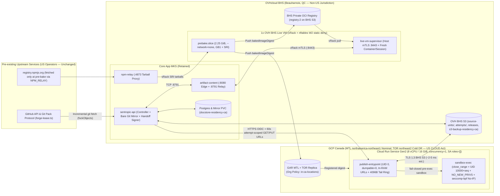
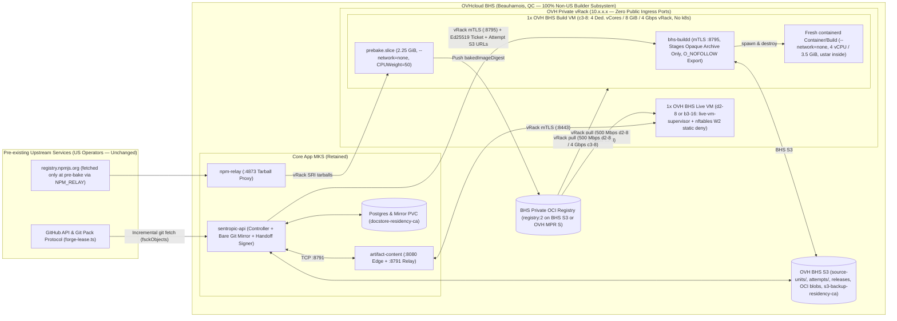

Status: superseded on 13/11/2026 — the owner removed the builder VM and the k8s build pool; artifact builds move to spec/SPEC_EVOL_V8_ARTIFACT_DELIVERY.md

# SPEC_EVOL — Sentropic Artifact Builder Serverless Architecture Proposal (`(a1)` Serverless Canada vs `(a2)` Dedicated OVH BHS Container Host, + 1 Live VM)

- **Document ID**: `SPEC_EVOL_ARTIFACT_BUILDER_SERVERLESS`
- **Revision**: `v3` (Round-3 reconciliation addressing all 2 BLOCKERs, 7 MAJORs, and 1 MINOR from `builder-serverless-arch-astra.v2.md`, while preserving all validated `v2` design resolutions)
- **Status**: `EVOL` — Architecture Specification Pending Runtime Verification Gates (`S0`, `S4b`, `S7/L7`) (supersedes the Kubernetes worker-pod topology in `spec/SPEC_EVOL_ARTIFACT_BUILDER_SLO.md` §7.1–§7.3 while preserving its normative SLOs, cache/GB1 security invariants, L7 acceptance gates, and live/MCP contracts)
- **Date**: 2026-11-12 (`America/Toronto`, Montréal)
- **Author**: `DESIGN` lane (Gemini Carbon)
- **Verified Code & PR Baseline**:
  - `rhanka/sentropic` `origin/main` @ `599582db9bb480d0f5f4eec8168de4048dc7b25b`
  - Open PR `#1007` (`feat/builder-slo-l1-sealed-cache`) @ `2aefce3327a1796308c7ab0e4c09d23a821f803e` (44 commits)
  - Open PR `#1003` (`feat/t4a-cm-artifact-storage`) @ `dee7dcfb8c43cc34428b490b99b2214d310ed44f`
  - Merged PRs `#1004`, `#1005`, `#1008` on `origin/main`; open PR `#1010`
  - Consumer repository & contract: `radar-immobilier` `origin/main` @ `fa86c8647581812053dce13a19386b09c3a16153` (`docs/spec/SPEC_ARTIFACT_BUILD_SLO.md`, `sentropic.artifact.json`, `artifact-build/gb1-qualification.json`, `tools/make/ui-artifact-env.mjs`)

> **Evidence discipline.** Every quantitative or external claim in this specification carries an explicit epistemic tag:
> - `[FACT]` — directly measured in Sentropic preprod, verified in `sentropic` (`599582db9`) / `radar-immobilier` (`fa86c864`), or documented in official vendor contracts/tariffs (dated URL cited in §12). Unpublished vendor SLAs are marked `SLA: unknown` `[FACT]`.
> - `[ESTIMATE]` — engineering projection derived from physical throughput, queueing formulas, or peer benchmarks (`carbon-preparation-web.md`), explicitly `unverified` in our environment until proven by gates `S0`, `S4b`, or `S7/L7`.
> - `[TARGET]` — binding engineering budget or SLO threshold enforced by `L6`/`L7`.
> - `[DECISION]` — binding directive already issued by the owner.
> - `[RECOMMENDATION]` — proposed engineering choice submitted for owner sign-off in §11.

---

## Mandat et décisions de l'owner (verbatim)

1. **Retrait de Kubernetes pour les workers de build** `[DECISION]` :
   > *« je souhaite en plus partir sur une archi container serverless pour cette partie, k8s va coûter trop cher »*
2. **Dimensionnement minimal du mode interactif** `[DECISION]` :
   > *« on n'a besoin que d'une VM live »*
3. **Engagement de performance (SLO produit)** `[DECISION]` :
   > *« un artefact doit se construire en moins d'1 min »* (`S6` bout en bout de `start_accepted` à `url_routable` : **< 60 s plafond strict**, **< 40 s au p95** sur ≥ 20 essais `Warm` et ≥ 20 essais `Cold-known` séparément).
4. **Contrainte de résidence des données** `[DECISION]` `[FACT]` :
   - Hébergement de référence au **CANADA** (**OVHcloud `BHS` — Beauharnois, Québec**).
   - Politiques cluster actives sur le cluster applicatif : **`s3-backup-residency-ca`** et **`docstore-residency-ca`** `[FACT]`. Ces politiques d'admission Kubernetes ne gouvernent pas d'elles-mêmes les ressources externes : le §6 spécifie les contrôles techniques équivalents hors cluster (pré-configuration de dossier GCP avant création du projet pour les buckets `_Required` et `_Default`, capture bornée en mémoire du `stdout/stderr` de build, pare-feu hôte `nftables` `W2`, et distinction entre sous-système builder et dépendances amont préexistantes GitHub / `npmjs`).

---

## Synthèse exécutive (Français)

### 1. Décomposition complète des 6 min 51 s (411,0 s) mesurées le 12/11

La publication `Focus` mesurée en préprod le 2026-11-12 (commit `bd80254`, 03:18–03:25 UTC) a duré **6 min 51 s (411,0 s)** `[FACT]` :
- Phases instrumentées `runPhase` (`build-only.ts:163-173`) : **`install` 1,4 s** (cache scellé) + **`prepare` 320,0 s (5 min 20 s)** (transfert séquentiel de **816 MiB / 49 318 fichiers**, soit 2,55 MiB/s vers un pod Kubernetes neuf ; **> 14 min** observées sur un `live start` sous contention disque) + **`build` 49,0 s** (`recipes.ts:91-93`, compilation monolithique des **4 750 modules** `immo` sur 1 vCPU) + **`verify` 2,0 s** = **372,4 s** `[FACT]`.
- Travail hors-phases dans `buildOnly` (`build-only.ts:65-186`) couvrant les **38,6 s restantes** (`411,0 - 372,4 = 38,6 s`) : validation du job (`resolveAttemptJob`), création du pod/Service (`ensureResponsivePod`), téléchargement complet de l'archive GitHub `codeload` (`forge.snapshot` à `build-only.ts:152`, mesuré à **21–23 s** le 11/11 pour 187 Mo / 4 004 fichiers `[FACT]`), export du candidat, `handoff`, suppression du pod (`waitDeleted`) et routage `url_routable`.

### 2. Architecture `(a)` révisée (`v3`) : corrections bloquantes de sécurité, intégrité Git et budgets à froid

La révision `v3` corrige dans la conception tous les points soulevés par la revue `builder-serverless-arch-astra.v2.md` (les preuves d'exécution restant conditionnées aux portes `S0`, `S4b` et `S7/L7`) :
1. **Zéro repli permissif sur Cloud Run (`§4.4`)** : le repli `SINGLE_USE_INSTANCE=1` post-build est **supprimé**. Avant tout `execve` de code dépôt, un binaire statique `sandbox-exec` ferme tous les descripteurs hérités (`close_range(3, ~0U, 0)`), bascule vers un UID éphémère unique par build (`10000 + seq`, rendant `/proc/1/{environ,mem,fd}` du parent `uid=0` inaccessible par noyau avec `EACCES`/`EPERM`), active `PR_SET_NO_NEW_PRIVS=1` et installe un filtre noyau **`seccomp-bpf`** sans privilège refusant (`EACCES`) tout `socket` hors `AF_UNIX` (bloquant Internet, S3 et `169.254.169.254` `metadata.google.internal` pendant le build). Tout échec d'initialisation de la sandbox **interdit l'exécution du code** (`503 sandbox_init_failed`) et disqualifie `(a1)` au profit de `(a2)` lors de `S0`.
2. **Politique réseau explicite `W2 static deny` sur l'unique VM Live (`§3.5`)** : `bootstrap-procs.ts:6-7,33-50` ne faisant qu'observer les sockets établis, `LiveVM` impose le refus sortant au niveau noyau via un namespace réseau dédié par conteneur (`veth` `/30` sans route par défaut ni NAT ni IPv6) et une table hôte **`nftables` `inet live_w2_deny`** bloquant toute nouvelle connexion sortante (`ct state new,invalid drop` vers `169.254.169.254`, l'hôte, le `vRack` et Internet). Les certificats mTLS restent exclusivement sur l'hôte dans `live-vm-supervisor` (hors sandbox), qui relaie uniquement le flux preview/HMR autorisé vers `172.30.<slot>.2:5173`.
3. **Miroir Git nu vérifié (`transfer.fsckObjects=true`) + contrat `build:artifact` préservé (`§3.1.4`, `§3.4`)** : au lieu d'un recalcul Merkle impossible depuis une archive `ui` filtrée, `sentropic-api` maintient à `BHS` un miroir Git `--bare` vérifiant nativement toute la chaîne Merkle jusqu'à `commit.tree.sha` sur `git fetch` incrémental (`~0,8–1,8 s` `[ESTIMATE]`, sans plafond de 300 fichiers, gérant renommages/suppressions/modes), puis filtre via `readForgeTarball` (`forge-tar.ts:68-125`) avec `filterProfileDigest`. La compilation conserve `BUILD_RECIPE` (`npm --ignore-scripts --offline run build:artifact`, `recipes.ts:91-93`) et le wrapper qualifié `tools/make/ui-artifact-env.mjs` de `radar-immobilier` (`sentropic.artifact.json`, fermeture workspaces `@radar/{domain,scoring,sources}`).
4. **Découplage `cacheState=sealed` / chaleur locale et vrais budgets à froid (`§3.2`, `§5.3`, `§7`)** : `cacheState=sealed` (immuabilité registre + reçu signé) et `runnerRegistered` sont séparés de `localWarmth` ; l'éviction locale (`POST /v1/pool/drain` avec reçu signé `DrainReceipt`) prouve le froid sans déclencher `409 cache_not_prewarmed`. Le tirage d'image à froid tient compte des **500 Mbit/s max** de la `d2-8` (`≥ 3,69 s` de transfert pur + décompactage `~7,8 s` `[ESTIMATE]`, suffisant pour `LiveVM` `S1c ≤ 15 s`, mais imposant une **`c3-8` à 4 Gbit/s privé** sur `BuildVM` pour tenir `S5 ≤ 12 s` après éviction locale).

| Critère | Variante `(a1)` — Serverless Canada (`Cloud Run Gen2 MTL`, secours `TOR`) | Variante `(a2)` — Conteneurs éphémères `--network=none` sur `BuildVM` OVH `BHS` (zéro k8s) |
| :--- | :--- | :--- |
| **Isolation par build** | `close_range` + UID unique (`10000+seq`) + `PR_SET_NO_NEW_PRIVS` + **`seccomp-bpf` coupant tout socket IP/métadonnées** (zéro repli permissif ; échec = abort avant `execve`) | Conteneur `containerd` rootless **neuf par build** avec **`--network=none`**, extraction `ustar` *dans* le conteneur, export `O_NOFOLLOW` |
| **Résidence & juridiction (builder)** | **100 % Canada** (`BHS` + `MTL` en nominal, `TOR` en secours régional) ; buckets logs `_Required` et `_Default` créés à `northeast1` avant création du projet ; opérateur US (**Google LLC / CLOUD Act**) `[FACT]` | **100 % OVH `BHS` (Beauharnois, QC)** physiquement et juridiquement (**droit CA / UE-FR, zéro nouveau sous-traitant US**) `[FACT]` *(hors GitHub amont préexistant)* |
| **Cibles `S5` / `S6` p95 (`Warm` / `Cold-known`)** | `S5` : **`8,8 s`** / **`11,4 s`** (`≤ 12 s` joint) ; `S6` : **`20,5 s`** / **`28,5 s`** (`< 40 s` p95, `< 60 s` max) `[TARGET]` | `S5` (`c3-8` `4 Gbit/s`) : **`7,2 s`** / **`11,3 s`** (`≤ 12 s` joint) ; `S6` : **`18,9 s`** / **`28,4 s`** `[TARGET]` |
| **Coût mensuel vérifié (`3 000` builds/mois, HT)** | **`54,28 $ CAD/mois` brut** (`47,03 $ CAD` avec palier gratuit GCP : **0,97 $ CAD net** d'excédent Cloud Run sur `8,22 $` brut + `LiveVM d2-8` `40,76 $` incluant pré-cuisson en slice `2,25 Go` + GAR `MTL`+`TOR` `3,34 $` + logs/S3 `1,96 $` ; `min-instances=1` 176 h exclu par défaut car **52,84 $ CAD/mois**) `[FACT]` | **`135,62 $ CAD/mois` qualifié `CK-Evicted`** (`LiveVM d2-8` `40,76 $` + `BuildVM c3-8` 12m `90,66 $` à `4 Gbit/s` `vRack` + snapshots/registre `R-S3` `4,20 $` ; mode éco `2 × d2-8` à **`82,12 $ CAD/mois`** uniquement sans éviction disque sur `BuildVM`) `[FACT]` |

### 3. Plan cohérent en dépendances (`86 à 103 h-agent`)

Le calendrier (§10) sépare strictement les préparations indépendantes (`S3a`, `S4a`) des intégrations (`S3b`, `S4b`), rend `S0` spécifique à la variante retenue (`OD-1`) via un prototype `Focus` autonome (sans attendre `S1`), décompose les `18–22 h` de `S2` (`S2.1`–`S2.4`), et chiffre une fourchette réaliste de **`86 à 103 h-agent`** (~4,2 à 4,8 jours calendaires) jusqu'à la campagne complète `L7` (**20× Warm + 20× Cold-known + pointes concurrentes `K=2,4` + rendu réel `Focus`**).

---

## 0. Cumulative Peer Review Reconciliation (`v1 → v2 → v3`)

> **Verification posture.** Every item below specifies the exact design resolution in `v3` against verified repository facts (`sentropic` `599582db9`, `#1007` `2aefce3327`, `#1003` `dee7dcfb8c`, `radar-immobilier` `fa86c864`) and official vendor contracts. **Design resolution in `v3` is not an implementation or runtime proof**: runtime security, cold-pull latency, and `< 60 s` SLO compliance remain strictly gated on executable verification gates **`S0`** (sandbox/pull PoC), **`S4b`** (`LiveVM` adversarial `W2` test), and **`S7/L7`** (`20× Warm + 20× Cold-known + burst` campaign).

### 0.1 Round-2 Review Findings (`builder-serverless-arch-astra.v2.md` → `v3`)

| ID | Severity | Round-2 Review Finding (`astra.v2`) | Design Resolution & Verified Evidence in `v3` *(Runtime Proof Gate)* | Section |
| :---: | :---: | :--- | :--- | :---: |
| **R2-1** | **BLOCKER** | `§4.4` assumed `unshare(CLONE_NEWNET\|...)` + `pivot_root` works despite reduced Cloud Run capabilities (`container-contract`), and allowed falling back to `SINGLE_USE_INSTANCE=1` + `exit(0)` *after* the build (allowing mid-build exfiltration & metadata access, contradicting `OD-1`). | **Deleted the permissive `SINGLE_USE_INSTANCE` fallback.** Replaced privileged mount/netns assumptions with an unprivileged-compatible Linux kernel sandbox (`close_range(3, ~0U, 0)` + `PR_SET_DUMPABLE=0` on UID `0` parent + unique per-build UID `10000+seq` + `capset(0)` + `PR_SET_NO_NEW_PRIVS=1` + **`seccomp-bpf` (`SECCOMP_MODE_FILTER`) returning `EACCES` on any non-`AF_UNIX` `socket`**, blocking internet, S3, and `169.254.169.254` in-kernel with zero capabilities). Any sandbox setup error `_exit(126)`s **before** `execve` (`503 sandbox_init_failed`) and disqualifies `(a1)` → `(a2)` in `S0`. *(Runtime gate: `S0` 2-build test).* | §4.4, §10 (`S0`), §11 (`OD-1`) |
| **R2-2** | **BLOCKER** | `§3.5` omitted an explicit network-deny policy on `LiveVM`. `bootstrap-procs.ts:6-7,33-50` only *reports* `established` sockets without blocking egress; `vRack` does not stop Vite/plugins reaching host daemons, metadata, internal services, or internet. | Specified mandatory **two-plane `W2 static deny` network isolation on `LiveVM`** (both `(a1)` and `(a2)`): mTLS certs/keys remain exclusively on the host inside `live-vm-supervisor` (`uid=live-sup`); each Live container gets an isolated `/30` veth (`172.30.<slot>.2`, no default route, no NAT, IPv6 off) governed by host **`nftables` `inet live_w2_deny`** (`forward` policy `drop`; `input` from `veth-live-*` `ct state new,invalid drop`), blocking `169.254.169.254`, host supervisor ports, `vRack`, and internet while permitting inbound `:5173` preview/HMR replies. *(Runtime gate: `S4b` adversarial probe).* | §3.5, §10 (`S4a`, `S4b`) |
| **R2-3** | **MAJOR** | `§3.4` could not recompute root `commit.tree.sha` from a `ui`-filtered snapshot (excluded paths & `forge-tar.ts` link/mode stripping break full-repo Git Merkle trees); `< 1.5 s` ignored misses, >300 files, renames/deletes/modes, and filter identity. | Replaced synthetic delta-tree assembly with a **verified bare Git mirror at OVH `BHS`** (`--bare`, `transfer.fsckObjects=true`, `fetch.fsckObjects=true`, `core.hooksPath=/dev/null`): `git fetch origin <sha>` verifies the full Git Merkle graph natively (handling renames, deletions, mode flips, and `> 300` files without ceiling), then pipes `git archive` through `readForgeTarball` (`forge-tar.ts:68-125`). Keyed S3 units by `<commitTreeSha>/<filterProfileDigest>.tar.zst` and budgeted **3 distinct cases**: S3 hit (`0.15–0.30 s`), warm mirror fetch (`0.8–1.8 s`), and cold mirror/`codeload` fallback (`21–25 s`, standalone only). *(Runtime gate: `S2.2`, `S7`).* | §3.4 |
| **R2-4** | **MAJOR** | `§4.3`/`§5.3` ran `npx vite build` directly, bypassing `BUILD_RECIPE` (`recipes.ts:91-93` `npm --ignore-scripts --offline run build:artifact`) and `immo`'s `tools/make/ui-artifact-env.mjs` (`.env*` refusal, env allowlist, leak scan, `ui/dist`), and omitted `sentropic.artifact.json` & workspace closure. | **Retained `BUILD_RECIPE` (`npm --ignore-scripts --offline run build:artifact`) verbatim.** `Q1` evolves *behind* `build:artifact` in `radar-immobilier` (`package.json:53` → `tools/make/ui-artifact-env.mjs` → `npm run build:artifact -w ui`), preserving `.env*` rejection, `ARTIFACT_ENV`, leak scan, and `outputDir: "ui/dist"` (`sentropic.artifact.json:4`). Defined exact `closurePaths` (`package.json`, `package-lock.json`, `sentropic.artifact.json`, `artifact-build/gb1-qualification.json`, `tools/make/ui-artifact-env.mjs`, `ui/**`, `packages/radar-{domain,scoring,sources}/**`) and added **Playwright real `Focus` render + `/__app` transport qualification**. *(Runtime gate: `S1`, `S7`).* | §3.1.4, §4.3, §5.3 |
| **R2-5** | **MAJOR** | `§6.1` replaced `_Default` sink after creation, leaving `_Required` (`400 d`) in `global` (`region-support`: bucket location is immutable once created); URL scrubbing alone did not bound untrusted build `stdout/stderr`; `"100% Québec"` ignored Toronto DR. | Mandated **pre-project-creation Folder Default Resource Settings** (`--storage-location=northamerica-northeast1`) + `in:ca-locations` Org Policy + parent sink exclusion audit **before** `gcloud projects create`, verified by asserting `_Required` and `_Default` both reside in `northamerica-northeast1`. `publish-entrypoint` captures child `stdout/stderr` into an **in-memory `4096 B` ring buffer** (never written to container stdout/Cloud Logging), returning only `truncateRecipeTail(scrubRecipeOutput(tail))` (`recipe-diagnostics.ts:15-34`). Updated wording to **`100% Canada` (`MTL` nominal, `TOR` failover)**. *(Runtime gate: `S0`/`S2.4`).* | §6.1, §6.2 |
| **R2-6** | **MAJOR** | `d2-8` private network is **`500 Mbit/s` max** (`≥ 3.69 s` wire transfer alone for `220 MiB` before verify/unpack, not `1.2 s` on `1 Gbit/s`); `§5.3` Cold column summed to `9.4 s` not `8.4 s`; `10–12 s` queue waits were unbudgeted; peak bursts untested. | Separated wire transfer, SHA-256 verify, `zstd` unpack, boot, build, and handoff across **distinct cold regimes** (`CK-Scale0`, `CK-Evicted` on `500 Mbit/s` `d2-8` `~7.8 s` vs `4 Gbit/s` `c3-8` `~3.2 s`, `First-Bake`). Selected **`c3-8` (`4 Gbit/s` `vRack`)** as the `(a2)` `CK-Evicted`-qualified `BuildVM`, fixed all column sums while keeping end-to-end p95 targets distinct from step sums, enforced a **single global deadline** (`14.5 s` joint / `55 s` standalone including queue + retries), and added **`K = 2, 4` concurrent burst qualification** in `L7`. *(Runtime gate: `S0`, `S7`).* | §2.1, §4.3, §5.2, §5.3 |
| **R2-7** | **MAJOR** | `§3.2` defined `registryState=sealed` as requiring `publishRunnerState=ready` (unpacked on `BuildVM`), making `Cold-known` (`BuildVM` image evicted before `requireSealed`) fail `sealed` or falsify readiness; `liveNodeState` couldn't classify standalone `(a1)` `S5`. | **Decoupled 3 orthogonal states**: (1) `cacheState` (`sealed` = immutable registry image + signed `CacheReceipt`), (2) `runnerRegistered` (`boolean`, revision/allowlist registered), and (3) `localWarmth` (per-surface node/instance warmth). `requireSealed` checks `cacheState === 'sealed' && runnerRegistered` **only**, so local eviction preserves `sealed`. Defined path-specific `case` classification (`runnerReceipt.coldStart` on `(a1)`, `imagePulled` on `(a2)`, `liveWarmth` on `S1`) and signed `DrainReceipt` from `POST /v1/pool/drain`. | §3.2 |
| **R2-8** | **MAJOR** | `3,000 × 68 = 204k vCPU-s` / `408k GiB-s` exceeds Cloud Run free tier (`~$0.97 CAD` billable); `min-instances=1` (`8 vCPU/16 GiB`, `176 h`) costs **`$52.84 CAD/mo`** at idle rates, not `$14`; `(a1)` pre-bake host unchosen; `(a2)` `512 MiB` pre-bake ignored `1,024 MiB` heap / `1,388.6 MiB` peak (`recipes.ts:13-23`). | Corrected free-tier excess (**`$0.97 CAD/mo` net** vs **`$8.22 CAD/mo` gross**) and `min-instances=1` (`176 h` = **`$52.84 CAD/mo`**, `730 h` = `$219.18 CAD/mo`, removed as cheap knob). Sized `prebake.slice` at **`2,304 MiB` (`2.25 GiB`)** matching `recipes.ts:13-23` (`1,388.6 MiB` peak), placed `(a1)` pre-bake concretely on **`LiveVM` (`BHS` `vRack`)** (`2.0 GiB` Live + `2.25 GiB` pre-bake + `1.0 GiB` OS = `5.25 GiB < 8 GiB`), and priced `TOR` GAR (`$1.67 CAD/mo`) & `(a2)` `c3-8` (`$90.66 CAD/mo` 12m). | §3.1.2, §4.5, §7 |
| **R2-9** | **MAJOR** | `§10` started `S3` (`infra-sec` Nov 12 `18:30`) before `S2` finished (Nov 13 `15:00`), started `S4` before `S3` finished, required `S1`'s `Q1` config (`18:00`) inside `S0` (`12:00`), forced Cloud Run in `S0` even if `OD-1=(a2)`, and left `S2`'s `18 h` un-itemized. | Made **`S0` variant-specific per `OD-1`** using a standalone 25-line `poc-focus.vite.config.mjs` prototype (independent of `S1`); itemized `S2` into **`S2.1`–`S2.4`** (`18–22 h`); split independent host setup (**`S3a`**, **`S4a`**, depending only on `S0`) from controller integration (**`S3b`**, **`S4b`**, starting strictly after all predecessors finish); and presented an **`86–103 h` effort range** with explicit `S0` unknowns. | §10 |
| **R2-10** | **MINOR** | `#1007` @ `2aefce3327` exports `createSealInstall` (not `createSealedInstall`); network/Poisson projections must carry `[ESTIMATE]`; reconciliation table must not claim runtime proof prior to execution. | Corrected `createSealInstall` (`supervisor-install.ts` in `#1007`), tagged all RTT/pull/queueing projections `[ESTIMATE]`, and scoped §0 explicitly to design resolution pending `S0`/`S4b`/`S7`. | §0, §5.2, §9, §11 |

### 0.2 Round-1 Design Resolutions Validated in `v2` & Preserved Intact in `v3`

- **R1-3 (`CacheIdentity`, `GB1`, SRI, Toolchain)**: Full tenant/repo/toolchain/policy `CacheIdentity` (`cache.ts:11-17,50-53`), `NPM_RELAY` SRI verification, zero postinstall hooks (`gb1-qualification.ts:38-39`), pinned `BUILDER_IMAGE` (`node v26.13.0`, `recipes.ts:3-6`).
- **R1-4 (Trusted Execution & Publication Chain)**: Control-plane digest selection, per-attempt S3 keys (`attempts/<jobId>/<runId>-<attempt>/candidate.tar.zst`, zero concurrent hedge retries), byte-level `candidateDigest(files)` rehash (`handoff-publication.ts:28-30`), and signed `/v1/images/allowlist` distribution to `immo` (`packages/artifacts/src/live-host/recheck.ts:57`).
- **R1-7 (Dev Prebundle vs Prod Rollup)**: `LIVE_PREBUNDLE_SCRIPT` (`createServer`, `recipes.ts:80-90`) for `S1` dev cache vs `Q1` entry scoping for `S5` Rollup `vite build`.
- **R1-8 & R1-10 (`L7` Requirements, Migration & Rollback)**: `20× Warm + 20× Cold-known` `S6` acceptance, `idleBuild`/`queuedBuild` (`idle.ts:16,61`) unified on `PublishBuildRunner`, per-row `liveBackend`/`publishBackend` persistence, 7-day dual-seal rollback rehearsal, and legacy `k8s` rollback explicitly marked service-continuity only (non-SLO-compliant).

---

## 1. Problem Diagnosis (`411.0 s` Full Accounting), Peer Benchmarks & Canadian Cloud Reality

### 1.1 Complete Accounting of the `6 min 51 s` (`411.0 s`) Baseline (`origin/main` @ `599582db9`)

Tracing `buildOnly` (`api/src/services/artifacts/live/build-only.ts:65-192`) against the 2026-11-12 preprod `Focus` publish (`bd80254`, 03:18–03:25 UTC) and the 2026-11-11 preprod instrumentation campaign accounts for **all `411.0 s`**:

| Execution Segment in `buildOnly` (`build-only.ts`) | Measured Duration | Code Path & Physical Bottleneck |
| :--- | :---: | :--- |
| **A. Instrumented `runPhase` steps (`372.4 s` subtotal)** | **`372.4 s`** `[FACT]` | Logged via `runPhase` (`build-only.ts:163-173`): |
| 1. `install` (`cache.acquire` sealed hit) | `1.4 s` `[FACT]` | S3 manifest read + HMAC verification (`cache.ts:100-115`). *(On a cold lockfile on 2026-11-11: `source_transfer` `35–41 s` + `tarball_stream` `108–112 s` + `npm ci` `30 s` + per-file `drain` **`> 999 s` / `17–25 min`** `[FACT]`.)* |
| 2. `prepare` (`worker.prepare`) | **`320.0 s` (`5m 20s`)** `[FACT]` | Per-file S3 `getFile` + SHA-256 rehash (`cache.ts:174-177`) + sequential `768 KiB` base64 frame transfer of **`816 MiB` / `49,318` files** (`~16.9 KiB` mean) = **`2.55 MiB/s`** (`~154 files/s`) and `> 150,000` `overlayfs` syscalls in a fresh k8s pod (`> 14 min` under disk contention on `live start`) `[FACT]`. |
| 3. `build` (`worker.build` → `BUILD_RECIPE`) | **`49.0 s`** `[FACT]` | `npm --ignore-scripts --offline run build:artifact` (`recipes.ts:91-93`) compiling all **`4,750` modules** of the monolithic `immo` UI on `1 vCPU` (`65 s` under concurrent load; `13.47 s` unthrottled multi-core workstation) `[FACT]`. |
| 4. `verify` (`worker.verify`) | `2.0 s` `[FACT]` | Static bundle constraint checks inside pod (`build-only.ts:173`). |
| **B. Uninstrumented outer `buildOnly` steps (`38.6 s` residual)** | **`38.6 s`** `[FACT]` | `411.0 s` wall-clock minus `372.4 s` `runPhase` sum (`build-only.ts:66-162, 174-186`): |
| 5. `forge.snapshot(key, job.headSha)` | `~21–23 s` `[FACT]` | `build-only.ts:152` → `forge-lease.ts:99-125`: calls GitHub `/git/commits/<sha>` + downloads the **entire monorepo tarball** (`187 MB` / `4,004` files) from `codeload.github.com` through `readForgeTarball` (`forge-tar.ts:68`) (measured `21–23 s` on 2026-11-11 `[FACT]`). |
| 6. Pod & Service lifecycle + candidate export + handoff | `~15.6–17.6 s` `[ESTIMATE]` | `admittedBinding` / `resolveAttemptJob` (`lines 66, 77`), k8s Pod + Service creation & boot (`ensureResponsivePod`, `line 147`), `worker.clean` (`line 162`), frame-by-frame `candidates.read` + `/live-host/v1/handoff` upload (`handoff-publication.ts:28-39`), `pods.remove` (`waitDeleted` 404 confirmation, `pods.ts:279-287`), and edge `url_routable`. |
| **Total `Focus` `git_publish` Wall-Clock (2026-11-12)** | **`411.0 s` (`6m 51s`)** `[FACT]` | **Every major term (`320 s` `prepare`, `49 s` `build`, AND `21–23 s` `forge.snapshot`) exceeds the `12 s` joint `S5` p95 budget on its own.** |

### 1.2 Industry Peer Benchmark Summary

As documented with primary sources in `carbon-preparation-web.md` §1.1–§1.7: **Lovable** (`3 s` median sandbox acquisition via pre-baked layered Modal gVisor images + Rust OJ `[FACT]`), **Bolt.new** (`< 1 s` browser Wasm VFS `[FACT]`), **v0 / Vercel** (`~250 ms` p50 Firecracker NVMe snapshot restore `[FACT]`), **Replit** (`< 30 s` SOCI lazy image streaming `[FACT]`), **CodeSandbox** (`~2 s` `userfaultfd` microVM clone `[FACT]`), and **Claude Artifacts** (fixed CDN/browser `<iframe>`, zero `npm` `[FACT]`) all eliminate per-request `node_modules` file materialization and scope compilation strictly to the artifact. Crucially, as noted in the Carbon benchmark review, OCI image pre-baking eliminates per-file application staging **only when layers are already unpacked on the host or streamed lazily**: after local `containerd` eviction without a lazy snapshotter, standard `containerd` must still transfer, SHA-256-verify, and `zstd`-unpack the compressed layers over the VM's NIC (`500 Mbit/s` max on OVH `d2-8` vs `4 Gbit/s` private `vRack` on `c3-8` / `b3-16` `[FACT]`). Firecracker/CRIU VM cloning is excluded on OVH Public Cloud because nested KVM triggers guest/host kernel panics during OVH live host migrations (`KB0052529`) `[FACT]`, and browser-only `esbuild-wasm` breaks Vite/Svelte/Tailwind preview-to-publish parity `[ESTIMATE]`.

### 1.3 Verified Canadian Cloud Capabilities & Regional Quotas

| Provider / Product | Canadian Region | CPU / RAM / Network | Cold Start & Official SLA | Quota & Operational Verdict for `S5 ≤ 12 s` Joint p95 |
| :--- | :--- | :--- | :--- | :--- |
| **Scaleway Serverless Containers / Jobs** | **None** (EU only) `[FACT]` | 6 vCPU / 12–16 GB `[FACT]` | `SLA: unknown` `[FACT]` | **Disqualified** — outside Canada `[FACT]`. |
| **OVHcloud Serverless Containers** | `BHS` *"Coming soon"* `[FACT]` | `unknown` `[FACT]` | `unknown` `[FACT]` | **Unavailable** (not GA) `[FACT]`. |
| **OVHcloud AI Training / AI Deploy (CPU)** | **`BHS` (Beauharnois, QC)** `[FACT]` | 1–12 Intel vCPU (`ai1-1-cpu` = 1 vCore / 4 GiB); **no `vRack`** `[FACT]` | `30 s` to several minutes (`STANDBY → RUNNING`); `SLA: unknown` `[FACT]` | **Disqualified** for interactive `S5` (slow cold boot) and unused for pre-bake (no `vRack` access to `NPM_RELAY`). |
| **Google Cloud Run Services (Gen2)** | **`northamerica-northeast1` (Montréal)** & `northeast2` (Toronto) `[FACT]` | Up to **8 vCPU / 32 GiB** (`tmpfs`), 60 min max; Linux microVM w/ `seccomp` `[FACT]` | `~2–5 s` typical w/ *Startup CPU Boost* `[ESTIMATE]`; **`SLA: unknown`** `[FACT]`; `5–25 s` on Cloud Run **Jobs** `[ESTIMATE]` | **Variant `(a1)` primary** (`~35 km` / `~2–5 ms` projected RTT `[ESTIMATE]` from `BHS`). Default max `100` instances/service, **capped by regional vCPU/RAM project quota** (typically `20–100 vCPU` = **`2–12` concurrent `8-vCPU` builds** until quota uplift) `[FACT]`. |
| **AWS Lambda (Container ≤ 10 GB)** | **`ca-central-1` (Montréal)** & Calgary `[FACT]` | ~6 vCPU / 10 GB RAM + 10 GB `/tmp`, 15 min max `[FACT]` | `~1–3 s` Firecracker chunk lazy-load `[FACT]`; `SLA: unknown` `[FACT]` | **Variant `(a1)` secondary** (`App Runner` absent in `ca-central-1`; Fargate `8–45 s`) `[FACT]`. |
| **OVHcloud Public Cloud VMs (`d2-8`, `c3-8`, `b3-16`)** | **`BHS` (Beauharnois, QC)** `[FACT]` | `d2-8`: 4 vCores/8 GB, **`500 Mbit/s` max** pub/priv; `c3-8`: 4 ded. vCores/8 GB, **`4 Gbit/s` priv `vRack`**; `b3-16`: 4 vCores/16 GB, **`4 Gbit/s` priv `vRack`** `[FACT]` | Fresh unprivileged container from unpacked image: `~0.35–0.50 s` `[ESTIMATE]`; cold `220 MiB` pull+unpack: `~7.8 s` (`d2-8`) vs `~3.2 s` (`c3-8`) `[ESTIMATE]` | **Variant `(a2)` compute** (`LiveVM` = `d2-8` or `b3-16`; `CK-Evicted`-qualified `BuildVM` = **`c3-8`** so cold `vRack` image pull stays `< 3.5 s`). |

---

## 2. Normative SLOs (`Warm`, `Cold-known`, Global Deadlines & Peak Bursts)

### 2.1 Binding SLO Contract, Global Deadlines & Statistical Evaluation Rules

Per consumer `SPEC_ARTIFACT_BUILD_SLO.md` §3.1–§3.4 and provider `SPEC_EVOL_ARTIFACT_BUILDER_SLO.md` §2 & §7.6.3:

1. **Both `Warm` and `Cold-known` are mandatory acceptance regimes**: `S6` (`start_accepted` at attach → `url_routable` returning HTTP `200` with the new asset hash on the published URL) MUST pass **both** the standalone ceilings and the **identical joint `S6` step allocation** across **`N ≥ 20` `Warm` runs** AND **`N ≥ 20` `Cold-known` runs** in preprod (`L7`), plus production qualification. Below `20` samples, `/v1/slo` MUST return `p95: null, insufficientSamples: true` `[FACT]`.
2. **Independence of step-sum allocations vs measured end-to-end p95s**: `p95(∑ step_i) ≠ ∑ p95(step_i)`. In §§2, 4.3, and 5.3, **per-step budget allocations** are kept strictly distinct from **end-to-end `S5` / `S6` p95 targets**, which include tail-correlation margin and are evaluated empirically at `ceil(0.95 × N)` (`19th` of `20` ordered runs) `[FACT]`.
3. **Single end-to-end monotonic deadline including queue wait & retries (`deadline.ts`)**: queue wait and sequential transport retries are **never** outside the SLO clock. Every `git_publish` starts a single monotonic deadline at `start_accepted`:
   - **Joint `S6` publish (`S5` inside `S6`)**: hard deadline **`14.5 s`** (`≤ 15.0 s` joint max), bounding admission queue wait to **`maxQueueWaitMs = 3_000 ms`** and refusing admission immediately (`503 builder_busy`) if `remainingMs < 7_500 ms`.
   - **Standalone `git_publish` (`S5` outside `S6`, `< 25 s` p95 / `< 60 s` max)**: hard deadline **`55.0 s`**, bounding queue wait to **`maxQueueWaitMs = 12_000 ms`** and permitting at most `1` sequential retry only when `remainingMs ≥ 12_000 ms`.
   - **Typed errors are breaches**: any typed error (`503 builder_busy`, `timeout`, `sandbox_init_failed`) on a prewarmed lockfile counts as a **max breach (`∞`)** in `L7` (`SPEC_ARTIFACT_BUILD_SLO` §3.2) `[FACT]`. Only `cold-new-lockfile` (`§7.3`, deliberately unprewarmed) tests `≤ 5 s` `409 cache_not_prewarmed`.
4. **Peak concurrency qualification (`L7` Burst Gate)**: average monthly volume (`3,000` builds/month) does not bound burst contention. `L7` (`Lot S7`) explicitly qualifies simultaneous `S5` bursts of **`K = 2`** (must pass joint `S5 ≤ 15.0 s` max) and **`K = 4`** (must pass standalone `S5 < 25.0 s` p95 and `< 60.0 s` max with `0` errors).

| ID | Phase (`start_accepted` → terminal/routable event) | Standalone p95 / Max | **Joint `S6` Allocation (p95 / Max)** | `(a1)` Target p95 (`Warm` / `Cold-known`) | `(a2)` (`c3-8`) Target p95 (`Warm` / `Cold-known`) |
| :--- | :--- | :---: | :---: | :---: | :---: |
| — | `artifacts_git_attach` | `2 s` / `3 s` | **`2.0 s` / `3.0 s`** | `0.8 s` / `0.8 s` `[TARGET]` | `0.8 s` / `0.8 s` `[TARGET]` |
| **S1 / S1c** | `live start` → `preview_routable` (`Warm` / `Cold-known`) | `< 30 s` / `45 s` (`< 60 s` `S1c`) | **`15.0 s` / `20.0 s`** *(both cases)* | `3.4 s` / `13.2 s` `[TARGET]` | `3.4 s` / `13.2 s` `[TARGET]` |
| **S2** | `live_write` → HTTP 200 new asset hash in preview | `< 5 s` / `10 s` | **`3.0 s` / `5.0 s`** | `1.5 s` / `1.5 s` `[TARGET]` | `1.5 s` / `1.5 s` `[TARGET]` |
| **S3** | `git_commit` → commit reachable + async mirror warm | `< 10 s` / `30 s` | **`5.0 s` / `7.0 s`** | `4.0 s` / `4.0 s` `[TARGET]` | `4.0 s` / `4.0 s` `[TARGET]` |
| **S4** | `stop` → session `DORMANT` + Live container destroyed | `< 15 s` / `30 s` | **`3.0 s` / `5.0 s`** | `1.6 s` / `1.6 s` `[TARGET]` | `1.6 s` / `1.6 s` `[TARGET]` |
| **S5** | `git_publish` → **`url_routable`** (incl. queue & handoff) | `< 25 s` / `< 60 s` | **`12.0 s` / `15.0 s`** | `8.8 s` / `11.4 s` `[TARGET]` | `7.2 s` / `11.3 s` `[TARGET]` |
| **S6** | **End-to-end journey (`attach` → `url_routable`)** | **`< 40 s` / `< 60 s`** | **`40.0 s` / `55.0 s`** *(5 s margin)* | **`20.5 s` / `28.5 s`** `[TARGET]` | **`18.9 s` / `28.4 s`** `[TARGET]` |

---

## 3. Shared Security, Cache, Snapshot & Live-VM Foundations (`(a1)` & `(a2)`)

### 3.1 Full `CacheIdentity`, `GB1` Pre-Bake (`2.25 GiB`) & Qualified `build:artifact` Contract

#### 3.1.1 Server-derived `CacheIdentity` (`cache.ts:11-17,50-53` preserved)

`CacheIdentity` is **never** reduced to `lockSha256` alone. `sentropic-api` derives the full tenant- and policy-scoped key server-side via `snapshotRepo` (`forge-lease.ts:99-125`), keeping input identity strictly separate from the output OCI image digest:

```ts
cacheKey = `v3/${id.lockSha256}/${sha256(JSON.stringify([
  id.storageScopeId,          // Tenant isolation boundary — cross-scope sharing forbidden
  id.repoId,                  // Repository boundary (forge-binding.ts)
  id.platform,                // 'linux/amd64' (recipes.ts:6)
  id.nodeVersion,             // '26.13.0' from pinned BUILDER_IMAGE (recipes.ts:3-6)
  id.npmVersion,              // Exact npm version measured & pinned from BUILDER_IMAGE in Lot S2.1
  id.baseBuilderImage,        // Input BUILDER_IMAGE ('docker.io/library/node@sha256:add5c17c...', recipes.ts:3)
  id.policyRevision,          // sha256([installRecipeFor(installWorkspaces), NPM_RELAY, PREBAKE_POLICY_V3])
  id.workspaceTopology,       // sha256(sorted package.json paths)
  id.integrityDigest,         // sha256(files['artifact-build/gb1-qualification.json'] ?? '')
  [...id.installWorkspaces].sort(), // Server-resolved UI workspace closure: ['packages/radar-domain', 'packages/radar-scoring', 'packages/radar-sources', 'ui']
  id.descriptorDigest,        // qualifyBuild(source.gb1).descriptorDigest (sentropic.artifact.json)
]))}`;
```

- **Input vs Output digest**: `id.baseBuilderImage` is the pinned base image (`recipes.ts:3`). The resulting OCI digest `bakedImageDigest` (`sha256:<64-hex>`) is an **output** recorded inside the HMAC-signed `CacheReceipt` (`ARTIFACT_DEPENDENCY_CACHE_SIGNING_KEY`, `product-builder.ts:28`) alongside `treeSha256` and `inventory`.

#### 3.1.2 Concrete operational pre-bake runner & `2.25 GiB` RAM budget (`recipes.ts:13-23`)

- **Chosen operational pre-bake host (no unchosen placeholder, no Cloud Build)**:
  - **In `(a1)`**: pre-bake runs on **`LiveVM` at OVH `BHS`** (connected to private `vRack`, reaching `NPM_RELAY` at `:4873` privately with `$0` extra VM).
  - **In `(a2)`**: pre-bake runs on **`BuildVM` at OVH `BHS`** (`vRack`).
- **Verified memory sizing (`recipes.ts:13-27`)**: `recipes.ts:13-23` documents `INSTALL_HEAP_MB_DEFAULT = 1024` MiB (`--max-old-space-size=1024`, `immo` heap OOM at `384` and `768` MiB) with a **measured peak RSS of `1,388.6 MiB`** under a `1,536 MiB` limit (`LIVE_PREBUNDLE_SCRIPT` peak `945–959 MiB` with `MALLOC_ARENA_MAX=2` and `GOMEMLIMIT=256MiB`, `lines 24-27`) `[FACT]`. A `512 MiB` reservation would OOM. Accordingly, both variants isolate pre-baking in a dedicated systemd cgroup v2 slice **`prebake.slice` (`MemoryMax=2304M` = `2.25 GiB`, `MemorySwapMax=0`, `CPUWeight=50` vs `1000` for active user work, `maxConcurrentPrebakes=1`)**:
  - On `(a1)` `LiveVM` (`d2-8` `8,192 MiB` RAM): `2,048 MiB` (`1` Live container) + `2,304 MiB` (`prebake.slice`) + `1,024 MiB` (`live-vm-supervisor` + OS) = **`5,376 MiB` (`5.25 GiB`) worst-case simultaneous peak < `8,192 MiB`** (`2.75 GiB` free page-cache headroom).
  - On `(a2)` `BuildVM` (`c3-8` / `d2-8` `8,192 MiB` RAM): `3,584 MiB` (`1` active `S5` build) + `2,304 MiB` (`prebake.slice`) + `1,024 MiB` (`bhs-buildd` + OS) = **`6,912 MiB` (`6.75 GiB`) worst-case simultaneous peak < `8,192 MiB`** (`1.25 GiB` headroom).
- **GB1, SRI & offline install**: `sentropic-api` runs `qualifyBuild(source.gb1)` (`gb1-qualification.ts:48`), enforcing `postinstallAllowlist.length === 0` (`lines 38-39`: **zero lifecycle scripts ever execute**) and `scriptQualification` coverage (`artifact-build/gb1-qualification.json:1-102` in `immo`). Every tarball is fetched via `NPM_RELAY` and SRI-verified (`verifySri`, `cache.ts:2`) before launching an air-gapped (`--network=none`) container from `BUILDER_IMAGE` executing `installRecipeFor(installWorkspaces)` (`npm ci --offline --ignore-scripts --no-audit --no-fund --workspace=...`, `recipes.ts:41-47,62-64`) under `installEnvironment(1024)`. Normalized `zstd` OCI layers (`mtime=0`, `uid:gid=1000:1000`, `mode=0444|0555`) are appended via `crane append` without Dockerfile shell execution.

#### 3.1.3 Distinct Live Dev Prebundle vs Production Build Optimization

- **Live Dev Prebundle (`S1`, `/dependencies/vite-dev-cache`)**: `vite optimize` is forbidden (`recipes.ts:78-79` `[FACT]`). During pre-bake, an air-gapped step runs **`LIVE_PREBUNDLE_SCRIPT`** (`createServer` in `mode: 'development'`, `middlewareMode: true, ws: false, watch: null` until `deps/_metadata.json` commits, `recipes.ts:80-90`) — preserving `optimizeDeps: { exclude: ["@sentropic/geo-ui-svelte"] }` (`immo` `ui/vite.config.ts:93`) — and freezes `/dependencies/vite-dev-cache` (copied to `/tmp/vite-cache` in `< 80 ms` at `live start`).
- **Production Publish (`S5`)**: Rollup `vite build` ignores `.vite/deps` `[FACT]`; `S5` speed comes from `Q1` entry scoping behind `build:artifact` (§3.1.4).

#### 3.1.4 Preserving `BUILD_RECIPE` (`build:artifact` → `ui-artifact-env.mjs`), Source Closure & Real Rendering Gate

1. **Zero bypass of `BUILD_RECIPE` (`recipes.ts:91-93`)**: both `(a1)` and `(a2)` execute the **exact frozen `BUILD_RECIPE`** (`npm --ignore-scripts --offline run build:artifact`) under `buildEnvironment()` (`recipes.ts:53-55`, `--max-old-space-size=1024`). Calling `npx vite build` directly from the runner is **prohibited**.
2. **`Q1` evolves behind `build:artifact` in `radar-immobilier` (`origin/main@fa86c864`)**:
   - Root `package.json:53` retains `tools/make/ui-artifact-env.mjs`: `"build:artifact": "node tools/make/ui-artifact-env.mjs npm --offline --ignore-scripts run build:artifact -w ui"`.
   - Every security invariant in `tools/make/ui-artifact-env.mjs:14-76` remains active on every publish: (a) refuses any `ui/.env*` file (`dotenvFiles('ui')`, `lines 61-65`), (b) strips inherited `VITE_*`, `GITHUB_PAGES`, and `QA_HARNESS` (`lines 19,28-31`), (c) injects `ARTIFACT_ENV` (`VITE_ARTIFACT_MODE='1'`, `VITE_API_BASE_URL='/__app'`, `VITE_BASEMAP_TILE_URL='/__artifacts/tiles/v1/osm/{z}/{x}/{y}'`, `lines 14-18`), (d) writes output to `outputDir: "ui/dist"` (`entry: "index.html"`) matching `sentropic.artifact.json:1-7`, and (e) scans `ui/dist` post-build via `leaks('ui/dist', dropped)` (`lines 40-56,71-75`), failing closed if any dropped value (`≥ 8` chars) leaked.
   - Inside `ui/package.json`, `"build:artifact": "vite build --config vite.artifact.config.ts"` imports the shared plugins/aliases from `ui/vite.config.ts:76-88` (`svelte()`, `artifact-boot.artifact.ts` swap when `VITE_ARTIFACT_MODE === '1'`, `$lib` alias) while targeting the dedicated artifact entry (`80–300` modules instead of `4,750`).
3. **Exact `source.tar.zst` workspace closure (`closurePaths`)**: derived server-side from `sentropic.artifact.json` + `package-lock.json` `link: true` dependencies of `ui` (`ui/package.json:19-21` imports `@radar/domain`, `@radar/scoring`, `@radar/sources` `[FACT]`):
   - Root files: `package.json`, `package-lock.json`, `sentropic.artifact.json`, `artifact-build/gb1-qualification.json`, `tools/make/ui-artifact-env.mjs`, `tsconfig*.json`.
   - Workspace trees: `ui/**`, `packages/radar-domain/**`, `packages/radar-scoring/**`, `packages/radar-sources/**` (filtered by `forge-tar.ts:23-29,127-134` to strip `.git`, `node_modules`, `.env*`, `.npmrc`, `.yarnrc*`, `*.pem|*.key|*.p12|*.pfx`, and `ui/dist/**`).
4. **End-to-end rendering & transport qualification (`S1` & `S7/L7`)**: acceptance requires a **headless Playwright browser gate** against both `preview_routable` (`S1`/`S2`) and `url_routable` (`S5`/`S6`) verifying: (i) `0` uncaught `pageerror`/console errors, (ii) rendered `Focus` DOM & CSS/Inter fonts (`@fontsource-variable/inter`), (iii) basemap tile requests hitting `/__artifacts/tiles/v1/osm/...`, and (iv) live `/__app` reader-op transport via `artifact-boot.artifact.ts`.

### 3.2 Decoupled Readiness (`cacheState` vs `runnerRegistered` vs `localWarmth`), `D2` Retention & `DrainReceipt`

To eliminate any contradiction between `sealed` cache status and `Cold-known` local eviction, `CacheJobs` separates **three orthogonal observables** per `(storageScopeId, cacheKey)` (`GET /v1/cache` and `/v1/pool`):
1. **`cacheState`** (`absent | building | sealed | failed`): **immutable registry & receipt state ONLY**. `cacheState === 'sealed'` holds iff `bakedImageDigest` and its HMAC-signed `CacheReceipt` exist in the registry. **Evicting local `containerd` layers on `LiveVM` or `BuildVM`, or Cloud Run scaling to `0`, NEVER alters `cacheState`.**
2. **`runnerRegistered`** (`boolean`): `true` once `prewarm` has registered the digest-pinned Cloud Run revision (`(a1)`) or enrolled `bakedImageDigest` in `bhs-buildd`'s signed allowlist (`(a2)`). **`requireSealed` checks `cacheState === 'sealed' && runnerRegistered === true` ONLY** — a `Cold-known` test therefore never degrades into `409 cache_not_prewarmed` (`cold-new-lockfile`).
3. **`localWarmth`** (runtime telemetry, never an admission refusal):
   - `liveWarmth`: `{ standbyReady: boolean, imageUnpacked: boolean }` reported by `live-vm-supervisor`.
   - `publishWarmth`: `{ activeInstances: number }` on `(a1)` Cloud Run, or `{ imageUnpacked: boolean }` on `(a2)` `BuildVM`.
- **Path-specific `case` classification & verifiable `DrainReceipt` (`L7`)**:
  - `POST /v1/pool/drain` (`?evictLocalImages=true`) kills any standby container on `LiveVM`, removes non-running unpacked layers for `bakedImageDigest` on `LiveVM` (and on `BuildVM` in `(a2)` `c3-8`, or verifies `activeInstances === 0` / rotates a fresh zero-instance revision in `(a1)`), asserts `cacheState === 'sealed' && runnerRegistered === true`, and returns an HMAC-signed **`DrainReceipt`** (`{ drainId, drainedAt, cacheKey, cacheState: 'sealed', liveEvicted: true, publishColdPrepared: true }`).
  - `S1` stamps `case: 'cold-known'` iff `cacheState === 'sealed'` and `!liveWarmth.imageUnpacked` at `start_accepted` (else `'warm'`).
  - Standalone `S5` stamps `case: 'cold-known'` iff `cacheState === 'sealed'` and the signed execution receipt reports `coldStart: true` (`(a1)` `instanceInvocationSeq === 1`) or `imagePulled: true` (`(a2)` `pullMs > 0`); otherwise `'warm'`.
  - Full `S6` stamps `case: 'cold-known'` iff preceded by a valid `DrainReceipt` and **both** `S1` and `S5` recorded cold execution.
- **`D2` Retention (`≥ 30 d` + pinned bindings) & startup auto-prewarm**: `sealed` registry images/receipts are retained for **`≥ 30` days** after `max(sealedAt, lastUsedAt)` and pinned for all non-archived bindings, active `LiveRuntime`s, pending `BuildJob`s, `main` heads, and `refKind: 'tag'` prod tags (`LiveVM` and `BuildVM` provision `≥ 80 GiB` container storage for `≥ 25` shared-base images). Registry GC logs `artifact_cache_evicted` and flips `cacheState: sealed → absent` *before* blob deletion. On `sentropic-api` startup, any change to `BUILDER_IMAGE`, `BUILDER_TOOLCHAIN`, or `policyRevision` automatically enqueues `prewarm` for all pinned bindings.

### 3.3 Trusted Execution-to-Publication Evidence Chain (`evidence.ts:15` → `recheck.ts:57`)

1. **Control-plane digest authority & consumer `imageAllowlist`**: `sentropic-api` constructs `ArtifactBuildTuple` (`evidence.ts:11-18`) strictly from its trusted `CacheReceipt` (`bakedImageDigest`), invokes the runner by immutable digest, and serves `GET /v1/images/allowlist` (Ed25519-signed active `bakedImageDigest` set per `storageScopeId`) so `publicationRecheck` at `packages/artifacts/src/live-host/recheck.ts:57` (`!view.imageAllowlist.includes(claims.tuple.builderImageDigest)`) enforces tenant-scoped image provenance.
2. **Attempt-scoped S3 keys & byte-level rehash (`handoff-publication.ts:28-30`)**: concurrent hedge retries are **forbidden**; sequential retries increment `AttemptFence` (`recheck.ts:50,62-65`) and write to **`attempts/<jobId>/<runId>-<attempt>/candidate.tar.zst`**. `sentropic-api` extracts via the bounded `ustar` reader and **recomputes `candidateDigest(files)` over all received bytes** (`handoff-publication.ts:29-30`) before sealing `Handoff`.

### 3.4 Verified Bare Git Mirror (`transfer.fsckObjects=true`) & `filterProfileDigest` Source Snapshotter

A `ui`-filtered S3 archive cannot reconstruct a full-repository Git `commit.tree.sha` because Git's root Merkle tree hashes every excluded top-level tree (`api/`, `docs/`, etc.), submodule gitlinks (`160000`), symlinks (`120000`), and exact file modes stripped by `forge-tar.ts:23-29,99-119,127-134` `[FACT]`. To replace the `21–23 s` `187 MB` `codeload` download (`build-only.ts:152` `[FACT]`) while preserving full cryptographic Git Merkle verification:

1. **Persistent, verified bare Git object store at OVH `BHS`**:
   - `sentropic-api` mounts a `BHS` persistent volume `/var/lib/artifact-git-mirrors/<storageScopeId>/<repoId>.git` (`docstore-residency-ca`, periodic packfile backup to `BHS` S3 `s3-backup-residency-ca`), initialized as a `--bare` repository with `transfer.fsckObjects = true`, `fetch.fsckObjects = true`, `receive.fsckObjects = true`, `core.hooksPath = /dev/null`, and `protocol.allow = https` (**zero Git hooks ever execute**).
   - **Initialization**: `POST /v1/cache/prewarm` (and `artifacts_git_attach` background seed) runs `git clone --bare --no-tags` (`~10–16 s` once per repository `[ESTIMATE]`); `prewarm` refuses to set `runnerRegistered = true` until the bare mirror contains the target `headSha`.
   - **Incremental Merkle-verified update (renames, deletions, mode changes & `> 300` files)**: on any uncached `commitSha`, `sentropic-api` executes `git fetch --no-tags --no-write-fetch-head origin <commitSha>` using the short-lived GitHub installation token (`forge-github.ts`). Git's pack protocol transfers **only missing delta-compressed objects** (`< 50 KiB` for typical edits; zero `300`-file REST API ceiling) and `fetch.fsckObjects=true` **natively recomputes and verifies every blob, subtree, `commit.tree.sha`, and `commitSha` in the Merkle DAG** — handling file renames, deletions, `100644 ↔ 100755` mode transitions, and gitlinks identically to upstream Git.
2. **Canonical filtering via `readForgeTarball` (`forge-tar.ts:68-125`) & `filterProfileDigest`**:
   - `git archive --format=tar --prefix=repo/ <commitSha> -- <closurePaths>` pipes directly through `readForgeTarball` (`forge-tar.ts:68-125`, extended from single `subPath` to `closurePaths`), enforcing the identical `FORGE_LIMITS` (`65,536` files, `64 MiB`/file, `192 MiB` total, `lines 9-10`), `excluded()` secret/cert/`.env` stripping (`lines 23-29`), symlink skipping (`lines 99-103`), and `withoutOutput()` (`lines 127-134`).
   - Filtered archives are stored in `BHS` S3 at **`source-units/<storageScopeId>/<repoId>/<commitTreeSha>/<filterProfileDigest>.tar.zst`** (`30 d` + binding-pinned), where:
     `filterProfileDigest = sha256(JSON.stringify(['SOURCE_FILTER_V3', closurePaths, FORGE_LIMITS, descriptorOutputDir]))`.
     Changing `closurePaths` or filter rules rotates `filterProfileDigest` without invalidating the bare Git mirror.
3. **Explicit 3-regime latency budgets (misses and fallbacks never conflated with `< 1.5 s`)**:
   - **Regime S-Hit (`S3` source-unit cache hit, including `S6` where `S3 git_commit` fires async `snapshotWarm` during `S4 stop`)**: `BHS` S3 `HEAD`/`GET` = **`0.15–0.30 s`** `[ESTIMATE]` *(budgeted in joint `S6`)*.
   - **Regime S-Delta (Warm bare-mirror miss on a brand-new commit, standalone `S5` or `S1`)**: incremental `git fetch` (`0.4–0.9 s`) + local `git archive | readForgeTarball | zstd` + `BHS` S3 `PUT` (`0.4–0.9 s`) = **`0.8–1.8 s`** `[ESTIMATE]` *(even a `1,000`-file refactor stays `< 3.0 s` `[ESTIMATE]`)*.
   - **Regime S-Fallback (Uninitialized mirror PVC or `fsck` corruption)**: falls back to `codeload.github.com` streaming via `forge-lease.ts:62-72` (**`21.0–25.0 s`** `[FACT]`) while re-cloning the bare mirror in the background — budgeted **only** under standalone `S5` (`23 s + 8 s = 31 s < 60 s` max ceiling), **never** on a prewarmed `S6` path.

### 3.5 Single-VM Live Runtime (`LiveVM`) with Explicit `W2` Static-Deny Network Policy (`(a1)` & `(a2)`)

On `origin/main`, `bootstrap-procs.ts:6-7,33-50` only *reports* `established()` sockets (`egress: 'static-deny'`) and explicitly notes that *"it cannot prove NetworkPolicy denial, which stays a Q1 receipt"* `[FACT]`. Because Kubernetes `NetworkPolicy` disappears when moving to a single OVH `BHS` `LiveVM`, **both `(a1)` and `(a2)` enforce an explicit two-plane kernel network-deny architecture** alongside per-session container recreation:

1. **Fresh unprivileged container per session (`pods.ts:63-70` & `bootstrap-frame.ts:22-25` preserved)**:
   - Host daemon `live-vm-supervisor` generates a fresh UUIDv4 `containerUid` (`ARTIFACT_POD_UID=<containerUid>`, preserving `bootstrap-frame.ts:25,53` `FENCE_KEYS` verbatim) and boots a fresh `containerd` container matching `pods.ts:63-70`: `uid=1000, gid=1000`, `readOnlyRootFilesystem: true`, `allowPrivilegeEscalation: false`, `cap-drop=ALL`, `seccomp=RuntimeDefault`, cgroup v2 `memory.max=2048M`, `pids.max=512`, read-only `/dependencies`, and per-container `tmpfs` `/workspace` (`384 MiB`) and `/tmp` (`1664 MiB`).
   - On `stop`, `30 min` lease expiry, or error, `live-vm-supervisor` `SIGKILL`s the cgroup, deletes the container/namespaces, unmounts `tmpfs`, and spawns 1 fresh standby container (`~0.35–0.50 s` `[ESTIMATE]`). Any cleanup failure within `2.0 s` transitions `LiveVM` to `QUARANTINED` (`503 builder_unavailable:vm_cleanup_failed`, fail-closed). Concurrent excess sessions wait `≤ 5.0 s` then return `503 pool_exhausted`.
2. **Explicit `W2 static deny` network isolation (Plane A host supervisor vs Plane B untrusted container)**:
   - **Plane A — Host-only mTLS termination (`live-vm-supervisor`, `uid=live-sup`, host `netns`)**: listens on `<vRack-IP>:8443` (mTLS verifying client cert `CN=artifact-content.sentropic.internal`). **All TLS/mTLS server certificates, private keys, CA bundles, and `vRack` sockets stay exclusively on the host (`0400`, `uid=live-sup`) and are NEVER mounted or exposed inside any Live container.** Validated W3 supervisor frames (`:8791` relay) and preview/HMR HTTP+WS streams (`:8080` edge) are forwarded solely over TCP to the target slot's point-to-point veth `172.30.<slot>.2:5173`.
   - **Plane B — Per-container `netns` + host `nftables` `inet live_w2_deny` (loaded fail-closed before `live-vm-supervisor.service`)**:
     - Each Live container has only `lo` (`127.0.0.1/8`, carrying `:5173` bootstrap ↔ `:5174` Vite dev server + `/_live/<sessionId>/hmr` WebSocket, `recipes.ts:66-70,100-103`) and one `/30` veth (`172.30.<slot>.2/30` ↔ host `172.30.<slot>.1/30`), configured with **no default route, `net.ipv6.conf.all.disable_ipv6=1`, empty `/etc/resolv.conf`, and zero NAT/masquerade**.
     - Host `nftables` `table inet live_w2_deny` enforces static deny in-kernel:
       - `chain forward { type filter hook forward priority 0; policy drop; }` — **100% of routed traffic from `iifname "veth-live-*"` toward `vRack` (`10.x.x.x`), OpenStack metadata (`169.254.169.254/32`), or the internet (`0.0.0.0/0`) is dropped**.
       - `chain input { type filter hook input priority 0; iifname "veth-live-*" ct state established,related accept; iifname "veth-live-*" counter name "w2_host_drop" drop; }` — **every new connection (`SYN`, UDP, ICMP, raw) initiated from Vite or a repository plugin toward the `LiveVM` host (`172.30.<slot>.1`, including `live-vm-supervisor` `:8443`, SSH `:22`, or host services) is dropped**.
       - `chain output { type filter hook output priority 0; oifname "veth-live-*" ip daddr 172.30.0.0/16 tcp dport 5173 meta skuid "live-sup" ct state new,established accept; oifname "veth-live-*" ct state established,related accept; oifname "veth-live-*" drop; }` — only `live-vm-supervisor` may open TCP `:5173` into the container.
3. **Mandatory adversarial verification in `Lot S4b`**: automated selftest deploys a probe Vite plugin inside a Live session that attempts outbound TCP/UDP sockets to `1.1.1.1:443`, `:53`, `169.254.169.254:80` (OpenStack metadata), `vRack` Postgres/API IPs, and host `172.30.<slot>.1:{22,8443}`, asserting: (a) 100% fail with `ENETUNREACH` / kernel drop (`w2_host_drop` counter increments), (b) zero `.pem`/`.key` or supervisor socket exists inside the container, and (c) inbound `:5173` preview HTTP `200`, HMR WebSocket, and `phase` `established === 0` (`bootstrap-procs.ts:49`) all pass.

---

## 4. Variant `(a1)` — Serverless Canada (`Cloud Run Gen2 MTL`, DR `TOR`) + 1 Live VM at OVH `BHS`

### 4.1 Component & Data-Flow Diagram — Variant `(a1)`



### 4.2 Registry, Regional Quota & Deadline Governance — Variant `(a1)`

- **Registries & `First-Bake` registration**: `prebake.slice` on `LiveVM` pushes `bakedImageDigest` to **`BHS` `registry:2`**, **GAR `northamerica-northeast1` (Montréal)**, and **GAR `northamerica-northeast2` (Toronto DR)** (`constraints/gcp.resourceLocations = ['in:ca-locations']`). `prewarm` creates and health-checks the digest-pinned Cloud Run revision *before* setting `runnerRegistered = true`, so `First-Bake` image transfer occurs asynchronously during `prewarm` (`< 15 min`), never on an interactive `S5` path.
- **Regional vCPU quota (`https://cloud.google.com/run/docs/quotas`)** `[FACT]`: Cloud Run's `100` max-instance setting is bounded by regional vCPU/RAM quota (`min(vcpu_quota / 8, mem_gib_quota / 16)` = **`2–12` concurrent `8-vCPU` builds** on baseline projects; `Lot S0` verifies and requests `160 vCPU` = `20` concurrent builds). Excess bursts enter `sentropic-api`'s admission semaphore subject to the **global monotonic deadline** (§2.1: `maxQueueWaitMs = 3.0 s` inside `14.5 s` joint `S6`; `maxQueueWaitMs = 12.0 s` inside `55.0 s` standalone `S5`).

### 4.3 Separate Step-Allocation & Independent p95 Budgets (`Warm` vs `CK-Scale0` vs `S1c`) — Variant `(a1)`

#### `S5` (`git_publish` accepted → `url_routable` HTTP `200`, `0 s` queue at `K ≤ quota / 8`)

| Step | Component | `Warm` Allocation | `CK-Scale0` Allocation *(scaled to 0)* | Action & Instrumentation Event |
| :--- | :--- | :---: | :---: | :--- |
| 1. Admit, `resolveAttemptJob`, `forge.snapshot` & `requireSealed` | `sentropic-api` (`BHS`) | `0.55 s` | `0.60 s` *(S6 S-Hit)*<br>*(`1.20 s` standalone S-Delta)* | `A7` check, GitHub head check, `S-Hit` (`S3`-warmed; `1.20 s` bare-mirror `git fetch` if standalone), `cacheState === 'sealed' && runnerRegistered` (`phase: admit_snapshot`). |
| 2. Queue wait + HTTPS OIDC invoke & microVM boot | `BHS` → `MTL` | `0.25 s` | **`3.40 s`** `[ESTIMATE]` | `0.00 s` queue (`K ≤ quota/8`); post-scale-to-zero Gen2 microVM boot + GAR mount w/ *Startup CPU Boost* (`phase: runner_boot`, stamps `coldStart: true`). |
| 3. `source.tar.zst` fetch & bounded `ustar` extract | `Outer` → `Inner` | `0.60 s` | `0.65 s` `[ESTIMATE]` | Parent fetches `closurePaths` archive (`3–12 MiB`) from `BHS` S3; inner sandbox extracts via bounded `ustar` reader (`phase: source_stage`). |
| 4. Air-gapped `BUILD_RECIPE` (`8 vCPU`, `seccomp-bpf` no-IP) | `Inner` (`MTL` `tmpfs`) | `3.95 s` | `4.15 s` `[ESTIMATE]` | **`npm --ignore-scripts --offline run build:artifact`** (`recipes.ts:91-93` → `tools/make/ui-artifact-env.mjs` → `Focus` `Q1` `vite build` + leak scan) (`phase: vite_build`). |
| 5. `O_NOFOLLOW` pack, attempt S3 `PUT` & UID/dir reap | `Outer` → `BHS` S3 | `0.75 s` | `0.80 s` `[ESTIMATE]` | Verifies `ui/dist` (`O_NOFOLLOW`), uploads `attempts/<jobId>/<runId>-<attempt>/candidate.tar.zst`, kills `uid 10000+seq` group & unlinks dir (`phase: candidate_upload`). |
| 6. Byte rehash, `GB1` verify, `sealHandoff` & **`url_routable`** | `API` → `immo` → `Edge` | `1.40 s` | `1.40 s` `[ESTIMATE]` | Recomputes `candidateDigest(files)` (`handoff-publication.ts:29-30`), `recheck.ts:44-58`, commits release pointer, verifies HTTP `200` (`phase: publish_routable`). |
| **Sum of Step Allocations** *(design check, ≠ p95)* | — | `7.50 s` sum | `11.00 s` sum *(S6)* / `11.60 s` *(standalone)* | Verified arithmetic sum of individual step allocations. |
| **Independent End-to-End `S5` Target (`≤ 12.0 s` p95 / `≤ 15.0 s` max)** | — | **`8.80 s` p95 / `13.5 s` max** `[TARGET]` | **`11.40 s` p95 / `14.5 s` max** `[TARGET]` | Standalone `S5` (`55.0 s` deadline, incl. `≤ 12 s` burst queue): `< 25.0 s` p95 / `< 60.0 s` max. |

#### Complete `S6` Journey (`attach` → `url_routable`, `N ≥ 20` `Warm` & `N ≥ 20` `Cold-known`, `LiveVM = d2-8`)

| Phase (`SPEC_ARTIFACT_BUILD_SLO` §3.1) | Joint Allocation (p95 / Max) | `(a1)` `Warm` Target (p95 / Max) | `(a1)` `Cold-known` Target (p95 / Max) | Verified Cold-known Mechanics (`DrainReceipt`) |
| :--- | :---: | :---: | :---: | :--- |
| 0. `artifacts_git_attach` | `2.0 s` / `3.0 s` | `0.8 s` / `2.0 s` | `0.8 s` / `2.0 s` | Fresh artifact binding (`bare` Git mirror already seeded by `prewarm`). |
| 1. `S1` / `S1c` `live start` → `preview_routable` | **`15.0 s` / `20.0 s`** | `3.4 s` / `7.5 s` | **`13.2 s` / `18.0 s`** | `LiveVM` `d2-8` (`500 Mbit/s` max `[FACT]`): `220 MiB` wire transfer (`4.1 s`, theoretical min `3.69 s`) + SHA-256 verify (`0.4 s`) + `zstd` unpack (`3.3 s`) = `7.8 s` + spawn (`0.45 s`) + source (`0.55 s`) + Vite boot (`2.2 s`) + route (`0.8 s`) = `11.8 s` step sum → `13.2 s` p95 `[ESTIMATE]`. |
| 2. `S2` `live_write` → preview HTTP `200` new hash | `3.0 s` / `5.0 s` | `1.5 s` / `3.5 s` | `1.5 s` / `3.5 s` | `L4` `applyOverlay` HMR over `:5173 → :5174` loopback. |
| 3. `S3` `git_commit` (+ async `snapshotWarm`) | `5.0 s` / `7.0 s` | `4.0 s` / `6.2 s` | `4.0 s` / `6.2 s` | Commit pushed to GitHub + bare mirror `git fetch` & `S-Hit` archive staged in background. |
| 4. `S4` `stop` → container destroyed (`DORMANT`) | `3.0 s` / `5.0 s` | `1.6 s` / `3.5 s` | `1.6 s` / `3.5 s` | `live-vm-supervisor` kills cgroup, deletes container + `tmpfs`. |
| 5. `S5` `git_publish` → **`url_routable`** | **`12.0 s` / `15.0 s`** | `8.8 s` / `13.5 s` | **`11.4 s` / `14.5 s`** | Cloud Run `activeInstances === 0` (`coldStart: true` verified in `runnerReceipt`). |
| **Independent End-to-End `S6` (`< 40.0 s` p95 / `< 60.0 s` max)** | **`< 40.0 s` / `55.0 s`** | **`20.5 s` / `36.2 s`** `[TARGET]` | **`28.5 s` / `49.5 s`** `[TARGET]` | Evaluated at `ceil(0.95 × N)` across **`N ≥ 20` MCP runs** per case (`p95(total)` measured directly). |

### 4.4 Fail-Closed Per-Invocation Sandbox Architecture (Zero Permissive Fallback) — Variant `(a1)`

Cloud Run `concurrency=1` reuses container instances across sequential requests, exposes `http://metadata.google.internal` (`169.254.169.254`), and restricts privileged container capabilities and mount syscalls (`https://cloud.google.com/run/docs/container-contract`, `about-execution-environments`) `[FACT]`. **Variant `(a1)` eliminates all permissive fallbacks** (`SINGLE_USE_INSTANCE` post-build exit is **forbidden**) and enforces five kernel-backed boundaries **without requiring `CAP_SYS_ADMIN`, `--privileged`, or `pivot_root`**:

1. **UID `0` non-dumpable parent vs unique per-invocation UID child**:
   - `publish-entrypoint` runs as UID `0` (`0700` private dir `/run/parent`), calls `prctl(PR_SET_DUMPABLE, 0)` at startup, and keeps the 60-second attempt-scoped `GET`/`PUT` S3 URLs **exclusively in V8/Rust heap memory**.
   - For invocation `seq`, a static C/Rust helper `/usr/local/libexec/sandbox-exec` allocates a **fresh, never-reused UID/GID `uid = 10000 + seq`** (`seq < 50000`; at `seq == 50000` the instance exits cleanly between requests), creates `/tmp/inv/<attemptId>/{workspace,tmp,home}` (`chmod 0700`, `chown uid:uid`), `chdir`s into `/tmp/inv/<attemptId>/workspace`, and runs `BUILD_RECIPE` with `HOME=/tmp/inv/<attemptId>/home` and `TMPDIR=/tmp/inv/<attemptId>/tmp`.
   - Because the parent is `uid=0` (`dumpable=0`), the Linux kernel unconditionally denies `uid=10000+seq` any access to `/proc/1/{environ,mem,fd,maps}`, `ptrace`, `process_vm_readv`, or `kill(1, ...)` with `EACCES`/`EPERM`, and denies cross-invocation access to any other `/tmp/inv/*` directory.
2. **File-descriptor, capability & process-group hygiene**:
   - Before `execve`, `sandbox-exec` calls `close_range(3, ~0U, 0)` (closing every inherited HTTP/TLS/parent FD; only `/dev/null` stdin and bounded stdout/stderr pipes `1, 2` remain), calls `setpgid(0, 0)` and `prctl(PR_SET_PDEATHSIG, SIGKILL)`, clears supplementary groups (`setgroups(0, NULL)`), drops UID/GID via `setresgid(uid, uid, uid)` + `setresuid(uid, uid, uid)`, zeroes all effective/permitted/inheritable/ambient capability sets (`capset`), and sets **`prctl(PR_SET_NO_NEW_PRIVS, 1)`**.
3. **Unprivileged `seccomp-bpf` kernel socket & metadata air-gap**:
   - With `PR_SET_NO_NEW_PRIVS = 1`, `sandbox-exec` installs a strict **`seccomp(SECCOMP_SET_MODE_FILTER, SECCOMP_FILTER_flag_TSYNC, ...)`** BPF filter (requiring **zero Linux capabilities** on Gen2 Linux microVMs):
     - **Network & metadata block**: intercepts `socket` and `socketpair`; whenever `arg0` (`domain`) `!= AF_UNIX` (`1`), returns **`SECCOMP_RET_ERRNO | EACCES`** — blocking **100% of IPv4 (`AF_INET`), IPv6 (`AF_INET6`), `AF_NETLINK`, `AF_PACKET`, and `AF_VSOCK` sockets** in kernel space before any packet can reach the internet, `BHS` S3, or **`169.254.169.254` (`metadata.google.internal`)**. Also denies `connect`/`sendto`/`sendmsg` if ever called on a non-local socket.
     - **Syscall hardening**: denies (`EACCES`) `ptrace`, `process_vm_readv`, `process_vm_writev`, `mount`, `umount2`, `pivot_root`, `chroot`, `unshare`, `setns`, `bpf`, `io_uring_setup`, `keyctl`, `add_key`, and `perf_event_open`.
   - *(Optional defense-in-depth)*: if Gen2 permits `unshare(CLONE_NEWUSER | CLONE_NEWNET | CLONE_NEWPID)`, `sandbox-exec` applies it before `setresuid`; if `unshare` returns `EPERM`, execution relies on the mandatory `seccomp-bpf` + unique-UID + `close_range` stack above.
4. **Strict fail-closed enforcement (abort before `execve`, disqualify `(a1)` on `S0` failure)**:
   - If **any** mandatory call (`close_range`, `setgroups`, `setresgid`, `setresuid`, `capset`, `PR_SET_NO_NEW_PRIVS`, or `seccomp(SECCOMP_SET_MODE_FILTER)`) returns `!= 0`, `sandbox-exec` **immediately calls `_exit(126)` without calling `execve`**. `publish-entrypoint` returns `503 builder_unavailable:sandbox_init_failed` (zero repository/npm/Vite code ever runs).
   - Furthermore, the Cloud Run service runs as `sentropic-publish-zero@` with **zero IAM roles (`[]`)**.
   - After child exit/timeout, `publish-entrypoint` sends `SIGKILL` to `-pgid`, scans `/proc/*/status` for `Uid: <uid>` killing any detached grandchild until `0` processes remain, and unlinks `/tmp/inv/<attemptId>`; if any process survives `> 500 ms` or unlink fails, `publish-entrypoint` flushes the response and calls `process.exit(1)` to destroy the microVM.
5. **`Lot S0` 2-invocation adversarial acceptance gate**: on the **same warm Cloud Run Gen2 instance**, `S0` runs two back-to-back adversarial builds probing (a) outbound TCP/UDP `1.1.1.1:443` & S3 (`EACCES`), (b) `http://169.254.169.254/computeMetadata/v1/` (`EACCES`), (c) `/proc/1/{environ,mem,fd}` & inherited FDs `≥ 3` (`EACCES`/`EBADF`), (d) double-forked daemon survival into build 2 (`0` survivors), and (e) `/tmp` & `/workspace` sentinel file visibility in build 2 (`ENOENT`/`EACCES`). **If any check fails, `(a1)` is disqualified and `OD-1` selects `(a2)`.**

### 4.5 Failure Modes & Mitigations — Variant `(a1)`

| Failure Mode | Symptom | Automated Handling | Cost / SLO Impact |
| :--- | :--- | :--- | :--- |
| **Cloud Run cold-start tail (`> 5 s`)** | `S5` approaches `14 s` | *Startup CPU Boost* + UI-closure layer (`~220 MiB` `[ESTIMATE]`). Keeping `min-instances=1` (`8 vCPU/16 GiB`) for `176 h/mo` costs **`$52.84 CAD/mo`** at published idle rates (§7.1 `[FACT]`), so if `L7` `CK-Scale0` breaches `12.0 s` p95, switching to `(a2)` or sizing a warm slot is an explicit owner cost decision, not a hidden knob. | Tracked in `/v1/slo?case=cold-known`. |
| **Montréal (`northeast1`) outage** | `503` / connect timeout | Sequential retry (`resolveAttemptJob` new `AttemptFence` + new S3 attempt key, within global deadline) routed to pre-deployed cold Cloud Run service + GAR replica in **`northamerica-northeast2` (Toronto, ON, Canada)**. | 100% Canada residency preserved (`+$1.67 CAD/mo` GAR replica). |
| **Regional vCPU quota saturation** | Burst `> quota / 8` builds | `sentropic-api` queues up to `3.0 s` (`S6`) / `12.0 s` (standalone) within the global deadline, else fails fast `503 builder_busy` (`retriable: true`). | Tested at `K = 2, 4` in `Lot S7`. |

---

## 5. Variant `(a2)` — Non-US Builder Subsystem: Ephemeral `--network=none` Containers on OVH `BHS` `BuildVM` (No k8s)

### 5.1 Component & Data-Flow Diagram — Variant `(a2)`



### 5.2 Registry, Bandwidth-Accurate VM Sizing (`c3-8` vs `d2-8`) & Peak Concurrency — Variant `(a2)`

1. **Registry at `BHS` (§7)**: **Option `R-S3`** (`distribution/registry:2` inside core MKS backed by `BHS` S3 `s3-backup-residency-ca`, `~$0.60 CAD/mo`) or **Option `R-MPR`** (OVH Managed Private Registry Plan S, `$25.92 CAD/mo` `[FACT]`).
2. **Why `CK-Evicted` cold-pull physics selects `c3-8` (`4 Gbit/s` `vRack`) over `d2-8` (`500 Mbit/s` max) for `BuildVM`**:
   - Per the OVHcloud Canada catalog (`https://www.ovhcloud.com/en-ca/public-cloud/prices/`), `d2-8` caps private `vRack` bandwidth at **`500 Mbit/s` (`59.60 MiB/s`)** `[FACT]`. After local `containerd` eviction (`CK-Evicted`), transferring a `220 MiB` compressed dependency layer `[ESTIMATE]` over `500 Mbit/s` requires **`3.69 s` theoretical wire minimum** (`~4.1 s` with TLS/HTTP) + `0.4 s` SHA-256 verification + `~3.3 s` `zstd` decompression/unpack = **`~7.8 s` before compilation starts** `[ESTIMATE]`, pushing `S5` to `~15.3 s` (`> 12.0 s` joint p95 and `> 15.0 s` joint max).
   - **`c3-8` (`4` dedicated 2.3 GHz+ vCores / `8 GiB` RAM / `100 GB` NVMe, `$90.66 CAD/mo` 12m `[FACT]`)** provides **`4 Gbit/s` private `vRack` bandwidth** `[FACT]`, reducing `220 MiB` wire transfer to `~0.70 s` + `0.30 s` SHA-256 verify + `~2.20 s` dedicated-CPU `zstd` unpack = **`~3.20 s` total cold image pull+unpack** `[ESTIMATE]` (fitting `S5 ≤ 12.0 s` joint p95). `d2-8` (`$32.96 CAD/mo`) remains viable for `LiveVM` (`S1c` budget is `15.0 s` p95 / `20.0 s` max) and as an economy `BuildVM` *only if* `D2` images stay pinned on disk without eviction.
3. **Consistent `4-vCPU` concurrency & global deadline under peak bursts**:
   - `bhs-buildd` runs **`maxConcurrentBuilds = 1`** (`--cpus=4 --memory=3584m`, slot hold time `~4.95 s` `[ESTIMATE]`) + **`prebake.slice`** (`MemoryMax=2304M`, `CPUWeight=50`, §3.1.2) + FIFO queue (`maxQueue = 4`).
   - Enforced under the **global monotonic deadline** (§2.1): on `K = 2` simultaneous `Warm` `S5` requests, Build #1 completes in `~7.2 s` and Build #2 waits `~4.95 s` (`≤ 5.5 s` `S6` queue cap on `(a2)`) and completes in **`~12.2 s` (`≤ 14.5 s` joint deadline / `≤ 15.0 s` max)** `[ESTIMATE]`. On `K = 4` simultaneous standalone `S5` requests, Builds #3 and #4 complete in `~17.1 s` and **`~22.1 s` (`< 25.0 s` standalone `S5` p95)** `[ESTIMATE]`. *(At `3,000` builds/month uniform mean, a textbook Poisson model yields `P(≥ 2 concurrent) < 0.006%` `[ESTIMATE]`, which does not model human bursts — hence `K = 2, 4` are empirically gated in `Lot S7`.)*

### 5.3 Separate Step-Allocation & Independent p95 Budgets (`Warm` vs `CK-Evicted`) — Variant `(a2)` (`c3-8`)

| Step | Component | `Warm` Allocation *(NVMe cached)* | `CK-Evicted` Allocation *(drained `BuildVM`)* | Action & Measured Sub-Phases |
| :--- | :--- | :---: | :---: | :--- |
| 1. Admit, `resolveAttemptJob`, `forge.snapshot` & `requireSealed` | `sentropic-api` (`BHS`) | `0.50 s` | `0.55 s` *(S6 S-Hit)*<br>*(`1.15 s` standalone S-Delta)* | `A7` check, GitHub head check, `S-Hit` (`1.15 s` bare-mirror `git fetch` if standalone), `cacheState === 'sealed' && runnerRegistered` (`phase: admit_snapshot`). |
| 2. Queue wait + `vRack` dispatch + cold image pull/verify/unpack | `API` → `bhs-buildd` (`c3-8` `4 Gbps`) | `0.20 s` | **`3.20 s`** `[ESTIMATE]` | `0.00 s` queue (`K=1`); `CK-Evicted` (`DrainReceipt`) separately logs `pull_wire_ms` (`~700 ms`), `pull_verify_ms` (`~300 ms`), and `pull_unpack_ms` (`~2200 ms`) (`phase: runner_boot`, `imagePulled: true`). |
| 3. Opaque `source.tar.zst` fetch, `--network=none` spawn & `ustar` extract | `bhs-buildd` → `containerd` | `0.55 s` | `0.60 s` `[ESTIMATE]` | Fetches `closurePaths` archive (`3–12 MiB`); spawns unprivileged `--network=none` container (`~0.35 s`); **in-container** bounded `ustar` reader extracts `/workspace` (`phase: source_stage`). |
| 4. Air-gapped `BUILD_RECIPE` (`4` ded. vCores, `--network=none`) | `Sandbox` (`BuildVM`) | `3.95 s` | `4.05 s` `[ESTIMATE]` | **`npm --ignore-scripts --offline run build:artifact`** (`recipes.ts:91-93` → `tools/make/ui-artifact-env.mjs` → `Focus` `Q1` `vite build` + leak scan) (`phase: vite_build`). |
| 5. Container destroy, `O_NOFOLLOW` verify & attempt S3 `PUT` | `bhs-buildd` → `BHS` S3 | `0.45 s` | `0.45 s` `[ESTIMATE]` | Kills cgroup/namespaces, walks `/out` (`RESOLVE_NO_SYMLINKS`), uploads `attempts/<jobId>/<runId>-<attempt>/candidate.tar.zst`, unmounts `tmpfs` (`phase: candidate_upload`). |
| 6. Byte rehash, `GB1` verify, `sealHandoff` & **`url_routable`** | `API` → `immo` → `Edge` | `1.30 s` | `1.30 s` `[ESTIMATE]` | Recomputes `candidateDigest(files)` (`handoff-publication.ts:29-30`), `recheck.ts:44-58`, commits release pointer, verifies HTTP `200` (`phase: publish_routable`). |
| **Sum of Step Allocations** *(design check, ≠ p95)* | — | `6.95 s` sum | `10.15 s` sum *(S6)* / `10.75 s` *(standalone)* | Verified arithmetic sum (`0.55 + 3.20 + 0.60 + 4.05 + 0.45 + 1.30 = 10.15 s`). |
| **Independent End-to-End `S5` Target (`≤ 12.0 s` p95 / `≤ 15.0 s` max)** | — | **`7.20 s` p95 / `11.0 s` max** `[TARGET]` | **`11.30 s` p95 / `14.5 s` max** `[TARGET]` | Complete `S6` journey (`LiveVM d2-8` + `BuildVM c3-8`): **`18.9 s` p95 `Warm` (`33.5 s` max)** and **`28.4 s` p95 `Cold-known` (`49.5 s` max)** (`< 40.0 s` p95 / `< 60.0 s` max). |

### 5.4 Host Daemon Archive/Output Controls & Sandbox Isolation — Variant `(a2)`

1. **Zero archive parsing on the host (`bhs-buildd`)**: `bhs-buildd` stages `source.tar.zst` (`≤ 64 MiB`, SHA-256 verified against the Ed25519 ticket) as an opaque read-only file `/run/builds/<attemptId>/in/source.tar.zst`. `zstd` decompression and `ustar` extraction run **solely inside the unprivileged `--network=none` container** via `#1007`'s bounded reader (`bootstrap-transfer.ts`). Child `stdout/stderr` is captured into a bounded `4096 B` ring buffer and scrubbed via `scrubRecipeOutput` (`recipe-diagnostics.ts:15-34`).
2. **Strict `O_NOFOLLOW` output export**: after container cgroup destruction, `bhs-buildd` inspects `/run/builds/<attemptId>/out/ui/dist` using `openat2(RESOLVE_BENEATH | RESOLVE_NO_SYMLINKS)`, rejecting symlinks, hardlinks (`nlink > 1`), special files, `> 255` files, or `> 64 MiB` (`bootstrap-procs.ts:16`).
3. **Kernel air-gap**: rootless `containerd` container (`--network=none` — zero NICs except `lo`, zero host/`vRack`/metadata reachability — `uid=1000:1000`, `readOnlyRootFilesystem`, `cap-drop=ALL`, `no-new-privileges`, `seccomp=RuntimeDefault`, `pids.max=256`, `memory.max=3584M`, `memory.swap.max=0`). Any teardown error quarantines `BuildVM` (`fail-closed`).

### 5.5 Failure Modes & Mitigations — Variant `(a2)`

| Failure Mode | Symptom | Automated Handling | Cost / SLO Impact |
| :--- | :--- | :--- | :--- |
| **`BuildVM` reboot / OVH host maintenance** | `:8795` `vRack` connect error | Sequential retry (within global deadline) dispatches to standby `bhs-buildd` unit on `LiveVM` (when `LiveVM` is `b3-16` `16 GiB`, `0 $` extra) or optional 2nd `d2-8` (`+$32.96 CAD/mo`), else fails fast `503 builder_unavailable:build_vm_down`. | Zero silent hang. |
| **Sustained burst `K > 4`** | Queue full (`maxQueue = 4`) | Immediate `503 builder_busy` (`retriable: true`) whenever estimated wait exceeds global deadline; scale-out is adding a 2nd `BuildVM` to `sentropic-api`'s pool. | Tested at `K = 2, 4` in `Lot S7`. |

---

## 6. Scoped Residency, Pre-Creation GCP Logging Regionalization & 12-Flow Inventory

### 6.1 Scope Delimitation, Pre-Creation GCP Log Controls & Child Output Confinement

1. **Builder Subsystem vs Pre-existing Upstream Dependencies**:
   - On `origin/main`, `forge-lease.ts:44-71` (`forge-github.ts`) reads branch heads and commits from **GitHub (`api.github.com` / `github.com` — Microsoft Corp., US)** `[FACT]`, `NPM_RELAY` (`recipes.ts:2`) fetches public tarballs from `registry.npmjs.org` `[FACT]`, and base images originate on `ghcr.io/rhanka` / `docker.io` (`deploy/k8s/README.md:123`, `recipes.ts:3`) `[FACT]`.
   - The residency comparison between `(a1)` and `(a2)` therefore governs **whether the Sentropic Artifact Builder subsystem introduces a new US sub-processor (Google LLC) for compilation RAM, OCI registry images, and execution audit logs in Canada**, or keeps **100% of builder infrastructure under OVHcloud `BHS` (CA / EU-FR)**.
   - Geographic accuracy: `(a1)` operates **100% in Canada** (`Montréal, QC — northamerica-northeast1` nominal; **`Toronto, ON — northamerica-northeast2` on regional failover**), whereas `(a2)` operates **100% at OVH `BHS` (Beauharnois, QC)**.
2. **Pre-project-creation GCP Cloud Logging guarantees (`_Required` & `_Default` immutability)**:
   - Per Google Cloud Logging documentation (`https://cloud.google.com/logging/docs/default-settings`, `https://cloud.google.com/logging/docs/region-support`), every GCP project creates `_Required` (`400 d` Admin Activity / System Event logs) and `_Default` (`30 d`) buckets in `global` by default, and **an existing log bucket's storage location cannot be changed after creation** `[FACT]`. Merely replacing the `_Default` sink leaves `_Required` in `global`.
   - Therefore, Variant `(a1)` MUST be deployed into a **brand-new dedicated GCP project (`sentropic-builder-ca-prod`) created inside a dedicated GCP Folder (`fldr-sentropic-ca`)** strictly **after** executing three prerequisite steps:
     1. Set Folder **Default Resource Settings**: `gcloud logging settings update --folder=<FOLDER_ID> --storage-location=northamerica-northeast1` so GCP creates **both `_Required` and `_Default` directly in `northamerica-northeast1`** at project birth.
     2. Enforce Organization Policy `constraints/gcp.resourceLocations = ['in:ca-locations']` on `<FOLDER_ID>`, and disable Cloud Trace, Cloud Profiler, and Error Reporting APIs.
     3. Audit all Organization and ancestor-Folder inherited log sinks (`gcloud logging sinks list --organization=<ORG_ID>` and `--folder=<ANCESTOR_ID>` with `includeChildren`) and attach an exclusion filter (`NOT resource.labels.project_id="sentropic-builder-ca-prod"`) to any sink routing outside Canada *prior to* `gcloud projects create`.
     4. **Mandatory `S0` / `S2.4` deployment gate**: run `gcloud logging buckets list --location=northamerica-northeast1` and `--location=global` on the created project and **abort deployment unless both `_Required` and `_Default` report `location: northamerica-northeast1` and zero `global`-stored buckets exist**.
3. **Bounded in-memory capture of untrusted build `stdout/stderr` (zero repository output in Cloud Logging)**:
   - Cleaning URL query strings is insufficient if untrusted build scripts print source code or tokens to `stdout`/`stderr`. In `(a1)` (and `(a2)`), `publish-entrypoint` / `bhs-buildd` connects the child sandbox's `fd 1` and `fd 2` to an **in-memory `4096`-byte circular tail buffer** (`RECIPE_TAIL_BYTES = 4096`, `recipe-diagnostics.ts:8`) and **never writes child output to the container's own `stdout`/`stderr`**. GCP Cloud Logging therefore never ingests a single byte of npm/Vite/repository output.
   - Upon child exit, the parent applies `truncateRecipeTail(scrubRecipeOutput(tail))` (`recipe-diagnostics.ts:15-34`), base64-encodes it (`≤ MAX_WIRE_OUTPUT_BYTES = 8192`, `line 11`), and returns `{ exitCode, signal, output }` inside the authenticated HTTPS/mTLS response body to `sentropic-api` at OVH `BHS` (which re-validates and re-scrubs via `readRecipeDiagnostics`, `lines 56-69`). Container logs emit only structured JSON lifecycle events (`attemptId`, `phase`, `durationMs`, `exitCode`, query-stripped path).

### 6.2 Complete 12-Flow Storage, Compute, Telemetry & Backup Inventory

| # | Asset / Flow | Variant `(a1)` Region & Operator | Variant `(a2)` Region & Operator | Retention & Persistence | Legal / CLOUD Act Status |
| :---: | :--- | :--- | :--- | :--- | :--- |
| **1** | **Upstream Git forge (`immo` repo)** | US/Global — GitHub (Microsoft) `[FACT]` | US/Global — GitHub (Microsoft) `[FACT]` | Permanent Git history | Pre-existing US sub-processor (`forge-lease.ts:44-71`). |
| **2** | **Upstream npm tarballs (`NPM_RELAY`)** | `BHS` `npm-relay` → cached in `BHS` S3 | `BHS` `npm-relay` → cached in `BHS` S3 | `≥ 30 d` (`D2`) in OVH `BHS` S3 | Public OSS packages; stored at rest in OVH `BHS`. |
| **3** | **Ledgers (`Postgres`) & bare Git mirror** | OVH `BHS` (OVHcloud) `[FACT]` | OVH `BHS` (OVHcloud) `[FACT]` | Active + WAL/pack backups on `BHS` S3 | CA residency (`docstore-residency-ca`, `s3-backup-residency-ca`), non-US. |
| **4** | **`source-units/` & `attempts/` S3 staging** | OVH `BHS` S3 (OVHcloud) | OVH `BHS` S3 (OVHcloud) | `source-units/`: `30 d` + pinned; `attempts/`: `24 h` | 100% at rest in OVH `BHS`, non-US. |
| **5** | **Published static releases (`#1003` / S3)** | OVH `BHS` PG/S3 (OVHcloud) `[FACT]` | OVH `BHS` PG/S3 (OVHcloud) `[FACT]` | Release lifecycle | 100% at rest in OVH `BHS`, non-US. |
| **6** | **Pre-bake scratch (`prebake.slice` `2.25 GiB`)** | OVH `BHS` `LiveVM` (`vRack`) | OVH `BHS` `BuildVM` (`vRack`) | Ephemeral (`< 15 min`), wiped on seal | 100% OVH `BHS`, non-US. |
| **7** | **Pre-baked OCI images (`bakedImageDigest`)** | **GAR `MTL` + `TOR` (Google US)** **+** `BHS` `R-S3` | **`BHS` Registry only** (OVHcloud) | **`≥ 30 d` + pinned bindings (`D2`)** — **persistent** | `(a1)`: **100% Canada (`QC`+`ON`), persistent under Google US (CLOUD Act)**; `(a2)`: non-US `BHS`. |
| **8** | **`LiveVM` disk, `containerd` store & snapshots** | OVH `BHS` SSD/NVMe + `BHS` Glance | OVH `BHS` SSD/NVMe + `BHS` Glance | `/workspace` wiped `< 1.5 s` on `stop`; OS snap `30 d` | 100% OVH `BHS`, non-US. |
| **9** | **Publish build RAM, `/tmp` & child tail buffer** | **Cloud Run `MTL` (`TOR` DR) (Google US)** | **`BuildVM` `BHS` (OVHcloud)** | Wiped on child reap / container exit; `4096 B` tail returned to `BHS` | `(a1)`: **100% Canada (`QC`/`ON`), US CLOUD Act in RAM**; `(a2)`: non-US `BHS`. |
| **10** | **Runner audit (`_Required`) & request (`_Default`) logs** | **GCP Cloud Logging `northeast1`** (`_Default` `30 d`, `_Required` `400 d`, pre-created regional) + `BHS` PG | Local `journald` (`7 d` on `BuildVM`) + `BHS` PG `phase-events` (`30 d`) | `7–400 d` (zero child stdout/stderr, zero source code, URL-scrubbed) | `(a1)`: regional `northeast1` under Google US; `(a2)`: 100% OVH `BHS`. |
| **11** | **Failover / DR publish target** | **Cloud Run + GAR `northamerica-northeast2` (Toronto, ON)** | Standby `bhs-buildd` on `LiveVM` (`b3-16`) or 2nd `BHS` VM | Cold standby (`+$1.67 CAD/mo` TOR GAR in `(a1)`) | Both **100% in Canada** (`ON` vs `QC`). |
| **12** | **7-day migration rollback k8s pool** | Existing OVH MKS `BHS` (`2 × d2-4`) | Existing OVH MKS `BHS` (`2 × d2-4`) | Deleted at `Cutover + 7 days` | 100% OVH `BHS`, non-US. |

---

## 7. Complete Dated Cost & Memory Model (`$ CAD / month` as of 2026-11-12, Excl. Tax)

### 7.1 Separated Catalog Rates (`[FACT]`), Measured Memory (`[FACT]`) & Workload Assumptions (`[ESTIMATE]`)

1. **Measured memory baselines (`recipes.ts:9-27`)** `[FACT]`:
   - Clean install (`INSTALL_HEAP_MB_DEFAULT = 1024`) & clean build (`NODE_BUILD_HEAP_OPTIONS = '--max-old-space-size=1024'`): **measured peak RSS `1,388.6 MiB`** (OOM at `384` and `768` MiB); `LIVE_PREBUNDLE_SCRIPT` peak `945–959 MiB`. Hence `prebake.slice` is `2,304 MiB` (`2.25 GiB`), Live container is `2,048 MiB`, and Publish container is `3,584 MiB` (`(a2)`) / `16 GiB` (`(a1)` `8-vCPU` tier).
2. **OVHcloud Canada Public Cloud catalog (`BHS`, `https://www.ovhcloud.com/en-ca/public-cloud/prices/`, 2026-11-12)** `[FACT]`:
   - `d2-4` (2 vCores, 4 GB, 50 GB SSD, `250 Mbps`): **`$18.31 CAD/mo`**.
   - `d2-8` (4 vCores, 8 GB, 50 GB SSD, **`500 Mbps` max**): **`$32.96 CAD/mo`** (no commitment).
   - `b3-8` (2 vCores, 8 GB, 50 GB NVMe): **`$59.86 CAD/mo` on-demand** · **`$50.88 CAD/mo` 12m**.
   - `b3-16` (4 vCores, 16 GB, 100 GB NVMe, **`4 Gbps` private `vRack`**): **`$119.50 CAD/mo` on-demand** · **`$101.58 CAD/mo` 12m**.
   - `c3-8` (**4 dedicated vCores**, 8 GB, 100 GB NVMe, **`4 Gbps` private `vRack`**): **`$106.65 CAD/mo` on-demand** · **`$90.66 CAD/mo` 12m**.
   - Storage & registry (`BHS`): `vRack` private IP `$0.00`; `80 GB` Block Storage (container store + bare Git mirror volume) + `20 GB` VM snapshot **`~$7.80 CAD/mo`** (`$3.60 CAD/mo` snapshot-only on `100 GB` NVMe `b3-16`/`c3-8`); S3 egress to `MTL` **`~$0.015 CAD/GB`**; `R-S3` (`registry:2` on `BHS` S3, `~15 GiB`) **`~$0.60 CAD/mo`** vs OVH MPR Plan S **`$25.92 CAD/mo`** `[FACT]`.
3. **Google Cloud Run Tier-1 catalog (`northamerica-northeast1` & `northeast2`, `https://cloud.google.com/run/pricing`, `1 USD = 1.39 CAD`)** `[FACT]`:
   - **Active request rates**: `$0.000024 USD/vCPU-s`, `$0.0000025 USD/GiB-s`, `$0.40 USD/1M requests` (billed to `100 ms` incl. cold-start boot `[FACT]`).
   - **Workload consumption (`3,000` cold builds/month × `8.5 s` @ `8 vCPU / 16 GiB` `[ESTIMATE]`)**: `3,000 × 68 =` **`204,000 vCPU-s`** and `3,000 × 136 =` **`408,000 GiB-s`**:
     - **Gross cost (before free tier)**: `(204,000 × $0.000024) + (408,000 × $0.0000025) + $0.0012 = $5.917 USD` = **`$8.22 CAD/mo`**.
     - **Net cost if 100% of billing-account free tier (`180,000 vCPU-s` / `360,000 GiB-s` `[FACT]`) is available**: excess `24,000 vCPU-s` (`$0.576 USD`) + `48,000 GiB-s` (`$0.120 USD`) = `$0.696 USD` = **`$0.97 CAD/mo` billable** (not `$0.00`).
   - **Idle `min-instances=1` catalog cost (excluded from baseline)**: published Tier-1 idle rates are `$0.0000025 USD/vCPU-s` + `$0.0000025 USD/GiB-s` (`$0.000060 USD/s` for `8 vCPU / 16 GiB`) `[FACT]`. Keeping `min-instances=1` for `176` business hours/month (`633,600 s`) costs `$38.02 USD` = **`$52.84 CAD/mo`** (`$219.18 CAD/mo` for `730 h` 24/7) before credits `[FACT]`.
   - **GAR (`MTL` + `TOR` DR) & regional logs**: `~12 GiB` × `$0.10 USD/GB` = `$1.67 CAD/mo` per region (**`$3.34 CAD/mo` for `MTL` + `TOR` DR**; cold `TOR` Cloud Run service = `$0.00/mo`); regional `northeast1` logs (`< 2 GiB/mo`) = **`~$1.00 CAD/mo`**.

### 7.2 Monthly Total Comparison (`3,000` Builds/Month Assumed, Excl. Tax)

| Configuration (`$ CAD / month`) | Live + Pre-Bake Host (`BHS`) | Publish Compute | Registries (incl. DR) + Mirror + Network + Logs | **Steady-State Monthly Total (Gross / w/ Full Free Tier)** |
| :--- | :---: | :---: | :---: | :---: |
| **Today k8s (`2 × d2-4` MKS)** *(fails `< 60 s` SLO; `4 × d2-4` = `$74.24`)* | Shared MKS (`$36.62`) | Shared MKS (`$0`) | `$1.00` (`BHS` S3 cache) | **`$37.62`** (`2` slots) – **`$74.24`** (`4` slots) `[FACT]` |
| **`(a1)-Econ` (Recommended if US cloud allowed)**: `1× d2-8` Live+Prebake + Cloud Run `MTL` + `TOR` DR | `$32.96` + `$7.80` (`80 GB` disk/snap) = `$40.76` | **`$8.22` gross** / **`$0.97` net** *(+`$52.84` if `min-instances=1` 176h)* | `$3.34` GAR (`MTL`+`TOR`) + `$0.60` `R-S3` + `$0.36` egress + `$1.00` logs = `$5.30` | **`$54.28 CAD/mo` gross** / **`$47.03 CAD/mo` w/ free tier** |
| **`(a1)-Perf`**: `1× b3-16` Live+Prebake (12m, `2` Live slots) + Cloud Run `MTL` + `TOR` DR | `$101.58` (12m) / `$119.50` (on-dem.) + `$3.60` snap | **`$8.22` gross** / **`$0.97` net** | `$5.30` (GAR `MTL`+`TOR` + `R-S3` + egress + logs) | **`$118.70` (12m) – `$136.62` (on-dem.) gross** (`$111.45` w/ free tier) |
| **`(a2)-Qualified` (Recommended Non-US, passes `CK-Evicted`)**: `1× d2-8` Live + **`1× c3-8` Build (`4 Gbps` `vRack`, 12m)** | `$32.96` + `$7.80` = `$40.76` | `$90.66` (12m) / `$106.65` (on-dem.) + `$3.60` snap | `$0.60` `R-S3` *(+`$25.32` if OVH MPR S; `+$32.96` if dedicated `d2-8` DR VM)* | **`$135.62` (12m) – `$151.61` (on-dem.) CAD/mo** |
| **`(a2)-Pinned-Econ`** *(no `BuildVM` layer eviction; fails `CK-Evicted` `12 s`)*: `2 × d2-8` (`BHS`) | `$40.76` | `$32.96` + `$7.80` = `$40.76` | `$0.60` `R-S3` | **`$82.12 CAD/mo`** *(pinned-disk only)* |
| **`(a2)-Perf`**: `1× b3-16` Live (12m, includes DR `bhs-buildd`) + `1× c3-8` Build (12m) | `$101.58` + `$3.60` = `$105.18` | `$90.66` + `$3.60` = `$94.26` | `$0.60` `R-S3` | **`$200.04` (12m) – `$233.95` (on-dem.) CAD/mo** |

- **One-time 7-day migration coexistence cost**: keeping `2 × d2-4` k8s builder nodes warm during the 7-day rollback window adds `7 / 30 × $36.62` = **`$8.55 CAD` one-time**.

---

## 8. Executable Migration & Rehearsed Rollback

### 8.1 Kubernetes Boundary: What Stays vs What Leaves

- **Stays on Core MKS (`BHS`)**: `sentropic-api` (control plane, `CacheJobs`, bare Git mirror PVC, `Handoff` signer), `apps/artifact-content` (`:8080` preview/release edge, `:8791` W3 relay — updated in `src/live.ts:81` and `src/supervisor-relay.ts:298` to dial `LiveVM` `<vRack-IP>:8443` mTLS when `runtime.liveBackend === 'bhs-live-vm'`), `npm-relay`, `R-S3` `registry:2`, and `Postgres` (`docstore-residency-ca`, `s3-backup-residency-ca`).
- **Leaves Kubernetes (deleted after 7-day green soak)**: `sentropic-artifact-builders` namespace, `artifact-builders` MKS nodepool (`2 × d2-4`), `pods.ts`, and `kubernetes.ts`.

### 8.2 Unifying `buildOnly`, `idleBuild` & `queuedBuild` + Per-Row Backend Persistence

1. **All clean-build paths use `PublishBuildRunner`**: static publication (`buildOnly`, `build-only.ts:65`) **and** the 900-second idle reaper (`idleBuild` → `queuedBuild`, `idle.ts:16,61`, `controller.ts:52,54,132`) dispatch through `PublishBuildRunner`. On `idleBuild`, `sentropic-api` revokes the live route (`idle.ts:27`), checkpoints the draft (`line 30`), observes `head`, **immediately destroys the `LiveVM` container** (`< 1.6 s`), and runs the clean `head` build (`kind: 'idle'`) on `PublishBuildRunner`.
2. **Backend stamped per runtime/attempt row**: `LiveRuntime` persists `liveBackend: 'k8s' | 'bhs-live-vm'` and `BuildAttempt` persists `publishBackend: 'k8s' | 'cloudrun-mtl' | 'bhs-build-vm'` in `control.artifact_host_kv`. Default env flags govern **newly admitted** work only; `reconcile`, `stop`, `project`, `queuedBuild`, and `recover` (`controller.ts:18-135`) route strictly to the row's persisted backend.
3. **7-day dual-format cache sealing**: while `k8s` rollback remains armed, `seal` writes **both** `bakedImageDigest` (OCI) **and** the S3 `CacheObject` (`tar.zst` archive + manifest from `#1007` `createSealInstall`) under the shared `CacheIdentity`, preventing a 20-minute cold install if rolled back.

### 8.3 Rehearsed Cutover & Rollback Scope

1. **Preprod rollback rehearsal (`Lot S6`)**: with an active `LIVE` session (`S2` loop) and an in-flight `S5` `git_publish` running on `bhs-live-vm` + `(a1)`/`(a2)`, flip defaults to `k8s` via `POST /v1/admin/drain` and verify zero dropped in-flight operations and warm dual-sealed S3 hits on subsequent `k8s` runs.
2. **Functional continuity vs `< 60 s` SLO**: rolling back to legacy `k8s` (`< 5 min`) restores **service availability only** and **does NOT satisfy the `< 60 s` `S6` SLO**. Switching `(a1) ↔ (a2)` post-k8s takes `< 2 min` only if the alternate runner is warm-provisioned (`runnerRegistered = true`); otherwise cold Terraform + initial pre-bake requires `~20–30 min`.

---

## 9. Explicit Disposition Matrix (`KEPT` / `CHANGED` / `ABANDONED`)

| Item | Verified Baseline State | Disposition | Exact Disposition & Rationale |
| :--- | :--- | :---: | :--- |
| **`L1` (`PR #1007`)** | Open @ `2aefce3327` (44 commits: adds `sealDependencies` + `sealFetch` + **`createSealInstall`** in `supervisor-install.ts`, `requireSealed`, `cache-api.ts`, `phase-events.ts`, bounded `ustar`/`zstd` in `bootstrap-transfer.ts`) `[FACT]` | **SPLIT: `KEPT` (control plane, bounded `ustar`, 7d dual-seal) / `ABANDONED` (hot-path `node_modules` `extractArchive`)** | **KEPT & REUSED** in `Lot S2`: `CacheJobs`, `requireSealed` (updated to check `cacheState === 'sealed' && runnerRegistered`, §3.2), `cache-api.ts` (`/v1/cache/prewarm`, `/v1/cache`), `phase-events.ts`, and `bootstrap-transfer.ts` bounded `ustar`+`zstd` readers (for `source.tar.zst` & candidate bundles, plus `createSealInstall` S3 dual-seal during the 7-day k8s window).<br>**ABANDONED at `Cutover + 7d`**: hot-path `extractArchive('/dependencies')`, `sealDependencies`, and `sealFetch`. |
| **`L2` (`#1004`, `#1005`)** | **Merged** on `origin/main` (`@sentropic/artifacts@0.2.27`) `[FACT]` | **`KEPT`** | Retains `#1004` dispatch redrive + `#1005` `bridge.stop` failure ack; remaining `L2` items (`A7` `409 live_session_active`, restart adoption, 4xx parse, `pendingJobId` clear, `live-commit.ts` settle) ship in `Lots S3b/S5`. |
| **`L3`** | Stopped before k8s implementation `[FACT]` | **`ABANDONED` (k8s pool) → `CHANGED` (`LiveVM` standby)** | Kubernetes warm pod pooling is abandoned; replaced by `live-vm-supervisor` pre-creating 1 fresh unprivileged container on `LiveVM` with host `nftables` `W2 static deny` (§3.5). |
| **`L4`** | Planned (`SPEC_EVOL` §7.4) | **`KEPT` (Mandatory)** | `applyOverlay` incremental Vite HMR (`project.ts`) + dev prebundle generated via **`LIVE_PREBUNDLE_SCRIPT` (`createServer`, `recipes.ts:80-90`)** in `/dependencies/vite-dev-cache` (§3.1.3). |
| **`L5`** | Planned (`SPEC_EVOL` §7.5.5) | **`KEPT`** | `≤ 25 s` server accept-then-poll contract + `lastCommand` in `live_status`. |
| **`L6`** | Sink in `#1007` (`phase-events.ts`) `[FACT]` | **`KEPT` (Adapted)** | `PhaseEventSink`, `/v1/metrics/phases`, `/v1/slo` (`p95: null` when `N < 20`), `/v1/pool` reporting decoupled `cacheState`, `runnerRegistered`, and `localWarmth` (§3.2). |
| **`L7`** | Normative in `SPEC_EVOL` §9–§10 & consumer §7 `[FACT]` | **`KEPT` (Mandatory Gate)** | `Lot S7`: **`20 × Warm S6` + `20 × Cold-known S6`** (pre-run signed `DrainReceipt`, MCP-timed through `url_routable`), **`K = 2, 4` concurrent `S5` burst gate**, **Playwright real `Focus` render + `/__app` transport gate**, `≤ 5 s` `409` missing-lockfile test, adapted `F1`–`F4` fault injections, and prod qualification. |
| **`Q1`** | Converged `[FACT]` | **`KEPT` (MANDATORY BLOCKER)** | Dedicated `ui/vite.artifact.config.ts` (`80–300` modules) **invoked behind `BUILD_RECIPE` (`build:artifact` → `tools/make/ui-artifact-env.mjs`)** (§3.1.4). |
| **`Q2`** | Converged `[FACT]` | **`CHANGED`** | `C7` dirty-live publish remains rejected; `4–8 vCPU` burst runs on `PublishBuildRunner` (`(a1)`/`(a2)`); `stop` destroys the `LiveVM` container in `< 1.6 s`. |
| **`Q3`** | `#1004` (`0.2.27`) in `immo` `package.json:14` `[FACT]` *(repo pin ≠ deployed proof)* | **`KEPT` (Verify Deployed Runtime)** | Close `immo #1078` unmerged; **verify deployed runtime version** in `immo` preprod/prod during `Lot S5` and roll out `0.2.28`. |
| **`Q4`** | Landed in `#1008` (`MAX_BUILDER_PODS=4`) `[FACT]` | **`ABANDONED` (post-soak)** | Retired with the k8s builder nodepool at `Cutover + 7d`. |
| **`Q5`** | Converged (Option 5B) `[FACT]` | **`KEPT` (Post-SLO `Lot S8`)** | `artifact-imports.json` + SRI-verified `BHS` S3 ESM mirror staged into `source.tar.zst` so offline builds require zero runtime network. |
| **`Q6`** | Converged `[FACT]` | **`KEPT` (Orthogonal)** | `product-architecture@1` ontology in Engram (`cluster-mesh` `engram_*` tools); independent of builder compute. |
| **`PR #1003`** | Open @ `dee7dcfb8c` (`T4a` DB/S3 storage) `[FACT]` | **`KEPT` (Orthogonal)** | Host/CM release blob storage after `acceptHandoff`; retains its post-`T3` merge sequence. |
| **`PR #1008` / `#1010`** | `#1008` merged; `#1010` open `[FACT]` | **`RETIRED` at `Cutover + 7d`** | Kept during the 7-day dual-seal rollback window only, then removed with `pods.ts` / `kubernetes.ts`. |

---

## 10. Dependency-Consistent Multi-Lane Plan (`86–103` Agent-Hours, Zero Dependency Violations)

### 10.1 Strict Precedence Schedule Across 4 Non-Overlapping Lanes

Work begins **2026-11-12 09:00 EST (`America/Toronto`)** across 4 single-agent lanes (`immo-host`, `builder-api`, `infra-sec`, `qa-conductor`). Preparatory infrastructure lots (`S3a`, `S4a`) are cleanly separated from controller integration lots (`S3b`, `S4b`), **`S0` uses a standalone 25-line prototype config** (zero circular dependency on `S1`) and **tests only the variant chosen in `OD-1`** (disqualifying `(a1) → (a2)` if `(a1)` fails), and **every lot starts strictly at or after the completion timestamp of every predecessor in `Depends On`**:

| Lot | Milestone Class | Lane & Window (`EST`) | Effort Range (`Base–Max`) | Depends On *(All Done Before Start)* | Concrete Deliverables & Verification Gate |
| :---: | :---: | :--- | :---: | :---: | :--- |
| **`S0`** | **Variant-Specific PoC Gate** | `infra-sec`<br>`Nov 12 09:00 → 13:00` | **`3–4 h`** | `OD-1`, `OD-2` | Mount standalone 25-line `poc-focus.vite.config.mjs` prototype onto `immo@fa86c864` inside `BUILDER_IMAGE` (`node v26.13.0`) to time real `Focus` build.<br>• **If `OD-1=(a1)`**: create `fldr-sentropic-ca` + project w/ pre-creation `northeast1` `_Required`/`_Default` log buckets; run **2-build adversarial test** on Cloud Run Gen2 `MTL` (`seccomp-bpf` no-IP/no-metadata, `close_range`, `/proc/1` `EACCES`, grandchild reap, `/tmp` clean) + check vCPU quota *(fail → switch to `(a2)`)* + time `BHS` container boot.<br>• **If `OD-1=(a2)`** *(zero GCP)*: benchmark cold `220 MiB` pull/verify/unpack (`c3-8` `4 Gbps` vs `d2-8` `500 Mbps`) + `--network=none` `Focus` build + `BHS` container boot. |
| **`S1`** | **First Win A (`-45 s` build)** | `immo-host`<br>`Nov 12 09:00 → 19:00` | **`8–10 h`** | `OD-2` | **Production `Q1` Behind `build:artifact`**: keep `package.json:53` → `tools/make/ui-artifact-env.mjs` (`.env*` refusal, `ARTIFACT_ENV`, `leaks('ui/dist')`, `sentropic.artifact.json:4` `ui/dist`) calling `ui/vite.artifact.config.ts` (`80–300` modules); CI post-merge `/v1/cache/prewarm` hook; **Playwright real `Focus` render + CSS/font/tile + `/__app` transport gate** (`< 4.5 s` build). |
| **`S2`** | **First Win B (`-320 s` prep & `-20 s` snapshot)** | `builder-api`<br>`Nov 12 13:00 → Nov 13 16:00` | **`15–18 h`** | `S0` *(13:00)*, `OD-3` | **Itemized Cache, Git Mirror & Readiness Core**:<br>• **`S2.1` (`5–6 h`)**: `BHS` bare Git mirror (`transfer.fsckObjects=true`, no hooks) + `closurePaths` `readForgeTarball` (`forge-tar.ts`) + `filterProfileDigest` S3 units + `S3→S5` `snapshotWarm` (§3.4).<br>• **`S2.2` (`4–5 h`)**: Extract `#1007` @ `2aefce3327` (`CacheJobs`, `cache-api`, `phase-events`, `bootstrap-transfer` bounded `ustar`/`zstd`), decoupled `cacheState` / `runnerRegistered` / `localWarmth`, `D2` 30d retention, startup auto-prewarm & signed `DrainReceipt` (§3.2).<br>• **`S2.3` (`6–7 h`)**: Full `CacheIdentity` (`npmVersion` pin), `GB1`/SRI OCI layer baker (`2.25 GiB`), `LIVE_PREBUNDLE_SCRIPT` (`recipes.ts:80-90`) dev cache & 7d `createSealInstall` dual-seal (§3.1). |
| **`S3a`** | **Prep: Registry & Runner Host** | `infra-sec`<br>`Nov 12 13:00 → Nov 13 11:30` | **`7–9 h`** | `S0` *(13:00)* | **Independent Infra Provisioning**:<br>• **`3–4 h`**: `BHS` `R-S3` (`registry:2` on S3) + `prebake.slice` (`MemoryMax=2304M`).<br>• **`4–5 h`**: If `(a1)`, static `sandbox-exec` (`seccomp-bpf` + `close_range` + UID drop) + Terraform GAR/Cloud Run `MTL` & `TOR` DR (`SA roles=[]`, 4096B tail ring); if `(a2)`, `BuildVM` (`c3-8` `4 Gbps`) Terraform + `bhs-buildd` (`--network=none`, `O_NOFOLLOW`). |
| **`S4a`** | **Prep: `LiveVM` & `W2` Firewall** | `infra-sec`<br>`Nov 13 12:00 → Nov 14 11:30` | **`8–9 h`** | `S0` *(Nov 12 13:00)*, `S3a` *(Nov 13 11:30)* | **Independent `LiveVM` Host Provisioning**: Terraform `LiveVM` (`d2-8` or `b3-16`) on `BHS` `vRack` (`0` public ports); host **`nftables` `inet live_w2_deny`** static-deny firewall (fail-closed before supervisor); host-only mTLS `:8443` proxy (`certs` outside container) + `live-vm-supervisor` per-session container recreation & quarantine (§3.5). |
| **`S3b`** | **First Deployable `< 12 s` Publish** | `builder-api`<br>`Nov 13 16:00 → Nov 14 13:30` | **`10–12 h`** | `S1` *(Nov 12 19:00)*, `S2` *(Nov 13 16:00)*, `S3a` *(Nov 13 11:30)* | **Unified `PublishBuildRunner` Integration**: wire `buildOnly` (`build-only.ts:65`) **and** `idleBuild`/`queuedBuild` (`idle.ts:16,61`); global deadlines (`14.5 s` joint / `55 s` standalone); attempt-scoped S3 keys; byte rehash (`handoff-publication.ts:29-30`) + signed `/v1/images/allowlist`; `A7` `409`. **Gate**: preprod `Focus` `S5` `< 11.5 s` cold / `< 9 s` warm through `url_routable`. |
| **`S4b`** | **Live Integration, `L4` & `W2` Gate** | `builder-api` (`6–7 h`) + `infra-sec` (`2 h`)<br>`Nov 14 13:30 → 21:00` | **`8–9 h`** | `S3b` *(Nov 14 13:30)*, `S4a` *(Nov 14 11:30)* | **Controller/Edge Wiring + `L4` HMR + Adversarial `W2` Proof**: wire `sentropic-api` & `artifact-content` (`:8080`/`:8791` mTLS upstream) to `LiveVM`; `L4` `applyOverlay` HMR (`S2 < 2 s`); **pass adversarial `W2` probe** (`1.1.1.1`, `:53`, `169.254.169.254`, `vRack`, host `:22/:8443` all dropped, `established === 0`, zero certs in sandbox). |
| **`S5`** | **Consumer & Edge Convergence** | `immo-host`<br>`Nov 14 13:30 → 20:30` | **`6–7 h`** | `S1` *(Nov 12 19:00)*, `S3b` *(Nov 14 13:30)* | **`L5` + `Q3` + Signed Allowlist Consumer**: verify deployed `immo` version & upgrade to `@sentropic/artifacts@0.2.28` (4xx parse, `pendingJobId` clear, `live-commit.ts` settle, signed `imageAllowlist` refresh for `recheck.ts:57`); `≤ 25 s` MCP accept-then-poll + `lastCommand`; close `immo #1078`. |
| **`S6`** | **Observability & Rollback Rehearsal** | `builder-api`<br>`Nov 15 08:30 → 15:30` | **`6–7 h`** | `S4b` *(Nov 14 21:00)*, `S5` *(Nov 14 20:30)* | **`L6` + Per-Row Backend Drain/Rollback**: `/v1/slo` (`p95: null` `< 20`), `/v1/metrics/phases`, `/v1/pool`; per-row `liveBackend`/`publishBackend` + `/v1/admin/drain`; **execute preprod rollback rehearsal under active `LIVE` + in-flight `git_publish`**. |
| **`S7` (`L7`)** | **Full `L7` Qualification & Cutover** | `qa-conductor` (`11–13 h`) + `builder-api` (`2–3 h`) + `infra-sec` (`2–3 h`)<br>`Nov 15 15:30 → Nov 16 14:30` | **`15–18 h`** | `S6` *(Nov 15 15:30)* | **Normative `L7` Campaign & Prod Cutover**: **`20 × Warm S6` + `20 × Cold-known S6`** (signed `DrainReceipt`), **`K = 2, 4` concurrent `S5` burst gate**, **Playwright real `Focus` render/transport gate**, `≤ 5 s` `409` test, `F1`–`F4` fault injections, prod cutover + prod qualification gate; delete k8s builder nodepool & `pods.ts`/`kubernetes.ts` at `Cutover + 7d`. |
| **Total** | **`S0` through `S7` (`L7` Complete)** | **4 Non-Overlapping Lanes** | **`86–103 h`** | **Zero Violations** | *(Optional post-SLO `Lot S8`: `Q5` offline-staged `BHS` S3 ESM mirror, `8 h`, after `S7`.)* |

### 10.2 Empirical Unknowns Retired by `Lot S0` (Driving the `86 h` vs `103 h` Spread)

| Unknown Retired in `S0` | Optimistic Outcome (`86 h` Base) | Adverse Outcome (`103 h` Upper Bound) | Pre-Committed Action |
| :--- | :--- | :--- | :--- |
| 1. Cloud Run Gen2 `seccomp-bpf` + UID drop *(if `OD-1=(a1)`)* | All 5 adversarial checks pass on 2 consecutive warm-instance builds | Any check fails or Gen2 cold boot exceeds `5.0 s` p95 | Disqualify `(a1)` at `T + 3 h` and execute `S3a` on `(a2)` `c3-8` (`+2 h` Terraform pivot). |
| 2. Real `Focus` module closure under `ui/vite.artifact.config.ts` | Clean `80–250` module boundary (`BUILD_RECIPE` `< 4.2 s`) | Transitive `@radar/*` / DS imports pull extra modules (`+2 h` boundary split in `S1`) | Keep `BUILD_RECIPE` + `ui-artifact-env.mjs`; trim barrel re-exports in `S1`. |
| 3. Compressed `--workspace=ui` OCI layer size & `zstd` unpack | `≤ 220 MiB` compressed (`≤ 3.2 s` pull+unpack on `c3-8`, `≤ 7.8 s` on `d2-8`) | `250–320 MiB` compressed (`LiveVM d2-8` `S1c` approaches `15 s`) | Upgrade `LiveVM` in `OD-4` from `d2-8` (`500 Mbps`) to `b3-16` (`4 Gbps` `vRack`) or tune `zstd` level (`+2 h`). |
| 4. `L7` 40-run + `K=2,4` burst tail variance | Passes first `20+20` preprod run cleanly | Tail outlier requires tuning cgroup/heap or retry window (`+4 h` re-run) | Re-run full `N = 20` cohort after fix (partial patches prohibited). |

---

## 11. Remaining Owner Decisions & Recommendations

### `OD-1` — Builder Subsystem Jurisdiction: Variant `(a1)` Serverless Canada vs Variant `(a2)` Dedicated OVH `BHS` `BuildVM` (No k8s)

- **Trade-off**: Neither variant alters the pre-existing upstream GitHub dependency (`forge-lease.ts:44-71`).
  - **`(a1)` Cloud Run Gen2 (`MTL` nominal, `TOR` cold DR — 100% Canada)**: **`$54.28 CAD/mo` gross** (`$47.03 CAD/mo` w/ GCP free tier; `$0.97 CAD/mo` net Cloud Run compute), `2–12+` parallel `8-vCPU` builds, **but** places persistent OCI images (`≥ 30 d` in GAR `MTL`/`TOR`), regional `_Required`/`_Default` execution metadata logs (`30–400 d` in `northeast1`), and compilation RAM under **Google LLC (US CLOUD Act)**, and is strictly conditional on `S0` passing the 2-build fail-closed `seccomp-bpf` sandbox gate.
  - **`(a2)` Dedicated OVH `BHS` `BuildVM` (`c3-8` `4 Gbps` `vRack`, `$135.62 CAD/mo` 12m w/ `d2-8` `LiveVM`)**: **100% OVH `BHS` (Beauharnois, QC — zero new US sub-processor)**, unconditional `--network=none` fresh container per build, passes `CK-Evicted` cold pull (`~3.2 s` over `4 Gbps` `vRack`), `1` active `4-vCPU` build + FIFO (`K = 2` `< 15 s`). *(Economy `2 × d2-8` at `$82.12 CAD/mo` is eligible only if `BuildVM` pins `D2` images without local eviction.)*
- **Recommendation** `[RECOMMENDATION]`: **Select `(a1)-Econ` (`$54.28 CAD/mo` gross / `$47.03` net)** if client contracts allow a US cloud operator in Canada (with automatic fallback to `(a2)-Qualified` if `S0` fails any sandbox or cold-boot gate); **select `(a2)-Qualified` (`1× d2-8` Live + `1× c3-8` Build at `BHS`, `$135.62 CAD/mo` 12m)** if procurement requires zero new US CLOUD Act sub-processors on the builder subsystem.

### `OD-2` — Confirm Mandatory `Q1` Dedicated Artifact Entry Behind `build:artifact`

- **Recommendation** `[RECOMMENDATION]`: **Approve `Lot S1`** (`ui/vite.artifact.config.ts` invoked via `BUILD_RECIPE` → `tools/make/ui-artifact-env.mjs`, verified by Playwright real `Focus` rendering & `/__app` transport).

### `OD-3` — Tactical Handling of Open PR `#1007` (`@ 2aefce3327`, 44 Commits)

- **Recommendation** `[RECOMMENDATION]`: **Extract `#1007`'s reusable modules in `Lot S2.2`** (`CacheJobs`, `requireSealed`, `cache-api.ts`, `phase-events.ts`, `bootstrap-transfer.ts` bounded `ustar`/`zstd` readers, keeping **`createSealInstall`** temporarily for 7-day k8s dual-seal rollback only), then close `#1007` and delete hot-path `extractArchive('/dependencies')` at `Cutover + 7d`.

### `OD-4` — `LiveVM` Flavor (`d2-8` vs `b3-16`) & Registry (`R-S3` vs `R-MPR`)

- **Recommendation** `[RECOMMENDATION]`: Start `LiveVM` on **`d2-8` (`$40.76 CAD/mo` w/ `80 GB` disk/snap; hosts `2.0 GiB` Live + `2.25 GiB` `prebake.slice` = `5.25 GiB < 8 GiB`)**, upgrading to `b3-16` (`4 Gbps` `vRack`, `$101.58 CAD/mo` 12m) if `2` concurrent Live slots or faster `S1c` pulls are needed; use **Option `R-S3` (`registry:2` on `BHS` S3, `~$0.60 CAD/mo`)**.

---

## 12. Verified Sources & Code Index

### 12.1 Verified Code Citations (`sentropic` `origin/main@599582db9`, `#1007@2aefce3327`, `radar-immobilier` `origin/main@fa86c864`)

| Subsystem Contract | Exact Verified Repository, File & Lines |
| :--- | :--- |
| Full `CacheIdentity`, `cacheKey` derivation, `treeDigest` & per-file `materialize` | `sentropic` `api/src/services/artifacts/live/cache.ts:11-25, 50-73, 166-179` |
| `GB1` qualification & empty `postinstallAllowlist` enforcement | `sentropic` `api/src/services/artifacts/live/gb1-qualification.ts:7-18, 38-65, 69-74` |
| Pinned `BUILDER_IMAGE` (`node v26.13.0`), `1,024 MiB` heap / `1,388.6 MiB` peak RSS, `INSTALL_RECIPE`, `LIVE_PREBUNDLE_SCRIPT` & `BUILD_RECIPE` | `sentropic` `api/src/services/artifacts/live/recipes.ts:2-27, 41-64, 76-105` |
| `W2 static deny` socket reporting (`established`, non-enforcing) & output limits | `sentropic` `api/src/services/artifacts/live/bootstrap-procs.ts:6-9, 14-18, 33-50` |
| Bounded `4096 B` recipe output tail & double token scrubbing | `sentropic` `api/src/services/artifacts/live/recipe-diagnostics.ts:7-34, 56-69` |
| `readForgeTarball`, `FORGE_LIMITS`, secret/link exclusions & `withoutOutput` | `sentropic` `api/src/services/artifacts/live/forge-tar.ts:9-13, 23-29, 68-134` |
| W3 `FRAME_OPS` & `(podName, podUid)` monotonic `FENCE_KEYS` | `sentropic` `api/src/services/artifacts/live/bootstrap-frame.ts:20-25, 45-61` |
| Unprivileged worker pod (`uid=1000`, `readOnlyRootFilesystem`, `cap-drop=ALL`, `ARTIFACT_POD_UID`) | `sentropic` `api/src/services/artifacts/live/pods.ts:52-90` (`lines 63-70`) |
| GitHub API / `codeload` `snapshot` & `buildOnly` / `idleBuild` lifecycle | `sentropic` `api/src/services/artifacts/live/forge-lease.ts:44-72, 99-125`; `build-only.ts:65-192`; `idle.ts:16-65` |
| `ArtifactBuildTuple`, byte-level `candidateDigest(files)` rehash & consumer `publicationRecheck` | `sentropic` `api/src/services/artifacts/live/evidence.ts:11-18`; `handoff-publication.ts:26-48`; `packages/artifacts/src/live-host/recheck.ts:44-65` (`line 57` `imageAllowlist`) |
| PR `#1007` sealed install export (`createSealInstall`) | `sentropic` PR `#1007` (`2aefce3327`) `api/src/services/artifacts/live/supervisor-install.ts` |
| Consumer `build:artifact` wrapper, `.env*`/leak checks, `gb1-qualification.json` & `@radar/*` UI closure | `radar-immobilier` `sentropic.artifact.json:1-7`; `artifact-build/gb1-qualification.json:1-102`; `package.json:8-16, 52-55`; `tools/make/ui-artifact-env.mjs:14-76`; `ui/package.json:14-35`; `ui/vite.config.ts:14-23, 72-95` |

### 12.2 Official Vendor Documentation & Pricing URLs (Verified 2026-11-12)

- **OVHcloud Canada (`BHS` VMs `500 Mbps` `d2-8` vs `4 Gbps` `c3-8`/`b3-16`, Block Storage, MPR, AI Deploy, `KB0052529`)**: `https://www.ovhcloud.com/en-ca/public-cloud/prices/` · `https://help.ovhcloud.com/csm/en-public-cloud-ai-deploy-getting-started` · `https://help.ovhcloud.com/csm/en-public-cloud-faq?id=kb_article_view&sysparm_article=KB0052529`
- **Google Cloud Run & Cloud Logging (`container-contract`, Gen2 `seccomp`/capabilities, regional `quotas`, active & idle `min-instances` `pricing`, pre-creation `_Required`/`_Default` log bucket `default-settings` & `region-support`)**: `https://cloud.google.com/run/docs/container-contract` · `https://cloud.google.com/run/docs/about-execution-environments` · `https://cloud.google.com/run/docs/quotas` · `https://cloud.google.com/run/pricing` · `https://cloud.google.com/logging/docs/default-settings` · `https://cloud.google.com/logging/docs/region-support`
- **AWS Montréal & Peer Benchmarks**: `https://docs.aws.amazon.com/lambda/latest/dg/gettingstarted-limits.html` · `https://aws.amazon.com/blogs/compute/on-demand-container-loading-in-aws-lambda/` · `https://docs.aws.amazon.com/general/latest/gr/apprunner.html` · `https://lovable.dev/blog/faster-previews-soon-powered-by-oj` · `https://modal.com/blog/lovable-case-study` · `https://vercel.com/blog/optimizing-vercel-sandbox-snapshots` · `https://codesandbox.io/blog/how-we-clone-a-running-vm-in-2-seconds`
