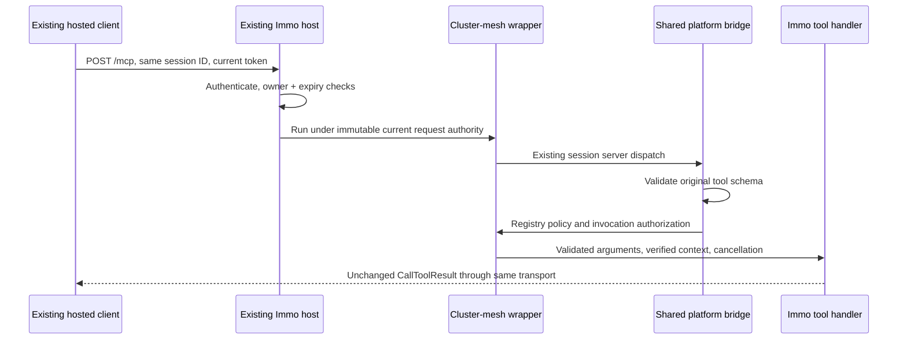

# Stateful MCP wrapping and Immo wire conformance

Status: proposed EVOL; documentation only. Owner direction: 2026-10-14, Hosting B. This specifies the three cluster-mesh blockers assigned below; it does not claim they are implemented or that production cutover is authorized.

## 1. Objective and evidence

Wrap the current Immo MCP through cluster-mesh while retaining its public identity, twelve tools and stateful HTTP behavior. A hosted client must continue using its existing endpoint, OAuth registration and valid MCP session without a wrapper-induced reconnect.

| Blocker | Existing Track item | Delivery responsibility |
| --- | --- | --- |
| 1: host-owned stateful wrapping | `01M58VB97WG8D4M7NGC88R8ECG` | cluster-mesh composition and Radar host adapter |
| 2: all twelve input schemas | `01M58VB9DQG99VAG152Z3J3QGK` | mcp-platform validation, consumed by cluster-mesh |
| 3: discovery and complete result parity | `01M58VB9KP4Z9J4JNP6PQ7YQAA` | shared platform bridge/codec and cluster-mesh conformance |

Source baseline: Sentropic `ab2138d605816cc278fbfd2cf88968ffcfbdb649` (`cluster-mesh` 0.19.1, `mcp-platform` 0.3.0). The prior archive inspection is `.tmp/cm-immo-compose/answer.md` in the Sentropic root. Durable evidence is the source and fixture pinned here, not that local scratch file.

Radar #866 is pinned to `8ef6b7190165035a19e994f5e765e774bb7101c7`, `packages/immo-mcp/src/fixtures/immo-tools.v1.json`, SHA-256 `31487e8fb9b85019fc707ed3a7296e33156c46fb5fd3071d456d6dae1b44d998`. Read that Git object if the sibling checkout has moved. Its `deployed-baseline.test.ts` compares complete discovery/results and normalizes only correlation UUIDs.

The released `packages/cluster-mesh/src/compose/mcp.ts` creates a server and transport per request. `packages/mcp-platform/src/transport/bridge.ts` validates tool arguments through the bounded configuration profile and projects only name/description/schema. `transport/result-codec.ts` canonicalizes text and adds `isError`/`_meta`. These are incompatible with the pinned Immo contract.

#689 at `811455a5b3724999828e4b313057d78cb26323e3` supplies reusable `mcp/oauth-context.ts`, `oauth-sessions.ts` and `oauth-tool-schemas.ts`. Its new sessions are mesh-owned; its discovery still drops title/execution and its runner still uses the AppToolResult codec. Do not duplicate that work or treat it as complete wrapping support.

## 2. Decisions and boundaries

- **D1 — Retain host ownership.** Add an explicit stateful wrapping composer. The wrapped host owns authentication, protocol server identity/capabilities, session IDs, server/transport objects, owner checks, expiry and HTTP lifecycle. The wrapper owns registry preflight, policy dispatch and common wire bridge registration.
- **D2 — Separate configuration from tool schemas.** Keep `sentropic.parameters/2020-12-bounded-v1` for configuration. Add an SDK-backed MCP tool validator accepting the original draft-07 schemas; do not weaken configuration validation or rewrite provider schemas to fit it.
- **D3 — Explicit wire results.** Native MCP handlers return SDK `CallToolResult`; validate and preserve it. AppToolResult handlers retain their existing explicit codec. Never infer the result mode from payload shape or retry a failed wire invocation through the old path.
- **D4 — Reuse.** Share bridge registration/dispatch, registry policy, SDK validation and request-local authority. Coordinate the common helper extraction with #689; remove its empty-schema/list-override workaround when adopting the shared bridge.
- **D5 — No authorization migration here.** Token exchange stays disabled until #689 is delivered and the owner gives GO. No raw user bearer reaches providers, data sources, receipts or outbound requests. Radar owns blocker 6 (mcp-auth 0.2.2).
- **D6 — Identity continuity.** Preserve external URL/path, issuer, audience/resource URI, OAuth client registration/credentials, scopes, provider/app-instance IDs, server name/version/capabilities and original tool names. Wrapping is not a credential rotation or a namespace prefix migration.

Artifacts/content hosting, DNS, storage migrations, receiver #865 activation and Radar domain implementation are outside these three fixes. Hosting B is retained without reopening its domain choices. Full live `search_signals` parity remains blocked while the only existing remote authorization path forwards the user bearer; simulation or canned responses cannot clear that deployment gate.

## 3. Stateful architecture

