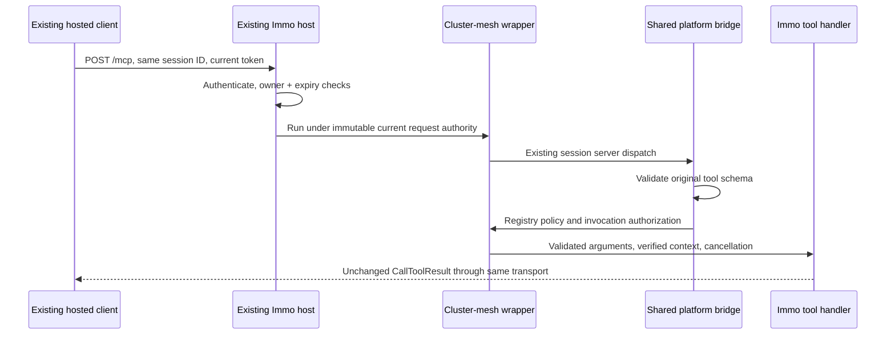

# Stateful MCP wrapping and Immo wire conformance

Status: proposed EVOL; documentation only. Owner direction: 2026-10-14, Hosting B. This specifies the three cluster-mesh blockers assigned below; it does not claim they are implemented or that production cutover is authorized.

## 1. Objective and evidence

Wrap the current Immo MCP through cluster-mesh while retaining its public identity, twelve tools and stateful HTTP behavior. A hosted client must continue using its existing endpoint, OAuth registration and valid MCP session without a wrapper-induced reconnect.

| Blocker | Existing Track item | Delivery responsibility |
| --- | --- | --- |
| 1: host-owned stateful wrapping | `01M58VB97WG8D4M7NGC88R8ECG` | cluster-mesh composition and Radar host adapter |
| 2: all twelve input schemas | `01M58VB9DQG99VAG152Z3J3QGK` | mcp-platform validation, consumed by cluster-mesh |
| 3: discovery and complete result parity | `01M58VB9KP4Z9J4JNP6PQ7YQAA` | shared platform bridge/codec and cluster-mesh conformance |

Source baseline: Sentropic `ab2138d605816cc278fbfd2cf88968ffcfbdb649` (`cluster-mesh` 0.19.1, `mcp-platform` 0.3.0). The prior archive inspection is `.tmp/cm-immo-compose/answer.md` in the Sentropic root. Durable evidence is the source and fixture pinned here, not that local scratch file.

Radar #866 is pinned to `8ef6b7190165035a19e994f5e765e774bb7101c7`, `packages/immo-mcp/src/fixtures/immo-tools.v1.json`, SHA-256 `31487e8fb9b85019fc707ed3a7296e33156c46fb5fd3071d456d6dae1b44d998`. Read that Git object if the sibling checkout has moved. Its `deployed-baseline.test.ts` compares complete discovery/results and normalizes only correlation UUIDs.

The released `packages/cluster-mesh/src/compose/mcp.ts` creates a server and transport per request. `packages/mcp-platform/src/transport/bridge.ts` validates tool arguments through the bounded configuration profile and projects only name/description/schema. `transport/result-codec.ts` canonicalizes text and adds `isError`/`_meta`. These are incompatible with the pinned Immo contract.

#689 at `811455a5b3724999828e4b313057d78cb26323e3` supplies reusable `mcp/oauth-context.ts`, `oauth-sessions.ts` and `oauth-tool-schemas.ts`. Its new sessions are mesh-owned; its discovery still drops title/execution and its runner still uses the AppToolResult codec. Do not duplicate that work or treat it as complete wrapping support.

## 2. Decisions and boundaries

- **D1 — Retain host ownership.** Add an explicit stateful wrapping composer. The wrapped host owns authentication, protocol server identity/capabilities, session IDs, server/transport objects, owner checks, expiry and HTTP lifecycle. The wrapper owns registry preflight, policy dispatch and common wire bridge registration.
- **D2 — Separate configuration from tool schemas.** Keep `sentropic.parameters/2020-12-bounded-v1` for configuration. Add an SDK-backed MCP tool validator accepting the original draft-07 schemas; do not weaken configuration validation or rewrite provider schemas to fit it.
- **D3 — Explicit wire results.** Native MCP handlers return SDK `CallToolResult`; validate and preserve it. AppToolResult handlers retain their existing explicit codec. Never infer the result mode from payload shape or retry a failed wire invocation through the old path.
- **D4 — Reuse.** Share bridge registration/dispatch, registry policy, SDK validation and request-local authority. Coordinate the common helper extraction with #689; remove its empty-schema/list-override workaround when adopting the shared bridge.
- **D5 — No authorization migration here.** Token exchange stays disabled until #689 is delivered and the owner gives GO. No raw user bearer reaches providers, data sources, receipts or outbound requests. Radar owns blocker 6 (mcp-auth 0.2.2).
- **D6 — Identity continuity.** Preserve external URL/path, issuer, audience/resource URI, OAuth client registration/credentials, scopes, provider/app-instance IDs, server name/version/capabilities and original tool names. Wrapping is not a credential rotation or a namespace prefix migration.

Artifacts/content hosting, DNS, storage migrations, receiver #865 activation and Radar domain implementation are outside these three fixes. Hosting B is retained without reopening its domain choices. Full live `search_signals` parity remains blocked while the only existing remote authorization path forwards the user bearer; simulation or canned responses cannot clear that deployment gate.

## 3. Stateful architecture



The adapter binds the host once. It registers the bridge on each existing SDK server and on each subsequently created server, before that server handles its next call. Binding is atomic relative to request admission: in-flight calls finish with their captured handlers/context; later calls use the installed bridge. The host must expose this seam explicitly. A Hono app with an inaccessible session map is not sufficient; do not introspect SDK private fields or create an HTTP loopback proxy.

Only a valid initialize without a session ID allocates a server/transport. Existing IDs reuse their objects for POST, GET and DELETE, notifications, SSE and cancellation. A foreign, expired or unknown ID returns the host's identical 404 response without initializing a replacement or touching another owner's transport. Missing-ID methods and malformed initialize retain the host's protocol behavior. DELETE, failed initialization and shutdown close each allocated transport exactly once.

Immo keeps its current owner predicate: subject always matches; client ID (`azp`, else `client_id`) matches when both tokens expose one. Its 30-minute idle and 8-hour absolute defaults, configured values, timestamp update rules and exact expiry boundary remain host-owned. The #689 session store uses a stronger owner tuple and a different expiry comparison; substituting it is not a transparent wrapper.

Every request is authenticated again before session access. Scope changes, token expiry and current account authorization apply on the next call, without renewing the session. Replace Immo's mutable `toolCtx.auth` access in the adapter with request-local context or explicit immutable arguments. Reuse the Node AsyncLocalStorage pattern from #689, combining HTTP, SDK cancellation and session-lifetime signals; never store the last caller on the session or server. Abort prevents later effects and releases request resources.

The host alone sees the ingress Authorization header. Its sanitized request passed to the SDK removes credentials after verification; domain callbacks receive verified claims and cancellation, never the token, raw Request or a fetch function carrying ingress headers. No exchange capability is installed in this mode. Account and domain authorization still execute; an unavailable account resolver fails closed.

## 4. Proposed public API and exports

These are new APIs to implement, not exports available in 0.19.1. Keep Node-specific authority storage in the composition leaf and preserve optional-peer lazy loading.

| Package subpath | Proposed additions |
| --- | --- |
| `@sentropic/cluster-mesh/compose/mcp-stateful` | `createStatefulMcpNamespace`, `StatefulMcpHost`, `StatefulMcpHooks`, `StatefulMcpNamespaceOptions`, `VerifiedMcpRequest`, `McpWrapRefusal` |
| `@sentropic/mcp-platform/transport/bridge` | `registerMcpWireTools`, `McpWireRunner`, `McpWireBridgeOptions`, `McpWireFailure`; SDK `Tool`/`CallToolResult` remain the wire types |
| `@sentropic/mcp-platform/transport/tool-schemas` | `compileMcpToolSchemas`, `CompiledMcpToolSchemas`, `McpToolValidationLimits` |
| `@sentropic/mcp-platform/transport/result-codec` | Public existing AppToolResult codec plus `validateMcpWireResult`; no lossy decode/re-encode for native results |
| `@sentropic/cluster-mesh/loaders/mcp` | Typed loaders for the schema and result leaves; existing bridge loader exposes its new symbols |

```ts
// Proposed cluster-mesh leaf; types below are part of its public contract.
interface VerifiedMcpRequest {
  readonly principal: Readonly<{
    issuer: string; sub: string; clientId?: string; tid?: string;
    scopes: readonly string[];
  }>;
  readonly resource: string;
  readonly correlationId: string;
  readonly signal: AbortSignal;
}
interface StatefulMcpHooks {
  register(server: Server): void; // McpServer hosts pass their public .server.
  run<T>(authority: VerifiedMcpRequest, next: () => Promise<T>): Promise<T>;
}
interface StatefulMcpHost {
  bind(hooks: StatefulMcpHooks): Promise<Hono>;
}
type McpWrapRefusal =
  | { kind: 'scope'; missingScopes: readonly string[] }
  | { kind: 'account' | 'policy' | 'invalid-arguments' | 'inactive' | 'internal' };
interface StatefulMcpNamespaceOptions {
  readonly host: StatefulMcpHost;
  readonly registry: CompiledMcpRegistry;
  readonly tools: readonly Tool[];
  readonly limits: McpToolValidationLimits;
  authorize(tool: string, context: VerifiedMcpRequest): Promise<boolean>;
  invoke(tool: string, args: Record<string, unknown>,
    context: VerifiedMcpRequest): Promise<CallToolResult>;
  formatRefusal(tool: string, refusal: McpWrapRefusal,
    context: VerifiedMcpRequest): CallToolResult;
}
declare function createStatefulMcpNamespace(modules: ClusterMeshModules,
  options: StatefulMcpNamespaceOptions): Promise<ClusterMeshHonoNamespaceModule>;
```

`Server`, `Tool` and `CallToolResult` above are SDK types; Hono, CompiledMcpRegistry, ClusterMeshModules and ClusterMeshHonoNamespaceModule retain their existing public imports. `bind` returns the complete host router (including public protected-resource metadata); it installs hooks exactly once, before admitting post-bind requests. The composer caches that router; `createRouter` must not bind again. Rebinding a host is a startup error. On partial bind failure, stop admission and fail composition; never silently route back to previous handlers.

The module declares namespace `/mcp`, while the complete host router already owns `/mcp` and its well-known routes. Mount explicitly with `createClusterMeshPlugin({ runtime, namespaces: [wrapped], mounts: { '/mcp': '/' } })`; test that `/mcp/mcp` is absent. Never protect public PRM discovery behind the transport's auth middleware.

Preflight validates exact tool-name uniqueness, compiled-registry resolution for every selected tool, complete selected-provider tool coverage and original schema compilation before binding. Collision or incompatible/missing package leaves fail startup. No name prefixes, copied manifests, second registry, dummy principal verifier or catch-and-use-stateless behavior.

`authorizeDispatch` remains the compiled-plan policy check before effects, followed by the required host `authorize` callback for live account/domain decisions. `formatRefusal` is a pure, bounded presentation callback, never an authorization override; it receives only the public reason and verified context. For Immo scope refusal it emits the existing `scope_denied:<scope>`, tool and correlationId envelope. Unknown tools remain JSON-RPC MethodNotFound. Internal exceptions become a safe generic failure, without exception messages or credentials.

The platform wire registration takes `(server, tools, runner, options)`: `McpWireRunner.run(name, validatedArgs, extra)` returns `Promise<CallToolResult>`; `extra` exposes only SDK cancellation, not headers. Options require a compiled schema validator and `formatFailure(name, McpWireFailure)` for invalid arguments/internal failures. The composer implements that formatter using its current request context and `formatRefusal`. Missing request authority refuses execution. The stdio adapter supplies its own trusted context explicitly.

## 5. Schema validation contract

`compileMcpToolSchemas(tools, limits)` compiles once at startup and returns `validate(name, args)` with a discriminated `{ valid: true, data } | { valid: false, diagnostics }`. Use the SDK `AjvJsonSchemaValidator` already used by #689, configured/qualified for the fixture's explicit draft-07 dialect. No schema fetches, remote `$ref`, async validators or custom executable keywords. Unknown dialects/unsupported constructs fail compilation with a tool/path diagnostic, not at the first user call.

Accept unbounded strings, draft-07 tuple `items`, numeric `exclusiveMinimum`, required fields, enums, `additionalProperties: false`, numeric limits and the exact advertised defaults. Do not coerce types, drop unknown properties, add schema bounds, replace schemas with `{}`, or reinterpret tuples as homogeneous arrays. Apply supported defaults to a cloned arguments object before validation; missing values default, explicit null/false/zero do not. Preserve domain-only checks such as bbox ordering and bbox-required when limit exceeds 500.

Schema and JSON budgets are independent of semantic string bounds. `McpToolValidationLimits` requires positive integers `maxSchemaBytes`, `maxSchemaDepth`, `maxArgumentBytes`, `maxArgumentDepth`, `maxResultBytes` and `maxResultDepth`. Implementation lot 0 records the host's existing HTTP limit and measured fixture/request/result maxima; set limits high enough for every currently accepted representative Immo case and enforce the same advertised host budget. Never silently shrink accepted inputs to make validation bounded. Check raw HTTP bytes before JSON allocation, then finite JSON values/depth before Ajv or domain invocation; reject oversize inputs without effects. Do not truncate results to meet a budget.

This validator is used by the new wire bridge only. The bounded configuration compiler and its negative tests remain unchanged. The original Tool.inputSchema object is retained for discovery and registry digest/provenance; compiled validators and defaulted call arguments are separate internal objects.

## 6. Discovery and result fidelity

The bridge returns every provided SDK Tool field unchanged: name, title, description, inputSchema, execution (including `taskSupport: forbidden`), annotations, outputSchema and `_meta` when present. Preserve missing fields as missing, order as supplied and schema text values exactly; do not manufacture capabilities or claim task execution. Discovery is not proof that a call passes validation.

`validateMcpWireResult(result, limits)` validates the complete SDK result without transforming it, then returns it. Preserve content order and block types, text bytes (including pretty JSON/whitespace/key order inside text), structuredContent, isError presence/value and `_meta` presence/value. SDK passthrough fields must not be stripped by parsing; validate a view and return the original JSON value. No injected audit metadata; receipts use the existing out-of-band receipt port.

Application errors already returned as CallToolResult remain tool results. Protocol errors remain protocol errors. Native results never travel through `decodeToolResult`/`encodeToolResult`; those remain for explicitly AppToolResult-native providers. Shared registration internals select the contract explicitly, with one execution and no fallback. Add vectors for non-text/mixed content, absent versus false isError, empty content where SDK-valid, structuredContent and metadata, beyond the twelve-tool fixture.

## 7. Conformance against #866

Vendor the exact fixture bytes and `immo-deployed-baseline.v1.json` receipt into `packages/cluster-mesh/tests/conformance/fixtures/` in the implementation branch. Record the Radar repository, commit and original paths beside them. Assert the SHA-256 from section 1 before parsing. Never refresh this golden fixture merely to make the wrapper pass.

The exact tool set is `search_lots`, `get_lot_card`, `search_signals`, `get_opportunity_dossier`, `list_documents`, `read_document_excerpt`, `get_zones_geojson`, `get_lots_geojson`, `get_grille_pdf`, `get_pv_pdf`, `get_reglement_provenance`, `query_zoning_events`.

| Gate | Observable acceptance |
| --- | --- |
| C1: initialize/discovery | Real SDK Client + StreamableHTTPClientTransport initialize against the wrapped host. Deep equality with fixture serverVersion (`immo`, `0.0.1`), serverCapabilities and all twelve ordered Tool objects, including title/execution. Assert root and historical PRM routes, canonical resource and unchanged authentication challenge URLs. |
| C2: schema validity | Compile all twelve original schemas; execute every captured argument vector. Exercise unbounded strings below the host byte budget; minArea/superficieMinM2 > 0 accepted and 0 rejected; bbox exactly four numbers accepted, three/five/non-number items rejected; omitted defaults reach the handler with their recorded values. Missing required fields, wrong types, extra properties and out-of-range limits refuse before effects. |
| C3: full wire results | For both `captures.http` and `captures.simulation`, compare every captured call and narrow-scope result as a complete object. Keep text byte formatting and optional-field presence. Normalize only the single top-level correlationId UUID inside text, validating UUIDv4 and replacing that occurrence, as #866 does. No JSON parse/stringify normalization or deletion of `_meta`/isError. |
| C4: warm wrapping | Initialize before binding, retain client/transport/session ID and credentials, bind onto the existing host, then list/call/GET/DELETE without another initialize, connect, OAuth consent or connector reset. Spy on server/transport construction: zero replacements for that session; exactly one pair for a later legitimate initialize. |
| C5: identity/lifetime | Same-owner refreshed token retains session; removed scope applies immediately. Foreign subject/client, missing/expired token and expired/unknown session refuse with expected host semantics. Test idle and absolute boundaries, owner mismatch without timestamp refresh, successful DELETE, abandoned initialize, shutdown and sweep cleanup. |
| C6: overlapping requests | Barrier-controlled calls A/B on the same session with different current scopes capture their own immutable context. Add independent-user sessions, cancellation, GET stream lifetime and session expiry during a call; no authority leakage, post-abort effects or double close. |
| C7: no unauthorized egress | Spies see zero token-exchange requests and zero ingress bearer values in domain arguments, SDK extras, logs, receipts or fetch headers. Protected Radar egress is refused while exchange is off; no fallback to anonymous requests, shared machine identity or simulation. |
| C8: installed consumer | Pack/install both packages into a clean external consumer; import only declared public subpaths. Run C1-C7 against the installed wrapper, with real auth verification and a conforming host adapter. Missing peers, incompatible versions, name collisions, unknown schemas and repeated bind fail before admission. |

Two complementary test levels are required. Sentropic's deterministic fixture-backed handlers exercise transport, validation and preservation of recorded result envelopes; they are package contract tests, not a Radar domain implementation. Radar's installed-package test must run its real factored handlers/data adapters via the existing `deployed-baseline.test.ts` methodology, including actual default application, authorization and domain refusals. Neither test may implement the wrapper in a fixture or return golden responses as evidence of domain parity.

The current #866 missing-coarse-scope capture is HTTP 401 under mcp-auth 0.1.0. Radar's 0.2.2 adoption/#689 may deliberately return 403 for an authenticated token with insufficient scope. Keep the original fixture immutable; record and assert that separately owned auth delta with its adoption receipt. It is not permission to normalize other mismatches or relabel a full snapshot comparison as exact parity.

The captured HTTP `search_signals` success can qualify formatting with synthetic local data. It cannot qualify today's protected live Radar path under D5. Record C7 refusal evidence and mark production signal parity blocked until #689, receiver #865 qualification and owner GO provide an approved replacement. Package conformance completion does not close that external gate.

Optional artifacts composition is a separate variant: expect twelve unchanged Immo entries plus the exact selected artifacts tool set (15 in the inspected 0.1.1 baseline, 27 total). Compare the Immo subset in original order and every field, separately validate artifacts names/results, and reject unexpected/duplicate names. Do not silently change the twelve-tool acceptance denominator.

## 8. Release and compatibility plan

| Package | Baseline | Planned implementation release | Required changes |
| --- | --- | --- | --- |
| `@sentropic/mcp-platform` | 0.3.0 | 0.4.0 minimum | New public validator, wire registration and result leaf; export maps/typesVersions where applicable, API report and README. Existing AppToolResult/configuration contracts remain explicit. |
| `@sentropic/cluster-mesh` | 0.19.1 | 0.21.0 minimum | Stateful leaf, typed loaders, shared authority integration, conformance/installed consumer. Reserve #689's proposed 0.20.0; do not reuse its release number. |
| `@sentropic/mcp-auth` | Immo capture 0.1.0 | 0.2.2, Radar-owned | Dependency adoption and auth-delta receipt, outside this branch. |

The platform bump is required by this design: the shared bridge and public schema/result APIs change. Set cluster-mesh's selected platform peer/catalog/loader range consistently to `>=0.4.0 <0.5.0`; update package lockfiles, packaging fixtures, release matrix and topology checks together. Keep optional leaves absent until selected; selection must preflight symbols as well as semver. Do not widen unrelated artifacts ranges here.

These numbers are floors, not publication reservations. Before implementation commits and after rebase, query published versions through the repository's containerized make lane and choose unused versions strictly greater than npm's current releases. If #689 changes the tuple, reconcile its shared helper/loader use in the same delivery sequence. Publish platform before mesh through CI/tagged releases, qualify the installed tuple, then let Radar pin it. This documentation PR bumps no manifests and publishes nothing.

## 9. Implementation lots and acceptance

These are future implementation lots, distinct from this spec branch's documentation checklist. The three existing Track items stay open until their runtime acceptance evidence passes. Keep commits under 150 changed lines and scope each implementation branch mechanically.

| Lot / owner | Files and change | Acceptance and dependency |
| --- | --- | --- |
| L0 / package maintainer + Radar | Pin conformance fixture/receipt; inventory `server-http.ts`, `tools.ts`, auth/default/expiry semantics and current HTTP budgets; agree the host bind seam and handler extraction. | Fixture hash verified; all twelve calls classified; exact budget values and auth delta recorded; no claim of production signal parity. Starts from this spec and Hosting B. |
| L1 / mcp-platform | Add `src/transport/tool-schemas.ts`; share SDK validation/default logic with #689; expose the new leaf. | C2 positive/negative vectors pass; bounded configuration behavior unchanged; no empty-schema workaround, caller mutation or remote schema fetch. Depends on L0. |
| L2 / mcp-platform | Evolve `src/transport/bridge.ts` and `result-codec.ts` with explicit native wire registration; retain a single shared dispatch kernel. | C1/C3 full-field discovery and wire vectors pass over HTTP and stdio; existing AppToolResult round trips pass; invalid result fails safely. Depends on L1. |
| L3 / cluster-mesh | Add `src/compose/mcp-stateful.ts`, stateful contract/context modules and loaders; reuse `createRegistryPolicy`/`authorizeDispatch` and #689 request-local primitives. | C4-C7 pass with a host-owned session adapter; startup failure is fail-closed; no second session map, alternate legacy endpoint or bearer-bearing invocation context. Depends on L2. |
| L4 / package maintainer | Update manifests/exports, catalog/ranges, lockfiles, READMEs, API report and packaging consumer fixtures; CI releases in dependency order. | C8 clean consumer passes, required symbols resolve, cold optional imports remain valid, published versions and package integrity recorded. Depends on L1-L3. |
| L5 / Radar integration owner | Adapt existing host/session and domain seams using public installed packages; remove mutable auth and replaced registrations; run host suite and hosted-client UAT. | Actual Immo handlers satisfy C1-C6, no manual reconnect/re-registration; C7 enforced. Production cutover additionally requires live signal authorization and owner GO. Depends on L4 and Radar blocker 6. |

File-level test inventory (new unless marked existing):

- Platform: `packages/mcp-platform/tests/mcp-wire-schema.test.ts` (all fixture schema constructs/defaults/budgets); `tests/mcp-wire-results.test.ts` (metadata and lossless/error vectors); existing `tests/registry-parameters.test.ts`, `wire-parity.test.ts`, `request-identity.test.ts`, `streamable-http.test.ts`, `stdio.test.ts` (configuration/transport/authority regressions).
- Mesh: `packages/cluster-mesh/tests/mcp-stateful-wrap.spec.ts` (bind, ownership, concurrency, lifecycle, authority and egress); `tests/conformance/immo-stateful-wrap.spec.ts` (C1-C7); `tests/packaging/mcp-stateful-consumer.spec.ts` and its `fixtures/mcp-stateful/host.ts` (C8); existing `tests/mcp-composition.spec.ts`, `loaders/mcp-platform.spec.ts`, `integrations/mcp-surface.spec.ts`, `modules/topology-ranges.spec.ts`, `packaging/mcp-tuple.spec.ts` (explicit existing surfaces and release tuple).
- Radar: existing `packages/immo-mcp/src/deployed-baseline.test.ts`, `server-http-session.test.ts`, `server-http.test.ts`, `oauth-discovery.test.ts`, `server.test.ts`, `data-source.test.ts`, `raw-data.test.ts`; add a warm-bind scenario exercising its real server/transport map and a hosted-client session across wrapping.

Scoped commands: `make test-mcp-platform SCOPE=tests/mcp-wire-schema.test.ts ENV=test-cm-mcp-stateful-wrap`, then the wire suite; `make test-cluster-mesh SCOPE=tests/mcp-stateful-wrap.spec.ts ENV=test-cm-mcp-stateful-wrap`, then conformance/packaging. Final implementation gates: `make typecheck-mcp-platform typecheck-cluster-mesh ENV=test-cm-mcp-stateful-wrap`, the complete two package test targets, `make api-extract-mcp-platform ENV=test-cm-mcp-stateful-wrap` and `make pack-mcp-platform pack-cluster-mesh ENV=test-cm-mcp-stateful-wrap`. Run targets sequentially when they share build artifacts. Radar runs `make test-immo-mcp SCOPE=src/deployed-baseline.test.ts ENV=test-immo-cm` and its complete MCP suite in its isolated checkout.

## 10. Risks and cutover gates

| Risk | Mitigation / observable stop condition |
| --- | --- |
| Existing Immo sessions are inaccessible to a wrapper | Radar must expose bind through public server/session seams. If it requires discarding live objects, C4 fails; do not claim no-reconnection acceptance or deploy. |
| SDK registration replacement races with active calls | Admission barrier during bind; each call captures its handler/context; test binding while a call is paused and verify single completion. Never inspect private SDK handler maps. |
| Open streams outlive request authority | Capture immutable authority for each operation, combine lifecycle signals, and bound stream ownership to existing host policy. No ambient authority reuse for later requests. |
| More expressive schemas consume resources | Measured host-compatible byte/depth limits, startup compilation, no remote/async schema execution; negative vectors prove refusal before effects. |
| Authorization failures change the result envelope | Explicit refusal formatter and narrow-scope golden vectors; preserve auth-library migration delta separately. No formatting hook may bypass policy. |
| #689 and this work fork the same logic | Coordinate extraction into the shared platform/authority helpers; update its consumer to remove local schema/list workarounds. Do not invent a second OAuth stack. |
| Process restart or replica routing loses in-memory sessions | Warm wrapping preserves live objects only. A cold restart retains the host's existing unknown-session behavior. Production must keep active sessions on their owning process through natural expiry; if deployment cannot do this without forced reconnection, cutover stays blocked. No copied session IDs or stateless retry. |
| Disabled exchange breaks protected live signal calls | Package work remains deliverable; production equivalence/cutover remains blocked until the separate authorization path and owner GO are qualified. |

Rollout first proves C1-C8 on the exact installed tuple, then Radar's real-host suite, then hosted-client UAT with the same configuration and credentials. Observe the existing connector performing tools/list and repeated calls before and after binding; verify no fresh initialize/consent/reconnection and no wrong-owner access. DNS/resource URI changes or invalidating existing sessions fail acceptance. A failing release is not activated; after activation, rollback is an operator deployment decision, never automatic execution through a legacy route.
