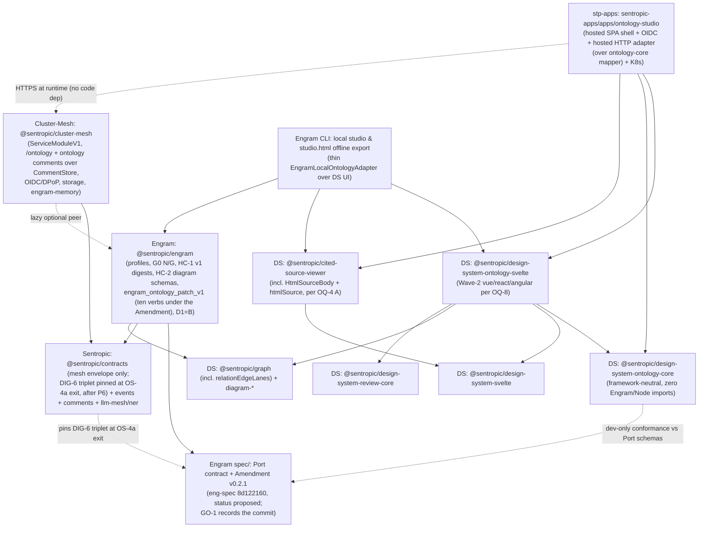
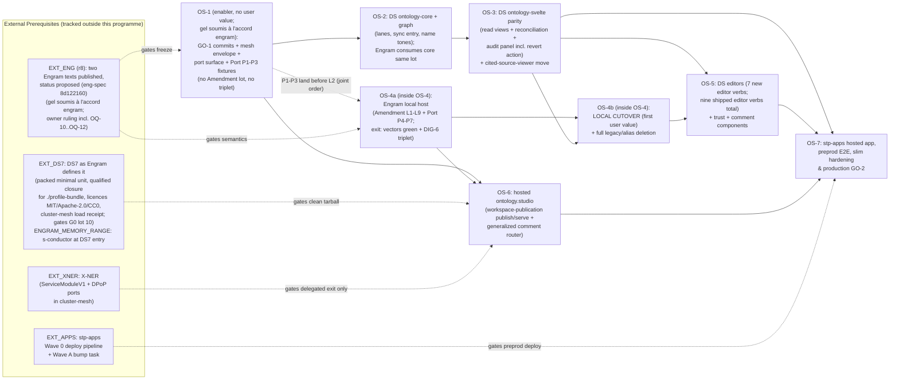

# SPEC_EVOL — Ontology Studio Architectural Split (Engram, Design System, Sentropic, Cluster-Mesh, stp-apps)

**Revision r10 · 2026-11-23 · Draft for owner review and GO (convergence pass: folds only the Major Finding 1 of Opus review `.h2a/reviews/ontology-split-r9-opus.md` — the undetermined local Answer view at the `OS-4b` parity cutover — as explicit sub-question `OQ-10L` under `OQ-10`, corrects the §16 Opus F1 row, and applies two unambiguous one-line Minor fixes (Findings 6 and 9), against snapshot `.tmp/rv/ontology-split-r10.before.md`; r9 was an Engram re-check pass: applies the five required replacements of the Engram re-check of r8, `graphify:.graphify/scratch/design/studio-split/RECHECK-studio-split-r8-fable.md` — VERDICT: CONSENT-WITH-CHANGES — word for word against snapshot `.tmp/rv/ontology-split-r9.before.md`, plus its nine precision edits and the Major findings of Opus review `.h2a/reviews/ontology-split-r8-opus.md` as recorded in §16; r8 was a joint pass with Engram: aligns §4.3 item 2, §5.1 and the `OS-1` row on Engram's two published reference texts, status `proposed` — `engram:spec/SPEC_ONTOLOGY_STUDIO_DATA_PORT_CONTRACT.md` v0.2.1 and `engram:spec/SPEC_ONTOLOGY_LIFECYCLE_PATCH_AMENDMENT.md` v0.2.1, commit `8d122160a11a499901bdd96f7519577bb147c656` ([PR #535](https://github.com/rhanka/engram/pull/535)), §2.1 — against snapshot `.tmp/rv/ontology-split-r8.before.md`; r7 folded the Engram design review `graphify:.graphify/scratch/design/studio-split/REVIEW-studio-split-engram-fable.md` — VERDICT: AGREE-WITH-CHANGES, 2 BLOCKER / 9 MAJOR / 12 MINOR — against snapshot `.tmp/rv/ontology-split-r7.before.md`; r6 folded the one remaining Major finding of Opus review `.h2a/reviews/ontology-split-r5-opus.md`; r5 folded `.h2a/reviews/ontology-split-r4-opus.md`; r4 folded `.h2a/reviews/ontology-split-r3-opus.md`; r3 folded `.h2a/reviews/ontology-split-r2-opus.md`; r2 folded Carbon review `.h2a/reviews/ontology-split-carbon.md`). GO-1 records the commit of the two Engram texts before any lot; the digest triplet pinned by `@sentropic/contracts` exists only after Engram lot `P6` and is recorded at the `OS-4a` exit (§8, `OQ-12`). GO-1 and the `OS-1` freeze stay « gel soumis à l'accord engram » until the owner rules on the proposed texts (§2.2, §8).**

---

## 1. Résumé propriétaire

- [FAIT] Le 22 novembre 2026, tu as fixé le cap.
- [FAIT] Tous les écrans du Studio vont dans la bibliothèque d'écrans partagée.
- [FAIT] Les données et leurs règles restent dans Engram.
- [FAIT] Sentropic porte l'organisation d'ensemble et les accès partagés.
- [FAIT] Un autre dépôt assemble le site hébergé et le met en ligne.
- [FAIT] Aujourd'hui, les écrans vivent encore dans Engram.
- [FAIT] Un petit serveur local sert les pages et les données.
- [FAIT] Ce serveur ne sépare pas les clients entre eux.
- [FAIT] Il ne convient donc pas à un site partagé.
- [FAIT] Une partie du travail existe déjà.
- [FAIT] Le moteur de dessin du graphe est déjà dans la bibliothèque partagée.
- [FAIT] Les briques de commentaires y sont aussi.
- [FAIT] La visionneuse de sources existe déjà dans Sentropic.
- [FAIT] Son transfert, avec la vue des pages web citées, fait partie du plan.
- [JUGEMENT] Après le découpage, chaque rôle est simple.
- [JUGEMENT] La bibliothèque partagée fournit tous les écrans.
- [JUGEMENT] Elle fournit le graphe, les listes, les fiches et les formulaires.
- [JUGEMENT] Elle fournit aussi les commentaires et la lecture des sources.
- [JUGEMENT] Engram garde les règles des données et leur historique.
- [JUGEMENT] Engram garde aussi les calculs qui enrichissent les données.
- [JUGEMENT] Sentropic garde les règles d'accès et la séparation des espaces.
- [JUGEMENT] Le dépôt du site assemble les écrans publiés.
- [JUGEMENT] Il met le site en ligne et le met à jour.
- [JUGEMENT] L'utilisateur verra les changements dans cet ordre.
- [JUGEMENT] D'abord, le Studio local garde les mêmes écrans.
- [JUGEMENT] Une exception reste ouverte.
- [JUGEMENT] Elle porte sur la vue des réponses en local.
- [JUGEMENT] La sous-question OQ-10L la pose en clair en section 7.2.
- [JUGEMENT] Ces écrans viennent alors de la bibliothèque partagée.
- [JUGEMENT] Le rapprochement de doublons reste possible, comme aujourd'hui.
- [JUGEMENT] Ensuite, le Studio local reçoit les formulaires manquants.
- [JUGEMENT] Chaque édition acceptée apparaît tout de suite dans le graphe.
- [JUGEMENT] Enfin, le site hébergé montre les mêmes données.
- [JUGEMENT] Dans le choix recommandé, ce site sert d'abord à lire et commenter.
- [JUGEMENT] Les éditions restent alors en local, dans un premier temps.
- [FAIT] Deux protections restent non négociables.
- [FAIT] Les six anciennes empreintes de profils ne changent pas, à l'octet près.
- [FAIT] Les quatre schémas de diagrammes gérés par Engram ne bougent pas.
- [FAIT] Des copies et des versions voisines existent déjà côté bibliothèque.
- [JUGEMENT] Ce plan ne les déplace pas et ne les modifie pas.
- [JUGEMENT] Leur sort relève d'une décision séparée des deux propriétaires.
- [JUGEMENT] **Avant / après.**

```text
AVANT                                  APRÈS
┌──────────────────────────────┐     ┌──────────────────────────────┐
│ Engram                       │     │ Bibliothèque d'écrans        │
│  écrans + données + serveur  │     │  tous les écrans du Studio   │
│  local, dans un seul dépôt   │     └──────────────┬───────────────┘
└──────────────────────────────┘                    │
                                         ┌──────────▼───────────────┐
                                         │ Studio local (Engram)    │
                                         │ ou site hébergé          │
                                         └──────────┬───────────────┘
                                                    │ avec connexion
                                         ┌──────────▼───────────────┐
                                         │ Sentropic                │
                                         │  accès + commentaires    │
                                         └──────────┬───────────────┘
                                                    │
                                         ┌──────────▼───────────────┐
                                         │ Engram                   │
                                         │  données + règles        │
                                         └──────────────────────────┘
```

- [JUGEMENT] **Écran du choix « où ouvrir le site ».**
- [FAIT] Avant : l'utilisateur lance le Studio en local, sur sa machine.
- [JUGEMENT] Après, choix recommandé : il ouvre une adresse dédiée au Studio.
- [JUGEMENT] Il se connecte, puis il choisit son espace de travail.
- [JUGEMENT] Les mêmes écrans pourraient aussi vivre dans le site principal.
- [JUGEMENT] Ce second choix garde une seule adresse, mais lie les mises à jour.
- [JUGEMENT] **Écran du choix « quels formulaires livrer d'abord ».**
- [FAIT] Avant : la fiche se lit, mais elle ne se modifie pas.
- [FAIT] Seul le rapprochement de doublons accepte ou refuse une proposition.
- [JUGEMENT] Après, choix recommandé : la fiche reçoit des formulaires complets.
- [JUGEMENT] L'utilisateur crée, relie et retire, puis voit le résultat.
- [JUGEMENT] Le choix réduit garde la lecture seule et le rapprochement.
- [JUGEMENT] Le choix large ajoute aussi l'édition des règles elles-mêmes.
- [JUGEMENT] Ce choix large coûte bien plus et touche aux empreintes protégées.
- [JUGEMENT] **Plan en sept étapes, sans arrêt brutal du Studio.**
- [JUGEMENT] Les deux premières étapes préparent le terrain, sans écran nouveau.
- [JUGEMENT] La troisième reconstruit les écrans actuels dans la bibliothèque.
- [JUGEMENT] La quatrième bascule le Studio local sur ces écrans.
- [JUGEMENT] C'est le premier changement visible pour l'utilisateur.
- [JUGEMENT] La cinquième ajoute les formulaires, en local.
- [JUGEMENT] Les commentaires arrivent avec le site hébergé.
- [JUGEMENT] En local, les boutons de commentaires restent donc éteints.
- [JUGEMENT] Les deux dernières ouvrent le site hébergé, puis la production.
- [JUGEMENT] Une étape séparée de re-vérification finale disparaît du plan.
- [FAIT] Les contrôles des deux protections tournent déjà à chaque changement Engram.
- [FAIT] Engram a relu le modèle de données de ce plan.
- [FAIT] Engram approuve le cap et demande des ajustements.
- [FAIT] Engram a publié ses deux textes de référence.
- [FAIT] Ces textes restent au statut proposé.
- [FAIT] Les formats des données échangées appartiennent à Engram.
- [FAIT] Engram les écrit et les versionne dans son dépôt.
- [FAIT] Sentropic garde seulement l'enveloppe des appels partagés.
- [FAIT] Les règles des corrections appartiennent aussi à Engram.
- [FAIT] Engram les a écrites dans son propre document de règles.
- [FAIT] Ce plan cite ce document au lieu de fixer ces règles.
- [FAIT] Dix verbes de correction existent dans les règles d'Engram.
- [FAIT] Neuf verbes existent déjà dans le code livré.
- [FAIT] Le dixième verbe annule une décision prise avant.
- [FAIT] Le premier gel attend ta décision sur ces textes proposés.
- [FAIT] Ce gel note d'abord la version exacte de ces textes.
- [FAIT] L'empreinte complète des formats viendra plus tard.
- [FAIT] Elle demande un lot Engram qui reste à construire.
- [JUGEMENT] **Effort estimé : 282 à 417 heures-agent, colonne Engram provisoire.**
- [JUGEMENT] Bibliothèque d'écrans : 113 à 168.
- [JUGEMENT] Engram : 74 à 110, à repricer par Engram.
- [JUGEMENT] Engram a listé le travail à repricer.
- [JUGEMENT] Engram n'a donné aucun chiffre pour ce travail.
- [JUGEMENT] Sentropic : 65 à 95.
- [JUGEMENT] Site hébergé : 30 à 44.
- [JUGEMENT] Douze questions attendent ta décision en section 7.2.
- [JUGEMENT] Trois questions nouvelles viennent des textes d'Engram.
- [JUGEMENT] Une question porte sur le premier affichage hébergé.
- [JUGEMENT] Dans le choix recommandé, le site hébergé n'a aucune recherche par question dans la première version.
- [JUGEMENT] Dans le choix recommandé, le site hébergé ne reçoit aucun index de recherche.
- [JUGEMENT] Le sort de la vue des réponses en local reste à décider.
- [JUGEMENT] Elle peut rester telle quelle sur des données de base.
- [JUGEMENT] Elle peut aussi se fermer dès la première décision prise.
- [JUGEMENT] Ce choix se note au premier gel.
- [JUGEMENT] Une question porte sur le bouton d'annulation.
- [JUGEMENT] Une question porte sur le moment du gel complet.
- [JUGEMENT] Chaque question propose deux ou trois options qui avancent.
- [JUGEMENT] Chaque option montre ses risques.
- [JUGEMENT] Chaque question montre aussi le risque de ne pas décider.
- [JUGEMENT] Une question porte sur les éditions en mode hébergé.
- [JUGEMENT] Le choix recommandé garde une seule référence pour ces éditions.
- [JUGEMENT] Cette référence reste le fichier de décisions du corpus.
- [JUGEMENT] Le site hébergé publie alors des vues figées et datées du corpus.
- [JUGEMENT] Ces vues portent déjà les corrections du journal local.
- [JUGEMENT] Une édition locale donne une nouvelle vue à publier.
- [JUGEMENT] Le sort exact de chaque correction suit le document de règles d'Engram.
- [JUGEMENT] Ce plan ne fixe pas ce sort à la place d'Engram.
- [JUGEMENT] La relecture se fait alors en deux endroits.
- [JUGEMENT] On commente sur le site hébergé.
- [JUGEMENT] On corrige en local, puis on republie.
- [JUGEMENT] Aucun écran unique ne réunit les deux gestes au début.

---

## 2. Authority, Source Pins, and Binding Constraints

[JUGEMENT] This document is an architecture specification (revision 10), not a delivery receipt. [FAIT] Revision 10 folds only Finding 1 (Major) of `.h2a/reviews/ontology-split-r9-opus.md` (§17): the local Answer view at the `OS-4b` cutover is explicit sub-question `OQ-10L` under `OQ-10`, not a decided behaviour, and no §2–§8 sentence may read it as decided before GO-1 records that ruling with Engram's E2 answer. [FAIT] Revision 9 applies the Engram re-check of r8 (CONSENT-WITH-CHANGES, receipt `.tmp/rv/ontology-split-r9.md`) to the r8 alignment of §4.3 item 2, §5.1 and the `OS-1` row on Engram's two published reference texts, status `proposed`: `eng-spec:spec/SPEC_ONTOLOGY_STUDIO_DATA_PORT_CONTRACT.md` v0.2.1 (`sha256:c231a2c04884fa83ba47e04637da981be6ff5d27c4f91715925106aebedd1093`) and `eng-spec:spec/SPEC_ONTOLOGY_LIFECYCLE_PATCH_AMENDMENT.md` v0.2.1 (`sha256:f62ee4e69500f0436a3e03da87819d58b2080af948df8b4a93cb901f5a24d69e`), both at commit `8d122160a11a499901bdd96f7519577bb147c656` (§2.1 `eng-spec:`). Anything in §2–§8 that restated or contradicted those two texts is removed and replaced by a citation; DTO field definitions and patch rules live only there. GO-1 records that commit before any lot; the digest triplet pinned by `@sentropic/contracts` (data-port contract DIG-6) exists only after Engram lot `P6` and is recorded at the `OS-4a` exit (§8, `OQ-12`). Until the owner rules on the proposed texts, GO-1 and the `OS-1` freeze stay « gel soumis à l'accord engram » (§8). Every claim carries an inline tag: `[FAIT]` marks an observation verified directly in a pinned source tree or document with `path:line` or commit hash; `[JUGEMENT]` marks a proposed design, boundary, lot plan, risk, option, or effort estimate. Effort is reported exclusively in **agent-hours** (zero human-time or calendar estimates). **Language policy exception:** Per `sen-wt:.tmp/packets/COMMON-RULES.md:12,116` and this lane's binding brief (matching `sen-wt:spec/SPEC_EVOL_REMOTE_FASTLANE.md:5–57,109`), `§1` is a concise French owner summary in short simple sentences, while the technical specification (`§2–§9`) is strictly English per `sen-wt:rules/MASTER.md:63`. No code, branch, commit, push, or deployment was modified outside the spec output files.

### 2.1 Inspected Repository and Document Pins

| Prefix | Repository / File | Exact Pin Verified in Revision 10 |
|---|---|---|
| [FAIT] `eng-feat:` | `/home/antoinefa/src/graphify` (`origin`: `rhanka/engram`), branch `feat/process-std-ontology-studio` | Commit `8f19554cea3a4397fd66a90c7e9fd5ea54c81626` (2026-08-20 20:46:14 -0400, `chore(track): archive decision D1 (memory store backend) as selected=B`). Read strictly read-only via `git -C /home/antoinefa/src/graphify show feat/process-std-ontology-studio:<path>` (working tree untouched). |
| [FAIT] `eng-main:` | `/home/antoinefa/src/graphify` (`origin`: `rhanka/engram`), `origin/main` | Commit `66465de8073c28c00a5f12a9650d4e54e989ec6f` (`feat(ontology): G0 lot 9b — relation and registry compatibility (#530)`), re-pinned in r7 at Engram's request (review M9; r6 pin was `89e72ac3b`, six ref updates behind). Package `@sentropic/engram@0.28.0`. **G0 data-model lots 1a–9b are merged at this pin** (lot 8b pair verification `8352e7ed1`, lot 9a row/domain compatibility `e4e3daef5` adding `src/ontology-guardian/row-domain-compat.ts`, lot 9b `66465de80`; earlier lots as recorded in r6); **lot 10 (conformance and delivery) is not merged and is blocked on DS7** (`eng-main:spec/SPEC_ONTOLOGY_GUARDIAN_G0_AMENDMENT_DATA_MODELS.md` §6–§7). Re-verification at this pin (r7, via `git show` only): every Engram file cited below is blob-identical between `89e72ac3b` and `66465de8` except `src/profile-bundle.ts` (grew by the lot 8b/9a/9b surface; its citations below are restated at this pin), `package.json` (build-script lines only; the dependency block cited below is restated at this pin), and `src/cli.ts` (scrap commands at `:6158+` only; every `cli.ts` line cited below is below that and unchanged). Drift note (Engram re-check of r8, recorded in r9): this `eng-main:` code pin `66465de8` is four ref updates behind `origin/main`; 19 files differ, and among the files this spec cites only `package.json` (line 266) and `src/cli.ts` (lines 6164 and below) changed, both outside every cited range. |
| [FAIT] `eng-spec:` | `/home/antoinefa/src/graphify` (`origin`: `rhanka/engram`), `origin/main`, read only via `git -C /home/antoinefa/src/graphify show origin/main:<path>` (working tree untouched) | Commit `8d122160a11a499901bdd96f7519577bb147c656` (`docs(spec): ontology studio data-port contract and lifecycle patch amendment (#535)`, [PR #535](https://github.com/rhanka/engram/pull/535)). Two reference texts, both status `proposed`, owner acceptance pending: **`spec/SPEC_ONTOLOGY_STUDIO_DATA_PORT_CONTRACT.md` v0.2.1**, contract identifier `engram.ontology-studio-data-port/v1`, `sha256:c231a2c04884fa83ba47e04637da981be6ff5d27c4f91715925106aebedd1093` (recomputed in r8 over the `git show` bytes); **`spec/SPEC_ONTOLOGY_LIFECYCLE_PATCH_AMENDMENT.md` v0.2.1**, amending `spec/SPEC_ONTOLOGY_LIFECYCLE_RECONCILIATION.md`, `sha256:f62ee4e69500f0436a3e03da87819d58b2080af948df8b4a93cb901f5a24d69e` (recomputed in r8 the same way). Their code citations are pinned at `eng-main:66465de8` above and state that they hold at the later drift commit they record; the two operative lines r8 re-verified at `origin/main` are `src/studio-scene.ts:777–782` and `src/studio-export.ts:708–711,751` (§4.3 item 2). Sections of these texts are cited below as `Port §…` (data-port contract) and `Amendment §…` (lifecycle amendment). |
| [FAIT] `ds:` | `/home/antoinefa/src/sent-tech-design-system`, `origin/main` | Commit `c498cd5dcd2e7bbd4b3a880e378524546ab7b33e` (2026-11-22 22:52:34 -0500, PR #335 `fix/elements-publish-chrome`, tag `elements-v0.3.1`). Versions: `@sentropic/graph@0.3.1`, `@sentropic/design-system-review-core@0.1.2`, `@sentropic/design-system-svelte@0.45.0`, `@sentropic/design-system-vue@0.41.0-next.14`, `@sentropic/diagram-core@0.6.0`, `@sentropic/diagram-canvas@0.5.0`, `@sentropic/diagram-codecs@0.1.1`, `@sentropic/design-system-elements@0.3.1`. (r1 pin was `8f3feabdd`.) All DS facts below are verified at this pin via `git show`. Drift note (exact, corrected in r5): `origin/main` advanced to `f57f41807` (Elements `0.3.2` release train), where `packages/elements/README.md` changed at lines 231 and 239; the lines cited below (`:11,177`) are unchanged, as is every other DS line cited below. |
| [FAIT] `ds-rk:` | `/home/antoinefa/src/sent-tech-design-system/scratchpad/review-kit/SPEC-r6.md` | Working-tree file, Revision r6 (19/11), 315 lines. |
| [FAIT] `sen:` | `/home/antoinefa/src/sentropic`, `origin/main` | Commit `f9a87400cf0a7e272d7650563823edaba4f4071d` (2026-11-22 23:20:37 -0500, PR #1065 `ci/no-coauthor-trailer`). `@sentropic/cluster-mesh@0.27.0-dev.3`, `@sentropic/llm-mesh@0.38.6`, `@sentropic/cited-source-viewer@0.2.0`. All Sentropic package facts read via `git show origin/main:<path>` (drift from r1 pin `6d3b8ddc` is CI-only; no `packages/cited-source-viewer`, `cluster-mesh`, `comments`, or `contracts` change). |
| [FAIT] `sen-wt:` | `/home/antoinefa/src/sentropic` working-tree specs & reviews | `spec/SPEC_EVOL_LLM_MESH_NER_AND_DECISION_CHOICE.md` (r5, 2026-11-21), `spec/SPEC_EVOL_REMOTE_FASTLANE.md` (r14, 2026-11-22), `spec/SPEC_EVOL_SENTROPIC_APPS_MONOREPO.md`, `.tmp/rv/ontology-studio-split.constraints.md` (2026-11-22), `.h2a/reviews/ontology-split-carbon.md` (Carbon review of r1, VERDICT: CHANGES), `.h2a/reviews/ontology-split-r2-opus.md` (Opus review of r2, VERDICT: CHANGES, 18 findings), `.tmp/rv/ontology-split-r3.before.md` (exact r2 snapshot), `.h2a/reviews/ontology-split-r3-opus.md` (Opus review of r3, VERDICT: CHANGES, 0 Blocking / 3 Major / 11 Minor), `.tmp/rv/ontology-split-r4.before.md` (exact r3 snapshot, `sha256:65a560129b8b…`), `.h2a/reviews/ontology-split-r4-opus.md` (Opus review of r4, VERDICT: CHANGES, 0 Blocking / 1 Major / 8 Minor), `.tmp/rv/ontology-split-r5.before.md` (exact r4 snapshot, `sha256:9c46e4f62fe6…`), `.h2a/reviews/ontology-split-r5-opus.md` (Opus review of r5, VERDICT: CHANGES, 0 Blocking / 1 Major / 8 Minor), `.tmp/rv/ontology-split-r6.before.md` (exact r5 snapshot, `sha256:6e9e3ad72439…`), `graphify:.graphify/scratch/design/studio-split/REVIEW-studio-split-engram-fable.md` (Engram design review of r6, AGREE-WITH-CHANGES, 2 BLOCKER / 9 MAJOR / 12 MINOR; read read-only, Engram working tree untouched — its Engram-side citations were taken at `89e72ac3b` and are re-verified at `eng-main:66465de8` in r7), `.tmp/rv/ontology-split-r7.before.md` (exact r6 snapshot, `sha256:ec48314068d4…`), `.tmp/rv/ontology-split-r7.md` (r7 receipt: Engram finding → disposition), `.tmp/rv/ontology-split-r8.before.md` (exact r7 snapshot, `sha256:90f4120c8b23…`), `.tmp/rv/ontology-split-r8.md` (r8 receipt: change table + the three owner questions), `.tmp/rv/ontology-split-r9.before.md` (exact r8 snapshot), `.tmp/rv/ontology-split-r9.md` (r9 receipt), `.h2a/reviews/ontology-split-r8-opus.md` (Opus review of r8, VERDICT: CHANGES, 0 Blocking / 5 Major / 13 Minor), `graphify:.graphify/scratch/design/studio-split/RECHECK-studio-split-r8-fable.md` (Engram re-check of r8, CONSENT-WITH-CHANGES; read read-only). |
| [FAIT] `apps:` | `/home/antoinefa/src/sentropic-apps` | Local `main` `561ad4301570db3d7f088dcf14bf33e5592c2e69` (`deploy: pages static ingress TLS via letsencrypt-prod`) holds `LICENSE`, `README.md`, and `deploy/pages-static/pages-static.yaml`. `origin/main` `c13bf37c0222a506064eac18d4b1e6b84b80f1df` holds only `LICENSE` and `README.md` — the pages-static deploy file is not on `origin/main`. |

### 2.2 Binding Directives and Prior Decisions

- [FAIT] **Owner Direction (2026-11-22, verbatim):** « L'ontology studio doit être très intégré à engram, mais je pense que toute la partie UI doit être transférée au design system, avec la modélisation des données côté engram, et l'archi globale gérée avec sentropic et cluster-mesh. »
- [FAIT] **Track Decision D1 = B (memory store backend only):** Archived on `eng-feat:` at commit `8f19554c` (decision `01KZM1JXHQK5CV8CX3N39VB66P`, title « Backend local du store mémoire graphify : SQLite vs PostgreSQL »): the `decision.created` event is `.track/events.jsonl:445` (2026-08-09), the selection `optionId: "B"` is `:448` and the outcome `go` is `:449` (both `2026-08-21T00:45:56.212Z`). Option B selects « SQLite derrière le serveur local » (Mode 2 local server owns SQLite and serializes `MemoryPort` commands, zero DB provisioning, same server boundary as Mode 3), with commit message noting that Engram carries no standalone production server and that SQLite + Postgres are storage adapters behind the external cluster-mesh host (`eng-feat:8f19554c`, `sen:packages/cluster-mesh/src/engram-memory/contract.ts:1–105`). **[FAIT] The archived recommendation is conditional:** B is the target « seulement si le serveur local est déjà une brique commune Modes 2/3 et passe le soak à 2x le pic », with C (local Postgres) as go-live and fallback until those gates (`eng-feat:.track/events.jsonl:445`, `recommendation` field). This spec therefore does **not** make the Studio host the memory-store owner in Wave 1 (§4.3): the Studio needs only compiled artifacts and the decision file, and memory-store hosting keeps its own programme and gates. **[FAIT] The Studio host is not counted as D1's common local server** (review m8): D1's condition concerns the server that would own the memory store, and `createLocalOntologyHost` (§4.3) neither satisfies nor consumes it. [FAIT] The D1 record currently lives on the `eng-feat:` Track stream only (the `main` stream at the pin ends earlier); merging that record into `main`'s Track stream is an Engram-side bookkeeping item recorded here, not a lot of this split. **[FAIT] D1 = B chose the local backend of the memory store only. It did not choose a store for the ontology decision log, and this spec does not extend it to patches: decision-log authority is owner question `OQ-9` (§7.2), an Engram data-model and versioning decision per the constraints file.**
- [FAIT] **Engram Constraints for Split (2026-11-22):** Engram retains the ontology schema and profiles (including the G0 data-models amendment), versioning and enrichment, the memory store (D1 = B), and the NER boundary. Two hard contracts are non-negotiable: **(1) v1 fingerprints stay stable**; **(2) governed diagram schemas do not move**. Ownership source — `sen-wt:.tmp/rv/ontology-studio-split.constraints.md:1–5` (its lot-status wording, "lots 1a–4b merged, lot 5 in review", is superseded: lots 1a–9b are merged on `eng-main:66465de8` and lot 10 is blocked on DS7, §2.1).
- [FAIT] **Engram Data-Model Review of r6 (2026-11-23, AGREE-WITH-CHANGES):** Engram, owner of the data model, agrees with the direction and the five-owner split and confirms both hard contracts, and withholds consent to the GO-1 record and the `OS-1` freeze until two blockers are resolved (`graphify:.graphify/scratch/design/studio-split/REVIEW-studio-split-engram-fable.md` §0, §3.1). **[JUGEMENT] The conductor accepts both blockers, consistent with the owner direction above (the data model stays in Engram), and r7–r8 are written on that basis:** **(B1)** the data-port DTO schemas and golden fixtures are owned, authored, and versioned by Engram under its contract of record, now published as `eng-spec:spec/SPEC_ONTOLOGY_STUDIO_DATA_PORT_CONTRACT.md` v0.2.1, status `proposed` (§2.1); `@sentropic/contracts` keeps only the mesh envelope and pins that contract by its digest triplet, which exists only after lot `P6` and is recorded at the `OS-4a` exit, not at GO-1 (§4.4, §5.1, §8). **(B2)** patch semantics are defined only by `eng-spec:spec/SPEC_ONTOLOGY_LIFECYCLE_PATCH_AMENDMENT.md` v0.2.1, status `proposed` (§2.1); this spec cites it and states none of its rules (§4.3 item 2, §5.1). [JUGEMENT] Both texts now exist, so the r7 dependency « à écrire par engram » is discharged as a writing task; what remains open is acceptance: until the owner rules on the proposed texts (including `OQ-10`–`OQ-12`), **GO-1 and the `OS-1` freeze stay « gel soumis à l'accord engram »** (§8); the direction, `OS-2`, and `OS-3` are not blocked by the two findings. Field and schema names for Engram-owned shapes are the names Engram minted in the data-port contract (Port §7.11); r1–r7 placeholder spellings in §9–§14 are history and bind nothing.
- [FAIT] **Owner Decision `[G2]` (Governance Unification):** Verbatim in `eng-main:spec/SPEC_ONTOLOGY_GUARDIAN_G0_CONTRACTS.md:22`: « Engram governs profiles, schemas, fixtures and migrations. The Design System retains and publishes the generic @sentropic/diagram-core executor, layout and rendering. Consumers pin profiles; no second diagram metamodel. »
- [FAIT] **Owner Decision `D4-A` (G0 Data Models, 2026-11-21):** Engram defines logical data models (tier N) and governed metadata (tier G), publishing exact versions and digests; `cluster-mesh` owns access rights and RLS translation; downstream compilers consume pinned models (`eng-main:spec/SPEC_ONTOLOGY_GUARDIAN_G0_AMENDMENT_DATA_MODELS.md:7–14`).
- [FAIT] **Libs vs Deploy Split (`APPS-1 b`, `APPS-2 a`, `APPS-3 a`):** `sentropic` owns global architecture and published `@sentropic/*` libraries; `sentropic-apps` (`stp-apps`) owns hosted application shells, container images built from published packages, DNS, and Kubernetes deployment (`sen-wt:spec/SPEC_EVOL_REMOTE_FASTLANE.md:99,109`, `sen-wt:spec/SPEC_EVOL_SENTROPIC_APPS_MONOREPO.md:308–316`).
- [FAIT] **NER Service-Module Precedent (2026-11-21):** `SPEC_EVOL_LLM_MESH_NER_AND_DECISION_CHOICE.md:3,15,33–99,144–153` specifies the capability-agnostic `ServiceModuleV1` / `createServiceModuleRegistry` pattern (`disabled | in-process | delegated`), mutual DPoP authentication, and `VerifiedInvocationContext` binding. That spec is **"Draft for owner GO" (`:3`), not ratified**, and the pattern is not yet implemented on `sen:origin/main` (tracked as prerequisite `EXT_XNER` in §6.1).
- [FAIT] **No Legacy Fallback & Stack Rules:** Zero Python across all repositories, specs, build scripts, and tests (`sen-wt:.tmp/packets/COMMON-RULES.md:8`). Replaced code is deleted in the same cutover lot — never deferred (`sen-wt:rules/MASTER.md:59`).

---

## 3. Inventory of the Ontology Studio as It Exists

### 3.1 Branch-Delta Reconciliation (`feat/process-std-ontology-studio` vs `origin/main` across Repos)

- [FAIT] **Complete `eng-feat:` → `eng-main:` code-delta verification (eliminating any separate reconciliation lot):**
  - Commit `8f19554ce` (tip of `eng-feat:`) modifies **only** `.track/events.jsonl` and `.track/head.json` (77 insertions, 1 deletion, archiving D1 = B).
  - Comparing `eng-feat:~1` (`343690503`) against its merged `eng-main:` counterpart (`98630a86f`) over `studio/` and `src/` produces solely 32 files with 72 insertions / 72 deletions renaming `ACLP-AM` → `process-std-AM`. **100% of `studio/` and `src/` commits on `feat/process-std-ontology-studio` are already merged on `eng-main:`.**
  - Both hard-contract test suites (`tests/ontology-guardian-g0-p1-7-replay.test.ts` for `HC-1` and `tests/ontology-guardian-diagram-schemas.test.ts` for `HC-2`) **already exist and execute on every CI run** across Node 20/22/24 (`eng-main:.github/workflows/typescript-ci.yml:40`).
- [FAIT] **Already extracted / evolved on `origin/main` (must NOT be re-migrated from scratch):**
  1. **`packages/graph/` (`@sentropic/graph`)**: Removed from `eng-main:` and shipped in `ds:packages/graph/` as `@sentropic/graph@0.3.1` with `./processing` (`graph-layout`, `hierarchy-layout`, `scene-layout`), `./worker`, `./layout-client`, `./presentation`, and `./engine` (`ds:packages/graph/package.json:1–50`). `eng-main:studio/vite.config.js:42–44` builds against the published DS package.
  2. **`@sentropic/cited-source-viewer`**: Extracted into `sen:packages/cited-source-viewer` (`0.2.0`) as a pure Svelte 5 frame (`CitedSourceViewer.svelte`, `MarkdownBody.svelte`, `PdfBody.svelte`) built on `@sentropic/design-system-svelte` with zero graphify runtime dependency and **zero other internal consumers inside `sen:packages/`, `api/`, or `ui/`** (`sen:packages/cited-source-viewer/package.json:1–92`, repo-wide grep on `sen:origin/main`).
  3. **`@sentropic/design-system-review-core` & review UI**: Shipped in DS (`ds:packages/review-core/package.json`, `0.1.2`) with `CommentLayer`, `CommentPin`, `CommentComposer`, `CommentThread`, `CommentAuthorship`, `ReviewModeToggle`, `ThreadPanel`, `OrphanList`, the framework-neutral 1-D margin-gutter pin layout `layoutPins` (`ds:packages/review-core/src/layout-pins.ts:1,39`), and `{@html}`-free markdown helpers (`parseCommentBody`, `isSafeMarkdownHref`) in `ds:packages/components-svelte/src/lib/index.ts:587–625`. **[FAIT] No `Comment*`, `ThreadPanel`, or `OrphanList` exists under `ds:packages/components-vue/` on the pinned tree (`git grep` at the pin returns nothing); there is no Vue parity for the review kit today.** The review-kit Svelte components are recorded as Svelte barrel-only inventory (`ds:packages/component-index/parity-baseline.json`, `barrelOnly`).
  4. **`engram-memory`, `src/ontology-guardian/`, & `cluster-mesh/engram-memory`**: `eng-main:` (`66465de8`) ships `engram-memory/` (41 files: SQLite + Postgres adapters, `module-storage-neutral.ts`, `session-front-engine.ts`, `dual-as-of.ts`), `engram-live/` (41 files), `src/ontology-guardian/` (covering G0 lots 1a–9b, governed diagram schemas, ArchiMate, OpenERP), and moved `@sentropic/llm-mesh` to optional `peerDependencies` (`dcbd660a9`). `sen:` ships `packages/cluster-mesh/src/engram-memory/` (`memory-binding-v1`, `MEMORY_CONTRACT_DIGEST = sha256:dd0cccbd…`). **[FAIT] The public `./profile-bundle` surface at this pin (inventoried in r7, review P2/M9):** subpath export (`eng-main:package.json:51–54`); `ProfileBundleV1` (`engram.profile-bundle/v1`) is Engram's sealed portable carrier — `digest`, `profileHash`, optional `presentationHash`, `documentProjection`, registry snapshots with `registriesMode: "full" | "bindings-only"` (`eng-main:src/profile-bundle.ts:25,41–53`) — re-exporting the tier-N and tier-G types including `QualifiedPin` (`:21–23`), refusing local module references, and exporting `bundleProfile` (`:582`), `checkProfileCompatibility` (`:872`, typed tier-N compatibility incl. the lot 9a row/domain classifier `src/ontology-guardian/row-domain-compat.ts` and the lot 9b relation/registry completion), and the lot-8b pure pair verifier `verifyModelPair` (`:1411`). §3.3 and §5.1 build on this carrier instead of raw local state files (review M4).
  5. **Studio additions on `eng-main:` absent from `eng-feat:`**: 82 files under `eng-main:studio/` (vs 74 on `eng-feat:`), adding `HtmlSourceBody.svelte` (`115` L), `htmlSource.js` (`302` L), `htmlSource.test.js` (`231` L), `windowScene.test.js`, `windowedFirstPaint.test.js`, `citedSourceGroupLabelBridge.test.js`, `citedSourceMultilevel.test.js`, `citedSourceResolverSeam.test.js`, live `/sources/*` serving (`eng-main:src/studio-sources.ts`), and `window.__ENGRAM_BUNDLE__` (`eng-main:studio/src/lib/api.js:70–92`).
  6. **DS `packages/ui-ontology` (`@sentropic/ui-ontology`, private, `0.0.0`)**: a DS-owned `ui@1` ontology profile draft in Engram YAML format (`ds:packages/ui-ontology/package.json:2–7`), whose format, validation, and admission Engram owns (`ds:packages/ui-ontology/README.md:14`), with catalog registration and publication gated on a pending Engram format amendment. **[JUGEMENT] Naming note for `OQ-1`:** this package is a *profile content* draft, not Studio UI; the new `@sentropic/design-system-ontology-*` names (§4.2) denote Studio UI components and contracts only, and the two families must not be confused in docs or imports. Like the DS-minted diagram versions (§5.0), a DS-held profile pending Engram admission is recorded as an existing owner item **outside this split's lots**: no lot moves, renames, or registers it.
- [JUGEMENT] **Migration baseline rule:** Every extraction lot in §6 reads directly from `eng-main:` (`66465de8+`), never from stale `eng-feat:`.

### 3.2 UI Pieces Inventory (`studio/` and Legacy `src/workspace/`)

#### A. Svelte 5 Studio SPA (`eng-main:studio/src/`)

| Component / Module | Exact Lines (`eng-main:`) | Current Role & Imports (`[FAIT]`) | Target Owner & Partition (`[JUGEMENT]`) |
|---|---:|---|---|
| `studio/src/App.svelte` | 1,151 (`1,081` on `eng-feat:`) | Full SPA orchestrator (`eng-main:studio/src/App.svelte:1–1151`): view switcher (`workspace`/`reconciliation`/`answer`), `AppChrome`/`Select`, `registerBodyRenderer("html", HtmlSourceBody)` (`:22–31`), 20+ visibility/grouping/bulk-collapse handlers (`:411–557`), lazy per-model sidecar/hierarchy/index caches (`ensureEntity`, `ensureClassHierarchies`, `ensureSceneHierarchies`, `ensureSearchIndex`, `:563–593`), selection-scoped citation thread navigation (`selectionThreadEntities`, `handleOpenSource`, `:623–719`), progressive windowed→full scene upgrade (`loadWorkspaceWindowed`, `:733–805`), `?model=` URL deep-link (`:850–885`), and central `CitedSourceViewer` overlay (`:1005–1045`). | **3-way split:** (1) Pure state/cache/window-upgrade/citation-thread reducers **and one pure URL-state codec** → DS `ontology-core`; (2) `OntologyStudioShell` chrome, 3-column frame, view switcher, model picker UI, source overlay slot → DS `ontology-svelte`; (3) auth session, `models.json` discovery, history binding, & concrete adapter wiring → Host shell (`stp-apps` or Engram CLI). **[FAIT] Today the SPA reads only `?model=` (`App.svelte:857–861`); `?view=`, `?node=`, and `?candidate=` exist only in the legacy SSR (`src/ontology-studio.ts:205,641–646`). The codec therefore treats `model` as parity and `view`/`node`/`candidate` as new, written once in `ontology-core` and merely bound by each host.** |
| `studio/src/components/WorkspaceShell.svelte` | 34 | 3-column shell (left rail, center canvas, right panel). | **Generic → DS** (compose onto existing DS `AppShell.svelte`). |
| `studio/src/components/GraphCanvas.svelte` | 3,063 | Monolithic interactive canvas: WebGL2 (`@sentropic/graph`) + Canvas2D fallback, picking, pan/zoom/drag, Force/Layers/Radial/Grid/Metro morphing, edge-opacity, connected-dim hover, group-fold & merge animations (`mergePair` prop at `:119`), boxed labels, DS `Popover`/`Switch`/`ButtonGroup`. | **Generic → DS** (decompose into `OntologyGraphCanvas` + `GraphControlsPopover`, `GraphTooltip`, `GraphSelectionOverlay`, canvas-projected `CommentPin` overlay over `@sentropic/graph/engine`, `./presentation`, `./layout-client`. The merge animation reuses the shipped `ForceGraph` `mergePair`/`onMergeComplete` contract, §4.2 — no new merge animator). |
| `studio/src/components/LeftRail.svelte` | 869 | Search box, stats badges, ontology taxonomy accordion, community list, hierarchy forests, group-by bulk controls, weak-link toggle, `TimeScrub`. | **Generic → DS** (data-driven facet & taxonomy rail over `OntologyTaxonomyTree` view model; community legend reuses DS `GraphLegend`, §4.2). |
| `studio/src/components/OntologyClassNode.svelte` | 287 | Recursive taxonomy class row built on DS `SelectableRow`, `Badge`, `Collapsible`, `TypeShapeGlyph`, `EntityStateControl`, nested `HierarchyTreeNode`. | **Generic → DS**. |
| `studio/src/components/HierarchyTreeNode.svelte` | 205 | Recursive hierarchy/process forest tree row with adaptive indent, hover tooltip, `EntityStateControl`, subtree selection. | **Generic → DS** (reconcile with DS `TreeView` / `SelectableRow`). |
| `studio/src/components/EntityStateControl.svelte` | 209 | 4-state visibility control (Normal / Grouped / Hidden / Solo) built on DS `IconButton`, `Menu`, Lucide icons. | **Generic → DS**. |
| `studio/src/components/TypeShapeGlyph.svelte` | 71 | Renders SVG glyph for 7 node shapes × solid/hollow × normal/bold via `shapeSvgPath` (`@sentropic/graph`), importing `isBoxShape` (`graphRendererPayload.js:19`) and `shapeForType`/`variantForType` (`graphAdapter.js:21`). | **Generic → DS** (re-root onto `@sentropic/graph/presentation` + `ontology-core`; breaks `graphAdapter.js` coupling). |
| `studio/src/components/TimeScrub.svelte` | 154 | Temporal cursor/playback scrubber over **closed `[t, t_end]` (`closed-v1`)** epoch-ms bounds (`TimeScrub.svelte:5`). Uses raw `<input type="range">` + raw `<button>` (`:70–120`). | **Generic → DS** (rewrite on DS `Slider`/`RangeSlider` + `IconButton`; zero raw `<input type="range">`). |
| `studio/src/components/EntityPanel.svelte` | 513 | Right-column entity inspector: description (via `{@html renderInlineMarkdown}` at `:19`), provisional-rationale warning badge, relations list, file-grouped citations with verbatim quotes & click-to-open-source. | **Generic → DS** (`EntityInspectorPanel`; replace `{@html}` with DS `{@html}`-free markdown renderer + DOM `CommentLayer` anchors). |
| `studio/src/components/SelectionPanel.svelte` | 347 | Multi-entity selection summary + embedded `EntityPanel`. | **Generic → DS**. |
| `studio/src/components/ReconciliationView.svelte` | 766 | 3-column reconciliation workbench: candidate rail, pinned-twin subgraph canvas, compare panel + Accept/Reject via `postPatchApply`. **Coupling defect:** hardcodes mystery-corpus `TYPE_GROUP_ORDER = ["Character", "Alias", "DisguisePersona", …]` (`:77–90`). | **Generic → DS** (`ReconciliationWorkbench`, driven by adapter-supplied `type_order` + `OntologyStudioAdapter`). |
| `studio/src/components/AnswerPanel.svelte` | 553 | Grounded retrieval view (`553` L on both `eng-feat:` and `eng-main:`): "Most relevant" hero, scored entity cards with `{@html renderInlineMarkdown}` (`:21`), explicit "Retrieval, not a written answer" banner, custom prose `renderAnswer` slot (`:139`). | **Generic → DS** (`AnswerRetrievalPanel`: `{@html}`-free markdown, framework-neutral prose render slot, pure `RetrievalResultView` prop). |
| `studio/src/components/HtmlSourceBody.svelte` | 115 (`eng-main:` only) | Sandboxed HTML cited-source body renderer (`srcdoc` with active-element stripping + `default-src 'none'` CSP + `<mark data-csv-mark>`), paired with `studio/src/lib/htmlSource.js` (`302` L) and `htmlSource.test.js` (`231` L). | **Generic → DS** (migrate together with `@sentropic/cited-source-viewer` in `OS-3` per recommended `OQ-4 A`, before `OS-4` deletes `studio/src/`). |

#### B. Studio Client Libraries (`eng-main:studio/src/lib/`, 21 modules)

- [FAIT] **Pure UI / visualization state logic (9 modules → DS `ontology-core`, with cycle cleanup; counts re-measured on `eng-main:` in r3):**
  - `viewerState.js` (712 L), `entityVisibility.js` (230 L — imports `nodeCommunity`, `nodeType` from `graphAdapter.js:26`), `groupBy.js` (532 L), `classNodes.js` (**894 L**), `ontologyTree.js` (**226 L**), `railIndent.js` (97 L), `rowTooltip.js` (47 L), `hoverIntent.js` (83 L), `htmlSource.js` (302 L → moves with `HtmlSourceBody.svelte` into DS cited-source viewer).
  - `renderBackend.js` (119 L, WebGL2/Canvas2D switch) is used only by `GraphCanvas.svelte:45` and its test: it moves **with `OntologyGraphCanvas` into `ontology-svelte`, not into `ontology-core`**.
- [FAIT] **39 studio test files (`eng-main:studio/src/tests/`) are the parity oracle.** They must run against the extracted DS code from `OS-2` onward (Engram consumes `ontology-core` in that same lot), not only at cutover. **[JUGEMENT] Disposition of all 39 (they live inside the `studio/src/` tree that `OS-4` deletes, so each file needs a home before cutover):**

| Destination | Files (count) |
|---|---|
| **Move to DS `ontology-core` in `OS-2`** (pure `../lib/` logic) | `classNodes`, `communityGroupingPath`, `entityVisibility`, `graphAdapter` (pure view-model/temporal subset; canonical scene-emission assertions split off and stay in Engram), `graphRendererPayload`, `groupBy`, `hierarchyOntologyRow`, `hoverIntent`, `ontologyTree`, `railIndent`, `sceneLoader`, `viewerState`, `windowScene` (13) |
| **Move to DS `ontology-svelte` / DS `cited-source-viewer` in `OS-3`** (component/render tests; source-reading tests are rewritten as DS component tests, not copied verbatim) | `answerPanel`, `appHeader`, `citedSourceViewer`, `dualRenderBackend`, `edgeSkipBackend`, `entityPanel`, `graphCanvasRenderer`, `htmlSource`, `leftRail`, `leftRailRender`, `modelSwitchGroupAxis`, `pickingBackendAgnostic`, `railRowTooltip`, `reconciliationView`, `typeShapeGlyph`, `windowedFirstPaint` (16) |
| **Stay in Engram** (adapter glue / host: `api.js` transports, `citedSources.js` resolution, `models.json` discovery, in-browser retrieval as shipped today over `../../../src/search-index-emitter.js` (its post-cutover local path is `OQ-10L`, undecided)) | `api`, `citedSourceGroupLabelBridge`, `citedSourceMultilevel`, `citedSourceProvenance`, `citedSourceResolverSeam`, `citedSourcesThread`, `modelStore`, `reconciliation` (Engram serializer half; DS draft-intent assertions split to `ontology-core`), `retrieval` (9) |
| **Delete in `OS-2`** (superseded by `@sentropic/graph` `./layout-client`/`./worker`, which carries its own DS tests) | `forceLayoutClient` (1) |
- [FAIT] **Superseded / deleted modules (3 modules — DO NOT port to DS):**
  - `forceLayoutClient.js` (85 L) & `layoutWorker.js` (20 L) — **superseded by `ds:packages/graph/src/layout-client.ts` & `./worker`** (configured with `dispatch: "sync"` on `file://`, see §4.2 & §6.2).
  - `markdown.js` (26 L, `{@html}` regex renderer) — **deleted, superseded by DS `{@html}`-free structured markdown parsing** (`parseCommentBody` / `isSafeMarkdownHref`, `ds:packages/components-svelte/src/lib/index.ts:613–614`).
- [FAIT] **Coupled / mixed modules requiring boundary split (8 modules):**
  - `graphRendererPayload.js` (1,491 L): directly imports `../../../src/studio-edge-lanes.ts` (`:1`) AND `shapeForType` from `./graphAdapter.js` (`:13`), AND hardcodes 12 bare hexes in `GROUP_PALETTE` (`:25–38`). Splits cleanly: move `relationEdgeLanes` to `@sentropic/graph`, move pure type-shape/color token resolvers to `ontology-core` over `@sentropic/graph/presentation` + DS OKLCH tokens (deleting bare hexes), breaking the `graphAdapter.js` cycle. **[FAIT] `colorForGroup` keys the colour by group name via a stable hash (`:221–224`), so legend and canvas agree and colours do not shift when the node list changes. The token mapping in `ontology-core` keeps name keying (§4.2); it must not switch to first-appearance assignment.**
  - `graphAdapter.js` (1,454 L): duplicates `src/studio-scene.ts`, calls `@graphify/graph-layout`, directly imports `../../../src/temporal-interval.ts` (`:29`), and creates an import cycle by importing `colorForGroup` from `./graphRendererPayload.js` (`:36`). Splits into pure view-model / `closed-v1` temporal helpers in `ontology-core` and canonical scene emission in Engram.
  - `api.js` (437 L): mixes `/api/ontology/*`, static `./*.json`, `./models/<id>/*`, and `window.__ENGRAM_BUNDLE__`/`__GRAPHIFY_BUNDLE__`. Replaced by concrete `OntologyStudioAdapter` implementations.
  - `sceneLoader.js` (**133 L** on `eng-main:`, more than double the `eng-feat:` size — windowed first paint): windowed→full progressive loader + `fetchGraph` fallback. State machine moves to `ontology-core`; transport moves to adapters. `OS-2` effort is sized on the 133-line version.
  - `modelStore.svelte.js` (112 L): `models.json` multi-model switcher. Pure selection state moves to `ontology-core`; `models.json` discovery stays in host adapter.
  - `citedSources.js` (**392 L**): converts `OntologyCitation` → `CitedSourceRef` via `@graphify/cited-source-refs` and resolves `./sources/provenance.json`. **Engram adapter glue.**
  - `retrieval.js` (163 L): invokes `assembleAnswerPack` (`@graphify/retrieval`) in-browser over `search-index.json`. **[FAIT] That in-browser path is what ships today. [JUGEMENT] Whether it remains the local Answer path after the `OS-4b` cutover is `OQ-10L` (§7.2), undecided in r10; no disposition in this inventory decides it** (hosted mode has no retrieval in v1 under the MAT-0 baseline, §4.5).
  - `reconciliation.js` (41 L): constructs `engram_ontology_patch_v1` payload (still hardcoding `"studio-reconciliation"` author on `eng-feat:`). Splits into DS `OntologyPatchDraft` intent + Engram/cluster-mesh serializer.

#### C. Legacy Server-Rendered HTML Workspace (`src/workspace/` + `src/ontology-studio-workspace.ts`)

- [FAIT] Engram still carries 15 files under `src/workspace/` plus `src/ontology-studio-workspace.ts`, served on `GET /` alongside the Svelte SPA on `GET /studio/` (`eng-main:src/ontology-studio.ts:539–559`).
- [JUGEMENT] Retired and deleted inside `OS-4` at cutover, obeying `sen-wt:rules/MASTER.md:59` ("No legacy fallback").

#### C2. Engram Server-Side Studio Modules (inventoried in r3)

| Module (`eng-main:`) | Lines | Role today (`[FAIT]`) | Disposition (`[JUGEMENT]`) |
|---|---:|---|---|
| `src/ontology-studio.ts` | 726 | Raw Node server: legacy SSR `/`, SPA `/studio/*`, `/sources/*`, patch routes. Imports `ontology-studio-workspace.js` and `workspace/tokens-st.js` (`:10–11`), serves the SSR at `:220,635–639`, and carries the loopback auth bypass (`:520–527`). | **Replace and delete in `OS-4`.** `createLocalOntologyHost` serves the DS UI and the local data port; the bypass and the patch/SSR routes of this file are deleted with it. No second local server remains. |
| `src/studio-assets.ts` | 562 | SPA asset serving + entity sidecar builder. Public export (`src/index.ts:733–734`). | **Keep in Engram** (server-side asset/sidecar code, not UI). Rewire its consumers when `ontology-studio.ts` is replaced in `OS-4`; keep the public export. |
| `src/studio-export.ts` | 967 | Static studio build used by the pipeline (`src/pipeline.ts:18`) and the CLI (`src/cli.ts:5146`). Public export (`src/index.ts:735–736`). | **Keep in Engram.** `engram studio export` keeps building `studio.html`, now from published DS packages (`OS-4`, per `OQ-5`). |
| `src/studio-render-buffers.ts` | 193 | Builds render buffers over `@sentropic/graph`; imports `relationEdgeLanes` from `./studio-edge-lanes.js` (`:14`). Public export (`src/index.ts:801,812`). | **Keep in Engram; rewire in `OS-2`** to import `relationEdgeLanes` from `@sentropic/graph`. This is the Engram consumer that the edge-lane move must not break. |
| `src/studio-edge-lanes.ts` | 22 | Pure `relationEdgeLanes` helper imported by the SPA and by `studio-render-buffers.ts`. | **Move to `@sentropic/graph` and delete here in `OS-2`**, after both consumers import the DS version in the same lot. |
| `src/studio-sources.ts` | 293 | Live `/sources/*` serving: `serveStudioSource`, `serveCitedSourceFile`, `resolveSourceFile` and provenance building over `studio-export.ts` / `studio-assets.ts` (`:35–36`), imported by `src/ontology-studio.ts:21`. Public export (`src/index.ts:755–764`). | **Keep in Engram; rewire in `OS-4`.** `createLocalOntologyHost` mounts the same `/sources/*` behaviour and the data port's `readSource` delegates here when `ontology-studio.ts` is deleted; keep the public export. |

- [JUGEMENT] **Semver note:** `studio-assets`, `studio-export`, `studio-render-buffers`, and `studio-sources` are public exports of `@sentropic/engram`. This split removes none of them, so the moves above are internal rewiring, not a breaking export change. Removing the `src/ontology-studio.ts` server entry points is the one visible behaviour change; it ships in `OS-4` behind the replacement local host and is called out in the Engram release notes of that lot.

#### D. Current UI Gaps Relative to Target Scope

- [FAIT] **`studio/` has no entity or relation CRUD editor UI:** the shipped code defines 9 patch operations (`eng-main:src/ontology-patch.ts:12–21`: `accept_match`, `reject_match`, `create_canonical`, `merge_alias`, `set_status`, `add_relation`, `reject_relation`, `deprecate_entity`, `supersede_entity`), whereas `ReconciliationView.svelte` exposes only `accept_match` and `reject_match`. [FAIT] The Amendment adds a tenth verb, `revert_decision` (Amendment §10; Port §6 known set of ten verbs), which is not shipped code at the pin: every forward-looking verb count in §4–§8 is therefore **ten** (nine shipped + `revert_decision`), and every "nine" that remains names the shipped set at the pin or the nine editor verbs (§4.2, `OQ-11`).
- [FAIT] **`studio/` has no comment/annotation layer:** DS ships `@sentropic/design-system-review-core@0.1.2` + `CommentLayer`/`CommentPin`/`ThreadPanel`/`CommentAuthorship`/`OrphanList`, not yet wired to Studio DOM panels or projected onto the WebGL2 canvas.
- [FAIT] **Trust UI is scattered and hides `OntologyNodeTrustTier`:** Engram declares `OntologyNodeTrustTier = "earned" | "asserted" | "signed" | "unverified"` (`eng-main:src/ontology-patch.ts:78`; corrected in r7, review m4 — the only shipped enforcement is the queue-time pair predicate `violatesTrustTier`, `eng-main:src/ontology-reconciliation.ts:264–267`, under memory contract §3.4, and an unknown tier loads as absent, fail-open, `eng-main:src/ontology-patch-context.ts:43–62`), which is not surfaced in Studio UI yet. Any apply-time guard extending that regime is defined by the Engram amendment (§4.3), not by this spec.

### 3.3 Data Model, Ontology Schema, Profiles, and Versioning

- [FAIT] **Ontology Profiles & Normalization (`eng-main:src/ontology-profile.ts`):** Profiles define `node_types` (7 shapes × 2 fills × 2 borders + `linking.normalizer`), `relation_types` (`source_types`, `target_types`, `requires_evidence`, `assertion_basis`, `derivation_methods`), `registries`, `citation_policy`, and lifecycle `hardening.statuses` **declared per profile** — `candidate`, `attached`, `needs_review`, `validated`, `rejected`, `superseded` are only the **default statuses** used when a profile declares none (`eng-main:src/ontology-profile.ts:41,184–187`; corrected in r7, review M2). **[FAIT] Three profile-hash regimes exist, not one (r7, review P1/M1):** legacy and tagged `engram.data-model/1` profiles use `profile_hash = SHA-256(JSON.stringify(stableForHash(normalized)))` as bare hex (`eng-main:src/ontology-profile.ts:614–623`; `stableForHash` at `src/ontology-guardian/digests.ts:126–130`); `engram.metamodel/v1` profiles use `semanticProfileDigest` (`src/ontology-profile.ts:617–619`; `src/ontology-guardian/digests.ts:132–136`), prefixed `sha256:` and excluding `presentation`/`visual_encoding`, and carry a separate stored `presentation_hash` (`src/ontology-profile.ts:630–640,689`). `metamodel_version` is optional and is refused together with `data_model` (`src/ontology-profile.ts:337`); legacy and tagged profiles have none. A tier-G governance pin is `QualifiedPin { namespace, pin }` (`eng-main:src/model-governance.ts:6`), and G versions independently over the same N pin, so a model has no single governance pin. §5.1's version pin is the Port `version_pin` (Port §5), which carries both digests as bare hex for every family.
- [FAIT] **`src/model-schemas.ts` (inventoried in r7, review P3/m2):** the neutral, data-only module shared by the profile validator and the governed diagram schemas — tier-N scalar declarations and the native scalar fragments `NATIVE_TEXT_SCHEMA` / `NATIVE_BOOLEAN_SCHEMA` / `NATIVE_DATE_SCHEMA` (`eng-main:src/model-schemas.ts:34–36`), imported by the governed schemas (`src/ontology-guardian/diagram-schemas.ts:8`, used at `:159–162`) and entering the semantic schema digest. It is therefore inside the `HC-2` perimeter (§5.0).
- [FAIT] **Engram versioning (corrected in r7, review P5/M3):** versioning is exact pins plus `checkProfileCompatibility(old, new)` (`eng-main:src/profile-bundle.ts:872`), the tier-N compatibility matrix and the tier-G deployment rules (`eng-main:spec/SPEC_ONTOLOGY_GUARDIAN_G0_AMENDMENT_DATA_MODELS.md` §6), with profile and governance publication through Engram's catalog. `eng-main:src/lifecycle.ts` is git branch and worktree metadata (`:1,9–30`), not ontology versioning (review m3); it appears nowhere in this split's versioning story.
- [FAIT] **G0 Guardian Contracts & G0 Data-Models Amendment (`eng-main:66465de8`):**
  - `src/ontology-guardian/` governs JCS canonicalization (`canonical.ts`), digests (`digests.ts`), admission (`admission.ts`), catalog (`catalog.ts`), OpenERP & ArchiMate profiles, and **four deep-frozen governed diagram schemas** (`diagram-schemas.ts:118–314`, 330 lines total).
  - G0 data-model lots **1a through 9b** are merged on `eng-main:` (lot 5 registries/input closure `07c9b0a7f`, lot 6 ownership/retention `c21ac190e`, lots 7/7a/7b storage/bytes/sensitive-data/protection `cf82ac678`/`6d96d45cb`/`baa3681e1`, lot 8a companion publication `20cc374b7`, lot 8b pair verification `8352e7ed1`, lot 9a row/domain compatibility `e4e3daef5`, lot 9b relation/registry compatibility `66465de80`), preserving byte-identical v1 hashes when `data_model === undefined`. **Lot 10 (conformance and delivery) is blocked on DS7** (amendment §6–§7; `EXT_DS7`, §6.1).
- [FAIT] **Compiled Ontology & Studio Data Artifacts (`eng-main:`):**
  - `graph.json`, `scene.json` (`src/studio-scene.ts` carrying **closed `[t, t_end]`** intervals under `TEMPORAL_INTERVAL_CONVENTION = "closed-v1"`, `src/temporal-interval.ts:2,17–29`, where `t_end` absent = open-ended and point-in-time events set `t_end === t`), `scene-hierarchies.json`, `class-hierarchies.json`, `search-index.json`, `entities.json` / sidecars, `reconciliation-candidates.json`, `workspace-manifest.json` (`workspace-bundle-contract-v1`), `sources/provenance.json`.
  - **Shipped Patch & Decision-Log Schema IDs (`eng-main:src/ontology-patch.ts:8–10,109,127,518`):** Engram already migrated canonical wire IDs to **`"engram_ontology_patch_v1"`**, **`"engram_ontology_patch_validation_v1"`**, **`"engram_ontology_patch_apply_v1"`**, and **`"engram_ontology_reconciliation_decision_log_v1"`** (accepting legacy `graphify_*` via `schemaIdAccepted`), and declares **`OntologyNodeTrustTier = "earned" | "asserted" | "signed" | "unverified"`** (`:78`; "enforces" corrected in r7, review m4).
  - **Current `applyOntologyPatch` limitation (`eng-main:src/ontology-patch.ts:608–651`):** Today `applyOntologyPatch` appends to the decision log and an audit log and writes `stateDir/needs_update`, without updating `scene.json`, `entities.json`, `GraphStore`, or advancing the graph hash. How accepted decisions become visible in read views is patch semantics, defined only by the Amendment (`eng-spec:` §2.1) and cited, not defined, in §4.3 item 2 / §5.1.
  - **[FAIT] Patch validation today resolves every target against the compiled unfolded base (inventoried in r6).** `loadOntologyPatchContext` builds `context.nodes` and `context.relations` from the compiled `stateDir/ontology/nodes.json` and `relations.json` (`eng-main:src/ontology-patch-context.ts:98–134`); `validateOperationTargets` then requires base existence for `accept_match` (both ids, `eng-main:src/ontology-patch.ts:386–391`), `set_status` (`:393–398`), `add_relation` (both endpoints, `:410–415`), `merge_alias` (canonical, `:452–456`), `deprecate_entity` (`:469–473`), and `supersede_entity` (both ids, `:474–481`), and `applyOntologyPatch` validates before it appends (`:608–651`). `create_canonical` checks only `type` and `label` and names no node id (`:445–451`), and no verb edits a label (`label` appears in the node type at `:42` and in `create_canonical` at `:449` only). [JUGEMENT] What validation reads once a projection exists is patch semantics defined only by the Amendment (§4.3 item 2); this spec states none of it. The facts above are the shipped starting point the Amendment records in its §3 table (per-verb effect, reversal, rebase, stale marker, already-written logs); today's reader skips malformed lines with a warning, unwraps `{ patch }` records, accepts legacy `graphify_*` ids, and deduplicates nothing (`eng-main:src/ontology-patch.ts:234–258,518`).
  - **[FAIT] No Engram code folds a decision into compiled artifacts (inventoried in r5).** The nine shipped patch verbs appear in exactly one non-doc source file, `eng-main:src/ontology-patch.ts` (`git grep -l` over `*.ts`/`*.js` at the pin returns only that file; the tenth verb is Amendment §10, not shipped code); the `ontology` CLI has `candidates`, `patch`, `serve`, and `studio` and no `rebuild` (`eng-main:src/cli.ts:3212,3214,3279,3315,3339`); candidate generation states "nothing is ever applied" (`eng-main:src/ontology-reconciliation.ts:1109`) and "nothing is merged, here or downstream" (`:2145`). Engram's lifecycle spec plans the fold — "apply to authoritative project state -> rebuild derived graph and ontology artifacts" and a `graphify ontology rebuild` command (`eng-main:spec/SPEC_ONTOLOGY_LIFECYCLE_RECONCILIATION.md:39,206`) — but does not ship it: its executed UAT record ends at "`needs_update: true` after write apply" (`:501–505`). No lot below may therefore assume a pipeline fold or a decision-replay oracle. [JUGEMENT] Which fold exists in Wave 1 is decided only in the Amendment (§4.3 item 2); no lot in this split freezes fold semantics from any other text.
  - **[FAIT] Today the authoritative decision log is a file inside the corpus repository.** `decisionsPath` comes from project config `outputs.ontology.reconciliation.decisions_path` (`eng-main:src/ontology-patch-context.ts:135–136`), resolved against the config directory (`eng-main:src/project-config.ts:452–453`); a write outside the repository path jail is refused (`eng-main:src/ontology-patch.ts:620–624`); the patch context records `dirtyWorktree` from `git status` (`ontology-patch-context.ts:137`); apply appends to that file (`ontology-patch.ts:647`). **[FAIT] Three processes append to that same file today through the one `applyOntologyPatch`:** the CLI `engram ontology patch apply --write` (`eng-main:src/cli.ts:3295–3313`), the MCP server `engram ontology serve --write` exposing `apply_ontology_patch` (`eng-main:src/cli.ts:3315–3336`, `eng-main:src/serve.ts:1265–1267,1365–1376`), and the Studio HTTP server (`eng-main:src/ontology-studio.ts:543`). The append is a bare `appendFileSync` with no lock (`ontology-patch.ts:573–576,647–648`), and a decision record carries no sequence number and no hash (`{ ...patch, status, applied_at, applied_by }`, `ontology-patch.ts:640–646`) — so a line count is an ordering counter, never a version identity: a checkout, merge, rebase, or revert can shrink the log or swap it for a different log of the same length. There is no database decision log today, and no step publishes a compiled corpus into a hosted store. Which log is authoritative in hosted mode, and how a compiled corpus reaches the hosted Studio, is therefore an open Engram decision (`OQ-9`, §5.1, §7.2) — not a consequence of `D1 = B`.

### 3.4 Storage Layer and Decision D1 = B

- [FAIT] **GraphStore Mirror Port (`eng-main:src/storage/types.ts`):** Pushed projections (`file`, `postgres`, `neo4j`, `spanner` + `vector/pgvector`) declaring `aggregate` (`groupCounts(axis)`), `window` (`graphWindow({ strategy: "degree-top-n", layout, limit })`), and `queryWindow` (closed `[t, t_end]` overlap).
- [FAIT] **Memory Store & D1 = B (`eng-feat:8f19554c`, `eng-main:engram-memory/`, `sen:packages/cluster-mesh/src/engram-memory/`):** Option B owns SQLite serialized behind the local Mode 2 server and Postgres behind the remote Mode 3 host under co-signed **`memory-binding-v1`** (`MEMORY_CONTRACT_DIGEST = sha256:dd0cccbd6e5e29766fbc9c48351ffe58f5b0a3162152f5ff02da0798c3244fee`, profiles `atomic-units-v1`, `immutable-chains-v1`, `immutable-boundaries-v1`, `scope-outbox-v1`, `fenced-writers-v1`, optional `leased-snapshots-v1`).

### 3.5 Services, Enrichment, and HTTP API Surface Today

- [FAIT] **Current HTTP Server (`eng-main:src/ontology-studio.ts:511–680`):** Raw Node `http.createServer` serving legacy SSR `/`, prebuilt SPA `/studio/*`, live `/sources/*` (path-traversal guard + non-HTML MIME), `/_st/tokens.css`, `/api/ontology/{scene.json,graph.json,search-index.json,entity/:id,groups,window,reconciliation/*,rebuild-status}`, and `POST /api/ontology/patch/{validate,dry-run,apply}` (256 KiB cap, `--write` flag).
- [FAIT] **Other decision-log write paths (same authoritative file, §3.3):** `engram ontology patch apply --write` (CLI, `eng-main:src/cli.ts:3295–3313`) and `engram ontology serve --write` (MCP server for agents, tool `apply_ontology_patch`, `eng-main:src/cli.ts:3315–3336`, `eng-main:src/serve.ts:1365–1376`) both call `applyOntologyPatch` directly. Any design that assumes the Studio HTTP server is the only local writer is therefore wrong; how the three writers serialize at the one `applyOntologyPatch` chokepoint (without forcing the CLI/MCP writers through the HTTP host) is defined by the Engram lifecycle amendment (§4.3), not by this spec.
- [FAIT] **Current Auth Defect (`eng-main:src/ontology-studio.ts:520–530`):** Write routes bypass bearer auth whenever `isLoopbackHost(options.host)` is true; zero OIDC, zero DPoP, zero tenant/workspace isolation, zero RBAC, zero idempotency key, zero optimistic concurrency lock.
- [FAIT] **Enrichment Services (Engram-owned):** Tree-sitter + multimodal extraction, PDF OCR, citation grounding, wiki description batching, registry seed completion, reconciliation scoring, and the planned NER enrichment loop consuming `@sentropic/llm-mesh/ner`.

### 3.6 Coupling Points & Generic vs Engram-Specific Classification

- [FAIT] **Verified Coupling Points Blocking Separation Today:**
  1. **Vite source-level aliases (`eng-main:studio/vite.config.js:41–64`):** `@graphify/graph-layout` → `../src/graph-layout.ts` (superseded by `ds:packages/graph/src/processing/graph-layout.ts`), `@graphify/retrieval` → `../src/retrieval/answer-pack.ts`, `@graphify/cited-source-refs` → `../src/cited-source-refs.ts`.
  2. **Unaliased direct relative imports into Engram `src/` (`git grep '\.\./\.\./' origin/main -- studio/`):**
     - `studio/src/lib/graphRendererPayload.js:1` → `../../../src/studio-edge-lanes.ts` (`relationEdgeLanes`, 22 pure lines).
     - `studio/src/lib/graphAdapter.js:29` → `../../../src/temporal-interval.ts` (`closedTemporalBounds`, `closedTemporalProjectionMetadata`, `isActiveAtClosedTemporalCursor`).
     - `studio/src/tests/retrieval.test.js:4` → `../../../src/search-index-emitter.js` (Engram retrieval adapter test; stays in Engram).
  3. **Cross-boundary import cycle:** `graphRendererPayload.js:13`, `entityVisibility.js:26`, and `TypeShapeGlyph.svelte:21` import from `graphAdapter.js`, while `graphAdapter.js:36` imports `colorForGroup` from `graphRendererPayload.js`.
  4. **Duplicated scene-building logic:** `studio/src/lib/graphAdapter.js` (1,454 L) maintains a JS copy of `src/studio-scene.ts`.
  5. **Domain-hardcoded corpus types in UI:** `ReconciliationView.svelte:77–90` hardcodes detective-mystery types (`Character`, `DisguisePersona`, `CrimeOrScheme`, `ForensicMethod`, `Motive`).
  6. **DS duplication & non-token styling:** `studio/src/lib/markdown.js` (`{@html}` regex), `GROUP_PALETTE` 12 bare hexes (`graphRendererPayload.js:25–38`), raw `<input type="range">` (`TimeScrub.svelte:70–120`).
  7. **Monolithic UI + transport coupling:** `GraphCanvas.svelte` (3,063 L), `App.svelte` (1,151 L), direct `api.js` fetches inside `ReconciliationView.svelte`, and build-time `dist/studio-template.html` coupling.
  8. **Engram package closure leak (DS7):** Commit `dcbd660a9` (`1-E2-1b`) moved `@sentropic/llm-mesh` to optional `peerDependencies`, **but** `eng-main:package.json:152–171` still keeps `ai`, five `@ai-sdk/*` packages, `graphology*`, `mistral-ocr`, and `web-tree-sitter` in production `dependencies` (pending `EXT_DS7`; citation corrected in r7, review m1 — the block is `:152–171` at `66465de8`). [FAIT] DS7's own definition is Engram's (review M8): a packed minimal unit with a qualified closure for `./profile-bundle` — zero AI SDK, zero host or runtime `graphology`, licences limited to MIT, Apache-2.0 or CC0, plus a cluster-mesh load receipt (`eng-main:spec/SPEC_ONTOLOGY_GUARDIAN_G0_AMENDMENT_DATA_MODELS.md` §6 "sentbase L0 acceptance", lot 10). `EXT_DS7` below cites that definition (§6.1).

| Capability / Artifact | Generic or Engram-Specific (`[JUGEMENT]`) | Target Owner |
|---|---|---|
| WebGL2 / Canvas2D renderer, typed buffers, layouts, workers, presentation helpers, `relationEdgeLanes` (`@sentropic/graph`) | Generic (already in DS `0.3.1`; add `relationEdgeLanes` + sync-only layout entry) | **Design System** |
| Studio UI views, canvas wrapper, taxonomy/hierarchy rail, visibility controls, DS-composed time scrub, entity/relation editors, neutral reconciliation, retrieval panel, DS-composed trust badges, DOM + canvas-projected comments | Generic (domain-agnostic over typed view models & adapter) | **Design System** |
| Cited-source viewer (`@sentropic/cited-source-viewer` + `HtmlSourceBody.svelte` + `htmlSource.js`) | Generic UI (moves from `sentropic` + `engram/studio` to DS in `OS-3` under recommended `OQ-4 A`) | **Design System** |
| Annotation core (`review-core`), `CommentLayer`, `CommentPin`, `ThreadPanel`, `CommentAuthorship`, `OrphanList` | Generic (already in DS) | **Design System** |
| Ontology metamodel, profiles, registries, G0 guardian + N/G amendment, v1 fingerprints (`HC-1`), governed diagram schemas (`HC-2`), **data-port DTO schemas + fixtures and patch/decision semantics (the two `eng-spec:` texts at §2.1, status `proposed`)** | Engram-specific (binding authority) | **Engram** |
| Extraction, citation grounding, wiki descriptions, reconciliation scorer, `engram_ontology_patch_v1` engine + amendment-defined projection, retrieval index, NER boundary (consumer per Engram's own Spec 2, §4.3) | Engram-specific | **Engram** |
| Memory store (`engram-memory`, `memory-binding-v1`, D1 = B SQLite local / Postgres managed) & `GraphStore` window/aggregate projections | Engram engine behind Cluster-Mesh storage kernel | **Engram** (engine) + **Cluster-Mesh** (host binding) |
| Mesh envelope (Port §3) + the DIG-6 digest triplet **recorded only at the `OS-4a` exit after `P6`** (GO-1 records the texts' commit, §8), service-module registry, Hono router + ontology comment routes over `CommentStore`, OIDC/DPoP auth, `(tenant, workspace)` isolation, RBAC, SSE/audit receipts | Shared platform / control-plane (the DTO schemas themselves are Engram's, row above) | **Sentropic** & **Cluster-Mesh** |
| Hosted Studio SPA shell, container image, OIDC session wiring, URL deep-linking, DNS/TLS, K8s/Traefik deploy | App deployment | **stp-apps** (`sentropic-apps`) |
| Offline static/single-file CLI exporter (`engram studio export` → `studio.html`) & local CLI (`engram ontology studio`) | Thin Engram consumer shell over published DS UI | **Engram** |

---

## 4. Target Architecture and Split by Owner

### 4.1 Global Dependency DAG



[JUGEMENT] **Adapter ownership:** solid arrows are code dependencies; the dotted `STP -.-> CM` arrow is a runtime HTTPS call only. The hosted HTTP adapter that implements the DS `OntologyStudioAdapter` lives in `stp-apps` (the app shell already imports the DS packages), **not** in `cluster-mesh`. `cluster-mesh` therefore has no code dependency on `ontology-core` and no `CM --> DS_OCORE` edge is needed. The wire-to-view mapper and the URL-state codec are written **once** in `ontology-core` (§4.2) and shared by the `stp-apps` adapter and the Engram local adapter — host logic is never written twice. The mapper's wire-input types are **structural types declared inside `ontology-core`** (zero runtime dependency on `@sentropic/contracts` or on Engram); they mirror the **Engram-owned data-port DTO schemas** (§5.1, review B1), and a dev-only conformance test against those Engram schemas and golden fixtures — the shipped `review-core` pattern (`ds:packages/review-core/package.json:35–37`, dev-only `@sentropic/comments`) — keeps the declarations from drifting in DS CI (dotted edge above). `@sentropic/contracts` carries no DTO declaration to conform to: it holds the mesh envelope only and pins the Port contract by its DIG-6 triplet only from the `OS-4a` exit (§4.4, §6.1).

[JUGEMENT] **Strict Acyclicity & Zero-Engram Invariant:** No package in `sent-tech-design-system` may depend on `@sentropic/engram`, `@graphify/*`, `@sentropic/cluster-mesh`, `@sentropic/llm-mesh`, any relative path escaping its package root, or any server/Node runtime API. [JUGEMENT] How DS CI obtains the Engram schemas and fixtures for the dev-only conformance test above — vendored pinned data checked against the DIG-6 triplet, a data-only package, or a dev-only dependency that never reaches `dist` — is decided with Engram before `OS-2` and before Port lot `P6` freezes the packaging (Opus r8 review Finding 2); until that choice is recorded, no DS package adds `@sentropic/engram` in any dependency field, and the §5.2 purity gate is read over `dist` and non-test sources. `cluster-mesh` loads `@sentropic/engram` exclusively through a lazy provider-catalog entry (`in-process` roots only). `stp-apps` depends exclusively on published npm tarballs, never on source-level monorepo aliases.

### 4.2 Design System (`sent-tech-design-system`)

- [FAIT] **Verified DS Governance & Framework-Parity Rules (restated in r3; `ds:packages/component-index/README.md:18–61,103–118`, `ds:scripts/component-index.test.mjs`, `ds:packages/component-index/parity-baseline.json:3–5`, `ds:plan/08-BRANCH_angular-rattrapage.md:8`, `ds:spec/SPEC_DECISIONS_GRAPH_DATAVIZ_REPATRIATION.md:3,200`):**
  - Workspace CI (`npm run verify`) runs `licensing:check`, `check`, `test` (including `scripts/component-index.test.mjs` / `index:check`), `dist:import-closure`, and `pack:smoke` (`scripts/smoke-pack.mjs`).
  - **The DS targets four frameworks** (Svelte / React / Vue / Angular, `ds:plan/08-BRANCH_angular-rattrapage.md:8`), with `*-preact` (Preact + Signals JSX emitting React via `scripts/emit-react.mjs`) and Vue `./vapor` dual-lane. The owner mandate "quatre frameworks équilibrés" is recorded with **its publication threshold still open and no option selected** (`ds:spec/SPEC_DECISIONS_GRAPH_DATAVIZ_REPATRIATION.md:3,200`).
  - **Partial parity is allowed when it is baselined in the same commit with a reason** (`parity-baseline.json:3–5`): e.g. `lock-presence-badge` ships Svelte + Vue with React and Angular marked `missing` (`:1303–1309,1402–1409`), and Svelte-only families including `CommentLayer`, `CommentPin`, `CommentThread`, and `GraphLegend` are inventoried under `barrelOnly` (`:1412` onward). A Svelte-only component therefore does **not** break `index:check` by itself; an *unbaselined* gap or barrel change does.
  - `packages/component-index` scans ONLY eight barrels (`components-{svelte,react,vue,angular}` and `dataviz-{svelte,react,vue,angular}`). A separate package outside those barrels is outside the scanner. **[FAIT] `packages/diagram-canvas` and `packages/graph` are framework-neutral and declare no Svelte peer, so they are not a precedent for a Svelte-only package.**
  - Styling uses OKLCH tokens (`--st-*`) exclusively — tokens only, no raw hex (`ds:spec/SPEC_EVOL_DS_DIAGRAM_CARDS.md:264,431`; `ds:PRODUCT.md` has 30 lines and carries the 44 px mobile touch-target rule at `:29`, used in §4.2 for comment pins).
- [JUGEMENT] **Target DS Package Family (100% of Studio UI in DS, zero duplication of shipped DS primitives):**
  1. **Reused without duplication:** `@sentropic/graph` (`0.3.1+`: `./engine`, `./worker`, `./layout-client`, `./processing`, `./presentation`, plus `relationEdgeLanes` moved from Engram and a build-time sync-only layout entry, §4.2 item 4), `@sentropic/diagram-{core,canvas,codecs}` (under `[G2]`), `@sentropic/design-system-review-core` (`0.1.2+`; **`layoutPins` (`ds:packages/review-core/src/layout-pins.ts:1,5–10,39`) is a one-dimensional margin-gutter layout — `{ id, targetY }` in, clamped Y positions out — and is reused only for DOM gutter pins, never for 2-D canvas placement**, §4.2 item 4), and `@sentropic/design-system-svelte` primitives (`AppChrome`, `AppShell`, `TreeView`, `SelectableRow`, `Collapsible`, `Badge`, `Alert`, `StatusDot`, `ColorSwatch`, `LockPresenceBadge`, `Slider`, `RangeSlider`, `IconButton`, `Popover`, `Drawer`, `Search`, `DataTable`, `FilterBar`, `FilterPill`, `SelectionChip`, `Tooltip`, `Toggletip`, `Popper`, `Form`, `FormGroup`, `Combobox`, `EventFeedPanel`, `CommentLayer`, `CommentPin`, `CommentComposer`, `CommentThread`, `CommentAuthorship`, `ReviewModeToggle`, `ThreadPanel`, `OrphanList`, and `{@html}`-free `parseCommentBody`/`isSafeMarkdownHref`).
     - **[FAIT] `ForceGraph` and `GraphLegend` already ship** in `@sentropic/design-system-svelte` (`ds:packages/components-svelte/src/lib/index.ts:122–123`). `ForceGraph.svelte` (1,309 L) already carries tones, legend entries, shapes, dashes, zoom/pan reset, and the reconciliation merge animation `mergePair` / `onMergeComplete` (`ForceGraph.svelte:233,253–275`), with four-framework parity (`parity-baseline.json:613–618`); `GraphLegend.svelte` is 143 L. The Studio already uses the same merge contract (`ReconciliationView.svelte:54–55,262,452–462` passes `mergePair` to `GraphCanvas`; `GraphCanvas.svelte:119`). **[JUGEMENT] `OntologyGraphCanvas` adopts the `mergePair`/`onMergeComplete` contract verbatim (no new `GraphMergeAnimator`), community legends reuse `GraphLegend` (no bespoke legend in the rail), and `OS-3` evaluates `ForceGraph` for the small reconciliation preview before keeping a second pinned-twin canvas — the WebGL canvas is kept only for the large workspace graph it already serves.**
     - **[FAIT] The DS Track already holds part of this work:** `GD-M6-GRAPHIFY`, "graphify — audit DS appliqué, 0 customisation", criterion "graphify consumes the libraries via DS versions; removal of copies/aliases" (`ds:.track/events.jsonl:1311,1486`; programme status `ds:docs/graph-dataviz-checkpoint.md:3,26,76`). **[JUGEMENT] This split is the delivery vehicle for `GD-M6-GRAPHIFY`: `OS-2` and `OS-4` link to it in Track and close its Studio scope on cutover, so two programmes never own the same move. Three more open DS items overlap this split and are linked, not duplicated: `OS-2`'s sync-only entry is the Studio slice of **`GD-M2-WORKERS`** (« fallback sync … import worker depuis tarball consommateur prouvé », `ds:.track/events.jsonl:1468`); the `OQ-8` absence matrix is a row of **`GD-M2-PARITY`** (« Matrice Svelte/React/Vue/Angular inclut contrats manquants », `:1474`), linked from `OS-3`; and the `ForceGraph` contract reuse is linked to **`GD-M2-DS-PRESENTATION`** (« convergence ForceGraph/Grid prouvée sans substitution de contrats », `:1470`) from `OS-3` (all open per `ds:docs/graph-dataviz-checkpoint.md:67–70`). **`GD-M2-CANVAS`** (« Canevas humain/agent via commandes et transactions communes », `ds:.track/events.jsonl:1471`) must be quoted whole: « Sélection/move/resize/ports/snap/groupes/copy/paste/palette/inspecteur/undo/annotations; preview≠transaction≠persistence; mutations validées et révisions contrôlées » (`:1472`). The diagram-editing verbs (move/resize/ports/copy-paste) stay out of this split — the ontology WebGL viewer is not a diagram editor and no second diagram canvas is built — but the **inspector, annotation anchoring, and preview≠transaction≠persistence model are the shared interaction contract** the Studio editors align with: validate/dry-run is the *preview*, `applyPatch` under `If-Match` is the *transaction*, and the authoritative decision log is the *persistence* (§5.1). `OS-5` links to `GD-M2-CANVAS` on exactly those three terms and invents no parallel vocabulary for them.**
  2. **Re-homed `@sentropic/cited-source-viewer` (`packages/cited-source-viewer`, under recommended `OQ-4 A`):** Moves pure Svelte 5 `CitedSourceViewer`, `MarkdownBody`, `PdfBody`, `quoteMatch`, `markdownSource`, `pdfEngine`, and `registry` from `sen:packages/cited-source-viewer` into DS **and absorbs `HtmlSourceBody.svelte` (`115` L) + `htmlSource.js` (`302` L) + `htmlSource.test.js` (`231` L)** from `eng-main:studio/` before `OS-4`. Audited for optional peer `pdfjs-dist` under DS `licensing:check` and registered in `scripts/smoke-pack.mjs`. **Priced packaging steps (§6.2 `OS-3`, §7.3):** the viewer peers on `@sentropic/design-system-svelte ^0.34.33` and exports TypeScript sources (`exports` → `./src/*.ts`), so the move includes the peer bump to the current DS line, conversion to the DS dist build checked by `dist:import-closure`, and the npm provenance publisher change of repository.
  3. **New `@sentropic/design-system-ontology-core` (`packages/ontology-core`):** Framework-neutral TypeScript, zero runtime dependencies (except pure types/helpers from `@sentropic/graph/presentation` and `@sentropic/design-system-tokens`), zero DOM/Node/Engram imports. Exports:
     - Typed view-model contracts (`OntologySceneView`, `OntologyNodeView`, `OntologyEdgeView`, `OntologyTaxonomyTree`, `OntologyHierarchyForest`, `OntologyEntityDetail`, `OntologyCitationGroup`, `ReconciliationCandidateView`, `RetrievalResultView`, `OntologyPatchDraft`, `TrustMetadataView` mirroring the Engram `trust` member and `status` as **open strings** (Port §6, §7.11: the r1–r7 `trustTier` spelling is withdrawn; tiers, verbs, and statuses are open vocabularies, the host advertises the known sets, and an unknown value renders as unknown, never rejected — the eight structural sets Engram closes are listed in Port §6 and are not view-model vocabularies).
     - Pure state & projection reducers migrated from `studio/src/lib/` + `App.svelte` (zero `graphAdapter.js` cycle): `viewerState`, `entityVisibility`, `groupBy`, `classNodes`, `ontologyTree`, `railIndent`, `rowTooltip`, `hoverIntent`, `closed-v1` temporal helpers (exactly the three the Studio imports today, `graphAdapter.js:25–29`: `closedTemporalBounds`, `closedTemporalProjectionMetadata`, `isActiveAtClosedTemporalCursor`; `overlapsClosedTemporalWindow` stays an Engram server helper for temporal recall), windowed→full progressive scene state machine, per-`(modelId, entityId)` sidecar cache controller, selection-scoped citation group reducer, and cleaned `graphRendererPayload` (tokenized OKLCH group colours — bare-hex `GROUP_PALETTE` deleted). **[JUGEMENT] Group colours keep the Studio's name keying:** tone = `category1..8[stableHash(groupName) % 8]` over the group name, the same keying as `colorForGroup` today. `@sentropic/graph/presentation` `buildToneMap` assigns tones by first appearance in the node list (`ds:packages/graph/src/presentation.ts:185–207`) and must **not** be used for group colours, or colours would shift on the windowed→full upgrade and on filter changes; a stability test across that upgrade and across filters gates `OS-2`.
     - **Single source of truth for vocabularies and DTOs:** every data-port DTO schema originates in the Port contract (`eng-spec:` §2.1, Port §6–§7); the structural mirrors in `ontology-core` are conformance-tested against its schemas and fixtures in DS CI (Port §12), and `@sentropic/contracts` declares no DTO at all (§4.4). This spec restates no vocabulary list and no DTO field (§5.1).
     - `OntologyStudioAdapter` port interface (§5.2, scoped consistently with `{ workspaceId, modelId? }`); the deterministic fixture adapter is a **test-only entry point that replays Engram-generated transcripts** (§5.2, review M6) — it is not a production export of this package.
     - **One wire-to-view mapper and one pure URL-state codec** (`model` = parity; `view`/`node`/`candidate` = new), shared by the Engram local adapter and the `stp-apps` hosted adapter. Hosts only bind browser history and auth; neither host re-implements mapping or URL logic. The mapper consumes **structural wire-input types declared in this package** (mirroring the Engram-owned DTO schemas), conformance-tested dev-only against those schemas (§4.1) — `ontology-core` keeps zero runtime dependencies beyond graph presentation and tokens.
     - Framework-neutral slot/callback contracts (no Svelte-only `Snippet` types in `ontology-core`, keeping future `vue`/`preact→react`/`angular` parity clean per `OQ-8`).
  4. **New `@sentropic/design-system-ontology-svelte` (`packages/ontology-svelte`):** Svelte 5 components, tokenized CSS (`--st-ontology-*` → `--st-semantic-*`), full a11y/keyboard parity, Vitest/jsdom + CDP tests:
     - **Canvas & Navigation:** `OntologyStudioShell` (on `AppShell` + `AppChrome`, view switcher, model selector props, central cited-source overlay slot), `OntologyGraphCanvas` (decomposed from 3,063-line `GraphCanvas.svelte` into canvas engine wrapper, `GraphControlsPopover`, `GraphTooltip`, `GraphSelectionOverlay` over `@sentropic/graph/engine`, `./presentation`, `./layout-client`, adopting the `ForceGraph` `mergePair`/`onMergeComplete` contract, and carrying `renderBackend.js`; rail-row and control tooltips use DS `Tooltip`/`Toggletip` (`ds:packages/components-svelte/src/lib/index.ts:293–294`), while the canvas hover card is a DS `Popper` (`ds:packages/components-svelte/src/lib/index.ts:220`; `Popper.svelte` positions against any `HTMLElement` anchor) bound to a moving 1×1 anchor element at the projected cursor point, because a `<canvas>` has no per-entity DOM trigger for `Tooltip` to anchor to and `Popper` supplies the flip/shift collision handling with no new positioning code), `OntologyLeftRail` (community legend via DS `GraphLegend`; search facets and active-filter chips built on DS `FilterBar`/`FilterPill`/`SelectionChip`, `ds:packages/components-svelte/src/lib/index.ts:118–119,239`), `OntologyClassNode`, `HierarchyTreeNode`, `EntityStateControl`, `TypeShapeGlyph` (over `@sentropic/graph/presentation`), and `TimeScrub` (composed on DS `Slider`/`RangeSlider` + `IconButton`, closed `[t, t_end]` semantics). **[FAIT] Runtime `dispatch: "sync"` alone does not stop a bundler from emitting the layout worker chunk:** `layout-client` constructs its worker via `new Worker(new URL("./worker.js", import.meta.url))` (`ds:packages/graph/src/layout-client.ts:302–315`), `createLayoutClient` still references `defaultCreateWorker` (`:362`), and the worker threshold constant is `WORKER_NODE_THRESHOLD = 250` at `:128`. **[JUGEMENT] The single-file build therefore needs a build-time measure, owned by the DS in `OS-2`: a sync-only layout entry in `@sentropic/graph` that never references the default worker constructor, imported by the single-file and `file://` builds. Runtime `dispatch: "sync"` (on `file:`, `origin === "null"`, or `disableWorker`) stays as the second line of defence, and the `OS-4` gate proves zero sibling worker chunks in the emitted file.**
     - **Inspectors & Editors:** `EntityInspectorPanel` & `SelectionPanel` (using DS `{@html}`-free markdown parsing — `markdown.js` deleted), `EntityEditorForm` / `EntityEditorDrawer`, and `RelationEditorForm` built on DS `Form` / `FormGroup` with `Combobox` entity/relation pickers (`ds:packages/components-svelte/src/lib/index.ts:78,125–126`), covering the **nine shipped editor verbs** of `engram_ontology_patch_v1` with validate/dry-run preview, surfacing host verdicts without re-implementing them client-side (emitting typed `OntologyPatchDraft` intents, never mutating backend state directly). The tenth verb, `revert_decision` (Amendment §10), is **not a tenth editor**: under the recommended `OQ-11 A` it is one confirm-and-apply action in the audit panel, priced in `OS-3` (§6.2); `OQ-11 B/C` move or remove that action. No `trackControlled` member, lock, or refusal exists in v1, because no Engram DTO carries it and no producer exists (Port §7.11, §14 recommendation A, adopted in r8 as the baseline; a future producer ruling reintroduces it as a priced delta, not by silent addition).
     - **Reconciliation & Retrieval:** `ReconciliationWorkbench` (adapter-supplied `type_order`, the name Engram minted for the r1–r7 `taxonomyOrder` placeholder, Port §7.11 — pinned-twin subgraph via `@sentropic/graph/processing`), `AnswerRetrievalPanel` (`{@html}`-free markdown + framework-neutral prose slot rendered as a Svelte 5 `Snippet` in `ontology-svelte` + DS `Alert` retrieval-only notice).
     - **Trust & Comments (zero duplicate DS primitives, canvas-safe pinning):**
       - Compose provisional and staleness indicators directly on existing DS `Alert`, `Badge`, `StatusDot`, and `LockPresenceBadge` (no bespoke `ProvisionalNotice` or `StaleBanner`, and no `trackControlled` indicator in v1, item above); add thin `TrustBadge` (rendering the Engram `trust` member + lifecycle `status` as open strings, plus the profile's own free provenance strings as the Port contract carries them — no closed provenance union is defined here) and `EvidenceProvenanceStrip`.
       - **DOM vs Canvas annotation split:** DOM `CommentLayer` (with `a1:` `text`/`element` anchors) mounts ONLY on DOM surfaces (`EntityInspectorPanel`), where review-core `layoutPins` lays out the margin-gutter pins it was built for. On `OntologyGraphCanvas` (which renders all nodes/edges inside one `<canvas>` with zero per-entity DOM elements), a lightweight semantic pin overlay projects each commented entity's current `(x, y)` (or relation edge midpoint) through `@sentropic/graph`'s active camera viewport transform on every pan/zoom/layout-morph and renders accessible DS `CommentPin` buttons with a **44×44 px touch target on touch devices** (`ds:PRODUCT.md:29`; the visible glyph may stay smaller inside the hit area). **[JUGEMENT] 2-D pin decluttering is new, small code in `OntologyGraphCanvas` (priced in `OS-5`):** pins falling into the same screen-space cell collapse into one count badge that expands on zoom or on click; `layoutPins` cannot do this (it has no x coordinate) and is not used on canvas. Hidden, folded, or time-filtered entities automatically surface in DS `ThreadPanel` / `OrphanList` with a one-click "Reveal & focus" action.
  5. **Docs, Verification & Multi-Framework Scope (`OQ-8`):** Interactive stories live under `apps/docs/src/routes/views/ontology-studio/`; all new packages register in `scripts/smoke-pack.mjs` (`packages` + `deepVerify` closures) so `npm run verify` stays green. Under recommended `OQ-8 A`, `ontology-svelte` and the re-homed `cited-source-viewer` ship as separate Svelte-only packages **outside the eight scanned barrels**, following the in-repo precedent **`@sentropic/design-system-artifact-shell`** (private Svelte-only package, `ds:packages/artifact-shell/package.json:2–4`, whose README stages React/Vue/Angular parity in later lots and enters the index only with them, `ds:packages/artifact-shell/README.md:16–23`): each package README states "Svelte 5 only, parity staged", reviewed non-catalogue entries are recorded in `ds:packages/component-index/catalog-overlay.json` (`excluded` with reason, `:14–26`, read by the index generator), and the framework-absence matrix is delivered as this programme's rows of the already-open **`GD-M2-PARITY`** item (§4.2 item 1) — no bespoke waiver artifact is invented. Because partial parity is legal when baselined in the same commit, `OQ-8 B` (components inside `components-svelte` as barrel-only or baselined entries, contracts in `ontology-core` — the shipped review-kit pattern) stays a real forward option. Full four-framework parity is `OQ-8 C`. No statement in this spec claims a Svelte-only package breaks DS CI by itself.

### 4.3 Engram (`rhanka/engram` / `@sentropic/engram`)

- [FAIT] Engram on `eng-main:` (`66465de8`, `0.28.0`) publishes modular subpaths (`./memory-substrate`, `./mcp-memory`, `./profile-bundle`, `./session-front-contracts`, `./archi`, `./registry/*`), governs `engram-memory/` (41 files), `engram-live/` (41 files), `src/ontology-guardian/` (G0 lots 1a–9b, lot 10 blocked on DS7), and `profiles/`, and has moved `@sentropic/llm-mesh` to optional `peerDependencies` (`dcbd660a9`).
- [JUGEMENT] **Engram retains and consolidates:**
  1. **Ontology Schema, Profiles, and Guardian Authority:** `src/ontology-profile.ts`, `src/profile-bundle.ts`, `src/model-schemas.ts`, `src/model-governance.ts`, `src/ontology-guardian/*` (G0 lots 1a–9b and follow-up G0 lots), `profiles/`, `registry/`. Enforces **`HC-1` (v1 fingerprint stability)** and **`HC-2` (governed diagram schemas do not move)**. [FAIT] Engram also owns the **data-port contract of record**, published as `eng-spec:spec/SPEC_ONTOLOGY_STUDIO_DATA_PORT_CONTRACT.md` v0.2.1, status `proposed`, at the commit and digest pinned in §2.1. [JUGEMENT] This spec cites that contract (cited below as Port §…) and restates none of its DTO fields (§5.1).
  2. **Versioning, Patch Engine & Decision Semantics — defined by Engram, cited here (r8: Amendment v0.2.1, status `proposed`, `eng-spec:` §2.1):** Engram retains `src/ontology-patch.ts` (`engram_ontology_patch_v1`, `OntologyNodeTrustTier`), `src/ontology-reconciliation.ts`, `src/ontology-patch-context.ts`, and the decision/audit logs (versioning proper — exact pins, `checkProfileCompatibility`, tier-N/G rules — is §3.3; `src/lifecycle.ts` is removed from this item, review m3). **[FAIT] Normative dependency, now published:** patch and decision semantics are defined **only** by `eng-spec:spec/SPEC_ONTOLOGY_LIFECYCLE_PATCH_AMENDMENT.md` v0.2.1 (status `proposed`; commit and `sha256` in §2.1), cited below as Amendment §…, together with the DTO catalogue of the Port contract (§5.1). [JUGEMENT] This spec states no rule on any topic those two texts define; r7 removed this spec's own patch rules and r8 removes the remaining restatements and contradictions in §2–§8 (the r1–r7 texts remain readable as history in §9–§14 and in the snapshots, where they bind nothing). [FAIT] The verb count under the Amendment is **ten** — the nine shipped verbs (§3.2.D) plus `revert_decision` (Amendment §10; Port §6) — and the created-node result member is the name Engram minted, `created_node_id` (Port §7.11). [FAIT] **Reading point (revert target and `duplicate_id`):** a revert names a patch `id`, and the first decision that carries an `id` owns it (Amendment §7, classification and first pass). A `duplicate_id` record carries its owner's `id` and owns none, so it is never itself a cancel target: a revert naming that `id` is judged against the owner, and the later record stays `duplicate_id` whether or not the owner is reverted. The override paragraph of Amendment §7 lists `duplicate_id` beside the outcomes for which « a revert naming one is `orphan` »; that wording is exact for an `id` that no decision owns and is not read here as making a revert of an owned `id` `orphan` (flagged to Engram as a wording erratum; the first-pass table governs). This spec states no other revert rule. The one consequence the lots rely on: the `OS-3` audit panel offers no revert action on a `duplicate_id` item. [FAIT] **Reading point corrected in r8 (operative lines):** where §2–§8 or a lot gate relies on the scene layout carry-through or on the export layout, the citations are the extended ranges that include the operative line — `eng-main:src/studio-scene.ts:777–782` (`snapshot_id` and `layout_id` at `:777–780`, `layout_dims` at `:781–782`; the Amendment's `:777–780` form stops before `layout_dims`) and `eng-main:src/studio-export.ts:708–711,751` (the build and its comment at `:708–711`, the layout call `applySceneLayout` at `:751`; the Amendment's `:708–711` form stops before that call), both re-verified in r8 via `git show origin/main:` (§2.1). The projection's view construction is Amendment VIEW-6 to VIEW-6c and MAT-0 to MAT-2; this spec restates none of it. What this split requires from the two texts, without prescribing their rules: (a) accepted decisions become visible in the Studio read views the lots below serve, as the Amendment defines; (b) the one projection the Amendment defines is the only fold any lot may call (§3.3; the rule itself is the Amendment's, not restated here); (c) conformance vectors are the Amendment §16 vectors as packaged in its lot `L9` — owned by **`OS-4a`**, not by `OS-1`; Port §10 fixtures and vectors follow the owner of the Port lot that delivers them (`P1`–`P3` → `OS-1`, `P4`–`P7` → `OS-4a`) (§6.1 lot map; a vector change is a contract revision under Port §11, not a `@sentropic/contracts` major); (d) GO-1 records the **commit** of the two texts (§2.1) before any lot, and the digest triplet (Port DIG-6) is recorded only at the `OS-4a` exit, after lot `P6` (§8, `OQ-12`); (e) Engram re-prices its shares from the input lists the two texts give (Port §13, Amendment §17 — neither text gives a figure in agent-hours), so the Engram column stays provisional until that re-price (§7.3). Names for Engram-owned shapes are the minted names of Port §7.11. The Engram publish step and the projected artifacts of a workspace publication are Port §8; window, group-count and search-index artifacts are reserved in v1 under Amendment MAT-0 (baseline `OQ-10 A`, §5.1) and are never carried by a v1 publication, so no lot below may cost or gate a hosted windowed first paint from a publication artifact. How the projection treats any given decision is the Amendment's rule, not stated here. **The authority of the decision log is `OQ-9`:** under the recommended `OQ-9 A` baseline the corpus-repository decision file (§3.3) stays the single authority, local writes append to it through the one `applyOntologyPatch` (repository path jail kept), and no database decision log, no SQLite/Postgres patch transaction, and no extension of `D1 = B` to patches is built in Wave 1. Concurrency, identity, fencing and trust mechanics around that file are likewise defined only in the Amendment and Port §5; the contract surface this split relies on is stated once in §5.1 without restating those rules, and `OS-4a` implements the two texts, not a rule from this spec.
  3. **Enrichment & NER Boundary:** Extraction, OCR, citation grounding, wiki descriptions, registry seed completion, and reconciliation scoring stay Engram-owned. [FAIT] The NER consumer belongs to Engram's own Spec 2, status `proposed` (`eng-main:spec/SPEC_ENGRAM_CONTEXTUAL_GRAPH_AND_PROMPT_LOOP.md:3–4`), and the Sentropic NER spec is a draft assigning Engram the data model and the span conversion (`sen-wt:spec/SPEC_EVOL_LLM_MESH_NER_AND_DECISION_CHOICE.md:3,15,20`). [JUGEMENT] This split states only the boundary (r7, review M5): **the Studio never calls `llm-mesh`; NER-derived data reaches the Studio only through Engram's data port, as provenance Engram defines in its own specification.** No NER or enrichment shape is frozen anywhere in §5.
  4. **Memory Store (D1 = B) & Graph Projections:** `engram-memory/` implementing `memory-binding-v1` (SQLite behind local Mode 2 host; Postgres behind remote Mode 3 host), `src/storage/*` (`GraphStore` `aggregate`, `window`, `queryWindow` on closed `[t, t_end]`), and canonical scene/hierarchy/search/manifest/source emitters (consuming `relationEdgeLanes` from `@sentropic/graph`).
  5. **New Host Subpath `@sentropic/engram/ontology-studio-host` (`OS-4`, before any DS editor reaches local users):** Clean, side-effect-free TypeScript factory `createEngramOntologyDataPort(deps)` implementing `OntologyDataPortV1` (§5.1). `deps` binds only host resources (publication/state directory, decision-log resolver, source reader, and in hosted mode the injected workspace-publication resources the Port contract's upload plan requires (Port §7.8, §8; presigned-PUT signer, publication object store, and Postgres pointer store stay Sentropic envelope resources, §4.5/§5.1) — **never a tenant**: every port method carries an explicit `(tenantId, workspaceId, modelId?)` scope (§5.1). `createLocalOntologyHost` is the single local Studio server: it serves the DS UI and appends patch decisions to the corpus decision file under `OQ-9 A` (through the one `applyOntologyPatch` under the amendment's concurrency rules, item 2). **[JUGEMENT] The local host and the publication both refuse a model with no graph hash** (r7, review m7: the context falls back to `""`, `eng-main:src/ontology-patch-context.ts:107`, and the manifest value is nullable, `src/workspace-manifest.ts:92` — an empty hash can never fence a pin). **[JUGEMENT] Hosted preview never calls `loadOntologyPatchContext`** (r7, review M4): that loader lets `profile-state.json` choose `stateDir`/`rootDir` and runs `git status` in `rootDir` (`eng-main:src/ontology-patch-context.ts:100,103,137`), so both local and hosted validation contexts come from the pure in-memory context builder the two texts define (Amendment lot `L2`, Port lot `P4`, Port CTX-3 — cited here, not restated). That builder is `OS-4a` work in the one-owner lot map (§6.1), priced in Engram's re-price (§7.3). **[JUGEMENT] It does not host the memory store in Wave 1:** `D1 = B` makes SQLite-behind-a-server the *conditional* target (§2.2), the Studio needs only compiled artifacts and the decision file, and coupling the Studio host to `MemoryPort` soak gates would price another programme into `OS-4` for no Studio need. **Local auth (replacing the loopback bypass, priced in `OS-4`):** **every** request — bootstrap HTML, static assets, `/api/*`, and `/sources/*` alike — first requires an allow-listed `Host` (the bound loopback host:port) and is refused before any body is served otherwise, so a DNS-rebinding page (same-origin with itself, `Host: <attacker-name>:<port>`) can never fetch the bootstrap, extract its secret, or read any route. The host then generates a per-launch random secret, delivers it only inside that Host-checked SPA bootstrap (never in a URL), and requires it as a bearer token on **every** `/api/*` route, reads included; writes additionally require a same-origin `Origin` when present and `Content-Type: application/json`; no CORS allow-origin is emitted. **`/sources/*` rule (navigations cannot carry a bearer):** the bootstrap response also sets a per-launch `HttpOnly; SameSite=Strict` cookie scoped to the sources mount path; a source read accepts the bearer (in-app fetch) **or** that cookie (the viewer's "Open" navigation, `href={rawHref}` at `sen:packages/cited-source-viewer/src/CitedSourceViewer.svelte:444`), always under the same Host allow-list — "Open" keeps working and sources stay closed to rebinding. Loopback binding alone is never treated as authentication (a web page can POST to a loopback port and a rebinding page can read its answers). The host **replaces `src/ontology-studio.ts`**, whose routes and loopback bypass are deleted in the same lot (§3.2.C2), and mounts `/sources/*` via the kept `src/studio-sources.ts`. Obeys the `EXT_DS7` closure as Engram defines it (§3.6 item 8), and Engram additionally delivers a **qualified closure receipt for `./ontology-studio-host`** itself (static and runtime import walk, licence set) on the lot-10 walker pattern (r7, review M8; priced in `OS-4a`/`OS-6`, §6.2). Engram also owns the **workspace publication** as Port §8 defines it (descriptor `publication.json`, schema `engram_ontology_workspace_publication_v1`, identity `descriptor_digest` — the minted names of Port PUB-1/PUB-2 and §7.11, replacing every r1–r7 `descriptorDigest` placeholder in §2–§8). Its contents, its never-carried list, and its verifier are Port §8.2, §8.5 and §8.7 and are not restated here. Two corrections from those texts govern every lot below: **(i)** no window, group-count or search-index artifact is in a v1 publication (Amendment MAT-0; the artifact names are reserved, Port §8.2) — the r7 "precomputed window/groups" publication contents are withdrawn (baseline `OQ-10 A`); **(ii)** no file of a publication holds a registry record in either registry mode — the sealed bundle attests at most a count and a digest (Port §8.3, correcting the r7 sentence that registry records travel inside `ProfileBundleV1` under `registriesMode: "full"`; that sentence is withdrawn wherever it appeared in §2–§8). The Engram publish step (CLI/CI, service-authenticated) uploads the publication to the hosted store bound to one `(tenant, workspace)` (§5.1). This split adds **no production dependency to Engram's root manifest** (review M8 item 3); DS UI packages enter Engram as build-time dependencies of the Studio build only (item 6). [JUGEMENT] **Local Answer path undecided (`OQ-10L`):** this item does not state whether `createLocalOntologyHost` keeps serving a base `search-index.json` for in-browser retrieval or whether the local Answer view uses only the host `queryRetrieval` path; GO-1 records that choice with Engram's E2 answer for the three host kinds (§7.2 `OQ-10L`), and `OS-4b` builds only the recorded path.
  6. **Studio Freeze Rule During the Migration (r7, review M7):** the r6 plan replaced Engram's `studio/` only at `OS-4b`, ≈122–180 agent-hours after GO-1, with no rule for the interim while `eng-main:` keeps moving (R-1). [JUGEMENT] The rule is now stated: **from GO-1, `studio/src/` accepts fixes only — any new screen or component lands in the DS.** After `OS-4b`, a check in Engram's CI enforces it: no `.svelte` file under `studio/` other than one root mount (or none if the DS ships the application root). DS UI packages enter Engram as **build-time dependencies of the Studio build only** and never enter the root production `dependencies` (`eng-main:package.json:152–171`), so the freeze cannot widen the DS7 closure problem (§3.6 item 8).
  7. **Local CLI Continuity (`engram ontology studio` & `engram studio export`) + Complete Legacy Deletion (`OS-4`):** Thin shell importing published `@sentropic/design-system-ontology-svelte` + DS `@sentropic/cited-source-viewer` (including `HtmlSourceBody`) wired to `EngramLocalOntologyAdapter` over the shared `ontology-core` mapper/codec (single-file `studio.html` imports the DS sync-only layout entry). Deletes migrated `studio/src/`, legacy SSR `src/workspace/*` + `src/ontology-studio-workspace.ts`, `src/ontology-studio.ts`, and all dead Vite aliases (`@graphify/graph-layout`, etc.) in `OS-4` (`MASTER.md:59`); `src/studio-edge-lanes.ts` is already gone since `OS-2`.

### 4.4 Sentropic (`rhanka/sentropic`)

- [JUGEMENT] Sentropic owns global architecture, cross-repo contracts, and package retirement:
  1. **`@sentropic/contracts` (mesh envelope only, Port §3):** Extends `CLUSTER_MESH_NAMESPACES` (per `OQ-2`: `/ontology` recommended) and publishes **only the mesh envelope** the Port contract assigns to it (Port §3 table: namespace entry, scope triple and `VerifiedInvocationContext`, auth scopes, method names with opaque DTO payloads, routes and header mechanics, SSE envelope, receipts — enumerated there, not restated here). It declares **no data-port DTO** and imports no Engram type. Its one Engram-facing constant is the **digest triplet** `(contract identifier, revision, digest)` of Port DIG-6: that triplet **exists only after Engram lot `P6`** (Port §11, §13), so `OS-1` pins nothing of it and the triplet is recorded at the **`OS-4a` exit** (§6.2, §8, `OQ-12`); GO-1 records only the commit of the two texts (Port DIG-4, §2.1). DTO versioning is Engram's (Port §11).
  2. **`@sentropic/events`:** Defines ontology audit/effect receipt types (`effectRef = ontology:patch:<patchId>` or `ontology:profile:<pin>`) in the `transported → verified → acted` chain.
  3. **`@sentropic/llm-mesh/ner`:** Owns the NER service contract that Engram consumes; Studio renders read-only trust/provenance projections and never calls `llm-mesh`.
  4. **Retire `sen:packages/cited-source-viewer` (`OS-3`, under recommended `OQ-4 A`):** Once DS publishes `@sentropic/cited-source-viewer` with `HtmlSourceBody`, remove the duplicate workspace from `rhanka/sentropic` (zero internal consumers verified on `sen:origin/main`). **Priced retirement steps (grep-defined scope, so the scope exception cannot silently go stale):** the scope exception is defined as **every hit of a repository-wide `git grep -n cited-source-viewer` on the `sen:` tree**, each accounted in `OS-3` as removed or explicitly retained with a reason (historical baseline documents only). At the pin that includes, beyond the package itself: `.github/workflows/ci.yml` (viewer entries at `:48,292,316,553,557,559–560,1273–1294`, publish job `:3008–3029`, capacity/bootstrap/summary references `:3658,3689–3691,3856,3979,3987`), `scripts/ci/consumer-boundaries.json:12`, `scripts/ci/publishable-manifests.mjs:23,30,36,598`, `scripts/ci/publishable-ci-wiring.test.mjs:582`, `scripts/test-api-image-canonical.sh:173`, `.gitignore:78`, and `Makefile` (transform-lane notes `:975,1122` and the viewer target block `:4670` onward, incl. `typecheck-cited-source-viewer`) — default-forbidden paths that require an explicit scope exception (`rules/MASTER.md`, Branch Scope Control), recorded in the `OS-3` branch scope before the edit, never worked around silently. The `OS-3` gate re-runs that grep (§6.2).
  5. **Release & Prerequisite Governance:** The `cluster-mesh` `ENGRAM_MEMORY_RANGE` alignment (currently `>=0.22.0 <0.23.0` at `sen:packages/cluster-mesh/src/modules/catalog.ts:18`, against `@sentropic/engram@0.28.x+`) has **exactly one owner: s-conductor, at DS7 entry**, as Engram's amendment already assigns it (`eng-main:spec/SPEC_ONTOLOGY_GUARDIAN_G0_AMENDMENT_DATA_MODELS.md` §6; r7, review M8 item 4) — `OS-6` consumes the resulting load receipt and does not co-own the alignment (the r6 dual ownership is removed). Sequences `EXT_XNER` (`ServiceModuleV1`/DPoP) and runs Wave A bump automation (`SPEC-r6` C1 `open|closed` rename is already merged at `fe9a25d551` — no gate remains).

### 4.5 Cluster-Mesh (`@sentropic/cluster-mesh`)

- [FAIT] **Shipped today on `sen:origin/main` (`@sentropic/cluster-mesh@0.27.0-dev.3`):** Lazy provider catalog (`src/modules/catalog.ts`), `createClusterMeshPlugin` + `createNamespaceRegistry` (`src/hono/plugin.ts:23–34`, `src/runtime/namespace-registry.ts:20–41`), `/llm-mesh` optional host composition (`src/compose/llm-mesh.ts:31–43`), PostgreSQL & SQLite storage kernels (`./storage/postgres`, `./storage/sqlite`), and co-signed `./engram-memory` (`memory-binding-v1`). The `CommentStore` port lives in `@sentropic/comments` (`sen:packages/comments/src/store.ts:26`, every signature carrying a `TenantContext`, `:10–13`); **[FAIT] its Postgres implementation `PgCommentStore` lives in the API app, not in cluster-mesh or `@sentropic/comments`** (`sen:api/src/services/comments/pg-comment-store.ts:51`, over `public.comments`; `comments.workspace_id` references `workspaces.id`, `sen:api/src/db/schema.ts:794–796`, and `public.comments.context_type` has no CHECK constraint, `:792–815`). Injecting that store into the hosted Studio module (§4.5 below) is unaffected. The shipped C2 artifact comment router (`sen:packages/comments/src/artifact-hono.ts`, 274 L, plus ports 138 L, artifact-only at `artifact-hono-ports.ts:45,67–82`) is mounted at `sen:api/src/app.ts:497`.
- [FAIT] **NOT shipped yet on `sen:origin/main` (external prerequisites tracked in §6.1):** `ServiceModuleV1`, `createServiceModuleRegistry`, `ServiceTokenVerifierPort`, `ServiceDpopCredentialBrokerPort`, and `ServiceInvocationBindingPort` (zero matches in `sen:origin/main:packages/cluster-mesh/`; specified in draft `sen-wt:spec/SPEC_EVOL_LLM_MESH_NER_AND_DECISION_CHOICE.md:29–99`, prerequisite `EXT_XNER`). Also `packages/cluster-mesh/src/compose/comments.ts:22–53` serves the M2/M3 `CanonicalCommandStore` (not `CommentStore`), legacy `packages/comments/src/hono.ts:17–24` is SHA-256-pinned to 6 product context types (`contract-v1.json:1005`), and `ds-rk:SPEC-r6.md:60,63,102–104` hardcodes `C2` to `kind: 'artifact'` + `packages/artifacts`.
- [JUGEMENT] **Ontology Studio as a Cluster-Mesh Service Module (`ontology.studio` / `sentropic.ontology.studio/v1`):**
  1. **Placement Modes (mirroring NER `ServiceBindingV1`):**
     - `disabled`: skips provider loading and mounts no route.
     - `in-process` (`{ mode: 'in-process', executorRef }`): lazily resolves catalog entry `engram-ontology/studio` (`@sentropic/engram/ontology-studio-host`), injects the published-publication reader, the workspace-publication resources of Port §7.8/§8 (presigned-PUT signer built on the shipped exact-`Content-Length` signer pattern, publication object store, Postgres pointer store — §5.1), `CommentStore`, source reader, auth/policy verifier, and receipt port. Mounts under `/api/v1/ontology/v1` (per `OQ-2 A`). **Under the `OQ-9 A` baseline this mode serves published immutable workspace publications read-only (§5.1) and holds no ontology decision log** — the only hosted writes are comments and workspace publications. Two small pieces of hosted state are named, not wished away (§5.1): immutable publication blobs live in the **already-shipped S3-compatible object storage** (MinIO dev/test, Scaleway prod; `sen:api/src/config/env.ts` document storage, `sen:api/src/services/storage-s3`, artifacts S3 adapter), and **one binding/pointer row per workspace** (Sentropic envelope state keyed by the publication's `descriptor_digest`, Port PUB-2; per-model pins read from the pointed descriptor) lives in the Sentropic API Postgres beside `workspaces`/`public.comments`. No hosted GraphStore projection and **no hosted projection execution** is built (Port §8.2): hosted reads pass the publication's projected bytes through (§5.1). **MAT-0 (baseline `OQ-10 A`):** a v1 publication carries no window, group-count or search-index artifact, so the hosted host advertises none and the Studio paints from the shipped fallback — the r7 sentence costing precomputed window/groups in the publication (the first hosted windowed display) is withdrawn; serving a base window or index after a decision would contradict the projected views (Amendment MAT-0, VIEW-7; Port §7.3 notes). Locally, `createLocalOntologyHost` (`OS-4`) is a separate Engram entry point, not a cluster-mesh mode. **Sequencing rule:** `OS-6` ships `in-process` through the existing plugin mount first; landing the shared `ServiceModuleV1` registry primitive stays with `EXT_XNER` and is never a precondition for the in-process exit.
     - `delegated` (`{ mode: 'delegated', registrationRef }`): proxies typed `OntologyDataPortV1` calls to a dedicated ontology host (`https://ontology-svc.mesh.internal:8443/ontology/v1`) using RFC 9449 DPoP (`EXT_XNER`), pinning generation/descriptor via `ETag`/`If-Match`. **[JUGEMENT] That dedicated host (`apps/ontology-host`) is a `stp-apps`-owned deploy unit embedding the Engram library** (r7, review m11) — never an Engram standalone production server (§2.2).
  2. **Auth, Tenancy, RBAC & Ontology Comments via one generalized comment router:**
     - **Human web users:** OIDC session via `@sentropic/auth-hono` (`auth.sent-tech.ca`) → server-side `TenantContext { tenantId, workspaceId, userId }` via `reconcileCmTenantId` (never trusting client `tenantId` or `author`).
     - **Service / Delegated / Agent / MCP callers:** RFC 9449 DPoP-bound OAuth access tokens (`ServiceTokenVerifierPort` + replay store + `ServiceInvocationBindingPort` → `VerifiedInvocationContext`) — **delegated mode only** (`EXT_XNER`). **Workspace publication does not wait for those ports:** it uses the shipped S2S resource-server middleware `createRequireServiceAuth` from `@sentropic/mcp-auth/hono` (OAuth `client_credentials`, as wired in `sen:api/src/routes/auth/service-s2s.ts:1–16`) requiring scope `ontology:publish` — added to `KNOWN_SERVICE_CLIENT_SCOPES` and provisioned only through the governed `oauth-register-service-client` Job on its 90-day cycle, with the one-workspace grant stored as `publisherClientId` on the pointer row (§5.1). The in-process exit therefore needs no `EXT_XNER` piece.
     - **Ontology comments (one router mechanism, zero new DB table):** r2 planned a second, ontology-only router. That would re-implement the shipped C2 semantics (`sen:packages/comments/src/artifact-hono.ts`, 274 L, plus its 138-line ports, artifact-only at `artifact-hono-ports.ts:45,67–82`). **[JUGEMENT] r3 removes that second mechanism: `OS-6` generalizes C2 into one target-kind router factory** (parameterized base path, target predicate/normalizer, and an authorizer port), instantiated for artifacts (existing behaviour, existing C2 tests unchanged as the regression gate) and for ontology at `/workspaces/:wsId/ontology-targets/:targetId/comments…` — **the same wire shape the factory already emits** (`GET …/comments`, `GET …/comments/summaries`, `GET …/comments/threads/:threadId`, `POST …/comments`, `POST …/threads/:threadId/close|reopen`, `PATCH …/threads/:threadId/assignee`, `PATCH|DELETE …/comments/:id`; shipped at `sen:packages/comments/src/artifact-hono.ts:104,118,132,142,212–215,241,258` under `/artifacts/:artifactId/…`), with `:targetId` carrying the namespaced ontology target (`ont:<modelId>:…`, URL-encoded). One factory emits one shape; the r3 workspace-only route spelling with `{state,assign}` verbs is withdrawn. The artifact-specific wrapper stays as a thin alias. Semantics are the shipped ones: target existence validated via `OntologyDataPortV1` (`target = { kind: 'record', recordType: 'ontology_entity' | 'ontology_relation' | 'ontology_scene', id: '<namespaced-id>', sectionKey }`), workspace `ontology:read` / `comment` RBAC, thread verbs keyed by `threadId`, `assigned_to: null` unassign, `sectionKey ≤ 2048` + reply `sectionKey` inheritance, non-empty `provenance.toolCallId` on non-human writes (`SPEC-r6.md` §1 semantics on `open|closed`; C1 already merged at `fe9a25d551`). The pinned legacy `packages/comments/src/hono.ts` is not touched.
     - **[FAIT] `listByTarget` matches `kind` + `id` and ignores `recordType`** (`sen:api/src/services/comments/pg-comment-store.ts:167–176`; `TargetQuery` at `sen:packages/comments/src/types.ts:98–101` carries no `recordType`). **[JUGEMENT] Ontology target IDs are therefore namespaced so they can never collide with artifact or product IDs in the same workspace:** `id = "ont:<modelId>:<entityId | relationId | scene>"`, minted and validated by the ontology router. The router additionally post-filters every returned row on `(row.target.recordType ?? row.target.kind) === target.recordType`, **including when it validates that a reply's `threadId` belongs to the same ontology target**, so a foreign thread ID can never be grafted onto an ontology target.
  3. **API Surface (Hono Router in `@sentropic/cluster-mesh/services/ontology-studio`):** Every workspace route accepts optional `?model=<modelId>` (defaulting to the workspace's active model when omitted).

| Method & Path (under mounted base) | Capability / Auth Scope | Semantics (`[JUGEMENT]`) |
|---|---|---|
| `GET /ready` | `ontology:readiness` | Envelope readiness over the pointed publication's `descriptor_digest` and the host's stated contract triplet once it exists (Port DIG-9; before `P6` the triplet is absent, §8) + strong `ETag` (`200`/`503`), `Cache-Control: no-store`. DTO members are Port §7, not restated here. |
| `GET /workspaces/:wsId/models` | `ontology:read` | Lists available re-indexation models (`models.json` equivalent) + active `defaultModelId`. |
| `GET /workspaces/:wsId/manifest` | `ontology:read` | The Port `manifest` DTO (Port §7.1, §7.2, PUB-5 — members not restated here), keyed by the publication's `descriptor_digest`. |
| `GET /workspaces/:wsId/scene` | `ontology:read` | The Port `scene` DTO (Port §7.1, §7.3); the envelope validator is the model's opaque `pin_token` (Port PIN-4 — no party parses it). **Hosted:** the publication's projected scene bytes, passed through (Port §8.2). **Local:** the same DTO from the local host. Scene layout members are carried through exactly as the shipped builder carries them (`eng-main:src/studio-scene.ts:777–782`, extended range §4.3 item 2); no route recomputes layout (Amendment VIEW-6b, citing the export layout at `eng-main:src/studio-export.ts:708–711,751`). |
| `GET /workspaces/:wsId/window` | `ontology:read` | **MAT-0 baseline (`OQ-10 A`):** no window is projected or published in v1 (Amendment MAT-0, VIEW-7; Port §8.2 reserved names). **Hosted:** never advertised in v1: a publication carries no window artifact, so the hosted host advertises empty window lists whatever the log holds (Port §7.3 notes), and the port answer is the Port error for an unavailable capability (Port §7.3 notes, PR-05); the shipped client fallback (light-scene first paint) applies. The r7 hosted row serving a precomputed publication window artifact is **withdrawn** — it costed the first hosted windowed display that MAT-0 reserves (`OQ-10`). **Local:** a store-backed host may serve a window only under the Amendment's VIEW-7 condition, cited here not restated. |
| `GET /workspaces/:wsId/groups` | `ontology:read` | **MAT-0 baseline (`OQ-10 A`):** no group count is projected or published in v1 (Amendment MAT-0, VIEW-7; Port §8.2). **Hosted:** empty advertised axes in v1 (Port §7.3 notes) and counts are computed client-side, as today without a store. The r7 precomputed-groups publication row is withdrawn with the window row above. **Local:** store-backed serving only under Amendment VIEW-7. |
| `GET /workspaces/:wsId/hierarchies/scene` & `/hierarchies/class` | `ontology:read` | Authoritative `scene-hierarchies` and `class-hierarchies` payloads (`?model=<id>`). |
| `GET /workspaces/:wsId/entities/:entityId` | `ontology:read` | The Port `entity` DTO (Port §7.1, §7.4; the trust member is Engram's `trust`, Port §7.11; no NER member in v1, Port §9). Hosted serves the publication's projected entity pack by byte range (Port §8.2); local serves the same DTO live. |
| `POST /workspaces/:wsId/retrieval/query` | `ontology:read` | The Port retrieval exchange (Port §7.1, §7.5 — request and answer members are Engram's, not restated here). **MAT-0 baseline (`OQ-10 A`). Hosted:** a v1 publication carries no search index (Port §8.2 reserved names) and neither Engram text gives a hosted host another source, so the query answers the unavailable-capability error for every hosted model in v1 (Port PR-05) and the hosted Answer panel ships in its disabled state. **Local:** for a model whose log holds an effective decision, model-scoped capabilities report server retrieval off and the query answers the same error (Amendment MAT-0; Port §7.2–§7.3 notes). `OS-3` designs both disabled states in Wave 1. |
| `GET /workspaces/:wsId/sources/provenance` & `/sources/*` | `ontology:read` | Tenant- & model-scoped, traversal-checked cited sources & provenance chain; never falls back to `text/html`. |
| `GET /workspaces/:wsId/reconciliation/candidates` & `/candidates/:id` | `ontology:read` | The Port candidate DTOs (Port §7.1, §7.7 — filter, queue disclosures and staleness members are Engram's minted names, Port §7.11; the r1–r7 `rebuildPending` spelling is withdrawn). |
| `GET /workspaces/:wsId/reconciliation/decision-log` & `/rebuild-status` | `ontology:read` | The Port `decision_log` and `rebuild_status` DTOs (Port §7.1, §7.7): each decision-log item carries its Amendment disposition and the log carries its summary (Port §7.11 — the r1–r7 per-list spellings are withdrawn). This is the surface the `OS-3` audit panel renders, including the `duplicate_id` case of §4.3 item 2. |
| `POST /workspaces/:wsId/patches/validate` & `/patches/dry-run` | `ontology:edit` | Validation / dry-run under the Amendment and Port §7.7 (this spec states no validation rule). Hosted preview under `OQ-9 A` is Port CTX-3/CTX-4 over the publication's sealed documents (Port §8.3–§8.4); a created node is reported under Engram's minted `created_node_id` (Port §7.11). |
| `POST /workspaces/:wsId/patches/apply` | `ontology:edit` + `If-Match` + `Idempotency-Key` | **Local host only under the `OQ-9 A` baseline; hosted apply exists only if `OQ-9 B` or `OQ-9 C` is chosen (then priced separately, §7.3).** Where enabled: apply (`?model=<id>`, ≤ 256 KiB) carries `If-Match` with the **opaque Engram-minted pin token** (§5.1) and delegates the write to the one `applyOntologyPatch`; fencing, validation, serialization, and every refusal rule are the amendment's (§4.3 — the r6 compare-and-append, projected-validation, created-id, lockfile, digest, and trust-guard rules in this row are removed, not restated). The route's envelope surface is only: the write is fenced on the opaque `pin_token` (Port PIN-4/PIN-4a, mapped to the Port stale-pin answer with nothing appended — the fence sequence itself is Port/Amendment text, not restated here), a successful apply is visible in the read views, writes `InvocationReceiptPort` (`acted`), and emits SSE invalidation. No `trackControlled` refusal exists in v1 (§4.2). Where disabled, this route is not mounted and the Port capabilities report writes off (Port §7.2). |
| `POST /workspaces/:wsId/publications/initiate` + `POST /workspaces/:wsId/publications/complete` + `GET /workspaces/:wsId/publications/:publicationId` (publish) | `ontology:publish` (shipped S2S `client_credentials` via the governed provisioning Job, client bound to exactly one workspace by `publisherClientId` on the pointer row; §5.1) | **The hosted data path (§5.1). No publication bytes transit the API.** The descriptor, upload plan and status DTOs are Port §7.8 and the publication rules are Port §8 (identity `descriptor_digest`, PUB-1/PUB-2; verifier §8.7) — not restated here. The envelope keeps: `initiate` returns the Port upload plan as **one presigned S3 PUT per artifact** (shipped signer pattern binding the exact `Content-Length`; a failed artifact retries alone — no multipart machinery); the publisher uploads each artifact directly to object storage; `complete` acknowledges asynchronously and the workspace pointer moves atomically **only** after successful verification; republication is idempotent on `descriptor_digest` and the same digest with a different artifact set or corpus is refused at the envelope. This is the only way ontology data reaches the hosted Studio in Wave 1. |
| `GET/POST /workspaces/:wsId/ontology-targets/:targetId/comments`, `GET …/comments/summaries`, `GET …/comments/threads/:threadId`, `POST …/threads/:threadId/close|reopen`, `PATCH …/threads/:threadId/assignee`, `PATCH/DELETE …/comments/:id` | `ontology:read` / `comment` | Ontology instantiation of the generalized C2 factory — **identical wire shape to shipped artifact comments** (`recordType ∈ {ontology_entity, ontology_relation, ontology_scene}`, `open|closed`, `threadId`-keyed thread verbs, `sectionKey ≤ 2048`, `toolCallId` on non-human writes; `:targetId` = namespaced `ont:<modelId>:…`). |
| `GET /workspaces/:wsId/events` | `ontology:read` (SSE) | Cursor-resumable (`Last-Event-ID`, `?model=<id>`) stream of §5.3 events (`≤ 64 KiB`/frame, `Cache-Control: no-store`). |

### 4.6 App Shell and Deployment (`sentropic-apps` / `stp-apps`)

- [FAIT] `sentropic-apps` (`apps:`) local `main` (`561ad43`) carries `deploy/pages-static/pages-static.yaml`; its `origin/main` (`c13bf37`) holds only `LICENSE` and `README.md` (§2.1). Aligned with `APPS-1 b` / `APPS-2 a` / `APPS-3 a`.
- [JUGEMENT] **`stp-apps` owns `sentropic-apps/apps/ontology-studio/` and `sentropic-apps/deploy/ontology-studio/`:**
  - **Thin SvelteKit / Vite SPA Shell:** Imports published DS packages (`@sentropic/design-system-ontology-svelte`, `@sentropic/design-system-ontology-core`, `@sentropic/cited-source-viewer`, `@sentropic/design-system-svelte`, `@sentropic/design-system-themes`) and `@sentropic/auth-client`, and owns the **hosted HTTP adapter** implementing `OntologyStudioAdapter` over the shared `ontology-core` mapper/codec (cluster-mesh is called over HTTPS at runtime and is not a code dependency, §4.1). Owns OIDC login/logout (`auth.sent-tech.ca`), workspace selector, and binding of the core URL codec to browser history. Zero domain logic, zero local ontology state.
  - **Container Image & Deploy Unit:** Dedicated Dockerfile built strictly from published npm tarballs (pinned exact versions + lockfile, script-disabled install, non-root runtime, strict CSP). K8s/Traefik deployment overlays (`preprod`, `prod`) with `letsencrypt-prod` TLS and health/readiness probes.
  - **Automated Library Bumps:** Subscribes to `stp-apps` Wave A bump PRs whenever DS or `cluster-mesh` releases.

---

## 5. Contracts Between the Parts

### 5.0 Mandatory Hard Contracts (Non-Negotiable Invariants)

[FAIT] Per `sen-wt:.tmp/rv/ontology-studio-split.constraints.md:1–5`, two hard contracts govern the entire split and MUST remain green in automated CI on every lot:

1. **[FAIT] Hard Contract `HC-1` — v1 Fingerprint Stability (P1-7):**
   - `normalizeOntologyProfile` and `hashOntologyProfile` (`SHA-256(UTF-8(JSON.stringify(stableForHash(normalized))))`) MUST preserve byte-for-byte preimage and digest identity for all untagged v1 profiles (`profile.data_model === undefined`), dispatching strict N/G closure solely on `profile.data_model !== undefined` (`eng-main:spec/SPEC_ONTOLOGY_GUARDIAN_G0_AMENDMENT_DATA_MODELS.md` §5, `eng-main:src/ontology-profile.ts:614–623` — the hash; the r6 citation `:69–83` pointed at visual-encoding constants and is corrected in r7, review m1 — `eng-main:src/ontology-guardian/digests.ts:101–164`, `stableForHash` at `:126–130`). [FAIT] The quoted formula covers legacy and tagged profiles; `engram.metamodel/v1` profiles hash through `semanticProfileDigest` instead (§3.3) — `HC-1` freezes each regime's shipped bytes, not one formula.
   - All six historical v1 baseline pins MUST replay byte-identically in independent Node processes against P1-7 (`453b95b55d3d1f8d89cf181a3ea53ed16d8e7260`, already running in `eng-main:tests/ontology-guardian-g0-p1-7-replay.test.ts`):
     - `openerp/openerp@1` (27,088 B) → `8c00c51d1132d48dbe7a223f0fb0fb7b7d79fc6894d403b4731ffa265b081e65`
     - `engram/app-context@1` (13,558 B) → `f04ea89ae549471fe0dc62460dccd5b3c87204717b98ea7f4235cbf0d835819a`
     - `diagram/generic@1.0.0` (2,043 B) → `6166cca09085eb244751d4c3b0edf82de000d3ca445af134409836970a2f1dbe`
     - `diagram/archimate@1.0.0` (3,128 B) → `96791bf1886f4a57d3cb96c82573a2bed9da621ddc9262c81d6167b90c3b3b22`
     - `diagram/uml@1.0.0` (2,336 B) → `184d0b7f7364293a2f835e80c31320300ba0f4f9ebcea35f7e0dc8fc093ea0d9`
     - `diagram/archi@1.0.0` (21,212 B) → `81ed1a11925f9bb1d644a839cad788555ffeea876c8c09d2d0a34d6981e8b344`
   - [JUGEMENT] **Split enforcement:** Extracting UI, adding `OntologyDataPortV1`, live projections, or Studio visual metadata MUST NEVER alter `stableForHash`, `semanticProfileDigest`, `contentDiagramDigest`, `pinsDigestOf`, or any persisted v1 profile preimage.

2. **[FAIT] Hard Contract `HC-2` — Governed Diagram Schemas Do Not Move (`[G2]`) — precise perimeter:**
   - The four deep-frozen governed schemas in `eng-main:src/ontology-guardian/diagram-schemas.ts:118–314` — `DIAGRAM_PRESENTATION_CONTRACT_SCHEMA` (`engram:diagram-presentation-schema/1`), `DIAGRAM_SEMANTIC_SCHEMA` (`engram:diagram-semantic-schema/1`), `DIAGRAM_VIEW_SCHEMA` (`diagram-view-schema@1`), and `DIAGRAM_VIEW_SCHEMA_V2` (`diagram-view-schema@2`) — together with their registries, skeletons, migrations, and fixtures (already tested by `eng-main:tests/ontology-guardian-diagram-schemas.test.ts`) **stay in Engram and MUST NOT move** to Design System, Sentropic, or `stp-apps`. **[FAIT] The perimeter includes the native scalar fragments those schemas import** — `NATIVE_TEXT_SCHEMA` / `NATIVE_BOOLEAN_SCHEMA` / `NATIVE_DATE_SCHEMA` in `eng-main:src/model-schemas.ts:34–36` (imported at `diagram-schemas.ts:8`, used at `:159–162`, entering the semantic schema digest; added in r7, review m2). **This split changes no diagram schema at all.**
   - **[FAIT] The DS already holds members of the same governed family, so the r2 perimeter sentence was wrong and is withdrawn:** vendored frozen copies in `@sentropic/diagram-core` carry `diagram-view-schema@1/@2` (`ds:packages/diagram-core/src/view-schema-pin.ts:1–17`) and `engram:diagram-presentation-schema/1` (`ds:packages/diagram-core/src/presentation.ts:177–179`); and the DS has minted `engram:diagram-view-schema/3` and `/4` (`ds:packages/diagram-core/schemas/diagram-view-schema-3.json`, `diagram-view-schema-4.json`, `ds:packages/diagram-core/README.md:127–134`) plus `engram:diagram-notation-schema/1` (`ds:packages/diagram-core/src/notation.ts:86`). Engram holds no view-schema @3/@4 and no notation schema (`git grep` on `eng-main:` returns nothing). **[JUGEMENT] Those DS-minted `engram:` versions are recorded here as an existing `[G2]` open item for the Engram and DS owners, outside this split's lots:** the lots neither adopt nor remove them, and no lot may cite them as governed Engram schemas.
   - [FAIT] **Enforcement already ships (no new check is built by this split):** the DS already runs the digest gate for the vendored copies — `ds:packages/diagram-core/tests/view-schema-pin.test.ts:1–10,33–34,50–65` recomputes the `@1/@2` digests, compares them with the Engram literals (`273351021b…`, `50c97fc8…`), and asserts byte identity against fixtures, alongside `view-schema-resolution.test.ts:21–22` and `presentation-catalog-pin.test.ts:1` — while Engram's HC-2 suite freezes the source side. [JUGEMENT] The split therefore **cites those shipped tests as the vendored-copy guard and adds nothing**: vendored copies stay allowed only as pinned data with equal digests, **Engram admission is required for any new `engram:diagram-*` version** (owner governance, not a lot deliverable), and no lot gate — in particular not production GO-2 — depends on diagram packages the Studio never imports (no file under `eng-main:studio/` references `diagram-core`/`diagram-canvas`). The r2 rule "DS CI forbids `engram:diagram-*` schemas" stays deleted: applied to current DS `main` it would go red and break the published `diagram-core@0.6.0` / `diagram-canvas@0.5.0`. Under `[G2]`, the DS retains `@sentropic/diagram-{core,canvas,codecs}` as generic execution, layout, and rendering engines over pinned schemas; it defines no new diagram metamodel as part of this split.

### 5.1 Data-Model API (`OntologyDataPortV1`, Engram-Owned DTO Schemas, and Shipped Schema IDs)

[FAIT] **Contract home (r8):** the normative schemas and fixtures of **every** data-port DTO are the Port contract — `eng-spec:spec/SPEC_ONTOLOGY_STUDIO_DATA_PORT_CONTRACT.md` **v0.2.1**, status `proposed`, contract identifier `engram.ontology-studio-data-port/v1`, at commit `8d122160a11a499901bdd96f7519577bb147c656`, `sha256:c231a2c04884fa83ba47e04637da981be6ff5d27c4f91715925106aebedd1093` (§2.1) — read with its companion `eng-spec:spec/SPEC_ONTOLOGY_LIFECYCLE_PATCH_AMENDMENT.md` **v0.2.1**, status `proposed`, same commit, `sha256:f62ee4e69500f0436a3e03da87819d58b2080af948df8b4a93cb901f5a24d69e` (§2.1, §4.3 item 2). [JUGEMENT] **This section restates none of their DTO fields, vocabulary lists, pin members, publication contents, or patch rules.** The TypeScript block below keeps only what is Sentropic's own surface: the envelope scope every call carries (Port §3) and the port **method names** whose request/response DTOs are the Port §7.1 catalogue rows of the same name. Every DTO type name in that block is a pointer to the corresponding Port §7 definition under Engram's minted name (Port §7.11 maps each r1–r7 placeholder spelling to its minted name; the placeholder spellings are withdrawn in §2–§8). `@sentropic/contracts` holds only the mesh envelope (Port §3, §4.4); the structural mirrors in DS `ontology-core` are conformance-tested against the Port schemas and fixtures in DS CI (Port §12). DTO versioning is Port §11. The digest triplet of Port DIG-6 exists only after lot `P6` and is recorded at the `OS-4a` exit (§4.4, §8); GO-1 records the commit above (Port DIG-4).

[JUGEMENT] `OntologyDataPortV1` is the host contract implemented by `@sentropic/engram/ontology-studio-host` and exposed/proxied by `cluster-mesh` (`sentropic.ontology.studio/v1`). **Every method carries an explicit tenant/workspace scope** (the `CommentStore` pattern, `sen:packages/comments/src/store.ts:10–13,26–80`: "Every signature carries a `TenantContext`"). The port factory binds only host resources (§4.3) and never a tenant, so a port instance can never silently serve the wrong workspace. In hosted mode the server builds `OntologyPortScope` from the verified `TenantContext` and never trusts a client-supplied tenant; in local mode the host builds it from the explicit local workspace (`tenantId: "local"`). `modelId` stays inside the scope so multi-model bundles never leak data across models, and `listModels` is scoped like every other method. **[JUGEMENT] Conformance ownership (r8, one owner per Engram lot, §6.2):** `OS-1` owns only the Sentropic envelope freeze and the scope-refusal cases of the port conformance suite (a W2-scoped call against a W1-bound publication is refused; no method reads across `(tenantId, workspaceId)` or across models), run against an in-memory scope-checking double, plus Engram lots `P1`–`P3` fixtures as they land (Port §13). `OS-1` owns **no** Amendment lot and claims **no** lifecycle vector and **no** digest triplet. Amendment lots `L1`–`L9` and Port lots `P4`–`P7` are owned by **`OS-4a`** alone (§6.2); its exit gate is where the Amendment vectors are green and where the Port DIG-6 triplet is pinned. The same suite then gates the hosted module in `OS-6` as a consumer, not as a second owner. Which party tests what is Port §12; the refusal scenarios are Port §12 PR-01 to PR-10.

```ts
export interface OntologyPortScope {
  readonly tenantId: string;                    // hosted: verified TenantContext; local host: "local"
  readonly workspaceId: string;                 // hosted: Sentropic workspace bound to one corpus (see publication contract)
  readonly modelId?: string;                   // omitted => workspace active/default model
}

// The version pin is the Port `version_pin` DTO (Port §5, §7.2 — schema
// `engram_ontology_version_pin_v1`). Its members, the three closed profile
// families, the bare-hex representation of both digests in the pin, the
// optional catalog namespace (`profile_ref` vs `QualifiedPin`), the separate
// patch stamp, and the opaque `pin_token` derivation are defined there and
// are NOT restated here (Port §7.11 withdraws the r1–r7 sketch of this shape:
// required namespace, prefixed `contentDigest`, open `profileFamily`, and a
// `snapshotId` member — none of those is in the pin). The only envelope facts
// this split relies on: the token is opaque to every party but Engram
// (Port PIN-1) and is the read validator / write fence (Port PIN-4, PIN-4a);
// header mechanics stay with @sentropic/contracts (Port §3).
export type OntologyVersionPin = unknown; // opaque Port `version_pin` value, typed by Engram's schema

// Vocabularies, their known sets, and which eight structural sets stay closed
// are Port §6 (VOC-1 to VOC-4 and the closed-sets paragraph) — not restated
// here. The r7 sentence "vocabularies are never closed unions" is withdrawn:
// it contradicts Port §6 for those eight sets. The known patch-verb set is
// TEN verbs (nine shipped, eng-main:src/ontology-patch.ts:12-21, plus
// `revert_decision`, Amendment §10; Port §6 table).
export type OntologyPatchOperationV1 = string; // open string; known set = Port §6 (ten verbs)

// Trust/status view models in DS ontology-core mirror the Port DTO members
// under Engram's minted names (`trust`, not `trustTier`; Port §7.11). There is
// NO `trackControlled` member and NO NER member in any Engram DTO in v1
// (Port §7.11, §9, §14). Their field definitions live in Port §7, not here.

// Capabilities are the Port `capabilities` DTO (Port §7.2, schema
// `engram_ontology_port_capabilities_v1` — the r1–r7 `schemaVersion: 1`,
// `allowedPatchOps` and `commentsEnabled` members are withdrawn, Port §7.11;
// whether comments are available is advertised by the host envelope, not by an
// Engram DTO, Port §14). Its members — including the model-scoped reading of
// server retrieval and of the window lists under MAT-0 (Port §7.2 first note,
// §7.3 notes) — are defined there and are not restated here.
export type OntologyDataCapabilitiesV1 = unknown; // opaque Port `capabilities` value

// Method names only. Each request/response DTO is the Port §7.1 catalogue row
// of the same method name, under its Port §7 minted name (e.g. retrieval input
// is the Port `retrieval_request`, the decision-log options are the Port
// `decision_log_query` — Port §7.11 withdraws this sketch's inline `query`,
// `etag`, options-object, `idempotencyKey` and always-present `newPin` forms).
export interface OntologyDataPortV1 {
  getCapabilities(scope: OntologyPortScope): Promise<OntologyDataCapabilitiesV1>;
  listModels(scope: OntologyPortScope): Promise<OntologyModelsManifestV1>;
  getManifest(scope: OntologyPortScope): Promise<OntologyWorkspaceManifestV1>;
  getScene(scope: OntologyPortScope, opts?: { layoutId?: string }): Promise<OntologySceneV1>;
  getWindow(scope: OntologyPortScope, opts: { strategy: string; layout: string; limit?: number }): Promise<OntologyWindowSliceV1>;
  getGroupCounts(scope: OntologyPortScope, opts: { axis: string }): Promise<OntologyGroupCountsV1>;
  getSceneHierarchies(scope: OntologyPortScope): Promise<OntologySceneHierarchiesV1 | null>;
  getClassHierarchies(scope: OntologyPortScope): Promise<OntologyClassHierarchiesV1 | null>;
  getEntity(scope: OntologyPortScope, entityId: string): Promise<OntologyEntitySidecarV1>;
  queryRetrieval(scope: OntologyPortScope, input: unknown): Promise<OntologyRetrievalResultV1>; // Port `retrieval_request` -> `answer_pack`
  getSourceProvenance(scope: OntologyPortScope): Promise<OntologySourceProvenanceV1 | null>;
  readSource(scope: OntologyPortScope, relPath: string): Promise<{ bytes: Uint8Array; contentType: string }>; // validator is the envelope's, Port §7.11
  listReconciliationCandidates(scope: OntologyPortScope, filter?: OntologyReconFilterV1): Promise<OntologyReconListV1>;
  getReconciliationCandidate(scope: OntologyPortScope, id: string): Promise<OntologyReconCandidateV1>;
  getDecisionLog(scope: OntologyPortScope, query?: unknown): Promise<OntologyDecisionLogV1>; // Port `decision_log_query` -> `decision_log`
  getRebuildStatus(scope: OntologyPortScope): Promise<OntologyRebuildStatusV1>;
  validatePatch(scope: OntologyPortScope, patch: OntologyPatchInputV1): Promise<OntologyPatchValidationV1>;
  dryRunPatch(scope: OntologyPortScope, patch: OntologyPatchInputV1): Promise<OntologyPatchApplyResultV1>;
  // Writes. Hosted mode mounts applyPatch ONLY under OQ-9 B/C (Port capabilities
  // report writes off otherwise). Request is the closed Port `apply_request`
  // and response the Port `patch_apply` (Port §7.1, §7.7): no idempotency DTO
  // member exists (header mechanics are the envelope's, Port §3) and a new pin
  // is present only as Port defines it (Port §7.11).
  applyPatch(scope: OntologyPortScope, input: unknown): Promise<OntologyPatchApplyResultV1>;
  // Hosted data path: the only way ontology data enters the hosted store in Wave 1. Three calls by design —
  // publication bytes (100+ MB JSON before sources) NEVER transit this port or the API body: initiate returns one
  // presigned PUT per artifact (exact Content-Length), the publisher uploads directly to object storage,
  // complete starts ASYNC verification (202 semantics) and the pointer moves only on success.
  // Descriptor, upload-plan and status DTOs are Port §7.8 under Engram's minted
  // names; publication identity is `descriptor_digest` (Port PUB-2).
  initiateWorkspacePublication(scope: OntologyPortScope, descriptor: OntologyPublicationDescriptorV1): Promise<OntologyPublicationUploadPlanV1>;
  completeWorkspacePublication(scope: OntologyPortScope, input: { publicationId: string }): Promise<OntologyPublicationStatusV1>;
  getWorkspacePublicationStatus(scope: OntologyPortScope, input: { publicationId: string }): Promise<OntologyPublicationStatusV1>;
}
```

- [JUGEMENT] **Patch Wire IDs, Decision Authority, Workspace Publication & Projection Citation:**
  - **Schema IDs, closure and versioning are Port text:** shipped shapes are carried verbatim, new members and closure follow Port CNV-2 to CNV-4 and §7.1/§7.1a, open vocabularies and the eight closed structural sets follow Port §6, and version steps follow Port §11 — none of it restated or decreed here. In particular the r7 exception "vocabularies are never closed unions" is withdrawn wherever it appeared (§5.1 block above).
  - **Decision-log authority is `OQ-9`; the `OQ-9 A` baseline below is the only authority priced in §7.3.** `OS-1` freezes no apply semantics at all (local or hosted): apply semantics are implemented and gated in `OS-4a` against the Amendment (§6.2). `OS-1` must **not** freeze hosted apply semantics until `OQ-9` is answered; until then the repository decision file remains authoritative by default, exactly as today, and hosted capabilities report writes off (Port §7.2).
  - **Workspace publication (Engram-owned hosted data path, Port §8).** A workspace publication, its descriptor and identity (`descriptor_digest`, Port PUB-1/PUB-2), its per-model contents (Port §8.2), the sealed profile bundle (Port §8.3), the patch-context document (Port §8.4), what it never carries (Port §8.5), changed-base/profile handling (Port §8.6, DRF-1 to DRF-5) and its verifier (Port §8.7) are defined **only** there and are not restated here. The r7 contents list in this bullet is withdrawn, including its search-index and projected window/groups entries (reserved in v1, Amendment MAT-0, baseline `OQ-10 A`) and its sentence that registry records travel inside the sealed bundle under `registriesMode: "full"` (no publication file holds a registry record in either mode, Port §8.3 correction, §4.3 item 5). Hosted preview is Port CTX-3/CTX-4; no tier-N or tier-G type is re-modelled in `ontology-core` or `@sentropic/contracts` (Port §5.2). The signed workspace manifest's relation to the descriptor is Port PUB-4/PUB-5 and the previous-profile entry is Port DRF-4/DRF-5; neither is restated here (the r7 descriptor member list in this bullet is withdrawn). (a) **Who runs the pipeline:** Engram's CLI/CI in or for the corpus repository — the hosted service never runs extraction and never runs a projection (Port §8.2). What the publish step emits is Port §8.2, including its reserved MAT-0 names; hosted first paint in v1 is therefore the shipped fallback paint, not a windowed paint from a publication artifact (`OQ-10`). (b) **Where it lives + how it gets there (Sentropic envelope only):** publication blobs are immutable objects in the shipped **S3-compatible object storage** (MinIO dev/test, Scaleway prod) under a `descriptor_digest` key; **one pointer row per workspace** in the Sentropic API Postgres names that digest and the one publisher client (per-model pins live in the pointed descriptor, never duplicated on the row). Upload follows the Port upload plan (Port §7.8) as **one presigned S3 PUT per artifact, direct publisher→bucket**, on the shipped signer pattern (`sen:packages/artifacts/src/adapters/s3-uploads.ts:2,8–12,95–108`: exact `Content-Length` bound), with a publication-prefix key guard, per-artifact cap 512 MiB and per-publication cap 5 GiB (operator-configurable), retry of the single failed artifact, and **no multipart machinery**. Completion is asynchronous: the host checks stored digests/sizes and runs Engram's one publication verifier (Port §8.7 — its checks and codes are not restated here) by reading storage server-side, never through an API body, and moves the pointer atomically only on success, so a failed publish never half-updates the hosted Studio. Reads serve only the pointed publication's bytes pass-through (Port §8.2). Publication auth is the **shipped S2S path** (`createRequireServiceAuth`, `client_credentials`, scope `ontology:publish`) with the credential provisioned **only** by the shipped governed Job (`sen:api/src/scripts/oauth-register-service-client.ts:3–8`, run as `make oauth-register-service-client-job`, **90-day rotation cycle**): `ontology:publish` is added to `KNOWN_SERVICE_CLIENT_SCOPES` (`sen:api/src/services/auth/service-client-provisioning.ts:9–21`, which has no such scope today), the shipped binding ties the client to a **tenant only** (`sen:api/src/services/identity/cm-service-clients.ts:18`), so the one-workspace grant is the `publisherClientId` on the pointer row — `initiate`/`complete` refuse any authenticated client whose id differs — and the publisher secret lives only where that Job's documented procedure puts it (a `0600` secret file / platform Secret; only its `sha256` hash is stored server-side). There is **no runtime minting endpoint**; `ontology:admin` approves and seeds the binding row, it does not mint credentials. `OS-6` stays independent of `EXT_XNER`. (c) **Workspace↔corpus binding (envelope):** hosted comments and reads are keyed to the Sentropic `workspaceId` (`comments.workspace_id → workspaces.id`); an `ontology:admin` action seeds the pointer row **before the first publish** with exactly one corpus binding and one publisher client, and every publish whose descriptor binding or authenticated client differs is refused (a first publish never self-binds either value); republishing an identical `descriptor_digest` is an idempotent no-op, while the same digest with a different artifact set is refused. Descriptor members naming that binding are Port §7.8/§8, not restated here. (d) **Hosted rebuild under `OQ-9 A`:** there is none to invent — a rebuild is a new local pipeline run and a new publication under Port §8 (changed-base/profile handling is Port DRF-1 to DRF-5; a rebased needs-attention record refuses publication unless the explicit acknowledgment Port DRF-3 defines is given — stated there, not here); the hosted pointer move after async verification is the whole sync path. Queue staleness is reported under Engram's minted names (Port §7.11), never as a restated `rebuildPending` rule. Under `OQ-9 B`/`C` the sync direction changes (write-back or hosted authority + export); those mechanisms are not built or priced in Wave 1 (§7.2 `OQ-9`, §7.3 deltas).
  - **Projection and log identity — cited, not defined (r8):** the single normative sources are the Amendment (projection, dispositions, log digest, writers, rebase, trust — Amendment §5–§14) and Port §5 (pin and token). The contract surface this split relies on, stated once without prescribing their rules: (1) hosted reads never run a fold — they serve the pointed publication's bytes pass-through (Port §8.2); (2) accepted edits under **all ten verbs** become visible in the local read views that the Amendment projects through the one local host (retrieval is not one of them under MAT-0, §4.5), and decisions from any of the three writers (§3.3) appear through the same path; (3) only the opaque `pin_token` is ever carried as a read validator or write fence at the envelope (Port PIN-1, PIN-4); (4) the decision-log view and the `OS-3` audit panel render each item's Amendment disposition and the log summary under Engram's minted names (Port §7.7, §7.11), including the `duplicate_id` revert case of §4.3 item 2; (5) view construction over a projected graph, including the no-layout rule, is Amendment VIEW-6 to VIEW-6c cited with the extended operative ranges `eng-main:src/studio-scene.ts:777–782` and `eng-main:src/studio-export.ts:708–711,751` (§4.3 item 2); (6) window, group counts and the search index are not projected in v1 (Amendment MAT-0, VIEW-7; baseline `OQ-10 A`). **No database transaction for patches is specified in Wave 1** and `D1 = B` remains a memory-store decision (§2.2).
  - **NER Boundary:** the Studio never calls `llm-mesh` and no DTO carries an NER member in v1 (Port §9); §4.3 item 3 states the boundary once.

### 5.2 UI-to-Data Boundary (`OntologyStudioAdapter` — Zero Engram Imports in DS)

[JUGEMENT] `@sentropic/design-system-ontology-core` declares `OntologyStudioAdapter` as the **sole seam** between DS UI components and any host. Every method receives `scope: OntologyStudioScope` (`{ workspaceId: string; modelId?: string }`) consistently.

```ts
export interface OntologyStudioScope {
  readonly workspaceId: string;
  readonly modelId?: string;
}

export interface OntologyStudioAdapter {
  readonly capabilities: OntologyStudioUiCapabilities; // write, comments, retrieval, window, groups, models, disableWorker
  listModels?(workspaceId: string): Promise<OntologyModelsListView>;
  loadWorkspace(scope: OntologyStudioScope): Promise<OntologyWorkspaceView>;
  loadWindow?(scope: OntologyStudioScope, opts: { strategy: string; layout: string; limit?: number }): Promise<OntologySceneView>;
  loadGroupCounts?(scope: OntologyStudioScope, axis: string): Promise<Record<string, number>>;
  loadEntity(scope: OntologyStudioScope, entityId: string): Promise<OntologyEntityDetail>;
  queryRetrieval?(scope: OntologyStudioScope, query: string): Promise<RetrievalResultView>;
  resolveSource?(scope: OntologyStudioScope, ref: CitedSourceRefLike): Promise<ResolvedSourcePayload>;
  listReconciliationCandidates?(scope: OntologyStudioScope, filter?: ReconciliationFilterView): Promise<ReconciliationQueueView>;
  loadDecisionLog?(scope: OntologyStudioScope, opts?: { source?: 'authoritative' | 'audit'; limit?: number }): Promise<DecisionLogView>; // OS-3 parity: SSR audit trail
  loadRebuildStatus?(scope: OntologyStudioScope): Promise<RebuildStatusView>; // OS-3 parity: SSR rebuild status
  validatePatch?(scope: OntologyStudioScope, draft: OntologyPatchDraft): Promise<PatchValidationView>;
  dryRunPatch?(scope: OntologyStudioScope, draft: OntologyPatchDraft): Promise<PatchPreviewView>;
  applyPatch?(scope: OntologyStudioScope, draft: OntologyPatchDraft, expectedPin: OntologyRevisionPinView): Promise<PatchApplyOutcomeView>;
  readonly comments?: CommentsAdapter;                 // exact @sentropic/design-system-review-core interface
  subscribe?(scope: OntologyStudioScope, onEvent: (ev: OntologyUiEvent) => void): () => void;
}
```

- [JUGEMENT] **Three Concrete Adapters (zero changes to DS components across deployments; all three share the one `ontology-core` mapper and URL codec):**
  1. **Hosted HTTP adapter** (owned by `stp-apps`, §4.1 — not by `cluster-mesh`): calls `/api/v1/ontology/v1/workspaces/:wsId/*?model=...`, attaches OIDC cookie / CSRF / the envelope validator carrying the opaque `pin_token` (Port PIN-1/PIN-4 — never parsed, never assembled client-side), subscribes to SSE `/events`, and wires `comments` to the generalized comment router's ontology endpoints. Under `OQ-9 A` it reports patches unwritable at the UI-capability level (editors hidden) while comments stay writable; comment availability is a host-envelope advertisement, not an Engram DTO member (Port §14). **This is the only adapter that wires `comments` in Wave 1.**
  2. **`EngramLocalOntologyAdapter`** (owned by `@sentropic/engram` CLI / exporter):
     - Offline `engram studio export` (`studio.html` / static bundle): reads `window.__ENGRAM_BUNDLE__` (with read-only compat fallback to `window.__GRAPHIFY_BUNDLE__`) or `./models/<id>/*.json`, injects Engram's `@graphify/retrieval` & `@graphify/cited-source-refs` inside Engram's shell, sets `write: false`, and imports the DS sync-only layout entry (§4.2) so the single file carries no worker chunk.
     - Local `engram ontology studio` (Mode 2 loopback server; patch decisions append to the corpus decision file under `OQ-9 A`; the Studio host does not host the memory store in Wave 1, §4.3): talks to loopback `createLocalOntologyHost` with the per-launch bearer secret (§4.3) and `write: true` only when `--write` is passed. **[JUGEMENT] Comments are hosted-only in Wave 1:** this adapter wires **no** `comments` and the host envelope advertises comments unavailable (a UI/host capability, never an Engram DTO member, Port §7.11/§14) — there is no local comment store, no forwarding to the mesh, and no local credential to invent; the DS comment components ship in `OS-5` against fixtures and light up for users only in the hosted Studio (`OS-7`). `createLocalOntologyHost` ships in `OS-4`, before any DS editor is exposed to local users, and replaces the legacy `src/ontology-studio.ts` server in the same lot. [JUGEMENT] This item likewise leaves the loopback `queryRetrieval` binding open: whether this adapter's Answer view uses the host query or keeps the shipped in-browser retrieval over a host-served base index is `OQ-10L` (§7.2); until GO-1 records it, neither the `retrieval` capability this adapter reports in loopback mode nor the base-index serving of §4.3 item 5 is frozen. (The offline line above describes the static export only.)
  3. **`FixtureOntologyAdapter`** (owned by DS `packages/ontology-core`, **test-only entry point** — r7, review M6): deterministic in-memory dataset supporting multi-model switching, `closed-v1` temporal scrubbing, hierarchy forests, and `review-core` fixture comments (the Wave-1 test surface for comment components, since local users get no comment backend). **[JUGEMENT] For patches it replays the Engram fixtures and vectors** (Port §10, §12; Amendment §16 as packaged in lot `L9`, owned by `OS-4a` — the r7 attribution of those vectors to `OS-1` is withdrawn) and contains **no validation rule and no canonicalization or digest code** (Port §12). No production adapter validates patches on the client; any divergence is a stale Engram file, refreshed from Engram — never a second implementation to fix.
- [JUGEMENT] **Mechanical Purity Gate (CI-enforced in DS):**
  - Import-closure tests in `packages/ontology-{core,svelte}` and `packages/cited-source-viewer` assert zero static or dynamic imports matching `@sentropic/engram`, `@graphify/*`, `@sentropic/cluster-mesh`, `@sentropic/llm-mesh`, `node:*`, **or any relative path escaping the package root (`../../*`)**.
  - `npm run dist:import-closure` and `npm run pack:smoke` verify clean isolated installation from packed tarballs.

### 5.3 Event Contract

| Layer | Event / Channel | Schema & Delivery Semantics (`[JUGEMENT]`) |
|---|---|---|
| **UI → Host** | Framework-neutral intent callbacks (`onSelect`, `onFocus`, `onVisibilityChange`, `onApplyPatch`, `onOpenSource`, `onCommentCreate`) | Pure typed intents emitted from DS components; host adapter translates to HTTP/local calls and rolls back optimistic UI state with `role="alert"` on rejection (`ds-rk:202`). |
| **Server → Client (SSE)** | `GET /workspaces/:wsId/events?model=<id>` (`text/event-stream`, `Cache-Control: no-store`, `Last-Event-ID` opaque bounded cursor, ≤ 64 KiB/frame — the bound follows the chat-wire protocol v1 event-size rule as cited in `sen-wt:spec/SPEC_EVOL_REMOTE_FASTLANE.md` SSE section) | The SSE **envelope** (framing, cursor, size bound) is Sentropic's (Port §3); the three Engram event **payloads** are Port §7.9 under their minted names and members — not restated here (Port §7.11 withdraws this row's r1–r7 member spellings, including any snapshot member on an event and any affected-entity list under its placeholder name). The comment-changed event carries no Engram data and stays with Sentropic (Port §3). No enrichment event exists in v1 (Port §9). |
| **Mesh / Audit Receipts** | `@sentropic/events` `InvocationReceiptPort` + Engram decision log + `engram-memory` outbox | Receipts are envelope state (Port §3): every mutating call records `transported → verified → acted` with an effect reference to the patch, the verified principal and scope, and the Engram log identity **by its Port-minted names carried opaquely** (Port §5, §7.11 — receipt fields never parse a pin or a digest). Receipt write failure withholds confirmation. |

### 5.4 Auth and Tenant Pair Contract

- [JUGEMENT] **Canonical `(tenantId, workspaceId)` Authority:** Every hosted request resolves `TenantContext { tenantId, workspaceId, userId }` server-side via Cluster-Mesh membership lookup (`reconcileCmTenantId` for OIDC; `ServiceInvocationBindingPort` for DPoP). Client-supplied `tenantId`, `author`, or `principal` fields are ignored/rejected; `author` on applied patches is always stamped server-side from verified principal.
- [JUGEMENT] **Permission Matrix:**

| Action Class | Required Permission | Human Session (OIDC) | Workload / Delegated / MCP (DPoP) | Local CLI Dev (`createLocalOntologyHost`) |
|---|---|---|---|---|
| Read models, scene, window, entities, sources, recon queue, SSE | `ontology:read` | Member (`viewer` / `commenter` / `editor` / `admin`) | Scope `ontology:read` + active workspace grant | Local-user principal bound to explicit local workspace |
| Create / reply / close / assign ontology review comments | `comment` (workspace ontology right on `ontology.studio` router) | `commenter` / `editor` / `admin` | Scope `comments:write` + mandatory non-empty `provenance.toolCallId` (`ds-rk:124–132`) | **Disabled in Wave 1** (host envelope advertises comments unavailable, §5.2 — no local store, no forwarding; never an Engram DTO member, Port §7.11) |
| Validate / dry-run / apply `engram_ontology_patch_v1` | `ontology:edit` | `editor` / `admin` | Scope `ontology:edit` + workspace grant (no `trackControlled` condition exists in v1, §4.2; trust outcomes are the Amendment's, surfaced as host verdicts) | Requires explicit `--write` + `Host` allow-list on **every** request (bootstrap, assets, `/api/*`, `/sources/*`) + per-launch bearer secret on every `/api/*` route (+ sources-mount cookie as the only navigation alternative for `/sources/*`) + same-origin `Origin` + JSON content-type on writes (§4.3); loopback bind alone authorizes nothing |
| Seed the workspace-to-corpus binding row (`corpusId` + `publisherClientId`, §5.1) | `ontology:admin` | `admin` | Refused | n/a (no hosted binding locally) |

- [JUGEMENT] **No pin/promote row exists (r7, review M3 item 3):** profile and tier-G governance publication goes through Engram's catalog (§3.3) and no route in §4.5 implements it; the r6 permission row promising it under `ontology:admin` is deleted, and `ontology:admin` is restricted to seeding the workspace-to-corpus binding above. It never mints credentials (§5.1).

- [JUGEMENT] **Cross-Boundary Privacy Rule:** Following `eng-main:spec/memory/contracts/engram-cluster-mesh.md:74–78`, same-`(tenant, workspace)` studio reads stay integral; any cross-workspace/cross-tenant export or external-model call enforces PII armor / disclosure policy at the Engram/Cluster-Mesh boundary before data leaves the workspace.

---

## 6. Incremental Migration Plan in Lots (No Big Bang)

[JUGEMENT] **Parity first, new features second; user value as early as the contracts allow:** At every lot boundary the local Engram Studio (`engram ontology studio` and offline `studio.html`) remains buildable, tested, and usable, and the hosted Studio becomes usable at `OS-7` preprod. `OS-1` is explicitly an **enabler lot with no user-visible change**: it freezes only the Sentropic envelope and the port surface and lands Engram lots `P1`–`P3` fixtures — it owns no Amendment lot, no lifecycle vector and no digest triplet (r8 lot map, §6.1). `OS-2` also ships no new screen, but Engram's own Studio consumes the extracted core in the same lot so the 39 existing studio test files guard the extraction from day one — no library waits for a distant consumer. The **first user-visible change is `OS-4`**: the local Studio, with the same read views and the same reconciliation accept/reject it has today (the local Answer view counts among those read views only as `OQ-10L` rules at GO-1, §7.2) **(including the SSR-only audit trail and rebuild status, ported in `OS-3` so parity loses nothing — and, under baseline `OQ-11 A`, the audit panel's one confirm-and-apply revert action for the tenth verb, built in `OS-3` alongside that panel)**, running on DS components over the new local host. New editors for the nine shipped verbs (`OS-5`, local) come only after that parity cutover, so the cutover never bundles new editor features; **comment components also ship in `OS-5` but reach users only in the hosted Studio (`OS-7`)** — Wave 1 has no local comment backend (§5.2). Lot history: r3 renumbered the r2 lots (r2 `OS-5` + Engram half of r2 `OS-6` → `OS-4`; r2 `OS-4` → `OS-5`; Cluster-Mesh half stays `OS-6`) and **cut r2 `OS-8` as a separate lot** — its HC-1/HC-2 audit line repeated what Engram CI already runs on every PR, and its remaining hardening/soak work folds into the `OS-7` production exit (§6.2), which adds **no new cross-repo check at all** (the DS vendored-schema digest gate already ships, §5.0). Dead Vite aliases, legacy SSR files, and the legacy local server are deleted in `OS-4` at cutover (`MASTER.md:59`).

### 6.1 Lot Sequence, Parallelism, and External Prerequisites DAG



[JUGEMENT] **Critical path and first value (DAG made literal in r4, `OS-5 --> OS-7` edge added in r5):** `OS-4` is drawn as its two real halves — **`OS-4a` host** (starts at GO-1 in parallel with `OS-1` — its first Engram lot, Amendment `L1`, precedes Port `P1`–`P3` in the two texts' joint order, Port §13 / Amendment §17, so an `OS-1`-exit entry dep would invert that order) and **`OS-4b` cutover** (after `OS-3` + `OS-4a`) — because `OS-6` needs only the host half, while local users need both. `OS-7` additionally needs **`OS-5`**, because its gate requires the DOM + canvas comment round-trip and the comment components (`CommentLayer`, camera-projected pins, `ThreadPanel`, `OrphanList`, published as `ontology-svelte 0.2.0`) are built in `OS-5`, not in the `OS-3` parity release. Production elapsed effort on the longest dependency chain is therefore `OS-1 + max(OS-2 + OS-3 + OS-4b + OS-5, OS-4a + OS-6) + OS-7` = **199–295 agent-hours** (Engram column provisional) (§7.3: the `OS-5` branch, 134–199 h, is now strictly longer than `OS-4a + OS-6`, 83–122 h, which overlaps it). Summing every lot without parallelism is the full 282–417 h programme total (Engram column provisional); the elapsed figure assumes `OS-4a + OS-6` truly run in parallel with the DS branch after `OS-1`. The cutover gate (`OS-3 --> OS-4b`, `OS-4a --> OS-4b`, `OS-4b --> OS-5`) exists so no DS editor can ever post to the legacy patch route with no projection. First user-visible change: `OS-1 + OS-2 + OS-3 + OS-4b` = **≈122–180 agent-hours** elapsed on the critical branch (§7.3). **External prerequisite sequencing:** `OS-1..OS-5` have **zero dependency** on `EXT_XNER`, `EXT_DS7`, or `EXT_APPS`. **[FAIT] `EXT_ENG` in r8:** both Engram texts are published at the `eng-spec:` pin (§2.1), status `proposed`; the writing dependency is discharged and what gates the freeze is the owner's ruling on those proposed texts, including `OQ-10`–`OQ-12` (§8). The direction, `OS-2`, and `OS-3` are not blocked by `EXT_ENG` (they build against §5.1–§5.2 and the Port fixtures as `P1`–`P3` land). **One owner per Engram lot (r8 lot map, §6.1):** Port `P1`–`P3` → `OS-1`; Amendment `L1`–`L9` and Port `P4`–`P7` → `OS-4a`; no other lot owns any of them, and the joint implementation order inside that map is the order the two texts state (Port §13, Amendment §17), whose two immovable gates — no `contract.json` revision 1 before `L9` + `P6`, and no DIG-6 triplet before `P6` — are `OS-4a` exit gates, never `OS-1` gates. `OS-6` has **two exits**: the **in-process exit** (workspace-publication publish/serve via shipped S2S auth + generalized comment router + OIDC; needs only `EXT_DS7` for the clean Engram tarball) gates `OS-7`, and the **delegated exit** (DPoP proxying, gated by `EXT_XNER` and by `OQ-6`) never gates `OS-7`. `SPEC-r6` C1 is not a prerequisite (already merged at `fe9a25d551`), and the C2 generalization inside `OS-6` reuses shipped code instead of waiting for a new comments programme.

**Engram lot map (r8 — one owner per lot, resolving the r7 `OS-1`/`OS-4a` overlap on Amendment `L1`–`L8`).** The two texts order their own lots jointly as: Amendment `L1`, then Port `P1`–`P3`, then Amendment `L2`–`L7`, then Port `P4`, then Amendment `L8`, then Port `P5`, then Amendment `L9`, then Port `P6`–`P7` (Port §13, Amendment §17 — the lot contents are defined there and are not restated here). Ownership in this programme follows Engram's round-2 recommendation (Port §14, Amendment §18 — "move the gate, not the lots"), adopted as the r8 baseline and put to the owner as `OQ-12`:

| Engram lot(s) | Sole owner in this split | What that owner's exit may claim |
|---|---|---|
| Port `P1`, `P2`, `P3` | **`OS-1`** | Port fixtures green as they land; envelope + port surface frozen. No lifecycle vector, no triplet. |
| Amendment `L1`–`L8` | **`OS-4a`** | Nothing at `OS-1`; green Amendment vectors only at the `OS-4a` exit. |
| Amendment `L9` | **`OS-4a`** | Vector package published; no digest left pending (Amendment §17). |
| Port `P4`, `P5` | **`OS-4a`** | Sealed-bundle/context and descriptor/verifier conformance vs the real local host. |
| Port `P6` | **`OS-4a`** (Sentropic records the pin) | `contract.json` exists; the DIG-6 triplet is pinned in `@sentropic/contracts` **at this exit and not before**. |
| Port `P7` | **`OS-4a`** (consumed as a gate in `OS-6`) | Host conformance vs the local host; `OS-6` re-runs it vs the hosted module without co-owning it. |

[JUGEMENT] The gate moves, the lots do not: `OS-4a` still starts at GO-1 (its `L1` precedes `P1`–`P3`), `OS-1` still exits before any host exists, and `OS-6` is still gated by `OS-4a` — so no lot waits for the triplet before `OS-6`, and no two-stage manifest pin can support a conformance claim against zero lifecycle vectors (Port §14 grounds). The programme total is unchanged by the move; only gate placement changes (§7.3).

### 6.2 Detailed Lot Table

| Lot | Owner(s) | Scope & Deliverables (`[JUGEMENT]`) | Entry Deps | Test Gates (Must Pass Before Exit) | Rollback Procedure |
|---|---|---|---|---|---|
| **OS-1** *(enabler — no user-visible change; **gel soumis à l'accord engram**, §8)* | Sentropic + Engram | Record Owner GO-1 (§7.2 answers, now `OQ-1`–`OQ-12`) in Track: **GO-1 records the commit of the two Engram texts** (`8d122160a11a499901bdd96f7519577bb147c656`, §2.1 — Port DIG-4: the texts' commit is what GO-1 records, before any lot) **and pins no digest**; on the Sentropic side freeze only the **mesh envelope** in `@sentropic/contracts` (Port §3; §4.4, §5.1). The DIG-6 triplet is pinned at the `OS-4a` exit after `P6`, never here (§6.1 lot map, `OQ-12`); freeze the **port surface**: the method names of §5.1, each carrying the explicit envelope scope on every method (Port §3), with every request/response DTO taken from the Port §7.1 catalogue under its minted name — no pin member, vocabulary list, or DTO field is frozen from this spec's text (§5.1); **no patch-semantics freeze and no lifecycle vector is an `OS-1` deliverable** (Amendment `L1`–`L9` belong to `OS-4a`, §6.1 lot map); the **workspace-publication envelope** around Port §8 (contents, descriptor and `descriptor_digest` identity are Port §8.1–§8.2, incl. MAT-0 reserved window/groups/search names — **no precomputed window/groups content is frozen or priced here**, §5.1; presigned single-PUT initiate + async complete/status, S3 store + Postgres pointer row keyed by `descriptor_digest`, S2S `ontology:publish` via the governed provisioning Job), hosted apply semantics **only if `OQ-9` is answered**, `OntologyStudioAdapter` (framework-neutral slots, consistent `scope`, incl. `loadDecisionLog`/`loadRebuildStatus`), the §5.3 event union (no enrichment event), and the `ontology.studio` declaration; reserve the namespace slot (`OQ-2`); land **Port lots `P1`–`P3` only** (schema bundle and shipped-shape fixtures, pin/token/vocabularies, path rules — Port §13; the **ten**-verb known set is a Port §6 fixture, not a list restated here), wired to run in Engram CI and conformance-tested in DS CI, with the Sentropic envelope tested in `sentropic` CI against opaque DTO bodies (Port §12), **plus the scope-refusal cases** of the port conformance suite (§5.1) executed against an in-memory scope-checking double. **Explicitly not in `OS-1`:** every Amendment lot (`L1`–`L9`), Port `P4`–`P7`, every lifecycle vector, `contract.json`, and the DIG-6 triplet — all owned by `OS-4a` (§6.1 lot map). From GO-1 the `studio/src/` freeze applies (§4.3 item 6). | Owner GO-1 on §7.2 (`OQ-1`–`OQ-12`) recording the two texts' commit (`EXT_ENG`, §2.1; HC-1/HC-2 already enforced in Engram CI) | **Exit = only what GO-1 can record:** the two texts' commit is in Track; the mesh envelope and port surface are frozen; Port `P1`–`P3` fixtures green in Engram CI and conformance-tested in DS CI; scope-refusal cases green against the contract double (W2-on-W1 refused; cross-model reads refused). **This gate claims no digest triplet, no `contract.json`, and no green lifecycle vector** — each is an `OS-4a` exit gate after `L9`/`P6` (§6.1 lot map); any `OS-1` exit text claiming one is a defect. `make typecheck` & `make test-cluster-mesh` green; zero breaking change to existing `CLUSTER_MESH_NAMESPACES` consumers. | Revert contract PR; no runtime consumer depends on it yet. |
| **OS-2** | Design System + Engram | (a) In `@sentropic/graph`: accept `relationEdgeLanes` from Engram and add the **build-time sync-only layout entry** (no default worker constructor reachable, §4.2) — the Studio slice of `GD-M2-WORKERS`, linked in Track. (b) Create `packages/ontology-core`: migrate pure logic (`viewerState`, `entityVisibility`, `groupBy`, `classNodes` 894 L, `ontologyTree` 226 L, `railIndent`, `rowTooltip`, `hoverIntent`), `App.svelte` pure orchestration (windowed→full upgrade on the 133-line `sceneLoader` semantics, per-model sidecar cache, citation-thread reducer), the three `closed-v1` helpers, cleaned `graphRendererPayload` (breaking `graphAdapter.js` cycle; bare-hex `GROUP_PALETTE` deleted; **name-keyed `category1..8` tones, never `buildToneMap` first-appearance**), open-vocabulary handling locked by the Port `P1`–`P3` fixtures landed in `OS-1` (Port §6 — no vocabulary list restated here), `OntologyStudioAdapter` types, the **one wire-to-view mapper over structural wire types + dev-only conformance test against the Port schemas (§4.1) + one URL codec**, and the **test-only fixture adapter replaying Engram fixtures/vectors** (§5.2 — no validation or digest code, Port §12; lifecycle vectors replayed here are consumed from `OS-4a`'s `L9` package as it lands, never generated in `OS-2`). `renderBackend.js` does **not** enter core (it travels with the canvas in `OS-3`). Drop `markdown.js`. Register in `scripts/smoke-pack.mjs`. (c) **Engram consumes `ontology-core` in this same lot:** the existing Engram Studio imports the extracted pure logic from the DS package, `studio-render-buffers.ts` and the SPA import `relationEdgeLanes` from `@sentropic/graph` (graph range moved to the release carrying lanes + sync entry), and `src/studio-edge-lanes.ts` is deleted. The 13 `ontology-core` test files move here and `forceLayoutClient.test.js` is deleted (§3.2.B table). Link `GD-M6-GRAPHIFY` + `GD-M2-WORKERS` in Track. | `OS-1` | **Engram's studio tests pass against the extracted DS core** (the 13 moved files in DS CI, the rest still green in Engram against the consumed package); mapper conformance vs the Port DTO schemas green; Port fixture parity in Engram and DS CI (envelope checks in `sentropic` CI — **no digest-pin check exists before `P6`**, §6.1); fixture adapter replays the Engram fixtures/vectors it consumes and its import graph contains no canonicalization/digest code; **tone-stability test** (same group → same tone across windowed→full upgrade and filter changes); sync-entry import graph contains no worker constructor; purity test forbidding Engram/mesh/Node runtime imports AND relative imports escaping package root; DS `npm run verify` green. | Revert the Engram consumption commit (restores local copies) and **deprecate** the published DS version (a published npm version cannot be dropped). Engram Studio keeps working either way. |
| **OS-3** *(enabler for Studio users — DS parity build consumed at `OS-4`)* | Design System + Sentropic | (a) Create `packages/ontology-svelte` **parity release — existing features only**: decompose `GraphCanvas.svelte` (3,063 L) over `@sentropic/graph` (`./engine`, `./presentation`, `./layout-client`; runtime `dispatch: "sync"` on `file://`/`origin === "null"`/`disableWorker`, sync-only entry for single-file builds) carrying `renderBackend.js` and the `ForceGraph` `mergePair`/`onMergeComplete` contract; port `OntologyStudioShell` (`AppShell`/`AppChrome`), `OntologyLeftRail` (legend via `GraphLegend`, facets via `FilterBar`/`FilterPill`), `OntologyClassNode`, `HierarchyTreeNode`, `EntityStateControl`, `TypeShapeGlyph`, DS `TimeScrub` (`Slider`/`RangeSlider`/`IconButton`), `EntityInspectorPanel`, `SelectionPanel`, `AnswerRetrievalPanel` (`{@html}`-free DS markdown, framework-neutral prose slot), **the existing `ReconciliationWorkbench` accept/reject** (adapter-supplied `type_order`, Port §7.11, mystery-corpus hardcoding removed; `ForceGraph` evaluated for the small preview before keeping a second twin canvas), **and the SSR-only read parity the SPA never had: an audit-trail list on the shipped DS `EventFeedPanel`** (`ds:packages/components-svelte/src/lib/index.ts:132`; dated `{ at, type, severity, message }` events, rendering each decision-log item's Amendment disposition and the log summary under their Port-minted names, Port §7.7/§7.11 — needs-attention and malformed dispositions at warning severity, Port §6 classes) **+ rebuild-status panel** in the reconciliation drawer consuming `loadDecisionLog`/`loadRebuildStatus` (§5.2) — the legacy SSR shows both today (`eng-main:src/ontology-studio-workspace.ts:597–640`) while `studio/src/lib/api.js` calls neither route, so without this panel `OS-4` would silently delete two user-visible features. **Revert action (baseline `OQ-11 A`, priced in this lot):** one confirm-and-apply `revert_decision` action on that audit panel — not a tenth editor and not batch undo (Amendment REV-8 waits) — surfacing host verdicts without re-implementing any Amendment rule client-side. No Engram DTO carries a "revertable" marker in v1 (Port §7.7): the panel offers the action on items of the authoritative source, and it reads only the item's `effect.disposition` and the host's verdict on the `revert_decision` draft (`validatePatch` / `dryRunPatch`: `valid`, `disposition`, `reactivates`, issue codes), shown before the fenced `applyPatch`. It offers no action on an item whose `effect.disposition` is `duplicate_id`: a revert names a patch `id`, that `id` belongs to its owner, and the action would cancel the owner's decision (§4.3 item 2; Amendment §7, first pass). Each draft this panel or a later editor sends for one user action carries a fresh patch `id` for that action, reused only for the retry of that same action and never derived from target and operation alone, so a decision taken again after a revert appends a new patch (Amendment §7, §10 — the `id` rules themselves stay Engram's); the `OS-3`/`OS-4` gates cover accept → revert → accept and reject → revert → reject, and `OS-5` covers two drafts of one verb on one target. **MAT-0 disabled states (baseline `OQ-10 A`):** the window/group and server-retrieval surfaces design their unavailable state here (Amendment MAT-0/VIEW-7; Port §7.2–§7.3), so a model with an effective decision degrades to the shipped fallbacks by design, not by accident. No new editor verb ships in this lot. The 16 component test files move here (§3.2.B table). Link `GD-M2-PARITY` + `GD-M2-DS-PRESENTATION` in Track. (b) Under recommended `OQ-4 A`: migrate `@sentropic/cited-source-viewer` + `HtmlSourceBody.svelte` (`115` L) + `htmlSource.js` (`302` L) + `htmlSource.test.js` (`231` L) into `ds:packages/cited-source-viewer`, **including the priced packaging steps**: peer bump from `@sentropic/design-system-svelte ^0.34.33` to the current DS line, TS-source `exports` → DS dist build (`dist:import-closure`), `pdfjs-dist` licence audit under `licensing:check`, npm provenance publisher change, `scripts/smoke-pack.mjs` registration; and retire `sen:packages/cited-source-viewer` **including its priced default-forbidden edits under the grep-defined scope exception** (§4.4: every `cited-source-viewer` hit accounted, incl. `publishable-manifests.mjs`, `test-api-image-canonical.sh`, `.gitignore`). Add `apps/docs/src/routes/views/ontology-studio/` stories and the framework-absence matrix (per `OQ-8`). | `OS-2` | Svelte Vitest/jsdom parity tests (incl. `htmlSource.test`, `{@html}`-free markdown XSS, reconciliation accept/reject vs fixture with merge animation firing `onMergeComplete` exactly once, `EventFeedPanel` audit-trail + rebuild-status panel vs the Engram decision-log fixtures rendering every disposition class at its Port §6 severity, the audit-panel revert action vs fixture verdicts (confirm → one fenced apply intent; a `duplicate_id` item offers no revert action; host refusals surface verbatim), and the MAT-0 disabled states for window/groups/retrieval vs model-scoped capabilities fixtures); repository-wide `git grep -n cited-source-viewer` on `sen:` re-run with every remaining hit explicitly retained-with-reason (§4.4); CDP WebGL2 + Canvas2D golden pixel + picking parity; a11y/keyboard checks; `npm run verify` (incl. `index:check` with same-commit baseline/waiver per `OQ-8`, `licensing:check`, `dist:import-closure`, `pack:smoke`) green in DS and in `sen:` after retirement; publish `0.1.0`. | Hold npm release, or **deprecate** the published version and revert consumers (a published npm version cannot be dropped); Engram `studio/` and `sen:packages/cited-source-viewer` remain intact until publish succeeds. |
| **OS-4** *(first user-visible change: local parity cutover)* | Engram (+ DS fixes) | **(a) `OS-4a` Local host (starts at GO-1 in parallel with `OS-1`; gates `OS-6`; sole owner of Amendment `L1`–`L9` and Port `P4`–`P7`, §6.1 lot map):** Engram exports `@sentropic/engram/ontology-studio-host` (the typed port of Port §3/§7.1 with explicit envelope scope on every method, implementing the two `eng-spec:` texts at the §2.1 pin inside the one `applyOntologyPatch` for all three writers — **this lot implements those texts' lots `L1`–`L9` + `P4`–`P7` in their stated joint order and implements no semantic rule stated in this spec, because §2–§8 state none**; `loadOntologyPatchContext` is never called by any host path, Port CTX-3; no `trackControlled` lock exists, §4.2; write fencing is the opaque `pin_token` at the envelope, Port PIN-4/PIN-4a; and the **qualified closure receipt for `./ontology-studio-host`**) and `createLocalOntologyHost` as the single local Studio server with **`Host` allow-list on every request + per-launch bearer secret on `/api/*` + sources-mount cookie for `/sources/*` navigations + `Origin`/content-type enforcement on writes** (§4.3; no memory-store hosting). `/sources/*` rewires onto kept `src/studio-sources.ts`. **(b) `OS-4b` Cutover (gated on `OS-3` + `OS-4a`):** Engram `studio/` becomes a thin shell over published `ontology-svelte` + DS `cited-source-viewer` via `EngramLocalOntologyAdapter` (shared core mapper/codec, comments unavailable at the host envelope; DS packages as Studio-build-time dependencies only, never root production dependencies, §4.3 item 6); local users keep read views + reconciliation accept/reject + audit/rebuild panels (with the baseline revert action, §6.2 `OS-3`), now visible immediately through the Amendment's projection as implemented in `OS-4a`. The `studio/` freeze CI check lands here (no `.svelte` under `studio/` beyond one root mount, §4.3 item 6). **Priced version steps:** Engram studio pins move `@sentropic/design-system-svelte ^0.34.69 → ^0.45.0`, tokens/themes `^0.11.0 → ^0.16.1`, and `@sentropic/graph` to the release carrying lanes + sync entry (root `eng-main:package.json` and `studio/package.json`). **Deletions in this lot (`MASTER.md:59`):** migrated `studio/src/` components/libs (per §3.2.B test disposition), legacy SSR `src/workspace/*` + `src/ontology-studio-workspace.ts`, **`src/ontology-studio.ts` with its routes and loopback bypass**, and all dead Vite aliases. `src/studio-assets.ts` / `src/studio-export.ts` / `src/studio-sources.ts` are kept and rewired; `GD-M6-GRAPHIFY` Studio scope closes here. | `OS-4a`: GO-1 (`EXT_ENG` texts at the §2.1 pin; starts in parallel with `OS-1`, §6.1); cutover gate `OS-4b`: `OS-3` + `OS-4a` | **`OS-4a` exit (the moved gate, §6.1):** Amendment lots `L1`–`L9` and Port lots `P4`–`P7` land in their stated joint order; **every Amendment §16 vector is green** against the real local host (through each CLI/MCP/host writer where a vector is a write — the vector contents are the Amendment's and are not enumerated here), including its revert vectors read with the extended operative citations of §4.3 item 2 where a vector relies on them (`studio-scene.ts:777–782`, `studio-export.ts:708–711,751`); `contract.json` recomputes after `L9` + `P6` with no digest left pending, and **the Port DIG-6 triplet is pinned in `@sentropic/contracts` at this exit and verified in Sentropic CI** (Port §11–§12); Port `P7` host conformance (DTO schemas + PR-01–PR-10 refusal scenarios) is green against the local host; **no gate in this lot restates a semantic rule from this spec** (§2–§8 state none). Contract-surface gates that remain this spec's: an accepted patch under any of the ten verbs is visible at once on scene/entity/recon reads; a stale `pin_token` fence appends nothing (Port PIN-4a outcome at the envelope); the pure context builder proves no filesystem and no `git` invocation on the validation path (Port CTX-3); the `./ontology-studio-host` closure receipt is produced (zero AI SDK / runtime `graphology`, licence set); the `studio/` freeze CI check is green (root mount only) and Engram's root production `dependencies` gained no DS package; **local-auth probes:** tokenless/cross-origin/non-JSON writes and tokenless `/api/*` reads refused, **wrong-`Host` GETs of the bootstrap page, of a read route (even with a valid token), and of a source each refused**, and the viewer's "Open" navigation still succeeds via the sources-mount cookie under the correct `Host`; full Engram studio suite green (9 stay-in-Engram test files, §3.2.B); offline `file://` `studio.html` E2E: zero network, **zero sibling worker chunk in the emitted file** (sync entry), interactive re-layout at ≥250 nodes with zero console error, HTML/PDF/MD cited sources render; **local Answer-view gate (`OQ-10L`, as recorded at GO-1):** a storeless local host on a corpus with an empty decision log and a corpus whose log already holds an `accept_match` and a `reject_match` each show exactly the Answer-view state the GO-1 ruling specifies for that case (served, or disabled with its stated error or notice) and no other state; live `engram ontology studio` smoke on the new host only (legacy server absent); Engram CI (incl. HC-1/HC-2 suites) green; single-file size `≤ +15%`. | Revert the cutover PRs in Engram (restores old `studio/src/`, SSR, and legacy server); published DS packages unaffected; decision file format unchanged, so no data rollback is needed. |
| **OS-5** | Design System (+ Engram host support) | New features on the parity base: `EntityEditorForm` & `RelationEditorForm` on DS `Form`/`FormGroup`/`Combobox` (§4.2) for the 7 editor verbs not yet exposed (per `OQ-7`; with `accept_match`/`reject_match` from `OS-3`, **all nine shipped editor verbs** — the tenth verb `revert_decision` is the `OS-3` audit-panel action under baseline `OQ-11 A`, never a tenth editor in this lot) with validate/dry-run *preview*, apply *transaction* fenced on the opaque `pin_token` (Port PIN-4), decision-log *persistence* (the `GD-M2-CANVAS` shared terms, §4.2 — linked in Track), and host verdicts surfaced without any client-side rule re-implementation (§5.2; no `trackControlled` lock exists, §4.2); trust/staleness indicators on DS `Alert`/`Badge`/`StatusDot`/`LockPresenceBadge` + thin `TrustBadge`/`EvidenceProvenanceStrip`; DOM `CommentLayer` on `EntityInspectorPanel` (gutter pins via `layoutPins`) + camera-projected `CommentPin` overlay with **new 2-D screen-cell decluttering** (44 px touch targets; `layoutPins` is 1-D and is not used on canvas, §4.2) + `ThreadPanel`/`OrphanList`. **Editors ship to local users against the `OS-4` host; comment components ship DS-only against fixtures (comments unavailable locally at the host envelope) and reach users in the hosted Studio at `OS-7`** (read-only for patches under `OQ-9 A`). | `OS-3`, `OS-4` | Interaction tests for all nine shipped editor-verb drafts against the fixture adapter + local-host E2E proving a new entity/relation edit appears immediately in canvas/inspector, **incl. the chained edit the editors exist for — create an entity, take the `created_node_id` the host returns (Port §7.11), then link to it — with fixture verdicts from the Port fixtures and host verdicts from the `OS-4a` implementation on the same Amendment vectors (§5.2); the tenth verb is exercised only through the `OS-3` audit-panel action, never through an editor form**; optimistic rollback (`role="alert"`), host refusals surfaced verbatim (no client-side rule, no `trackControlled` case exists); comment pins (fixture adapter) track pan/zoom/morph, clustered pins expand on zoom/click, hidden entities fall back to `OrphanList`, local adapter proves comments unavailable with no wiring; a11y audit incl. touch-target size; DS `npm run verify` green; publish `0.2.0`; Engram local smoke on `0.2.0`. | Engram pins back to `ontology-svelte 0.1.0` (parity local Studio remains fully usable); DS **deprecates** `0.2.0` if needed (a published npm version cannot be dropped). |
| **OS-6** *(enabler — no direct user value until `OS-7`)* | Sentropic / Cluster-Mesh + Engram | Hosted service, **in-process exit**: lazy catalog entry `engram-ontology/studio`, Hono router (§4.5) serving the workspace's **published workspace publication only** through `OntologyDataPortV1` with server-derived `OntologyPortScope`; **publication store + publication (§5.1):** S3-compatible object storage for immutable blobs (existing `storage-s3`/artifacts S3 wiring; bucket provisioned with `stp-apps`), one Postgres pointer/binding row per workspace keyed by `descriptor_digest` (migration beside `workspaces`/`public.comments`), presigned **single-PUT** `initiate` + **async** `complete`/status under shipped S2S `ontology:publish` auth (`KNOWN_SERVICE_CLIENT_SCOPES` extension + governed Job provisioning + publisher-client check), stored-digest checks plus Engram's one verifier (Port §8.7) out of the request path, atomic pointer move on success only; **publisher-side upload** by Engram's CLI/CI of the publication that Port lot `P5` builds and verifies in `OS-4a` (Port §8, §13; this lot builds no publish step, verifier or entity pack of its own) — **no window/groups or search-index emitter is built in v1** (Amendment MAT-0 reserved names, baseline `OQ-10 A`; the r7 precomputed window/groups emitters are deleted from this lot, §7.3), and no publication file carries a registry record in either registry mode (Port §8.3, §8.5). Hosted reads serve the pointed publication's bytes pass-through — **no hosted GraphStore ingest and no hosted projection** (Port §8.2); hosted validate/dry-run is Port CTX-3/CTX-4 (never `loadOntologyPatchContext`). This lot **consumes** the `OS-4a` exit (green vectors + pinned DIG-6 triplet) and owns no Engram lot (§6.1 lot map). **Generalization of the shipped C2 router into one target-kind factory** (artifact behaviour unchanged as regression gate) with the ontology instantiation at the factory's own wire shape over `CommentStore`/`PgCommentStore` (namespaced `ont:<modelId>:…` target IDs, post-filter on `recordType` incl. reply-thread validation); OIDC session + `TenantContext` + RBAC, SSE bundle/comment invalidation, receipts. Hosted `applyPatch` is **not mounted** under `OQ-9 A`. The `ENGRAM_MEMORY_RANGE` alignment is **not** an `OS-6` deliverable: s-conductor owns it alone at DS7 entry (§4.4 item 5) and `OS-6` consumes its load receipt. The `./ontology-studio-host` qualified closure receipt (review M8) is verified here against the packed tarball if it was not already gated in `OS-4a`. **Delegated exit (separate, non-blocking):** DPoP proxying + `delegated` mock tests land with `EXT_XNER` per `OQ-6 A`; priced as a delta, never in the baseline (§7.3). | `OS-1`, `OS-4a` (port implementation, inside `OS-4`); `EXT_DS7` (clean tarball); delegated exit only: `EXT_XNER` | **In-process exit:** clean-tarball closure per Engram's DS7 definition (zero AI SDK, zero host/runtime `graphology`, licences MIT/Apache-2.0/CC0) **plus the qualified closure receipt for `./ontology-studio-host`** (review M8); **port conformance suite green against the hosted module** (§5.1); publish tests at the envelope (bad `descriptor_digest`/artifact digest, wrong corpus binding, wrong publisher client/cross-workspace client, unseeded binding row, oversize artifact, wrong-length PUT, interrupted upload, and failed async verification all refused/invisible; pointer moves only after successful verification and never half-moves; identical `descriptor_digest` republish idempotent, same digest with different artifacts refused) with every DTO-level refusal asserted through the Port §8.7 verifier result and the Port publication vectors (Port §10 — their contents are Engram's, not enumerated here, incl. the never-carried list of Port §8.5 in either registry mode); read tests serve exactly the pointed publication's stored bytes per scope/model for scene, entity, hierarchy, provenance and source reads (byte-equal, proving no API-side projection), and answer decision-log and reconciliation reads through the Engram library over the published artifacts, with no Sentropic filter, sort or paging code (Port §8.2), with **no window/groups/search artifact served in v1** and the MAT-0 unavailable-capability + fallback contract of §4.5, and hosted validate/dry-run preview gives the Port CTX-4 parity outcomes at that pin (`loadOntologyPatchContext` provably never invoked — no filesystem, no `git`); the DIG-6 triplet consumed here equals the one pinned at the `OS-4a` exit (Port §12 Sentropic CI check); cross-tenant/workspace read, comment, and publish probes refused; ontology comments at factory wire shape (CRUD/summaries/thread/close/reopen/assignee/RBAC/`toolCallId` + namespaced-ID and foreign-thread rejection), existing artifact C2 suite unchanged; hosted patch route absent and Port capabilities report writes off; `make test-cluster-mesh` & `make test` on `ENV=test-*`. **Delegated exit (when taken):** mock-HTTPS DPoP + replay rejection; never required for `OS-7` baseline. | Keep module binding `{ mode: 'disabled' }`; hosted reads stop, comments and local Studio unaffected; published workspace publications remain stored under their `descriptor_digest` keys. |
| **OS-7** | stp-apps (+ all owners at exit) | Build `sentropic-apps/apps/ontology-studio` assembling published DS packages (`ontology-svelte`, `ontology-core`, `cited-source-viewer`, `design-system-svelte`, `themes`) and `@sentropic/auth-client`, with the **hosted HTTP adapter owned here** over the shared core mapper/codec (history binding only). Add `deploy/ontology-studio/` K8s + Traefik manifests (`preprod` & `prod` overlays), CSP headers, CI image build from published npm tarballs; rehearse in preprod against `OS-6` with a workspace publication published through the real presigned single-PUT + async-verification path. **Slim production exit (absorbs the cut r2 `OS-8`):** security/SAST/SCA/container scan, load test of hosted publication reads and the local writer path, 7-day preprod soak receipt. **No new cross-repo check is built here:** the DS vendored diagram-schema digest gate already ships (§5.0) and the Studio imports no diagram package, so GO-2 never waits on it. Re-running Engram's HC-1/HC-2 CI suites is **not** a lot deliverable; they already gate every Engram PR. Owner GO-2 promotes to production. | `OS-3`, **`OS-5` (comment components, `ontology-svelte 0.2.0`)**, `OS-6` (in-process exit), `EXT_APPS` (`stp-apps` Wave 0 pipeline) | Isolated container build (zero `file:` links, script-disabled `npm ci`); preprod E2E: publish a corpus workspace publication through the real presigned-PUT + async-verification path → hosted Studio serves that exact `descriptor_digest` and its per-model pins; OIDC login, multi-model switch, **fallback first paint with the MAT-0 disabled states visible by design** (no windowed first paint from any publication artifact in v1, baseline `OQ-10 A` — the r7 gate text is withdrawn), read-only parity screens (patch editors hidden under `OQ-9 A`, reconciliation in preview, audit/rebuild panels live with dispositions rendered), HTML/PDF/MD cited-source open, DOM + canvas comment round-trip with namespaced targets, SSE update on republication, cross-tenant refusal probe; soak receipt; zero critical/high unapproved SCA findings; GO-2 in Track. | Roll back `stp-apps` to the previous image or scale to 0 / disable the `ontology.studio` binding; local Engram CLI, published workspace publications, and comments data are unaffected. |

---

## 7. Risks, Open Questions for the Owner, and Effort Estimate

### 7.1 Risk Register

| ID | Risk (`[JUGEMENT]`) | Severity | Evidence / Trigger | Mitigation |
|---|---|---|---|---|
| **R-1** | **Unreconciled `eng-main:` drift during migration:** `eng-main:` moves fast (lots 5–9b + `1-E2-1b` landed within days; the r6 pin was already six ref updates stale when Engram reviewed it). Extracting from stale snapshots would regress `HtmlSourceBody`, live `/sources/*`, `engram_ontology_patch_v1`, or `OntologyNodeTrustTier`. | High | `[FAIT]` `eng-main:66465de8` vs `eng-feat:8f19554c`; review M9 (stale pin, restated in §2.1 in r7). | Every extraction PR rebases on current `eng-main:` (`66465de8+`); counts in §3.2 are re-measured on `eng-main:` (never `eng-feat:`); `OS-3` explicitly migrates `HtmlSourceBody.svelte` + `htmlSource.js` before `OS-4` deletes `studio/src/`; **from GO-1 `studio/src/` accepts fixes only** (§4.3 item 6, review M7), so drift in the tree being extracted stops growing new surface. |
| **R-2** | **`GraphCanvas.svelte` (3,063 L) decomposition & canvas-pin projection regression:** Splitting WebGL2/Canvas2D/morph/picking/tooltips and adding camera-projected `CommentPin` overlays could drift coordinates or frame rates. | High | `[FAIT]` `eng-main:studio/src/components/GraphCanvas.svelte` = 3,063 lines (`EDGE_SKIP_THRESHOLD = 6000`, `LAYOUT_MORPH_DURATION_MS = 480`); review-core `layoutPins` is 1-D gutter-only (`layout-pins.ts:1,5–10`) and cannot declutter 2-D canvas pins. | Reuse `@sentropic/graph` (`./engine`, `./presentation`, `./layout-client`), the shipped `ForceGraph` merge contract and `GraphLegend`, `layoutPins` **only** for DOM gutters, and new screen-cell clustering for canvas pins; enforce CDP WebGL2/Canvas2D golden pixel, picking parity, and pin-projection/cluster-during-pan/zoom/morph tests in `OS-3`/`OS-5`. |
| **R-3** | **Accidental `HC-1` v1 fingerprint mutation:** Refactoring `ontology-profile.ts` or attaching Studio metadata could alter `stableForHash` preimage bytes. | Critical | `[FAIT]` `eng-main:spec/SPEC_ONTOLOGY_GUARDIAN_G0_AMENDMENT_DATA_MODELS.md:344` (`openerp@1` byte-change witness). | Keep Studio UI state and projections strictly outside profile preimages; existing CI `tests/ontology-guardian-g0-p1-7-replay.test.ts` gates every Engram PR in every lot — no lot re-runs it as a deliverable. |
| **R-4** | **Governed diagram schema drift (`HC-2` / `[G2]`):** Pressure to co-locate diagram schemas inside DS would create a second metamodel; the DS has already minted `engram:` view-schema versions Engram never admitted. | Critical | `[FAIT]` `sen-wt:.tmp/rv/ontology-studio-split.constraints.md:4`, `eng-main:src/ontology-guardian/diagram-schemas.ts:118–314`, DS-minted `@3/@4` + notation `@1` and vendored `@1/@2` (§5.0). | Precise perimeter in §5.0: this split changes no diagram schema and builds no new check — the DS digest gate for vendored `@1/@2`/presentation-`@1` already ships (`view-schema-pin.test.ts`); Engram admission for any new `engram:diagram-*` version; DS-minted versions recorded as an existing `[G2]` owner item outside the lots. No blanket DS CI ban (it would break current DS `main`), and no lot gate depends on diagram packages the Studio never imports. |
| **R-5** | **Engram AI-SDK dependency closure leaking into Cluster-Mesh hosts (`EXT_DS7`):** `eng-main:package.json:152–171` still lists `ai`, 5 `@ai-sdk/*` packages, `mistral-ocr`, and `web-tree-sitter` in production `dependencies` (only `@sentropic/llm-mesh` moved to optional peer in `dcbd660a9`); and nobody yet qualifies the closure of the new `./ontology-studio-host` subpath (review M8). | High | `[FAIT]` `eng-main:package.json:152–171` (citation corrected in r7); Engram's DS7 definition (amendment §6, lot 10); `sen:packages/cluster-mesh/src/modules/catalog.ts:18` (`ENGRAM_MEMORY_RANGE = '>=0.22.0 <0.23.0'`). | `EXT_DS7` cites Engram's own DS7 definition (§3.6 item 8); `OS-4a`/`OS-6` gate on the **qualified closure receipt for `./ontology-studio-host`** (static + runtime import walk, licence set, lot-10 walker pattern); the range alignment has one owner (s-conductor at DS7 entry, §4.4); this split adds no production dependency to Engram's root manifest. |
| **R-6** | **Offline `file://` single-file `studio.html` worker & asset regression:** Runtime `dispatch: "sync"` does not stop the bundler emitting the worker chunk (`new Worker(new URL("./worker.js", import.meta.url))`), so a single-file build could ship a dangling sibling chunk or hit `SecurityError` under `file://`. | Medium | `[FAIT]` `ds:packages/graph/src/layout-client.ts:128` (threshold 250), `:302–315,362`; `eng-main:studio/vite.config.js:8–29`. | Build-time sync-only entry in `@sentropic/graph` owned by DS (`OS-2`, import graph has no worker constructor) + runtime `dispatch: "sync"` as second defence; `OS-4` gate asserts zero sibling worker chunk in the emitted file and interactive re-layout at ≥250 nodes. |
| **R-7** | **Projection divergence across rebuild and republication:** with no shipped pipeline fold, an ambiguous fold point would make a Studio edit vanish after the next pipeline run or apply twice, and would leave hosted publication content — and the in-process CPU profile — undefined; a profile change adds drift (a recorded decision the new profile no longer admits). | High | `[FAIT]` No Engram code folds decisions into compiled artifacts (§3.3: verbs only in `ontology-patch.ts`, no `rebuild` CLI, lifecycle fold planned not shipped); `applyOntologyPatch` appends without updating the read views; three processes append without a lock today (§3.3). | The fold is **not defined in this spec**: it is the Amendment's (§4.3 item 2), implemented and vector-gated in `OS-4a` alone, never on a restated rule; hosted reads serve only a whole pointed publication by `descriptor_digest` pass-through (Port §8.2), fenced for writes by the opaque `pin_token` (Port PIN-4). Until the owner rules on the proposed Amendment, `OS-4a` semantics stay unfrozen (`EXT_ENG`, `OQ-12`). |
| **R-8** | **Multi-tenant / patch privilege escalation:** Keeping the legacy local server, or serving hosted data without tenant scoping on the port, would allow unauthorized, stale, or cross-workspace reads/writes; comment targets without namespacing could collide across kinds. | High | `[FAIT]` Loopback bypass is **in Engram** (`eng-main:src/ontology-studio.ts:520–527`), not in cluster-mesh; `reconciliation.js:38` (client author); `listByTarget` ignores `recordType` (`pg-comment-store.ts:167–176`). | `OS-4` deletes `src/ontology-studio.ts` and its bypass; the replacement host requires the `Host` allow-list on **every** request (bootstrap, assets, `/api/*`, `/sources/*`) + per-launch bearer on `/api/*` (sources-mount cookie only for "Open" navigations) + `Origin`/content-type enforcement on writes (loopback alone authorizes nothing — cross-site POST, bootstrap-secret theft, and DNS-rebinding reads of API and sources are all refused and probed in `OS-4`, §4.3); every `OntologyDataPortV1` method carries server-derived `OntologyPortScope` (conformance suite in `OS-1`, real-host gates in `OS-4`/`OS-6`); hosted publish is S2S-authenticated and workspace/corpus-bound; comment IDs namespaced `ont:<modelId>:…` with post-filter incl. reply threads (`OS-6`); `author` always server-stamped. |
| **R-9** | **Framework-parity mismatch (not an automatic CI break):** Shipping Svelte-only DS packages without a waiver/baseline, or silently assuming four-framework coverage that does not exist (e.g. review-kit Vue), misleads consumers and can turn `index:check` red on an *unbaselined* barrel change. | Medium | `[FAIT]` Partial parity is legal when baselined same-commit (`parity-baseline.json:3–5`); scanner covers eight barrels only; no review-kit Vue exists at the DS pin. | `OQ-8` decides placement explicitly (waivered separate packages vs barrel-only/baselined entries vs full parity) for **both** `ontology-*` and `cited-source-viewer`; publish the absence matrix; contracts stay framework-neutral in `ontology-core`. |
| **R-10** | **External prerequisite slippage (`EXT_XNER`, `EXT_DS7`, `EXT_APPS`):** Unshipped DPoP/registry ports or `stp-apps` Wave 0 could stall the hosted lots. | Medium | `[FAIT]` Zero `ServiceModuleV1`/DPoP matches on `sen:origin/main` (NER spec is Draft for owner GO); `apps:origin/main` has no deploy pipeline yet. | `OS-1..OS-5` need no external prerequisite; `OS-6` in-process exit needs only `EXT_DS7`; the delegated exit is split off behind `EXT_XNER` + `OQ-6` and never gates `OS-7`. |
| **R-11** | **Three local decision-log writers:** CLI, MCP server, and Studio host append to one git-tracked file with no lock today; the projection and `If-Match` could miss or misjudge foreign appends, and interleaved appends could corrupt lines. | Medium | `[FAIT]` Three `applyOntologyPatch` callers (§3.3, §3.5); bare `appendFileSync`, no lock, no record sequence/hash (`ontology-patch.ts:573–576,640–648`); D1 = B is conditional and memory-only (§2.2). | Writer, fencing and log-identity mechanics are the Amendment's and Port §5's (not restated here); this split requires only the envelope surface (opaque `pin_token` fencing, §5.1) and gates `OS-4a` on the Amendment's own vectors through the one `applyOntologyPatch`, without routing CLI/MCP writers through HTTP. The Studio host does **not** own the memory store in Wave 1, so no `MemoryPort` contention is added; memory writes keep their own programme and `memory-binding-v1` fencing. No patch write path is added to the memory store. |
| **R-12** | **Two diverging decision logs:** Building any hosted patch write path before `OQ-9` is answered would create a repository log and a database log with no defined authority or sync. | Critical | `[FAIT]` Today the only authority is the corpus decision file (§3.3); `D1 = B` never chose a patch store (§2.2). | Baseline forbids it structurally: hosted `applyPatch` is not mounted and Port capabilities report writes off until `OQ-9 B/C` is chosen and priced; `OS-1` freezes no apply semantics; hosted data changes only by whole-publication republication. |
| **R-13** | **Freeze blocked on acceptance of the proposed Engram texts (`EXT_ENG`, restated in r8):** both texts exist at the `eng-spec:` pin with status `proposed`; until the owner rules on them (incl. `OQ-10`–`OQ-12`), GO-1/`OS-1` cannot freeze and `OS-4a` cannot finally price semantics — and any lot that quietly re-derives those rules locally (a second fold, a client-side validator, a Sentropic-owned DTO copy, a two-stage digest pin) would re-create exactly the divergence the Engram review blocked. A second face of the same risk is claiming the DIG-6 triplet or green lifecycle vectors at `OS-1`, before `P6`/`L9` exist. | High | `[FAIT]` Both texts at commit `8d122160…`, status `proposed`, owner acceptance pending (§2.1); `contract.json` revision 1 cannot be built before `L9` + `P6` and the triplet exists only after `P6` (Port §13, Amendment §17). | GO-1 records only the texts' commit and `OS-1` exits only on envelope + port surface + `P1`–`P3` (§8, §6.2); vectors + triplet are `OS-4a` exit gates (one owner per lot, §6.1); the fixture adapter replays Engram files instead of re-implementing rules (§5.2); `OS-2`/`OS-3` proceed without the freeze so the programme is not idle; Engram re-prices its column from its own input lists (§7.3) rather than this spec guessing it. |

### 7.2 Open Questions for the Owner

[JUGEMENT] Twelve decisions require owner selection (`OQ-9` was added in r3; `OQ-10`–`OQ-12` are added in r8 and turn Engram's three open round-2 recommendations — Amendment MAT-0, a Studio revert in Wave 1, and the GO-1 commit/triplet sequence, recorded as recommendations in Port §14 and Amendment §18 — into owner questions; none of the three is decided by either Engram text, and each marks Engram's recommendation explicitly). Every question lists **2–3 options that each move forward**, their risks and benefits, a recommendation, the **risk of not deciding**, and the **exact blocking lot gate**. The §7.3 baseline prices the recommended option of every question; **every** other option is priced as a delta in §7.3. **[JUGEMENT] Interaction rule (`OQ-1` × `OQ-8`, previously overlapping):** `OQ-1` decides *package granularity* (separate `ontology-svelte` vs folded into `components-svelte`); `OQ-8` decides *framework placement/coverage given that answer*. If `OQ-1 = B` (folded), `OQ-8 A` is void and `OQ-8` is read as `B`; if `OQ-1 = A` or `C`, `OQ-8` applies exactly as written. Where the two answers still conflict, **`OQ-8` wins on placement** and the conflict is recorded in Track at GO-1 — no silent combination ships.

#### OQ-1 — Design System Package Granularity for Ontology Studio UI
- **Blocking gate:** `OS-2`
- **Question:** How should the Ontology Studio UI components be packaged inside `sent-tech-design-system`?
  - **Option A (Recommended): Dedicated sibling packages** — `@sentropic/design-system-ontology-core` (framework-neutral TS, zero Engram/Node deps) + `@sentropic/design-system-ontology-svelte` (plus optional framework siblings per `OQ-8`), matching `@sentropic/diagram-{core,canvas,codecs}` and `@sentropic/dataviz-{core,svelte,...}`.
    - *Risks:* Adds 2 packages (in Wave 1) to `scripts/smoke-pack.mjs` and npm releases; +6–8 agent-hours of initial scaffolding.
    - *Benefits:* Keeps `@sentropic/design-system-svelte` lean for non-ontology apps, isolates `@sentropic/graph` and editor complexity, and keeps `component-index` unaffected under `OQ-8 A`.
  - **Option B: Fold Svelte components into `@sentropic/design-system-svelte`** (keeping only `packages/ontology-core` separate, mirroring `review-core`).
    - *Risks:* Bloats core component packages and couples Studio release cadence to core DS releases; entering the eight scanned barrels makes any framework gap need a same-commit parity baseline with reason (the legal `OQ-8 B` pattern, not an automatic CI break).
    - *Benefits:* Fewer npm packages to bump in `stp-apps` and Engram.
  - **Option C: Split further into `@sentropic/graph-studio` (canvas/rail/time-scrub) + `@sentropic/ontology-editors` (editors/reconciliation/trust) on top of `ontology-core`.**
    - *Risks:* Extra coordination across 3+ UI packages before a second non-ontology graph-studio consumer exists (+10–14 agent-hours).
    - *Benefits:* Enables a future non-ontology graph viewer to install the canvas without ontology editors.
- **Risk of not deciding:** Blocks `OS-2` package scaffolding, `scripts/smoke-pack.mjs` registration, and npm export paths; starting `OS-2` before choosing risks costly package-rename churn across DS, Engram, and `stp-apps`.

#### OQ-2 — Cluster-Mesh Namespace Slot for Ontology Studio API
- **Blocking gate:** `OS-1` & `OS-6`
- **Question:** Under which `ClusterMeshNamespace` (`sen:packages/contracts/src/cluster-mesh-namespace.ts:3–33`) should the `ontology.studio` service router mount? [FAIT] The union already contains `/comments` (`cluster-mesh-namespace.ts:18`); **[JUGEMENT] ontology comments deliberately ride the ontology mount chosen below, not `/comments`**: their target validation needs `OntologyDataPortV1` and `ontology:read`/`comment` RBAC, while `/comments` serves product comments — the shared piece is the generalized router *factory* (§4.5), not the namespace. This sub-choice is recorded here so it is decided with the mount, not rediscovered in `OS-6`.
  - **Option A (Recommended): Add dedicated `/ontology` to `CLUSTER_MESH_NAMESPACES`** (`/api/v1/ontology/v1` in API, `/ontology/v1` on dedicated host).
    - *Risks:* Coordinated minor bump of `@sentropic/contracts` + `@sentropic/cluster-mesh`.
    - *Benefits:* Clean separation of ontology studio, reconciliation, and ontology comment routes from agent session memory under `/memory`, with crisp DPoP `htu` and RBAC scoping.
  - **Option B: Mount under existing `/memory` (`/api/v1/memory/v1/ontology`)** — mirroring how NER mounts under `/llm-mesh/v1/ner`.
    - *Risks:* Conflates domain ontology management (profiles, OpenERP/ArchiMate models, reconciliation) with agent session memory; complicates tenants enabling Ontology Studio without session memory.
    - *Benefits:* Zero change to `CLUSTER_MESH_NAMESPACES` union.
  - **Option C: Mount under existing `/apps` (`/api/v1/apps/ontology/v1`).**
    - *Risks:* Overloads `/apps` (shared by Remote/Pages control-plane slots) and weakens per-capability namespace isolation.
    - *Benefits:* Reuses an existing union entry without touching `@sentropic/contracts`.
- **Risk of not deciding:** Blocks `OS-1` wire-contract freeze and `OS-6` HTTP/DPoP/RBAC wiring; changing the mount path later breaks client adapters, Traefik ingress rules, and CSP `connect-src` allowlists.

#### OQ-3 — Hosted Surface Topology in `stp-apps`
- **Blocking gate:** `OS-7` (does NOT block `OS-1..OS-6`)
- **Question:** How should the hosted Ontology Studio be exposed to end users?
- **Before / after (what the user sees):**

```text
BEFORE                         AFTER — A (dedicated)           AFTER — B (embedded)
terminal: engram studio        browser: ontology.…            browser: main Sentropic app
┌─────────────────────┐        ┌──────────────────────┐        ┌──────────────────────────┐
│ local page, no      │        │ login → workspace    │        │ sidebar → "Ontology"    │
│ shared login,       │        │ picker → graph,      │        │ route → same graph,     │
│ one machine only    │        │ inspectors, comments │        │ inspectors, comments    │
└─────────────────────┘        └──────────────────────┘        └──────────────────────────┘
```
  The Studio screens are identical in A and B (same DS packages); only the address, login client, and release train differ.
  - **Option A (Recommended): Dedicated app `sentropic-apps/apps/ontology-studio` at `ontology.sent-tech.ca` first**, using `@sentropic/design-system-ontology-svelte` so Sentropic's main `ui/` can embed the same package later.
    - *Risks:* Needs DNS/TLS (`ontology.sent-tech.ca`), OIDC client registration on `auth.sent-tech.ca`, and `EXT_APPS` Wave 0 deploy readiness.
    - *Benefits:* Obeys `APPS-1 b` / `APPS-3 a` (one deploy unit per app), independent release cadence, zero bloat on Sentropic chat UI.
  - **Option B: Embed first inside Sentropic's existing `ui/` app** (defer standalone `stp-apps` deploy unit to Wave 2).
    - *Risks:* Couples Studio deploys to Sentropic monolith trains and delays `stp-apps` separation.
    - *Benefits:* Reuses existing Sentropic OIDC login and ingress with zero new DNS entry.
  - **Option C: Ship both standalone `ontology.sent-tech.ca` and an embedded Sentropic `ui/` route in Wave 1.**
    - *Risks:* Doubles OIDC/routing/E2E verification surface (+25–40 agent-hours) for no day-1 functional gain.
    - *Benefits:* Users access Studio both standalone and directly from the main Sentropic sidebar on day 1.
- **Risk of not deciding:** Blocks `OS-7` app scaffolding, DNS/TLS provisioning, and OIDC client registration; does not delay `OS-1..OS-6`.

#### OQ-4 — Package Home of `@sentropic/cited-source-viewer` and `HtmlSourceBody`
- **Blocking gate:** `OS-3` & `OS-4`. Framework placement of the moved viewer is decided with `OQ-8` (which covers it).
- **Question:** `@sentropic/cited-source-viewer@0.2.0` is a pure Svelte 5 UI package currently sitting in `sen:packages/cited-source-viewer` (with zero other consumers inside `sen:packages/ api/ ui/`), while `eng-main:studio/` added `HtmlSourceBody.svelte` (`115` L) + `htmlSource.js` (`302` L). Where should they live?
  - **Option A (Recommended — aligns with 22/11 *"all UI to DS"*): Move `@sentropic/cited-source-viewer` (keeping its package name and pure Svelte 5 API, absorbing `HtmlSourceBody.svelte` + `htmlSource.js` + `htmlSource.test.js`) into `sent-tech-design-system` in `OS-3`**, auditing optional `pdfjs-dist` under DS `licensing:check` and retiring `sen:packages/cited-source-viewer`.
    - *Risks:* Adds ~16–24 agent-hours in `OS-3` (re-homing, `pdfjs-dist` license/CSP check in DS, `smoke-pack.mjs` wiring) — already included in the §7.3 baseline.
    - *Benefits:* Achieves 100% single-repo UI home in DS immediately, gives `HtmlSourceBody` a clean permanent home before `OS-4`, and eliminates a stray Svelte UI package in `rhanka/sentropic`.
  - **Option B: Move `@sentropic/cited-source-viewer` into DS AND split its pure engines (`quoteMatch`, `markdownSource`, `htmlSource`, `pdfEngine`) into a framework-neutral `@sentropic/cited-source-core`** alongside framework bindings.
    - *Risks:* Adds +14–22 agent-hours over Option A and reopens the package's public subpath layout.
    - *Benefits:* Ready for non-Svelte cited-source viewers (Vue/React/Angular) without a second refactor.
  - **Option C: Keep `@sentropic/cited-source-viewer` in `rhanka/sentropic` for Wave 1 (moving `HtmlSourceBody.svelte` + `htmlSource.js` into `sen:packages/cited-source-viewer` before `OS-4`)** and bind it into DS Ontology Studio via a typed slot seam, deferring the DS move to Wave 2.
    - *Risks:* Leaves a pure Svelte UI package temporarily outside DS (partial deviation from the 22/11 direction) and incurs a second move later.
    - *Benefits:* Saves ~10–14 agent-hours on `OS-3` and avoids touching DS `licensing:check` for `pdfjs-dist` in Wave 1.
- **Risk of not deciding:** Blocks `OS-3` and `OS-4`; without an assigned home for `HtmlSourceBody.svelte` and `htmlSource.js` before `OS-4` deletes `studio/src/`, opening any HTML cited source in Studio breaks.

#### OQ-5 — Continuity of Offline Single-File `studio.html` and Local CLI `engram ontology studio`
- **Blocking gate:** `OS-4`
- **Question:** After moving UI to DS and hosting to Cluster-Mesh + `stp-apps`, which local/offline Studio modes must Engram retain?
  - **Option A (Recommended): Keep BOTH `engram studio export` (self-contained read-only `file://` `studio.html` importing the DS sync-only layout entry) and `engram ontology studio` (local Mode 2 Studio host; it does not host the memory store in Wave 1, §4.3)**, both built as thin Engram shells over published DS packages.
    - *Risks:* Requires maintaining `EngramLocalOntologyAdapter`, the single-file Vite pass, and the offline `≥ 250`-node layout & bundle-size CI gates in `OS-4`.
    - *Benefits:* Zero regression for air-gapped dossier sharing, corpus UATs, and local offline development.
  - **Option B: Keep local `engram ontology studio` only; retire single-file `file://` `studio.html`.**
    - *Risks:* Drops double-click offline HTML sharing relied on by static Pages/corpus UATs.
    - *Benefits:* Removes `vite-plugin-singlefile` build and `file://` worker/asset constraints (-6–10 agent-hours in `OS-4`; the `OS-2` sync-only entry stays as the DS graph capability and is **not** counted as an `OQ-5` saving).
  - **Option C: Hosted-only via `stp-apps` + Cluster-Mesh; retire all local Studio commands in Engram.**
    - *Risks:* Requires a cluster connection even for local repository exploration; under `OQ-9 A` it would also remove the only patch-editing surface of Wave 1.
    - *Benefits:* Eliminates `EngramLocalOntologyAdapter` and the local host (-16–24 agent-hours across `OS-4`).
- **Risk of not deciding:** Blocks `OS-4` build pipeline and E2E gate design; assuming wrong either silently drops offline demos or wastes `OS-4` engineering on a retired delivery mode.

#### OQ-6 — Day-1 Hosting Mode of the `ontology.studio` Cluster-Mesh Service Module
- **Blocking gate:** `OS-6` deployment config & `OS-7` preprod activation (does NOT block `OS-1..OS-5`). **`OS-6` has two exits: the in-process exit gates `OS-7`; the delegated exit never does.** No option below makes `OS-7` wait for `EXT_XNER`.
- **Question:** Which `ServiceBindingV1` mode should be built and active in Sentropic preprod/prod on day 1?
  - **Option A (Recommended): Activate `in-process` in the Sentropic API for day-1 preprod/prod, and build the `delegated` DPoP test lane when `EXT_XNER` lands** (separate `OS-6` delegated exit, priced as a delta, §7.3), switching to `delegated` (`apps/ontology-host`) by config once corpus memory/CPU warrants isolation.
    - *Risks:* Requires `EXT_DS7` minimal-closure gate on `@sentropic/engram` before enabling `in-process` in the API; the delegated proof waits for `EXT_XNER` (the NER spec is still Draft for owner GO).
    - *Benefits:* Zero extra Kubernetes workload on day 1, production never waits for `EXT_XNER`, and the delegated wire contract is still proven before any switch.
  - **Option B: Activate `delegated` (`apps/ontology-host` dedicated pod with mutual DPoP) from day 1.**
    - *Risks:* Makes day-1 production wait for `EXT_XNER` and adds a dedicated K8s deployment, internal TLS/DPoP workload enrollment, and ops surface (+24–36 agent-hours) before day-1 traffic exists.
    - *Benefits:* Strictest process/memory isolation from Sentropic API on day 1 and avoids loading Engram in the API container entirely.
- [JUGEMENT] (r4: the former Option C — "`in-process` only, delegated in Wave 2" — differed from A only by *when* the delegated test lane is built, so it is removed as a near-duplicate. Choosing A and simply never triggering its delegated lane in Wave 1 *is* that former C, at +0; the baseline prices A's in-process exit and the lane stays a delta.)
- **Risk of not deciding:** Blocks `OS-6` deployment wiring and `OS-7` preprod infrastructure (single API pod vs dedicated `apps/ontology-host` pod + DPoP enrollment); stalling late forces unplanned k8s manifest and credential churn at `OS-7`.

#### OQ-7 — Wave-1 Scope of Entity, Relation, and Schema Editors
- **Blocking gate:** `OS-5` (form scope) & `OS-4a` (Amendment implementation over **ten** verbs). Reconciliation accept/reject is parity and ships in `OS-3`/`OS-4` under every option; the tenth verb's Studio surface is decided separately in `OQ-11` and is never an editor form in this question.
- **Question:** Which *new* editor capabilities for the nine shipped verbs ship in Wave 1 (`OS-5`, local first) vs Wave 2?
- **Before / after (what the user sees):**

```text
BEFORE (today + OS-4 parity)     AFTER — A (full editors)          AFTER — B (minimal)
┌──────────────────────────┐     ┌───────────────────────────┐     ┌──────────────────────────┐
│ Entity: Ada Lovelace     │     │ Entity: Ada Lovelace      │     │ same read-only panel     │
│ description (read-only)  │     │ [Edit] status form        │     │ as BEFORE; only the      │
│ relations: 3 (read-only) │     │ [Add relation…] picker    │     │ reconciliation queue     │
│ Recon: [Accept][Reject]  │     │ [Deprecate][Supersede…]   │     │ keeps [Accept][Reject]   │
└──────────────────────────┘     │ → change visible at once  │     └──────────────────────────┘
                                 └───────────────────────────┘
```

  - **Option A (Recommended): Full instance editors covering all nine shipped editor verbs** in `OS-5` (two already in `OS-3`, seven new; verb names and semantics are Port §6 / Amendment §7, not restated here; no label-edit form ships) backed by the `OS-4a` host implementing the two Engram texts (§4.3 item 2) + a **read-only profile/G0 schema inspector over the sealed publication documents** as Port §5.2/§8.3 allow (no tier-N/G type re-modelled in the DS); visual tier N/G profile authoring ships in Wave 2. The tenth verb is not in this option's editor count under any reading: its surface is `OQ-11`. Under `OQ-9 A` these editors are local in Wave 1 and hidden in the hosted read-only Studio.
    - *Risks:* Ontology profile YAML/JSON authoring stays in Git/CLI during Wave 1.
    - *Benefits:* Fully backed by the Amendment implementation in `OS-4a`, immediate live visibility, zero risk to `HC-1` fingerprints.
  - **Option B: Minimal Wave 1** — reconciliation + read-only inspectors only; defer the 7 new editor verbs to Wave 2 (cut `OS-5` to trust/comment polish).
    - *Risks:* Local users wait a full wave for entity/relation editing, the largest missing Studio capability (§3.2.D).
    - *Benefits:* Saves ~14–20 agent-hours in `OS-5`; `OS-4a` still implements all ten verbs (the Amendment lots do not shrink), so the saving is DS-side only.
  - **Option C: Include visual tier N/G ontology schema & governance authoring in Wave 1.**
    - *Risks:* Large scope jump (+80–120 agent-hours), competes with remaining G0 lots, and increases risk to `HC-1` v1 fingerprints.
    - *Benefits:* Enables browser-based profile authoring in Wave 1.
- **Risk of not deciding:** Blocks `OS-5` form implementation and the `OS-4` amendment verb-coverage tests; building without scope closure risks major UI/API rework mid-lot.

#### OQ-8 — Design System Framework Placement for `ontology-*` and `cited-source-viewer`
- **Blocking gate:** `OS-3` docs/index/baseline wiring & Wave-2 DS roadmap. Covers **both** new Svelte packages (`ontology-svelte` and the re-homed `cited-source-viewer`), not only `ontology-*`.
- **Question:** [FAIT] The DS targets four frameworks (`ds:plan/08-BRANCH_angular-rattrapage.md:8`) under an owner mandate whose publication threshold is still open (`ds:spec/SPEC_DECISIONS_GRAPH_DATAVIZ_REPATRIATION.md:3,200`); partial parity is legal when baselined in the same commit with a reason (`parity-baseline.json:3–5`); the index scans only eight barrels; and the review-kit precedent `ds-rk:SPEC-r6.md:3` plans Svelte **and** Vue with React/Preact later — it does not freeze non-Svelte contracts, and the pinned tree ships no Vue review-kit components at all (§3.1). All current Studio consumers are Svelte 5. Where do the two Svelte-only packages sit in Wave 1?
  - **Option A (Recommended): Separate Svelte-only packages outside the eight scanned barrels, on the shipped `artifact-shell` pattern** — README-stated "Svelte 5 only, parity staged in later lots" (`ds:packages/artifact-shell/README.md:16–23`), reviewed non-catalogue entries in `catalog-overlay.json` `excluded` with reasons (`:14–26`), and the framework-absence matrix delivered as this programme's rows of the already-open `GD-M2-PARITY` item; framework-neutral contracts in `ontology-core`; `vue`, `preact→react`, and `angular` adapters deferred to Wave 2 when a concrete consumer appears. No bespoke waiver artifact is created — the three shipped DS mechanisms above are the record.
    - *Risks:* Non-Svelte apps cannot mount the Studio natively until Wave 2; the overlay entries and `GD-M2-PARITY` rows must be kept current or they become misleading; the `artifact-shell` precedent is a *private* package, so first publication still needs the normal DS release decision.
    - *Benefits:* smallest Wave-1 surface, no core-barrel bloat, no parity-baseline debt, and clean cross-framework contracts for later adapters.
  - **Option B: Svelte components inside `components-svelte` as barrel-only or same-commit-baselined entries** (the shipped review-kit pattern: `CommentLayer`/`GraphLegend` under `barrelOnly`, `lock-presence-badge` baselined Svelte+Vue), with contracts in `ontology-core` and only renderers in the barrel.
    - *Risks:* Bloats the core Svelte package and couples Studio cadence to core DS releases; every later barrel change must re-baseline in the same commit.
    - *Benefits:* one fewer package family to publish/bump, components sit beside the primitives they compose, and gaps are visible in the DS catalogue from day 1.
  - **Option C: Full four-framework parity in Wave 1** (`svelte`, `preact→react`, `vue` + Vapor, `angular`) with `component-index` + baselines extended.
    - *Risks:* +85–130 agent-hours for frameworks with zero current Studio consumer, extending the critical path.
    - *Benefits:* complete catalogue coverage from day 1 and no staged-parity record to maintain.
- **[JUGEMENT] Weighed and rejected for Wave 1 — Elements custom-element wrapper:** the published `@sentropic/design-system-elements` lane wraps four catalogue components (incl. the complex `<st-bpmn-canvas>`) as framework-neutral custom elements with JSON-envelope validation and `st-intent` events (`ds:packages/elements/README.md:11,177`). Wrapping the whole Studio the same way would give non-Svelte hosts a mountable element without four native ports. *Why not now:* the Studio is a stateful multi-view application (adapter callbacks, canvas, SSE, URL state), not a single envelope component — the wrapper would need a new intent/adapter contract across the shadow-DOM boundary plus injected-CSS packaging, priced well above zero, for zero current non-Svelte consumer. *Risk of the rejection:* if a non-Svelte consumer appears before Wave-2 adapters, it must embed the Svelte app whole (iframe/route) or wait. The path stays open as a Wave-2 distribution form of `ontology-svelte` without changing `ontology-core`.
- **Risk of not deciding:** Blocks `OS-3` package placement, docs/catalogue wiring, and any same-commit baseline entry; building first and placing later means a package move plus consumer import churn in DS, Engram, and `stp-apps`, and risks shipping Svelte-only components with no recorded staged-parity entry (README + overlay + `GD-M2-PARITY` rows).

#### OQ-9 — Hosted Data Path and Decision-Log Authority (Engram-owned)
- **Blocking gate:** `OS-1` (hosted apply semantics only) & `OS-6` & `OS-7`. The read surface, workspace-publication contract, and local apply proceed before this answer (§5.1).
- **Question:** [FAIT] Today the authoritative decision log is a file inside the corpus repository (`decisions_path` config resolved against the config directory, writes jailed to the repo, `dirtyWorktree` recorded; §3.3), and `D1 = B` chose a memory-store backend only (§2.2). No contract publishes a compiled corpus into a hosted store today, and hosted comments are keyed to Sentropic workspaces with no corpus binding. In hosted mode, (a) how does a compiled corpus reach the Studio, (b) which single decision log is authoritative in each mode and how do modes sync, and (c) what folds accepted edits back into the base snapshot? [JUGEMENT] Sub-question (c) is **not answered in this spec at all**: it is defined only in the Amendment (§4.3 item 2). No option below silently assumes a fold model; each inherits the Amendment as published, and `OS-4a` is re-priced by Engram from its input lists (§7.3).
  - **Option A (Recommended): The corpus-repository decision file stays the single authority; the hosted Studio is read-only for patches in Wave 1.** Engram's pipeline (CLI/CI) compiles the corpus and publishes immutable, `descriptor_digest`-addressed workspace publications (Port §8) to the workspace; hosted users read and comment; edits happen in the local Studio and reach hosted users by republication; a rebuild is a local pipeline run + a new publication under Port §8.6. No database decision log, no hosted patch transaction, no extension of `D1 = B`.
    - *Risks:* Hosted users cannot edit entities/relations in Wave 1 (comments and reconcile preview still work); hosted data is only as fresh as the last publication; **the review loop is split across two surfaces — hosted users comment but cannot edit, local users edit but cannot comment (Wave 1 has no local comment backend, §5.2), so "comment → local edit → republish" has no single screen and each round-trip costs a republication.**
    - *Benefits:* One authority, zero new write store, zero sync mechanism to design or lose data with; the hosted Studio ships with real data as early as `OS-6`/`OS-7`; fully consistent with how corpora are versioned today.
  - **Option B: The repository file stays authoritative, with hosted write-back.** The hosted service turns accepted patches into a write-back to the corpus repository (patch branch or PR per workspace credential); republication follows merges.
    - *Risks:* Requires repo write credentials in the hosted service, conflict handling against `dirtyWorktree`/concurrent local edits, and review latency between a hosted edit and its visibility (+30–48 agent-hours over baseline, §7.3, plus an ops/credential model); a rejected write-back strands the edit outside both logs unless carefully journaled.
    - *Benefits:* Hosted editing in Wave 1 without abandoning git history as the corpus record.
  - **Option C: The hosted store becomes authoritative.** Patch decisions live in the hosted database (per-workspace log + overlay as r2 described), with an export that replays them into the corpus repository for offline use.
    - *Risks:* This is a new Engram data-model and versioning decision (the constraints assign versioning to Engram): it extends `D1 = B` beyond the memory store, needs a hosted rebuild story, backup/migration semantics, and an export that must stay replay-equal forever (+36–56 agent-hours over baseline, §7.3); two-writer divergence (local file vs hosted DB) must be designed out, not patched later.
    - *Benefits:* Hosted editing is native and immediate; multi-editor hosted collaboration needs no git round-trip.
- **Risk of not deciding:** `OS-1` cannot freeze *hosted* apply semantics, `OS-6` cannot know whether it is building a read-only publication server or a fenced patch writer, and `OS-7` E2E cannot say what "an edit" means in preprod. Deciding late after building hosted writes is the one path that creates two diverging logs (`R-12`). Until answered, the default in force is Option A's authority (the file, as today) with hosted capabilities reporting writes off — progress continues, but delay postpones hosted editing if B or C is the real intent.

#### OQ-10 — MAT-0: Accept the v1 Reservation of Window, Group Counts and Search Index, or Define Their Construction Now?
- **Blocking gate:** GO-1 (records the ruling) & `OS-3` (disabled-state design) & `OS-4b` (local Answer view, via sub-question `OQ-10L` below) & `OS-6`/`OS-7` (hosted first paint and gates). Baseline below is **Option A**; `OQ-10L` has **no baseline** in r10.
- **Question:** [FAIT] Amendment MAT-0 reserves window, group-count and search-index artifacts in v1: no rule in either Engram text builds them over a projected graph, a v1 publication never carries them (Amendment MAT-0, VIEW-7; Port §8.2), and for a model whose log holds an effective decision the window/group reads and server retrieval answer as unavailable with the shipped client fallbacks applying (Port §7.2–§7.3). [FAIT] r7 of this split costed the opposite surface: hosted window and groups served from precomputed publication artifacts and a windowed first paint from those artifacts (r7 lines 428–429, 588, 711–712 in the r8 snapshot). r8 withdraws that costing everywhere in §2–§8. Do you accept the MAT-0 reservation in v1?
- **Engram recommendation (marked): Option A.** Both texts recommend A (Port §14 row + round-2 recommendation; Amendment §18 row + round-2 recommendation), with an explicit owner ruling recorded at GO-1 stating the consequence in words: server retrieval goes dark for a model after its first effective decision, and `OS-3` designs that disabled state in Wave 1. [JUGEMENT] Engram's re-check of r8 adds the hosted half of that consequence, which follows from Port §8.2 and PR-05: a v1 publication carries no search index, so the hosted Studio answers no retrieval query for any model in v1.
  - **Option A (Recommended — Engram recommendation): Accept the reservation in v1.** A v1 publication carries none of the three artifacts; hosted and local Studios paint from the shipped fallbacks (light-scene first paint, client-side counts; the local Answer view follows sub-question `OQ-10L` below and is not decided by this option); the artifact names stay reserved for a later amendment that defines their construction.
    - *Risks:* The first hosted windowed display r7 promised does not exist in Wave 1: large hosted corpora get the fallback first paint. Retrieval is lost in two ways. Hosted: a v1 publication carries no search index, so the hosted Studio answers no retrieval query for any model in Wave 1 and its Answer panel is disabled from the first release (Port §8.2, PR-05). Local: server retrieval is unavailable for a model after its first effective decision, in practice after the first accepted match. Both last until a later amendment defines a projected index.
    - *Benefits:* Nothing is frozen ahead of a rule that exists; on the hosted surface no base window or index is ever served after a decision, so no hosted view can contradict the projected views every other surface shows (locally, serving a base index is exactly what `OQ-10L` decides, so this benefit holds locally only under `OQ-10L` L-A or L-C); `OS-3` can design the disabled state immediately; Wave 1 keeps its current price (§7.3).
  - **Option B: Define the three constructions now.** Ask Engram to extend the Amendment with construction rules for a projected window, group counts and a search index before the freeze; Engram prices that new lot and the publication then carries the artifacts.
    - *Risks:* Freezes a promise to write three constructions that do not exist in either text today; on the round-2 reviewer's assessment, which both Engram texts record, the Amendment is then not freezable until they are written and vectored, so GO-1, `OS-4a` and the hosted lots all wait on new Engram design work whose price Engram has not given (§7.3 delta is therefore unpriced until Engram prices it — choosing B without that price accepts an open-ended Engram column).
    - *Benefits:* Wave 1 could keep a hosted windowed first paint and server retrieval after decisions, if the constructions turn out to be cheap and sound.
- **Sub-question `OQ-10L` (r10 — the local Answer view at the `OS-4b` parity cutover; no baseline, nothing below is decided):** [FAIT] Today the local Answer view has no server retrieval: it runs `assembleAnswerPack` in the browser over the base `search-index.json` (§3.2.B), served by the legacy server that `OS-4` deletes (§3.2.C2). [FAIT] Server retrieval and that in-browser path are two different paths: the C4 consequence recorded above governs the server path (the host `queryRetrieval` answer and its capabilities, §4.5); it does not by itself choose whether the in-browser path survives the cutover — r9's §16 read it as that choice, and r10 withdraws that reading (§17). [JUGEMENT] **Precondition, sent to Engram before GO-1 (E2, all three host kinds):** Engram states what Port PR-05's unavailable-capability answer for `queryRetrieval` means for (i) a hosted host on a publication, (ii) a local host with a store, and (iii) a local host without a store — the default local install — read with Port §7.2; until that answer exists, even a corpus with an empty log has no determined local Answer state, because Port `P7` runs its scenarios against the local host (§6.2 `OS-4` gate). Engram is also asked to widen its own C4 wording « in practice after the first accepted match » to the first accepted **or rejected** match (an admitted rejection is effective too, Amendment §7 classes as cited in §4.3 item 2); r10 does not edit that verbatim text. **Question:** at `OS-4b`, does the local Answer view (a) go dark, (b) keep reading the base index, or (c) keep it only until the first effective decision?
  - **Option L-A: Host path only — the local Answer view goes dark wherever server retrieval is off.** `createLocalOntologyHost` serves no base index for in-browser retrieval; the Answer view uses only the host `queryRetrieval` path and otherwise shows the `OS-3` disabled state.
    - *Risks:* Every corpus that was ever reconciled — after the first accepted **or rejected** match, by CMP-1 effect on upgrade as the Amendment defines it — loses its shipped local Answer view on the first day of `OS-4b`, and on a literal PR-05 reading a storeless default install could lose it for every model (exactly what E2 must settle). The `OS-4b` « parity » cutover then removes a shipped view; that loss must be the owner's recorded choice, not a side effect.
    - *Benefits:* No unprojected index is ever read after a decision, so the Answer view can never contradict the projected views; one retrieval path only, already covered by the priced disabled-state design (§7.3, subject to Engram's provisional re-price).
  - **Option L-B: Keep the shipped in-browser path.** The local host keeps serving the base `search-index.json` after decisions, and the Answer view keeps assembling answers in the browser as today (§3.2.B).
    - *Risks:* After any effective decision the view reads an unprojected base index and can contradict every projected surface; it also sits against the ground both Engram texts record for MAT-0, so it needs Engram's explicit consent at GO-1, and any « base data » notice is new `OS-3` surface this revision does not price.
    - *Benefits:* The parity cutover removes nothing local users have today; no corpus loses its Answer view at `OS-4b`.
  - **Option L-C: Base index only while the log holds no effective decision, then the disabled state.** Serving of the base index (and the in-browser path) is gated on the model's log state; from the first effective decision the view behaves as in L-A.
    - *Risks:* Two regimes to build and gate (host gating on log state, a visible switch the day a first match is decided); it still depends on E2 for the storeless empty-log case, and its host-side gating is Engram work inside the provisional `OS-4a` column that r10 does not re-price.
    - *Benefits:* Keeps today's view exactly where base and projected data cannot yet diverge, and never serves an unprojected index after a decision.
  - **Risk of not deciding `OQ-10L`:** `OS-3` cannot freeze the right local Answer state, §4.3 item 5 and §5.2 item 2 cannot freeze base-index serving or the loopback `retrieval` capability, and the `OS-4` gate cannot say which state its two Answer cases must show — so the first user-visible lot can silently remove a shipped view for every local user or keep it on unprojected data, decided by whichever implementer reads the older text first. GO-1 therefore records the `OQ-10L` choice together with Engram's E2 answer; `OS-4b` may not exit on any other basis (§8).
- **Risk of not deciding:** `OS-3` cannot know whether to design disabled states or windowed surfaces, `OS-6` cannot know whether it is building window/groups emitters, and the `OS-7` gate cannot say what hosted first paint means; every lot built in the meantime either costs a display MAT-0 withdraws or omits one the owner expected. The texts are also not freezable as a pair while this consequence is unrecorded (Port §14, §15 item 5).

#### OQ-11 — Revert Action in the Studio Audit Panel in Wave 1, or CLI-Only Undo?
- **Blocking gate:** `OS-3` (audit-panel scope, Option A) & `OS-5` (Option C) & GO-1 (records the choice; Option B must be recorded there). Baseline below is **Option A**.
- **Question:** [FAIT] The Amendment's tenth verb, `revert_decision` (Amendment §10), is implemented in `OS-4a` under every option, and the CLI undo path therefore exists either way; Wave 1 also ships reconciliation accept/reject from its first release (`OS-3`/`OS-4`), so an accepted merge becomes visible at once. Does the Studio offer a revert action in Wave 1 — one confirm-and-apply action on the audit panel (`OS-3`), never a tenth editor — or is undo CLI-only in Wave 1?
- **Engram recommendation (marked): Option A, with the pricing correction that the action is priced in `OS-3`, not as a tenth editor in `OS-5`** (Port §14 row *and* round-2 recommendation; Amendment §18 round-2 recommendation). Grounds the round-2 review gives, as both Engram texts record them: the engine verb, the per-item disposition, the fenced apply and the dependent/reactivation answers already exist in the two texts, so CLI-only undo saves exactly one DS control; batch undo (Amendment REV-8) can wait under every option.
  - **Option A (Recommended — Engram recommendation): Revert action in the audit panel in Wave 1, priced in `OS-3`.** One confirm-and-apply control on authoritative decision-log items, never on a `duplicate_id` item; host verdicts surface verbatim; no client-side Amendment rule (§6.2 `OS-3`).
    - *Risks:* One more write surface to gate in `OS-3`/`OS-4` (fencing, refusal display, no action on a `duplicate_id` item, §4.3 item 2). The host refuses a revert whose target still has dependents (`has_dependents`, Amendment REV-5), so undoing a decision that later decisions build on takes several reverts, dependents first. A revert can also bring back into effect decisions that the reverted one had blocked; the host lists them before the write (`reactivates`, Amendment REV-6).
    - *Benefits:* The reversal the Amendment exists to give sits beside the accept/reject that needs it from the first release; no context switch to a terminal to fix a wrong merge.
  - **Option B: CLI-only undo in Wave 1, recorded at GO-1.** The audit panel renders dispositions read-only; undo is the Engram CLI verb; the Studio action is a Wave-2 addition.
    - *Risks:* An accepted merge with no undo beside it leaves Studio-only users without any in-product way to reverse a wrong decision in Wave 1; the correction loop leaves the product surface entirely.
    - *Benefits:* Saves one DS control and its `OS-3` test surface (−2–4 agent-hours, §7.3); the engine and CLI paths are unchanged.
  - **Option C: Revert action later in Wave 1, with the `OS-5` editors.** Same control as A, shipped at the editors' lot instead of with the parity audit panel.
    - *Risks:* Accept/reject ships at `OS-4` cutover without its undo for the whole `OS-4`→`OS-5` interval — precisely the window in which new users first reconcile on the new host; the control then arrives bundled with new-feature risk instead of with the panel it belongs to.
    - *Benefits:* Keeps the `OS-3` parity lot strictly to existing features; the action still ships inside Wave 1.
- **Risk of not deciding:** `OS-3` cannot freeze the audit panel's scope or its tests, and `OS-5` cannot know whether it is pricing nine editor verbs or nine plus an undo control; deciding after `OS-3` ships means reopening the parity release or leaving Wave 1 without an in-Studio undo by default rather than by ruling.

#### OQ-12 — GO-1 Records the Two Texts' Commit Now and the Digest Triplet After `P6`, or Wait / Pin Twice?
- **Blocking gate:** GO-1 itself & the `OS-1` exit gate & the `OS-4a` exit gate. Baseline below is **Option A**.
- **Question:** [FAIT] The digest triplet that `@sentropic/contracts` pins (Port DIG-6) cannot exist before Engram lot `P6`, because `contract.json` revision 1 lists every vector with its digest and cannot be built before Amendment `L9` + Port `P6` (Port §13, Amendment §17); what GO-1 *can* record before any lot is the commit of the two texts (Port DIG-4). [FAIT] r7's `OS-1` gate claimed both the pinned digest and green amendment vectors, while its `OS-4a` scope also claimed the amendment implementation (`L1`–`L8`) — one work owned by two lots. r8 resolves that overlap with the one-owner lot map (§6.1) and moves the gate to `OS-4a`. Do you confirm that sequence?
- **Engram recommendation (marked): Option A — move the gate, not the lots** (Port §14 and Amendment §18 round-2 recommendations): `L1`–`L8` (and, in this split's map, `L9` + `P4`–`P7`) stay in `OS-4a`; `OS-1` exits on the commits, the frozen envelope/port surface and `P1`–`P3`; the pinned triplet and the green vectors become the `OS-4a` exit gate, which already gates `OS-6`; the programme total is unchanged.
  - **Option A (Recommended — Engram recommendation): Commits at GO-1, triplet at the `OS-4a` exit.** GO-1 records commit `8d122160…` (§2.1); `OS-1` exits claiming no triplet and no lifecycle vector; after `L9` + `P6`, the `OS-4a` exit pins the DIG-6 triplet in `@sentropic/contracts` and verifies it in Sentropic CI (§6.2).
    - *Risks:* Between GO-1 and the `OS-4a` exit, conformance claims rest on the recorded commit plus `P1`–`P3` fixtures, not on a pinned manifest — a reader who skips §6.1 could mistake the envelope freeze for a full contract freeze; mitigated by the explicit negative gate in `OS-1` (§6.2).
    - *Benefits:* No lot waits for the triplet before `OS-6`, which already waits for `OS-4a`; the pin, when recorded, covers every fixture and vector at once; total effort unchanged.
  - **Option B: Delay GO-1 / the `OS-1` freeze until the triplet exists.** Run `L1`–`L9` + `P1`–`P6` first, then record commit and triplet together in one GO.
    - *Risks:* The whole programme's contract freeze waits on the longest Engram implementation chain; DS lots (`OS-2`/`OS-3`) build for months of agent-hours against an unfrozen surface or sit idle, and the `studio/src/` freeze (§4.3 item 6) cannot take effect, so the tree being extracted keeps growing.
    - *Benefits:* One single freeze moment with nothing provisional to explain.
  - **Option C: Pin in two stages.** Pin a provisional manifest over `P1`–`P3` at `OS-1`, then re-pin the full triplet after `P6`.
    - *Risks:* A manifest pinned in two stages lets a conformance claim be made against zero lifecycle vectors (Engram's stated objection); every consumer re-pins and re-verifies twice for no additional guarantee (+3–5 agent-hours of churn, §7.3).
    - *Benefits:* A digest constant exists in `@sentropic/contracts` from `OS-1` onward for tooling that wants one early.
- **Risk of not deciding:** The r7 overlap stays live in practice even though r8's text resolves it: `OS-1` and `OS-4a` teams can each plan `L1`–`L8` as theirs, an `OS-1` exit can be declared against a triplet that cannot exist yet, and Engram cannot finally price its column while lot ownership is unrecorded (§7.3). GO-1 also cannot be recorded at all, since what it records *is* this question.

### 7.3 Effort Estimate (Agent-Hours Only)

[JUGEMENT] All estimates below are in **agent-hours only** (zero human-time or calendar estimates). Excludes external prerequisites tracked elsewhere (`EXT_DS7`, `EXT_XNER`, `EXT_APPS`), DNS/platform waits, and new corpus curation. Baseline assumes the recommended options (`OQ-1 A`, `OQ-2 A`, `OQ-3 A`, `OQ-4 A`, `OQ-5 A`, `OQ-6 A` **in-process exit** — the delegated test lane is a delta below, `OQ-7 A`, `OQ-8 A`, `OQ-9 A`, `OQ-10 A` (MAT-0 reservation accepted), `OQ-11 A` (audit-panel revert in `OS-3`), `OQ-12 A` (commits at GO-1, triplet at `OS-4a` exit)). **Priced inside the lots:** tenant/workspace scope-refusal cases (`OS-1`, re-gated against real hosts in `OS-4a`/`OS-6`), the mesh-envelope freeze on the Sentropic side (`OS-1` — **no digest pin is priced or possible there**; recording the DIG-6 triplet is priced inside the `OS-4a` exit after `P6`), the workspace-publication envelope around Port §8 with **no window/groups/search content priced anywhere** (MAT-0 baseline; the r7 precomputed window/groups pricing inside `OS-1`/`OS-6` is deleted, and the `OS-3` disabled-state design takes its place inside the already-priced parity panels), S3 store + pointer row + presigned single-PUT + async verification (incl. running Engram's Port §8.7 verifier) + governed-Job S2S publish auth + the publisher-side upload of the publication (`OS-6`, consuming `P5` from `OS-4a`), Port `P1`–`P3` fixtures in Engram CI and conformance-tested in DS CI (`OS-1`/`OS-2`) and Amendment `L1`–`L9` + Port `P4`–`P7` implementation and vectors (`OS-4a`, Engram column provisional), sync-only layout entry (`OS-2`), name-keyed tones from the re-measured `eng-main:` sizes (`OS-2`, incl. 133-line `sceneLoader`), Engram consumption of `ontology-core` + mapper conformance (`OS-2`), fixture-replaying adapter (`OS-2`), `ForceGraph`/`GraphLegend`/`FilterBar`/`Popper` reuse, the SSR audit/rebuild parity panel on `EventFeedPanel` **including its one revert control** (baseline `OQ-11 A` — one DS control inside the already-priced audit-panel slice, per Engram's pricing correction, and **no tenth editor anywhere**) and the MAT-0 disabled states (`OS-3`), viewer peer/dist/provenance steps and the grep-defined `sen:` retirement edits (`OS-3`), Host-on-every-request local auth with sources cookie + `studio-sources` rewire + DS/graph pin bumps + `studio/` freeze CI check (`OS-4`), the `./ontology-studio-host` qualified closure receipt (`OS-4a`/`OS-6`, review M8), 2-D canvas-pin decluttering as new code + editors on `Form`/`FormGroup`/`Combobox` (`OS-5`; `layoutPins` covers only DOM gutters), the one generalized comment-router factory instead of a second router (`OS-6`). **Priced at zero (removed, not deferred):** local comment backend/forwarding (hosted-only comments), Studio-host memory-store ownership, hosted GraphStore ingest, **hosted projection execution**, **every window/groups/search-index emitter or hosted windowed display** (MAT-0 reservation, baseline `OQ-10 A` — removed from the price in r8, not deferred inside Wave 1), **a tenth editor form for `revert_decision`** and batch undo, any `trackControlled` member/lock/refusal, **multipart upload machinery** (single-PUT signer pattern instead), any new diagram-schema check (already shipped in DS), the cut r2 `OS-8` lot and its duplicated CI audit, and **every client-side re-implementation of Engram patch rules** (Port §12). The r5 total is unchanged from r4 (282–417) and the r6 total was likewise stated unchanged, each for reasons recorded in §12–§13. **[JUGEMENT] Verb-count and gate-move accounting (r8 — every count updated, no total invented):** the Amendment has **ten** patch verbs, not nine (Port §6; §3.2.D). The tenth verb's *engine* work is inside the provisional Engram column (`OS-4a`, Amendment lot `L4` among `L1`–`L9`); its *Studio surface* is exactly one DS control priced inside the already-priced `OS-3` audit-panel slice (baseline `OQ-11 A`), so no editor range grows: `OS-5` still prices **7 new editor verbs (nine shipped editor verbs total)**, and pricing the revert as a tenth editor — the r7 reading of its own nine-verb count — is explicitly not done. The `OS-1`→`OS-4a` gate move (`OQ-12 A`) moves no work and therefore no hours — Engram-lot *implementation* was always inside the provisional `OS-4a` share; only the claims an `OS-1` exit may make change. Deleting the r7 precomputed window/groups pricing (`OQ-10 A`) removes emitter work that r7 had folded, unitemised, into the `OS-6` publish-step slice. Port `P5` (publish step, publication verifier, entity pack and index, publication vectors) is **not** in that slice: `OS-4a` owns it alone (§6.1 lot map), and Engram re-prices it there from Port §13. The `OS-6` Engram share covers only what no Engram lot holds: uploading an already built publication under the Sentropic envelope, and support of the hosted module that consumes the `OS-4a` exit. This revision moves **no lot range** and invents no delta: both Engram shares stay provisional until Engram's re-price. **[JUGEMENT] The total is therefore still NOT claimed final for the Engram column:** both Engram texts now exist and list the re-pricing inputs (Port §13: `P1`, `P3`, `P4`, `P5`, `P6`, `P7` items; Amendment §17: `L2`, `L4`, `L5`, `L8`, `L9` items), and **neither text gives a figure in agent-hours** — so Engram re-prices, by the §6.1 lot map, its `OS-1` share (`P1`–`P3`; stated 10–15 h) and its `OS-4a` share (`L1`–`L9` + `P4`–`P7`, incl. the pure context builder; stated 32–46 h within `OS-4`), and the `OS-6` Engram share is final only with that re-price. Writing the two texts themselves (`EXT_ENG`) is already done Engram-side and stays outside the table. The programme total below therefore still reads **282–417 with the Engram column provisional** — the final total is fixed when Engram records its re-priced shares (at GO-1 if Engram prices them by then, otherwise the qualifier travels with the total), and neither §1 nor §6.1 may quote the total without that qualifier until then.

| Lot | Design System | Engram | Sentropic & Cluster-Mesh | stp-apps | Lot Subtotal |
|---|---:|---:|---:|---:|---:|
| **OS-1** *(enabler; gel soumis à l'accord engram)* GO-1 commit record + mesh envelope + port surface (scope on every method) + Port `P1`–`P3` fixtures + scope-refusal cases — **no Amendment lot, no lifecycle vector, no digest triplet** (§6.1 lot map) | — | 10–15 *(provisional — `P1`–`P3` share only; Engram re-prices from Port §13 inputs, no figure given there)* | 16–23 | — | **26–38** *(Engram share provisional)* |
| **OS-2** DS `ontology-core` + `@sentropic/graph` (edge lanes, sync entry, name-keyed tones, mapper conformance); Engram consumes core | 25–37 | 6–9 | — | — | **31–46** |
| **OS-3** *(enabler)* DS `ontology-svelte` parity (read + reconciliation + audit/rebuild **incl. the one revert control, `OQ-11 A`** + MAT-0 disabled states) + `@sentropic/cited-source-viewer` & `HtmlSourceBody` move (incl. packaging/retirement steps) | 49–72 | — | 6–9 | — | **55–81** |
| **OS-4** Engram local host (`OS-4a`: **Amendment `L1`–`L9` + Port `P4`–`P7`** + closure receipt + local auth + DIG-6 triplet pin at exit = 32–46, *provisional — Engram re-prices from Amendment §17 / Port §13 inputs*) + **local parity cutover** (`OS-4b` = 10–15) & full legacy/alias/server deletion (incl. pin bumps, studio-freeze CI check) | 4–6 | 38–55 *(provisional)* | — | — | **42–61** *(Engram share provisional)* |
| **OS-5** DS editors (**7 new editor verbs; nine shipped editor verbs total — no tenth editor**), trust, DOM + canvas comment components (fixture-tested; hosted-only at runtime) | 34–51 | 4–6 | — | — | **38–57** |
| **OS-6** *(enabler)* Hosted `ontology.studio` in-process exit (S3 publication store + single-PUT/async publish + Port §8.7 verifier + generalized comment router; **no window/groups/search emitter**) | — | 13–20 *(provisional — publisher-side upload and hosted-module support; Port `P5` is in `OS-4a`; Engram re-prices)* | 38–56 | — | **51–76** |
| **OS-7** `stp-apps` hosted app, preprod E2E, slim hardening/soak & production GO (no new cross-repo check) | 1–2 | 3–5 | 5–7 | 30–44 | **39–58** |
| **Total (`OS-1..OS-7`)** | **113–168** | **74–110** *(provisional until Engram re-prices by the §6.1 lot map; writing the two `EXT_ENG` texts is done and excluded)* | **65–95** | **30–44** | **282–417** *(with the Engram column provisional)* |

- [JUGEMENT] **Critical path to production (elapsed, with the §6.1 parallelism):** `OS-1 (26–38) + max(OS-2 + OS-3 + OS-4b + OS-5 = 134–199, OS-4a + OS-6 = 83–122) + OS-7 (39–58)` = **199–295 agent-hours** (equivalently the literal chain `OS-1 + OS-2 + OS-3 + OS-4b + OS-5 + OS-7`); without parallelism the sum is the full 282–417 h programme total — `OS-5` is **on** the production path in both readings because `OS-7` gates on its comment components. [JUGEMENT] Both figures inherit the provisional Engram column (above); `EXT_ENG` writing is complete, so no writing time sits on the path — the only pre-freeze wait left is the owner's ruling itself. The elapsed chain is unchanged by the r8 gate move, because `OS-4a` already ran in parallel and `OS-6` already waited for it. **First user-visible change** (local parity cutover): `OS-1 + OS-2 + OS-3 + OS-4b (10–15)` = **≈122–180 agent-hours**; `OS-1`, `OS-2`, `OS-3`, and `OS-6` are labelled enablers with no new screen for Studio users on their own.
- [JUGEMENT] **Option deltas relative to baseline (`282–417` agent-hours) — every non-baseline option priced exactly once:**
  - `OQ-1 B` (fold Svelte into `components-svelte`, core separate): **+0 agent-hours beyond `OQ-8 B`** — B is priced **once**, as the placement under `OQ-8 B` below; choosing it here only selects that placement (per the `OQ-1 × OQ-8` rule, `OQ-1 = B` ⇒ `OQ-8 = B`) and the two deltas never stack; `OQ-1 C` (split canvas vs editors further): **+10–14 agent-hours**.
  - `OQ-2 B` (mount under `/memory`): **-2–3 agent-hours**; `OQ-2 C` (mount under `/apps`): **-2–3 agent-hours** (routing only; both keep ontology comments on the ontology mount).
  - `OQ-3 B` (embed in Sentropic `ui/` first): **-8–14 agent-hours** (ingress/login reused, deploy coupling accepted); `OQ-3 C` (standalone + embedded in Wave 1): **+25–40 agent-hours**.
  - `OQ-4 B` (split `cited-source-core`): **+14–22 agent-hours**; `OQ-4 C` (keep `cited-source-viewer` in `sentropic` for Wave 1): **-10–14 agent-hours**.
  - `OQ-5 B` (retire `studio.html`): **-6–10 agent-hours** (`OS-4` single-file work only; no `OS-2` sync-entry saving is claimed, §7.2 `OQ-5 B`); `OQ-5 C` (hosted-only): **-16–24 agent-hours**.
  - `OQ-6 A` delegated test lane when `EXT_XNER` lands: **+10–16 agent-hours** (never on the production critical path; not triggering it in Wave 1 is +0); `OQ-6 B` (delegated `apps/ontology-host` active day 1): **+24–36 agent-hours** and an `EXT_XNER` wait. (`OQ-6` has two options since r4.)
  - `OQ-7 B` (minimal: defer the 7 new editor verbs): **-14–20 agent-hours** (DS-side only — `OS-4a` still implements all ten verbs); `OQ-7 C` (visual N/G schema authoring): **+80–120 agent-hours**.
  - `OQ-8 B` (barrel-only/baselined inside `components-svelte`): **+4–8 agent-hours** (barrel + baseline + core-release coupling); `OQ-8 C` (full four-framework parity): **+85–130 agent-hours**.
  - `OQ-9 B` (repository authority + hosted write-back): **+30–48 agent-hours**; `OQ-9 C` (hosted store authority + export for local replay): **+36–56 agent-hours**. Both additionally require their own Engram design pass before `OS-6` can freeze hosted apply.
  - `OQ-10 B` (define projected window/groups/search now): **unpriced until Engram prices the new Amendment lot** — neither Engram text gives a figure, and r8 invents none; choosing B therefore reopens the Engram column beyond its stated provisional range and blocks GO-1 until Engram prices it. (`OQ-10` has two options; A is the priced baseline at +0.)
  - `OQ-11 B` (CLI-only undo in Wave 1): **-2–4 agent-hours** (one DS control and its `OS-3` tests; engine, CLI and panel rendering unchanged, per Engram's grounds); `OQ-11 C` (revert action with `OS-5` instead of `OS-3`): **+0 agent-hours** (same control, later lot — the cost is the undo gap between `OS-4` and `OS-5`, not hours).
  - `OQ-12 B` (delay GO-1 until the triplet exists): **+0 agent-hours of build work** (same lots, re-sequenced — the cost is elapsed idle/rework risk on `OS-2`/`OS-3` and the unfrozen `studio/src/` tree, §7.2); `OQ-12 C` (two-stage pin): **+3–5 agent-hours** (provisional manifest build, pin, CI verification, then full re-pin and re-verification).

---

## 8. Owner GO Checklist

- [JUGEMENT] **GO-1 (Architecture & Contract Freeze — unlocks `OS-1` and starts `OS-4a` in parallel; « gel soumis à l'accord engram »):** Owner confirms the 5-owner target split (§4), reaffirms `HC-1` (v1 fingerprints) and `HC-2` (governed diagram schemas in Engram, precise perimeter §5.0 incl. the `model-schemas.ts` native fragments), and records answers to **OQ-1 through OQ-12** (§7.2) in Track. **[FAIT] What GO-1 records about the Engram texts is their commit, before any lot:** `8d122160a11a499901bdd96f7519577bb147c656`, carrying `eng-spec:spec/SPEC_ONTOLOGY_STUDIO_DATA_PORT_CONTRACT.md` v0.2.1 (`sha256:c231a2c04884fa83ba47e04637da981be6ff5d27c4f91715925106aebedd1093`) and `eng-spec:spec/SPEC_ONTOLOGY_LIFECYCLE_PATCH_AMENDMENT.md` v0.2.1 (`sha256:f62ee4e69500f0436a3e03da87819d58b2080af948df8b4a93cb901f5a24d69e`), both status `proposed` (§2.1 — Port DIG-4: the digest covers machine-checked files only and the texts' commit is what GO-1 records). **GO-1 records no digest triplet, no `contract.json`, and no green vector:** the DIG-6 triplet `(contract identifier, revision, digest)` exists only after Engram lot `P6` (itself after `L9`), so it is pinned in `@sentropic/contracts` and recorded in Track **at the `OS-4a` exit**, together with the green Amendment §16 vectors (§6.1 lot map, §6.2 `OS-4` gate — baseline `OQ-12 A`; under `OQ-12 B` this GO does not occur until that exit state exists, and under `OQ-12 C` a provisional pin is additionally recorded at `OS-1` and replaced at the same exit). Under baseline `OQ-10 A`, GO-1 also records the MAT-0 ruling **with its consequence in words**: server retrieval goes dark for a model after its first effective decision (Port §14 grounds), and the hosted Studio has no server retrieval for any model in v1 (Port §8.2, PR-05). GO-1 additionally records the `OQ-10L` ruling (L-A, L-B or L-C) for the local Answer view together with Engram's E2 answer for the three host kinds (§7.2 `OQ-10L`); without both, `OS-4b` has no determined local Answer state and may not exit, whatever the `OQ-10` ruling. Under `OQ-11 B`, GO-1 is where CLI-only undo is recorded. GO-1 records no fold text, DTO field, or patch rule from this spec, because §2–§8 contain none. Until the owner records those rulings, GO-1 and the `OS-1` freeze remain « gel soumis à l'accord engram »; the direction, `OS-2`, and `OS-3` may proceed on the §5.1–§5.2 surface. Engram's re-priced shares are recorded when Engram gives them (at GO-1 if priced by then; until then the total keeps its provisional qualifier, §7.3), and the `studio/src/` freeze takes effect at GO-1 (§4.3 item 6). If `OQ-9` is the only open answer, GO-1 may still start `OS-1` for the read/local surface, but hosted apply semantics stay unfrozen and unbuilt (§5.1).
- [JUGEMENT] **GO-2 (Production Activation — `OS-7` exit):** After the `OS-7` preprod rehearsal passes (workspace publication published through the real single-PUT + async-verification path and served by its exact `descriptor_digest`, OIDC login, multi-model switch, fallback first paint with MAT-0 disabled states by design, HTML/PDF/MD cited-source viewer, DOM + canvas comment round-trip, SSE on republication, cross-tenant isolation, local Amendment-conformant edit green under the `OS-4a`-pinned triplet, soak receipt), the owner grants production promotion approval in `stp-apps`. No diagram-schema check gates GO-2: that guard already ships in DS CI (§5.0) and the Studio imports no diagram package.

---

## 9. r2 changes

[FAIT] Revision 2 folds all 12 findings of the independent Carbon review `.h2a/reviews/ontology-split-carbon.md` (VERDICT: CHANGES) against r1 snapshot `.tmp/rv/ontology-split-r2.before.md`, verified directly against current repository pins (`eng-main:89e72ac3b`, `ds:c498cd5dc`, `sen:f9a87400`, `apps:561ad43`), while applying strict simplification (cutting 2 lots, deleting duplicates instead of porting them, removing `CM-C2` as a dependency, retiring the satisfied C1 gate). *Historical appendix: lot numbers in this section are the r2 numbering (see the r3 renumbering map in §6 and §10 Finding 7). Two r2 statements recorded below are superseded by r3 and kept only as history: the r2 #2 second comment router (r3 generalizes C2 instead, §10 Finding 11) and any r2 hosted-write placement (r3 `OQ-9`, §10 Finding 1).*

| Finding | Severity | Disposition | Concrete Revision in r2 |
|---|---|---|---|
| **#1** | Blocking | **Accepted & fixed** | Added explicit **Risk of not deciding** + **Blocking gate** to all 8 owner questions (`OQ-1..OQ-8`); replaced strawman `OQ-4 C` with three forward-moving options; flipped `OQ-4` recommendation to **Option A (move `@sentropic/cited-source-viewer` + `HtmlSourceBody.svelte` + `htmlSource.js` + `htmlSource.test.js` into DS in `OS-3`, retiring `sen:packages/cited-source-viewer`)** aligned with the 22/11 *"all UI to DS"* mandate and updating §4.1 DAG and `OS-3`/`OS-5` gates. |
| **#2** | Blocking | **Accepted & fixed (simplified)** | Removed invalid claim that `C2` accepts `ontology_*` targets; mounted ontology comment routes directly inside the `ontology.studio` Hono router over existing `CommentStore` (`public.comments`), removing `C2` as a dependency completely while matching `SPEC-r6.md` §1 semantics (`threadId`, `open|closed`, `sectionKey ≤ 2048`, `toolCallId`). Split client annotations cleanly: DOM `CommentLayer` on `EntityInspectorPanel` only, and camera-projected `CommentPin` overlay keyed by `{ entityId | relationId }` on `OntologyGraphCanvas` with `OrphanList` fallback for hidden/folded entities. |
| **#3** | Blocking | **Accepted & fixed (simplified)** | Added pure deterministic `projectOntologyOverlay(baseSnapshot, appliedDecisions)` in `@sentropic/engram/ontology-studio-host` + monotonic `(graphHash, profileHash, decisionRevision)` ETag/fenced writer in §4.3, §5.1, `OS-6`, so all 9 patch verbs update live reads immediately and `If-Match` rejects concurrent conflicting patches (`412 STALE_BINDING`). Threaded `modelId` consistently via `OntologyModelScope` / `OntologyStudioScope` and `?model=<id>` across every method and route, plus `listModels()`. |
| **#4** | Blocking | **Accepted & fixed (simplified)** | Documented DS's real 4-framework parity (`svelte`, `preact→react`, `vue` + Vapor, `angular`) and `component-index` (`index:check`) rules in §4.2; removed `component-index` registration from `OS-3` (matching `diagram-canvas`/`graph` so `npm run verify` stays green); removed Svelte-only `Snippet` from `ontology-core` contracts; cut unanchored Vue lot and added Owner Question `OQ-8` on multi-framework parity scope. |
| **#5** | Major | **Accepted & fixed** | Corrected `[t, t_end)` → **closed `[t, t_end]` (`closed-v1`)** in §3.2.A, §3.3, §5.1; inventoried all 3 direct `../../../src/*` imports (`studio-edge-lanes.ts`, `temporal-interval.ts`, `search-index-emitter.js`) and the `graphRendererPayload.js` ↔ `graphAdapter.js` cycle in §3.6; moved 21-line `relationEdgeLanes` to `@sentropic/graph` and `closed-v1` helpers to `ontology-core` in `OS-2`; broadened DS purity gate (§5.2) to forbid relative imports escaping package root. |
| **#6** | Major | **Accepted & fixed (simplified)** | Deleted `studio/src/lib/markdown.js` in favor of DS `{@html}`-free structured markdown parsing (`parseCommentBody`/`isSafeMarkdownHref`); deleted bare-hex `GROUP_PALETTE` in favor of DS OKLCH tokens + `@sentropic/graph/presentation`; rewrote `TimeScrub` on DS `Slider`/`RangeSlider` + `IconButton`; dropped bespoke `ProvisionalNotice`/`StaleBanner` in favor of DS `Alert`/`Badge`/`StatusDot`/`LockPresenceBadge`. |
| **#7** | Major | **Accepted & fixed (simplified)** | **Cut Lot `OS-0`** (`10–16` h saved; verified 100% of `eng-feat:` `studio/`+`src/` commits are already merged on `eng-main:` and `HC-1`/`HC-2` tests already run in CI); **cut Wave-1 `OS-8` (`ontology-vue`)** (`24–36` h saved; moved to `OQ-8`); moved ALL dead Vite aliases and legacy SSR deletions directly into `OS-5` (`MASTER.md:59`); renumbered active plan cleanly to 8 lots (`OS-1..OS-8`, total `256–384` agent-hours). |
| **#8** | Major | **Accepted (refined with source nuance) & fixed** | Source check of `ds:packages/graph/src/layout-client.ts:478–545` confirmed `ensureWorker` already catches synchronous `createWorker()` throws and `onerror` into sync fallback, **but** `resolveLayoutWorkerUrl()` (`new URL("./worker.js", import.meta.url)`) still risks single-file chunk conflicts and noisy `SecurityError` on `file://` (`origin === "null"`). Fixed cleanly without custom Blob workers by passing `dispatch: "sync"` when `location.protocol === "file:" || location.origin === "null"` or `disableWorker: true`, gated by an offline `file://` `≥ 250`-node re-layout E2E in `OS-5`. |
| **#9** | Major | **Accepted & fixed (simplified)** | Eliminated invented `"engram.ontology.patch/v1"`; reused Engram's shipped `"engram_ontology_patch_v1"`, `"engram_ontology_patch_validation_v1"`, `"engram_ontology_patch_apply_v1"`, and `"engram_ontology_reconciliation_decision_log_v1"` verbatim; added `OntologyNodeTrustTier = 'earned' | 'asserted' | 'signed' | 'unverified'` into `OntologyDataPortV1` and `TrustMetadataView`. |
| **#10** | Major | **Accepted & fixed (simplified)** | Split §4.5 strictly into shipped `[FAIT]` vs unshipped X-NER `[JUGEMENT]` (`ServiceModuleV1`/DPoP absent on `sen:origin/main`); noted `dcbd660a9` (`@sentropic/llm-mesh` optional peer) while `ai`/`@ai-sdk/*` remain pending `EXT_DS7`; added explicit external prerequisite nodes (`EXT_DS7`, `EXT_XNER`, `EXT_APPS`) to §6.1 DAG and §6.2 Entry Deps with explicit non-deadlocking sequencing for `OS-6` (`SPEC-r6` C1 is already merged at `fe9a25d551`, so no `EXT_C1` gate is carried). |
| **#11** | Minor | **Accepted & fixed** | Updated exact line counts (`App.svelte`: `1,151` on `eng-main:` / `1,081` on `eng-feat:`; `AnswerPanel.svelte`: `553`; `HtmlSourceBody.svelte`: `115`; `htmlSource.js`: `302`; `graphRendererPayload.js`: `1,491`; `graphAdapter.js`: `1,454`; `api.js`: `437`) and explicitly partitioned every `App.svelte` orchestration responsibility across `ontology-core`, `OntologyStudioShell`, and host adapters in §3.2.A & §4.2. |
| **#12** | Minor | **Accepted & fixed** | Cited explicit bilingual owner-summary convention (`COMMON-RULES.md:12,116`) in §2, tightened §1 into short simple French sentences, and refreshed all repository pins (`eng-main:89e72ac3b` with G0 lots 1a–8a merged and `1-E2-1b`, `ds:c498cd5dc` `elements-v0.3.1`). |

---

## 10. r3 changes

*Historical appendix: statements below record what r3 did, in r3's words. Where r4 supersedes them — `layoutPins` for canvas pins, local comments at `OS-5`, the `OS-7` digest check, bundle fields attributed to the signed manifest, and r3 effort/DAG figures — §2–§8 and §11 govern.*

[FAIT] Revision 3 folds the independent Opus review `.h2a/reviews/ontology-split-r2-opus.md` (VERDICT: CHANGES — 0 Blocking, 7 Major, 11 Minor) against the r2 snapshot `.tmp/rv/ontology-split-r3.before.md`. Every finding was re-verified against the pinned sources in the r3 lane (Engram read only through `git -C /home/antoinefa/src/graphify show <ref>:<path>`, working tree untouched; DS at `ds:c498cd5dc`; Sentropic at `sen:f9a87400`; apps at `apps:561ad43`/`c13bf37`). Dispositions: **17 findings accepted or accepted-with-nuance and fixed; 1 sub-claim partially rejected with evidence (Finding 5 on `GD-M2-CANVAS`); no reviewed hard contract in the constraints file is violated, and both hard contracts remain named in §5.0** (HC-1 six vectors byte-identical to `eng-main` sources; HC-2 precise perimeter). Simplifications: the r2 `OS-8` production lot is **cut** (duplicated CI audit; residue in the `OS-7` exit), the planned **second comment router is removed** (one generalized C2 factory), the r2 **hosted database decision-log/fenced patch transaction is removed** (not decided; `OQ-9`), the bespoke **`GraphMergeAnimator`, rail legend, and pin layout are removed** (shipped `ForceGraph` contract, `GraphLegend`, `layoutPins`), and the plan is **re-sliced parity-first** so the first user-visible change lands at the `OS-4` local cutover (≈112–166 critical-path agent-hours instead of 128–192) with new editors afterwards. Total effort 257–383 agent-hours (r2: 256–384); newly priced work (tenant scope, bundle publication, sync-only entry, version/packaging steps) is paid for by the removed mechanisms and the cut lot.

| Finding | Grade | Disposition | Verification & concrete revision in r3 |
|---|---|---|---|
| **1** Hosted data path & decision-log authority unspecified | Major | **Accepted & fixed; recommended baseline simplifies it away in Wave 1** | Verified: `decisionsPath` from config + repo jail + `dirtyWorktree` + file append (§3.3, with lines); D1 = B title/scope is the memory store only (§2.2). Added the Engram-owned **bundle-publication contract** (§4.3, §4.5 `POST …/bundles`, §5.1: who runs the pipeline, immutable pin-addressed bundles, `corpusId` ↔ workspace binding incl. `comments.workspace_id`, hosted rebuild = local run + republish), deleted the SQLite/Postgres `fenced-writers-v1` patch transaction, and added **`OQ-9`** (A file authority + hosted read-only for patches in Wave 1, recommended; B write-back; C hosted authority + export), each with risks and the risk of not deciding, priced in §7.3 (B +30–48, C +36–56). `OS-1` must not freeze hosted apply until `OQ-9` is answered; `R-12` added. |
| **2** `createLocalOntologyHost` needed at r2 `OS-5`, shipped in r2 `OS-6`; legacy server never retired | Major | **Accepted & fixed** | Verified: legacy route has no overlay/`decisionRevision` (`ontology-patch.ts:608–651`); `ontology-studio.ts` (726 L) imports the deleted SSR (`:10–11,220,635–639`). The r2 `OS-6` is split across the new plan: the **Engram local host ships in `OS-4`** (starting in parallel after `OS-1`) and the hosted module is `OS-6`; DAG edges `OS-3 --> OS-4` (cutover gate) and `OS-4 --> OS-5` guarantee no editor posts to a hostless route; `src/ontology-studio.ts` **and its bypass are deleted in `OS-4`** (§3.2.C2); R-8 corrected (bypass is in Engram). |
| **3** HC-2 perimeter & enforcement mismatch | Major | **Accepted & fixed** | Verified DS vendored `@1/@2`/presentation-`@1` and DS-minted `@3/@4` + notation-`@1`; Engram holds none of the minted versions (grep empty). §5.0 now defines HC-2 as the four named Engram schemas + registries/skeletons/migrations/fixtures, allows vendored copies only as pinned data with equal digests, records the DS-minted versions as an existing `[G2]` owner item **outside the lots**, states the split changes no diagram schema, and replaces the R-4 blanket ban (which would break DS `main`) with a DS digest-equality test (`OS-7` exit) + Engram admission for new versions. |
| **4** Framework-parity rule & `OQ-8` misstated | Major | **Accepted & fixed** | Verified: 4-framework target + open publication threshold; same-commit baselined gaps and `barrelOnly` (`lock-presence-badge`, `CommentLayer`, `GraphLegend`); eight-barrel scanner; `diagram-canvas`/`graph` have no Svelte peer; **no review-kit Vue exists at the pin** (the §3.1 "Vue parity" claim is deleted); `SPEC-r6` plans Svelte+Vue. §4.2 restates the real rule; **`OQ-8` is reframed** (A waivered separate Svelte-only packages + absence matrix, B barrel-only/baselined, C full parity) and **extended to `cited-source-viewer`**; every "breaks CI immediately" claim removed. |
| **5** Duplicate check misses shipped DS graph pieces & DS Track | Major | **Accepted & fixed, one sub-claim partially rejected with evidence** | Verified `ForceGraph` (1,309 L, `mergePair`/`onMergeComplete`, 4-framework parity), `GraphLegend` (143 L), Studio's identical `mergePair` flow, `layoutPins:39`, and `GD-M6-GRAPHIFY` ("consumes DS versions; removal of copies/aliases"). r3 reuses all three, drops the bespoke merge animator/legend/pin layout, evaluates `ForceGraph` for the small recon preview (`OS-3`), and makes the split the `GD-M6-GRAPHIFY` delivery vehicle. **Partially rejected:** the implied overlap with `GD-M2-CANVAS` — its Track criterion covers diagram-canvas editing (move/resize/ports/copy-paste), a different surface from the ontology WebGL viewer; r3 records the relation as the shared `@sentropic/graph` engine only and builds no second diagram canvas. |
| **6** `OntologyDataPortV1` has no tenant/workspace scope | Major | **Accepted & fixed (explicit-scope variant chosen)** | Every method now takes `OntologyPortScope { tenantId, workspaceId, modelId? }` as its first argument (`CommentStore` pattern), `listModels`/`getCapabilities` included; `createEngramOntologyDataPort(deps)` binds only host resources, never a tenant (§4.3, §5.1); `OS-1` contract test proves W2-refusal on a W1-bound bundle. |
| **7** User value late; `OS-1`/`OS-2` none; single-PR cutover bundled with features | Major | **Accepted & fixed (re-sliced, lots renumbered)** | Verified 39 Engram studio test files. New slicing: `OS-1` labelled enabler; `OS-2` extraction **consumed by Engram in the same lot** under its 39 tests; `ReconciliationWorkbench` accept/reject moved into parity `OS-3`; **local cutover right after parity = `OS-4` (first value, ≈112–166 h vs 128–192)**; new editors/comments ship to local users in `OS-5`; hosted app + slim production exit = `OS-7` (7 lots total). Renumbering map in §6 intro; the r2 receipt's "every lot delivers a visible capability" claim does not carry into r3. |
| **8** Six inventory counts still `eng-feat` | Minor | **Accepted & fixed** | Re-measured on `eng-main` via `git show` + `wc -l`: `LeftRail` 869, `TimeScrub` 154, `classNodes` 894, `ontologyTree` 226, `sceneLoader` 133, `citedSources` 392 — each r2 value matched the `eng-feat` count exactly. §3.2 refreshed; `OS-2` is sized on the 133-line `sceneLoader`. |
| **9** Server-side studio modules missing; `renderBackend` unassigned | Minor | **Accepted & fixed** | Verified lines/uses/exports (193/562/967/726 L; `index.ts:733–736,801,812`; pipeline/CLI). New §3.2.C2 inventories all four plus `studio-edge-lanes` with keep/move/delete decisions and the semver note (no public export is removed); `renderBackend.js` travels with `OntologyGraphCanvas` into `ontology-svelte`, not core; the `studio-render-buffers` rewire is in `OS-2`. |
| **10** `GROUP_PALETTE → buildToneMap` colour instability | Minor | **Accepted & fixed** | Verified `colorForGroup` = stable name hash (`graphRendererPayload.js:221–224`) vs first-appearance 8-tone `buildToneMap` (`presentation.ts:185–207`). Core keeps **name-keyed `category1..8` tones** and forbids `buildToneMap` for group colours; tone-stability test (window→full upgrade + filters) gates `OS-2`. |
| **11** Comment-route residuals | Minor | **Accepted & fixed (second router removed)** | (a) §4.5 corrected: `PgCommentStore` is in the API app (`pg-comment-store.ts:51`). (b) Namespaced IDs `ont:<modelId>:…` + `recordType` post-filter **including reply-thread validation**, because `listByTarget` ignores `recordType`. (c) Weighed generalize-C2 vs second router against the shipped factory shape (ports, 274+138 L) and chose **one generalized target-kind factory**, artifact suite as regression gate — the planned second router is deleted. (d) Pins sized to **44 px touch targets** (`ds:PRODUCT.md:29`). |
| **12** Runtime `dispatch:"sync"` leaves the worker chunk | Minor | **Accepted & fixed** | Verified `new URL("./worker.js", import.meta.url)` + retained `defaultCreateWorker` reference and threshold at `:128`. Build-time **sync-only layout entry in `@sentropic/graph`, DS-owned in `OS-2`** (no worker constructor in its import graph); runtime sync kept as second defence; `OS-4` asserts zero sibling chunk in the emitted single file. |
| **13** `OS-6` prerequisite/wording inconsistencies | Minor | **Accepted & fixed** | `OS-6` now has an **in-process exit** (gates `OS-7`, needs only `EXT_DS7`) and a separate **delegated exit** (DPoP tests, `EXT_XNER`, never gates `OS-7`); §2.2 corrects the NER spec to "Draft for owner GO" (`:3`); R-8 places the bypass in Engram; `violatesTrustTier` is named a reconciliation predicate (`ontology-reconciliation.ts:264–267`) and the **new apply-time guard is named and priced in `OS-4`**. |
| **14** Vocabularies copied without one source of truth | Minor | **Accepted & fixed** | Verified the three-vocabulary incident note (`ontology-patch.ts:62–75`) and server uses; helper list corrected to the three Studio imports (`graphAdapter.js:25–29`), `overlapsClosedTemporalWindow` stays server-side. Engram is named the single source; **`OS-1` golden fixtures are Engram-owned and run in Engram, contracts, and DS CI**; vocabulary changes start in Engram. |
| **15** Adapter ownership, missing DAG edge, host logic twice | Minor | **Accepted & fixed by removing the edge** | Verified the SPA reads only `?model=` today (others are legacy SSR). The hosted adapter **moves to `stp-apps`**; cluster-mesh becomes a runtime HTTPS dependency only (dotted DAG edge, §4.1); **one wire-to-view mapper + one URL codec in `ontology-core`** serve both adapters; hosts only bind history/auth. |
| **16** Version gaps & packaging steps unpriced | Minor | **Accepted & fixed** | Verified pins (`^0.34.69`/`^0.11.0` vs DS 0.45.0/0.16.1; viewer peer `^0.34.33` + TS-source exports; `sen:` CI/Make retirement paths; graph `^0.3.0`). Priced explicitly: viewer peer/dist/provenance + `sen:` default-forbidden retirement with a recorded scope exception (`OS-3`); Engram DS/theme/token/graph bumps on consumption and cutover (`OS-2`/`OS-4`); reflected in §7.3. |
| **17** r2 `OS-8` repeats CI-enforced HC audit | Minor | **Accepted & fixed by cutting the lot** | Verified both suites run per Engram PR (`typescript-ci.yml:39–40` `npm test`). The separate production lot is **deleted**; its hardening/soak residue folds into the `OS-7` exit, whose only new cross-repo content is the DS vendored-schema digest-equality check. No lot "re-verifies" HC-1/HC-2. |
| **18** Owner copy & citation precision | Minor | **Accepted & fixed** | §1 rewritten in short simple French sentences about what the user sees and where, with **no lot/question codes and the two before/after screens** (site topology and editors, repeated in `OQ-3`/`OQ-7`); citations corrected — tokens rule to `SPEC_EVOL_DS_DIAGRAM_CARDS.md:264,431` (`ds:PRODUCT.md` is 30 lines, 44 px rule at `:29`), 0-Python to `COMMON-RULES.md:8`, undefined `CM:` reference replaced by the named Fastlane SSE citation, `@sentropic/design-system-elements`, worker threshold `:128`, pages-static present only on apps local `main` (§2.1/§4.6). |

---

## 11. r4 changes

*Historical appendix: statements below record what r4 did, in r4's words. Where r5 supersedes them — pipeline-fold / replay wording, hosted overlay wording, exact-bytes digest and beside-file lockfile, writes-only `Host` check, presigned-multipart upload and synchronous completion, single-model pin bundle identity and runtime client minting, production path 151–223 h without `OS-5`, the double-priced `OQ-1 B`/`OQ-8 B` placement, the "complete" retirement list, rollback wording in `OS-3`/`OS-5`, whole-file drift sentences, and one qualifier in Finding 2 (corrected in place to a factual status term) — §2–§8 and §12 govern.*

[FAIT] Revision 4 is a **convergence pass** folding the independent Opus review `.h2a/reviews/ontology-split-r3-opus.md` (VERDICT: CHANGES — 0 Blocking, 3 Major, 11 Minor) against the r3 snapshot `.tmp/rv/ontology-split-r4.before.md` (`sha256:65a560129b8b…`). Every finding was re-verified against the pinned sources in this lane (Engram `feat` read only through `git -C /home/antoinefa/src/graphify show feat/process-std-ontology-studio:<path>`; `eng-main:89e72ac3b`, `ds:c498cd5dc`, `sen:f9a87400`, apps `561ad43`/`c13bf37`; drift to `eng-main:30652c505` / `ds:f57f41807` verified empty over every cited file, §2.1). Dispositions: **13 findings accepted and fixed, 1 accepted with one refined sub-choice (Finding 2: separate publication descriptor instead of touching the signed manifest), plus 2 reviewer suggestions refined with evidence inside accepted findings (Finding 5 `Tooltip` anchoring; Finding 10 `OQ-1`×`OQ-8` precedence instead of renumbering); no finding rejected outright.** Both hard contracts remain named and enforced in §5.0 (`HC-1` six vectors untouched; `HC-2` — this split still changes no diagram schema, and the vendored-copy guard is now correctly cited as already-shipped DS tests). Scope removed, not added, wherever a finding allowed it: local comment backend/forwarding, Studio-host memory-store ownership, hosted GraphStore ingest, the "new" diagram digest check, the invented `origin` union, and `OQ-6`'s duplicate option are all deleted. Total effort 282–417 agent-hours (r3: 257–383): the +25–34 h delta is exactly the newly priced real work below (lock/digest, local auth, bundle store/upload/credential, canvas decluttering, SSR parity panel), net of the removals. No lot was added; `OS-4` is only drawn as its two real halves (`OS-4a`/`OS-4b`) in the DAG.

| Finding | Grade | Disposition | Verification & concrete revision in r4 |
|---|---|---|---|
| **1** Three writers; `decisionRevision` not an identity | Major | **Accepted & fixed** | Verified all three `applyOntologyPatch` callers (CLI `cli.ts:3295–3313`, MCP `cli.ts:3315–3336` + `serve.ts:1265–1267,1365–1376`, Studio `ontology-studio.ts:543`), bare `appendFileSync` with no lock (`ontology-patch.ts:573–576,647–648`), record without sequence/hash (`:640–646`), repo jail + `dirtyWorktree`. Inventoried in §3.3/§3.5. Fix at the one chokepoint (smallest correct change — CLI/MCP are *not* forced through HTTP): advisory lockfile inside `applyOntologyPatch` + host re-read on change; new `decisionLogDigest` (sha256 over exact log bytes) in `OntologyVersionPin`, ETag/`If-Match`, events, and publish idempotency (same pin + different digest → `409`); `decisionRevision` demoted to counter only (§4.3, §4.5, §5.1, §5.3, R-7/R-11). Priced in `OS-1` (fixtures incl. same-length-different-log) + `OS-4` (three-writer gate). |
| **2** Hosted data path: no store, contradictions | Major | **Accepted & fixed; one sub-choice refined with evidence** | Verified: only Postgres declares `aggregate`/`window` (`postgres.ts:1044–1052` vs `sqlite.ts:22–23,749–751`); bundles of "100+ MB of JSON" (`workspace-manifest.ts:98`); shipped S2S `createRequireServiceAuth` (`sen:api/src/routes/auth/service-s2s.ts:1–16`); shipped S3 storage (`sen:api` document storage / artifacts S3 adapter); SPA window/groups 404 fallbacks (`sceneLoader.js`, `cli.ts` store wiring). Named the store (S3 blobs + one Postgres pointer row; "no database at all" deleted, §4.5/§5.1), presigned-multipart `initiate`/`complete` with caps/resumability and streamed reads, S2S `ontology:publish` credential (mint/rotation; `OS-6` independent of `EXT_XNER`), and **precomputed window/groups bundle artifacts** (no hosted GraphStore ingest; 404 fallback documented). **Refined sub-choice:** the review proposed additive manifest fields or a v2; the manifest is a *signed, stabilized* peer contract (`workspace-manifest.ts:37,52`), so r4 keeps it byte-unchanged and adds a separate Engram `engram_ontology_bundle_publication_v1` descriptor instead — strictly smaller, no renegotiation. Priced in `OS-1`/`OS-6`. |
| **3** Local comments promised, no backend | Major | **Accepted & fixed (review option (a): hosted-only)** | Verified: `OS-4` host and local adapter wire no comment store; comments persist only via `PgCommentStore`; "forwarded to mesh" needed undesigned credential + `OS-6`. Wave 1 now states one choice everywhere: comment *components* ship in `OS-5` against fixtures, local adapter reports `commentsEnabled: false` with no wiring, users get comments only in the hosted Studio (`OS-7`); §1, §5.2, §5.4, §6, `OS-5` corrected; the split review loop ("comment hosted → edit local → republish") is added to `OQ-9 A` risks. Options (b)/(c) remain available to the owner only as future decisions, not Wave-1 scope. |
| **4** DS programme overlap; selective `GD-M2-CANVAS` quote | Minor | **Accepted & fixed** | Verified full criterion (`ds:.track/events.jsonl:1472`: inspecteur/undo/annotations; preview≠transaction≠persistence) and open siblings `GD-M2-WORKERS` (`:1468`), `GD-M2-DS-PRESENTATION` (`:1470`), `GD-M2-PARITY` (`:1474`; checkpoint `:67–70`). §4.2 quotes the criterion whole, aligns editors on inspector/annotation/preview-transaction-persistence vocabulary (diagram-editing verbs stay out), and links `OS-2`→`GD-M2-WORKERS`, `OS-3`→`GD-M2-PARITY`+`GD-M2-DS-PRESENTATION`, `OS-5`→`GD-M2-CANVAS` terms. Links only — no new mechanism. |
| **5** `layoutPins` cannot place canvas pins | Minor | **Accepted & fixed; `Tooltip` suggestion refined with evidence** | Verified 1-D signature (`layout-pins.ts:1,5–10,39`: `{id, targetY}`, no x) vs 2-D canvas projection; the review itself corrects the r2 suggestion. `layoutPins` now scoped to DOM gutters only (§3.1, §4.2, `OS-5`, R-2); 2-D screen-cell decluttering is named as new small `OntologyGraphCanvas` code and priced in `OS-5`. `FilterBar`/`FilterPill`/`SelectionChip` adopted as rail-facet bases. **Refined:** `Tooltip`/`Toggletip` adopted for DOM-anchored rail/control tooltips, but the canvas hover card stays cursor-anchored — a `<canvas>` has no per-entity DOM trigger for `Tooltip` to anchor to (§4.2). |
| **6** "New" digest check already ships; GO-2 gated on it | Minor | **Accepted & fixed by deletion** | Verified `view-schema-pin.test.ts:1–10,33–34,50–65` (recompute + Engram literals + byte identity), `view-schema-resolution.test.ts:21–22`, `presentation-catalog-pin.test.ts:1`; zero `diagram-core`/`diagram-canvas` references under `eng-main:studio/`. §5.0 cites the shipped tests as the guard; the check is removed from `OS-7` deliverables/gates and from GO-2 (§6, §8, R-4), and `OS-7` effort drops accordingly. |
| **7** SSR-only features dropped; 39 tests unsorted | Minor | **Accepted & fixed (parity kept, removal rejected)** | Verified SSR drawer audit trail + rebuild status (`ontology-studio-workspace.ts:597–640`), SPA calling neither route (`api.js` endpoint list), and all 39 test files with imports. `OS-3` parity now includes an audit-trail + rebuild-status panel over new adapter methods `loadDecisionLog`/`loadRebuildStatus` (§5.2) — recording the loss instead was rejected because parity must lose nothing. §3.2.B gains the full disposition table (13 → core/`OS-2`, 16 → svelte/viewer/`OS-3`, 9 stay in Engram, 1 deleted = 39), wired into `OS-2`/`OS-3`/`OS-4` gates. |
| **8** Comment route table ≠ shipped C2 shape | Minor | **Accepted & fixed** | Verified shipped routes (`artifact-hono.ts:104,118,132,142,212–215,241,258`) and existing `/comments` namespace (`cluster-mesh-namespace.ts:18`). Ontology rows now derive from the factory verbatim at `/workspaces/:wsId/ontology-targets/:targetId/comments…` (incl. `summaries`, `close`/`reopen`, `assignee`); the `{state,assign}` spelling is withdrawn (§4.5). Mount choice recorded in `OQ-2`: factory shared, namespace not — ontology comments need port validation + ontology RBAC. |
| **9** Mapper type home; DAG vs critical path | Minor | **Accepted & fixed** | Verified review-core dev-only pattern (`ds:packages/review-core/package.json:35–37`) and recomputed the literal DAG sum (r3: 221–329 h ≠ claimed 145–215 h). Mapper now consumes structural types declared in `ontology-core` with a dev-only `@sentropic/contracts` conformance test (dotted DAG edge; zero runtime dep, §4.1/§4.2/`OS-2`). DAG draws `OS-4a`/`OS-4b`; production elapsed restated as `OS-1 + max(OS-2+OS-3, OS-4a+OS-6) + OS-7 = 151–223 h` with the no-parallelism sum (244–360 h) shown beside it (§6.1, §7.3). |
| **10** Question overlaps, deltas, `OQ-8` grounding | Minor | **Accepted & fixed; merge refined to precedence with evidence** | Verified `artifact-shell` precedent, `catalog-overlay.json:14–26` exclusions, `GD-M2-PARITY`, Elements lane (`packages/elements/README.md:11,177`). **Refined:** instead of merging `OQ-1` into `OQ-8` (renumbering every `OQ-*` reference for zero owner benefit), §7.2 states the interaction rule the review allowed as the alternative — granularity vs placement, `OQ-1=B` voids `OQ-8 A`, `OQ-8` wins conflicts. `OQ-6` reduced to two genuinely distinct options (former C = A untriggered, +0). Delta list completed (`OQ-1 B/C`, `OQ-2 B/C`, `OQ-3 B/C` added; every non-baseline option priced once). `OQ-8 A` rebased on artifact-shell + overlay + `GD-M2-PARITY` (invented waiver deleted); Elements wrapper weighed and rejected for Wave 1 with risks stated. |
| **11** Local auth unspecified; memory hosting unpriced | Minor | **Accepted & fixed (memory hosting removed)** | Verified bypass + comment (`ontology-studio.ts:520–527`) and D1's conditional recommendation (`eng-feat:.track/events.jsonl:445`: B only if common server + 2× soak; C go-live/fallback). Local auth specified: per-launch bearer secret on *every* route + `Host` allow-list + same-origin `Origin` + JSON content-type, loopback never sufficient (§4.3, §5.4, `OS-4` probes, R-8). Memory-store ownership **removed** from the Studio host in Wave 1 (Studio needs artifacts + decision file only; §2.2, §4.3, `OQ-5`, R-11) rather than priced with another programme's gates. |
| **12** Inventory gaps | Minor | **Accepted & fixed** | Verified `studio-sources.ts` (293 L, public export `index.ts:755–764`, imported by `ontology-studio.ts:21`) and `ui-ontology` (private `ui@1` draft; Engram owns format/admission, README `:14`). `studio-sources.ts` added to §3.2.C2 (keep, rewire in `OS-4`, export kept; semver note updated). `ui-ontology` inventoried in §3.1 with the `OQ-1` naming note and recorded beside the `[G2]` items outside the lots. |
| **13** `origin` invented; guard undefined; `OS-1` test vacuous | Minor | **Accepted & fixed (scope removed where possible)** | Verified: no `origin` union on `eng-main` (provenance = `assertion_basis`/`derivation_methods`, `ontology-profile.ts:105–106`); `violatesTrustTier` pair-only (`ontology-reconciliation.ts:264–267`) with zero tier checks in `ontology-patch.ts`; no port implementation exists in `OS-1`. Fixes: closed `origin` enum **deleted** (`assertionBasis`/`derivationMethods` verbatim strings, §5.1/§4.2); guard **defined** in Engram terms (cross-tier merge refused when both declare; patches never set/raise tier; absent ≠ `earned`; §4.3, `OS-4` gate); `OS-1` publishes a **conformance suite** run against a scope-checking double, re-gated against real hosts in `OS-4`/`OS-6` (§5.1). |
| **14** Citation/wording nits (4) | Minor | **Accepted & fixed (all four)** | (1) §2.1 header → "Verified in Revision 4" (+ drift notes). (2) D1 events corrected: created `:445`, selected B `:448`, outcome `:449` (verified on `eng-feat:`). (3) `sen:` retirement list completed (`ci.yml:3008–3029,3658,3689–3691,3856,3979,3987`; `Makefile:975,1122,4670+`) in §4.4. (4) `OS-2` rollback → deprecate published version + revert Engram consumption (npm versions cannot be dropped). |

---

## 12. r5 changes

*Historical appendix: statements below record what r5 did, in r5's words. Where r6 supersedes them — patch validation and hosted preview reading the compiled unfolded context ("exactly today's local context"), and orphan-only reporting without the conflict rule, created-canonical id, or chain gates — §2–§8 and §13 govern.*

[FAIT] Revision 5 is the **final convergence pass** folding the independent Opus review `.h2a/reviews/ontology-split-r4-opus.md` (VERDICT: CHANGES — 0 Blocking, 1 Major, 8 Minor) against the r4 snapshot `.tmp/rv/ontology-split-r5.before.md` (`sha256:9c46e4f62fe6…`, copied before any edit). Every finding was re-verified against the pinned sources in this lane (`eng-main:89e72ac3b` and `eng-feat:8f19554ce` read only via `git show`, `ds:c498cd5dc`, `sen:f9a87400`, apps `561ad43`/`c13bf37`; Engram/DS drift restated at cited-line precision in §2.1). Dispositions: **all 9 findings accepted and fixed; no finding rejected.** Where the review offered alternatives, r5 takes the smaller one each time and adds nothing else: Finding 1 option (a) (overlay as the only fold, no pipeline fold built), Finding 2 first option (one DAG edge, no lot re-slice), Finding 3 cookie rule for navigations (no viewer fetch rewrite), Finding 6 patch-context artifacts added (hosted preview kept) with asynchronous completion, Finding 7 shipped signer pattern adopted (multipart machinery deleted). Both hard contracts remain named and enforced in §5.0 (`HC-1` six vectors untouched — no lot writes a profile preimage; `HC-2` — this split still changes no diagram schema). Total effort **282–417 agent-hours, unchanged from r4**: each r5 precision sits inside the mechanism r4 already priced, and deleting multipart pays for the async publication status (§7.3). The only figure that moves is elapsed production effort, restated at 199–295 h because the already-priced `OS-5` is now correctly on the `OS-7` path. No lot, question, or option was added or removed.

| Finding | Grade | Disposition | Verification & concrete revision in r5 |
|---|---|---|---|
| **1** Decision fold does not exist; fold point undefined | Major | **Accepted & fixed (review option (a))** | Verified: the nine verbs occur only in `eng-main:src/ontology-patch.ts` (`git grep -l` over `*.ts`/`*.js` at the pin); no `rebuild` CLI (`cli.ts:3212,3214,3279,3315,3339`); "nothing is ever applied / merged" (`ontology-reconciliation.ts:1109,2145`); lifecycle fold planned (`SPEC_ONTOLOGY_LIFECYCLE_RECONCILIATION.md:39,206`) with UAT ending at `needs_update` (`:501–505`); `applyOntologyPatch` only appends (`ontology-patch.ts:608–651`). Inventoried as a fact in §3.3. **One model is now written everywhere: the overlay is the only fold** — whole log over any unfolded base, each decision `id` once, pipeline never folds, publish step emits projected artifacts beside the log snapshot so hosted reads are pure pass-through (§4.3 item 2, §4.5 routes, §5.1, `OQ-9`). Deleted "folds the decision file into a new base snapshot" and hosted "folded through the active overlay". Orphan rule: a decision whose target vanished after re-extraction has no effect and is listed via `orphanDecisionIds` in the decision-log view / `OS-3` audit panel. R-7 and the `OS-4` gate now use only oracles that exist (incremental = from-scratch whole-log overlay; re-projection over a rebuilt base applies survivors once). The choice is recorded as an Engram decision at GO-1 (§8); option (b) (building `ontology rebuild` + `foldedThrough`) is not built or priced in Wave 1. Priced at zero delta: the overlay function (`OS-4a`) and the publish step (`OS-6`) were already priced; publish-time projection reuses the one function. |
| **2** `OS-7` needs `OS-5`; DAG, entry deps, critical path omit it | Minor | **Accepted & fixed (review first option)** | Verified inside the spec: comment components are built in `OS-5` (`ontology-svelte 0.2.0`), the `OS-3` parity release has none, and `OS-7`/GO-2 gate on the DOM + canvas round-trip. Added `OS5 --> OS7` to the §6.1 DAG, `OS-5` to the `OS-7` entry dependencies (§6.2), and restated production elapsed as `OS-1 + max(OS-2 + OS-3 + OS-4b + OS-5 = 134–199, OS-4a + OS-6 = 83–122) + OS-7` = **199–295 h** (§6.1, §7.3; literal chain `OS-1+OS-2+OS-3+OS-4b+OS-5+OS-7` recomputes to the same figures, other branch 148–218 h). No-parallelism sum is now stated as the full 282–417 h programme total. Programme total unchanged, as the review recomputed. |
| **3** Local `Host` check covers writes only; rebinding reads + bootstrap theft; `/sources/*` rule undefined | Minor | **Accepted & fixed** | Verified the r4 rule (§4.3/§5.4 writes-only `Host`), the rebinding path (attacker-controlled `Host`, no read check), `href={rawHref}` at `sen:packages/cited-source-viewer/src/CitedSourceViewer.svelte:444`, and the ephemeral default port (`eng-main:src/cli.ts:3349`). The `Host` allow-list now gates **every** request (bootstrap HTML, assets, `/api/*`, `/sources/*`) before any body is served (§4.3, §5.4, R-8 is now true as written). `/sources/*` is defined: bearer for in-app fetch **or** a per-launch `HttpOnly; SameSite=Strict` cookie scoped to the sources mount for "Open" navigations, always under the Host check. `OS-4` probes now include wrong-`Host` GETs of bootstrap, read route (valid token included), and source, plus a working "Open". Inside the already-priced `OS-4` local-auth slice; no delta. |
| **4** `If-Match` outside the lock (TOCTOU); no stale-lock rule; lockfile in corpus repo; byte digest not canonical | Minor | **Accepted & fixed (all four)** | Verified the r4 step order (check before lock), `validateOntologyPatch` checking compiled nodes not the log (`ontology-patch-context.ts:78–137`), validate-then-append (`ontology-patch.ts:614,647`), the `dirtyWorktree` signal (`:137`), and shipped RFC 8785 JCS (`src/ontology-guardian/canonical.ts`). Fixes: `applyOntologyPatch` takes `expectedDecisionLogDigest` and does compare-and-append (re-read + compare after lock acquisition, nothing appended on `412`); lock record `{ pid, acquiredAt }` with dead-PID-only recovery (live/unverifiable owners never stolen from, age alone never breaks); lockfile moved under `stateDir`, never beside `decisionsPath`; digest redefined canonically as `sha256` over JCS(record)+`"\n"` in file order (empty log = `sha256("")`, unparsable line fails closed), with CRLF/key-order stability and same-length-different-log vectors in `OS-1`/`OS-4`. `OS-4` gains the check-then-foreign-append race and stale-lock cases. Inside the already-priced lock/digest work; no delta. |
| **5** Trust-guard rule (ii) relies on a closed write schema v1 does not have | Minor | **Accepted & fixed** | Verified the open shipped type (`eng-main:src/ontology-patch.ts:25,37` index signature, `...value` spread at `:491`, extra keys preserved at `:640–647`). Rule (ii) is now a targeted refusal inside `applyOntologyPatch` for all three writers: any `trust` key at top level or inside `target` is refused, all other v1 payloads accepted today keep working, and full schema closure is stated to apply only to the `OntologyDataPortV1` wire DTO (§4.3, §5.1) — no breaking v1 closure, no `/v2` forced. `OS-4` tests top-level and in-`target` assertions through CLI, MCP, and host. Strictly smaller than the r4 wording implied; no delta. |
| **6** Publication precision: bundle identity, preview inputs, completion cost, provisioning, missing port | Minor | **Accepted & fixed (all five)** | Verified: single-model tuple vs per-model descriptor pins and pointer/idempotency keys; patch-context inputs (`ontology-patch-context.ts:78–137`: profile state, normalized profile, registries, compiled manifest/nodes/relations/sources) absent from the bundle list while hosted preview was promised; synchronous `complete` re-reading up to 5 GiB inside one request; governed Job + 90-day cycle (`sen:api/src/scripts/oauth-register-service-client.ts:3–8`), `KNOWN_SERVICE_CLIENT_SCOPES` without `ontology:publish` (`service-client-provisioning.ts:9–21`), tenant-only binding (`cm-service-clients.ts:18`); no presigner/pointer port in the injection list. Fixes: bundle identity = **`descriptorDigest`** (pointer row `workspaceId → { corpusId, descriptorDigest, publisherClientId }`, per-model pins only in the descriptor, idempotency/`409` restated on it, port returns a publication status instead of a single-model pin); per-model patch-context inputs added to the bundle so hosted preview executes with exactly today's local context; `complete` is asynchronous (`202` + `verifying|published|failed` status, verification reading storage server-side, pointer moves only on success); provisioning bound to the shipped Job (scope added, row seeded by `ontology:admin` before first publish, no runtime minting, secret only per the Job procedure); the injected **`OntologyBundlePublicationPort`** is named in §4.3 `deps`, §4.5 injection, §5.1, and `OS-6`. Priced inside the `OS-1` publication freeze and the `OS-6` publication slice; the async status is paid by Finding 7's deletion of multipart (below). |
| **7** Reuse gaps on r4-new surfaces | Minor | **Accepted & fixed (all four bases named and adopted)** | Verified at the pins: `EventFeedPanel` (`ds:packages/components-svelte/src/lib/index.ts:132`, dated `{ at, type, severity, message }` events); `Popper` against any `HTMLElement` anchor (`index.ts:220`, `Popper.svelte` props) vs `Tooltip` with no anchor prop; `Form`/`FormGroup`/`Combobox` (`index.ts:78,125–126`); shipped presigned-PUT signer binding exact `Content-Length` (`sen:packages/artifacts/src/adapters/s3-uploads.ts:2,8–12,95–108`). Adoptions: the `OS-3` audit trail is now an `EventFeedPanel` (orphans at warning severity); the canvas hover card is a `Popper` on a moving 1×1 anchor element (no new positioning code; the `Tooltip` limitation stands); editors build on `Form`/`FormGroup`/`Combobox`; bundle upload switches from new multipart machinery to **one presigned PUT per artifact** on the shipped signer pattern with a bundle-prefix key guard (retry = the failed artifact alone). All §4.2/§4.5/§5.1/`OS-1`/`OS-3`/`OS-5`/`OS-6`/`OS-7`/GO-2 mentions aligned. Net pricing effect pays for Finding 6's async status; total unchanged. |
| **8** Same placement priced twice; unpriced `OQ-5 B` saving | Minor | **Accepted & fixed** | Verified `OQ-1 B` and `OQ-8 B` describe the one placement with deltas −2–+2 h and +4–8 h under an implication rule (`OQ-1 = B` ⇒ `OQ-8 = B`), and `OQ-5 B` claimed an `OS-2` sync-entry saving its delta excluded. The placement is now priced **exactly once, on `OQ-8 B` (+4–8 h)**; `OQ-1 B` reads **+0 beyond `OQ-8 B`** (selecting B selects that placement; deltas never stack, §7.3). For `OQ-5 B` the unpriced claim is dropped the other way the review allowed: the sync-only entry stays as a DS graph capability and no saving is claimed for it in the option text or the delta (−6–10 h, `OS-4` only). "Every non-baseline option priced exactly once" is now true as written. |
| **9** Citation and wording nits (6) | Minor | **Accepted & fixed (all six)** | (1) Verified the additional `sen:` hits (`ci.yml:292,316,553,559`, `publishable-manifests.mjs:23,30,36,598`, `publishable-ci-wiring.test.mjs:582`, `test-api-image-canonical.sh:173`, `.gitignore:78`): the §4.4 list no longer claims completeness — the scope exception is **grep-defined** (every repository-wide `cited-source-viewer` hit accounted) and the `OS-3` gate re-runs that grep. (2) Rollback wording in `OS-3`/`OS-5` now deprecates + reverts, matching `OS-2`. (3) Drift restated at cited-line precision (§2.1: `src/profile-bundle.ts` +179 lines named-only; `packages/elements/README.md:231,239` vs cited `:11,177`). (4) §1 no longer calls `OQ-9` new. (5) `OS-6` carries its enabler label (§6.2, §7.3). (6) The qualifier ending the §11 Finding 2 clause is replaced in place by the factual term "documented"; neither that qualifier nor its French counterpart appears anywhere in this revision (gate re-run over the whole file). |

---

## 13. r6 changes

[FAIT] Revision 6 is the **final convergence pass** folding the independent Opus review `.h2a/reviews/ontology-split-r5-opus.md` (VERDICT: CHANGES — 0 Blocking, 1 Major, 8 Minor) against the r5 snapshot `.tmp/rv/ontology-split-r6.before.md` (`sha256:6e9e3ad72439…`, copied before any edit). **Lane scope, stated plainly: this revision closes the one remaining Major finding (Finding 1) with the smallest correct change and adds nothing else; the eight Minor findings (2–9) are not folded in r6 and remain open as recorded below — no r6 sentence claims them fixed.** Finding 1 was re-verified against the pinned sources in this lane (`eng-main:89e72ac3b` read only via `git show`; the other pins of §2.1 are unchanged). Both hard contracts remain named and enforced in §5.0, whose text r6 does not touch (`HC-1` six vectors untouched — no lot writes a profile preimage, and the new created-id digest is over a patch `id`, never over a profile preimage; `HC-2` — this split still changes no diagram schema). Total effort **282–417 agent-hours, unchanged from r5**, with the fit of the Finding 1 work inside the already-priced `OS-4a`/`OS-1`/`OS-6` slices stated as a reason in §7.3, not assumed. No lot, question, or option was added or removed; the only new names are the two the Major finding required (`createdCanonicalId`, `conflictedDecisionIds`).

| Finding | Grade | Disposition | Verification & concrete revision in r6 |
|---|---|---|---|
| **1** Patch validation reads the unfolded base under the overlay-only fold | Major | **Accepted & fixed (all seven required items)** | Verified at `eng-main:89e72ac3b`: `loadOntologyPatchContext` builds nodes/relations from compiled `ontology/nodes.json`/`relations.json` (`src/ontology-patch-context.ts:98–134`); `validateOperationTargets` requires base existence for `accept_match`/`set_status`/`add_relation`/`merge_alias`/`deprecate_entity`/`supersede_entity` (`src/ontology-patch.ts:386–415,452–481`) and `applyOntologyPatch` validates before append (`:608–651`); `create_canonical` names no node id (`:445–451`); no verb edits a label (`:42,449`). Inventoried as a fact in §3.3. **(1) Projected validation:** §4.3/§5.1 now build the validation context from `projectOntologyOverlay(unfoldedBase, wholeLog)` nodes/relations plus its consumed-target set — inside `applyOntologyPatch`, under the lock after the compare-and-append re-read, before append, for all three writers; local validate/dry-run build the same context and apply revalidates under the lock; status checks read the projected status (omitted `from_status` = projected, stale supplied `from_status` refused). The same overlay function is applied to one more view; no new store, route, or function is added. **(2) Created id:** deterministic `createdCanonicalId(patch.id) = "created:" + sha256hex(UTF-8 patch.id)`, refused if already present in the projected nodes (exact-replay dedup first), materialized by the overlay with the target `type`/`label` and no defaulted trust, and returned as `createdCanonicalId` by apply and dry-run. **(3) Conflict rule:** file-order projection, earlier decision wins, a later decision on an already-consumed target has no effect and is listed in `conflictedDecisionIds` beside `orphanDecisionIds` (never silent last-wins); the exhaustive per-verb consumed-target table freezes with the `OS-1` vectors; new patches on consumed/absent targets are refused before append, so only already-written (e.g. git-merged) logs reach the projection rule. **(4) Hosted inputs:** the bundle's per-model patch-context `nodes`/`relations` are now the publish-time projected nodes/relations of the same projection run (§4.5 validate/dry-run row, §5.1, `OS-1`, `OS-6`), so hosted preview is kept and validates against the projected context at the bundle pin. **(5) Rename:** removed, not redefined — §1 no longer promises it and the `OQ-7` A screen shows a status form only; `OQ-7` A states no label-edit form ships because no shipped verb edits a label. **(6) Vectors and gates:** `OS-1` freezes the derivation, the consumed-target table, and the chain/conflict vectors (create → `add_relation`, create → `merge_alias`, second `accept_match` refused / conflicted, relation to a deprecated/superseded entity refused, `set_status` after an overlay change); `OS-4` runs them against the real host through the three writers, `OS-5` runs the create-then-link chain end to end, and §5.2 makes the fixture adapter and the real host agree on every vector or fail. **(7) Price:** unchanged total, with the fit stated in §7.3 (`OS-4a` overlay + locked-apply slice, `OS-1` vector freeze, publish-time projection artifacts). |
| **2–9** Fold boundary & `needs_update` marker (2); fold decision format (3); lockfile placement & machine identity (4); cookie port isolation (5); publication record/descriptor bytes/retention/ETag (6); `Popper` tracking & signer generalization (7); retirement grep pattern (8); citation nits (9) | Minor (×8) | **Not folded in r6 — remain open** | This lane closes Major findings only and adds nothing else. No r6 edit touches these items and none is claimed closed anywhere in §2–§12; the §4.3/§5.1 sentences they concern (fold boundary, lock record, cookie, publication state, signer, grep scope, cited lines) stand exactly as r5 wrote them, except where a Finding 1 sentence in the same paragraph had to name the projected context. Each stays governed by the deadline its finding states (2–3 before GO-1, 4–5 before `OS-4`, 6 before the `OS-1` freeze, 7–9 as local edits) for a later owner-directed pass. |

---

## 14. r7 changes

[FAIT] Revision 7 folds the Engram data-model design review `graphify:.graphify/scratch/design/studio-split/REVIEW-studio-split-engram-fable.md` (AGREE-WITH-CHANGES — 2 BLOCKER, 9 MAJOR, 12 MINOR) against the r6 snapshot `.tmp/rv/ontology-split-r7.before.md` (`sha256:ec48314068d4…`, copied before any edit). Every Engram-side citation in the review was re-verified in this lane at `eng-main:66465de8073c28c00a5f12a9650d4e54e989ec6f`, Engram read only via `git -C /home/antoinefa/src/graphify show origin/main:<path>` (working tree untouched; the review file itself was read read-only at the path the brief named, being absent from `origin/main`): all cited files are blob-identical between the review's pin `89e72ac3b` and `66465de8` except `src/profile-bundle.ts`, `package.json`, and `src/cli.ts` (scrap commands at `:6158+` only), whose citations are restated at the new pin. The conductor accepts both blockers, consistent with the owner rule that the data model stays in Engram. Dispositions: **both BLOCKERs accepted; all 9 MAJORs accepted; all 12 MINORs accepted** — three with a scope note recorded below (m4's guard text is removed rather than edited because B2 moves the guard into the amendment; m8's Track-merge half is an Engram-side action recorded, not a lot; m12's peer-contract confirmation stays `unverified` pending Engram). **No finding is rejected**: none contradicts the owner direction of 22/11 (all of them enforce it) and none touches either hard contract — `HC-1`'s six vectors are byte-untouched and `HC-2`'s perimeter only widens to name `src/model-schemas.ts` (m2); both stay named in §5.0 per the constraints file. Finding-by-finding detail with the verification of each point lives in the receipt `.tmp/rv/ontology-split-r7.md`. GO-1 and the `OS-1` freeze are « gel soumis à l'accord engram » (§2.2, §6.1 `EXT_ENG`, §6.2, §8). Effort: the Engram column is provisional until Engram re-prices `OS-1`/`OS-4a` after its amendment draft (B2 item 5) — r7 does not claim the total unchanged for that column; all other columns are unchanged (§7.3). Historical appendices §9–§13 stand as written; their terms (bundle, overlay rules, old pins) bind nothing.

| Finding | Grade | Disposition | Concrete revision in r7 |
|---|---|---|---|
| **B1** Contract home: DTOs owned outside Engram | BLOCKER | **Accepted & fixed (conductor-accepted)** | Engram owns, authors, and versions every data-port DTO schema + golden fixture under a reference contract in Engram's `spec/` (status `proposed`, cited by commit + digest); `@sentropic/contracts` keeps only the mesh envelope and pins the Engram contract by digest; `ontology-core` mirrors are conformance-tested against the Engram schemas. Rewritten: §2.2, §4.1 (DAG + adapter paragraph), §4.2 (vocabulary/DTO source of truth, mapper), §4.3 item 1, §4.4 item 1, §5.1 (contract-home preamble, closed-schema/`/v2` decree withdrawn), `OS-1` row + gates. |
| **B2** Patch semantics defined here, incomplete, divergent | BLOCKER | **Accepted & fixed (conductor-accepted)** | All normative patch rules are **removed** from §4.3 item 2 and §5.1 (fold model, projected validation, created-id derivation, conflict rule, log-digest formula, lockfile/compare-and-append, trust guard) and replaced by a cited dependency: an Engram amendment to `SPEC_ONTOLOGY_LIFECYCLE_RECONCILIATION.md`, marked « à écrire par engram », covering per-verb effect, reversal, rebase/profile-drift, created id, fingerprint (legacy/wrapped records), stale marker, trust guard, legacy-log compatibility. Requirements kept without prescribing rules (§4.3/§5.1): one projection function as the only fold, reused by any later `ontology rebuild`; vectors generated from the amendment and versioned by Engram (no `@sentropic/contracts` major); GO-1 records the amendment commit (§8); Engram re-prices `OS-1`/`OS-4a` (§7.3). Downstream rules removed or re-based on the amendment everywhere they appeared: §1, §3.3, §3.5, §4.5 routes, §5.2, §6 intro/DAG, `OS-1`/`OS-4`/`OS-5`/`OS-6` rows and gates, R-7/R-11, `OQ-7`, `OQ-9` (c), §7.3, §8; new risk R-13 + prerequisite `EXT_ENG`. The open r5/r6 minors on the same rules are recorded as Engram amendment decisions (§4.3). |
| **M1** Version pin vs Engram profile identity | MAJOR | **Accepted & fixed** | `OntologyVersionPin` rewritten (§5.1): Engram's profile pin `{ namespace, id, version, contentDigest }`, profile-family discriminator, optional `presentationHash`, no required `metamodelVersion`, `semanticProfileDigest` and `governancePin` removed (governance = separate read-only `QualifiedPin` list under Engram's visibility rule), colon-joined ETag/`If-Match` token replaced by an opaque Engram-minted `pinToken` no party parses. Vector: visual-encoding-only change moves `presentationHash`, so no stale `304`. Propagated to §3.3 (three hash regimes), §4.5 scene/apply rows, §5.2, §5.3 events. |
| **M2** Closed unions freeze open vocabularies | MAJOR | **Accepted & fixed** | `status`, verbs, and tiers are open strings on the wire, validated against the profile's `hardening.statuses` (§3.3 corrected to "default statuses"); capabilities advertise `allowedPatchOps` + `knownTrustTiers`; unknown values render as unknown and are never schema-rejected; the Engram fixtures remain the lock (§4.2, §5.1). |
| **M3** Profile compatibility missing | MAJOR | **Accepted & fixed** | Item 1 (projection re-validates against the current profile; a no-longer-admitted decision is reported in its own list; vectors for one non-breaking + two breaking changes) is recorded as amendment content (§4.3, §5.1 item (6), `OS-1` vectors, `OS-4` gate). Item 2: the descriptor carries per model the previous profile pin + `checkProfileCompatibility` verdict, surfaced in the audit panel (§4.5 manifest row, §5.1, `OS-3`, `OS-6`). Item 3: the pin/promote permission row is deleted; `ontology:admin` only seeds the workspace-to-corpus binding (§5.4). §3.3 now states Engram's real versioning (pins + compatibility + N/G rules). |
| **M4** Raw state files instead of the sealed bundle | MAJOR | **Accepted & fixed** | The publication carries `ProfileBundleV1` + an Engram-defined path-free patch-context document, never `profile-state.json` or the raw normalized profile (§4.3 item 5, §5.1); Engram exposes a pure in-memory context builder (no filesystem, no `git`; hosted preview never calls `loadOntologyPatchContext`) — new Engram work, priced in Engram's re-price; registry records only under `registriesMode: "full"`; the `OQ-7 A` inspector reads the sealed document (tier G as pins only); the hosted unit is renamed "workspace publication" (routes `bundles` → `publications`, port/type names in §4–§8). |
| **M5** NER/enrichment shapes frozen pre-decision | MAJOR | **Accepted & fixed** | `receiptRef`-as-`NerReceipt`, sidecar NER provenance, and `nerEnrichmentEnabled` removed from V1 (§5.1 block, §4.5 entity row); `ontology.enrichment.status` removed from the closed event union (§5.3); the span-persistence sentence reduced to the boundary (Studio never calls `llm-mesh`; NER data only via Engram's port as Engram defines it) (§4.3 item 3, §5.1). |
| **M6** Fixture adapter duplicates patch rules/digest | MAJOR | **Accepted & fixed** | The fixture adapter replays Engram-generated transcripts (input, verdict, projection result, fingerprint), contains no validation or canonicalization/digest code, ships from a test-only entry point, and no production adapter validates patches client-side (§4.2, §5.2, `OS-2` gate, `OS-5` gate). |
| **M7** No freeze rule for Engram `studio/` | MAJOR | **Accepted & fixed** | From GO-1, `studio/src/` accepts fixes only; after `OS-4b` an Engram CI check enforces one root mount (or none); DS UI packages are Studio-build-time dependencies only, never root production dependencies (§4.3 new item 6, `OS-1`/`OS-4` rows + gates, R-1). |
| **M8** `EXT_DS7` narrower than Engram's DS7/lot 10 | MAJOR | **Accepted & fixed** | `EXT_DS7` cites Engram's definition (packed minimal unit, qualified `./profile-bundle` closure, zero AI SDK / host or runtime `graphology`, MIT/Apache-2.0/CC0, cluster-mesh load receipt — §3.6 item 8, §6.1); new Engram deliverable: qualified closure receipt for `./ontology-studio-host` on the lot-10 walker pattern (`OS-4a`/`OS-6`); no new production dependency in Engram's root manifest; one owner for the range alignment — s-conductor at DS7 entry, `OS-6` consumes the receipt (§4.4 item 5, `OS-6`). |
| **M9** Stale pin, stale lot status | MAJOR | **Accepted & fixed** | Re-pinned `eng-main:` to `origin/main` `66465de8073c…` everywhere (§2.1 header + rows, §2.2, §3.1, §3.3, §4.3, R-1); **G0 lots 1a–9b merged, lot 10 blocked on DS7** restated at that pin; the public `./profile-bundle` surface (sealed carrier, `verifyModelPair`, typed `checkProfileCompatibility`, `row-domain-compat.ts`) inventoried in §3.1/§3.3; every `eng-main:` citation re-verified at the new pin (blob comparison, §2.1) and the two already-wrong ones corrected under m1. |
| **m1** Three citations wrong at the pin | MINOR | **Accepted & fixed** | Hash citation → `src/ontology-profile.ts:614–623` + `stableForHash` at `digests.ts:126–130`, with the formula scoped to legacy/tagged profiles (§3.3, §5.0); `package.json` dependency block → `:152–171` at `66465de8` (§3.6, §4.3, R-5); patch-verb union → `src/ontology-patch.ts:12–21` (§3.2.D, §5.1). |
| **m2** HC-2 perimeter omits `model-schemas.ts` | MINOR | **Accepted & fixed** | The native scalar fragments (`src/model-schemas.ts:34–36`) are named inside the `HC-2` perimeter (§5.0) and the module is inventoried (§3.3). |
| **m3** `src/lifecycle.ts` is not versioning | MINOR | **Accepted & fixed** | Removed from §4.3 item 2; §3.3 states it is branch/worktree metadata and states Engram's actual versioning. |
| **m4** "Engram already enforces" overstates; `merge_alias` in guard rule (i) | MINOR | **Accepted & fixed (via B2)** | Wording corrected to "declares" with the shipped queue-only enforcement and fail-open loading cited (§3.2.D, §3.3); the apply-time guard text (incl. the single-node `merge_alias` case) is removed from this spec wholesale and recorded as amendment content extending memory contract §3.4 (§4.3) — there is no guard rule left here to drop `merge_alias` from. |
| **m5** Created-id field added to an Engram envelope | MINOR | **Accepted & fixed (via B2)** | This spec no longer names, derives, or returns any created-id field; Engram names the field it adds (optional) to the snake_case `engram_ontology_patch_apply_v1` result and the port DTO maps it (§4.3, §4.5, `OS-5`). |
| **m6** Digest input cases undefined | MINOR | **Accepted & fixed (via B2)** | Recorded as amendment content: uncanonicalizable payloads (lone surrogates, non-finite numbers) and stored-record vs unwrapped-patch coverage are decided there; the fingerprint formula itself is removed here (§4.3, §3.3 facts). |
| **m7** `graphHash` can be empty | MINOR | **Accepted & fixed** | Local host and publication refuse a model with no graph hash (§4.3 item 5, §5.1 pin + publication, `OS-4`/`OS-6` gates). |
| **m8** D1=B record location + unquoted clause | MINOR | **Accepted (spec half) & recorded (Engram half)** | §2.2 now states the Studio host is not counted as D1's common local server; merging the D1 record into `main`'s Track stream is recorded as an Engram-side bookkeeping item, explicitly not a lot of this split. |
| **m9** Schema ids / field names minted here | MINOR | **Accepted & fixed** | Every name this spec minted for Engram-owned shapes (descriptor schema/file names, result-list names, created-id field, descriptor digest name, publication port name) is marked a placeholder until the Engram contract/amendment names it (§2.2, §4.3, §5.1, §4.5). |
| **m10** `taxonomyOrder` has no source | MINOR | **Accepted & fixed** | Derived from existing profile data (`class_hierarchies`) or carried in the publication descriptor; no new profile key without an Engram format amendment (§4.5 manifest row, §4.2). Verified: no `taxonomyOrder` exists under `eng-main:src/` at the pin. |
| **m11** Delegated host has no owner | MINOR | **Accepted & fixed** | `apps/ontology-host` is stated to be a `stp-apps`-owned deploy unit embedding the Engram library, never an Engram standalone server (§4.5). |
| **m12** Projected artifacts vs signed manifest | MINOR | **Accepted; one half `unverified`** | Projected artifacts are listed in the descriptor only and stay outside the manifest's coherence stamp (§5.1). That sibling files do not breach the peer contract is recorded as awaiting Engram's confirmation (`unverified`), not asserted. |

**Agreed as written (review §5), left untouched in r7:** the five-owner split and dependency direction; `HC-1`/`HC-2` naming and enforcement (perimeter only completed by m2); the DS-minted diagram versions as an owner item outside the lots; D1 = B as a memory-store decision only; the byte-unchanged signed manifest; `OQ-9` decision-log authority with the corpus-file baseline; free-string provenance with no closed `origin` union; deletion of the legacy server, its loopback bypass, and the legacy SSR workspace at cutover.

---

## 15. r8 changes

[FAIT] Revision 8 is a **joint pass with Engram** against the exact r7 snapshot `.tmp/rv/ontology-split-r8.before.md` (`sha256:90f4120c8b23f7a3121944685a2ad5d27b2ec5da07f8ff728c25a3b708dc1d14`, copied before any edit and verified byte-identical to the r7 file at lane start). It aligns this spec on Engram's two published reference texts, both status `proposed`, read read-only via `git -C /home/antoinefa/src/graphify show origin/main:<path>` (Engram working tree untouched) at commit `8d122160a11a499901bdd96f7519577bb147c656` ([PR #535](https://github.com/rhanka/engram/pull/535)): `spec/SPEC_ONTOLOGY_STUDIO_DATA_PORT_CONTRACT.md` v0.2.1, `sha256:c231a2c04884fa83ba47e04637da981be6ff5d27c4f91715925106aebedd1093`, and `spec/SPEC_ONTOLOGY_LIFECYCLE_PATCH_AMENDMENT.md` v0.2.1, `sha256:f62ee4e69500f0436a3e03da87819d58b2080af948df8b4a93cb901f5a24d69e` — both digests recomputed in this lane over the `git show` bytes and matching the brief. Receipt (change table + the three owner questions): `.tmp/rv/ontology-split-r8.md`. Historical appendices §9–§14 stand as written; their nine-verb counts, placeholder names and digest-at-`OS-1` statements record what earlier revisions said and bind nothing in §2–§8.

| # | r8 change | Where in §2–§8 |
|---|---|---|
| 1 | **Two reference texts cited by path, version, commit and `sha256`; restatements removed.** New `eng-spec:` pin (§2.1); §4.3 item 2, §5.1 and the `OS-1` row rewritten to cite Port/Amendment sections instead of defining DTO fields, pin members, vocabulary lists, publication contents or patch rules. The §5.1 sketch now keeps only the envelope scope and method names; its pin/capabilities/trust field definitions are replaced by pointers to Port §5, §6, §7. Port §7.11 name mapping applied in §2–§8 (minted `descriptor_digest`, `pin_token`, `trust`, `type_order`, `created_node_id`, staleness/disposition names; placeholder spellings survive only where a sentence explicitly withdraws them). Contradictions removed with them: prefixed in-pin digest, required namespace, open `profileFamily`, any snapshot member on pin/event, always-present new pin, idempotency as a DTO member, "vocabularies are never closed unions" (Port §6 closes eight structural sets), registry records travelling inside the sealed bundle (Port §8.3: no publication file holds one in either mode), and any `trackControlled` or comment member in an Engram DTO (Port §7.11, §14). | Header, §1, §2, §3.3, §3.6, §4.1–§4.5, §5.1–§5.4, §6, R-7/R-11/R-12, `OQ-7`, `OQ-9` |
| 2 | **Revert reading point:** « a revert naming one is `orphan` » now holds explicitly for a `duplicate_id` record, following Amendment §7 (a `duplicate_id` record owns no `id`; only the owner of an `id` can cancel or be cancelled). The `OS-3` audit panel offers its revert action only on host-marked revertable items. | §4.3 item 2, §4.5 decision-log row, §5.1 item (4), `OS-3` scope + gate |
| 3 | **Operative line ranges extended:** `eng-main:src/studio-scene.ts:777–782` (not `:777–780`, which stops before `layout_dims`) and `eng-main:src/studio-export.ts:708–711,751` (not `:708–711`, which stops before the `applySceneLayout` call), both re-verified via `git show origin/main:` in this lane. The truncated forms inside the Amendment's own VIEW-6b citation are recorded as such; this spec cites only the extended ranges. | §2.1, §4.3 item 2, §4.5 scene row, §5.1 item (5), `OS-4a` gate |
| 4 | **Verb count ten, not nine — every normative count and estimate updated.** Shipped code still defines nine verbs (§3.2.D, §3.3 — stated as shipped facts); the Amendment total is ten everywhere forward-looking. Editors remain priced on the nine shipped verbs (7 new in `OS-5`); the tenth verb is one audit-panel control in `OS-3`, never a tenth editor. §7.3 records the accounting explicitly and invents no new total. | §1, §3.2.D, §4.1, §4.2, §4.3 item 2, §5.1, `OS-3`/`OS-4`/`OS-5` rows, `OQ-7`, §7.3 (incl. `OQ-11` deltas) |
| 5 | **GO-1 sequence + one owner per lot.** GO-1 records the two texts' **commit** before any lot (Port DIG-4); the DIG-6 triplet exists only after `P6` and is pinned/recorded at the **`OS-4a` exit**. The r7 `OS-1`/`OS-4a` overlap on Amendment `L1`–`L8` is resolved by the §6.1 lot map: Port `P1`–`P3` → `OS-1` only; Amendment `L1`–`L9` + Port `P4`–`P7` → `OS-4a` only; `OS-1`'s exit claims no triplet, no `contract.json`, no lifecycle vector (negative gate); `OS-6` consumes the `OS-4a` exit without co-owning any Engram lot. Engram-lot contents and joint order are cited (Port §13, Amendment §17), never restated. | Header, §2, §4.4, §5.1, §5.2, §6 intro + DAG + lot map, `OS-1`/`OS-2`/`OS-4`/`OS-6` rows, R-13, §7.3, §8 GO-1 |
| 6 | **MAT-0 consequence taken (baseline, owner question `OQ-10`).** r7 costed hosted window/groups from precomputed publication artifacts and a windowed first paint from them; MAT-0 withdraws that first hosted windowed display in v1. Deleted from §4.5 window/groups/retrieval rows, §5.1 publication contents, `OS-6` emitters and the `OS-7`/GO-2 gates; replaced by the shipped fallbacks and designed disabled states in `OS-3`. §7.3 deletes the pricing and records the substitution (Port `P5` verifier/entity-pack work absorbs the same `OS-6` slice) with no net range change. | §4.3 item 5, §4.5, §5.1, `OS-3`/`OS-6`/`OS-7` rows, §7.3, GO-2 |
| 7 | **Three owner questions added from Engram's open recommendations** — `OQ-10` (MAT-0 reservation), `OQ-11` (audit-panel revert vs CLI-only undo), `OQ-12` (GO-1 commits now, triplet after `P6`) — each with 2–3 forward-moving options, their risks, the risk of not deciding, the blocking gate, a §7.3 delta, and **Engram's recommendation explicitly marked** (Option A in each case, per Port §14 / Amendment §18). Baselines throughout §2–§8 price those recommended options, consistent with the §7.2 convention; no recommendation is recorded as an owner decision. | §1, §7.2 intro, `OQ-10`–`OQ-12`, §7.3 deltas, §8 |
| 8 | **Effort total unchanged on paper, qualifier retained.** 282–417 agent-hours stands with the Engram column provisional: both texts list re-pricing inputs (Port §13, Amendment §17) and give no figure, so r8 moves no lot range and records exactly why (gate move = no work moved; tenth verb = engine inside provisional `OS-4a` + one control inside priced `OS-3`; MAT-0 deletion ↔ `P5` absorption inside `OS-6`). `OQ-10 B` is explicitly unpriced until Engram prices it. | §1, §7.3 |

**Untouched in r8:** both hard contracts in §5.0 (`HC-1` six vectors byte-identical; `HC-2` perimeter unchanged, no diagram schema moved or edited); the five-owner split and dependency direction; `OQ-1`–`OQ-9` recommendations and deltas except the `OQ-7`/`OQ-9` wording fixes recorded above; appendices §9–§14.

---

## 16. r9 changes

[FAIT] Revision 9 applies the Engram re-check of r8 (`graphify:.graphify/scratch/design/studio-split/RECHECK-studio-split-r8-fable.md`, VERDICT: CONSENT-WITH-CHANGES, read read-only) against the exact r8 snapshot `.tmp/rv/ontology-split-r9.before.md` (`sha256:f155739e05f49c49d272304d37f8e5700e037d186c251b1f49575a6592e0ea71`, copied before any edit). The five required replacements (C1–C5) are applied word for word as written in that re-check; its nine precision edits are applied where unambiguous (all nine); nothing else in §2–§8 changes except the Major findings of the Opus review of r8 (`.h2a/reviews/ontology-split-r8-opus.md`, present at lane start, 0 Blocking / 5 Major / 13 Minor) as recorded below. The Engram pins are unchanged: both `spec/` paths, their version, their commit and both digests stay exactly as §2.1 records them. Receipt: `.tmp/rv/ontology-split-r9.md`. Historical appendices §9–§15 stand as written; rows §15.2, §15.6 and §15.8 in particular record what r8 said and are corrected, not rewritten, by this section.

| # | r9 change | Where in §2–§8 |
|---|---|---|
| C1 | **Revert target and `duplicate_id` corrected (Engram C1, verbatim).** A revert names a patch `id` and is judged against the owner of that `id`; a `duplicate_id` item is never itself a cancel target. This corrects §15 row 2, which recorded the r8 reading (« a revert naming one is `orphan` » for a `duplicate_id` record); that r8 statement no longer holds anywhere in §2–§8. | §4.3 item 2 |
| C2 | **No revertable marker (Engram C2, verbatim).** No Engram DTO carries that marker in v1; the audit panel reads `effect.disposition` and the host verdict and offers no action on a `duplicate_id` item. The `OS-3` gate text « a `duplicate_id` item offers no revert action » is unchanged. This corrects §15 row 2. | `OS-3` scope, `OQ-11` Option A |
| C3 | **Port lot `P5` belongs to `OS-4a` only (Engram C3, verbatim).** `OS-6` keeps only the publisher-side upload and hosted-module support; it builds no publish step, verifier or entity pack. This corrects §15 rows 6 and 8, which recorded the r8 absorption of `P5` into the `OS-6` slice; no lot range moves and both Engram shares stay provisional. | `OS-6` scope, §7.3 accounting and effort row |
| C4 | **`OQ-10` hosted consequence stated (Engram C4, verbatim).** A v1 publication carries no search index, so the hosted Studio has no server retrieval for any model in Wave 1; local server retrieval goes dark after a first effective decision. The French owner text (§1 and the r9 receipt) says the same in short simple sentences. | §4.5 retrieval row, `OQ-10`, §8 GO-1 |
| C5 | **`OQ-11` Option A risk corrected (Engram C5, verbatim).** The host refuses a revert whose target still has dependents (`has_dependents`), and a revert can reactivate blocked decisions (`reactivates`). | `OQ-11` Option A risks |
| P1–P9 | **Nine Engram precision edits, all applied:** hosted window capability never advertised in v1 (§4.5); Port §10 fixtures follow their lot owner (§4.3 item 2c); DAG edge `OS1 -. P1-P3 land before L2 (joint order) .-> OS4A` (§6); lot-map pointers §6.2 → §6.1 at §4.3 items 2 and 5, §6 intro and §6 critical path; §5.1 pin is the Port `version_pin` with bare-hex digests (§3.3); `taxonomyOrder` → `type_order` outside withdrawal sentences (§3.2.A); `OS-6` gate byte-equality scoped to scene/entity/hierarchy/provenance/source reads, decision-log and reconciliation reads through the Engram library (`OS-6` gate); round-2 reviewer attribution at `OQ-10` Option B and `OQ-11`; `eng-main:` drift note at §2.1. | As listed |
| Opus F1 | **Folded with C4 (hosted half and local server-retrieval half only).** The hosted retrieval consequence and the local *server*-retrieval consequence are the C4 text; §1 states the hosted consequence, the §3.2.B inventory no longer says hosted retrieval runs server-side, and §5.1 item (2) is limited to the views the Amendment projects. The local behaviour was **not** chosen in r9 (this row corrected in r10, §17): the C4 text governs server retrieval only, and whether the shipped in-browser local Answer path survives `OS-4b` — like whether a v1 publication may carry a base search index for a model with no effective decision, Engram's E2 point in the re-check — is undecided and is now explicit sub-question `OQ-10L` (§7.2), recorded at GO-1 with Engram's E2 answer for all three host kinds. | §1, §3.2.B, §4.5, §5.1, `OQ-10`, §8 |
| Opus F2 | **Folded as a decision gate, no option chosen.** §4.1 now records that how DS CI obtains the Engram schemas and fixtures (vendored pinned data, a data-only package, or a dev-only dependency that never reaches `dist`) is decided with Engram before `OS-2` and before Port lot `P6`; until then no DS package adds `@sentropic/engram` in any dependency field and the §5.2 purity gate is read over `dist` and non-test sources. Choosing among the three here would pre-empt Engram's `P6` packaging, so r9 gates the choice instead of making it. | §4.1 |
| Opus F3 | **Folded by C1, C2 and C5 verbatim.** The panel consequence in §2–§8 is Engram's text, not the review's broader rendering rule over disposition classes: where the two wordings differ, Engram's replacement governs, per the re-check condition that a variant wording of C1–C5 returns for a further look. | §4.3 item 2, `OS-3`, `OQ-11` |
| Opus F4 | **First half folded by C3 verbatim (`P5` in `OS-4a` only, upload only in `OS-6`). Second half not folded:** splitting the `OS-4a` exit into a local exit gating `OS-4b` and a contract exit gating `OS-6` would move the DIG-6 triplet and the `OS-4b` gate that Engram has just re-checked as right (commit first, digest triple at the `OS-4a` exit), so Engram's consented sequence is kept and the split-exit proposal is left for the owner and Engram to rule on; it is recorded here, not silently dropped. | §6.1 lot map unchanged; `OS-6`, §7.3 |
| Opus F5 | **Folded.** Every Studio draft for one user action carries a fresh patch `id` for that action, reused only for its retry and never derived from target and operation alone; `OS-3`/`OS-4` gate accept → revert → accept and reject → revert → reject, and `OS-5` gates two drafts of one verb on one target. The `id` rules themselves stay Engram's; this sentence states only what the Studio surface must send. | `OS-3` scope |
| — | **Opus Minor findings (13) are not folded in r9** and remain as the review records them; this revision is the Engram re-check pass plus Blocking/Major only, and no r9 sentence claims a Minor fixed. Effort total unchanged: 282–417 agent-hours with the Engram column provisional (§7.3). | — |

**Untouched in r9:** both hard contracts in §5.0; the Engram pins (§2.1 values); the five-owner split; `OQ-1`–`OQ-9` and `OQ-12` recommendations; appendices §9–§15.

---

## 17. r10 changes

[FAIT] Revision 10 is a **convergence pass on one finding only** against the exact r9 snapshot `.tmp/rv/ontology-split-r10.before.md` (`sha256:8cb32ba26ea88daf6b775b24dcc3268dbeef782e8fd1e3d7838fedb966abd2ce`, copied before any edit). It folds the single Major of the independent Opus review `.h2a/reviews/ontology-split-r9-opus.md` (VERDICT: CHANGES — 0 Blocking, 1 Major, 20 Minor): Finding 1, the local Answer view at the `OS-4b` parity cutover was undetermined while the §16 Opus F1 row said the local behaviour was chosen. r10 takes the smaller correct route the review allows: it does **not** invent the missing decision (Engram's E2 answer does not exist yet, and a local rule stated here would restate what the two Engram texts own), so it turns the local half into an explicit owner sub-question with forward options and makes every §2–§8 line read the same way — undecided until GO-1. Two unambiguous one-line Minor fixes of the same review are folded with it (Findings 6 and 9); every other Minor remains open exactly as that review records it, at its stated deadline, and no r10 sentence claims one fixed. Receipt: `.tmp/rv/ontology-split-r10.md`.

| # | r10 change | Where in §2–§8 (and §16) |
|---|---|---|
| F1-1 | **New sub-question `OQ-10L` under `OQ-10` (no baseline, no new question number, the twelve questions stay twelve).** It states the shipped in-browser path and the `OS-4` deletion of its server as facts, separates the server `queryRetrieval` path (governed by the unchanged C4 text) from the in-browser base-index path (not chosen), sends E2 to Engram as a GO-1 precondition for all three host kinds (hosted on a publication, local with a store, local without one), asks Engram to widen its own C4 wording from the first accepted match to the first accepted or rejected match, and offers three forward options — L-A host path only (dark), L-B keep the in-browser base index, L-C base index only until the first effective decision — each with its risks and benefits, plus the risk of not deciding and the blocking gates (GO-1, `OS-3`, `OS-4b`). | §7.2 `OQ-10` (blocking-gate line, Option A text, Option A benefits, new `OQ-10L` block) |
| F1-2 | **§1 tells the owner the same, in short simple sentences.** The « mêmes écrans » line now carries its one open exception (the local Answer view, `OQ-10L`), and the first-display lines state the local choice as still to be made and recorded at GO-1 (with Minor Finding 6 below). | §1 |
| F1-3 | **The silent and contrary normative lines now say « undecided » instead of implying a path.** The `retrieval.js` inventory disposition and the stay-in-Engram test row describe the in-browser path as what ships today only; §4.3 item 5 states that it does not decide whether `createLocalOntologyHost` serves a base index; §5.2 item 2 leaves the loopback `queryRetrieval` binding and the reported `retrieval` capability unfrozen until GO-1; the §6 parity sentence counts the local Answer view among the kept read views only as `OQ-10L` rules. The offline static-export line is explicitly scoped to the export, so it no longer reads as the loopback answer. | §2, §3.2.B, §4.3 item 5, §5.2 item 2, §6 intro |
| F1-4 | **`OS-4` gains the Answer-view gate the review required, keyed to the recorded ruling.** A storeless local host on an empty-log corpus and a corpus whose log already holds an `accept_match` and a `reject_match` must each show exactly the Answer state the GO-1 ruling specifies for that case, and no other. | §6.2 `OS-4` gate |
| F1-5 | **GO-1 records the ruling.** §8 now requires the `OQ-10L` choice and Engram's E2 answer at GO-1 and bars an `OS-4b` exit without both, whatever the `OQ-10` ruling. The C4 sentence of the GO-1 bullet is byte-identical to r9; the new sentence follows it. | §8 GO-1 |
| F1-6 | **§16 corrected in place (the one appendix line r10 edits).** The Opus F1 row no longer claims a chosen local behaviour: it records that C4 governs server retrieval only, that the in-browser survival question was undecided in r9 as in r10, and that it is now `OQ-10L`. All other appendices (§9–§15 and the rest of §16) stand as written. | §16 Opus F1 row |
| m6 | **Minor Finding 6 (one line pair, folded).** The two §1 lines that stated the recommended option's hosted consequence as `[FAIT]` are now `[JUGEMENT]` and read « Dans le choix recommandé, … », as the review's fix prescribes. | §1 |
| m9 | **Minor Finding 9 (one line, folded).** §6.1 now carries « (Engram column provisional) » at both figures it quotes (the elapsed chain and the programme total), as §7.3 requires of §1 and §6.1 alike. | §6.1 critical-path paragraph |
| — | **Not folded in r10:** the review's other 18 Minor findings (its Findings 2–5, 7, 8 and carried 10–21), including Finding 20's `OQ-12` label, whose correction is not a single line (the same attribution recurs outside `OQ-12`), and Finding 2's §16 reason, which is a rewording with a sequencing sentence rather than a one-line fix. Each stays open at the deadline the review's §9 states. Effort total unchanged: 282–417 agent-hours with the Engram column provisional (§7.3); `OQ-10L` L-B/L-C surface that this revision cannot price is named as unpriced inside the sub-question instead of being folded into a lot range. | — |

**Untouched in r10:** Engram's five verbatim texts C1–C5, every occurrence (§4.3 item 2, §4.5 retrieval row, `OS-3` and `OS-6` rows, `OQ-10` recommendation sentence and Option A risks, `OQ-11`, §7.3 accounting, §8 GO-1 sentence) — each verbatim sentence unchanged (the §8 GO-1 bullet gains only the following `OQ-10L` sentence, F1-5 above); the Engram pins (both texts' paths, version, commit and digests, with occurrence counts re-verified equal to r9); both hard contracts in §5.0; the five-owner split; the lot map and every lot range; `OQ-1`–`OQ-9`, `OQ-11` and `OQ-12`; appendices §9–§15 and §16 except its Opus F1 row.
