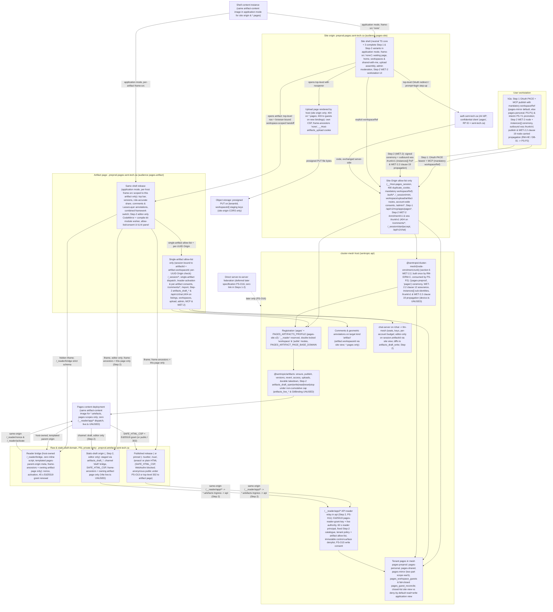
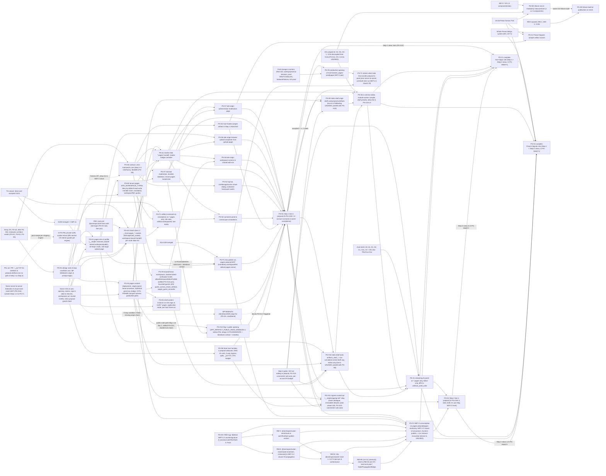

# SPEC_EVOL — `pages.sent-tech.ca`: a standalone artifact site (artifact functions only; Vue / Svelte / Preact switch in the top bar)

Status: design specification, **revision 20**, 2026-11-24 (author: Gemini 4 Neon, SPEC FIX lane, high effort, awaiting independent review; pre-answer specification preparing decisions **`D5` (`choix a`)** and **`D6` (`choix b`)** before `PS-K8` / `RM-0 (g)` countersignature — the owner has NOT yet answered `D5` or `D6`, and post-answer **revision 21** will record those verbatim answers, fold any text they change, freeze and pass a short independent delta review before `PS-K8` countersigns under **`WET-2.2`** (Remote revision 16, reviewed `SOLID`); folds every finding (`Finding 1`–`Finding 5`, plus `Observations 1–2`) of the independent review of revision 19 by Claude Opus 5.5 (`.h2a/reviews/pages-r19-opus.md`, verdict `CHANGES`) — re-anchoring `E0` on a future date expressed relative to `PS-K8` countersignature `T0` (`E0 = T0..T0 + 1 d`, `PS-D1 = T0 + 3 d..T0 + 5 d`, Step 1 `T0 + 16 d..T0 + 29 d`, Step 2 `T0 + 23 d..T0 + 42 d`, Vue+Vapor `T0 + 25 d..T0 + 45 d`; illustrative example if `T0 = Thursday 26/11`: Step 1 `12/12–25/12`, Step 2 `19/12–07/01`, Vue+Vapor `21/12–10/01`), closing the leftover `PS-O14` `28/11` references, unifying `PS-O15` wording and attribution, defining `D4 B` and `LH-W22` outside the locked block and qualifying §2.4's section-1 lot-code rule, and stating one canonical post-`PS-G1` staged-switch contract in §4.12 item 5 — keeps `.tmp/rv/DEUX-CHOIX-FINAL-r4.md` byte-identical, records zero `D5`/`D6` answer, keeps all 24/11 answers (`OD24:5-10`; base effort `706–1,081` own agent-hours + `60` provision), keeps the 22/11 enrolment security decision and 21/11 ownership rules with a single primary owner per lot and explicit cross-repository handoffs: `sentropic` builds the libraries, `stp-apps` deploys the apps, and the conductor guarantees the global architecture for libraries and deployments). **Revision 20** builds on frozen revision 19 preserved at `.tmp/rv/pages-r20.before.md` (SHA-256 `e4bcb00cb1911866b0ae1e9b58b0a1ecef54270358e397c0e703371152d1f389`, `3,018` lines, `1,478,645` bytes, byte-identical to `.tmp/rv/pages.r19.snapshot.md`, cited `PG19:n`), folds all five findings (`Finding 1`–`Finding 5`, 1 Major, 4 Minor) and `Observations 1–2` of `.h2a/reviews/pages-r19-opus.md` (`OR19:1-95`, SHA-256 `9d3a994d32505f204d38ea0aca3375ec6527e17c642a2890ee014efd858307dd`), preserves `.tmp/rv/DEUX-CHOIX-FINAL-r4.md` (`0bc64e7a5907b7aadcc2932bc951dbcf94c081d8f84e4f1740e48d2c8839496c`) byte-identical with zero `D5`/`D6` answer recorded, advances model (ii) so post-answer delta-reviewed **revision 21** is countersigned under `PS-K8`, keeps both `WET-2.2` digests unchanged (`21d8cf0d5ac36de59e3c09fb1c0e3b527d81efbc7eff16bb982c6b2ea6900c0f` full file, `wet2TextHash` `ce2eaa14f27d667fe14ae171f4ab9ca02880addc531237d3d64b1b1f21cde3ba` section 6), and changes nothing unrelated; section 28 lists what revision 20 changed and sections 4.12, 7.4 (`PS-K8`), 28 and `.tmp/rv/pages-r20.md` define the reproducible digest contract without self-reference. **Revision 19** built on the working-copy baseline preserved at `.tmp/rv/pages-r19.before.md` (SHA-256 `f30490314e646d43e629a00161acd60ab016ce0881f708008fb4ae265de0b49d`, 2,918 lines, which equalled frozen revision 18 at `.tmp/rv/pages.r18.snapshot.md`, SHA-256 `136c2b08d51d509725f4be413d7917d8825892c5560ea982c6a127ba0a688186`, 2,907 lines, cited `PG18:n`, plus 11 unreviewed lines appended after freezing), folded `Finding 1`–`Finding 7` of `.h2a/reviews/pages-r18-opus.md` (`OR18:1-142`), removed the unreviewed post-freeze `## 19. Owner answers of 24/11` appendage and folded the owner's 24/11 answers (`OD24:5-10`), embedded `.tmp/rv/DEUX-CHOIX-FINAL-r4.md` (SHA-256 `0bc64e7a5907b7aadcc2932bc951dbcf94c081d8f84e4f1740e48d2c8839496c`, from the h2a remote r16 decision dossier r4, decisions `D5` and `D6`, option `A` recommended in both) word for word without edits, aligned the specification with `D5`/`D6` (without recording any answer for them), adopted model (ii), kept both `WET-2.2` digests unchanged, and changed nothing unrelated; section 27 lists what revision 19 changed and `.tmp/rv/pages.r19.snapshot.md` preserves frozen revision 19 (`e4bcb00cb1911866b0ae1e9b58b0a1ecef54270358e397c0e703371152d1f389`). **Revision 18** built on the revision-17 snapshot preserved at `.tmp/rv/pages-r18.before.md` (SHA-256 `c2323e188e1cb25791fd1299a8c71876bcde846b35fa0166f3210153e36a1c4c`, 2787 lines, cited `R17:n`; byte-identical to `origin/main` at `043027ffe5`), closed `Finding 1`–`Finding 6` of `.h2a/reviews/pages-r17-opus.md` (`OR17:1-221`) — stating plainly the `h2a-cli` OAuth path and its self-renewing authorization, stating who can no longer sign in and the preprod IdP prod-data copy dependency across the owner lines, §1 table, schedule and Day-1 gate, adding owner confirmation step (0) to `PS-K8` / §4.12 item 5 / `E0` / §12 so `PS-K8` does not start immediately without the owner's agreement, adding the French section « Deux choix pour le propriétaire », fixing the `origin/main` pin-resolution table (`RF11` via `f57bbd1824` / `6d3b8ddc56`, `RF16` durably via `c647b64060`, `R3`–`R9` working-copy only, dated r11 statements), correcting the `RF16:358` / IdP `OAUTH_CLIENT_REQUIRED_ACR` pointer, and applying all six wording fixes — kept alignment with Remote revision 16 section 6 (`wet2TextHash` `ce2eaa14f27d667fe14ae171f4ab9ca02880addc531237d3d64b1b1f21cde3ba`), and changed nothing unrelated; section 26 lists what revision 18 changed and `.tmp/rv/pages.r18.snapshot.md` preserves frozen revision 18 (`136c2b08d51d509725f4be413d7917d8825892c5560ea982c6a127ba0a688186`). **Revision 17** builds on the revision-16 snapshot preserved at `.tmp/rv/pages-r17.before.md` (SHA-256 `b730e80e2b4f283ea8380506f28d78c58d01b372d13a5b35adedba82140970a1`, 2672 lines, cited `R16:n`), closes `Finding 1`–`Finding 4` of `.h2a/reviews/pages-r16-opus.md` with the smallest correct changes — owner decision of 23/11 « Sans clé à l'ouverture » (option (B)) kept: Pages sign-in sets neither a forced `prompt=login` nor the callback `auth_time` bound, sets `requiredAcr = passkey-fresh` with `acr` and `amr ⊇ {hwk, user, mfa}` re-checked at callback, accepts an existing passkey-based IdP session without a fresh ceremony and sends a bearer-ACR e-mail-link session to a passkey login — keeps alignment with Remote revision 16 section 6 (`wet2TextHash` `ce2eaa14f27d667fe14ae171f4ab9ca02880addc531237d3d64b1b1f21cde3ba`), and changes nothing unrelated; section 25 lists what revision 17 changed and sections 4.12, 7.4 (`PS-K8`), 25 and `.tmp/rv/pages-r17.md` define the reproducible digest contract without self-reference. **Revision 16** builds on the revision-15 snapshot preserved at `.tmp/rv/pages-r16.before.md` (SHA-256 `7b82a5f7c3d1969f945db9a53586a69638bb76d661d3babc92af7e3f71259c3c`, 2608 lines, cited `R15:n`), closes `Finding 1`–`Finding 3` of `.h2a/reviews/pages-r15-opus.md` with the smallest correct changes — owner decision of 23/11 « Sans clé à l'ouverture » (option (B)): Pages sign-in sets neither a forced `prompt=login` nor the callback `auth_time` bound and accepts an existing IdP session without a passkey — keeps alignment with Remote revision 16 section 6 (`wet2TextHash` `ce2eaa14f27d667fe14ae171f4ab9ca02880addc531237d3d64b1b1f21cde3ba`), and changes nothing unrelated; section 24 lists what revision 16 changed and sections 4.12, 7.4 (`PS-K8`), 24 and `.tmp/rv/pages-r16.md` define the reproducible digest contract without self-reference. **Revision 15** builds on the revision-14 snapshot preserved at `.tmp/rv/pages-r15.before.md` (SHA-256 `4f22164cb4b10bf7fe2c208890d5991c7113cebfdf1c4ee8f9a6bb7bc09d0954`, 2542 lines, cited `R14:n`), closes `Finding 1`–`Finding 6` of `.h2a/reviews/pages-r14-opus.md` with the smallest correct changes, keeps alignment with Remote revision 16 section 6 (`wet2TextHash` `ce2eaa14f27d667fe14ae171f4ab9ca02880addc531237d3d64b1b1f21cde3ba`), and changes nothing unrelated; section 23 lists what revision 15 changed and sections 4.12, 7.4 (`PS-K8`), 23 and `.tmp/rv/pages-r15.md` define the reproducible digest contract without self-reference. **Revision 14** builds on the revision-13 snapshot preserved at `.tmp/rv/pages-r14.before.md` (SHA-256 `96ea8c64fa59b39ef77db4c68eb2c67e37fe56a4f7bd78264d3a71a45d26c5b2`, 2475 lines, cited `R13:n`), closes `Finding 1`–`Finding 9` of `.h2a/reviews/pages-r13-opus.md` with the smallest correct changes, keeps alignment with Remote revision 16 section 6 (`wet2TextHash` `ce2eaa14f27d667fe14ae171f4ab9ca02880addc531237d3d64b1b1f21cde3ba`), and changes nothing unrelated; section 22 lists what revision 14 changed and sections 4.12, 7.4 (`PS-K8`), 22 and `.tmp/rv/pages-r14.md` define the reproducible digest contract without self-reference. **Revision 13** builds on the revision-12 snapshot preserved at `.tmp/rv/pages.r12.before-r13.md` (SHA-256 `867099aec18faab77f7a65ee8eec19a867f4cbf3aaa545ff34be8001643952ae`, 2412 lines, cited `R12:n`; byte-identical to `.tmp/rv/pages.r12.snapshot.md`), executes precisely the five alignment items of Remote revision 16 section 6.9 (`RF16:444-448`) — withdrawing `renewBy (+180 days)` for `WET-2.2 clause 25` refresh and `WET-2.2 clause 26` hard re-enrolment, normalizing every normative citation to **`WET-2.2 clause n`** (`WET-2.2 clause 1` through `WET-2.2 clause 27`) and `RF16:n`, adopting the library-wide request-bound per-workstation 2FA of `WET-2.2 clause 12` with explicit Pages bindings for `WET-2.2 clause 25`–`WET-2.2 clause 27` as they gate `artifacts.publish`, mirroring the converged two-outcome anomaly model in `PS-P2`, `PS-G2`, `PS-V1`, `PS-V2` and `PS-R1` with Remote r16 upstream hours, and countersigning the frozen `wet2TextHash` `ce2eaa14f27d667fe14ae171f4ab9ca02880addc531237d3d64b1b1f21cde3ba` (`RF16:1120`; section 6 slice `119` lines / `77,451` bytes; review `.h2a/reviews/remote-fastlane-r16-opus.md`, verdict `SOLID`) — records the verbatim 22/11 decision in section 2.4, preserves all thirty-four lot identifiers, all own effort sums, critical chains and milestone windows, and changes nothing unrelated; section 21 lists what revision 13 changed and sections 4.12, 7.4 (`PS-K8`), 21 and `.tmp/rv/pages-r13.md` define the reproducible digest contract without self-reference. **Revision 12** builds on the revision-11 snapshot preserved at `.tmp/rv/pages.r11.snapshot.md` (SHA-256 `251ba93fe363c0dfeb15c68611bae0e36f10380de6faeb9239987e168f6f3b18`, 2346 lines, cited `R11:n`), folds all five findings (`F1`–`F5`) of the independent review of revision 11 by Gemini 4 Carbon (`.h2a/reviews/pages-r11-carbon.md`, `CR11:1-140`, verdict `CHANGES`), defines one exact reproducible SHA-256 extraction method for `origin/main:spec/SPEC_EVOL_REMOTE_FASTLANE.md` section 6 and for this specification without self-reference (section 4.12, section 7.4 `PS-K8`, section 20 and `.tmp/rv/pages-r12.md`), completes canonical `` `WET-2.1 clause n` `` normalization across sections 2.1–12, enforces a single primary owner per lot in section 7.2 with an explicit cross-repository handoff table in section 7.1 and `stp-apps`-owned deployment overlays bounded by `PS-K9`, splits section 6.2 into `sent-tech-design-system` (`§6.2`) and `sentropic-apps (stp-apps)` (`§6.2b`) while removing pre-21/11 owner wording, and records `.tmp/rv/pages-r10-review-hydrogen4.out` alongside directly verified `immo9:` source ranges in section 2.2; section 20 lists what revision 12 changed. **Revision 11** built on the revision-10 snapshot preserved at `.tmp/rv/pages.r10.snapshot.md` (SHA-256 `0c7cab08c3ca2732cdc7d37d3ebc1ca713d738f94ce05baadab5d28ea86a8e37`, 2270 lines, cited `R10:n`; reviewed `REWORK` across unarchived passes `.tmp/rv/pages-r10-review-{opus,hydrogen,hydrogen2,hydrogen3,hydrogen4}.out`, `.h2a/reviews/` = `unknown`), cited section 6 of merged `origin/main:spec/SPEC_EVOL_REMOTE_FASTLANE.md` r11 clause by clause as **`WET-2.1 clause 1`** through **`WET-2.1 clause 24`**, explicitly accepted the r11 state-sync and quota rules (`WET-2.1 clause 18`, `WET-2.1 clause 19`, and `RF11 §7.2` including the single 256 KiB / `262 144`-byte `cat.snapshot` ceiling and collection-free `ready`), removed every contradiction with `WET-2.1`, and introduced the 21/11 ownership rules (section 19). Author of revision 9: Claude Opus 5.5 (planning lane, effort max; the Fable quota is out until 22/11), reviewed `REWORK` by Muse Code (`.h2a/reviews/pages-r9-muse.md`, `MR9:1-84`), folded in revision 10 (section 18). Author of revisions 4, 5, 6, 7 and 8: Claude Fable 5.2 (planning lane) for s-conductor. **Revision 9 folded the owner's answers to the twelve open decisions of revision 8** (`.tmp/pages-demo-dossier/owner-decisions-r4.yaml`, cited `OD4:n`, the note prevailing over the option label where they differ), after revision 8 was approved by its independent review (Claude Opus 5.5, `.h2a/reviews/pages-r8-opus.md`, verdict `APPROVE`, no blocker, no major, three minors m21 to m23 left to PS-D1); section 17 lists what revision 9 changed. Earlier revisions are preserved byte-for-byte in the conductor's working copy only (not tracked on `origin/main`): revision 9 at `spec/SPEC_EVOL_PAGES_TRI_FRAMEWORK_DEMO.r9.md` (SHA-256 `6320980280c3c8ff0ce05f5cc916a6c8f5afea908d14ca751fe251393bb2529c`, 1811 lines, cited `R9:n`); revision 8 at `spec/SPEC_EVOL_PAGES_TRI_FRAMEWORK_DEMO.r8.md` (SHA-256 `d45f24a135df0fb317b22630518e27de1fea6d6a840261c0f08e9602053ebb3b`, 1493 lines, cited `R8:n`); revision 7 at `spec/SPEC_EVOL_PAGES_TRI_FRAMEWORK_DEMO.r7.md` (SHA-256 `c5c3e2b4fb315d853eb9a9b061e043b6c54e1ee5831f1a91726160edbc73ab02`, 1376 lines, cited `R7:n`); revision 6 at `spec/SPEC_EVOL_PAGES_TRI_FRAMEWORK_DEMO.r6.md` (SHA-256 `16d746237f7bde56fed51542eb25075118060569e9b59db83524b372d5b88eb1`, 1258 lines, cited `R6:n`); revision 5 at `spec/SPEC_EVOL_PAGES_TRI_FRAMEWORK_DEMO.r5.md` (SHA-256 `0df04b25acb7f7e69cb493ebf76733064d0eba78d77fa14ff3b31a31f4facd0c`, 1036 lines, cited `R5:n`); revision 4 at `spec/SPEC_EVOL_PAGES_TRI_FRAMEWORK_DEMO.r4.md` (SHA-256 `6070a2b6bad36a3608a5be9da9f95bdc59e711e97d49e38efcd770cd8bf78d33`, 797 lines, cited `R4:n`); revision 3 at `spec/SPEC_EVOL_PAGES_TRI_FRAMEWORK_DEMO.r3.md` (SHA-256 `3b02ba67e011052841806ee7c7ec4321b17fa25e3d9b06878e2f96501cbf2e62`, 778 lines, cited `R3:n`). No product code, commit, branch, Track event, publication, DNS change or cluster act was made by this lane.

## 1. Synthèse propriétaire — une page

[FAIT] Le 15/11 au soir, vous avez répondu aux douze questions de la révision 8, avec des notes, puis précisé la question des adresses. La règle du dossier s'applique : quand votre note diffère de l'option cochée, c'est la note qui fait foi. Le 24/11, vous avez répondu aux questions 13 à 16 (la lecture publique s'ouvre dès la livraison, les éditeurs peuvent publier et rétablir un artefact d'un espace partagé ou miroir, un simple lecteur n'écrit rien par les API et un commentateur écrit des commentaires seulement, la spécification globale de fédération directe vient d'abord ; le point de savoir si un artefact ouvert par un commentateur peut écrire par les API autorisées et la question 17 restent ouverts). La révision 9 intégrant les réponses du 15/11, puis la révision 10 qui en corrigeait les écarts techniques, ont chacune fait l'objet d'une revue demandant des reprises (partage par espace de travail, session des pages d'artefacts, édition en direct, relais d'API, mode public, citations exactes et acceptation complète du contrat partagé d'enrôlement de `remote.sent-tech.ca`, répartition des responsabilités du 21/11, équilibre des sessions et calendrier). [JUGEMENT] Cette version est la **révision 20**. Elle garde toutes vos réponses du 15/11, du 22/11 et du 24/11. Elle ne rouvre aucune question tranchée. Elle ne lance rien. Elle prépare vos deux choix **D5** et **D6** avant la contresignature : elle n'est pas encore la version contresignée. Vos réponses à D5 et D6 seront enregistrées mot pour mot dans la **révision 21**, qui recevra une courte revue indépendante avant la contresignature entre `pages` et `remote.sent-tech.ca`. Le plan cite le contrat partagé **`WET-2.2`** clause par clause. Ce contrat est la section 6 du plan remote, révision 16. Le plan ne le redéfinit jamais. Une méthode fixe donne son empreinte. Le plan accepte ses règles de synchronisation et de quotas. Ces règles sont les clauses 18 et 19 et la section 7.2. L'instantané `cat.snapshot` reste borné à 256 Kio. Le message `ready` ne porte aucune collection. Le 22 novembre, vous avez fixé quatre règles. Chaque poste a un contrôle 2FA. Le poste rafraîchit son lien tout seul. Vous refaites une inscription complète tous les 90 jours. Le site détecte les écarts. Le site garde vos habitudes confirmées. Un écart simple demande au plus un nouveau contrôle 2FA. Le site affiche alors ce que vous devez confirmer. Seule une preuve forte révoque un poste. Cette preuve montre deux programmes avec la même clé en même temps. Le 23 novembre, vous avez choisi « Sans clé à l'ouverture ». « Sans clé à l'ouverture » veut dire : le site ne vous redemande pas votre clé. Il reste à décider (décision D5) si votre session du service de connexion doit avoir été ouverte avec votre clé. Pour ouvrir le site, le plan demande actuellement une session du service de connexion ouverte avec votre clé. Le site ne redemande pas votre clé si votre session du service de connexion a été ouverte avec votre clé. Une personne sans clé ne peut plus se connecter. En préproduction, le service de connexion n'inscrit pas de nouvelle clé. Il reçoit les clés de la production par une copie qui n'est pas confirmée. Sans elle, personne n'ouvre le site en préproduction le premier jour. Une session ouverte par lien courriel n'ouvre pas le site dans le navigateur ; elle vous renvoie vers une connexion avec votre clé. Elle peut pourtant autoriser l'outil h2a. Avec h2a, elle publie, partage, change l'accès et supprime en votre nom, sans clé. Cette autorisation peut se renouveler seule après la fin de la session. Une session ouverte avec votre clé ouvre le site, même ancienne ou volée. Avec elle, une autre personne agit en votre nom sur le site. Elle fait sur le site tout ce que vous pouvez y faire, sauf trois actes. Si votre compte administre le site, elle approuve des demandes d'accès, suspend des comptes et retire des artefacts. Votre session du site dure huit heures au plus. La session du service de connexion rouvre le site après huit heures, tant qu'elle reste ouverte. Le plan ne fixe pas la durée de cette session (par défaut, le module commun fixe sept jours, mais la valeur réelle du service de connexion n'est pas vérifiée). Elle ne peut ni approuver l'inscription ou la réinscription complète d'un poste, ni confirmer un écart. Ces trois actes demandent un nouveau contrôle 2FA avec votre clé. Publier depuis le navigateur ne demande pas ce nouveau contrôle. Publier par le tronc demande un poste déjà inscrit. Vos deux choix D5 et D6 vous sont présentés à la fin de cette section avant toute signature ; aucune réponse n'y est encore enregistrée. Les règles du 21 novembre restent en place. Chaque chantier a un seul responsable principal. Les passages entre dépôts sont écrits. **`sentropic` construit les bibliothèques. `stp-apps` déploie les applications. Le conducteur garantit l'architecture globale.** Vos six orientations restent en place. Les adresses restent sous `sent-tech.ca`. L'édition en direct utilise un brouillon statique dédié. Le serveur d'application porte le relais d'API. Les rôles suivent les droits réels du code. Les espaces gardent leur double verrou. Chaque instance garde sa sous-identité. Le poste porte la propagation. Le site tourne en trois langages complets. Le site couvre les étapes 1 et 2. Le reste ne change pas. Le site reste un vrai site d'artefacts. Les commentaires restent en place. La publication par h2a reste en place. La préproduction vient avant la production.

**Ce que vos réponses changent.** [JUGEMENT]

| Sujet | Votre décision | Ce qu'elle devient dans le plan |
|---|---|---|
| Adresses des artefacts | Rester sous `sent-tech.ca` : `artefacts.sent-tech.ca` inscrit sur la liste publique des suffixes ; l'artefact brut sur `<identifiant>.artefacts.sent-tech.ca` ; sa page avec le bandeau sur `<identifiant>.pages.sent-tech.ca`. | La « liste publique des suffixes » est une liste commune à tous les navigateurs : un nom qui y figure est traité comme une frontière entre sites, comme `github.io` ou `claudeusercontent.com`, où Claude sert ses artefacts. Une fois l'inscription prise en compte par un navigateur, un artefact ne peut plus déposer de cookie sur `sent-tech.ca` ni agir comme s'il faisait partie du site. En préproduction, les mêmes formes avec `preprod`, comme immo (`preprod.immo.sent-tech.ca`) : `preprod.pages.sent-tech.ca` pour l'accueil du site, `<identifiant>.preprod.pages.sent-tech.ca` pour chaque page d'artefact, et `<identifiant>.preprod.artefacts.sent-tech.ca` pour les artefacts bruts, les versions figées (`<identifiant-de-version>`) et, à l'étape 2, les brouillons statiques d'édition en direct (`<identifiant-de-brouillon>`, toujours sous forme d'identifiant unique normalisé). Deux inscriptions sur la section privée de la liste, une par environnement (`artefacts.sent-tech.ca` et `preprod.artefacts.sent-tech.ca`), qui n'hébergent aucun site elles-mêmes. Ouvrir directement dans le navigateur l'adresse brute d'un artefact non public redirige proprement (`302`) vers sa page avec le bandeau au lieu d'afficher une erreur brute. Aucun nom de domaine à acheter. |
| En attendant l'inscription | — | L'inscription demande une demande publique, déposée par vous comme détenteur de `sent-tech.ca`, avec un enregistrement DNS `_psl` de preuve laissé en place pour chaque environnement ; puis chaque navigateur, voire chaque système, la prend en compte à son rythme, sans moyen d'accélérer. Tant qu'elle n'est pas en place sur un moteur de navigateur, **cinq protections d'attente sont obligatoires** : (1) quatre cookies de session et de passage valables pour une seule adresse exacte (préfixe `__Host-`, sans domaine parent, `SameSite=Lax`, inaccessibles au script), accompagnés d'un **rejet immédiat (`400`) dès qu'une requête porte un nom de cookie en double**, ce qui neutralise le dépôt d'un faux cookie `sent-tech.ca` ; (2) le refus de toute action modificatrice ne venant pas exactement de la page même du site ou de la page d'artefact, une déconnexion par écriture (`POST`) uniquement, et le refus de tout cookie ou origine de navigateur sur les accès en ligne de commande et de poste ; (3) l'inventaire complet des cookies posés sous `sent-tech.ca`, immo et service de connexion compris, remis à leurs responsables ; (4) l'interdiction des appels de clé d'accès matérielle (WebAuthn) depuis les adresses d'artefacts, doublée d'une **vérification bloquante dès la note de conception** que le service de connexion contrôle bien l'origine exacte lors d'une connexion par clé d'accès et prend en charge la ré-authentification forcée ; (5) une **séparation nette des preuves** : le transport du droit de lecture dans un cadre est vérifié sur les trois moteurs de navigateur avant le premier jour (même site et domaine tiers simulé), mais la levée des protections d'attente sur un moteur exige ensuite sa propre vérification après intégration effective dans la liste publique. Le premier jour n'attend pas l'inscription. **Risque restant, accepté avec votre choix** : un filtre externe (liste de sites dangereux, messagerie, proxy d'entreprise) qui ignore la liste publique ou intègre ses copies à son propre rythme pourrait reprocher à tout `sent-tech.ca` un artefact malveillant. |
| Le bandeau | Une fonction du site, et vous demandiez comment fait claude.ai. | Comme claude.ai : la page d'artefact (`<identifiant>.pages.sent-tech.ca`) porte le bandeau, la session propre à cet artefact, les commentaires et l'IA, et affiche l'artefact brut — ou, à l'étape 2, le brouillon statique dédié `<identifiant-de-brouillon>.artefacts.sent-tech.ca` — dans un cadre venu d'une autre adresse ; l'artefact ne voit jamais votre session et **n'autorise son encadrement que par la seule page de son propre artefact** (jamais par l'accueil du site ni par la page d'un autre artefact). Parce qu'il appartient au site, le bandeau peut montrer plusieurs espaces, plusieurs personnes et plusieurs IA. Ce dont il dépend, dans l'ordre : les trois familles d'adresses, leurs certificats et le découpage strict des chemins à la passerelle d'entrée ; la session de la page d'artefact rattachée à l'artefact et à son espace ; le droit de lecture et son pont de passage par artefact ; les commentaires ; puis, **strictement après la validation de l'étape 1**, l'étape 2 avec le brouillon statique dédié, l'édition en direct, l'IA, le relais d'API autorisées côté serveur et l'enrôlement de postes sous `WET-2`. |
| La session de la page d'un artefact | — | Une session ne vaut que pour une adresse exacte. Sur l'accueil du site (`pages.sent-tech.ca`), chaque requête d'espace ou d'artefact désigne explicitement l'espace visé (aucune sélection implicite de l'espace « le plus récent »). Quand vous ouvrez un artefact sur `<identifiant>.pages.sent-tech.ca`, le site vérifie votre droit de lecture dans l'espace de cet artefact — que vous soyez membre complet d'un espace partagé ou miroir, ou invité venu d'un autre espace — et remet à sa page un « ticket de passage » à usage unique, valable 60 secondes, lié à votre navigateur et à cet espace exact ; une tentative depuis un autre navigateur ou une autre adresse est refusée sans brûler le ticket légitime en cours. La page en tire une session **rattachée côté serveur à la fois à cet artefact unique et à son espace de travail**, qui prend fin avec celle du site, sans reconnexion demandée. Sur cette page d'artefact, les routes générales du site (liste des espaces, liste de tous les artefacts, dépôt de fichiers, administration, MCP et enrôlement `WET-2`) répondent inexistantes (`404`), et toute requête visant un autre artefact ou émise depuis une autre page d'artefact est refusée (`403`) : une faille sur une page ne peut ainsi atteindre ni un autre artefact ni l'inventaire de l'espace. |
| Édition en direct « à la Lovable » | Impératif. | Exigence ferme de l'étape 2, qui **démarre strictement après l'acceptation de l'étape 1** : seul l'éditeur modifie l'artefact, à la main ou avec l'IA (qui lit et propose des modifications textuelles bornées au seul artefact ouvert), et le voit changer aussitôt, sans publier ; la publication reste un geste séparé. Plutôt que de réutiliser le serveur d'aperçu Vite d'immo — incompatible car non encadrable et dépendant d'un dépôt Git, désormais écarté — l'édition en direct repose sur un **parcours dédié de brouillons statiques** : le code est compilé dans un processus isolé du navigateur (module worker), enregistré par cinq opérations dédiées sous un **plafond non cumulatif de brouillons actifs** (qui ne consomme pas le quota cumulatif de publication), et servi sur `<identifiant-de-brouillon>.artefacts.sent-tech.ca` avec le même pont de droit de lecture, réservé au seul éditeur et encadrable par la seule page de cet artefact. L'artefact ou son brouillon peut appeler des API autorisées sur son propre chemin `/__reader/app/<identifiant-api>/…`, **routé directement par la passerelle d'entrée vers le serveur d'application** (et non vers le service de contenu autonome, qui ne porte ni routes métier ni secrets de session), lequel vérifie la signature cryptographique Ed25519 du droit de lecture et l'autorisation en direct. La liste par artefact est tenue dans le cadre d'une politique d'administrateur sur un **catalogue fixe d'API à l'étape 2** (`sentropic.initiatives`, `sentropic.llm-gateway`, et `mesh.echo` en préproduction), assortie d'une **liste d'interdiction immuable** excluant par construction toutes les surfaces de contrôle du site (artefacts, espaces, membres, sessions, MCP, enrôlement/tronc `WET-2` et administration). L'étape 2 n'est jamais livrée sans l'IA : si l'IA prend du retard, l'étape 2 aussi. |
| Rôles | Exactement ceux d'immo : éditeur, commentateur, lecteur, public ; le mode en direct pour l'éditeur seul. | Repris tels quels, sans créer de rôle supplémentaire, mais alignés point par point sur les droits réels du code : seul le **propriétaire** de l'artefact attribue un partage individuel, change le mode d'accès (`restreint`, `espace de travail`, `public`) ou supprime l'artefact ; un administrateur d'espace non propriétaire administre les membres complets de l'espace et ne dispose que d'un droit de **révocation seule** sur les partages individuels. Suite à votre réponse du 24/11 (question 14 : « Oui, éditeurs aussi »), la publication et le retour à une version antérieure sont ouverts aux éditeurs et administrateurs complets d'un espace partagé ou miroir (ainsi qu'à l'invité éditeur sur son artefact partagé) pour le profil du site seul (immo n'est pas touché), ce qui ajoute `10 à 16` heures-agent et un jour calendaire à l'étape 1. Le mode en direct est strictement réservé au rôle éditeur. « Public » veut dire lisible sans compte sur l'adresse brute de l'artefact : le service de contenu dédié au site reçoit son propre **parcours de lecture anonyme** (sans cookie de droit de lecture ni recherche de membre, protégé par le double verrou `'workspace'`/`'public'`, le refus d'indexation `noindex`, des caches, des plafonds de débit et le retrait administratif immédiat, sans commentaires ni relais d'API). La règle « comptes nommés seulement » de la révision 8 tombe comme règle du modèle, et suite à votre réponse du 24/11 (question 13 : « Oui, dès la livraison »), le mode public s'ouvre **dès la première livraison** — avant la fusion et la prise en compte de la liste publique des suffixes, avec le risque résiduel de réputation sur `sent-tech.ca` explicitement couvert par le signalement, le retrait immédiat, `noindex` et les plafonds anonymes. |
| Espaces de travail | Un espace personnel par défaut ; des espaces ou projets partagés ; le partage artefact par artefact ; la plupart des artefacts publiés par h2a depuis un dépôt dans un espace « miroir ». | Trois sortes d'espaces réservés au site dès le premier jour : personnel (artefacts restreints par défaut), partagé et miroir (par exemple ce dossier, dans l'espace miroir de `sentropic-apps`). **Ajustement majeur de la révision 10** : dans le code existant, un rôle dans un espace ne donne aucun droit de lecture sur un artefact « restreint » ; l'affirmation précédente selon laquelle la règle d'accès commune ne change pas est donc retirée. La bibliothèque d'artefacts introduit un **mode d'accès « espace de travail » à double verrou** (en écriture et en lecture), activé par défaut dans les espaces partagés et miroirs du site pour que tout membre complet y lise immédiatement les artefacts (et que les éditeurs et administrateurs en lisent les sources) sans partage individuel, tandis que ce double verrou reste fermé par construction pour les espaces personnels, immo et l'application sentropic, vérifié par des tests d'isolation dédiés. Tout ajout de membre et tout partage individuel exigent que le destinataire dispose déjà d'un **compte approuvé sur le site** (refus explicite sinon). Partager un seul artefact avec une personne extérieure à l'espace la fait entrer comme **« invitée »**, strictement confinée à cet artefact : elle ne voit ni les autres artefacts de l'espace ni la liste des membres, **se voit interdire toute création de nouvel artefact dans cet espace même en tant qu'invitée éditrice**, et la révocation de son partage coupe d'abord son droit de lecture avant de nettoyer son statut d'invitée de manière sûre même en cas de panne en cours d'opération. Ces espaces restent invisibles et fermés **en lecture comme en écriture** dans le registre des membres de l'application sentropic. |
| Fédération et enrôlement des postes | Le « tronc » est la fédération de cluster-mesh ; le serveur MCP des artefacts d'immo devient celui de cluster-mesh ; un seul serveur MCP enregistré dans claude.ai, ChatGPT ou Gemini ; propagation entre installations autorisée par leurs administrateurs et validée par l'utilisateur. | Ce plan ne crée pas de règle séparée pour les postes. Ce plan ne construit rien sur l'ancien code d'appareil. Ce plan cite le contrat partagé **`WET-2.2`** clause par clause. Ce contrat est la section 6 du plan remote, révision 16. Il compte les clauses 1 à 27. Sa liste d'alignement est la section 6.9, points 1 à 5. **`sentropic` construit ce contrat une seule fois. Le conducteur garantit ce contrat.** Ce plan ne redéfinit jamais ses enregistrements. Ce plan ne redéfinit jamais sa cérémonie. Ce plan ne redéfinit jamais son transport. Ce plan ne redéfinit jamais ses limites. Le premier jour, h2a publie en votre nom. h2a vise le point MCP du site. h2a nomme toujours l'espace cible. À l'étape 2, `stp-apps` déploie les bibliothèques `WET-2.2`. Le site les branche pour deux paires distinctes. Ces paires sont `('pages-preprod', 'pages')` puis `('pages-prod', 'pages')`. Vous inscrivez le **poste**. Vous n'inscrivez jamais une instance seule. Le poste prouve sa clé par un code de cérémonie. Le poste ne reçoit aucun mot de passe. Le poste ne reçoit aucun jeton. Chaque poste a un nouveau contrôle 2FA. Ce contrôle vaut pour ce poste seul. Ce contrôle ne réutilise jamais votre connexion. Chaque instance h2a garde sa sous-identité. Le plafond durable est de 4 096 identités liées. Ce plafond compte aussi les identités révoquées. Le site refuse un excès. Le site journalise chaque acte. Le site révoque une instance en moins d'une seconde. Les autres instances continuent. Le poste rafraîchit son lien tout seul. Vous refaites une inscription complète tous les 90 jours. Un écart simple bloque la publication. Le site affiche alors ce que vous devez confirmer. Vous confirmez avec un nouveau contrôle 2FA. Le site vérifie le lien en cours. Vous relancez ensuite la publication. Le site ne rejoue rien tout seul. Le message `ready` ne porte aucune collection. Les pages `state.begin`, `state.part` et `state.end` synchronisent l'état. L'instantané `cat.snapshot` reste borné à 256 Kio. Chaque attachement a au plus 256 autorisations de propagation. La publication h2a passe ensuite sur le tronc sortant. La clause 19 couvre la propagation entre installations. L'administrateur du destinataire autorise cette propagation. Vous validez cette propagation. Aucun serveur n'appelle un autre serveur. Seule la **fédération directe de serveur à serveur** reste pour plus tard. Le routage MCP sans poste local reste aussi pour plus tard. Voir la question 16. |
| Le site en trois langages | Svelte d'abord ; le site doit tourner en Svelte, Vue+Vapor et Preact+Signals ; pas de migration mais une double, puis triple exécution complète. | Le site devient lui-même un artefact à trois versions, complètes chacune, construites sur un **socle commun sans dépendance de framework** (client d'API, passage de session, pont de droit de lecture, coordination des brouillons, flux d'IA et formatage d'empreintes `WET-2.2`) ; la bascule du bandeau change ensemble le site et l'artefact. Svelte au premier jour et en premier à l'étape 2 ; la version Vue+Vapor démarre ses écrans d'étape 1 dès votre acceptation du premier jour, puis **intègre aussi l'ensemble des écrans de l'étape 2** (éditeur en direct, panneau d'IA, liste d'API autorisées, gestion des postes `WET-2.2`) ; la version Preact+Signals suit tout le design system Preact avec le même périmètre complet. **Règle de parité complète** : une version n'apparaît dans la bascule qu'après avoir réussi à l'identique **tous les parcours de l'étape la plus avancée en service (étapes 1 et 2 réunies une fois l'étape 2 livrée)** — jamais avec des fonctions manquantes. |
| Nom « canvas » | Pas maintenant. | Un dossier de décision dédié vous sera remis après l'étape 1, avec l'inventaire des paquets, noms d'hôtes et documents actuels. Aucun renommage n'est engagé dans ce plan. |
| Où vit le code et qui fait quoi (règles du 21/11) | `sentropic-apps` par étapes ; règles de responsabilité du 21/11. | Répartition claire des rôles : **`sentropic` construit les bibliothèques** (bibliothèque des artefacts, modules partagés de `cluster-mesh` dont `WET-2.2`, passerelles d'application et de contenu), le design system construit les composants partagés réutilisés, **`stp-apps` (`sentropic-apps`) assemble et déploie les applications** (coquille du site, trois jeux d'écrans, artefacts d'exemple, recettes de publication, manifestes, DNS/TLS/passerelles d'entrée et mises en service préproduction/production), et **le conducteur garantit l'architecture globale pour les bibliothèques et les déploiements** (note de conception, contresignature `WET-2.2`, arbitrages inter-dépôts et revues de mise en service). |
| Langage manquant ; registre d'approbation ; ouverture en préproduction | Comme recommandé. | Maintenus sur le principe : un langage absent est affiché indisponible, puis l'IA peut le proposer à l'éditeur à l'étape 2 ; le site a son propre registre d'approbation (locataire dédié `pages`, indépendant de `sentropic` et d'immo, avec solution de repli explicite soumise à votre accord écrit si la note de conception rencontre un blocage technique) ; l'ouverture en préproduction vaut pour les déploiements dédiés à ce site seul, sans ouvrir le déploiement partagé. |

**Ce qu'est le site le premier jour, en préproduction (`preprod.pages.sent-tech.ca`).** [JUGEMENT]

| Sujet | Le premier jour |
|---|---|
| Qui se connecte | Toute personne qui a un compte sur le service de connexion commun et se connecte avec sa clé (règle retenue en révision 17, soumise à votre décision **D5 (choix a)** ci-dessous). Avec cette règle, une personne sans clé ne peut plus se connecter. En préproduction, le service de connexion n'inscrit pas de nouvelle clé et attend une copie des données de production qui n'est pas confirmée : sans elle, personne n'ouvre le site le premier jour. Si vous choisissez l'**Option B** de D5 (accepter aussi une session ouverte par lien courriel sur le site pages), cette attente disparaît et une personne sans clé peut se connecter après approbation. Pour utiliser les fonctions, le compte doit être approuvé pour le site par un administrateur, dans un registre propre au site : approuver ou suspendre quelqu'un ici ne change rien ailleurs. En attendant, une page d'attente avec « demander l'accès », qui relit l'état enregistré et dit clairement si la demande a été prise en compte ou si la liste d'attente est pleine. Une fois approuvé, chacun reçoit son espace personnel ; il peut créer des espaces partagés et être membre d'espaces miroirs. Tout ajout de membre ou partage par artefact vise exclusivement un compte déjà approuvé sur le site. Le nom et l'adresse courriel du compte connecté restent affichés en permanence. |
| Ce qu'on y fait | Voir ses espaces, ses artefacts et ceux partagés avec soi (en nommant explicitement l'espace visé à chaque action, jamais de sélection implicite) ; créer un artefact en déposant ses fichiers depuis le navigateur sur l'accueil du site, ou le publier depuis h2a, par défaut dans l'espace miroir du dépôt (en mode d'accès « espace de travail ») ou dans son espace personnel (en mode « restreint ») ; ouvrir un artefact sur sa propre page ; consulter ses versions et revenir à une version antérieure (propriétaire, ou éditeur/administrateur complet d'un espace partagé ou miroir, ou invité éditeur sur son artefact partagé) ; le partager avec un rôle — éditeur, commentateur, lecteur ou public — dans un espace (pour l'administrateur d'espace) ou artefact par artefact (pour le propriétaire seul, l'invité restant confiné à cet artefact sans droit de création dans l'espace hôte) ; le supprimer (propriétaire seul). |
| Où sont servis les artefacts | L'artefact brut (ou une version figée) sur `<identifiant>.preprod.artefacts.sent-tech.ca`, sa page avec le bandeau sur `<identifiant>.preprod.pages.sent-tech.ca`. Un artefact est du code écrit par un utilisateur : il ne tient jamais de session, n'accepte son encadrement que par la seule page de son propre artefact, interdit les appels de clé d'accès matérielle, et les protections d'attente le tiennent à l'écart du site tant que la liste publique n'est pas vérifiée moteur par moteur. Tant qu'un artefact reste ouvert, son droit de lecture (signé cryptographiquement en Ed25519) est renouvelé en arrière-plan toutes les 45 secondes : un accès retiré, une révocation d'invité, une suspension ou un retrait administratif cesse de fonctionner en moins d'une minute. Ouvrir directement l'adresse brute d'un artefact non public dans le navigateur redirige proprement (`302`) vers sa page avec le bandeau. |
| Protections | Un volume et un rythme de publication maximaux par compte, un quota par espace (avec alerte à 80 % et procédure écrite de relèvement) et un nombre maximal d'espaces par personne ; le rejet immédiat des cookies en double ; la fermeture (`404`) des routes d'inventaire, de dépôt et d'administration sur les pages d'artefacts ; la recherche de destinataire de partage limitée à l'adresse courriel exacte d'un compte approuvé ; un bouton « signaler » ; une page réservée aux administrateurs sur l'accueil du site pour approuver les demandes, retirer durablement un artefact (bloquant même le propriétaire jusqu'à rétablissement) et suspendre l'accès d'un compte au site. La lecture sans compte (`public`) est ouverte dès la première livraison (votre réponse du 24/11 à la question 13), protégée par son double verrou, `noindex`, les caches et plafonds anonymes, le retrait administratif immédiat et une adresse de contact de retrait publiée avant l'ouverture. |
| Le bandeau | Au-dessus de chaque artefact ouvert sur `<identifiant>.preprod.pages.sent-tech.ca`, comme chez Claude : le titre, les versions, le partage par rôle conforme aux droits réels du code, les commentaires et annotations, la bascule de langage, le signalement, la possibilité de masquer le bandeau ; seules les actions permises par votre rôle sont proposées, et chacune est revérifiée côté serveur à chaque appel. |
| La bascule de langage | Artefacts en Vue et Svelte ; le site en Svelte. Vue+Vapor et Preact+Signals apparaissent grisés, « à venir », jusqu'à réussite de leur parité complète sur l'étape la plus avancée en service. Un artefact qui n'existe pas dans un langage affiche ce langage comme indisponible, sans traduction automatique ; les artefacts HTML simples déposés depuis le navigateur masquent la bascule de variante. |
| Commentaires | Un fil par artefact et des annotations géométriques posées sur une zone de l'écran, rattachées à la version et à la variante commentées, servis uniquement sur la page de l'artefact (et résolus dans l'espace de l'artefact pour que les invités d'un autre espace participent sans blocage) ; le commentateur et l'éditeur écrivent, le lecteur lit uniquement ; aucune liste de membres n'est exposée et les visiteurs sans compte n'y ont aucun accès. |
| Nos artefacts | Les premiers sont les nôtres, publiés depuis h2a dans des espaces miroirs (accessibles aussitôt aux membres complets de l'espace miroir), à commencer par la petite application du plan précédent, en Vue et en Svelte. |

**Trois choses à savoir.**

- [FAIT] **Du contenu écrit par des utilisateurs est déjà servi sous `sent-tech.ca` aujourd'hui** : les artefacts immo de préproduction. [JUGEMENT] Avec votre choix, ceux du site le seront aussi, jusqu'à ce que la liste publique soit intégrée et vérifiée moteur par moteur. D'où les cinq protections d'attente, obligatoires et vérifiées par des tests, incluant le rejet des cookies en double et le blocage WebAuthn sur les réponses d'artefacts. En outre, la vérification que le service de connexion (`auth.sent-tech.ca`) contrôle bien l'origine exacte lors des connexions par clé d'accès et prend en charge la ré-authentification forcée devient une **troisième condition d'arrêt obligatoire** de la note de conception : si ce contrôle manquait, son correctif dans le service de connexion bloquerait la mise en service du premier jour. Les cookies d'immo, du service de connexion et de l'application sentropic qui ne sont pas attachés à une adresse exacte restent exposés à tout artefact, du site ou d'immo : le constat est transmis à leurs responsables ; leur reprise ne fait pas partie de ce plan.
- [FAIT] **La bibliothèque des artefacts réserve aujourd'hui la publication, le retour à une version antérieure, la suppression et l'attribution de partages individuels au seul propriétaire de l'artefact** (un administrateur d'espace non propriétaire peut uniquement révoquer un partage individuel). [JUGEMENT] Suite à votre réponse du 24/11 à la **question 14** (« Oui, éditeurs aussi »), le profil du site ouvre la publication et le retour à une version antérieure aux éditeurs et administrateurs complets d'un espace partagé ou miroir (ainsi qu'à l'invité éditeur sur son artefact partagé), sans toucher immo ; ce choix est intégré dans les chiffres et dates ci-dessous (`+10 à +16` heures-agent et `+1` jour calendaire à l'étape 1), tandis que la suppression et les partages individuels restent au propriétaire seul.
- [FAIT] **Immo laisse un artefact appeler son application au nom de chaque lecteur, en lecture et en écriture, sans liste d'opérations** (décision antérieure). [JUGEMENT] Le site place désormais ce relais directement dans le serveur d'application (routé par la passerelle d'entrée depuis l'adresse brute), ajoute une liste par artefact bornée à un catalogue fixe d'API autorisées dans le cadre d'une politique d'administrateur, et interdit par construction toute surface de contrôle du site. Suite à votre précision du 24/11 sur la **question 15**, un simple lecteur n'écrit rien par ces API et un commentateur écrit des commentaires seulement (modifier l'artefact lui-même reste réservé aux éditeurs selon la règle de rôles déjà en place) ; seul reste ouvert le point de savoir si un artefact ouvert par un commentateur peut écrire par les API autorisées avec accord explicite (avant l'étape 2).

**Ce qui vient ensuite, jusqu'à la production.** [FAIT] Une consigne du 15/11 interdit tout déploiement de sentropic tant que la mise en service du service de contenu des artefacts n'a pas fait l'objet d'une décision séparée ; il n'est pas établi qu'elle vaille pour la préproduction. [JUGEMENT] Les dates ci-dessous sont des bornes au plus tôt, calculées en **arrondissant systématiquement toute durée calendaire au jour entier supérieur (`ceil`)**, en intégrant votre réponse du 24/11 à la question 14 (« Oui, éditeurs aussi », `+1` jour à l'étape 1), et en ancrant le départ `E0` sur la **date future `T0` de la contresignature du contrat partagé** (`E0` entre `T0` et `T0 + 1` jour, donc la note de conception approuvée entre `T0 + 3` et `T0 + 5` jours ; exemple illustratif non contractuel si `T0 = jeudi 26/11` : note approuvée du `29/11` au `01/12`), en supposant la fusion du stockage des artefacts, vos accords d'ouverture, la copie des données de production sur le service de connexion de préproduction effectuée (si la connexion par clé reste exigée pour ouvrir le site sous **D5 Option A**, ou pour autoriser h2a sous **D6 Option A** — sans cette attente pour le navigateur sous **D5 Option B**, mais D6 Option A la conserve pour h2a), et la consigne du 15/11 levée ou sans effet sur la préproduction. Comme l'étape 1 sature déjà les trois sessions de construction permanentes, **aucun chantier de l'étape 2 ne démarre en parallèle de l'étape 1** : l'étape 2 commence strictement après l'acceptation de l'étape 1. L'inscription sur la liste publique n'est sur le chemin d'aucune de ces dates.

| Étape | Contenu | Au plus tôt |
|---|---|---|
| 1. Premier jour en préproduction | Le tableau ci-dessus (y compris les espaces partagés et miroirs en mode d'accès d'espace à double verrou, la publication/rétablissement par les éditeurs, la lecture anonyme `public` ouverte dès la livraison, les invités bornés, la session d'artefact rattachée à son espace et la redirection des adresses brutes non publiques). | **Entre `T0 + 16 j` et `T0 + 29 j`** (13 à 24 jours calendaires arrondis au supérieur après approbation de la note de conception à `T0 + 3 j`–`T0 + 5 j`, question 14 incluse ; exemple illustratif si `T0 = jeudi 26/11` : **entre samedi 12/12 et vendredi 25/12** ; tant que la connexion par clé reste exigée sur le site sous D5 Option A — ou sur h2a sous D6 Option A — dépend aussi de la copie des données de production sur le service de connexion de préproduction, aujourd'hui non confirmée et vérifiée avant l'ouverture). |
| 2. Édition en direct « à la Lovable » | L'éditeur modifie l'artefact avec l'IA sur brouillon statique dédié (`<identifiant-de-brouillon>.artefacts.sent-tech.ca`, sous plafond non cumulatif) et le voit changer aussitôt ; l'artefact appelle les API du catalogue autorisé via le relais du serveur d'application (avec liste d'interdiction immuable) ; plafond de dépense d'IA par compte ; consommation du contrat partagé `WET-2.2`. Ce contrat est la section 6 du plan remote, révision 16. Chaque poste a un contrôle 2FA. Le poste ne reçoit aucun jeton. Le poste rafraîchit son lien tout seul. Vous refaites une inscription complète tous les 90 jours. Chaque instance garde sa sous-identité. Le site révoque une instance en moins d'une seconde. La publication passe par le tronc sortant. | **Entre `T0 + 23 j` et `T0 + 42 j`** (7 à 13 jours calendaires arrondis au supérieur, **strictement après l'acceptation de l'étape 1** ; exemple illustratif si `T0 = jeudi 26/11` : **entre samedi 19/12 et jeudi 07/01**) ; dépend du kit de compilation du design system, du plan de conversation IA et de la contresignature ainsi que de la publication des modules partagés `WET-2` ; ne part jamais sans l'IA. |
| 3. Construction en Wasm | D'abord la mesure du poids, du démarrage à froid, de la latence et du découpage des modules (un composant unique ou un par langage) ; ensuite seulement, la construction des artefacts par ce moteur à la publication. | Mesure : `2 à 3 jours` dès que les prérequis et une session se libèrent (au plus tôt autour de `T0 + 16 j`, ex. mi-décembre si `T0 = 26/11`). Construction : inconnue. |
| 4. Trois langages | Le site complet (écrans d'étape 1 et d'étape 2) en Vue+Vapor, à côté de la version Svelte ; puis le site complet et les artefacts en Preact+Signals. | **Vue+Vapor : entre `T0 + 25 j` et `T0 + 45 j`** (les écrans d'étape 1 démarrent dès votre acceptation du premier jour, puis les écrans d'étape 2 s'achèvent en **2 à 3 jours** arrondis au supérieur après la validation de l'étape 2, garantissant la parité complète étapes 1 + 2 ; exemple illustratif si `T0 = jeudi 26/11` : **entre lundi 21/12 et dimanche 10/01**). **Preact+Signals : inconnue**, après tout le design system Preact. |
| 5. Production (`pages.sent-tech.ca`) | Le même site en production (trois familles d'adresses, certificats, passerelles d'entrée et déploiements dédiés), et le transfert client d'un artefact par h2a de la préproduction vers la production en attendant que les deux environnements exécutent la propagation portée par le poste du contrat `WET-2` (clause 19). | Inconnue : la production ne sert aucun artefact aujourd'hui. Pas avant une semaine après l'acceptation du premier jour (plancher `T0 + 23 j`). |

[JUGEMENT] Effort propre à ce plan : **706 à 1 081 heures-agent** (intégrant désormais en base les `+10 à +16` heures-agent de votre réponse « Oui, éditeurs aussi » du 24/11 à la question 14 sur le socle `696 à 1 065` de la révision 10 ; hors travail éventuel non chiffré si vous reteniez l'Option C de la décision D6 ci-dessous), dont **414 à 629** pour le premier jour (chaîne critique de 164 à 250 heures-agent, soit 142 à 220 après la note de conception), **118 à 180** pour l'étape 2 (chaîne critique de 72 à 110 heures-agent, strictement après l'étape 1), **20 à 34** pour l'étape 3, **128 à 196** pour l'étape 4 et **26 à 42** pour l'étape 5, plus **60 heures-agent** de provision pour les revues (30 lots de construction sur 34). Par rapport à la révision 9 (`626 à 963`), l'écart net de **+80 à +118 heures-agent** (`+70 à +102` de la revue indépendante en révision 10, plus `+10 à +16` de la question 14 intégrée en révision 19) reflète : `+40 à +60` à l'étape 1 (mode « espace de travail » à double verrou, sortie d'invité sûre et publication par les éditeurs `+24 à +38`, parcours anonyme `public`, redirection directe et signature Ed25519 du droit de lecture `+8 à +12`, session d'artefact rattachée à son espace et durcissement des cookies `+4 à +6`, 3e condition d'arrêt de la note de conception `+2`, commentaires multi-espaces `+2`), `+12 à +14` net à l'étape 2 — en distinguant l'édition sur brouillon statique dédié et le relais d'API porté par le serveur d'application (`+20 à +28`) de **l'alignement sur le contrat partagé `WET-2` (`−8 à −14` heures-agent par rapport à la révision 9**, grâce à la suppression de la double construction de l'enrôlement) — et `+28 à +44` à l'étape 4 (ajout des écrans d'étape 2 dans Vue+Vapor et Preact+Signals pour une parité complète). Par rapport à la révision 8 (`415 à 636`), l'écart total de **+291 à +445 heures-agent** se répartit ainsi : les espaces de travail, le mode d'accès d'espace à double verrou, la publication par les éditeurs et les invités bornés (**68 à 110**), les nouvelles adresses sous `sent-tech.ca`, la session d'artefact rattachée à son espace, le parcours `public` et les protections d'attente (**33 à 51**), les rôles et commentaires multi-espaces (**8 à 10**), le socle commun aux trois versions du site (**6 à 8**), l'édition en direct sur brouillons statiques et le relais d'API autorisées (**60 à 90**), **l'alignement de l'enrôlement sur le contrat partagé `WET-2` (`−6 à −10`, compté à part de l'édition en direct)**, le site complet étapes 1 et 2 en Vue+Vapor et en Preact+Signals (**120 à 184**), et les noms et passerelles de production (**2**).

**Avant / après.**

| Sujet | Version de départ (révision 8) | Cette version (révision 20) |
|---|---|---|
| Adresses des artefacts | Un domaine séparé, à acheter | Sous `sent-tech.ca`, deux entrées sur la liste publique des suffixes (`artefacts` et `preprod.artefacts`), avec cinq protections d'attente (dont rejet des cookies en double, blocage WebAuthn et vérification du service de connexion) jusqu'à preuve moteur par moteur |
| Le bandeau | Sur l'adresse du site | Sur une page propre à chaque artefact (`<identifiant>.pages.sent-tech.ca`), avec sa propre session rattachée à l'artefact et à son espace, un périmètre strict de routes et un encadrement réservé à cette seule page |
| Espaces | Un seul espace commun du site | Personnel, partagé, miroir, avec mode d'accès « espace de travail » à double verrou dans les espaces partagés et miroirs ; partage artefact par artefact vers des comptes approuvés (invités bornés sans droit de création, révocation sûre en deux étapes) ; espaces fermés en lecture et en écriture dans l'application sentropic |
| Partage | Comptes nommés seulement | Éditeur, commentateur, lecteur, public (parcours anonyme dédié ouvert dès la livraison sous double verrou, `noindex`, caches et retrait immédiat, et redirection directe des adresses brutes non publiques), alignés cellule par cellule sur le code (partage nominatif et suppression au propriétaire seul ; publication/rétablissement ouverts aux éditeurs ; révocation seule pour l'administrateur d'espace) |
| Édition | Éditeur et IA à l'étape 2, l'IA pouvant manquer | Édition en direct « à la Lovable », impérative à l'étape 2 (démarrant strictement après l'étape 1), IA comprise, sur brouillon statique dédié `<identifiant-de-brouillon>.artefacts.sent-tech.ca` (sans serveur Vite) ; relais d'API porté par le serveur d'application sur catalogue fixe avec liste d'interdiction immuable |
| Le site | En Svelte seulement | En Svelte, puis Vue+Vapor, puis Preact+Signals, sans migration, sur un socle commun sans dépendance de framework ; chaque langage réussit la parité complète (étapes 1 et 2) avant d'apparaître dans la bascule |
| Enrôlement et synchronisation | Un transfert par h2a, sans fédération | Le plan consomme le contrat partagé `WET-2.2`. Ce contrat est la section 6 du plan remote, révision 16. `sentropic` le construit une seule fois. Chaque poste a un contrôle 2FA. Le poste ne reçoit aucun jeton. Le poste rafraîchit son lien tout seul. Vous refaites une inscription complète tous les 90 jours. Chaque instance garde sa sous-identité. Le plafond durable est de 4 096 identités. La publication passe par le tronc sortant. Le message `ready` ne porte aucune collection. L'instantané `cat.snapshot` reste borné à 256 Kio. Chaque attachement a au plus 256 autorisations. Le poste porte la propagation. Un transfert client par h2a sert en attendant. La fédération de serveur à serveur reste pour plus tard |
| Code et responsabilités (21/11) | Dépôt du design system | `sentropic` construit les bibliothèques (artefacts, `cluster-mesh` dont `WET-2.2`, passerelles) ; le design system construit les composants partagés ; `stp-apps` (`sentropic-apps`) assemble et déploie les applications ; le conducteur garantit l'architecture globale pour les bibliothèques et les déploiements |

**Ce qui n'existe pas aujourd'hui, dit d'emblée.** [FAIT] Aucune inscription sur la liste publique des suffixes ; aucune page d'artefact sur sa propre adresse, aucun routage par famille d'adresses à la passerelle d'entrée, ni passage de session rattaché à l'espace de l'artefact ; aucun bandeau ; les commentaires ne sont pas reliés aux artefacts ni résolus dans l'espace de l'artefact ; aucun mode d'accès « espace de travail » dans la bibliothèque d'artefacts, aucun espace partagé ou miroir propre au site, aucun statut d'« invité » borné ni réconciliation de sortie d'invité en deux étapes ; aucun parcours de lecture anonyme « public » ni redirection directe des adresses brutes non publiques dans le service de contenu ; aucun relais d'API par artefact côté serveur d'application avec catalogue fixe et liste d'interdiction immuable (immo relaie vers sa seule application, sans liste d'opérations) ; aucun parcours de brouillon statique pour l'édition en direct (les outils d'édition en direct existants dans la bibliothèque supposent un dépôt Git et un serveur Vite non encadrable et ne sont donc pas utilisés) ; aucun site en Vue+Vapor ou en Preact+Signals ; les modules partagés d'enrôlement et de tronc du contrat `WET-2` ne sont pas encore publiés dans `cluster-mesh`, et aucune fédération directe de serveur à serveur n'existe (deux décisions antérieures l'avaient écartée ; votre réponse la rouvre) ; h2a sait se connecter et choisir un espace, pas encore publier ; la production ne sert aucun artefact ; aucun registre d'approbation propre au site, aucune fonction de signalement ni de retrait administratif durable (sections 4 et 6).

**Questions 13 à 17 : état après vos réponses du 24/11** (détail en sections 2.4 et 11.2). Aucune question tranchée n'est rouverte ; seuls restent ouverts le point de savoir si un artefact ouvert par un commentateur peut écrire par les API autorisées (question 15) et la question 17.

| # | Question | État (24/11) et traduction dans le plan |
|---|---|---|
| 13 | Quand ouvrir la lecture sans compte (rôle « public ») ? | **Tranchée le 24/11 : « Oui, dès la livraison ».** Le mode `public` s'ouvre dès la première livraison en préproduction (`noindex`, caches et plafonds anonymes, retrait administratif immédiat, adresse de contact de retrait publiée avant l'ouverture) tout en gardant le double verrou `'workspace'`/`'public'` intact. Comme l'ouverture précède la fusion et la prise en compte de la liste publique des suffixes, le risque résiduel de réputation externe sur `sent-tech.ca` est accepté dès le premier jour ; la levée des cinq protections d'attente reste subordonnée à la vérification moteur par moteur après fusion dans la liste publique. |
| 14 | Un éditeur peut-il publier (ou rétablir une version d') un artefact dont il n'est pas le propriétaire ? | **Tranchée le 24/11 : « Oui, éditeurs aussi ».** Activée pour le profil du site seul (immo n'est pas touché) pour les éditeurs et administrateurs complets d'un espace partagé ou miroir et l'invité éditeur sur son artefact partagé ; la suppression et les partages individuels restent au propriétaire seul. Les **`+10 à +16` heures-agent** et le **`+1` jour calendaire** sont intégrés dans les totaux (`706 à 1 081` heures-agent) et les dates d'étape 1 (`T0 + 16 j` à `T0 + 29 j` après la contresignature ; ex. `12/12` à `25/12` si `T0 = 26/11`). |
| 15 | Un artefact ouvert par un lecteur non éditeur peut-il écrire par les API autorisées ? | **Partiellement tranchée le 24/11 ; sous-cas commentateur ouvert.** Tranché le 24/11 : un **lecteur simple** (sans droit d'écriture) n'écrit **rien** par le relais d'API (lecture seule autorisée), et un **commentateur** écrit des **commentaires seulement** (modifier l'artefact lui-même reste réservé aux **éditeurs** selon la règle de rôles existante). **Reste à trancher avant l'étape 2 :** si un artefact ouvert par un commentateur peut ou non écrire par les API autorisées avec accord explicite révocable (jamais pour un visiteur `public`, jamais vers une surface de contrôle). |
| 16 | Qui écrit la spécification de la **fédération directe de serveur à serveur** (au-delà du contrat partagé `WET-2`), et quand ? | **Tranchée le 24/11 : spécification globale d'abord, PAGES la cite ensuite.** La spécification globale de fédération directe entre serveurs est rédigée en premier (vous proposez d'ouvrir un dossier de décision pour la confier à Fable 5.2), puis `pages` l'applique à son périmètre. **Ni le premier jour ni l'étape 2 du site ne l'attendent** (l'étape 2 dépend uniquement de la contresignature et de la publication des modules partagés `WET-2.2`). |
| 17 | « Pas de migration, une double puis triple exécution complète » vaut-il aussi pour l'application sentropic ? | **Ouverte (non répondue le 24/11).** Recommandation : pour ce site seulement maintenant (avec parité complète étapes 1 et 2) ; la migration Vue en pause de l'application sentropic relève de son propre plan. Ne bloque aucun lot de ce plan. |

### Deux choix pour le propriétaire

Ces deux choix sont à trancher avant la signature du plan pages et la contresignature du contrat partagé. Vos réponses seront enregistrées mot pour mot dans le plan. Ils correspondent aux décisions D5 et D6 du dossier remote r16.

**D5 (choix a) — Accepter ou non une session par lien courriel sur le site pages**

- **Option A (recommandée) — Garder l'exigence de clé à l'ouverture du site pages (état de la révision 17).** Seule une session ouverte avec votre clé ouvre le site pages. Une personne sans clé ne peut pas se connecter. **Risque :** en préproduction, la connexion par clé attend une copie des données de production qui n'est pas confirmée. Sans elle, personne n'ouvre le site pages le premier jour. Le lancement est alors retardé.
- **Option B — Accepter aussi une session ouverte par lien courriel sur le site pages.** Le premier jour en préproduction n'attend plus cette copie. Une personne sans clé peut se connecter après approbation. **Risque :** quiconque contrôle votre boîte courriel peut ouvrir le site pages en votre nom, sans clé. Il y fait alors tout ce que vous pouvez y faire, sauf trois actes : approuver un poste, approuver une réinscription complète ou confirmer un écart.
- **Risque si vous ne tranchez pas :** la signature du plan pages et la contresignature du contrat partagé sont bloquées. Le premier jour reste exposé à un retard non prévu en préproduction.
- **Recommandation :** **Option A** si la copie des données de production arrive avant le premier jour. Sinon, **Option B** en préproduction seulement, puis passage à l'Option A dès que la copie est confirmée.
- **Dépendances :** D5 ne touche pas la section 6 du contrat d'enrôlement partagé (`WET-2.2`) ni la connexion au site remote, qui exige toujours votre clé. Sans réponse à D5, la contresignature entre les deux plans (jalons `PS-K8` côté pages et `RM-0 (g)` côté remote) reste bloquée. Ce blocage retarde le retour de la révision 16 en tête de la branche principale (`main`). Il retarde aussi le démarrage de la bibliothèque d'enrôlement (lot `RM-E`) et du lot correctif du poste (lot `LH-W22`) si vous répondez D4 B. Si vous choisissez D5 B pour lancer la préproduction sans attendre la copie de production, D6 A bloquerait quand même l'autorisation de h2a en préproduction jusqu'à cette copie.

**D6 (choix b) — Exiger ou non votre clé pour autoriser l'outil h2a**

- **Option A (recommandée) — Exiger une session ouverte avec votre clé pour autoriser h2a.** Une session par lien courriel est refusée. **Risque :** par conception du service de connexion, poser cette exigence de clé (réglage `requiredAcr`) coupe le renouvellement automatique, valable 15 jours par défaut. Il ne reste alors que le jeton d'accès, valable 1 heure par défaut. Vous devez donc vous reconnecter plus souvent. Ce réglage touche aussi les autres ressources que le même client h2a atteint, dont le point d'accès MCP de préproduction. En préproduction, la connexion par clé attend aussi la copie des données de production qui n'est pas confirmée. Sans elle, personne ne peut autoriser h2a en préproduction.
- **Option B — Laisser l'autorisation actuelle de h2a telle quelle.** Une session par lien courriel peut autoriser h2a. L'autorisation se renouvelle seule (15 jours par défaut), même après la fin de la session de connexion. **Risque :** quiconque contrôle votre boîte courriel peut autoriser h2a sans clé. Il peut ensuite publier, partager, changer l'accès et supprimer vos artefacts en votre nom, même après la fin de la session de connexion. Le passage de la commande `h2a sentropic publish` sur le tronc à l'étape 2 ne retire pas seul le client d'autorisation `h2a-cli` des clients autorisés sur le site pages (`/api/v1/mcp/apps/pages`). Ce chemin reste donc ouvert tant qu'il n'est pas retiré ou restreint.
- **Option C — Vérifier la clé seulement sur les outils de publication du site pages, côté serveur.** Les autres usages de h2a ne changent pas. **Risque :** la faisabilité technique de cette option n'est pas encore vérifiée (`unverified`). Elle peut demander un travail en plus avant le premier jour.
- **Risque si vous ne tranchez pas :** la signature du plan pages et la contresignature du contrat partagé sont bloquées. Le chemin h2a reste ouvert par simple lien courriel sans votre accord explicite.
- **Recommandation :** **Option A** dès que la connexion par clé fonctionne en préproduction. Elle ferme l'accès par boîte courriel sur la publication, le partage, le changement d'accès et la suppression. Ne retenez l'Option B que si vous acceptez ce risque tant que le client `h2a-cli` reste autorisé sur le site pages. Le passage sur le tronc à l'étape 2 ne ferme pas ce chemin seul.
- **Dépendances :** D6 ne touche pas la section 6 du contrat d'enrôlement partagé (`WET-2.2`). Sans réponse à D6, la contresignature `PS-K8` / `RM-0 (g)` reste bloquée, avec les mêmes effets en chaîne que D5. D6 A partage la dépendance de copie des données de production en préproduction avec D5 A et avec la répétition de remote (lot `RM-Q` préprod). D5 A combiné à D6 B ferme le navigateur au lien courriel mais laisse le chemin h2a ouvert par lien courriel.

#### Glossaire (hors bloc figé D5 et D6)

- **D4 B et lot correctif du poste :** D4 est une décision ouverte du dossier remote r16 (quand le dépôt `h2a` publie le texte du contrat partagé) ; son option B attend le retour de la révision 16 sur `main` après la contresignature, ce qui décale le lot correctif du poste côté `h2a` (détails en sections 2.4 et 11.2).
- **État de la révision 17 :** règle d'ouverture du site exigeant une session du service de connexion déjà ouverte avec votre clé.
- **Réglage `requiredAcr` :** réglage du service de connexion imposant qu'une session ait été ouverte avec votre clé (ce qui désactive le renouvellement automatique de 15 jours).
- **Point d'accès MCP de préproduction :** adresse du serveur d'outils appelée par `h2a` en préproduction.
- **Côté serveur :** vérification ajoutée dans le serveur `sentropic` sur les seuls outils de publication du site pages, sans toucher le réglage du client `h2a` dans le service de connexion.
- **Le tronc :** liaison chiffrée ouverte depuis le poste enrôlé vers le site à l'étape 2.

## 2. Authority, evidence and binding inputs

[JUGEMENT] This document is a design specification: a target, a gap analysis, a lot list and the open owner decisions. It launches nothing. `[FAIT]` marks an observation read in a source tree or a document, with the command prefix below and a line range. `[JUGEMENT]` marks a proposed design, gate, estimate or reading. A tag at the start of a paragraph, list item or table row applies to its whole content. Missing evidence is written `unknown`; no code shape is inferred. Effort is in agent-hours.

### 2.1 Evidence prefixes

| Prefix | Command and frozen reference |
|---|---|
| [FAIT] `sen:path:a-b` | `git -C /home/antoinefa/src/sentropic show origin/main:<path>`, lines `a` to `b`; `origin/main` @ `913e3bcbc9dec9ff5f9db36eb3a1ef5a3dd11b7a` (fetched 2026-11-15; not an ancestor of `origin/main` at `043027ffe5` — resolves on `origin/main` through `cc43c78ed3`, see the resolution row below). The checkout sits on `fix/preprod-rp-id-parity-login-a` and was not used. |
| [FAIT] `immo:path:a-b` | `git -C /home/antoinefa/src/radar-immobilier show origin/main:<path>`; `origin/main` @ `7486e5501ba0ca3a3f7f161fed48c498984bf79e`, not fetched, read by role only. `immo-cut:` is the unmerged branch `origin/feat/prod-cutover-v1220` @ `317bd10abc1e`. |
| [FAIT] `h2a:path:a-b` | `git -C /home/antoinefa/src/h2a show origin/main:<path>`; `origin/main` @ `1f57127dee0bf671e559c347cd86960180cd64c9`. `h2a#429:` is `git -C /home/antoinefa/src/h2a show eb680b940de3db85c5459d04a699401058236c89:<path>`, the head of PR #429 when revisions 4 to 7 read it. The head has moved since: `h2a#429@3616:` is the same command at `3616dff8c9dafe4de9f02f0bedbe8f6fe79809cc` (« configurable OAuth/MCP federations and PR #429 P3 fixes », 15/11 11:15), of which revision 8 read one file only (section 2.2). A `h2a#429:` line not re-read at the new head is `unverified` there. |
| [FAIT] `ds:path:a-b` | `git -C /home/antoinefa/src/sent-tech-design-system show origin/main:<path>`; `origin/main` @ `81083403e58dd1810bd1bd4f639882d226375d97`. |
| [FAIT] `k8s:path:a-b` | `git -C <poc-k8s> show HEAD:<path>` on branch `feat/ovh-canada-migration` @ `1ec3ecdc04bb`. Revision 3 read this branch at `02dd97118`; `k8s:` lines carried over from `R3:n` were not re-read at the new head and are `unverified` there. No live cluster state was read. |
| [FAIT] `R3:n` | The preserved revision 3, `spec/SPEC_EVOL_PAGES_TRI_FRAMEWORK_DEMO.r3.md`, line `n`. A fact cited only through `R3:n` was established by revision 3 and not re-read here unless listed in 2.2. |
| [FAIT] `OD:n` | `.tmp/pages-demo-dossier/owner-decisions-r3.yaml`, line `n`; SHA-256 `88526c48ce5400b741fbb180f1f7d7e822fe04d42f738d10f8b0acb13decec3b`. |
| [FAIT] `T6:n` | `spec/SPEC_EVOL_APP_T6_AGENTIC.md`; SHA-256 `9dc58431563b0212c728597942638c4f7f6cfb8685599f415fb1c45b7c3bc29b`. No revision or approval header in the file. |
| [FAIT] `CHAT:n` | `spec/SPEC_EVOL_CHAT_MESH_PROPOSAL.md`, proposal round 4, not counter-reviewed (`CHAT:3`, `CHAT:1028`); SHA-256 `21d1a10e8381d408857071c3e0aa908c54581027aa18e16bd12fa25f5c562f4c`. |
| [FAIT] `R4:n` | The preserved revision 4, `spec/SPEC_EVOL_PAGES_TRI_FRAMEWORK_DEMO.r4.md`, line `n`. The review cites revision 4 by these line numbers. |
| [FAIT] `OR4:n` | The independent review of revision 4, `.h2a/reviews/pages-r4-opus.md`, line `n`; SHA-256 `600ae3e8e547ee0e8e93316802be602185d5dae47cd0deb47577a1c88da583b4`. A code fact cited only through `OR4:n` was read by the reviewer on the same `origin/main` and not re-read by this lane; it is `unverified` by this lane. |
| [FAIT] `R5:n` | The preserved revision 5, `spec/SPEC_EVOL_PAGES_TRI_FRAMEWORK_DEMO.r5.md`, line `n`. The second review cites revision 5 by these line numbers. |
| [FAIT] `OR5:n` | The independent review of revision 5, `.h2a/reviews/pages-r5-opus.md`, line `n`; SHA-256 `e9528ecd7098a9e8be7864b3e576cbbb60b9e5aac1d2aefd9b570e719d456ab6`. The code facts behind M11 to M14 were re-read by this lane (section 2.2). A fact cited only through `OR5:n` was not re-read and is `unverified` by this lane. |
| [FAIT] `R6:n` | The preserved revision 6, `spec/SPEC_EVOL_PAGES_TRI_FRAMEWORK_DEMO.r6.md`, line `n`. The third review cites revision 6 by these line numbers. |
| [FAIT] `OR6:n` | The independent review of revision 6, `.h2a/reviews/pages-r6-opus.md`, line `n`; SHA-256 `93931cbe68a4c3de5e6a7d28ad560f6336ff43b9f4ff2676201c75416e543b0c`. The code facts behind M16, m8 and m14 were re-read by this lane (section 2.2). A fact cited only through `OR6:n` was not re-read and is `unverified` by this lane. |
| [FAIT] `R7:n` | The preserved revision 7, `spec/SPEC_EVOL_PAGES_TRI_FRAMEWORK_DEMO.r7.md`, line `n`. The fourth review cites revision 7 by these line numbers. |
| [FAIT] `OR7:n` | The independent review of revision 7, `.h2a/reviews/pages-r7-opus.md`, line `n`; SHA-256 `bdbe30545409c571ca0dc11b7eeb5ca8144a12e1421030c6e2ef4ff67d2985b6`. The code facts behind M17 and m16 to m20 were re-read by this lane (section 2.2). A fact cited only through `OR7:n` was not re-read and is `unverified` by this lane. |
| [FAIT] `CR:<date time>` | The dated entry of `.tmp/packets/COMMON-RULES.md` (SHA-256 `34f08dac2fd2f898aea1a3e03f339e82da8e58a7e88ce01c8f86a942610acd5b` when read for revision 7, `bdda4a27885fe7be1d7ef5aa591fbe445860544fffeac388a13b27ca208e3e61` when read for revision 6; the file is appended to, so entries are cited by their timestamp). |
| [FAIT] `DSS:n` | `spec/SPEC_EVOL_DS_SITE_ARTIFACTS.md`, revision 5; SHA-256 `daacaf973a7bc022c1f4166594f1171d6dd6e1e5ba776b09a642c9537526b82f`. The file itself says its next step is « the independent review of this revision » (`DSS:788`); that review is recorded: « DS-site framing r5 APPROVED by Opus (.h2a/reviews/ds-site-framing-opus-r5.md; spec sha256 daacaf97...) », with three minors to fold (`CR:15/11 07:06`). Revision 5 is therefore treated as approved. |
| [FAIT] `WASM:n` | `spec/SPEC_EVOL_WASM_DEPLOYMENT.md`; SHA-256 `b8173cf9f288bcf8b5d225e380bb6ccd489c31eab92caa3261e6c759e8dbac23` (unchanged since revision 3). |
| [FAIT] `KIT:n` | `/home/antoinefa/src/sent-tech-design-system/scratchpad/compile-kit/STUDY.md`, revision 2; SHA-256 `aa178aa555cc62100695919cfb0e7fc790a43e933fa4d856a8f8090db44668ab` (unchanged). No revision 3 of the study exists in that directory (`ls`, 2026-11-15). |
| [FAIT] `CMF:n` | `spec/CM_FIRST_ARTIFACTS.md`, design specification r3. |
| [FAIT] `APPS:n` | `spec/SPEC_EVOL_ARTIFACTS_APPSCRIPT.md`, draft r2; SHA-256 `592d94339a720d6b03ef3d3c8c2ea8c43c6e1448aa27ce172f37270c31ba008e`. Sibling feature, mentioned only (section 3.3). |
| [FAIT] GitHub | `gh pr view` on 2026-11-15: sentropic #1003 « T4a storage — CM artifact DB/S3 placement (CMF-1, CMF-S1, CMF-S2, CMF-S3) » is `OPEN`, `MERGEABLE`, merge state `CLEAN`, head `ae999230a`, 106 checks `SUCCESS` and 31 `SKIPPED`, and carries no GitHub review record (its approval is recorded outside GitHub, `unverified` here). h2a #429 « OAuth PKCE login and workspace binding for preprod publishing » is `OPEN`, `MERGEABLE`, head `eb680b940` at that query. The fourth review queried again on 15/11: #1003 `OPEN`, head `ae999230a`; h2a #429 `OPEN`, head `3616dff8c` (`OR7:6`). This lane did not query GitHub for revision 8; it found the commit `3616dff8c` in the local h2a repository (`git cat-file -t`, `git log -1`). |
| [FAIT] `OD4:n` | `.tmp/pages-demo-dossier/owner-decisions-r4.yaml`, line `n`; SHA-256 `f0b62f0ee6cfcd5f15cb18ca15fe3155b8de1247b75feec00be157c0c4628c91` (75 lines). The owner's answers to the twelve decisions of revision 8, then the clarification of PS-O11 (new in revision 9, unchanged in revision 10). |
| [FAIT] `RMT:n` | `.tmp/remote-dossier/owner-answer-r1.md`, line `n`; SHA-256 `bc2ae5df25ad3deffa7334c973a834b783b5ce8c0e95cc879f6a1654c1157033`. The owner's answer to the remote dossier, cited for the shared enrolment only (new in revision 9). |
| [FAIT] `sen9:path:a-b` | `git -C /home/antoinefa/src/sentropic show origin/main:<path>` with `origin/main` @ `dc30821130e2985a1991419ab0589894ead8d9b0` (not fetched by this lane; the tracking ref as found on 2026-11-15; not an ancestor of `origin/main` at `043027ffe5` — resolves on `origin/main` through `4bf2f2a609`, see the resolution row below). Used for the facts read by revision 9 only; every `sen:` line keeps its anchor `913e3bc` and was not re-read at `dc30821`. |
| [FAIT] `immo9:path:a-b` | `git -C /home/antoinefa/src/radar-immobilier show origin/main:<path>` with `origin/main` @ `ce5c064dd5234d7916b66fcd867e859c43a9398e` (not fetched). Used for the facts read by revision 9 only; every `immo:` line keeps its anchor `7486e55`. |
| [FAIT] `R8:n` | The preserved revision 8, `spec/SPEC_EVOL_PAGES_TRI_FRAMEWORK_DEMO.r8.md`, SHA-256 `d45f24a135df0fb317b22630518e27de1fea6d6a840261c0f08e9602053ebb3b`, 1493 lines, line `n`. |
| [FAIT] `OR8` | The independent review of revision 8, `.h2a/reviews/pages-r8-opus.md`, verdict `APPROVE`, three minors m21 to m23 left to PS-D1. |
| [FAIT] PSL wiki | The « Guidelines » page of the Public Suffix List wiki (`github.com/publicsuffix/list/wiki/Guidelines`), read on 2026-11-15 through a fetch that sent no data of this project; quoted in sections 4.8 and 7.4. |
| [FAIT] `R9:n` | Revision 9 of this specification (SHA-256 `6320980280c3c8ff0ce05f5cc916a6c8f5afea908d14ca751fe251393bb2529c`, 1811 lines, `MR9:4`), line `n` (new in revision 10). |
| [FAIT] `MR9:n` | The independent design review of revision 9, `.h2a/reviews/pages-r9-muse.md`, line `n` (84 lines, Muse Code, verdict `REWORK`: blockers B1–B2, majors M1–M8, minors m1–m7), which re-verified the cited code facts at `sen` `origin/main` = `25ba09a6de13` and `immo` `origin/main` = `584fac534136` (`MR9:6`). Code facts cited solely via `MR9:n` beyond earlier direct reads were verified at those heads by the reviewer and are noted as such (new in revision 10). |
| [FAIT] `R10:n` | The preserved revision-10 snapshot at `.tmp/rv/pages.r10.snapshot.md`, line `n` (SHA-256 `0c7cab08c3ca2732cdc7d37d3ebc1ca713d738f94ce05baadab5d28ea86a8e37`, 2270 lines; reviewed `REWORK`). **Revision-10 review file under `.h2a/reviews/`: `unknown`** (no revision-10 pages review file exists under `.h2a/reviews/`; the latest prior pages review there is `pages-r9-muse.md`). Unarchived revision-10 review logs read under `.tmp/rv/pages-r10-review-{opus,hydrogen,hydrogen2,hydrogen3,hydrogen4}.out` (`hydrogen4.out` added in revision 12) alongside a direct self-review of `R10` against `R9`, `RF11` and `poc-k8s` @ `1ec3ecdc04bb` (new in revision 11; completed in revision 12). |
| [FAIT] `R11:n` | The preserved revision-11 snapshot at `.tmp/rv/pages.r11.snapshot.md`, line `n` (SHA-256 `251ba93fe363c0dfeb15c68611bae0e36f10380de6faeb9239987e168f6f3b18`, 2346 lines, `1 216 424` bytes LF; reviewed `CHANGES`, new in revision 12). |
| [FAIT] `CR11:n` | The independent review of revision 11, `.h2a/reviews/pages-r11-carbon.md`, line `n` (140 lines, Gemini 4 Carbon, verdict `CHANGES`: findings `F1`–`F5`, folded in revision 12, section 20; new in revision 12). |
| [FAIT] `R12:n` | The preserved revision-12 snapshot at `.tmp/rv/pages.r12.before-r13.md`, line `n` (SHA-256 `867099aec18faab77f7a65ee8eec19a867f4cbf3aaa545ff34be8001643952ae`, 2412 lines, `1,255,123` bytes LF; byte-identical to `.tmp/rv/pages.r12.snapshot.md`; new in revision 13). |
| [FAIT] `R13:n` | The preserved revision-13 snapshot at `.tmp/rv/pages-r14.before.md`, line `n` (SHA-256 `96ea8c64fa59b39ef77db4c68eb2c67e37fe56a4f7bd78264d3a71a45d26c5b2`, 2475 lines, `1,304,003` bytes LF; reviewed `CHANGES` in `.h2a/reviews/pages-r13-opus.md`, `Finding 1`–`Finding 9`, folded in revision 14, section 22; new in revision 14). |
| [FAIT] `OR13:n` | The independent review of revision 13, `.h2a/reviews/pages-r13-opus.md`, line `n` (240 lines, Claude Opus 5.5, verdict `CHANGES`: `Finding 1`–`Finding 9`, folded in revision 14, section 22; new in revision 14). |
| [FAIT] `R14:n` | The preserved revision-14 snapshot at `.tmp/rv/pages-r15.before.md`, line `n` (SHA-256 `4f22164cb4b10bf7fe2c208890d5991c7113cebfdf1c4ee8f9a6bb7bc09d0954`, 2542 lines, `1,319,744` bytes LF; reviewed `CHANGES` in `.h2a/reviews/pages-r14-opus.md`, `Finding 1`–`Finding 6`, folded in revision 15, section 23; new in revision 15). |
| [FAIT] `OR14:n` | The independent review of revision 14, `.h2a/reviews/pages-r14-opus.md`, line `n` (260 lines, Claude Opus 5.5, verdict `CHANGES`: `Finding 1`–`Finding 6`, folded in revision 15, section 23; new in revision 15). |
| [FAIT] `R15:n` | The preserved revision-15 snapshot at `.tmp/rv/pages-r16.before.md`, line `n` (SHA-256 `7b82a5f7c3d1969f945db9a53586a69638bb76d661d3babc92af7e3f71259c3c`, 2608 lines, `1,336,722` bytes LF; reviewed `CHANGES` in `.h2a/reviews/pages-r15-opus.md`, `Finding 1`–`Finding 3`, folded in revision 16, section 24; new in revision 16). |
| [FAIT] `OR15:n` | The independent review of revision 15, `.h2a/reviews/pages-r15-opus.md`, line `n` (241 lines, Claude Opus 5.5, verdict `CHANGES`: `Finding 1`–`Finding 3`, folded in revision 16, section 24; new in revision 16). |
| [FAIT] `R16:n` | The preserved revision-16 snapshot at `.tmp/rv/pages-r17.before.md`, line `n` (SHA-256 `b730e80e2b4f283ea8380506f28d78c58d01b372d13a5b35adedba82140970a1`, 2672 lines, `1,352,338` bytes LF; reviewed `CHANGES` in `.h2a/reviews/pages-r16-opus.md`, `Finding 1`–`Finding 4`, folded in revision 17, section 25; new in revision 17). |
| [FAIT] `OR16:n` | The independent review of revision 16, `.h2a/reviews/pages-r16-opus.md`, line `n` (279 lines, Claude Opus 5.5, verdict `CHANGES`: `Finding 1`–`Finding 4`, folded in revision 17, section 25; new in revision 17). |
| [FAIT] `R17:n` | The preserved revision-17 snapshot at `.tmp/rv/pages-r18.before.md`, line `n` (SHA-256 `c2323e188e1cb25791fd1299a8c71876bcde846b35fa0166f3210153e36a1c4c`, 2,787 lines, `1,378,615` bytes LF; byte-identical to `origin/main` at `043027ffe5` and `.tmp/rv/pages.r17.snapshot.md`; reviewed `CHANGES` in `.h2a/reviews/pages-r17-opus.md`, `Finding 1`–`Finding 6`, folded in revision 18, section 26; new in revision 18). |
| [FAIT] `OR17:n` | The independent review of revision 17, `.h2a/reviews/pages-r17-opus.md`, line `n` (221 lines, `23,960` bytes, Claude Opus 5.5, SHA-256 `4a70dca0bea35c091a7a85ca2e27a3428d1ec454d50fe5ac543c1d0e060fa105`, verdict `CHANGES`: `Finding 1`–`Finding 6`, folded in revision 18, section 26; new in revision 18). |
| [FAIT] `PG18:n` | Frozen revision 18 preserved at `.tmp/rv/pages.r18.snapshot.md`, line `n` (2,907 lines, `1,427,126` bytes LF, SHA-256 `136c2b08d51d509725f4be413d7917d8825892c5560ea982c6a127ba0a688186`, matching `.tmp/rv/pages-r18.md:107-109` and `.tmp/rv/pages-r18.done:4`; reviewed `CHANGES` in `.h2a/reviews/pages-r18-opus.md`). The pre-r19 working copy snapshot at `.tmp/rv/pages-r19.before.md` (2,918 lines, `1,428,560` bytes, SHA-256 `f30490314e646d43e629a00161acd60ab016ce0881f708008fb4ae265de0b49d`) equals `PG18:1-2907` plus 11 unreviewed post-freeze lines (`2908-2918`, removed in revision 19 per `OR18` Finding 1; new in revision 19). |
| [FAIT] `OR18:n` | The independent review of revision 18, `.h2a/reviews/pages-r18-opus.md`, line `n` (142 lines, `18,080` bytes, Claude Opus 5.5, SHA-256 `b518f2c17eee907ad182e5eef41829f098765a4744f0cf203fd69055425b51c8`, verdict `CHANGES`: `Finding 1`–`Finding 7` — 1 Blocker, 4 Major, 2 Minor — folded in revision 19, section 27; new in revision 19). |
| [FAIT] `OD24:n` | `.tmp/rv/pages-owner-decisions-r10.md`, line `n` (10 lines, SHA-256 `f019e26be6e53e0ee707f2d52859e4a523dd962336e0f5089ad694d0d2c6afc4`): owner answers of 24/11 via `AskUserQuestion` to `PS-O13`–`PS-O17`, folded into revision 19 (section 2.4, section 11.2 and section 27; new in revision 19). |
| [FAIT] `DC4:n` | `.tmp/rv/DEUX-CHOIX-FINAL-r4.md`, line `n` (20 lines, `5,325` bytes, SHA-256 `0bc64e7a5907b7aadcc2932bc951dbcf94c081d8f84e4f1740e48d2c8839496c`): reviewed French « Deux choix pour le propriétaire » text from the h2a remote r16 decision dossier r4 (decisions `D5` and `D6`, option `A` recommended in both), embedded word for word without edits in sections 1, 27, 28 and `.tmp/rv/pages-r20.md` (new in revision 19; preserved byte-identical in revision 20). |
| [FAIT] `PG19:n` | Frozen revision 19 preserved at `.tmp/rv/pages-r20.before.md`, line `n` (`3,018` lines, `1,478,645` bytes LF, SHA-256 `e4bcb00cb1911866b0ae1e9b58b0a1ecef54270358e397c0e703371152d1f389`, byte-identical to `.tmp/rv/pages.r19.snapshot.md`, matching `.tmp/rv/pages-r19.md:94-96` and `.tmp/rv/pages-r19.done:4`; reviewed `CHANGES` in `.h2a/reviews/pages-r19-opus.md`; new in revision 20). |
| [FAIT] `OR19:n` | The independent review of revision 19, `.h2a/reviews/pages-r19-opus.md`, line `n` (`95` lines, `14,996` bytes, Claude Opus 5.5, SHA-256 `9d3a994d32505f204d38ea0aca3375ec6527e17c642a2890ee014efd858307dd`, verdict `CHANGES`: `Finding 1`–`Finding 5` — 1 Major, 4 Minor — plus `Observations 1–2`, folded in revision 20, section 28; new in revision 20). |
| [FAIT] `RF16:n` | `spec/SPEC_EVOL_REMOTE_FASTLANE.md` (frozen working-copy text, revision 16; durable git copy reachable from `origin/main` at `043027ffe5` via `git show c647b64060:spec/SPEC_EVOL_REMOTE_FASTLANE.md`, byte-identical to `.tmp/rv/remote-fastlane.r16.snapshot.md`), line `n`; 1,140 lines, `522,332` bytes, UTF-8 LF with zero CR bytes, full-file SHA-256 `21d8cf0d5ac36de59e3c09fb1c0e3b527d81efbc7eff16bb982c6b2ea6900c0f`, reviewed `SOLID` in `.h2a/reviews/remote-fastlane-r16-opus.md` (241 lines). Section 5.5 at `:296-332`; **section 6 `WET-2.2`** at `:333-450` (`WET-2.2 clause 1` to `WET-2.2 clause 27` at `:339-439`, noting at `:335` that `WET-2.2 clause 3`, `WET-2.2 clause 4`, `WET-2.2 clause 7`, `WET-2.2 clause 9`, `WET-2.2 clause 10`, `WET-2.2 clause 12`, `WET-2.2 clause 17`, `WET-2.2 clause 18` and `WET-2.2 clause 20`–`WET-2.2 clause 23` changed and `WET-2.2 clause 25`–`WET-2.2 clause 27` were added, and section 6.9 alignment checklist items 1 to 5 at `:440-450`; canonical UTF-8 LF SHA-256 extracted heading-to-heading by `awk '/^## 6\./{f=1} /^## 7\./{f=0} f' spec/SPEC_EVOL_REMOTE_FASTLANE.md | sha256sum` — or durably `git -C /home/antoinefa/src/sentropic show c647b64060:spec/SPEC_EVOL_REMOTE_FASTLANE.md | awk '/^## 6\./{f=1} /^## 7\./{f=0} f' | sha256sum` — covering lines `333–451` = `119` lines, `77,451` bytes LF-only with zero CR bytes and preserving the trailing blank line `451` immediately before `## 7.` so the stream ends in `0x0a 0x0a`, yielding `ce2eaa14f27d667fe14ae171f4ab9ca02880addc531237d3d64b1b1f21cde3ba` at `:1120`); section 7.1–7.2 protocol & single `cat.snapshot` ceiling + bounded channel-0 authority sync at `:454-502`; section 10.1–10.2 ownership handoffs and day-1 lot table (`RM-0` `14–21`, `RM-C` `24–37`, `RM-E` `46–67`, `RM-L` `16–24`, `RM-H1` `6–10`, `RM-H2` `24–39`, `RM-HE` `7–11`, `DB-01` `3–5`; `RM-Z` cut, external `EDGE-IP-01` `unknown`, optional `EDGE-ACT-01` `3–6`) at `:647-682`. Supersedes `RF11:n` (`spec/SPEC_EVOL_REMOTE_FASTLANE.md` r11, historic pin `b2482054dec438b005abfd26ea119e52f503bfcb`, resolving on `origin/main` through `f57bbd1824` — same blob `8e2ed9fd…`, tree-identical merge `6d3b8ddc56` — and preserved at `.tmp/rv/remote-fastlane.r11.main.md`) for freeze and release; `RF11:n` is retained only in historical records (sections 18–20 and section 2.2 past-lane paragraphs; updated in revision 13 and revision 18). |
| [FAIT] **Resolution on `origin/main` (`043027ffe5`)** | Verified ancestry and blob equivalence on `origin/main` at merge `043027ffe5` (PR #1074; new in revision 18; full 64-hex `wet2TextHash` restored in revision 19): **`sen:`** (`913e3bc`, not an ancestor of `main`) → `cc43c78ed3` (merge of #1035; tree differs only in `packages/llm-mesh/README.md`, unused by any citation); **`sen9:`** (`dc30821`, not an ancestor of `main`) → `4bf2f2a609` (merge of #1036; tree differs only in `packages/llm-mesh/README.md`, unused by any citation); **`RF11`** (`b2482054`, not an ancestor of `main`) → **`f57bbd1824`** (identical `spec/SPEC_EVOL_REMOTE_FASTLANE.md` blob `8e2ed9fd84f4fb4f6a01db5925b9bef57f2fe8ff07bbab88079abc993b8a54f6`; tree-identical merge commit `6d3b8ddc56`, merge of #1068); **`RF16`** → **`c647b64060`** (`git show c647b64060:spec/SPEC_EVOL_REMOTE_FASTLANE.md`, full-file SHA-256 `21d8cf0d5ac36de59e3c09fb1c0e3b527d81efbc7eff16bb982c6b2ea6900c0f`, §6 `ce2eaa14f27d667fe14ae171f4ab9ca02880addc531237d3d64b1b1f21cde3ba`) or `.tmp/rv/remote-fastlane.r16.snapshot.md` (working copy); **Pages r17** → `043027ffe5` (SHA-256 `c2323e18…`); **`R3`–`R9`** (`spec/SPEC_EVOL_PAGES_TRI_FRAMEWORK_DEMO.r3.md`…`.r9.md`), **`.tmp/rv/*`** (untracked) and **`.h2a/reviews/*`** (ignored at `origin/main:.gitignore:45`) → the conductor's working copy only (not tracked on `origin/main`). |

[FAIT] The specification files of the rows `R3`–`R9`, `OD`, `T6`, `CHAT`, `DSS`, `WASM`, `KIT`, `CMF`, `APPS`, `MR9`, `R10`, `R11`, `CR11`, `R12`–`R17`, and `.h2a/reviews/*` (ignored at `origin/main:.gitignore:45`) resolve in the conductor's working copy only (the `R3`–`R9` snapshots are not tracked on `origin/main`); `RF16` is read from the frozen working-copy file `spec/SPEC_EVOL_REMOTE_FASTLANE.md` revision 16 (full-file SHA-256 `21d8cf0d5ac36de59e3c09fb1c0e3b527d81efbc7eff16bb982c6b2ea6900c0f`), whose durable git copy reachable from `origin/main` (`043027ffe5`) is `git show c647b64060:spec/SPEC_EVOL_REMOTE_FASTLANE.md` (`origin/main` at `043027ffe5` carries Remote r11, blob `8e2ed9fd…`, §6 `b3c8a8fa…`, until the `WET-2.2` receipt / `RM-0 (g)` re-pin lands r16 on `main`); historic `RF11` pins (`b2482054dec438b005abfd26ea119e52f503bfcb` in §§2.2 and 18–20) resolve on `origin/main` through `f57bbd1824` (same blob `8e2ed9fd…`; tree-identical merge `6d3b8ddc56`). Their SHA-256 or git commit hash pins the exact text read.
### 2.2 What this lane read itself, and what it delegated

[FAIT] Read directly by this lane, at the lines cited: the whole of revision 3; `OD:1-11`; on `sen:`, `api/src/services/artifacts/{composition.ts:28-100, authorization.ts:40-90, app-registration.ts:9-34 and 214-246, artifact-panel.ts:1-45}`, `api/src/routes/namespaces/mcp-apps.ts:12-16 and 134-176`, `api/src/routes/artifacts-builder.ts:1-53`, `api/src/app.ts:452-500`, `api/src/services/identity/cm-auth-workspace.ts:1-38`, `api/src/routes/namespaces/llm-mesh.ts:156-168`, `packages/cluster-mesh/README.md:100-104 and 320-331`, `packages/cluster-mesh/src/{mesh.ts:26-38, membership.ts:28-52, device.ts:1-36, identity-contracts/types.ts:139, identity-contracts/replica-sync.ts:1-21}`, `packages/artifacts/src/profile/contracts.ts:5-6, 24-25, 45`, `packages/artifacts/src/server/edits.ts:36-44`, `packages/artifacts/src/client.ts:1-6`, `packages/comments/src/{types.ts:11-16, hono.ts:17-24}`, `packages/artifacts/src/content/{headers.ts:24, 29, 104; handler.ts:199-208}`, `apps/artifact-content/src/{host.ts:99-104, 138-144, 157-159; index.ts:58-64}`, `packages/artifacts/src/profile/{radar.ts:7, 26-30; index.ts:34-35}`, `packages/artifacts/src/mcp-core.ts:302-304`, `packages/artifacts/src/server/sources.ts:15, 41`, `api/src/routes/namespaces/artifacts.ts:9-13`, `deploy/k8s/base/{35-auth-idp.yaml:37, 50; artifact-content-deployment.yaml:53-58}`, `deploy/k8s/overlays/{prod/ingress.yaml:58; preprod/ingress.yaml:52; preprod/patch-artifact-content-config.yaml:6-11}`, `deploy/ci/artifact-content/bundle-checks.mjs:9-19`, `spec/SPEC_DECISION_DEPLOYMENT_PLANE.md:12`, `spec/SPEC_EVOL_CLUSTER_MESH_CENTRAL_CONTROL_PLANE.md:37`, and the `Makefile` target lines of section 7.1; on `h2a#429:`, `packages/h2a-runtime/src/sentropic/{publish-config.ts:18-23 and 99-103, mcp-client.ts:34, oauth-pkce.ts:51-55}` and `docs/sentropic-publish-client.md:10-18, 64-68`; on `immo:`, `packages/artifacts-host/src/p0b-profile.ts:28-74` and `deploy/overlays/preprod/patch-artifacts-control.yaml:6-15`; on `ds:`, `packages/artifact-shell/package.json:1-8` and the file list of `packages/artifact-shell/src/lib`; and the spec lines `T6:9, 33, 131, 135, 229, 230, 316`, `CHAT:3, 13, 27, 585, 608, 846, 859, 862, 899`, `DSS:58, 185, 333, 564, 576, 788`, `WASM:43, 118, 228, 246, 357`, `KIT:47, 148, 232, 272-276, 606, 677`, `APPS:1, 3, 6`, `CMF:395, 584`.

[FAIT] Read directly by this lane for revision 5 (`origin/main` re-checked at `913e3bcbc9dec9ff5f9db36eb3a1ef5a3dd11b7a`, unchanged): the whole review (`OR4:1-117`); on `sen:`, `api/src/services/artifacts/{authorization.ts:25-56, composition.ts:30-54, app-registration.ts:9-32, reader-activation.ts:1-150}`, `api/src/routes/namespaces/artifacts.ts:1-215`, `api/src/services/auth/session-adapter.ts:10-52`, `api/src/services/identity/{cm-auth-workspace.ts:1-38, cm-membership.ts:18-37}`, `api/src/routes/namespaces/auth/cm-registration.ts:20-52`, `api/src/routes/namespaces/mcp-apps.ts:10, 150-163`, `packages/artifacts/src/content/headers.ts:12-56`, `packages/artifacts/src/profile/radar.ts:18-30`, `apps/artifact-content/src/{host.ts:28-34, 99-108; index.ts:54-66}`, the `Makefile` lines 2419 and 4067, and the file list of `api/tests/api/artifacts-reader-*.test.ts` (`git ls-tree`, four files; their content was not read); `DSS:272-275`; `KIT:604-610`; `CR:14/11 12:55`, `CR:15/11 06:10`, `CR:15/11 07:06`.

[FAIT] Read directly by this lane for revision 6 (`origin/main` still at `913e3bcbc9dec9ff5f9db36eb3a1ef5a3dd11b7a`): the whole second review (`OR5:1-128`); on `sen:`, `apps/artifact-content/README.md:1-30`, `apps/artifact-content/src/{host.ts:20-165, runtime.ts:20-70}`, `packages/artifacts/src/content/{routing.ts:1-27, headers.ts:14 and 112-113, grants.ts:16}`, `api/src/routes/namespaces/artifacts.ts:28-75`, `api/src/services/artifacts/{reader-activation.ts:38-100, authorization.ts:25-52}`, `packages/artifacts/src/server/{upload-page.ts:1-25 and 155-200, uploads.ts:1-40, access.ts:108-140}`, `packages/artifacts/src/mcp-core.ts:280-306`, `packages/artifacts/src/http.ts:1188-1206`, `api/src/services/identity/{cm-membership.ts:14-38, cm-tenancy.ts:55-72, 155-166 and 198-208, cm-workspace-members.ts:55-80}`, `api/src/db/schema.ts:20`, `deploy/k8s/base/35-auth-idp.yaml:48-51`, and one search (`git grep -n "_reader/nonce" origin/main`, test files excluded: two hits, `apps/artifact-content/README.md:15` and `apps/artifact-content/src/host.ts:99`); on `immo:`, `deploy/overlays/preprod/patch-artifacts-control.yaml:1-20`; on `h2a#429:`, `packages/h2a-runtime/src/sentropic/publish-config.ts:14-26`. Not read, and `unknown` where used: the content policy served by the library version pinned by immo (`0.2.27`); the route that renders the upload page; `packages/artifacts/src/server/management.ts` beyond one search hit at `:102`; the publish, revert and delete paths of the library for a caller who is not the owner of the artifact.

[FAIT] Read directly by this lane for revision 7 (`origin/main` still at `913e3bcbc9dec9ff5f9db36eb3a1ef5a3dd11b7a`): the whole third review (`OR6:1-139`); on `sen:`, `api/src/services/workspace-access.ts:1-140`, `api/src/services/identity/{cm-tenancy.ts:228-300, cm-workspace-members.ts:50-79}`, `api/src/middleware/auth.ts:45-78`, `api/src/services/tool-service.ts:2860-2895`, `api/src/services/skills/foundation-executor.ts:545-570`, `api/src/routes/namespaces/workspaces/product-neutral.ts:15-50`, `api/src/routes/namespaces/mcp-apps.ts:55-70`, `api/src/services/artifacts/{authorization.ts:20-95, workspace-directory.ts:1-43, instance.ts:100-116}`, `api/src/db/schema.ts:10-40, 525-535, 792-796` and one listing of its `pgTable(` and `workspaceId` lines, `packages/artifacts/src/server/{publication.ts:405-430, 524-528 and 572-577; management.ts:70-122; service.ts:296-303; access.ts:83-86 and 222-234}`, `packages/artifacts/src/http.ts:1190-1208`, `packages/artifacts/src/adapters/postgres.ts:402-412`; three searches on `api/src`, test files excluded (`git grep -n` on `origin/main`: the callers of `getWorkspaceRole`, `hasWorkspaceRole` and `requireWorkspaceAccessRole`; the readers of `cm_workspace_members`, `findCmWorkspaceMember`, `listCmWorkspaceMembers` and `ensureWorkspaceForUser`; the places that enumerate the workspace types); and `CR:15/11 12:30`. Not read, and `unknown` where used: the body of each caller found by the searches, beyond the lines cited in section 4.3; `api/src/services/workspace-service.ts` beyond one search hit at `:69`; how the host wires `actorIsAdmin` for the management operations; any per-workspace table declared outside `api/src/db/schema.ts`.

[FAIT] Read directly by this lane for revision 8 (`origin/main` still at `913e3bcbc9dec9ff5f9db36eb3a1ef5a3dd11b7a`, `git rev-parse`; no fetch): the whole fourth review (`OR7:1-156`); on `sen:`, the whole of `api/src/services/identity/cm-workspace-members.ts` (79 lines), of `api/src/routes/namespaces/workspaces/cm-member-ports.ts` (64 lines), of `packages/cluster-mesh/src/hono/workspaces-router.ts` (84 lines) and of `api/src/services/identity/cm-administration-directory.ts` (21 lines); `api/src/services/identity/{cm-tenancy.ts:236-300 and 318-378, cm-identity.ts:120-152 and 190-206, cm-membership.ts:12-24 and 44-80, cm-users.ts:125-160}`, `api/src/routes/namespaces/workspaces/{cm-tenant-ports.ts:26-40, product-workspaces.ts:190-210}`, `api/src/routes/namespaces/{transfers-product-domain.ts:335-360, comments-ports.ts:88-112, resources-product-ports.ts:20-30}`, `api/src/services/{queue-manager.ts:1365-1381, tool-service.ts:1250-1262 and 1296-1340, chat-service.ts:1095-1104, workspace-provisioning.ts:30-50}`, `api/src/services/catalog/request-authority.ts:20-45`, `api/src/services/llm-identity/directory.ts:22-45`, `api/src/utils/workspace-scope.ts:1-27`, `api/src/services/artifacts/instance.ts:140-150`, `packages/cluster-mesh/src/identity-contracts/resolution.ts:1-60`, `packages/cluster-mesh/src/identity-stores/tenancy-postgres.ts:286-320`, `packages/cluster-mesh/src/storage/identity/workspace-deletion.ts:58-68`, `packages/artifacts/src/server/lifecycle.ts:180-225`; three searches on `origin/main`, test files excluded (`git grep -n`): every use of the member store and of its readers in `api/src` and `packages/cluster-mesh/src` (`workspaceMembers`, `listWorkspaceMembers`, `findWorkspaceMember`, `listCmWorkspaceMemberViews`, `createWorkspaceDirectory`, the three readers of `cm-tenancy.ts`, `resolveCmTenant`, `cm_workspace_members`); the functions and routes that list accounts, users, members or memberships in `api/src` and in the routers of `packages/cluster-mesh/src/hono` (`listAccounts`, `listCmUsers`, `listCmAdminUserViews`, `listTenantMemberships`, `findAccountByEmail`, `mentions`, and the route paths containing `users`, `members`, `accounts`, `people`, `memberships`); and the word `withdrawn` in `packages/artifacts/src`. On `h2a#429@3616:`, `docs/sentropic-publish-client.md:8-24 and 26-106`. Not read, and `unknown` where used: the body of the callers found by the searches beyond the lines cited in section 4.3; who may call the workspace export of `transfers-product-domain.ts`; `api/src/services/notifications/ops-recipients.ts` beyond one search hit at `:119`; `packages/cluster-mesh/src/identity/decision.ts` and `identity-contracts/enforcement.ts` beyond one search hit each (`:102`, `:179`); `api/src/services/identity/cm-transaction.ts` beyond one search hit at `:62`; how `chat-service.ts` lists the sessions of an account; whether a tool or a route exposes `withdraw` and `restore`; the code of PR #429 at its new head, beyond the one document.

[FAIT] Read directly by this lane for revision 9: the whole of revision 8 (1493 lines); `OD4:1-75`; `RMT:1-11`; the head of the review of revision 8 (`.h2a/reviews/pages-r8-opus.md`, its summary, follow-up tables and the minors m21 to m23); the brief `.tmp/agy/brief-pages-r5.txt`; `CR:15/11 15:10`; the option labels of the monorepo dossier (`.tmp/monorepo-dossier/kit-r3/src/content.json:42`, `:65`). On `sen9:`, `packages/artifacts/src/server/{access.ts:1-20 (and its lines 21-154 through one search), live-invitations.ts:1-60, live-contracts.ts:1-25}` and `packages/cluster-mesh/src/identity-contracts/types.ts:136-142`. On `immo9:`, `api/src/artifacts/reader-relay.ts:1-40 and the lines 46, 55-61, 72-92`, `api/src/artifacts/content-serve.ts:195-215 and 640-665`, `packages/artifacts-host/src/git-mode/flag.ts:25-60`, `deploy/overlays/preprod/{patch-artifacts-control.yaml:1-35, patch-ingress-preprod-host.yaml:1-25, artifact-content-ingress.yaml:1-60}`, `deploy/k8s/60-ingress.yaml:30-36`; and three searches (`git grep`): `commenter` on the whole immo tree, `allowlist|connect-src` on its api and deploy trees, the live tools on its artifacts host. The Public Suffix List « Guidelines » page.

[FAIT] Read directly by the revision-10 lane: `rules/MASTER.md:1-78`; the whole of `spec/SPEC_EVOL_PAGES_TRI_FRAMEWORK_DEMO.md` (r9); the whole independent review of revision 9, `.h2a/reviews/pages-r9-muse.md` (`MR9:1-84`), which re-verified the code facts of `access.ts:4-23`, `:116-136` and `:221-234`, `lifecycle.ts:193`, `authorization.ts:13-23` and `:48-51`, `reader-activation.ts:41-53`, `artifacts.ts:56` and `:87`, `comments-ports.ts:37-56`, `host.ts:33-36` and `:138-141`, `live-config.ts:111`, `live-assertion.ts:111-114`, `live.ts:41-50` and `:62-120`, `live-contracts.ts:8` (`GitBinding` required by live authority — no longer `unknown`), and `immo` `reader-relay.ts:1-26`, `:55-63`, `:75-110` and `content-serve.ts:655-672`; `spec/SPEC_EVOL_REMOTE_FASTLANE.md` revision r11 (`RF11:1-432`, `:580-635`, `:900-919`, covering section 6 `WET-2.1` at `:315-381` and the day-1 lot table at `:583-615`); and `.tmp/pages-demo-dossier/owner-decisions-r4.yaml` (`OD4:1-75`).

[FAIT] Read directly by the revision-11 lane (2026-11-21/22): `rules/MASTER.md:1-78`; the whole of `origin/main:spec/SPEC_EVOL_REMOTE_FASTLANE.md` r11 (`RF11:1-919`, `b2482054dec438b005abfd26ea119e52f503bfcb`), independently computing the SHA-256 of section 6 delimited from `/^## 6\./` to the line before `/^## 7\./` (`b3c8a8fa7f3eff0c7066d0618c6d4fae1ce7f018e4ce58439e0598f23975035c`); `.tmp/rv/pages.r10.snapshot.md` (`R10:1-2270`, verified byte-identical to revision 10) and `spec/SPEC_EVOL_PAGES_TRI_FRAMEWORK_DEMO.r9.md` (`R9:1-1811`); `.h2a/reviews/` directory and `grep -il pages` (confirming **no revision-10 pages review file exists under `.h2a/reviews/`**: recorded as `unknown`; read `.h2a/reviews/pages-r9-muse.md` and `.h2a/reviews/remote-rm0-carbon-r2.md` for `RM-0 (g)` receipt verification rules); the unarchived revision-10 review logs `.tmp/rv/pages-r10-review-{opus,hydrogen,hydrogen2,hydrogen3,hydrogen4}.out` (`hydrogen4.out` verified and folded by the revision-12 lane below); and direct verification of every `k8s:` file cited in sections 5.5 and 5.6 at commit `1ec3ecdc04bb` in `/home/antoinefa/src/poc-k8s`: `docs/runbooks/ovh-operations.md:82-113`, `platform/30-clusterissuer.yaml:25-92`, `platform/overlays/ovh/20-traefik.yaml:1-17`, `tenants/sentropic-preprod/30-traefik-middlewares-rbac.yaml:1-28`, `docs/runbooks/preprod-cred-governance.md:119-142`, `requests/README.md:11-47` and the `requests/` listing (`geo.md`, `matchid.md`, `openerp.md`, `radar-immobilier.md`, `sentropic-remote.md`, `surch.md`).

[FAIT] Read directly by the revision-12 lane (2026-11-22): `rules/MASTER.md:1-78`; the whole independent review of revision 11, `.h2a/reviews/pages-r11-carbon.md` (`CR11:1-140`, Gemini 4 Carbon, verdict `CHANGES`, findings `F1`–`F5`); `.tmp/rv/pages-r10-review-hydrogen4.out` (`1-52`); `.tmp/rv/pages-r11.md` and `.tmp/rv/pages-r11.done`; `origin/main:spec/SPEC_EVOL_REMOTE_FASTLANE.md` (`b2482054dec438b005abfd26ea119e52f503bfcb`, `RF11:278-383`, `:570-625`, `:900-919`, verifying `§5.5`, `§6`, `§10.1`–`§10.2`, and independently running the heading-to-heading `awk` + `sha256sum` extraction twice to confirm `68` lines, `25,151` bytes LF-only ending in `0x0a 0x0a`, SHA-256 `b3c8a8fa7f3eff0c7066d0618c6d4fae1ce7f018e4ce58439e0598f23975035c`); and directly on `immo9:` (`/home/antoinefa/src/radar-immobilier` @ `ce5c064dd5234d7916b66fcd867e859c43a9398e`): `api/src/artifacts/content-serve.ts:651-672` (confirming lines `651-654` state the owner's generic app-API relay decision and lines `655-672` mount `app.all("/__reader/app/*", ...)`) and `deploy/overlays/preprod/patch-artifacts-control.yaml:46-58` (confirming `IMMO_ARTIFACTS_LIVE_EDGE_ENABLED: "1"`, `IMMO_ARTIFACTS_LIVE_QUALIFIED: "true"`, `IMMO_ARTIFACTS_LIVE_INVITATIONS_QUALIFIED: "true"`, `IMMO_ARTIFACTS_LIVE_EDGE_URL`, and `IMMO_ARTIFACTS_LIVE_CONTROL_URL`).

[FAIT] Read directly by the revision-13 lane (2026-11-23, Muse Code, `muse-wonder-full-1.0`, SPEC FIX, effort max; zero MCP calls, zero Python, shell and file reads only): the revision-12 snapshot `.tmp/rv/pages.r12.before-r13.md` verified byte-identical to the specification at lane start (`sha256sum` `867099aec18faab77f7a65ee8eec19a867f4cbf3aaa545ff34be8001643952ae`, 2412 lines) and to `.tmp/rv/pages.r12.snapshot.md`; the frozen Remote revision 16 `spec/SPEC_EVOL_REMOTE_FASTLANE.md` (1,140 lines, full-file SHA-256 `21d8cf0d5ac36de59e3c09fb1c0e3b527d81efbc7eff16bb982c6b2ea6900c0f`) at `RF16:89-112` (verbatim 22/11 decision at `RF16:91`), `RF16:296-332` (section 5.5), the whole of section 6 `RF16:333-451` (`WET-2.2 clause 1`–`WET-2.2 clause 27` and section 6.9 items 1 to 5 at `RF16:444-448`), `RF16:454-502` (sections 7.1–7.2 including `ready` at `RF16:476` and `enrol.lifecycle` at `RF16:479`), `RF16:663-694` (section 10.2 lots and totals) and `RF16:1116-1140` (section 27, `wet2TextHash` at `RF16:1120`), independently running `awk '/^## 6\./{f=1} /^## 7\./{f=0} f' spec/SPEC_EVOL_REMOTE_FASTLANE.md | sha256sum` twice to confirm `119` lines, `77,451` bytes and SHA-256 `ce2eaa14f27d667fe14ae171f4ab9ca02880addc531237d3d64b1b1f21cde3ba`; the r11 baseline `.tmp/rv/remote-fastlane.r11.main.md` (919 lines, clause lines `321-365` and section 6.9 items 1 to 9 at `:371-379`) solely to map `RF11:n` to `RF16:n` by clause and section; the Remote fix receipts `.tmp/rv/remote-fastlane-r12.md` to `.tmp/rv/remote-fastlane-r16.md`; the independent review `.h2a/reviews/remote-fastlane-r16-opus.md` (241 lines, verdict `SOLID`, section 8 listing what Pages r13 must change); and `.tmp/rv/pages-r12.md` for the digest-without-self-reference precedent. No product code, secret or credential value was read by this lane, and no code fact beyond the two specifications and their receipts is newly asserted in revision 13.

[FAIT] Read directly by the revision-14 lane (2026-11-23, Muse Code, `muse-wonder-full-1.0`, SPEC FIX, effort max; zero MCP calls, zero Python, shell and file reads only): the whole independent review `.h2a/reviews/pages-r13-opus.md` (240 lines, Claude Opus 5.5, verdict `CHANGES`, `Finding 1`–`Finding 9`); the revision-13 snapshot `.tmp/rv/pages-r14.before.md` verified byte-identical to the specification at lane start (`sha256sum` `96ea8c64fa59b39ef77db4c68eb2c67e37fe56a4f7bd78264d3a71a45d26c5b2`, 2475 lines); and the frozen Remote revision 16 `spec/SPEC_EVOL_REMOTE_FASTLANE.md` at the lines each finding cites (in particular section 6 `RF16:333-451`, `RF16:275`, `RF16:296-303`, `RF16:342`, `RF16:356-360`, `RF16:409-438`, `RF16:444-448`, `RF16:464-478` and `RF16:663-671, 708`), independently running `awk '/^## 6\./{f=1} /^## 7\./{f=0} f' spec/SPEC_EVOL_REMOTE_FASTLANE.md | sha256sum` twice to confirm SHA-256 `ce2eaa14f27d667fe14ae171f4ab9ca02880addc531237d3d64b1b1f21cde3ba`. No product code, secret or credential value was read by this lane, and no code fact beyond the two specifications and their reviews is newly asserted in revision 14.

[FAIT] Read directly by the revision-15 lane (2026-11-23, Muse Code, `muse-wonder-full-1.0`, SPEC FIX, effort max; zero MCP calls, zero Python, shell and file reads only): the whole independent review `.h2a/reviews/pages-r14-opus.md` (260 lines, Claude Opus 5.5, verdict `CHANGES`, `Finding 1`–`Finding 6`); the revision-14 snapshot `.tmp/rv/pages-r15.before.md` verified byte-identical to the specification at lane start (`sha256sum` `4f22164cb4b10bf7fe2c208890d5991c7113cebfdf1c4ee8f9a6bb7bc09d0954`, 2542 lines); and the frozen Remote revision 16 `spec/SPEC_EVOL_REMOTE_FASTLANE.md` at the lines each finding cites (in particular `RF16:261`, `RF16:335`, `RF16:355-360`, `RF16:382`, `RF16:432`, `RF16:448`, `RF16:479`, `RF16:496`, `RF16:499` and `RF16:663-671`), independently running `awk '/^## 6\./{f=1} /^## 7\./{f=0} f' spec/SPEC_EVOL_REMOTE_FASTLANE.md | sha256sum` twice to confirm SHA-256 `ce2eaa14f27d667fe14ae171f4ab9ca02880addc531237d3d64b1b1f21cde3ba`. No product code, secret or credential value was read by this lane, and no code fact beyond the two specifications and their reviews is newly asserted in revision 15.

[FAIT] Read directly by the revision-16 lane (2026-11-23, Muse Code, `muse-wonder-full-1.0`, SPEC FIX, effort max; zero MCP calls, zero Python, shell and file reads only): the whole independent review `.h2a/reviews/pages-r15-opus.md` (241 lines, Claude Opus 5.5, verdict `CHANGES`, `Finding 1`–`Finding 3`, SHA-256 `962afa931c092944979ac473ff5b405e67c80e8e9aea08ff232ce58f03bca5b0`); the revision-15 snapshot `.tmp/rv/pages-r16.before.md` verified byte-identical to the specification at lane start (`sha256sum` `7b82a5f7c3d1969f945db9a53586a69638bb76d661d3babc92af7e3f71259c3c`, 2608 lines); the owner decision of 23/11, verbatim choice « Sans clé à l'ouverture », taken as option (B) of that review; and the frozen Remote revision 16 `spec/SPEC_EVOL_REMOTE_FASTLANE.md` at the lines each finding cites (in particular `RF16:159-160`, `RF16:261`, `RF16:355-360`, `RF16:631`, `RF16:666`, `RF16:673`, `RF16:728` and `RF16:794`), independently running `awk '/^## 6\./{f=1} /^## 7\./{f=0} f' spec/SPEC_EVOL_REMOTE_FASTLANE.md | sha256sum` twice to confirm SHA-256 `ce2eaa14f27d667fe14ae171f4ab9ca02880addc531237d3d64b1b1f21cde3ba`. No product code, secret or credential value was read by this lane, and no code fact beyond the two specifications and their reviews is newly asserted in revision 16.

[FAIT] Read directly by the revision-17 lane (2026-11-23, Muse Code, `muse-wonder-full-1.0`, SPEC FIX, effort max; zero MCP calls, zero Python, shell and file reads only): the whole independent review `.h2a/reviews/pages-r16-opus.md` (279 lines, Claude Opus 5.5, verdict `CHANGES`, `Finding 1`–`Finding 4`, SHA-256 `75e3b65a288249461dad198c7d70887074c2deb9e5c6dbd495fc390de4723e69`); the revision-16 snapshot `.tmp/rv/pages-r17.before.md` verified byte-identical to the specification at lane start (`sha256sum` `b730e80e2b4f283ea8380506f28d78c58d01b372d13a5b35adedba82140970a1`, 2672 lines); the owner decision of 23/11 as transmitted at `.tmp/agy/brief-pages-r16.txt:5`, with options (A) and (B) at `OR15:166-170`; and the frozen Remote revision 16 `spec/SPEC_EVOL_REMOTE_FASTLANE.md` at the lines each finding cites (in particular `RF16:159-162`, `RF16:261`, `RF16:355-360`, `RF16:631`, `RF16:666` and `RF16:728`), independently running `awk '/^## 6\./{f=1} /^## 7\./{f=0} f' spec/SPEC_EVOL_REMOTE_FASTLANE.md | sha256sum` twice to confirm SHA-256 `ce2eaa14f27d667fe14ae171f4ab9ca02880addc531237d3d64b1b1f21cde3ba`. No product code, secret or credential value was read by this lane, and no code fact beyond the two specifications and their reviews is newly asserted in revision 17; the `sen:` code facts on assurance are those the review verified at its pin (`OR16:12, 185`).

[FAIT] Read directly by the revision-18 lane (2026-11-24, Gemini 4 Neon, SPEC FIX lane, high effort; zero MCP calls, zero Python, zero secrets read, no make, no Docker, no commit, no push): `rules/MASTER.md:1-78`; the whole independent review `.h2a/reviews/pages-r17-opus.md` (221 lines, `23,960` bytes, Claude Opus 5.5, verdict `CHANGES`, `Finding 1`–`Finding 6`, SHA-256 `4a70dca0bea35c091a7a85ca2e27a3428d1ec454d50fe5ac543c1d0e060fa105`); the revision-17 snapshot `.tmp/rv/pages-r18.before.md` verified byte-identical to the specification at lane start (`sha256sum` `c2323e188e1cb25791fd1299a8c71876bcde846b35fa0166f3210153e36a1c4c`, 2,787 lines); `.tmp/rv/pages-r17.md` and `.tmp/rv/pages-r17.done`; frozen Remote revision 16 `spec/SPEC_EVOL_REMOTE_FASTLANE.md` at `RF16:159-164, 260-263, 355-362, 630-633, 665-668, 727-730`, verifying both the working copy and `git show c647b64060:spec/SPEC_EVOL_REMOTE_FASTLANE.md` yield full-file SHA-256 `21d8cf0d5ac36de59e3c09fb1c0e3b527d81efbc7eff16bb982c6b2ea6900c0f` and `awk` section 6 SHA-256 `ce2eaa14f27d667fe14ae171f4ab9ca02880addc531237d3d64b1b1f21cde3ba` (two runs each); git ancestry and tree/blob checks at `origin/main` `043027ffe510db7ce9382e9bec2b04d47afa89c3` confirming `913e3bc` → `cc43c78ed3` (diff `packages/llm-mesh/README.md` only), `dc30821` → `4bf2f2a609` (diff `packages/llm-mesh/README.md` only), `b2482054` → `f57bbd1824` (same Remote r11 blob `8e2ed9fd…`, tree-identical merge `6d3b8ddc56`), `origin/main:.gitignore:45` (`.h2a/`), and `git ls-tree origin/main spec/` confirming `R3`–`R9` are working-copy only; and directly on `origin/main` (`043027ffe5`): `api/src/scripts/oauth-register-client.ts:40-48, 74-82, 112-130, 208-215`, `api/tests/unit/oauth-register-client.test.ts:225-240`, `packages/auth-hono/src/oauth/authorize-handler.ts:75-86, 258-268, 408-416`, `packages/auth-hono/src/oauth/consent-decision-handler.ts:120-130`, `packages/auth-hono/src/oauth/session-resolver.ts:48-62`, `packages/auth-hono/src/oauth/offline-policy.ts:1-46`, `api/src/config/env.ts:160-168`, `api/src/db/schema.ts:175-186`, `packages/auth-hono/src/router.ts:95-105`, and `deploy/k8s/overlays/preprod/patch-auth-idp-config.yaml:25-52`.

[FAIT] Read directly by the revision-19 lane (2026-11-24, Gemini 4 Neon, SPEC FIX lane, high effort; zero MCP calls, zero Python, zero secrets read, no make, no Docker, no commit, no push, no new worktree): `rules/MASTER.md:1-78`; the whole independent review `.h2a/reviews/pages-r18-opus.md` (142 lines, `18,080` bytes, Claude Opus 5.5, verdict `CHANGES`, `Finding 1`–`Finding 7`, SHA-256 `b518f2c17eee907ad182e5eef41829f098765a4744f0cf203fd69055425b51c8`); the reviewed French text `.tmp/rv/DEUX-CHOIX-FINAL-r4.md` (20 lines, `5,325` bytes, SHA-256 `0bc64e7a5907b7aadcc2932bc951dbcf94c081d8f84e4f1740e48d2c8839496c`); `.tmp/rv/pages-owner-decisions-r10.md` (10 lines, SHA-256 `f019e26be6e53e0ee707f2d52859e4a523dd962336e0f5089ad694d0d2c6afc4`); `.tmp/agy/brief-pages-r16.txt:1-5`; `.tmp/rv/pages-r18.md` and `.tmp/rv/pages-r18.done`; `.tmp/rv/pages.r18.snapshot.md` (SHA-256 `136c2b08d51d509725f4be413d7917d8825892c5560ea982c6a127ba0a688186`, 2,907 lines) and the baseline snapshot `.tmp/rv/pages-r19.before.md` (SHA-256 `f30490314e646d43e629a00161acd60ab016ce0881f708008fb4ae265de0b49d`, 2,918 lines); and frozen Remote revision 16 `spec/SPEC_EVOL_REMOTE_FASTLANE.md` plus `git show c647b64060:spec/SPEC_EVOL_REMOTE_FASTLANE.md`, recomputing both `WET-2.2` digests twice each (`21d8cf0d5ac36de59e3c09fb1c0e3b527d81efbc7eff16bb982c6b2ea6900c0f` full file; `ce2eaa14f27d667fe14ae171f4ab9ca02880addc531237d3d64b1b1f21cde3ba` section 6, `119` lines, `77,451` bytes). No product code, secret or credential value was read by this lane.

[FAIT] Read directly by the revision-20 lane (2026-11-24, Gemini 4 Neon, SPEC FIX lane, high effort; zero MCP calls, zero Python, zero secrets read, no make, no Docker, no commit, no push, no new worktree): `rules/MASTER.md:1-78`; the whole independent review `.h2a/reviews/pages-r19-opus.md` (`95` lines, `14,996` bytes, Claude Opus 5.5, verdict `CHANGES`, `Finding 1`–`Finding 5` plus `Observations 1–2`, SHA-256 `9d3a994d32505f204d38ea0aca3375ec6527e17c642a2890ee014efd858307dd`); the baseline snapshot `.tmp/rv/pages-r20.before.md` (`3,018` lines, `1,478,645` bytes, SHA-256 `e4bcb00cb1911866b0ae1e9b58b0a1ecef54270358e397c0e703371152d1f389`, byte-identical to `.tmp/rv/pages.r19.snapshot.md`); `.tmp/rv/pages-r19.md` and `.tmp/rv/pages-r19.done`; `.tmp/rv/DEUX-CHOIX-FINAL-r4.md` (`20` lines, `5,325` bytes, SHA-256 `0bc64e7a5907b7aadcc2932bc951dbcf94c081d8f84e4f1740e48d2c8839496c`); `.tmp/rv/pages-owner-decisions-r10.md` (`OD24:1-10`, SHA-256 `f019e26be6e53e0ee707f2d52859e4a523dd962336e0f5089ad694d0d2c6afc4`); the `h2a` remote r16 decision dossier r4 (`/home/antoinefa/src/h2a/tmp/h-cond/remote/dossier-r16/dossier.json:1-140, 400-470` and `/home/antoinefa/src/h2a/tmp/h-cond/remote/plan/LH-W22.md:1-120`) to verify `D4` and `LH-W22`; and frozen Remote revision 16 `spec/SPEC_EVOL_REMOTE_FASTLANE.md` plus `git show c647b64060:spec/SPEC_EVOL_REMOTE_FASTLANE.md` (verified `c647b64060` ancestor of `origin/main` at `043027ffe5`), recomputing both `WET-2.2` digests twice each (`21d8cf0d5ac36de59e3c09fb1c0e3b527d81efbc7eff16bb982c6b2ea6900c0f` full file; `ce2eaa14f27d667fe14ae171f4ab9ca02880addc531237d3d64b1b1f21cde3ba` section 6, `119` lines, `77,451` bytes). No product code, secret or credential value was read by this lane.

[FAIT] The review confirmed, at the source, the facts it lists at `OR4:19-26` — that is most of the delegated reads of revision 4 on `sen:`, the nineteen Makefile lines, `h2a#429:`, the `immo:` lines of the profile and of the control patch, and the spec lines listed there. The `k8s:` lines cited in sections 5.5 and 5.6 were directly re-read at `1ec3ecdc04bb` by revision 11 above; still read by one delegated pass only, and `unverified` by a second read: the `R3:n` references not listed at `OR4:24`, the remaining `k8s:` lines outside sections 5.5 and 5.6, the AS-IS lines of section 6.1 on `publication.ts`, `versions.ts`, `source-read.ts`, `uploads.ts`, `management.ts` and `http.ts`, `h2a:packages/h2a/src/types.ts`, the other `immo:` lines, and `CMF:` (`OR4:35`, `OR4:90`). No `.env` file, secret or credential value was read by any pass.
### 2.3 Owner answers of 15/11 ~10:25, binding and verbatim

[FAIT] Reorientation, verbatim: « Attention tu as une mauvaise orientation je veux un vrai site completement fonctionnel mais restreint pour les fonctions des artefacts » (`OD:11`). Paste-back: « PG-O1 b · PG-O2 a · PG-O3 a · PG-O4 a · PG-O5 a · PG-O6 b · PG-O7 b » (`OD:2`). The notes override the option labels where they differ.

| Answer and note, verbatim | Consequence in this document |
|---|---|
| [FAIT] PG-O1 b, « Une vraie réponse d'IA dans la démonstration » — note: « Je veux juste la démonstration 100% fonctionnelle en 3 langages de artefact dans cluster mesh. Pas de la maquette. On utilisera le service pour publier nos artefact avec h2a local donc cluster mesh trunk et enrolement des instances par utiliseur possible » (`OD:4`) | A real site, no mock-up; a real AI answer through `llm-mesh` (section 4.7); publication from local h2a (section 4.4). The word « trunk » has no occurrence in `sen:packages/cluster-mesh`, `sen:spec`, `sen:docs` or `sen:api/src` (`git grep -n -i -c trunk`, 0 files); its reading here is a judgement (decision PS-O6). « possible » is read as: workstation enrolment with per-instance sub-identities (`WET-2.2 clause 3` and `WET-2.2 clause 4`, section 4.4) is designed now and delivered at step 2. |
| [FAIT] PG-O2 a, « Un dossier dédié dans le dépôt du design system » — note: « Pages pourrait etre gere par design system. Faudrait peut etre renommer le design system en canvas au passage » (`OD:5`) | Sources in a dedicated folder of the design-system repository (section 4.1). The rename is recorded as a later decision with one recommendation and is not acted on (PS-O9). |
| [FAIT] PG-O3 a, « Ouverture bornée à ce seul site, en préproduction » — note: « Preprod et prod comme pour les artefact immo ! Je veux juise les artefacf immo mais dans un site indepensant » (`OD:6`) | The product scope is the immo artifact function set (section 3); publication opens for this site only, in preprod then in prod (sections 5 and 8). |
| [FAIT] PG-O4 a, « preprod.pages.sent-tech.ca maintenant, pages.sent-tech.ca ensuite » — note: « Ca ne sera pas cote a cote. Y aura dans le liseret haut deja demandé (comme celui de claude) l option de baculer de langage), a cote des annotation de commentaire, etc » (`OD:7`) | No side-by-side page. A language switch in the top bar, next to the comment annotations and the other bar actions (sections 4.5 and 4.6). |
| [FAIT] PG-O5 a, « Mesurer, puis construire la démonstration en Wasm » — note: « Attention a la modularite et poids des modules wasm » (`OD:8`) | One measurement lot on size and modularity, then the Wasm build (section 4.5, lots PS-W1 and PS-W2). |
| [FAIT] PG-O6 b, « Tout le design system Preact d'abord » (`OD:9`) | The Preact switch is offered only after the whole Preact design system (lot PS-X1). |
| [FAIT] PG-O7 b, « Trois sessions en permanence » — note: « Les utilisateur de auth.sent-tech.ca ont tous acces. Cluster mesh gere leur workspace dans pages et permet de sync avec d autres cluster mesh » (`OD:10`) | Three build sessions at all times for this plan (section 8). Every account of the IdP can sign in; what « ont tous accès » maps to in the code — an approved tenant membership — is stated in section 4.3 and asked as decision PS-O12; « Cluster mesh gère leur workspace dans pages » is read as one `pages` space managed by cluster-mesh, of which every approved account is a member and in which each account sees its own artifacts and those shared with it — the reading and its alternative, one workspace per person, are decision PS-O4; sync with other cluster-meshes (section 4.3). |

### 2.4 Owner answers of 15/11 evening, binding (new in revision 9)

[FAIT] The owner answered the twelve open decisions of revision 8 (`OD4:6`), then clarified `PS-O11` in a question-and-answer exchange (`OD4:58-75`). The rule of the dossier binds: « the owner's note prevails over the option label when they differ » (`OD4:3`). Each answer, its verbatim note and what it decides in this document are in section 11.1; section 17 lists the revision-9 changes that folded those answers, and section 18 lists the revision-10 design corrections that reconcile them with the shipped codebase, the independent design review of revision 9 (`MR9:1-84`), and the shared workstation-enrolment and trunk contract `WET-2` (revision `WET-2.2`, `spec/SPEC_EVOL_REMOTE_FASTLANE.md` r16, section 6, `WET-2.2 clause 1` to `WET-2.2 clause 27` and section 6.9, `:333-450`). [JUGEMENT] Where a note differs from its option label, this specification keeps every binding owner decision intact and applies the note directly in place across every normative section (withdrawing revision 9's layered overrides; `MR9:74`): `PS-O4` (« Un espace par personne », implemented as three site-reserved workspace types `SITE_WORKSPACE_TYPES = ['pages-personal', 'pages-shared', 'pages-mirror']` inside tenant `pages` of the environment's mesh, with the double-locked `'workspace'` audience mode in shared and mirror workspaces and bounded per-artifact guest sharing to `approved` tenant `pages` accounts; section 4.3), `PS-O5` (« Transfert porté par h2a ») and `PS-O6` (« Canal authentifié, postes enregistrés à l’étape 2 », fulfilled by citing — and never redefining — `WET-2` in `spec/SPEC_EVOL_REMOTE_FASTLANE.md` r16 section 6, `WET-2.2 clause 1` to `WET-2.2 clause 27` and section 6.9, `:333-450`, for Step-2 workstation enrolment, `instances[]` sub-identities, outbound trunk publication and `WET-2.2 clause 19` node-carried cross-pair propagation, keeping `PS-Y1` as the interim client-side preprod-to-prod promotion path until both tiers run `WET-2` and narrowing `PS-O16` strictly to direct server-to-server federation; sections 4.3, 4.4, 4.12, 5.1, 5.4 and 7.2), `PS-O7` (« Svelte au départ ») and `PS-O10` (« Ton acceptation de l’étape 1 », with « pas de migration, une double exécution », implemented as three complete framework versions of the site — Svelte, Vue+Vapor in `PS-V1` and Preact+Signals in `PS-V2` — over one framework-neutral TypeScript core in `PS-S0`, each delivering both Step-1 and Step-2 view sets and passing `G-PS-PARITY` across every live step before the combined top-bar switch enables it; sections 4.5, 4.13 and 7.2), `PS-O8` (« Comptes nommés seulement », implemented as the four roles of immo — `editor`, `commenter`, `viewer`, `public` — aligned cell by cell with `evaluateAccess`, `canManageAccess` and `authorization.ts`, keeping Step-2 static-draft live editing strictly for `editor` and serving `public` on a dedicated ungranted anonymous raw-read path closed on day 1 until `PS-O13` opens; sections 4.5, 4.10 and 5.4), and `PS-O11` (« Rester sous sent-tech.ca », as clarified at `OD4:58-75`, implemented as three host families inside `sent-tech.ca`, two private-section Public Suffix List entries backed by mandatory interim guards until `G-PS-PSL` passes per browser engine, Step-2 static-draft live editing « à la Lovable » on `<draft-uuid>` origins, and an Ingress-routed `api` reader relay on `/__reader/app/<api-id>/*`; sections 4.5, 4.8, 5.1, 5.4 and 7.2). Settled points (`PS-O1` to `PS-O12`) are not asked again; the owner answered `PS-O13`, `PS-O14`, `PS-O16` and the plain-viewer half of `PS-O15` on 24/11 (`OD24:5-10`, folded below and in section 11.2), leaving open only `PS-O15`'s commenter relayed-API write sub-case (strictly after `PS-G1` ahead of Step-2 `PS-H11`) and `PS-O17` (holding zero lot of this plan), alongside the two pre-countersignature choices `D5` and `D6` in « Deux choix pour le propriétaire ».

[FAIT] **Owner decision of 22 November 2026 on enrolment security, binding and verbatim (new in revision 13; `RF16:91`).** « 2fa par poste je veux du 2fa. Faut un mecanisme de refresh. Requis de reenrollement hard configurable dans la lib et pour notre instanciation on le fera une fois aux 90j. Il faut mettre en place aussi des mecanismes de detection d'anomalie (chgt d'ip etc mais avec memorisation des habitudes pour reduire le nombre de reenrollements) » [JUGEMENT] This decision does not reopen `PS-O1` to `PS-O12`; it fixes how `PS-O5` and `PS-O6` are fulfilled at Step 2. In `WET-2.2` it is `WET-2.2 clause 10`–`WET-2.2 clause 12` (2FA per workstation, a new request-bound ceremony for every enrolment and every anomaly confirmation), `WET-2.2 clause 17` and `WET-2.2 clause 25` (refresh mechanism), `WET-2.2 clause 26` (hard re-enrolment configurable in the library, `90 days` on the Pages instance pairs `('pages-preprod', 'pages')` and `('pages-prod', 'pages')`) and `WET-2.2 clause 27` (anomaly detection with habit memory; live IP-change rows stay optional and off in `edgeClientIpMode = "unavailable"` until the external `EDGE-IP-01` receipt, section 4.12). Sections 1, 4.4, 4.9, 4.12 and 7.2 state the Pages bindings; no part of the decision is redefined here.

[FAIT] **Owner decision of 23 November 2026 on Pages sign-in, binding and verbatim (new in revision 17; updated in revisions 19–20 for `OR18` Findings 3–5, `OR19` Findings 4–5 and decisions `D5`/`D6`).** The line transmitted to the revision-16 lane (`.tmp/agy/brief-pages-r16.txt:5`) reads in full: « OWNER DECISION 23/11 on Finding 1, verbatim choice: « Sans clé à l'ouverture » = option (B) of the review: Pages sign-in sets neither a forced prompt=login nor the callback auth_time bound; it accepts an existing IdP session without a passkey. Write option (B) exactly as the review describes it, consistently at all seven locations: record in §4.12 item 5 (for acceptance at PS-K8) that the 10-minute bound of RF16:261 belongs to Remote's sign-in policy together with its forced prompt=login; state that RM-L exposes the bound as a per-site policy value set on Remote only; add the G-PS-SESSION assertion (sign-in over an IdP session 11 minutes old succeeds with no ceremony). State the residual risk plainly in the French owner summary: an old or stolen IdP session opens Pages; publishing still requires the 2FA per workstation of WET-2.2. Also fold Finding 2 (Minor). Do NOT touch the remote spec. » The options recorded at `OR15:166-170` are: (A) Remote's sign-in rule for Pages — `prompt=login` at each new site sign-in, at most once every 8 hours, with the 10-minute bound; and (B) keep the r15 owner-facing behaviour — the Pages policy sets neither the forced `prompt=login` nor the callback-age bound, `RM-L` exposes the bound as a policy value set on Remote only, and section 4.12 item 5 records that reading for `PS-K8`. The exact question wording shown to the owner on 23/11 is not preserved in the files read by this lane (`unknown`); no wording is reconstructed here. [JUGEMENT] Revision 17 narrowed « accepts an existing IdP session without a passkey » to `requiredAcr = urn:sentropic:loa:passkey-fresh` (with `acr` and `amr ⊇ {hwk, user, mfa}` re-checked at callback) without owner confirmation of its Day-1 preprod prod-data seed cost or of the separate `h2a-cli` OAuth path (`OR17` Findings 1–2; `OR18` Finding 4). The reviewed French section « Deux choix pour le propriétaire » (sections 1, 27 and 28, embedded word for word from `.tmp/rv/DEUX-CHOIX-FINAL-r4.md`, SHA-256 `0bc64e7a5907b7aadcc2932bc951dbcf94c081d8f84e4f1740e48d2c8839496c`, from the h2a remote r16 decision dossier r4) puts both unresolved choices explicitly to the owner as **`D5` (`choix a`)** (Option A recommended: keep passkey-opened session requirement on the Pages site; Option B: also accept an e-mail-link session on the Pages site) and **`D6` (`choix b`)** (Option A recommended: require a passkey-opened session to authorize `h2a`; Option B: leave `h2a` authorization as-is; Option C: verify passkey only on Pages publish tools server-side, `unverified`). **Cross-plan identifiers cited in the locked `DEUX-CHOIX-FINAL-r4.md` `Dépendances` bullets (`OR19` Finding 4):** **`D4`** is decision 4 of the `h2a` remote r16 decision dossier (`decision:remote-r16-signature`, r4, status **`open`** / unanswered; applicable when `D1 = A`): when `h2a` commits the `WET-2.2` section 6 text fixture to its public repo — `D4 Option A` (recommended) starts immediately upon owner signature of Remote r16, whereas **`D4 Option B`** waits until Remote r16 returns to the head of `sentropic` `main` after `PS-K8` / `RM-0 (g)` countersignature and re-pin; **`LH-W22`** is the **`h2a`** corrective lot (10 increments, architect estimate `9–14` agent-hours `unverified`, inside `h2a`'s `48–79` h total and not priced in this plan) aligning merged `LH-00`–`LH-09b` `WET-2.1` workstation code onto `WET-2.2` against fakes; and **`RM-Q`** is Remote Fastlane's preprod/prod rehearsal lot (sharing the preprod IdP prod-data seed dependency with `D5 A` and `D6 A`). **The owner has NOT yet answered `D5` or `D6`; no answer for `D5` or `D6` is recorded in revision 20.** Under `PS-K8` step (0) (model (ii) adopted in revision 19 per `OR18` Finding 3 and carried forward in revision 20; sections 4.12 item 5, 7.4, 8.4 `E0`, 12 and 28), revision 20 is the pre-answer specification; once the owner answers `D5` and `D6`, the `sentropic` conductor (via a SPEC FIX lane) produces post-answer **revision 21** recording the owner's answers verbatim in this section 2.4, folding any text changed by those answers (including activating the canonical pre-declared staged-switch contract of section 4.12 item 5 if a staged option is chosen), freezing revision 21 on disk with `.tmp/rv/pages.r21.snapshot.md` / `.tmp/rv/pages-r21.md` / `.tmp/rv/pages-r21.done`, and passing a **short independent read-only delta review** limited to section 2.4 and the lines changed by `D5`/`D6` **before** `PS-K8` executes steps (1)–(4) and records revision 21's digest in Track (defining future schedule anchor `T0`).

[FAIT] **Owner answers of 24 November 2026 to `PS-O13`–`PS-O17`, binding (`.tmp/rv/pages-owner-decisions-r10.md`, SHA-256 `f019e26be6e53e0ee707f2d52859e4a523dd962336e0f5089ad694d0d2c6afc4`, via `AskUserQuestion`; folded in revision 19 per `OR18` Findings 1–2 and reconciled in revision 20 per `OR19` Findings 1–3):**
- **`PS-O13` (public role — reading without an account):** « Oui, dès la livraison » (`OD24:5`). [JUGEMENT] Opens at first delivery (`APP_ARTIFACT_PUBLIC_READ_ENABLED="1"` on the dedicated pages content deployment in `PS-H4`, owner-only `set_access` to `public` in `PS-H1`, keeping the write/read double lock `'workspace'`/`'public'` intact and keeping `"0"` permanently on the shared `artifact-content` deployment). Because opening at first delivery precedes Public Suffix List merge and percolation, residual external-filter reputation risk (`R35`) is accepted from Day 1, backed by `G-PS-MODERATE` (`PS-H7`), `X-Robots-Tag: noindex` until prod GO, `SAFE_HTML_CSP`, `Permissions-Policy` blocking WebAuthn, single-parent `frame-ancestors`, section 5.3 anonymous caches and edge rate caps, durable administrative takedown, and a published third-party takedown contact before `PS-G1` (lifting section 4.8's five interim guards still waits per browser engine on post-merge `G-PS-PSL`).
- **`PS-O14` (non-owner editor publishes or reverts):** « Oui, éditeurs aussi » (`OD24:6`). [JUGEMENT] Enables profile-locked `rules.allowWorkspaceEditorPublish: true` in `PAGES_ARTIFACTS_PROFILE` (`pages-site.v2`, leaving `RADAR_ARTIFACTS_PROFILE` byte-for-byte intact) as the **base case** of revisions 19–20: adds `+10–16` agent-hours to `PS-H9` (`38–62` → **`48–78`**), bringing Step 1 to **`414–629`** own agent-hours (`448–663` with provision), total own effort to **`706–1,081`** (`766–1,141` with `60` h provision), Step-1 critical chain to **`164–250`** (`142–220` post-`PS-D1` = **`13–24` `ceil`-rounded calendar days**, **`T0 + 16 d` to `T0 + 29 d`** relative to `PS-K8` countersignature `T0`), Step 2 to **`T0 + 23 d` to `T0 + 42 d`**, and Vue+Vapor `PS-V1` to **`T0 + 25 d` to `T0 + 45 d`** (illustrative example if `T0 = Thursday 26/11`: Step 1 `12/12–25/12`, Step 2 `19/12–07/01`, Vue+Vapor `21/12–10/01`); `delete`, nominative grant placement and mode changes stay strictly owner-only. The prior `28/11` answer deadline is retired.
- **`PS-O15` (non-editor write through authorized APIs):** « Précision : il existe un rôle lecteur simple (sans droit) et un rôle commentateur ; la question porte sur le rôle commentateur » (`OD24:7`). [JUGEMENT] Settled on 24/11 (`OD24:7`): a **plain `viewer`** (no write right) writes **nothing** through `/__reader/app/<api-id>/*` (allow-listed `GET`/`HEAD` reads only; mutating relay calls unconditionally refused `403`, never eligible for write consent), and a **`commenter`** writes **comments only** (`PS-C1`). (Editing or publishing the artifact itself remains strictly with **`editor`s** under the existing role model of `PS-O8` / `OD4:48`, section 4.10 and `G-PS-LIVE`, not a 24/11 decision.) **Still open** ahead of Step-2 `PS-H11` (strictly after `PS-G1`; zero Step-1 impact): whether an artifact opened by a `commenter` may write through the authorized APIs (`/__reader/app/<api-id>/*`) with explicit revocable consent. Anonymous `public` remains refused (`401`/`403`).
- **`PS-O16` (direct server-to-server cluster-mesh federation spec):** « Question de périmètre ouverte. Si scopée à PAGES : oui. Mais la spec de la fédération globale doit d'abord exister ; sinon la confier à Fable 5.2 (décision dossier pour la spec globale) avant la spec PAGES. PAGES appliquera la fédération à son propre périmètre. » (`OD24:8`). [JUGEMENT] Global direct server-to-server federation specification comes first (owner proposes opening a decision dossier to assign it to Fable 5.2), and PAGES then cites and applies it to its own scope; still holds zero lot of Steps 1–5 (`PS-P2` consumes `WET-2.2`, not `PS-O16`).
- **`PS-O17` (« pas de migration, double puis triple exécution » on the `sentropic` application):** « Non répondu » (`OD24:10`; source rule `OD4:54-56`). [JUGEMENT] Remains **OPEN**; holds zero lot of this plan. (Operational review-routing notes in `OD24:9` belong to Track and are not carried in the specification body.)

[JUGEMENT] Identifier discipline. Lots of this specification are `PS-*` (pages site), their gates `G-PS-*` (with `G-PG-HOST` on `PS-H5` and `G-PG-DNS` on `PS-H6` carried from revision 3), the conductor acts `PS-K1` to `PS-K9`, and the owner decisions `PS-O1` to `PS-O17`. Revision 4 introduced the baseline `PS-*` lots, `G-PS-*` gates, conductor acts `PS-K1` to `PS-K6`, and open owner decisions `PS-O1` to `PS-O10`. Revision 5 added the lots `PS-H7` and `PS-S6`, the gates `G-PS-MODERATE` and `G-PS-UPLOAD`, and the decisions `PS-O11` and `PS-O12`; no identifier of revision 4 changed meaning. Revision 6 added the lots `PS-S7` (administrator page) and `PS-H8` (then scoped as a preview host) and the gates `G-PS-ADMIN` and `G-PS-PREVIEW`; it added no decision, and changed the recommendations of `PS-O4` and `PS-O12`. Revision 7 added no lot, gate, act or decision; it kept the recommendation of `PS-O4`, added to it the site-reserved workspace type and its exclusion from the sentropic application, and updated the figures of `PS-D1` and `PS-H2`. Revision 8 added no lot, gate, act, decision or risk; it kept every recommendation intact and updated the figure of `PS-H2` only. Revision 9 closed `PS-O1` to `PS-O12` (section 11.1) and opened `PS-O13` to `PS-O17` (section 11.2); it added the seven lots `PS-H9`, `PS-S8`, `PS-H10`, `PS-H11`, `PS-G2`, `PS-V1` and `PS-V2` (bringing the plan to thirty-four lots, thirty of them build lots), the gates `G-PS-WORKSPACES`, `G-PS-WORKSPACE-UI`, `G-PS-LIVE`, `G-PS-RELAY`, `G-PS-LIVE-2` and `G-PS-PARITY`, the conductor acts `PS-K7` to `PS-K9`, and the risks `R35` to `R39`, and it rewrote `R15`, `R20` and `R33`. Revision 10 adds no lot, act, decision or risk, introduces one post-merge per-engine gate **`G-PS-PSL`** (separating private-suffix `Domain=sent-tech.ca` cookie-refusal verification from pre-launch `G-PS-FRAME`; sections 4.8, 5.1, 5.4 and 7.4), adds **stop condition 3** to `G-PS-DESIGN` (IdP WebAuthn `clientDataJSON.origin` allow-listing and `prompt=login` verification owned under `PS-K5`; section 7.2), retires layered overrides by rewriting section 7.2 in place as the single self-contained normative lot table while converting section 7.2.1 into a non-normative revision-8 → revision-9 → revision-10 disposition ledger, sequences every Step-2 build lot (`PS-S5`, `PS-H8`, `PS-H10`, `PS-H11`, `PS-A1`, `PS-P2`) strictly after `PS-G1` (`G-PS-LIVE-1`), and fixes the revision-10 scope of each reworked identifier (section 7.2): `PS-H8` (`G-PS-PREVIEW`, `12–18` agent-hours) becomes the dedicated **static-draft origin** `<draft-uuid>.[preprod.]artefacts.sent-tech.ca` on the pages content deployment (retiring revision 8's non-UUID `preview` label and revision 9's Vite-edge assumption, with `live.ts`, `live-config.ts`, `live-assertion.ts` and `GitBinding` at `live-contracts.ts:8` marked `UNUSED`; sections 4.5, 5.1 and 5.4); `PS-H10` (`G-PS-LIVE`, `22–34` agent-hours) specifies the five static-draft tools `artifacts_draft_open|write|read|reset|stop` in `PAGES_ARTIFACTS_PROFILE` (`pages-site.v2`) under a non-cumulative active-draft cap (with `artifacts_live_*` `UNUSED`; sections 4.5 and 7.2); `PS-H11` (`G-PS-RELAY`, `24–36` agent-hours) moves the `/__reader/app/<api-id>/*` reader relay out of `apps/artifact-content` behind Ingress directly into `api`, verified by Ed25519 `pages-reader-grant-key`, bounded to the fixed Step-2 `<api-id>` catalogue (`sentropic.initiatives`, `sentropic.llm-gateway`, preprod `mesh.echo`) and an immutable control-surface denylist (sections 5.1, 5.4 and 7.2); `PS-P2` (`G-PS-ENROL`, `10–16` agent-hours) removes revision 9's duplicate enrolment build in `api/src/services/**` and becomes site wiring, UI and trunk publication consuming `@sentropic/cluster-mesh/node-enrolment` and `@sentropic/cluster-mesh/trunk` under `WET-2` (`WET-2.2`, `spec/SPEC_EVOL_REMOTE_FASTLANE.md` r16 section 6, `WET-2.2 clause 1` to `WET-2.2 clause 27` and section 6.9, `:333-450`; Cowork's `device.ts` `UNUSED` per `WET-2.2 clause 7`; gated on conductor countersignature `PS-K8` / `RM-0 (g)`); `PS-H9` (`G-PS-WORKSPACES`, `48–78` agent-hours in revision 19 with `PS-O14` = yes folded from `OD24:6`, up from `38–62`) implements the double-locked `'workspace'` audience mode, `allowWorkspaceEditorPublish: true`, bounded per-artifact guest sharing and fail-closed `pages_guest_reconcile` (section 4.3); `PS-D1` (`22–30`), `PS-H3` (`36–56`), `PS-H4` (`36–56`) and `PS-C1` (`20–30`) absorb stop condition 3, the workspace-bound `pages-artifact` session and normative per-route allow-list, the anonymous `public` and top-level `302` raw paths with Ed25519 grant signing and single-parent `frame-ancestors`, and cross-workspace comment resolution (sections 4.3, 5.1, 5.4 and 7.2); and `PS-V1` and `PS-V2` (`60–92` agent-hours each, `G-PS-PARITY`) widen to deliver both Step-1 and Step-2 view sets across Svelte, Vue+Vapor and Preact+Signals (sections 4.13 and 7.2). The answered decisions keep their names `PG-O1` to `PG-O7` and `PS-O1` to `PS-O12`. Lots of revision 3 (`PG-n`) are cited only in section 9, which maps them. Lots of other plans keep their names and are never re-priced here: `T6-*`, `WD-*`, `VD-*`, `DSA-*`, `CMF-*`, the chat-mesh lots `A0` to `F3`, the design-system lots `S2`, `S5`, `CK-1`, `CK-2`, `V12a`, `V13a`, `V13b`, `P9`, `P10`, `W3` (with `V13c` `UNUSED` under the static-draft path of section 4.5 and `PS-S5`), and the `SPEC_EVOL_REMOTE_FASTLANE.md` / `h2a` lots `RM-0` (exit `(g)`), `RM-C`, `RM-E`, `RM-HE` and `DB-01` (`WET-2.2 clause 22`, `:382`). Section 1 carries no lot code outside the verbatim-embedded `DEUX-CHOIX-FINAL-r4.md` block.

[JUGEMENT] Terminology trap, carried from revision 3 (`R3:108`): in `apps/artifact-content`, a « pages domain » is a host-owned domain of the shipped Vite live edge (`sen:apps/artifact-content/src/host.ts:82-98`; `sen:deploy/ci/artifact-content/bundle-checks.mjs:88-91`), which is **`UNUSED`** by this plan (`live.ts`, `live-config.ts`, `live-assertion.ts` and `GitBinding` at `live-contracts.ts:8`; sections 4.5, 5.1 and 5.4). The product of this document is called « **the site** ». Revision 5 introduced « the user-content domain », written `UCD`, a separate registrable domain for artifacts, and revisions 6 to 8 introduced « the pages space », a single tenant, workspace and storage scope per environment; **both terms are withdrawn across every normative section** (preserved solely in the historical records of sections 13 to 17 and the non-normative disposition ledger of section 7.2.1; `MR9:74`). Every normative section uses three host families under `sent-tech.ca` directly in place (section 5.1): « **the site origin** » is `preprod.pages.sent-tech.ca` in preprod and `pages.sent-tech.ca` in prod, holding the `pages-site` browser session (`__Host-pages_session`, requiring an explicit per-request `workspaceRef` on every workspace-scoped call and on `/api/v1/mcp/apps/pages`, never falling back to « most recent »), workspace administration, browser uploads, `/admin/*`, Step-1 MCP, and Step-2 `WET-2` ceremony routes and outbound trunk endpoint `wss://[preprod.]pages.sent-tech.ca/trunk/v1` (sections 4.3, 4.8, 5.1 and 7.2); « **the artifact page** » is `<artifact-uuid>.preprod.pages.sent-tech.ca` in preprod and `<artifact-uuid>.pages.sent-tech.ca` in prod (single-label lowercase UUID only; non-UUID labels answer `404`), serving the shell in `application` mode with the top bar, comments, annotations, and Step-2 live editor and AI panel around the framed raw or static-draft origin under a `pages-artifact` session (`__Host-pages_artifact_session`) minted by the browser-bound, non-burning handoff and bound server-side to `{ userId, tenantId: 'pages', audience: 'pages-artifact', artifactId, workspaceId: artifact.workspaceId, parentSessionId }` (sections 4.8, 5.1, 5.4 and 7.2), with its base domain configured as `PAGES_ARTIFACT_PAGE_BASE_DOMAIN` so every per-UUID control-origin check (`Origin === https://<session.artifactId>.<pages-base>`) and every content `frame-ancestors https://<artifact-uuid>.<pages-base>` header names that single owning artifact page alone (sections 5.1 and 5.4); and « **the raw artifact domain** » is `preprod.artefacts.sent-tech.ca` in preprod and `artefacts.sent-tech.ca` in prod, submitted as two entries of the private section of the Public Suffix List and hosting zero web content or `A`/`AAAA`/`CNAME` records themselves (`_psl` DNS TXT records only; sections 5.1 and 7.4), under which single-label lowercase UUID hosts (`404` on any non-UUID label, including revision 8's retired `preview` label) serve three kinds of untrusted-code origins: `<artifact-uuid>.…` (« **the raw origin** », following the artifact's current release pointer), `<release-uuid>.…` (a **pinned release origin** for an immutable historical release), and `<draft-uuid>.…` (a Step-2 **static-draft origin** allocated by `artifacts_draft_open` in `PS-H10` and routed by the pages content deployment in `PS-H8` under `SAFE_HTML_CSP`, `channel: 'draft'` reader-bridge activation, and `frame-ancestors https://<artifact-uuid>.<pages-base>` for `editor`-only live editing; sections 4.5, 5.1, 5.4 and 7.2). Cross-site grant transport (`(T1)` or `(T2)`) is proved before Step-1 go-live in `G-PS-FRAME` (`PS-H4`) across both same-site and simulated second-registrable-domain topologies on Chromium, Firefox and WebKit, whereas private-suffix `Domain=sent-tech.ca` cookie refusal below `[preprod.]artefacts.sent-tech.ca` is verified post-merge per shipping browser engine in `G-PS-PSL` before lifting any of section 4.8's five mandatory interim guards (sections 4.8, 5.1, 5.4 and 7.4). « **The pages content deployment** » is the separate Kubernetes Deployment running the same `artifact-content` image, reserved for the `pages` registration scopes (`PAGES_ARTIFACTS_PROFILE` `pages-site.v2`, `PAGES_ARTIFACT_PAGE_BASE_DOMAIN`, `allowWorkspaceAudience: true`, Ed25519 `pages-reader-grant-key` grant signing, `Permissions-Policy` blocking WebAuthn, ungranted anonymous `public` serving when `APP_ARTIFACT_PUBLIC_READ_ENABLED="1"` under `PS-O13`, and top-level `Sec-Fetch-Dest: document` `302` redirect to `https://<artifact-uuid>.<pages-base>/` on ungranted non-public raw opens; never serving `/__reader/app/*`, which Ingress routes directly to `api` in `PS-H11`; sections 5.1, 5.4 and 7.2), while the shell itself is served in `application` mode on both the site origin (`frame-src 'none'`) and `*.[preprod.]pages.sent-tech.ca` (per-host `frame-src` scoped to the owning artifact's raw, pinned-release and static-draft origins; `PS-H5`, section 5.1). « **The reader bridge** » is the two-half mechanism — a host-owned `/_reader/bridge` document and external script (zero inline script, served without a grant on each `<artifact-uuid>`, `<release-uuid>` and `<draft-uuid>` origin, templating `<meta name="pages-parent-origin" content="https://<artifact-uuid>.<pages-base>">` and emitting `frame-ancestors https://<artifact-uuid>.<pages-base>` so it is framable by that single owning artifact page alone) paired with the shell's framework-neutral bridge controller (`PS-S0`, `PS-S1`) — that obtains and renews the 55-second Ed25519 read grant of that origin (sections 5.1 and 5.4).

[JUGEMENT] **Ownership rules of 21/11 (binding across lots, owners and governance in revisions 11–20).** Across this specification, repository and architectural ownership follow three explicit rules aligned with `spec/SPEC_EVOL_REMOTE_FASTLANE.md` sections 5.5 and 10.1–10.2 (`RF16:298, 649-682`): (1) **`sentropic` builds the libraries** (`@sentropic/artifacts`, `@sentropic/cluster-mesh/node-enrolment`, `@sentropic/cluster-mesh/trunk`, host/runtime modules and library ports; `sent-tech-design-system` builds shared design-system libraries including `@sentropic/design-system-artifact-shell` and the compile kit); (2) **`stp-apps` (`sentropic-apps`) builds/assembles and deploys the apps** (site shell, three framework view sets, sample artifacts, containerized `Makefile`, application Kubernetes manifests/overlays under `sentropic-apps/apps/pages/deploy/k8s/overlays/{preprod,prod}/**`, DNS/TLS/Ingress manifests, `poc-k8s:requests/sentropic-pages.md`, OIDC client `pages` registration, preprod and prod rollouts, coordinating shared platform grants with the `poc-k8s` operator; any pre-Wave-0 transitional preprod overlay under `sentropic` is explicitly bounded by `PS-K9` and forbidden for prod `PS-R1`); and (3) **the conductor (`sentropic` conductor) guarantees the global architecture for both libraries and deployments** (design baseline `PS-D1`, cross-repository conductor acts `PS-K1`–`PS-K9` including `WET-2.2` countersignature `PS-K8` / `RM-0 (g)`, and architectural go-live sign-off on `PS-G1`, `PS-G2` and `PS-R1`). `h2a` owns workstation CLI/runtime lots (`PS-P1`, `PS-Y1`, and the explicit `h2a` sub-increment of `PS-P2`). Every lot in section 7.2 carries **one single primary owner** responsible for its exit gate, linked to adjacent repositories by the explicit handoff table of section 7.1 (an upstream library publication, `h2a` sub-increment, or conductor review leaves the lot's primary owner unchanged). Revisions 11–12 normalized every shared enrolment and trunk citation across sections 2.1–12 to the prior contract revision (clauses 1 through 24; sections 19–20 keep that record verbatim) and folded all revision-10 and revision-11 review findings (sections 19–20). Revision 13 added no lot, gate, act, decision or risk, preserved all thirty-four lot identifiers, renormalized every normative citation to **`WET-2.2 clause n`** (`WET-2.2 clause 1` through `WET-2.2 clause 27`), and explicitly accepted `WET-2.2 clause 1`–`WET-2.2 clause 27` and `RF16 §7.2` (section 21). Revision 19 folded the owner's 24/11 answer `PS-O14` = yes (`OD24:6`, `+10–16` agent-hours in `PS-H9`) into the base ledger (**`706–1,081` own agent-hours + `60` provision**, up from r10–r18's `696–1,065`, section 27), and revision 20 re-anchors `E0` relative to `PS-K8` countersignature `T0` (`T0 + 16 d..T0 + 29 d` Step 1, `T0 + 23 d..T0 + 42 d` Step 2, `T0 + 25 d..T0 + 45 d` Vue+Vapor; illustrative `T0 = 26/11`: `12/12–25/12`, `19/12–07/01`, `21/12–10/01`; section 28).

[JUGEMENT] « **The workspaces of the site** » are the three site-reserved workspace types `SITE_WORKSPACE_TYPES = ['pages-personal', 'pages-shared', 'pages-mirror']` inside tenant `pages` of the environment's mesh — carried separately as the `WET-2.2` `(meshId, tenantId)` pair **`('pages-preprod', 'pages')`** in preprod and **`('pages-prod', 'pages')`** in prod (`WET-2.2 clause 1`, `RF16:339`; under `PS-D1` stop condition 1's written owner fallback, tenant `'sentropic'` inside `pages-preprod` while `meshId` and `endpoint` stay distinct) — each `[tenantId, workspaceId]` mapping to its own two-part storage scope (sections 4.3, 5.1 and 7.2). « **The member store** » is the adapter `workspaceMembers` that `api` composes for cluster-mesh identity (`findWorkspaceMember`, `listWorkspaceMembers`, `putWorkspaceMember`, `removeWorkspaceMember`) together with `cmIdentityUnitOfWork.run` (`cm-identity.ts`, `cm-transaction.ts`; section 4.3). The two membership views are two **instances of the member store**, not two sets of functions: « **the application view** » is the default instance that every caller of the `sentropic` application receives unless it asks otherwise, denying **both reads and writes** on every `SITE_WORKSPACE_TYPES` workspace (`findWorkspaceMember` answers « no member », `listWorkspaceMembers` answers `[]`, and `putWorkspaceMember` and `removeWorkspaceMember` throw `ForbiddenSiteWorkspaceMutationError`, paired with raw SQL exclusions in `cm-tenancy.ts`, `workspace-service.ts` and `cm-administration-directory.ts`; `OR8` m22–m23, section 4.3); « **the site view** » is the second, named instance, constructed solely inside `PS-D1`'s closed file list (`OR8` m21), which reads and mutates caller memberships across `SITE_WORKSPACE_TYPES` (`pages-personal`, `pages-shared`, `pages-mirror`) in tenant `pages` and for no application workspace type (section 4.3). Finally, « **`WET-2.2`** » cites the current revision of the shared `WET-2` workstation-enrolment and trunk contract (`spec/SPEC_EVOL_REMOTE_FASTLANE.md` r16 frozen working-copy text, durable git copy reachable from `origin/main` at `043027ffe5` via `git show c647b64060:spec/SPEC_EVOL_REMOTE_FASTLANE.md`, section 6, `WET-2.2 clause 1` to `WET-2.2 clause 27` and section 6.9 alignment items 1 to 5, `RF16:333-450`, canonical section 6 SHA-256 `ce2eaa14f27d667fe14ae171f4ab9ca02880addc531237d3d64b1b1f21cde3ba` at `RF16:1120`, together with its trunk protocol state-sync and catalogue quota rules in `RF16 §7.2`, `:464-502`, including the single 256 KiB / `262 144`-byte `cat.snapshot` ceiling, collection-free `ready`, and bounded `state.begin`/`state.part`/`state.end` → `state.applied`/`state.active` authority sync). This specification cites `WET-2.2` clause by clause (`WET-2.2 clause n`) and never redefines its records, ceremony, challenges, fingerprints, quotas or wire frames: Step-2 workstation enrolment (`Node` + `instances[]` sub-identities), outbound node-attachment link (« **the trunk** », `wss://preprod.pages.sent-tech.ca/trunk/v1` and `wss://pages.sent-tech.ca/trunk/v1`; `WET-2.2 clause 6` and `WET-2.2 clause 21`), and **node-carried cross-pair propagation** between enrolled `(meshId, tenantId)` pairs (`WET-2.2 clause 19`, `RF16:376`, authorized by destination tenant-admin policy and destination user validation with zero server-to-server calls) are consumed from `@sentropic/cluster-mesh/node-enrolment` and `@sentropic/cluster-mesh/trunk` (`RM-E`, `RM-C`, `DB-01`; `WET-2.2 clause 22`, `RF16:382`; Cowork's `device.ts` `UNUSED` per `WET-2.2 clause 7`, `RF16:348`) under `pages`'s own `WET-2.2 clause 12` `artifacts.publish` assurance policy and `WET-2.2 clause 16` enforcement subset (`PS-P2`, gated on conductor countersignature `PS-K8` / `RM-0 (g)`; sections 4.4, 4.12, 5.1, 5.4 and 7.2). « **The federation** » of section 4.12 accordingly separates that `WET-2.2` node-attachment and node-carried propagation layer (with `PS-Y1` as the interim client-side promotion path until both tiers run `WET-2.2`) from **direct server-to-server federation** (inter-mesh server links and cloud-only multi-mesh MCP routing amending `D11R` and `CENTRAL_CONTROL_PLANE:37`), which alone remains deferred to its own later specification (`PS-O16`; sections 4.3, 4.12 and 7.2).
## 3. Product scope: the artifact functions in, everything else out

### 3.1 The reference: what immo exposes today

[FAIT] « Les artefacts immo » are a profile over the shared library `@sentropic/artifacts` (pinned `0.2.27`, `immo:package.json:14`, `:27`), composed by an adapter package (`immo:packages/artifacts-host/src/composition.ts:88`). The active tool set is assembled at `immo:packages/artifacts-host/src/p0b-profile.ts:30-74`: base `artifacts_ensure`, `artifacts_publish`, `artifacts_list`, `artifacts_get` (`:30`); `artifacts_get_source`, `artifacts_set_access`, `artifacts_delete` (`:31`); upload `artifacts_create_upload`, `artifacts_commit_upload`, `artifacts_publish_bundle` (`:36`); upload page `artifacts_create_upload_page`, `artifacts_list_assets`, `artifacts_publish_bundle_v2` (`:42`); sharing `artifacts_lookup_people`, `artifacts_list_access` (`:49`); `artifacts_list_versions`, `artifacts_revert` (`:50`, selected only with the v2 result envelope); `artifacts_revoke_reader_consent` (`:57`); and git-mode and live tools behind a stage flag (`:64-65`, `:73`).

[FAIT] Four properties of the immo flow matter for the site:

- The functions are reached through MCP tools and a cookie-guarded control API; immo has no artifact screen in its UI (`immo:api/src/app.ts:154`; a search of `immo:ui/src` for the artifact tool names returns only the build-time transport `ui/src/lib/net/artifact-boot.ts:1-7`).
- An artifact is served top-level on its own origin, one label per artifact under a wildcard (`immo:deploy/overlays/preprod/artifact-content-ingress.yaml:22-42`; `ARTIFACTS_CONTENT_BASE: "pages.preprod.immo.sent-tech.ca"`, `immo:deploy/overlays/preprod/patch-artifacts-control.yaml:14`).
- Immo has no top bar around an artifact and no comment on an artifact (searches of `immo:ui/src`, `immo:api/src/artifacts` and `immo:packages/artifacts-host/src` for `liser|top-?bar|topbar|banner|toolbar` and for artifact comments return only unrelated styling and one business field).
- On `immo:` `origin/main`, artifacts are open in preprod only (`ARTIFACTS_CONTROL_MODE: "general"`, `patch-artifacts-control.yaml:8`); the prod opening exists only on the unmerged branch `immo-cut:` (`deploy/prod-cutover/prod-settings.json:3-15`, static only, live off).

[JUGEMENT] Reading. « Les artefacts immo mais dans un site indépendant » therefore means: the same function set, on the same library, behind a site of its own. The site adds what immo does not have and the owner asks for: a screen for these functions, the top bar, comments and annotations, the language switch, and the AI answer.

### 3.2 In scope

[JUGEMENT] Rewritten in place for revision 10 (retiring layered overrides) to align the owner's settled answers (`OD4:1-75`) with the revision-10 design of sections 4.3, 4.5, 4.8, 4.10–4.13, 5.1, 5.4 and 7.2, and with the shared workstation-enrolment and trunk contract `WET-2` in its current revision `WET-2.2` (`spec/SPEC_EVOL_REMOTE_FASTLANE.md` r16, section 6, `WET-2.2 clause 1` to `WET-2.2 clause 27` and section 6.9, `:333-450`, together with its bounded reconnect authority-synchronization protocol in section 7.2, `:476-478`), which this specification cites as the single authoritative source and never redefines. « Step » refers to the steps of section 1; every Step-2 build lot starts strictly after Step-1 acceptance (`PS-G1` / `G-PS-LIVE-1`, section 7.2), with zero overlap onto Step 1.

| Function | Step | Backed by |
|---|---|---|
| [JUGEMENT] Sign in on the site origin (`[preprod.]pages.sent-tech.ca`, audience `pages-site`) with an IdP account via the confidential OAuth client `pages` and `__Host-pages_*` cookies (`HttpOnly; Secure; SameSite=Lax; Path=/`, rejecting duplicate `__Host-pages_*` cookie names with `400 duplicate_cookie`, `POST`-only logout, and `G-PS-DESIGN` stop condition 3 verifying IdP WebAuthn `clientDataJSON.origin` allow-listing and `prompt=login` support); for an account not yet approved in tenant `pages` of the environment's mesh (`('pages-preprod', 'pages')` in preprod, `('pages-prod', 'pages')` in prod; explicit written owner fallback to tenant `sentropic` only if `PS-D1` stop condition 1 triggers), a waiting page with « request access » that reads back the recorded membership state (« request recorded » or « not recorded: waiting list full », never « pending » for an unwritten row); once approved, idempotent provisioning of the account's `pages-personal` workspace (`admin` role) in the same transaction via the site view; the signed-in account's display name and e-mail address permanently visible across the shell, upload page and consent screens | 1 | Sections 4.2, 4.3, 4.8, 5.1, 7.2 (`PS-D1`, `PS-H2`, `PS-H3`, `PS-S1`) |
| [JUGEMENT] Workspaces of the site across the three site-reserved types `SITE_WORKSPACE_TYPES = ['pages-personal', 'pages-shared', 'pages-mirror']` inside tenant `pages`, each `[tenantId, workspaceId]` mapping to its own two-part storage scope ([FAIT] `sen:api/src/services/artifacts/composition.ts:43-52`; `sen:apps/artifact-content/src/runtime.ts:33`) and denied in both reads and writes to the `sentropic` application by default at the member store (`ForbiddenSiteWorkspaceMutationError` plus raw SQL exclusions; site view restricted to `PS-D1`'s closed file list): `pages-personal` by default for browser creations (artifacts `'restricted'` by default); `pages-shared` (team or project, within per-user cap) whose `admin` manages full members and roles on the site origin among accounts already `approved` in tenant `pages` (`403 recipient_not_approved_on_pages` otherwise, last-administrator rule enforced); and `pages-mirror` bound to one repository identifier and targeted by default by `h2a`; both `pages-shared` and `pages-mirror` default new artifacts to the double-locked `'workspace'` audience mode (`allowWorkspaceAudience: true` in `PAGES_ARTIFACTS_PROFILE` `pages-site.v2` and on the pages content deployment, with `workspaceAudienceRole` granting `'read'` to full members and `'source'` to full `editor`/`admin` members without nominative grants, while `pages-personal`, `RADAR_ARTIFACTS_PROFILE` and `sentropic` scopes keep `allowWorkspaceAudience: false`); every workspace-scoped site route and `/api/v1/mcp/apps/pages` requires an explicit per-request `workspaceRef` (`400 workspace_ref_required` if omitted, never falling back to « most recent ») | 1 | Sections 4.3, 4.8, 5.1, 7.2 (`PS-H2`, `PS-H9`, `PS-S8`) |
| [JUGEMENT] List readable artifacts per explicit workspace on the site origin (`mode: 'restricted'` owned or nominatively granted, and `mode: 'workspace'` for full members only — never exposing sibling `'workspace'` artifacts to `pages_workspace_guests`, whose `workspaceAudienceRole` is forced to `null`) and, separately, the indexed cross-scope « shared with me » list across the `pages` workspaces where the caller is a member or guest (both listing surfaces answer `404` on `*.[preprod.]pages.sent-tech.ca` artifact pages so one artifact page cannot enumerate workspace inventories); open an artifact top-level on its own artifact page `<artifact-uuid>.[preprod.]pages.sent-tech.ca`; delete one's own artifact (strictly owner-only, [FAIT] `sen:packages/artifacts/src/server/management.ts:101-103`, retained even during durable administrative takedown) | 1 | `artifacts_list` ([FAIT] it returns every artifact of the scope that the caller can read via `canRead`, `sen:packages/artifacts/src/http.ts:1196-1206`), `artifacts_get`, `artifacts_delete`; sections 4.3, 4.8, 5.1, 7.2 (`PS-H2`, `PS-H9`, `PS-S1`, `PS-S8`) |
| [JUGEMENT] Create or update an artifact from the browser on the site origin only (`404` on `*.[preprod.]pages.sent-tech.ca` artifact pages) for an explicit target `workspaceRef` where the approved caller is a non-guest writer (`403 guest_cannot_create_artifact` unconditionally refused to `pages_workspace_guests` on new bindings, including guest-`editor`s): the host's upload page opens top-level with `noopener` (`frame-ancestors 'none'`, `connect-src` scoped to the `pages` bucket origin while the shell keeps `connect-src 'self'`), files travel directly browser → object storage on presigned `PUT` URLs (`artifacts_list_assets` visible solely to the account that opened that `pageSessionId`), and the shell assembles and publishes them into a release (`index.html` required; plain-HTML uploads hide the artifact-variant switch) | 1 | `artifacts_ensure`, `artifacts_create_upload_page`, `artifacts_list_assets`, `artifacts_publish_bundle_v2` ([FAIT] `immo:packages/artifacts-host/src/p0b-profile.ts:42`); sections 4.3, 4.4, 4.8, 5.1, 7.2 (`PS-H1`, `PS-S6`) |
| [JUGEMENT] Publish and update from local `h2a` (`h2a sentropic publish <dir>`): at Step 1 (`PS-P1`), as the signed-in user through the site-origin per-app MCP endpoint `https://[preprod.]pages.sent-tech.ca/api/v1/mcp/apps/pages` (`404` on `*.pages`, strict token audience, rejecting any `Cookie` or `Origin` header with `400`), carrying a mandatory explicit `params.workspaceRef` (`400 workspace_ref_required` if omitted), defaulting to the repository's `pages-mirror` workspace (initial `mode: 'workspace'`) or else `pages-personal` (`mode: 'restricted'`), refusing `pages_workspace_guests` on new bindings (`403 guest_cannot_create_artifact`), and enabling non-owner `editor`/`admin` republish in shared/mirror workspaces (`allowWorkspaceEditorPublish: true`, settled by `PS-O14` = yes on 24/11, `OD24:6`); at Step 2 (`PS-P2`), moving `h2a` publication off this Step-1 bearer route onto the authenticated outbound `WET-2` trunk link | 1 | `artifacts_ensure`, `artifacts_publish`, upload tools (`PAGES_ARTIFACTS_PROFILE` `pages-site.v2`); sections 4.3, 4.4, 5.1, 7.2 (`PS-H1`, `PS-P1`, `PS-P2`) |
| [JUGEMENT] Versions: list releases, open any pinned historical release on its immutable `<release-uuid>.[preprod.]artefacts.sent-tech.ca` origin (`channel: 'pinned'`, `frame-ancestors https://<artifact-uuid>.<pages-base>`) inside the owning artifact page, and revert to a past version (owner, plus non-owner full `editor`/`admin` members on `mode: 'workspace'` artifacts and guest-`editor`s on their nominatively `'source'`-granted artifact per settled `PS-O14` = yes, `OD24:6`, `allowWorkspaceEditorPublish: true` in `pages-site.v2` while `RADAR_ARTIFACTS_PROFILE` stays owner-only; blocked while under durable administrative takedown) | 1 | `artifacts_list_versions`, `artifacts_revert`; sections 4.3, 4.10, 5.1, 5.4, 7.2 (`PS-H1`, `PS-H4`, `PS-H9`, `PS-S2`) |
| [JUGEMENT] Share by the four immo roles (`editor`, `commenter`, `viewer`, plus `public` opened from Day 1 per settled `PS-O13` = « Oui, dès la livraison » on 24/11, `OD24:5`, keeping the write/read double lock `'workspace'`/`'public'` intact alongside `G-PS-MODERATE`, `X-Robots-Tag: noindex`, §5.3 anonymous caches and published takedown contact while accepting pre-PSL external-filter reputation risk `R35`; `platform` permanently refused) with accounts already `approved` in tenant `pages` (`403 recipient_not_approved_on_pages` otherwise): workspace-wide in `pages-shared` and `pages-mirror` via double-locked `mode: 'workspace'`, or per artifact (« à l'atome ») through nominative ACL grants placed strictly by the artifact owner ([FAIT] `canManageAccess`, `sen:packages/artifacts/src/server/access.ts:221-234`, while non-owner workspace `admin`s manage full workspace members and hold reduce-only nominative grant revocation); external per-artifact recipients enter `pages_workspace_guests` + `pages_artifact_share_roles` (guest-`editor` holds workspace role `'editor'` + nominative `'source'` grant while unconditionally refused `artifacts_ensure` and new upload-page bindings with `403 guest_cannot_create_artifact`; sibling workspace artifacts and member lists stay hidden) and exit via fail-closed two-store `pages_guest_reconcile` (deleting the ACL grant first so `canRead` turns `false` immediately, before downgrading or removing `cm_workspace_members` and `pages_workspace_guests`); find a person by exact e-mail of an `approved` tenant `pages` account (returning at most one display name, scoped to `session.artifactId` and `canManageAccess` on `*.pages`); revoke grants; view and revoke reader consents (per-artifact on `<artifact-uuid>.<pages-base>`, account-wide on the site origin) | 1 | `artifacts_lookup_people`, `artifacts_set_access`, `artifacts_list_access`, `artifacts_revoke_reader_consent`; sections 4.3, 4.8, 4.10, 5.4, 7.2 (`PS-H1`, `PS-H2`, `PS-H9`, `PS-S2`) |
| [JUGEMENT] Serve raw published releases (`<artifact-uuid>.[preprod.]artefacts.sent-tech.ca` and pinned `<release-uuid>.[preprod.]artefacts.sent-tech.ca`, under two private-section Public Suffix List entries backed by section 4.8's five mandatory interim guards until post-merge `G-PS-PSL` passes per shipping browser engine, with `Permissions-Policy` blocking WebAuthn) on the dedicated pages content deployment across three paths: (1) **authenticated reads** via the host-owned grant-free `/_reader/bridge` (zero inline script, templated `<meta name="pages-parent-origin">`) and 55-second Ed25519 `pages-reader-grant-key` reader grant renewed every 45 s (`G-PS-FRAME` proving `(T1)`/`(T2)` cross-site transport on Chromium, Firefox and WebKit across same-site and simulated cross-domain topologies), with `POST /reader-activation` and consent writes enforcing `Origin === https://<session.artifactId>.<pages-base>` and `artifactId === session.artifactId`, resolving `[tenantId: 'pages', session.workspaceId]` and `workspaceAudienceRole` via the site view (for full shared/mirror members and cross-workspace guests alike), and emitting `frame-ancestors https://<artifact-uuid>.<pages-base>` via `PAGES_ARTIFACT_PAGE_BASE_DOMAIN` so the bridge and raw artifact are framable by that single owning artifact page alone; (2) **dedicated anonymous `public` serving path** opened on Day 1 on the pages content deployment per settled `PS-O13` (`APP_ARTIFACT_PUBLIC_READ_ENABLED="1"`, keeping `"0"` permanently on the shared `artifact-content` deployment and keeping the double lock intact), serving ungranted `GET`/`HEAD` on `acl.mode === 'public'` published releases via `evaluateAccess(..., actorId = null)` with zero grant cookie/token and zero member lookup, durable takedown enforcement (`PS-H7`), `X-Robots-Tag: noindex` until the prod GO, section 5.3 bounded caches and rate caps, and `/_reader/*`, `/__reader/*` and comments closed (`401`/`403`/`404`); and (3) **top-level raw navigation `302` redirect** for non-public opens, where an ungranted top-level browser visit (`Sec-Fetch-Dest: document`) to a `restricted` or `workspace` raw origin answers `302 Found` (`Cache-Control: no-store`, `Referrer-Policy: no-referrer`) to `https://<artifact-uuid>.<pages-base>/` (`?release=<release-uuid>` when pinned) instead of stranding the user on a bare JSON `401` (subresources, iframes and `fetch` keep `401`). Around the framed release, the artifact page `<artifact-uuid>.[preprod.]pages.sent-tech.ca` serves the shell in `application` mode (per-host `frame-src` scoped to that artifact's own raw, pinned-release and Step-2 static-draft origins), signed in by the browser-bound, non-burning workspace-scoped handoff (`__Host-pages_artifact_session` bound server-side to `{ userId, tenantId: 'pages', audience: 'pages-artifact', artifactId, workspaceId: artifact.workspaceId, parentSessionId }`) and enforcing the normative Site-Origin vs Artifact-Page per-route allow-list (`404` on workspace, listing, upload, admin, MCP and `WET-2` routes; `403` on any other `artifactId`) | 1 | The pages content deployment and shell content instance behind three-family Ingress routing; sections 4.3, 4.8, 5.1, 5.3, 5.4, 7.2 (`PS-H3`, `PS-H4`, `PS-H5`, `PS-H6`, `PS-S1`) |
| [JUGEMENT] Report an artifact (`POST /report` on `<artifact-uuid>.[preprod.]pages.sent-tech.ca`, bound to `session.artifactId`, writing `(artifactId, releaseId, reporterId)` with zero file body); for an administrator of tenant `pages`, one moderation page on the site origin only (`/admin/*`, `404` on `*.pages`): approve or reject pending access requests, issue or lift a durable administrative takedown (refusing every reader at once — live 55 s grants, full workspace members, anonymous `public` visitors and Step-2 `/__reader/app/*` callers — and preventing the owner from re-sharing, changing mode, opening or writing static drafts, republishing or reverting until reinstated, while retaining `artifacts_delete`), suspend or reinstate an account's `pages` membership (`suspended`, touching nothing outside the site), and read the moderation and audit log | 1 | Sections 4.8, 4.9, 5.1, 7.2 (`PS-H7`, `PS-S7`) |
| [JUGEMENT] Top bar on `<artifact-uuid>.[preprod.]pages.sent-tech.ca`: title, version selector (pinned release opens and `revert` per role / `PS-O14`), role-aware share dialog accurate to `canManageAccess` (owner grant and mode management, reduce-only nominative grant revocation for non-owner workspace `admin`s, zero share or edit controls for `commenter` and `viewer`), comments and annotations toggle, combined site-and-artifact language switch (enabling Vue+Vapor and Preact+Signals only once each passes `G-PS-PARITY` across every live step, and hiding the artifact-variant part on plain-HTML uploads), report, and per-user hide; every action re-checked server-side per call | 1 | Sections 4.6, 4.10, 4.13, 7.2 (`PS-S2`) |
| [JUGEMENT] Language switch at Step 1: multi-variant sample artifacts in Vue and Svelte (`/vue/`, `/svelte/`, `variants.json` built natively on the workstation) and the Svelte shell over the shared framework-neutral TypeScript core (`PS-S0`, zero framework imports); Vue+Vapor and Preact+Signals appear disabled (« coming soon ») until their `G-PS-PARITY` passes across every live step, absent artifact variants appear disabled with reason (no silent translation), and plain-HTML browser uploads hide the artifact-variant switch | 1 | Sections 4.5, 4.13, 7.2 (`PS-S0`, `PS-S2`, `PS-S4`) |
| [JUGEMENT] Comments (one thread per artifact) and geometric annotations (box or circle via `LassoLayer`, persisted with `(releaseId, variant)`), served solely on `<artifact-uuid>.[preprod.]pages.sent-tech.ca` (`404` on the site origin; `403` for any target other than `session.artifactId`) and resolving `[tenantId: 'pages', artifact.workspaceId]` from the artifact via the site view so both full shared/mirror members and cross-workspace guests participate; written by `commenter`, `editor` and `admin`, read-only for `viewer`, closed (`401`/`404`) to anonymous `public` visitors and ungranted workspace guests, with zero member enumeration (mention route `403`, user-id resolution restricted to readable thread authors on `session.artifactId`) | 1 | Sections 4.3, 4.6, 4.8, 4.10, 7.2 (`PS-C1`, `PS-S3`) |
| [JUGEMENT] **Live editing « à la Lovable » — a hard requirement of Step 2 (strictly after `PS-G1`)**: strictly for callers holding live `editor` authority (`writable` + `'source'` — owner, full `editor`/`admin` on `mode: 'workspace'`, or guest-`editor` with a nominative `'source'` grant; `403` to `commenter`, `viewer` and `public`), on a dedicated **static-draft serving path** (reusing nothing of the incompatible Vite live edge — `live.ts`, `live-config.ts`, `live-assertion.ts`, `artifacts_live_*` and [FAIT] `GitBinding` at `sen:packages/artifacts/src/server/live-contracts.ts:8` are `UNUSED`): island source edited by hand in CodeMirror or accepted from an AI diff compiles in a same-origin module worker (`worker-src 'self'`) of `<artifact-uuid>.[preprod.]pages.sent-tech.ca` using the shared compile kit, writes staged draft files server-side via the five `NEW` `artifacts_draft_open\|write\|read\|reset\|stop` tools in `PAGES_ARTIFACTS_PROFILE` (`pages-site.v2`, under a non-cumulative active-draft cap that never consumes the cumulative release quota), and renders live on `<draft-uuid>.[preprod.]artefacts.sent-tech.ca` authorized via the same `/_reader/bridge` (`channel: 'draft'`) and Ed25519 grant renewal, carrying `SAFE_HTML_CSP`, `Permissions-Policy` blocking WebAuthn, and `frame-ancestors https://<artifact-uuid>.<pages-base>` (never `srcdoc`, `blob:` or `data:`); publication remains a separate explicit act | 2 | `artifacts_draft_open`, `artifacts_draft_write`, `artifacts_draft_read`, `artifacts_draft_reset`, `artifacts_draft_stop` (`PAGES_ARTIFACTS_PROFILE` `pages-site.v2`); sections 4.5, 4.11, 5.1, 5.4, 7.2 (`PS-H8`, `PS-H10`, `PS-S5`, `PS-G2`) |
| [JUGEMENT] **The per-artifact API allow-list and Ingress-routed `api` reader relay (strictly after `PS-G1`)**: a published `<artifact-uuid>` release or Step-2 `<draft-uuid>` static draft calls `/__reader/app/<api-id>/…` on its own `*.[preprod.]artefacts.sent-tech.ca` origin (preserving `connect-src 'self'`, with `'__reader'` reserved in `PAGES_ARTIFACTS_PROFILE` `pages-site.v2`), **routed directly by Kubernetes Ingress to the `api` workload** — never served or relayed inside standalone `apps/artifact-content`, which holds no `api` dispatch or session secret; inside `api`, the relay verifies the Ed25519 `pages-reader-grant-key` reader grant and live site-view authority per call, mints a 60-second in-process reader principal for the reader's own `sub`, enforces `Sec-Fetch-Site: same-origin` and the `PS-O15` non-editor write boundary on mutating calls (settled 24/11 `OD24:7`: plain `viewer` unconditionally refused `403`, never eligible for write consent, and `commenter` writes comments only on `PS-C1`; whether an artifact opened by a `commenter` may write through the authorized APIs remains open for owner decision before `PS-H11`, while editing the artifact itself stays with `editor`s under the existing role rule; anonymous `public` visitors refused `401`/`403` and crossing zero browser cookies or `Authorization` headers), restricts `<api-id>` to the fixed Step-2 catalogue (`sentropic.initiatives`, `sentropic.llm-gateway`, and preprod `mesh.echo`) inside the tenant administrator's policy and the artifact's `editor`-configured `(apiId, method, pathPrefix)` allow-list, and enforces an **immutable denylist** hard-excluding every `pages`, `@sentropic/artifacts`, `/api/v1/mcp*`, `/auth/*`, `/_session/*`, `WET-2` (`/enrolment/v1/*`, `/trunk/v1`), `/workspaces/*`, `/tenants/*`, `/comments/*`, `/admin/*` and identity control surface (`400`/`403 control_surface_forbidden`) | 2 | Ingress routing of `/__reader/app/*` on `*.[preprod.]artefacts.sent-tech.ca` directly to `api`; sections 4.11, 5.1, 5.2, 5.4, 7.2 (`PS-H11`, `PS-G2`) |
| [JUGEMENT] A real streaming AI answer through `llm-mesh` (`/api/v1/chat`, served solely on `<artifact-uuid>.[preprod.]pages.sent-tech.ca` and answering `404` on the site origin, strictly for a `pages-artifact` session holding live `editor` authority on `(session.artifactId, session.workspaceId)`, metered under a per-account budget via site-view grants, refusing `providerApiKey`/`credential` with `400 raw_secret_forbidden`, exposing only « read `session.artifactId` source » and « propose text diff on `session.artifactId` » with a third-party-source influence warning on shared sources) whose accepted diffs compile in the module worker and write into `<draft-uuid>` via `artifacts_draft_write`; inseparable from Step-2 live editing, never optional | 2 | Sections 4.5, 4.7, 4.8, 5.1, 7.2 (`PS-A1`, `PS-S5`, `PS-H10`, `PS-G2`) |
| [JUGEMENT] Workstation enrolment, `instances[]` sub-identities, outbound trunk publication and node-carried cross-pair propagation **citing and consuming verbatim the shared contract `WET-2` (current revision `WET-2.2`, `spec/SPEC_EVOL_REMOTE_FASTLANE.md` r16, section 6, `WET-2.2 clause 1` to `WET-2.2 clause 27` and section 6.9, `:333-450`, with bounded reconnect authority sync in section 7.2, `:476-478`)**, built once in `@sentropic/cluster-mesh/node-enrolment` and `@sentropic/cluster-mesh/trunk` (`RM-E` and `RM-C`, pinned in `h2a` by `DB-01` per `WET-2.2 clause 22`, gated on conductor countersignature `PS-K8` / `RM-0 (g)`; Cowork's `device.ts` `UNUSED` per `WET-2.2 clause 7`) and wired on the site origin only (`404` on `*.pages`, strictly after `PS-G1`) for the separate `(meshId, tenantId)` pairs `('pages-preprod', 'pages')` and `('pages-prod', 'pages')` (`WET-2.2 clause 1` and `WET-2.2 clause 21`): single Ed25519 proof-of-possession ceremony handing zero token to the workstation (`WET-2.2 clause 3`–`WET-2.2 clause 4`, `WET-2.2 clause 7`–`WET-2.2 clause 11`, `WET-2.2 clause 23`–`WET-2.2 clause 24`); `pages`'s explicit `WET-2.2 clause 12` account assurance policy for `artifacts.publish` (`client = 'pages'`, `approved` tenant `pages` member, full-member write role on `workspaceScope`, `acr = 'passkey-fresh'`, `amr ⊇ {'hwk', 'user', 'mfa'}`, and a new request-bound `POST /auth/step-up` 2FA proof per workstation — single-use `jti`, never the site login; section 4.12 binding item 2) and `WET-2.2 clause 16` enforcement subset (`WET-2.2 clause 13`–`WET-2.2 clause 16`); moving `h2a sentropic publish` off the Step-1 OAuth bearer path onto the authenticated outbound trunk `wss://[preprod.]pages.sent-tech.ca/trunk/v1` with live `(enrolmentRef, instanceId)` Ed25519 signatures (`WET-2.2 clause 6`, `WET-2.2 clause 17`, `WET-2.2 clause 21`; non-browser `Cookie`/`Origin` rejected `400`); site-origin workstation and instance listing with refresh and hard-expiry countdown, snapshot step-up, habit readout and reset, re-enrolment, and `≤ 1 s` per-instance `instance.revoked` revocation (with bounded `state.begin`/`state.part`/`state.end` synchronization on reconnect, leaving sibling instances and the node link working; `WET-2.2 clause 18` and `SPEC_EVOL_REMOTE_FASTLANE.md` r16 §7.2); and `WET-2.2 clause 19` node-carried cross-pair propagation (destination tenant-admin allow-rule plus destination user validation, zero server-to-server calls) — leaving direct server-to-server federation alone outside this plan (`PS-O16`) | 2 | `@sentropic/cluster-mesh/node-enrolment`, `@sentropic/cluster-mesh/trunk` (`RM-E`, `RM-C`, `DB-01`, `RM-HE`); `WET-2` (`WET-2.2`, `spec/SPEC_EVOL_REMOTE_FASTLANE.md` r16, §6 `WET-2.2 clause 1`–`WET-2.2 clause 27` & §6.9, `:333-450`; §7.2, `:476-478`); sections 4.3, 4.4, 4.12, 5.1, 5.4, 7.2 (`PS-P2`, `PS-K8`) |
| [JUGEMENT] Wasm: size, modularity (one combined component versus one component per format, engine included), cold-start, warm p50/p95 compile latency, peak memory and output-digest-equality measurement (`PS-W1`), followed — once the owner chooses one component or three — by host-side Wasm recompilation of island sources at publication (`PS-W2`) so releases carry host-attested outputs and kit receipts | 3 | Sections 4.5, 7.2 (`PS-W1`, `PS-W2`) |
| [JUGEMENT] Complete site in Vue+Vapor (`PS-V1`), then complete site and third sample-artifact variant in Preact+Signals (`PS-V2`, `PS-X1`, after the whole Preact design system `W3` + `P10`), running concurrently beside the Svelte version over the single shared framework-neutral TypeScript core (`PS-S0`, zero framework imports; no migration, full double then triple execution): each framework version delivers **both Step-1 view sets** (waiting page, home, workspaces and « shared with me », artifact page and top bar, comments and ported `LassoLayer` annotations, browser upload, admin moderation) **and Step-2 view sets** (CodeMirror live editor, `<draft-uuid>` preview and `/__reader/app/<api-id>/` allow-list / `PS-O15` consent UI, streaming AI panel and diff review, and `WET-2` workstation/instance ceremony, status and revocation screens), and is never enabled in the combined site-and-artifact top-bar switch until it passes `G-PS-PARITY` across every live step (`G-PS-LIVE-1` and `G-PS-LIVE-2` once Step 2 ships) while keeping earlier versions' gates green | 4 | Sections 4.5, 4.13, 7.2 (`PS-S0`, `PS-V1`, `PS-V2`, `PS-X1`) |
| [JUGEMENT] The same site in production across all three host families (`pages.sent-tech.ca`, `<artifact-uuid>.pages.sent-tech.ca`, `<artifact-uuid\|release-uuid\|draft-uuid>.artefacts.sent-tech.ca`) as `WET-2` pair `('pages-prod', 'pages')` (`wss://pages.sent-tech.ca/trunk/v1`), with dedicated prod Ingress splits, DNS-01 certificates, `artefacts.sent-tech.ca` PSL entry, static artifacts first and shared `artifact-content` flags kept closed in prod; interim client-side promotion transfer of an artifact by `h2a` (`PS-Y1`, preserving variant bundles, island sources and `SourceRef` provenance, with zero server-to-server calls) from `('pages-preprod', 'pages')` to an explicit `workspaceRef` of `('pages-prod', 'pages')` until both tiers run `WET-2.2 clause 19` node-carried propagation | 5 | Sections 4.3, 4.12, 5.1, 5.6, 7.2 (`PS-R1`, `PS-Y1`) |
### 3.3 Out of scope, explicitly

[JUGEMENT] Rewritten in place for revision 10 (retiring layered overrides across every exclusion) to align with sections 4.3, 4.5, 5.1, 5.4 and 7.2, with the owner's binding decisions (`OD4:1-75`), and with the shared workstation-enrolment and trunk contract `WET-2` (current revision `WET-2.2`, `spec/SPEC_EVOL_REMOTE_FASTLANE.md` r16, section 6, `WET-2.2 clause 1` to `WET-2.2 clause 27` and section 6.9, `:333-450`, together with its bounded reconnect authority-synchronization protocol in section 7.2, `:476-478`), which this specification cites as the single authoritative source and never redefines. Everything that is not an artifact function is out of scope, in every step:

- [JUGEMENT] **The comparison.** No side-by-side page, no comparison page, no « measure on this device », no measurement tables published on the site, and no ranking of frameworks (section 9). The three versions of the site — Svelte, Vue+Vapor (`PS-V1`) and Preact+Signals (`PS-V2`) over the single shared framework-neutral TypeScript core (`PS-S0`) — are a complete concurrent parity across every live step (both Step-1 and Step-2 view sets passing `G-PS-PARITY` across `G-PS-LIVE-1` and `G-PS-LIVE-2` before the combined top-bar switch enables them), never a migration and never a benchmark comparison (sections 4.5, 4.13 and 7.2). Likewise, the Wasm measurements of `PS-W1` (`G-PS-WASM-SIZE`) produce an engineering report under `docs/wasm/measurement/**` for owner decision, never a user-facing comparison surface on the site (sections 4.5 and 7.2).
- [JUGEMENT] **The sentropic application.** No business screen, no folder, organisation, initiative, matrix or use case; no general chat product and no conversation history outside a single open artifact's `editor`-only `/api/v1/chat` session bound strictly to `(session.artifactId, session.workspaceId)` on `<artifact-uuid>.[preprod.]pages.sent-tech.ca` (`PS-A1`, answering `404` on the site origin and never listed or hydrated by `sentropic`'s `chat-service.ts`, sections 4.3, 4.7, 5.1 and 7.2); no workflow, agent studio, low-code editor or MCP connector screen; and no cross-exposure in either direction with `sentropic` workspaces or `RADAR_ARTIFACTS_PROFILE` scopes. The three site-reserved workspace types `SITE_WORKSPACE_TYPES = ['pages-personal', 'pages-shared', 'pages-mirror']` stay denied by default on both reads and writes in the application view of the member store (`ForbiddenSiteWorkspaceMutationError` plus raw SQL exclusions, with the named site view restricted to `PS-D1`'s closed file list; sections 4.3, 5.1 and 7.2 `PS-H2`, `PS-H9`), while every `pages` scope preserves the two-part `[tenantId, workspaceId]` key and never introduces a three-part scope key. Lots `T6-*` stay in their own plan ([FAIT] `T6:218-246`).
- [JUGEMENT] **Administration beyond the site's needs.** No general tenant-lifecycle management screen, no organisation-level hierarchy or assignment (`WET-2.2 clause 2`, `spec/SPEC_EVOL_REMOTE_FASTLANE.md` r16, section 6, `:340`, left unactivated on the site under `pages`'s `WET-2.2 clause 16` enforcement subset, `:367`, so workspaces belong directly to users or `pages-shared`/`pages-mirror` workspace `admin`s), no billing, no IdP account or credential lifecycle management (accounts and IdP-wide account suspension remain exclusively at `auth.sent-tech.ca`), and no moderation queue, appeal workflow or automated content scanning. By contrast, what remains in scope on the site origin only (answering `404` on `*.[preprod.]pages.sent-tech.ca` artifact pages) is: minimal site moderation, tenant `pages` membership approval/rejection, site-only `suspended` status and durable administrative takedown (`/admin/*`, `PS-H7`, `PS-S7`, sections 4.9, 5.1 and 7.2); administration of full members and roles in `pages-shared` and `pages-mirror` workspaces by their full `admin`s among already-`approved` tenant `pages` accounts (with last-administrator enforcement and reduce-only nominative grant revocation for non-owner workspace `admin`s, sections 4.3, 4.10 and 7.2 `PS-H9`, `PS-S8`); per-workspace, per-actor and non-cumulative active-draft quotas together with tenant `pages` default quotas set by the tenant's global administrator in the act « workspaces of the site » (sections 4.3, 4.9 and 7.2 `PS-H2`, `PS-H9`, `PS-H10`); and Step-2 `WET-2.2 clause 13`, `WET-2.2 clause 14` and `WET-2.2 clause 16` `artifacts.publish` policy switches and workstation/instance revocation (`PS-P2`, keeping workspace sync levels at `none` until propagation opens; sections 4.4, 5.1 and 7.2).
- [JUGEMENT] **Git-backed artifacts, the shipped Vite live edge, and unsafe browser preview mechanisms.** Every `artifacts_git_*` tool, every `artifacts_live_*` tool, the eight capability names lacking an HTTP executor case ([FAIT] `sen:packages/artifacts/src/mcp-core.ts:280-304`), the shipped Vite live edge (`[FAIT]` `sen:apps/artifact-content/src/live-config.ts:111`, `live-assertion.ts:111-114`, `live.ts:41-50, 62-120`), `GitBinding` (`[FAIT]` `sen:packages/artifacts/src/server/live-contracts.ts:8`), Vite worker pods, and the design-system Vite-preview bridge (`V13c`) are permanently excluded and marked `UNUSED` in every step (sections 4.5, 5.1, 5.4 and 7.2 `PS-H1`, `PS-H8`, `PS-H10`, `PS-S5`). Revision 9's assumption that `artifacts_live_*` or a `<live-uuid>` Vite origin could be selected for Step 2 pending a `PS-D1` git-binding check is withdrawn, as is revision 8's non-UUID `preview` label (`404` on any non-UUID label under `*.[preprod.]artefacts.sent-tech.ca`, sections 4.5 and 5.1). Equally out of scope for live preview are `srcdoc` iframes, `blob:` or `data:` documents, and any execution of untrusted artifact or draft code on the site origin or on `<artifact-uuid>.[preprod.]pages.sent-tech.ca` (`G-PS-EDIT`, `G-PS-PREVIEW`, sections 4.5 and 7.2). Instead, Step-2 live editing « à la Lovable » — a hard requirement starting strictly after Step-1 acceptance (`PS-G1` / `G-PS-LIVE-1`) and reserved strictly to callers holding live `editor` authority (`writable` + `'source'`, refused `403` to `commenter`, `viewer` and `public`) — uses the dedicated static-draft serving path: client-side compile-kit worker builds (`PS-S5`), the five new `artifacts_draft_open`, `artifacts_draft_write`, `artifacts_draft_read`, `artifacts_draft_reset` and `artifacts_draft_stop` tools in `PAGES_ARTIFACTS_PROFILE` (`pages-site.v2`, `PS-H10`, under a non-cumulative active-draft cap that never consumes release quota), and static-draft origin routing on `<draft-uuid>.[preprod.]artefacts.sent-tech.ca` (`PS-H8`, authorized via `/_reader/bridge` with `channel: 'draft'` and `frame-ancestors https://<artifact-uuid>.<pages-base>`, sections 4.5, 5.1, 5.4 and 7.2).
- [JUGEMENT] **The `platform` sharing mode, unapproved-account shares, and unguarded guest or `public` rights.** The `platform` sharing mode (exposing an artifact to every account of the tenant) stays permanently closed and refused (`403`) in `PAGES_ARTIFACTS_PROFILE` (`pages-site.v2`); none of the four immo roles (`editor`, `commenter`, `viewer`, `public`) needs it (sections 4.3, 4.10, 5.1 and 7.2 `PS-H1`). Equally out of scope are: adding members or placing per-artifact shares on IdP accounts that do not already hold `tm.status = 'approved'` in tenant `pages` (`403 recipient_not_approved_on_pages`, sections 4.3 and 7.2 `PS-H1`, `PS-H9`); automatic approval of every verified e-mail address before the prod GO (sections 4.3 and 11.3); creating new artifacts or upload-page bindings by per-artifact guests in `pages_workspace_guests` (`403 guest_cannot_create_artifact`, including for guest-`editor`s, sections 4.3 and 7.2 `PS-H9`); and nominative grant placement, access-mode changes or artifact deletion by non-owner workspace `admin`s ([FAIT] `canManageAccess` at `sen:packages/artifacts/src/server/access.ts:221-234` and `management.ts:101-107` keep grant placement and deletion owner-only while giving non-owner workspace `admin`s reduce-only nominative grant revocation, sections 4.3 and 7.2 `PS-H9`). By contrast, workspace-wide sharing in `pages-shared` and `pages-mirror` workspaces is in scope through the double-locked `'workspace'` audience mode (`allowWorkspaceAudience: true` on `pages-shared`/`pages-mirror`, `false` on `pages-personal`, `RADAR_ARTIFACTS_PROFILE` and `sentropic` scopes, with `workspaceAudienceRole = null` for `pages_workspace_guests`; sections 4.3, 5.1, 5.4 and 7.2 `PS-H9`), and anonymous `public` reading is in scope as the fourth role on its dedicated ungranted `GET`/`HEAD` serving path (`actorId = null`, zero grant cookie or token and zero member lookup, `X-Robots-Tag: noindex` until the prod GO, section 5.3 caches and rate caps, and zero access to `/_reader/*`, `/__reader/app/*`, `/comments/*`, live drafts or AI), opened from Day 1 (`APP_ARTIFACT_PUBLIC_READ_ENABLED="1"` on the dedicated pages content deployment while staying `"0"` permanently on the shared `artifact-content` deployment, keeping the write/read double lock intact) per the owner's 24/11 answer to `PS-O13` (`OD24:5`), backed by `G-PS-MODERATE`, `X-Robots-Tag: noindex`, §5.3 anonymous caches and published takedown contact while accepting pre-PSL external-filter reputation risk `R35` (sections 5.1, 5.4 and 7.2 `PS-H4`).
- [JUGEMENT] **Every sentropic API that is not an artifact function, non-allow-listed routes, and any control-surface call through the reader relay.** Neither the site origin (`[preprod.]pages.sent-tech.ca`, audience `pages-site`) nor the per-artifact page hosts (`<artifact-uuid>.[preprod.]pages.sent-tech.ca`, audience `pages-artifact`) expose the general `api` surface: every unlisted `/api/*`, `/workspaces/*` or `/tenants/*` route answers `404` at both Ingress and middleware (sections 4.8, 5.1 and 7.2 `PS-H3`, `PS-H6`). Furthermore, on `<artifact-uuid>.[preprod.]pages.sent-tech.ca`, site-wide listing, workspace, upload, authentication, account-wide consent, `/admin/*`, `/api/v1/mcp/apps/pages*` and Step-2 `WET-2` routes answer `404`, while single-artifact routes or `POST /reader-activation` naming any `artifactId` other than `session.artifactId` answer `403`, and on `*.[preprod.]artefacts.sent-tech.ca`, `/api/*`, `/_session/*`, `/auth/*`, `/comments/*`, `/admin/*` and `/trunk/v1` answer `404` at the edge (sections 4.8, 5.1, 5.4 and 7.2 `PS-H3`, `PS-H4`, `PS-H6`). For the Step-2 reader API relay (`PS-H11`): running any API relay inside standalone `apps/artifact-content` is out of scope (that process holds zero `api` dispatch and zero session secrets; Ingress on `*.[preprod.]artefacts.sent-tech.ca` routes `/__reader/app/*` directly to `api`, with `'__reader'` reserved in `PAGES_ARTIFACTS_PROFILE` `pages-site.v2`, sections 5.1, 5.4 and 7.2 `PS-H1`, `PS-H11`); arbitrary URLs or open-ended API targets are out of scope — `api` verifies the Ed25519 `pages-reader-grant-key` grant and live site-view authority per call, mints a 60-second in-process reader principal for the reader's own `sub`, and dispatches exclusively to `(apiId, method, pathPrefix)` entries configured by the artifact's `editor` inside the tenant administrator's policy from the **fixed Step-2 `<api-id>` catalogue** (`sentropic.initiatives`, `sentropic.llm-gateway`, and `mesh.echo` in preprod), unconditionally refusing mutating calls by plain `viewer`s (`403`, `OD24:7`), gating whether an artifact opened by a `commenter` may trigger mutating relay calls on the still-open `PS-O15` commenter sub-case (while `commenter` writes comments only per `OD24:7` and editing the artifact itself stays with `editor`s under the existing role rule), and refusing all calls by anonymous `public` visitors (`401`/`403`); and **every control surface is excluded unconditionally by an immutable denylist (`400`/`403 control_surface_forbidden` in `G-PS-RELAY`)**, forbidding tenant policies, artifact allow-lists and relayed calls from ever targeting any `pages`, `@sentropic/artifacts`, `/api/v1/mcp*`, `/auth/*`, `/_session/*`, `WET-2` (`/enrolment/v1/*`, `/trunk/v1`), `/workspaces/*`, `/tenants/*`, `/comments/*`, `/admin/*` or identity control surface (sections 5.1, 5.4 and 7.2 `PS-H11`).
- [JUGEMENT] **Custom domains per artifact, a separate purchased user-content domain, and non-UUID wildcard hostnames.** Per-artifact custom DNS bindings stay in `T6-A5` and `DSA-14` ([FAIT] `T6:230`; `DSS:570`). Purchasing a separate registrable user-content domain (`UCD`) is withdrawn in favour of the three host families under `sent-tech.ca` and the two private-section Public Suffix List entries `artefacts.sent-tech.ca` and `preprod.artefacts.sent-tech.ca`, which host zero web content and carry no `A`, `AAAA` or `CNAME` records at their apexes beyond persistent `_psl` TXT records (sections 5.1 and 7.2 `PS-H6`). Under both `*.[preprod.]pages.sent-tech.ca` and `*.[preprod.]artefacts.sent-tech.ca`, every non-UUID host label answers `404` (sections 5.1 and 7.2 `PS-H5`, `PS-H6`, `PS-H8`).
- [JUGEMENT] **Export to Google Apps Script.** The sibling feature of [FAIT] `APPS:1-6` is not part of this plan; if approved later under its own specification, it would enter as an additional top-bar action.
- [JUGEMENT] **Direct server-to-server cluster-mesh federation, non-`pages` `WET-2` usages, and any local redefinition or duplicate build of workstation enrolment.** Direct server-to-server cluster-mesh federation — inter-server mesh links, server-to-server state or artifact replication, distributed consensus, and cloud-only multi-mesh MCP routing without an enrolled local workstation (which would amend the two earlier decisions excluding server-to-server federation, [FAIT] `sen:spec/SPEC_DECISION_DEPLOYMENT_PLANE.md:12` and `sen:spec/SPEC_EVOL_CLUSTER_MESH_CENTRAL_CONTROL_PLANE.md:37`) — is out of scope here and deferred to its own later specification under `PS-O16` (sections 4.3, 4.12 and `WET-2.2 clause 19`, `spec/SPEC_EVOL_REMOTE_FASTLANE.md` r16, section 6, `:376`). Equally out of scope in this plan is any local redefinition or second implementation of workstation enrolment, instance sub-identities, ceremony protocol, trunk transport or node-carried cross-pair propagation: revision 9's standalone `api/src/services/**` enrolment build and its attribution to `PS-O16` are withdrawn. All of those mechanisms are specified once in the shared contract **`WET-2` (current revision `WET-2.2`, `spec/SPEC_EVOL_REMOTE_FASTLANE.md` r16, section 6, `WET-2.2 clause 1` to `WET-2.2 clause 27` and section 6.9, `:333-450`, together with its bounded reconnect authority-synchronization protocol in section 7.2, `:476-478`)**, built and priced once in `@sentropic/cluster-mesh/node-enrolment` and `@sentropic/cluster-mesh/trunk` by `RM-E` and `RM-C` and pinned in `h2a` by `DB-01` (`WET-2.2 clause 22`, `:382`, gated on conductor countersignature `PS-K8` / `RM-0 (g)`), and consumed on the site origin at Step 2 (`PS-P2`, sections 4.4, 5.1, 5.4 and 7.2) for `pages`'s separate `(meshId, tenantId)` pairs `('pages-preprod', 'pages')` and `('pages-prod', 'pages')` (`WET-2.2 clause 1` and `WET-2.2 clause 21`, `:339, 381`) — covering workstation enrolment, `instances[]` sub-identities, outbound trunk publication on `wss://[preprod.]pages.sent-tech.ca/trunk/v1`, per-instance revocation and `WET-2.2 clause 19` node-carried cross-pair propagation (`:376`, with `PS-Y1` as the interim client-side `h2a` promotion path until both tiers run `WET-2`). Cowork's device-code lifecycle ([FAIT] `sen:packages/cluster-mesh/src/device.ts:23-35`, `sen:api/src/routes/namespaces/session-device.ts:43-56`) is neither called, modified nor extended (`WET-2.2 clause 7`, `:348`); handing any session, cookie, OAuth token or bearer credential to a workstation during enrolment or browser artifact serving is excluded (`WET-2.2 clause 7` and `WET-2.2 clause 8`, `:348-349`, and section 5.4); `sessions.observe` and `sessions.operate` stay bound strictly to client `remote` and refused on `pages` (`WET-2.2 clause 5` and `WET-2.2 clause 12`, `:343, 356-360`); and converging `remote` and `pages` onto one shared cluster-mesh store stays outside this plan (`WET-2.2 clause 21`, `:381`).
- [JUGEMENT] **Automatic translation between frameworks.** The top-bar switch never converts or transpiles an artifact silently from one framework to another (section 4.5): a variant absent from the release stays disabled with its reason, and plain-HTML browser uploads hide the artifact-variant switch altogether. At Step 2, an `editor` may explicitly ask the AI (`PS-A1`) to propose a missing variant, which remains an ordinary text-diff proposal reviewed in the `<draft-uuid>` static draft (`PS-S5`, `PS-H10`) and published only by an explicit act of the author (`PS-O3`, sections 4.5 and 7.2).
- [JUGEMENT] **Untrusted-frame messaging beyond `/_reader/bridge`, DOM/text-range iframe anchors, shared-deployment changes, and cookie remediation outside `pages`.** At Step 1 and Step 2, the shell accepts zero `postMessage` events from any visible artifact or `<draft-uuid>` iframe — only the two closed inbound shapes from the host-owned `/_reader/bridge` frames it created, with text-range or DOM-block anchors inside the iframe and frame-height reporting deferred to a separate reviewed channel (geometric annotations stay overlay-only via `LassoLayer`; sections 4.6 and 5.4). Automatic replay of artifact requests that answered `401` during an expired 55-second grant window is not offered (section 5.4). Framing `/_reader/bridge`, raw `<artifact-uuid>`, pinned `<release-uuid>` or Step-2 `<draft-uuid>` origins from the site origin, from another artifact's page (`<B-uuid>.<pages-base>`) or from any third-party origin is excluded (`frame-ancestors https://<artifact-uuid>.<pages-base>` only; sections 5.1 and 5.4). Modifying the shared `artifact-content` deployment (`RADAR_ARTIFACTS_PROFILE`, `frame-ancestors 'none'`, `x-frame-options: DENY`, closed reader and public-read flags, and `allowWorkspaceAudience: false`; sections 5.1, 5.4 and 7.2 `PS-H4`) is out of scope. Remediating unprefixed `sent-tech.ca` cookies set by `immo`, `sentropic` ([FAIT] `sen:api/src/services/auth/session-adapter.ts:14, 29-39`) or `auth.sent-tech.ca` is outside this plan beyond handing over the complete cookie inventory to their respective owners (`PS-K5`), distinct from `G-PS-DESIGN` stop condition 3 gating IdP WebAuthn `clientDataJSON.origin` allow-listing and `prompt=login` support; and lifting any of section 4.8's five mandatory interim guards on a browser engine before post-merge `G-PS-PSL` passes on that shipping engine is excluded (sections 4.8, 5.1, 5.4 and 7.2).
- [JUGEMENT] **Design-system renaming, premature Wasm host builds, partial-parity framework enablement, and unsequenced or AI-less Step-2 delivery.** Renaming the design system to « canvas » is excluded from this plan and deferred to a dedicated post-Step-1 owner decision dossier with the package, hostname and document inventory (`PS-O9`, conductor act `PS-K7`). Rewriting shared design-system components inside the site is excluded (`PS-X1` and `PS-V2` wait for the whole Preact design system `W3` and `P10`, section 7.2). Host-side Wasm compilation is excluded until `PS-W1` delivers its measured size, cold-start, compile-latency and memory report and the owner chooses one combined component or one per format (`PS-W2`, sections 4.5 and 7.2). Enabling Vue+Vapor (`PS-V1`) or Preact+Signals (`PS-V2`) in the top-bar switch while missing any function of the latest live step is excluded (`G-PS-PARITY` requires passing both `G-PS-LIVE-1` and `G-PS-LIVE-2` once Step 2 is live, sections 4.13 and 7.2). Starting any Step-2 build lot (`PS-S5`, `PS-H8`, `PS-H10`, `PS-H11`, `PS-A1`, `PS-P2`) in parallel with Step 1 before `PS-G1` (`G-PS-LIVE-1`) passes, or shipping Step-2 live editing without the `PS-A1` streaming AI panel, is likewise excluded (sections 4.7 and 7.2).
## 4. Architecture

### 4.1 Overview and code home

[JUGEMENT] The diagram names proposed responsibilities, not deployed services. Rewritten in place for revision 10: three host families under `sent-tech.ca` behind normative three-way Ingress path splits and two private-section Public Suffix List entries (sections 4.8 and 5.1), three site-reserved workspace types (`SITE_WORKSPACE_TYPES = ['pages-personal', 'pages-shared', 'pages-mirror']`) with a double-locked `'workspace'` audience mode, bounded per-artifact guest sharing, fail-closed `pages_guest_reconcile` and read+write store-level isolation from the `sentropic` application (section 4.3), distinct `pages-site` and workspace-bound `pages-artifact` session surfaces (sections 4.8, 5.1 and 5.4), Step-2 static-draft live editing on `<draft-uuid>` via `artifacts_draft_*` compiled in a same-origin module worker with Vite `live.ts` and `GitBinding` marked `UNUSED` (sections 4.5, 5.1, 5.4 and 7.2), Step-2 Ingress-routed `/__reader/app/<api-id>/*` API relaying inside `sentropic api` rather than in `apps/artifact-content` (sections 5.1, 5.4 and 7.2), Step-2 workstation enrolment, `instances[]` sub-identities, outbound `/trunk/v1` publication and node-carried cross-pair propagation consuming the shared contract `WET-2` (current revision `WET-2.2`, `spec/SPEC_EVOL_REMOTE_FASTLANE.md` r16, section 6, `WET-2.2 clause 1` to `WET-2.2 clause 27` and section 6.9, `:333-450`, never redefined here; direct server-to-server federation alone deferred to `PS-O16`), and three complete framework versions of the site (Svelte, Vue+Vapor, Preact+Signals) over one framework-neutral TypeScript core covering both Step 1 and Step 2 (sections 4.13 and 7.2).



[JUGEMENT] **Key architectural boundaries captured by the diagram (sections 4.3, 4.5, 5.1, 5.4 and 7.2):**

- **Three host families, split sessions and two content workloads (`PS-H3` to `PS-H6`, `PS-H8`; sections 4.8, 5.1, 5.3 and 5.4).** The shell content instance (`PS-H5`) serves the site shell in `application` mode (`script-src 'self'` + release hashes, `worker-src 'self'`, `connect-src 'self'`, zero inline script) across both the site origin (`[preprod.]pages.sent-tech.ca`, `frame-src 'none'`, audience `pages-site` with mandatory per-request `workspaceRef` and never « most recent ») and single-label UUID hosts of the artifact-page wildcard (`<artifact-uuid>.[preprod.]pages.sent-tech.ca`, per-host `frame-src` scoped strictly to `<artifact-uuid>`'s own raw, pinned-release and Step-2 static-draft origins; `404` on non-UUID labels). Opening an artifact triggers the browser-bound, non-burning handoff (`/_session/start` → `/_session/mint` → `/_session/accept`, all four `__Host-pages_*` cookies `SameSite=Lax` with `400 duplicate_cookie` on duplicate cookie names) that mints `__Host-pages_artifact_session` bound server-side to `{ userId, tenantId: 'pages', audience: 'pages-artifact', artifactId, workspaceId: artifact.workspaceId, parentSessionId }`. Both Ingress and middleware enforce section 4.8's per-host route split: workspace listings, `artifacts_list`, browser upload, `/admin/*`, MCP and `WET-2` routes live on the site origin and answer `404` on `*.pages`, while `/comments/*`, `POST /report`, Step-2 `/api/v1/chat`, Step-2 `artifacts_draft_*` and per-UUID `POST /reader-activation` (requiring `Origin === https://<session.artifactId>.<pages-base>` and `artifactId === session.artifactId`) live on `*.pages` alone. The separate pages content deployment (`PS-H4`, `PS-H8`) runs the same `artifact-content` image on `[preprod.]artefacts.sent-tech.ca` (two private-section Public Suffix List entries hosting zero web content themselves; grant transport proved across three browser engines in `G-PS-FRAME` now, private-suffix `Domain=sent-tech.ca` cookie refusal gated post-merge per engine in `G-PS-PSL` before any interim guard lifts), configures `PAGES_ARTIFACT_PAGE_BASE_DOMAIN` so `/_reader/bridge` (zero inline script, templated `<meta name="pages-parent-origin">`), raw `<artifact-uuid>`, pinned `<release-uuid>` and Step-2 `<draft-uuid>` responses all emit `frame-ancestors https://<artifact-uuid>.<pages-base>` and `Permissions-Policy` blocking WebAuthn, signs 55-second reader grants with Ed25519 `pages-reader-grant-key`, serves ungranted anonymous `GET`/`HEAD` on `mode: 'public'` releases (`actorId = null`, `X-Robots-Tag: noindex`, section 5.3 caches) from Day 1 per settled `PS-O13` (`OD24:5`, keeping the write/read double lock intact while accepting pre-PSL external-filter reputation risk `R35`), and `302`-redirects ungranted top-level `Sec-Fetch-Dest: document` opens of non-public published releases to `https://<artifact-uuid>.<pages-base>/`. The shared `artifact-content` deployment stays byte-for-byte intact and answers `404` on every `pages` scope.
- **Multi-workspace tenancy, double-locked `'workspace'` authority and store-level application isolation (`PS-H2`, `PS-H9`, `PS-C1`; sections 4.3 and 7.2).** Inside tenant `pages` (`('pages-preprod', 'pages')` in preprod, `('pages-prod', 'pages')` in prod; fallback to tenant `sentropic` + `pages-personal` only on written owner acceptance of `PS-D1` stop condition 1), each workspace of `SITE_WORKSPACE_TYPES = ['pages-personal', 'pages-shared', 'pages-mirror']` maps `[tenantId, workspaceId]` to its own two-part storage scope. `PAGES_ARTIFACTS_PROFILE` (`pages-site.v2`) and the host introduce the write- and read-side double-locked `'workspace'` audience mode (`allowWorkspaceAudience: true` in `pages-shared` and `pages-mirror`, `false` in `pages-personal`, `RADAR_ARTIFACTS_PROFILE` and the shared `artifact-content` deployment), passing `workspaceAudienceRole` through `authorization.ts` and `apps/artifact-content/src/runtime.ts` for approved full members while forcing it to `null` for `pages_workspace_guests`. Every workspace member addition and nominative share requires an `approved` tenant `pages` account (`403 recipient_not_approved_on_pages`), guest-`editor`s are refused `artifacts_ensure` and new upload-page bindings with `403 guest_cannot_create_artifact`, grant revocation runs fail-closed two-store `pages_guest_reconcile`, and non-owner `editor`/`admin` publication and revert are enabled in `pages-site.v2` (`allowWorkspaceEditorPublish: true`, settled by `PS-O14` = yes on 24/11, `OD24:6`, included in `PS-H9`'s `48–78` h base estimate). At the member store (`cm-identity.ts`, `cmIdentityUnitOfWork.run`), the default **application view** denies both reads and writes (`ForbiddenSiteWorkspaceMutationError`) across all three `SITE_WORKSPACE_TYPES` (paired with raw SQL exclusions), while the named **site view** is restricted to `PS-D1`'s closed file list.
- **Step-2 static-draft live editing and Ingress-routed `api`-process reader relay (`PS-H8`, `PS-H10`, `PS-H11`, `PS-S5`, `PS-A1` — all Step-2 build lots sequenced strictly after `PS-G1`; sections 4.5, 5.1, 5.4 and 7.2).** Because the shipped Vite live edge requires a disjoint `pagesDomain`, a host assertion with label equal to `artifactId`, `frame-ancestors 'none'` and a `GitBinding` (`live-contracts.ts:8`), `apps/artifact-content/src/live*.ts`, `artifacts_live_*` and the design-system Vite-preview bridge `V13c` are `UNUSED`. Instead, an `editor` (`writable` + `'source'`) compiles islands in a same-origin module worker of `<artifact-uuid>.<pages-base>`, writes staged draft files server-side via `artifacts_draft_open|write|read|reset|stop` (`PS-H10`, non-cumulative active-draft cap, never consuming cumulative release quota), accepts streaming AI text diffs on `<artifact-uuid>.<pages-base>` into that draft (`PS-A1`), and previews them live on `<draft-uuid>.[preprod.]artefacts.sent-tech.ca` (`PS-H8`, running in parallel with `PS-H10` after `PS-G1`/`PS-H4`) through the same `channel: 'draft'` reader bridge and single-parent `frame-ancestors`. Because standalone `apps/artifact-content` holds neither `api` dispatch nor session secrets, the `*.[preprod.]artefacts.sent-tech.ca` Ingress routes `/__reader/app/<api-id>/*` directly to `sentropic api` (`PS-H11`; `'__reader'` reserved in `pages-site.v2`), where `api` verifies the Ed25519 `pages-reader-grant-key` grant and live site-view authority per call, enforces `Sec-Fetch-Site: same-origin` and the `PS-O15` write boundary (plain `viewer` unconditionally refused `403` on mutating calls per `OD24:7`; whether an artifact opened by a `commenter` may write through relayed APIs remains open for owner decision before `PS-H11`, while `commenter` writes comments only per `OD24:7` and editing the artifact itself stays with `editor`s under the existing role rule), dispatches in-process with a 60-second reader principal exclusively against the fixed Step-2 `<api-id>` catalogue (`sentropic.initiatives`, `sentropic.llm-gateway`, preprod `mesh.echo`) within tenant-admin policy and the editor's per-artifact allow-list, and enforces an immutable control-surface denylist (`400`/`403 control_surface_forbidden`) excluding every `pages`, artifact, MCP, session, `WET-2`, workspace, identity and admin route.
- **Workstation enrolment, outbound trunk and propagation via shared contract `WET-2` (`PS-P2`, `PS-Y1`, `PS-K8`; sections 4.3, 4.4, 5.1, 5.4 and 7.2).** This specification never defines or duplicates workstation enrolment, ceremony mechanics, challenges, fingerprints, trunk wire framing, quotas or node-carried propagation locally: it cites and consumes verbatim the shared contract **`WET-2` (current revision `WET-2.2`, `spec/SPEC_EVOL_REMOTE_FASTLANE.md` r16, section 6, `WET-2.2 clause 1` to `WET-2.2 clause 27` and section 6.9, `:333-450`, together with bounded reconnect authority synchronization via `state.begin`/`state.part`/`state.end` in section 7.2, `:476-478`, where `ready` carries no collections)**. Per `WET-2.2 clause 1`, `WET-2.2 clause 3`–`WET-2.2 clause 12`, `WET-2.2 clause 16`–`WET-2.2 clause 19` and `WET-2.2 clause 21`–`WET-2.2 clause 27`, `pages` runs separate `(meshId, tenantId)` pairs `('pages-preprod', 'pages')` and `('pages-prod', 'pages')` on distinct deploy units and stores from `remote-preprod` / `remote-prod`, leaves Cowork's `device.ts` and `session-device.ts` `UNUSED` (`WET-2.2 clause 7`), states its explicit `WET-2.2 clause 12` `artifacts.publish` assurance policy and `WET-2.2 clause 16` enforcement subset, moves Step-2 `h2a sentropic publish` off the Step-1 OAuth bearer MCP path onto the outbound trunk `wss://[preprod.]pages.sent-tech.ca/trunk/v1` with bound `(enrolmentRef, instanceId)` sub-identities (`WET-2.2 clause 21`), and relies on `WET-2.2 clause 19` node-carried propagation (zero server-to-server calls, with `PS-Y1` as interim client-side promotion until both tiers run `WET-2`). `@sentropic/cluster-mesh/node-enrolment` and `@sentropic/cluster-mesh/trunk` are built and priced once in `sentropic` (`RM-E` and `RM-C`, pinned in `h2a` by `DB-01`, `WET-2.2 clause 22`) after conductor countersignature `PS-K8` / `RM-0 (g)`; direct server-to-server federation alone remains deferred to `PS-O16`.

[JUGEMENT] **Code home and 21/11 ownership split** (rewritten in revisions 9–10 and aligned with the 21/11 ownership rules in revision 11). Revision 4 put the site sources in `apps/pages/` of the design-system repository (`PG-O2 a`). [FAIT] The owner has since chosen « sentropic-apps par étapes » for a new apps repository in which `pages` and `remote` are born (launch order of revision 9; option B, `.tmp/monorepo-dossier/kit-r3/src/content.json:65`), and the 21/11 ownership rules establish the binding division of labour across all repositories: **`sentropic` builds the libraries, `stp-apps` (`sentropic-apps`) deploys the apps, and the conductor (`sentropic` conductor) guarantees the global architecture for both libraries and deployments**. [JUGEMENT] Consequences per owner and repository, without designing `sentropic-apps`:

- **`sentropic` (builds the libraries):** builds `@sentropic/artifacts` (`PAGES_ARTIFACTS_PROFILE` `pages-site.v2`, double-locked `'workspace'` audience mode, static-draft tools `PS-H1`, `PS-H9`, `PS-H10`), the `pages` registration, member-store read+write barrier and guest reconciliation (`PS-H2`, `PS-H9`), site and artifact-page OAuth/handoff session libraries and normative route guards (`PS-H3`), the content-serving and `application`-mode shell library/runtime modules (`PS-H4`, `PS-H5`, `PS-H8`, leaving `live*.ts` and `GitBinding` `UNUSED`), minimal moderation (`PS-H7`), cross-workspace `'artifact'` comments wiring (`PS-C1`), the Step-2 Ingress-routed `api`-process `/__reader/app/<api-id>/*` reader relay (`PS-H11`, explicitly outside `apps/artifact-content/src/**`), Step-2 `llm-mesh` / `chat-server` library wiring (`PS-A1`), Step-3 Wasm measurement/build (`PS-W1`, `PS-W2`), and — built once in `sentropic` by `RM-E` and `RM-C` (`WET-2.2 clause 22`, `RF16:382`) — the shared `WET-2.2` libraries `@sentropic/cluster-mesh/node-enrolment` and `@sentropic/cluster-mesh/trunk` (removing any duplicate enrolment store from `api/src/services/**` so `PS-P2` mounts and consumes them only). [FAIT] A new UI root inside `sentropic` is refused by its CI (`R3:195`).
- **`sent-tech-design-system` (builds the shared design-system libraries):** builds shared library packages reused by the shell — `@sentropic/design-system-artifact-shell` header and comment-mode parts (ported to Vue+Vapor in `PS-V1` and Preact+Signals in `PS-V2`), the ONE compile kit and its runtime packs (`S2`, `S5`, `CK-1`, `V13a`, `CK-2`, `P10`, `V13b`; with Vite-preview bridge `V13c` `UNUSED`), browser chat core/views (`TR1`, `C1a`–`C1e`), and the whole Preact design system (`W3`).
- **`stp-apps` (`sentropic-apps`, deploys the apps; staged via conductor act `PS-K9` from `apps/pages/` until Wave 0 cutover lands):** builds/assembles and deploys the `pages` application end to end — the framework-neutral TypeScript core (`PS-S0`, zero framework imports), all three complete Step-1 + Step-2 framework versions of the site shell and views (Svelte in `PS-S1`–`PS-S8`/`PS-A1` UI/`PS-P2` UI, Vue+Vapor in `PS-V1`, and Preact+Signals in `PS-V2`, each enabled in the top-bar switch only after passing `G-PS-PARITY` across every live step), the multi-variant sample artifacts (`PS-S4`, `PS-X1`), the containerized `Makefile`, publication recipes, app OIDC client registration & cluster Secrets, three-family Ingress overlays, preprod and prod app deployments (`PS-H3`–`PS-H6`, `PS-H8`, `PS-H11`, `PS-P2`, `PS-G1`, `PS-G2`, `PS-R1`), coordinating shared platform grants (Cloudflare DNS, staging-then-prod DNS-01 certificates, `_psl` TXT records, preprod CPU budget, prod NetworkPolicies) with the `poc-k8s` operator.
- **The conductor (`sentropic` conductor — guarantees the global architecture for both libraries and deployments):** owns the global design baseline (`PS-D1`, `G-PS-DESIGN` including all three mandatory stop conditions), every cross-repository conductor act (`PS-K1`–`PS-K9`, including `WET-2.2` countersignature `PS-K8` / `RM-0 (g)` coordinated with `stp-apps` and library lanes), architectural coherence between `sentropic` libraries and `stp-apps` deployments, and architectural go-live sign-off on `PS-G1`, `PS-G2` and `PS-R1`.
- **`h2a`:** builds workstation CLI/runtime lots — Step-1 `h2a sentropic publish` over PR #429's declared `pages-preprod` federation (`PS-P1`), interim client-side preprod-to-prod promotion (`PS-Y1`, zero server-to-server calls), and Step-2 `PS-P2` trunk publication consuming the shared `RM-HE` ceremony client and the joint `@sentropic/cluster-mesh` `≥ 0.27.0` pin from `DB-01` (`WET-2.2 clause 22`, `RF16:382`).
- **`poc-k8s` and `radar-immobilier`:** `poc-k8s` operator grants cluster-level DNS, staging-then-prod DNS-01 wildcard certificates, `_psl` TXT records, preprod CPU budget and prod NetworkPolicies requested by `stp-apps` (`PS-H6`, `PS-R1`); `radar-immobilier` is untouched (reference for the function set and two-tier opening only, receiving its `sent-tech.ca` cookie inventory under `PS-K5`).

[JUGEMENT] `PG-O2`'s « Pages pourrait être géré par design system » is superseded by the repository decision; the rename it floated is `PS-O9`, decided « not now ».
### 4.2 The site as a cluster-mesh app

[FAIT] What exists for an app to be a client of the artifact host:

- A registration record `AppArtifactsRegistration` with `appSlug`, `environment: 'preprod' | 'prod'`, `tenantId`, one `workspaceId` (`:14`), `storage` (scope, quota, `actorQuotas: { maxBytes, ratePerWindow, windowSeconds }` at `:21`, placement), `profile` and `presentation` digests, `mcp: { resource, clientIds }` (`:25`), optional `embedding: { frameAncestors }` (`:218-220`), optional `viewAddress: { appOrigin, contentBaseDomains, nonRoutingHosts }` (`:28`) (`sen:api/src/services/artifacts/app-registration.ts:9-32`). It is loaded from `APP_ARTIFACT_REGISTRATIONS_JSON` only when `CM_REGISTRATION_ENABLED === '1'` (`:34`, `:240-246`), and a registration carrying `domain` is refused with `domain_not_enabled_in_t4a` (`:232`). The CM-first contract originally assumed « one [storage scope] per registration » (`CMF:395`).
- A per-app MCP router and a panel router mounted on the loader (`sen:api/src/app.ts:496-499`). `tools/list` answers; every `tools/call` ends in `501 tool_not_wired` (`sen:api/src/routes/namespaces/mcp-apps.ts:137-147`, `:174`); the route is gated by `CM_PER_APP_MCP_ENABLED` (`:15`), evaluates client permissions through `isToolPermitted` (`:163`), and checks workspace membership with `getWorkspaceRole` (`:66-68`).
- One composed host, compiled with `RADAR_ARTIFACTS_PROFILE` only (`sen:api/src/services/artifacts/composition.ts:31`), whose write gate lists `artifacts_ensure`, `artifacts_publish`, `artifacts_revert` (`:95`) and whose approval and quota accept `ensure` and `publish` only (`sen:api/src/services/artifacts/authorization.ts:78`, `:83`). Storage scopes live in `app-artifact-scopes/v1` keyed strictly by the two-part pair `[tenantId, workspaceId]` (`composition.ts:34`, `:43-52`; `sen:apps/artifact-content/src/runtime.ts:33` refuses any scope key that does not have exactly two parts). In the library, `evaluateAccess` (`sen:packages/artifacts/src/server/access.ts:4-23`, `:116-136`) returns `true` only for the owner (`:123`), a nominative `'source'` or `'read'` grant (`:132-133`), `'platform'` (`:135`), or double-locked anonymous `'public'` (`:6-7`, `:126-128`), granting zero read from a workspace role alone (`MR9:25`); `canManageAccess` (`:221-234`) reserves nominative grant placement and mode changes to the owner while restricting non-owner workspace administrators to reduce-only grant revocation (`sen:packages/artifacts/src/server/management.ts:101-107`); and `decidePublishAuthorization` (`sen:packages/artifacts/src/server/publication.ts:410-427`, `:449-460`) is owner-only.
- `embedding.frameAncestors` is validated as strict `https` origins (`app-registration.ts:218-220`) and consumed by one route only, the panel CSP projection behind `CM_PANEL_ENABLED` (`sen:api/src/services/artifacts/artifact-panel.ts:4`, `:20-35`, `:40-45`). The standalone content host `apps/artifact-content` does not read it: it binds one `baseDomain` per process (`sen:apps/artifact-content/src/index.ts:58`), emits `frame-ancestors 'none'` and `x-frame-options: DENY` (`sen:packages/artifacts/src/content/headers.ts:29`, `:104`), holds neither `api` route dispatch nor session secrets, and refuses every non-`GET`/`HEAD` request, every `/_reader/*` path beyond `nonce` and `activate`, and every content read lacking a single valid grant cookie (`sen:apps/artifact-content/src/host.ts:99-144`; `MR9:51`, `:55`). Meanwhile `api/src/routes/namespaces/artifacts.ts:56, 87` checks `Origin` against one static control-origin string and `sen:api/src/services/artifacts/reader-activation.ts:41-53` resolves the scope from the reader's own `[session.tenantId, session.workspaceId]` (`MR9:31`), while the shipped Vite live edge (`live-config.ts:111`, `live-assertion.ts:111-114`, `live.ts:41-50, 62-120`, `live-contracts.ts:8`; `MR9:47`) requires a disjoint `pagesDomain`, a host assertion whose label equals `artifactId`, `frame-ancestors 'none'`, and a `GitBinding`.
- On the cluster-mesh transport and workstation side, `@sentropic/cluster-mesh` currently scopes itself to one server and its attached workstations (`sen:packages/cluster-mesh/README.md:102-104`), does not yet export `./node-enrolment` or `./trunk` (`sen:packages/cluster-mesh/package.json:59-72`; `spec/SPEC_EVOL_REMOTE_FASTLANE.md` r16 section 3.5), and exposes only Cowork's legacy device-code lifecycle (`sen:packages/cluster-mesh/src/device.ts:23-35`; `sen:api/src/routes/namespaces/session-device.ts:43-56`).

[JUGEMENT] The site is the cluster-mesh application registration `appSlug: "pages"`, one per environment (`preprod` and `prod`), paired with its own profile `PAGES_ARTIFACTS_PROFILE` (`pages-site.v2`, section 5.2, leaving `RADAR_ARTIFACTS_PROFILE` and its pinned digests byte-for-byte intact). Rewritten directly in place for revision 10 — retiring revision 6 and revision 8's single « pages space » model, revision 9's layered overrides (`m4`), and every « authority untouched » claim (`B1`) — six things are set in the registration and its host bindings across `PS-H1` to `PS-H11`, `PS-C1`, `PS-P1`, `PS-P2` and `PS-R1` (section 7.2):

1. **Separate `(meshId, tenantId)` pair, multi-workspace registration across `SITE_WORKSPACE_TYPES`, double-locked `'workspace'` authority, and store-level isolation (`B1`, `B2`, `M1`, `M2`, `WET-2.2 clause 1`; `PS-H1`, `PS-H2`, `PS-H3`, `PS-H9`; sections 4.3, 5.1, 5.4 and 7.2).** Per the shared contract **`WET-2` (`WET-2.2`, `spec/SPEC_EVOL_REMOTE_FASTLANE.md` r16, section 6, `WET-2.2 clause 1` at `:339` and `WET-2.2 clause 21` at `:381`)**, mesh and tenant are carried separately as the pair `(meshId, tenantId)` and no name is ever both: the site runs as `('pages-preprod', 'pages')` (`endpoint = 'preprod.pages.sent-tech.ca'`) in preprod and `('pages-prod', 'pages')` (`endpoint = 'pages.sent-tech.ca'`) in prod, on distinct deploy units and cluster-mesh stores from `remote-preprod` and `remote-prod` (falling back to `tenantId = 'sentropic'` inside `pages-preprod` only on written owner acceptance of `PS-D1` stop condition 1, section 4.3, while keeping `meshId` and `endpoint` distinct). Rather than pinning one `workspaceId` (`app-registration.ts:14`) or one shared « pages space », the `pages` registration spans the three site-reserved workspace types **`SITE_WORKSPACE_TYPES = ['pages-personal', 'pages-shared', 'pages-mirror']`** inside tenant `pages` (`PS-H2`, `PS-H9`, section 4.3): `pages-personal` (one provisioned idempotently per account at tenant `pages` approval, defaulting new artifacts to `mode: 'restricted'`), `pages-shared` (team/project workspaces created by approved accounts, defaulting to `mode: 'workspace'`), and `pages-mirror` (bound to one repository identifier and targeted by default by `h2a sentropic publish`, defaulting to `mode: 'workspace'`). Each workspace maps `[tenantId, workspaceId]` to its own **two-part** storage scope (`composition.ts:43-52`, preserving the `runtime.ts:33` two-part invariant; revision 5's three-part scope key remains withdrawn). Because one registration serves many workspaces, **every workspace-scoped request on the site origin (`[preprod.]pages.sent-tech.ca`, audience `pages-site`) and on `/api/v1/mcp/apps/pages` requires an explicit `workspaceRef`** (`400 workspace_ref_required` if omitted, never falling back to « most recent », `B2`), while opening an artifact on `<artifact-uuid>.[preprod.]pages.sent-tech.ca` mints a browser-bound, non-burning `pages-artifact` session (`PS-H3`, four `__Host-pages_*` cookies with `SameSite=Lax` and `400 duplicate_cookie` on duplicate cookie names, `M2`) bound server-side to `{ userId, tenantId: 'pages', audience: 'pages-artifact', artifactId, workspaceId: artifact.workspaceId, parentSessionId }` and confined to the single-artifact allow-list (`404` on listings, workspace CRUD, upload, admin, MCP and `WET-2`). To let shared and mirror workspaces share by role without altering `RADAR_ARTIFACTS_PROFILE` or `sentropic` scopes (`B1`), `PAGES_ARTIFACTS_PROFILE` (`pages-site.v2`) and the host add the write- and read-double-locked `'workspace'` audience mode (`allowWorkspaceAudience: true` in `pages-shared` and `pages-mirror`, `false` in `pages-personal`, `RADAR_ARTIFACTS_PROFILE` and the shared `artifact-content` deployment, verified by golden isolation tests rather than diff-absence claims), resolving `workspaceAudienceRole` through the site view (`'read'` for approved full members, `'source'` for full `'editor' | 'admin'`, and forced to `null` for `pages_workspace_guests`). Every member addition and per-artifact share requires a recipient holding `tm.status = 'approved'` in tenant `pages` (`403 recipient_not_approved_on_pages`, `B1`); nominative grant placement and mode changes stay owner-only while non-owner workspace `admin`s hold reduce-only grant revocation (`canManageAccess`); guest-`editor`s hold workspace role `'editor'` plus a nominative `'source'` grant while `pages_workspace_guests` unconditionally refuses `artifacts_ensure` and new upload-page bindings (`403 guest_cannot_create_artifact`, `M1`); grant revocation executes fail-closed two-store `pages_guest_reconcile` deleting the ACL grant first (`M1`); non-owner `editor`/`admin` publish and revert are enabled in `pages-site.v2` (`allowWorkspaceEditorPublish: true`, settled by `PS-O14` = yes on 24/11, `OD24:6`, leaving `RADAR_ARTIFACTS_PROFILE` untouched); and at the member store (`cm-identity.ts`, `cmIdentityUnitOfWork.run`), the default application view denies **both reads and writes** (`ForbiddenSiteWorkspaceMutationError`, `OR8` m22–m23) across all three `SITE_WORKSPACE_TYPES`, limiting site-view construction to `PS-D1`'s closed file list (including `comments-ports.ts` in `PS-C1` and Step-2 `PS-A1` files).

2. **Authenticated readers across four roles, anonymous `public` raw serving under `PS-O13`, and top-level `302` redirect on non-public raw opens (`M5`, `m1`, `m5`, `m6`; `PS-H1`, `PS-H4`, `PS-H5`; sections 4.6, 5.1, 5.3, 5.4 and 7.2).** Revision 8 and revision 9's « Authenticated readers, not an anonymous public » rule is retired (`M5`): the registration supports the four roles (`editor`, `commenter`, `viewer`, `public`) while keeping `platform` permanently refused (`403`).
   - *Shell static files (`PS-H5`, section 5.3):* the shell release is read anonymously from day 1 on a dedicated shell content instance bound to both `[preprod.]pages.sent-tech.ca` (`frame-src 'none'`) and single-label UUID hosts `<artifact-uuid>.[preprod.]pages.sent-tech.ca` (`404` on non-UUID labels, `frame-src` scoped strictly to `<artifact-uuid>`'s own raw, pinned `<release-uuid>` and Step-2 `<draft-uuid>` origins), served in `application` mode (`script-src 'self'` + per-release script hashes, zero `'unsafe-inline'`, `worker-src 'self'`, `connect-src 'self'`) behind section 5.3's bounded anonymous caches (5-second metadata cache, 32 MiB asset cache, in-flight cap).
   - *Authenticated user artifacts (`PS-H4`, section 5.4):* every `restricted` or `workspace` release — and every Step-2 `<draft-uuid>` static draft — requires an `approved` tenant `pages` account (`authorization.ts:14-15`), live site-view authority (`workspaceAudienceRole` or nominative grant, zero durable takedown `PS-H7`), and a 55-second reader grant signed with Ed25519 **`pages-reader-grant-key`** obtained through `/_reader/bridge` and `POST /reader-activation` (renewed every 45 seconds while visible). Cross-site grant transport (`(T1)` capability token vs `(T2)` partitioned cookies) is proved across Chromium, Firefox and WebKit in `PS-H4` commit 1 (`G-PS-FRAME`, covering both same-site and simulated second-registrable-domain topologies), while browser rejection of `Domain=sent-tech.ca` cookies below the private Public Suffix List entries `[preprod.]artefacts.sent-tech.ca` is gated separately post-merge per shipping engine in **`G-PS-PSL`** (`m1`, until which all five interim guards of section 4.8 stay mandatory per engine).
   - *Anonymous `public` raw serving (`M5`, `m5`, `PS-H4`, sections 5.1 and 5.4):* `PAGES_ARTIFACTS_PROFILE` (`pages-site.v2`) sets `rules.allowPublicSharing: true` behind the write- and read-side double lock (`access.ts:6-7`, `:126-128`), and per the owner's 24/11 answer to `PS-O13` (« Oui, dès la livraison », `OD24:5`), `APP_ARTIFACT_PUBLIC_READ_ENABLED` is set to `"1"` from Day 1 on the dedicated pages content deployment (while staying `"0"` permanently on the shared `artifact-content` deployment, keeping the double lock intact). Because Day-1 opening precedes Public Suffix List PR merge and external-filter percolation, residual domain-reputation risk (`R35`) is accepted from Day 1, backed by `G-PS-MODERATE` (`PS-H7`) before `PS-G1`, a published third-party takedown contact, `X-Robots-Tag: noindex` until the prod GO, `SAFE_HTML_CSP`, `Permissions-Policy: publickey-credentials-get=(), publickey-credentials-create=()` (`m6`), single-parent `frame-ancestors`, and section 5.3's bounded caches and rate caps (lifting section 4.8's five interim guards still waits per shipping engine on post-merge `G-PS-PSL`). When `"1"`, ungranted `GET`/`HEAD` requests to published `<artifact-uuid>` or `<release-uuid>` raw origins (never Step-2 `<draft-uuid>` drafts) verify `pages` scope membership and zero durable takedown, then evaluate `evaluateAccess(acl, null, 'read', { allowPublicRead: true, allowWorkspaceAudience: false, workspaceAudienceRole: null })` with **`actorId = null`**, zero grant cookie or token and zero member lookup; `/_reader/*`, `/__reader/app/*`, `/comments/*`, live drafts and AI stay closed (`401`/`403`/`404`).
   - *Top-level `302` redirect for non-public raw opens (`M5`, section 5.4):* an ungranted top-level browser document navigation (`Sec-Fetch-Dest: document`, excluding nested iframe loads) to a published `<artifact-uuid>` or `<release-uuid>` raw origin that is not anonymously readable (`mode: 'restricted'` or `'workspace'`, or `'public'` while `APP_ARTIFACT_PUBLIC_READ_ENABLED === '0'`) resolves the owning `artifactId` and `PAGES_ARTIFACT_PAGE_BASE_DOMAIN` and answers **`302 Found`** (`Cache-Control: no-store`, `Referrer-Policy: no-referrer`) to `https://<artifact-uuid>.<pages-base>/` (`?release=<release-uuid>` when pinned), entering the workspace-scoped handoff and top bar cleanly instead of stranding the reader on a bare JSON `401` (while subresource, iframe, `fetch`, `<draft-uuid>` and foreign-scope ungranted calls continue to answer `401`/`404`).

3. **Embedding, per-artifact-page framing, and three-family host/control-origin binding (`B2`, `M3`, `m3`, `m6`; `PS-H4`, `PS-H5`, `PS-H6`, `PS-H8`; sections 4.5, 4.6, 5.1, 5.4 and 7.2).** Revision 8 and revision 9's static `embedding.frameAncestors` naming « the site origin » is withdrawn (`m3`, `MR9:73`): the site origin (`[preprod.]pages.sent-tech.ca`) emits `frame-src 'none'` and frames nothing, whereas each artifact's top bar lives on its own host `https://<artifact-uuid>.[preprod.]pages.sent-tech.ca` (`pages.sent-tech.ca` in prod), and permitting every `*.pages` host would let artifact page `B` frame artifact `A`'s release, bridge or draft. Instead, the `pages` registration binds all three host families under `sent-tech.ca` behind normative three-way Kubernetes Ingress splits (`PS-H6`, section 5.1), and the separate **pages content deployment** (`PS-H4`, `PS-H8` — running the same `artifact-content` container image on `[preprod.]artefacts.sent-tech.ca`, serving `pages` registration scopes exclusively and answering `404` on all non-`pages` scopes) configures **`PAGES_ARTIFACT_PAGE_BASE_DOMAIN`** (`preprod.pages.sent-tech.ca` in preprod, `pages.sent-tech.ca` in prod). On every response — the grant-free, host-owned `/_reader/bridge` document (zero inline script, `script-src 'self'`, templating `<meta name="pages-parent-origin" content="https://<artifact-uuid>.<pages-base>">` per request), raw published `<artifact-uuid>`, pinned historical `<release-uuid>` and Step-2 static-draft `<draft-uuid>` — the pages content deployment resolves the owning `artifactId` and emits **`frame-ancestors https://<artifact-uuid>.<pages-base>`** (omitting `x-frame-options`) alongside `Permissions-Policy: publickey-credentials-get=(), publickey-credentials-create=()` (`m6`), making each artifact's bridge, releases and drafts framable by **that owning artifact's page alone, never by the site origin and never by another artifact's page `https://<B-uuid>.<pages-base>`** (`m3`). Symmetrically on the `api` side (`artifacts.ts:56, 87`, `reader-activation.ts:31-40, 101-106`, `PS-H4`, sections 5.1 and 5.4), `PAGES_ARTIFACT_PAGE_BASE_DOMAIN` replaces the single static control-origin string with the per-UUID control-origin verifier requiring **`Origin === https://<session.artifactId>.<pages-base>` AND `artifactId === session.artifactId`** on `POST /reader-activation`, `GET /reader-gate` and per-artifact consent grants/revocations (`403` from the site origin or when page `B` asks for artifact `A`), while account-wide consent management stays on the site origin (`Origin === site origin`, `404` on `*.pages`). The shared `artifact-content` deployment remains byte-for-byte intact (`frame-ancestors 'none'`, `x-frame-options: DENY`, `APP_ARTIFACT_READER_ENABLED="0"`, `APP_ARTIFACT_PUBLIC_READ_ENABLED="0"`, `allowWorkspaceAudience: false`, answering `404` on every `pages` scope; `PS-K2` reconciliation of `DSS:274`).

4. **Per-workspace, per-actor and Step-2 non-cumulative active-draft quotas (`B1`, `M3`; `PS-H2`, `PS-H9`, `PS-H10`; sections 4.3, 4.5, 4.9, 5.7 and 7.2).** [FAIT] `AppArtifactsRegistration` already carries `storage.actorQuotas: { maxBytes, ratePerWindow, windowSeconds }` (`app-registration.ts:21`, reported as not used at `OR4:65`), and each `[tenantId, workspaceId]` storage scope receives `quotaBytes` on first use (`composition.ts:51-52`, charged on a cumulative counter at `authorization.ts:86-90`). [JUGEMENT] The `pages` registration configures and enforces three distinct bounds set by the tenant `pages` administrator: (a) per-workspace `quotaBytes` across each workspace of `SITE_WORKSPACE_TYPES` (with an 80 % alert and documented maintenance recovery procedure per scope, plus a per-user workspace count cap; guests consume zero quota of a host workspace and are refused new artifact creation); (b) per-actor byte quota and publication rate (`storage.actorQuotas.maxBytes`, `ratePerWindow`, `windowSeconds`), enforced identically on `h2a` and browser upload and returning a retry delay when exceeded; and (c) at Step 2 (`PS-H10`, sections 4.5 and 7.2), a separate **non-cumulative active-draft file and byte cap** per artifact and actor on `artifacts_draft_write`, so repeated live edits never deplete the cumulative release quota counter (while `DSA-11b` release dereference and purge remains a production gate in `PS-R1`, section 5.7).

5. **Clients, Step-1 per-app MCP with mandatory `workspaceRef`, and Step-2 publication channel move onto the shared `WET-2` outbound trunk (`B2`, `M2`, `M6`, `m2`, `WET-2.2 clause 1`, `WET-2.2 clause 3`–`WET-2.2 clause 12`, `WET-2.2 clause 16`–`WET-2.2 clause 19` and `WET-2.2 clause 21`–`WET-2.2 clause 27` & §6.9 items 1–5; `PS-H1`, `PS-P1`, `PS-P2`, `PS-K8`; sections 4.4, 5.1, 5.4 and 7.2).**
   - *Step 1 (`PS-H1`, `PS-P1`):* `mcp.resource` is `https://preprod.pages.sent-tech.ca/api/v1/mcp/apps/pages` (`https://pages.sent-tech.ca/api/v1/mcp/apps/pages` in prod), mounted on the site origin only (`404` on every `*.pages` artifact-page host, sections 4.8 and 5.1). `mcp.clientIds` lists `h2a-cli` for the `pages` registration, and `isToolPermitted` ([FAIT] called at `sen:api/src/routes/namespaces/mcp-apps.ts:163`) admits the Step-1 tools of `PAGES_ARTIFACTS_PROFILE` (`pages-site.v2`, including browser-upload and consent-revocation tools, with zero `artifacts_git_*` or `artifacts_live_*` tools) for `h2a-cli` and no other. A bearer token whose `aud` equals `mcp.resource` of `pages` is accepted on `/api/v1/mcp/apps/pages` alone (refused on every other route of the site origin, `*.pages` and `sentropic`), foreign-audience tokens are refused, every workspace-scoped `tools/call` carries a mandatory `params.workspaceRef` (`400 workspace_ref_required` if omitted, defaulting client-side in `h2a` to the repository's `pages-mirror` workspace else `pages-personal`, `B2`), and `/api/v1/mcp/apps/pages*` is carved out of browser `Sec-Fetch-Site` enforcement by rejecting any request carrying a `Cookie` or `Origin` header with `400` (`m2`).
   - *Step 2 (`PS-P2`, sequenced strictly after `PS-G1` — citing, never redefining, `WET-2`):* workstation enrolment, `instances[]` sub-identities, the single Ed25519 proof-of-possession ceremony (issuing zero session, cookie or bearer token to the workstation), challenge-response link authentication, per-instance `≤ 1 s` revocation, bounded reconnect authority synchronization (`state.begin`/`state.part`/`state.end`, where `ready` carries no collections), and node-carried cross-pair propagation are **never defined locally in this specification**; they cite and consume verbatim **`WET-2` (current revision `WET-2.2`, `spec/SPEC_EVOL_REMOTE_FASTLANE.md` r16, section 6, `WET-2.2 clause 1` to `WET-2.2 clause 27` and section 6.9, `:333-450`, together with section 7.2, `:476-478`)**. Cowork's `device.ts` and `session-device.ts` stay `UNUSED` (`WET-2.2 clause 7`, `:348`). `@sentropic/cluster-mesh/node-enrolment` and `@sentropic/cluster-mesh/trunk` are built and priced once in `sentropic` (`RM-E` and `RM-C`, pinned in `h2a` by `DB-01` on `≥ 0.27.0`, `WET-2.2 clause 22`, `:382`) after conductor countersignature `PS-K8` / `RM-0 (g)` (recording `wet2TextHash` and this specification's SHA-256 with explicit acceptance of `WET-2.2 clause 1`–`WET-2.2 clause 27` and section 7.2, `:448`), removing revision 9's duplicate `api/src/services/**` enrolment build (`PS-P2` `10–16` agent-hours). **Lot `PS-P2` explicitly moves `h2a sentropic publish` off the Step-1 OAuth bearer path onto the authenticated outbound `WET-2` trunk link `wss://[preprod.]pages.sent-tech.ca/trunk/v1` (`WET-2.2 clause 21`, `:381`)**, bound to the environment's `(meshId, tenantId)` pair (`('pages-preprod', 'pages')` or `('pages-prod', 'pages')`), requiring a live `(enrolmentRef, instanceId)` Ed25519 sub-identity binding under usage `artifacts.publish` (`WET-2.2 clause 4`–`WET-2.2 clause 5`, `:342-343`), enforcing `pages`'s explicit `WET-2.2 clause 12` assurance policy (site-origin `POST` from `client = 'pages'` under `__Host-pages_session` with exact `Origin`, `approved` tenant `pages` membership, full-member write role on `workspaceScope`, `acr = 'passkey-fresh'`, `amr ⊇ {'hwk', 'user', 'mfa'}`, and a new request-bound `POST /auth/step-up` proof per workstation — single-use `jti`, never the site login; section 4.4 and `PS-P2`), enforcing `pages`'s `WET-2.2 clause 16` policy subset (`WET-2.2 clause 13`–`WET-2.2 clause 16`), rejecting `Cookie` or `Origin` with `400` on ceremony open/poll and `/trunk/v1` (`m2`), and relying on `WET-2.2 clause 19` node-carried propagation (zero server-to-server calls, with `PS-Y1` as interim promotion until both tiers run `WET-2`, and direct server-to-server federation alone deferred to `PS-O16`).

6. **Step-2 static-draft live editing and Ingress-routed `api`-process `/__reader/app/<api-id>/*` reader relay (`M3`, `M4`, `M8`; `PS-H8`, `PS-H10`, `PS-H11`, `PS-S5`, `PS-A1`; sections 4.5, 5.1, 5.4 and 7.2).** All Step-2 build lots start **strictly after `PS-G1` (`G-PS-LIVE-1`)** (`M8`), with `PS-H8` and `PS-H10` running in parallel after `PS-G1` and `PS-H4`:
   - *Dedicated static-draft path (`M3`, sections 4.5, 5.1 and 5.4):* because `apps/artifact-content`'s existing Vite live edge (`live.ts`, `live-config.ts`, `live-assertion.ts`, and `GitBinding` at `live-contracts.ts:8`) is incompatible with this site's host and framing model, all `artifacts_live_*` tools, `live*.ts` files and the design-system Vite-preview bridge `V13c` remain **`UNUSED`**. Instead, `PAGES_ARTIFACTS_PROFILE` (`pages-site.v2`) adds the five static-draft tools `artifacts_draft_open|write|read|reset|stop` (`PS-H10`), callable solely on `<artifact-uuid>.<pages-base>` by an `editor` (`writable` + `'source'`, `403` to `commenter`, `viewer`, `public` or any other artifact's page), compiling islands inside a same-origin module worker of `<artifact-uuid>.<pages-base>` (`application` mode `worker-src 'self'`, section 4.5), accepting `PS-A1` AI text diffs into the draft via `artifacts_draft_write`, and serving staged draft files on `<draft-uuid>.[preprod.]artefacts.sent-tech.ca` (`PS-H8`) through the same `channel: 'draft'` `/_reader/bridge` activation and single-parent `frame-ancestors https://<artifact-uuid>.<pages-base>`.
   - *Ingress-routed `api`-process reader relay (`M4`, sections 5.1 and 5.4):* because standalone `apps/artifact-content` holds neither `api` route dispatch nor session secrets, `pages-site.v2` widens `rules.reservedFirstSegments` to `['api', '__artifacts', '__reader', 'livez', 'health']`, and the `*.[preprod.]artefacts.sent-tech.ca` Ingress routes `/__reader/app/*` **directly to `api`** (`PS-H6`, `PS-H11`; `apps/artifact-content/src/**` excluded). Inside `api`, the relay verifies the Ed25519 **`pages-reader-grant-key`** reader grant and live site-view authority per call, requires `Sec-Fetch-Site: same-origin` and revocable `PS-O15` per-artifact write consent for signed-in non-`editor` readers (`401`/`403` to anonymous `public` visitors), mints a 60-second in-process reader principal strictly for operations configured by an `editor` within tenant-admin policy against the fixed Step-2 `<api-id>` catalogue (`sentropic.initiatives`, `sentropic.llm-gateway`, preprod `mesh.echo`), and enforces an **immutable control-surface denylist** (`400`/`403 control_surface_forbidden` in `G-PS-RELAY`) hard-excluding every `pages`, `@sentropic/artifacts`, `/api/v1/mcp*`, `/auth/*`, `/_session/*`, `WET-2` (`/enrolment/v1/*`, `/trunk/v1`), `/workspaces/*`, `/tenants/*`, `/comments/*`, `/admin/*` and identity route.

[JUGEMENT] Closing the host-side gaps noted in `[FAIT]` above — wiring `mcp-apps.ts:174` off `501 tool_not_wired` for the `pages` registration, widening the `composition.ts:95` write gate and `authorization.ts:78, 83` approval and quota checks to cover `ensure`, `publish*`, `revert`, `set_access`, `delete` and Step-2 `artifacts_draft_*`, replacing singular control-origin and personal-workspace scope resolution in `artifacts.ts` and `reader-activation.ts`, and verifying all three mandatory `G-PS-DESIGN` stop conditions (second tenant `pages` binding, complete `SITE_WORKSPACE_TYPES` isolation inventory, and `auth.sent-tech.ca` WebAuthn `clientDataJSON.origin` allow-listing plus `prompt=login` support under `PS-K5`, `m6`) — is assigned to `PS-D1` and `PS-H1` to `PS-H11` in section 7.2 without altering `RADAR_ARTIFACTS_PROFILE` or the shared `artifact-content` deployment.
### 4.3 Per-user workspace, and sync between meshes

[FAIT] A per-user workspace already exists in the host, outside the `cluster-mesh` package:

- At account creation the IdP transaction calls `provisionCmAuthWorkspace`, which gives the account one workspace of type `'neutral'` named `'My Workspace'` with the role `admin`, in the tenant `'sentropic'` (`sen:api/src/services/identity/cm-auth-workspace.ts:8-37`; tenant at `:12`, enrolment at `:32`, row at `:34-37`).
- Workspace roles are `'viewer' | 'commenter' | 'editor' | 'admin'` (`sen:packages/cluster-mesh/src/identity-contracts/types.ts:139`).
- The artifact host maps `[tenantId, workspaceId]` to a storage scope, created on first use, with its own quota row (`sen:api/src/services/artifacts/composition.ts:43-52`). The mapping lives in one table `app-artifact-scopes/v1` (`:34`) whose key carries no app slug and no registration (`:43`); the reader activation reads the same key (`sen:api/src/services/artifacts/reader-activation.ts:41-47`).
- Authority needs **two** things: a role in the workspace, and an `approved` row. `approved` is `account_status = 'active'`, profile not disabled, tenant active, **tenant membership `approved` (`tm.status = 'approved'`, `authorization.ts:14-15`)**, workspace not hidden (`sen:api/src/services/artifacts/authorization.ts:32-34`). Read is granted to the four roles and write to `editor` and `admin`, only when `approved` is true (`:45-51`). The reader activation applies the same approval at every read: « suspension pauses, reactivation resumes » (`reader-activation.ts:78-91`).
- A tenant membership follows a request-then-decision flow: `requestMembership` leaves it pending, with caps of 20 pending requests per user and 200 per tenant (`sen:api/src/services/identity/cm-membership.ts:24-36`); the decision is reserved to a tenant administrator (`:18-19`; `OR4:47`).
- Self-registration with a verified e-mail address exists: the registration handler creates the account and calls `provisionCmAuthWorkspace` (`sen:api/src/routes/namespaces/auth/cm-registration.ts:35-52`). The lines read of `provisionCmAuthWorkspace` enrol the workspace and write no tenant membership (`cm-auth-workspace.ts:8-37`); whether `enrolWorkspace` creates one inside the cluster-mesh package, and what `statusForNewUser` returns, are `unknown`.

[FAIT] Facts added by revision 6, read for the second review:

- **A read across workspaces is refused in three places, not one.** (1) The reader activation resolves the storage scope from the reader's own `[tenantId, workspaceId]` and requires it to be the artifact's scope (`reader-activation.ts:41-47`, `:53`, `:55-59`), then builds the authority on the reader's workspace (`:93-96`). (2) **Every content read** rebuilds the authority on the workspace bound to the artifact's scope, with the reader as subject (`sen:apps/artifact-content/src/runtime.ts:57-63`): a reader without a role in the artifact's workspace is refused (`authorization.ts:48`), whatever grant the access list holds. The same runtime refuses a scope key that does not have exactly two parts (`runtime.ts:33`). (3) Comments filter by `workspaceId` (section 4.6). A `read` grant alone (`sen:packages/artifacts/src/server/access.ts:133`) is therefore sufficient nowhere in the host — **and conversely (`MR9:25`), a workspace role alone grants no read of a `restricted` artifact either**: `evaluateAccess` returns true only for the owner (`:123`), a nominative `source` or `read` grant (`:132-133`), or the `platform` / `public` modes (`:127-128`, `:135`), and `canRead` (`lifecycle.ts:193`) and `artifacts_list` (`http.ts:1198-1210`) filter by that exact function.
- The authority source is declared as shared: « The one membership authority source shared by read() and the workspace directory … so the approval predicate cannot drift between them » (`authorization.ts:28-31`).
- A personal workspace has the type `'neutral'` (`cm-auth-workspace.ts:36`), and a neutral workspace refuses members: « Neutral workspaces do not support memberships » (`sen:api/src/services/identity/cm-workspace-members.ts:65`). The other workspace types are `'ai-priorities'`, `'opportunity'` and `'code'` (`sen:api/src/db/schema.ts:20`); a member is added to one of them by an existing operation, by an actor who is already an administrator of that workspace (`cm-workspace-members.ts:58`, `:76`).
- `artifacts_list` returns every artifact of the caller's scope that the caller can read — its own and those granted to it (`sen:packages/artifacts/src/http.ts:1196-1206`). Inside one scope, a `restricted` artifact is readable by its owner and by the accounts named in its access list, and by no one else (`access.ts:123-138`); a change of access is refused to a caller who is not the owner (`sen:packages/artifacts/src/server/management.ts:102`; the surrounding lines were read for revision 7, below).
- Immo runs exactly that way: **one storage scope per environment for all its accounts** (`ARTIFACTS_STORAGE_SCOPE: "radar-immobilier-preprod"`, `immo:deploy/overlays/preprod/patch-artifacts-control.yaml:9`), with sharing by access list.
- A tenant is a row that an administrative flow can create (`sen:api/src/services/identity/cm-tenancy.ts:55-69`, « fixtures/admin flows »); a membership is per account and per tenant, with the states `invited`, `requested`, `approved`, `rejected`, `suspended` (`cm-tenancy.ts:157-160`); `requestMembership` takes the tenant as an argument (`cm-membership.ts:24`).
- `requestMembership` answers `{ status: 'pending' }` in every case, **including when it recorded nothing**: beyond 20 pending requests for the account or 200 for the tenant it returns the same answer without writing a row (`cm-membership.ts:27`, `:32-36`).
- What an approved membership of the tenant `sentropic` gives inside the sentropic application was not read and is `unknown`.

[FAIT] Facts added by revision 7, read for the third review (`OR6:60-75`). They concern the direction that revision 6 did not look at: what the pages space is **for the sentropic application**.

- **The application resolves a workspace from the member row alone, with no tenant and no type in the test.** `getWorkspaceRole(userId, workspaceId)` returns the role of the CM member row and nothing else (`sen:api/src/services/workspace-access.ts:22-30`), over `findCmWorkspaceMember` (`sen:api/src/services/identity/cm-tenancy.ts:250-253`). The enumeration per user is `SELECT … FROM "cm_identity"."cm_workspace_members" WHERE "user_id" = $1` (`cm-tenancy.ts:263-273`).
- **Any workspace of which the account is a member can be opened in the application.** The session middleware takes `workspace_id` from the query string and makes it the workspace of the request as soon as `getWorkspaceRole` answers a role (`sen:api/src/middleware/auth.ts:59-69`); without a role the answer is an opaque `404` (`:62-66`). The default workspace is the most recent non-hidden one among all the memberships (`workspace-access.ts:82-97`).
- **The application lists workspaces across tenants.** `listWorkspacesForUser` returns the id, name, type and role of every membership (`sen:api/src/services/tool-service.ts:2873-2883`); `searchInitiativesCrossWorkspace` reads the initiatives of all of them (`:2885-2891`); both are tools of the skills executor (`sen:api/src/services/skills/foundation-executor.ts:557-563`). The workspace dashboard and the workspace list of a user do the same, leaving out only hidden and `'neutral'` workspaces (`sen:api/src/routes/namespaces/workspaces/product-neutral.ts:25-42`; `workspace-access.ts:99-140`).
- **The members of a workspace are listed** by `listCmWorkspaceMembers` (`cm-tenancy.ts:245-248`), called from three places: the route that **deletes** a workspace, behind `requireWorkspaceAdmin`, to notify its members (`sen:api/src/routes/namespaces/workspaces/product-workspaces.ts:196`, `:204`), the workspace export (`sen:api/src/routes/namespaces/transfers-product-domain.ts:348`) and the job queue (`sen:api/src/services/queue-manager.ts:1377`). Revision 7 presented `product-workspaces.ts:204` as the member list of the application and wrote the roles `unknown`; both were wrong (`OR7:44`). **The member list that the application shows is another path, which uses none of these functions and is open to any member**; it is the first fact of revision 8, below.
- **Thirty-six tables of `api/src/db/schema.ts` carry a `workspace_id`**: organisations, folders, initiatives, jobs, document connector accounts, LLM provider accounts and leases, chat sessions and generation traces, context documents, object locks, owner signatures, comments, extension tool permissions, plans, todos, tasks and their dependencies, agent and workflow definitions with their tasks, transitions, runs, events, states and results, guardrails, entity links, solutions, products, bids, view templates, and the three live-canvas tables (`sen:api/src/db/schema.ts:32, 50, 65, 127, 371, 403, 444, 533, 630, 672, 746, 771, 794, 825, 844, 860, 888, 914, 932, 951, 979, 1007, 1033, 1055, 1075, 1097, 1121, 1144, 1167, 1198, 1217, 1239, 1291, 1345, 1352, 1361`). How each of them is reached — through the workspace of the request, or through a membership test of its own — was not read table by table and is `unknown`.
- **The membership test is called in twenty-two places besides the session middleware and the per-app MCP route**: the role middleware (`sen:api/src/middleware/workspace-rbac.ts:50`), the chat service (`chat-service.ts:1101`, `:1130`, `:1133`), the lock service (`lock-service.ts:243`, `:296`, `:328`), the tool service (`tool-service.ts:1259`, `:1366`, `:1399`), the workflow queue (`workflows-queue.ts:25`), the streams (`streams-product-workspaces.ts:20`, `:27`), the resource ports (`resources-product-ports.ts:25`), the generic MCP route (`mcp.ts:100`), the session workspace (`cluster-mesh/session-workspace.ts:151`, `:213`), the comment ports (`comments-ports.ts:101`), the workspace configuration (`config-product-workspace.ts:27`), the code ports (`code-git-ports.ts:119`), the todo orchestration (`todo-orchestration.ts:280`) and the remote sign-in (`sen:api/src/services/auth/remote-idp.ts:66`; revision 7 gave a wrong path). **That list was incomplete** (`OR7:45`): it left out the scope resolution of the administrator reads (`sen:api/src/utils/workspace-scope.ts:20`), the grants of an `llm-mesh` caller (`sen:api/src/services/llm-identity/directory.ts:31`), and the two callers of the tenant resolver (`sen:api/src/services/artifacts/instance.ts:147`; `resources-product-ports.ts:27`) — and it counted only the callers of the functions of `cm-tenancy.ts`, not the direct users of the member store, which are listed in the facts of revision 8 below (plus `cm-conversation-authority.ts` noted in `OR8` m21). The member table is also read by raw SQL in five places: the default workspace of an account (`sen:api/src/services/workspace-service.ts:69`), the provisioning of the personal workspace (`cm-auth-workspace.ts:17`), the administration directory (`cm-administration-directory.ts:12`), the deletion plan of an account (`cm-deletion-plan.ts:12`) and the artifact authority (`authorization.ts:37`). The body of each was not read.
- **The artifact side is bounded by the tenant, and only that side.** The authority source ends with `WHERE cw.tenant_id = $2`, the verified tenant of the token (`authorization.ts:32-42`), and `workspaces_list` is that same source (`sen:api/src/services/artifacts/workspace-directory.ts:30-33`). The per-app MCP route tests membership with `getWorkspaceRole` (`sen:api/src/routes/namespaces/mcp-apps.ts:66-68`).
- **The workspace type** is a text column whose default is `'ai-priorities'` (`schema.ts:20`). The application's creation route accepts four types (`product-workspaces.ts:29`) and the session workspace three (`session-workspace.ts:224`): neither can create a workspace of another type. The member operation refuses the type `'neutral'` only (`cm-workspace-members.ts:65`); a workspace of any other type accepts members, from an actor who is already an administrator of it (`:58`).
- **The library checks the owner.** Revision 6 wrote this `unknown` and made it a stop condition. Publication and revert: « Owner-only publication: lifecycle mutations are owner-only across the service » — `decidePublishAuthorization` denies when `acl.ownerId !== actorId` (`sen:packages/artifacts/src/server/publication.ts:410-427`, `:449-460` at `MR9:17`), for the operations `publish` and `revert` (`:526`, `:575`). Deletion: the owner only (`sen:packages/artifacts/src/server/management.ts:101-103`). Access change: the owner, or a server-resolved administrator who can only revoke a grant, or re-grant the platform principal on a public artifact — never place a nominative grant (`management.ts:104-107`; `sen:packages/artifacts/src/server/access.ts:17-19`, `:221-234`; `MR9:39`). The administrator predicate is a port of the host, `actorIsAdmin(actorId, storageScopeId)`, and also requires an approved account (`management.ts:76`, `:85-90`). `ensure`: the binding must belong to the actor and to the caller's scope (`sen:packages/artifacts/src/server/service.ts:300-301`). How the sentropic host wires `actorIsAdmin` was not read and is `unknown`.
- **`artifacts_list` walks every artifact of the host store, not of the scope.** `listArtifactIds()` takes no argument (`access.ts:84-85`) and is `SELECT id FROM artifacts.artifacts` (`sen:packages/artifacts/src/adapters/postgres.ts:406-410`); the loop then reads the access list of **each** artifact of the host, and the lifecycle state and the current release only of those in the caller's scope, and keeps those the caller can read (`http.ts:1198-1206`; minor m20, `OR7:115` — revision 7 wrote « several reads for each »).

[FAIT] Facts added by revision 8, read for the fourth review (`OR7:56-86`). They concern **where** the application reads the members of a workspace, and every place of the api that lists accounts or members.

- **The member list of the application goes around the three functions that revision 7 filtered.** The routes `GET /workspaces/:id/members` and `GET /workspaces/:id/members/mentions` are mounted by `sen:packages/cluster-mesh/src/hono/workspaces-router.ts:69-70` and served by `listMembers` and `listMentions` (`sen:api/src/routes/namespaces/workspaces/cm-member-ports.ts:34-38`). Both call `listCmWorkspaceMemberViews` (`sen:api/src/services/identity/cm-workspace-members.ts:23-35`), which tests the caller with `requireMember(…, admin = false)` — a direct read of the store, `tx.stores.workspaceMembers.findWorkspaceMember` (`:13-16`) — and then lists through a directory built on that same store (`:10-12`, `:25`). **Any active member may call it; the answer carries the `email` and the `displayName` of every member** (`:31-32`). The workspace id comes from the URL path (`cm-member-ports.ts:34`, `:36`), so the `workspace_id` test of the session middleware (`auth.ts:59-69`) is not on this path. None of `findCmWorkspaceMember`, `listCmWorkspaceMembers` and `listCmWorkspaceMembershipsForUser` is called. With revision 7 as written, an account of the site signed in to the application would have read the address of every account of the site.
- **A non-member gets `403` there, before the workspace is looked up.** `requireMember` throws the forbidden error when the member row is absent (`cm-workspace-members.ts:15-18`), and only then looks for the workspace (`:20`); the route maps it to `403 Insufficient permissions` (`cm-member-ports.ts:23`). The answer is therefore the same for a workspace of which the caller is not a member and for an id that does not exist. Revision 7 wrote that this route would answer `404` (`R7:828`); that was not what the code answers.
- **There is one member store, composed in two places, and everything reads it.** Its port has two readers, `findWorkspaceMember` and `listWorkspaceMembers`, and two writers, `putWorkspaceMember` and `removeWorkspaceMember` (`sen:packages/cluster-mesh/src/identity-contracts/ports.ts:113-114`; `OR8` m23); the Postgres adapter reads the table by workspace id, with no join (`sen:packages/cluster-mesh/src/identity-stores/tenancy-postgres.ts:306-317`). The api composes it outside a transaction (`sen:api/src/services/identity/cm-identity.ts:82`, `:129-133`, `:148`) and per transaction (`:196-197`, `:203`, `:206`, plus `cmIdentityUnitOfWork.run` in `cm-transaction.ts:150-154`, `OR8` m22). The three functions of `cm-tenancy.ts` are thin calls on it (`cm-tenancy.ts:247`, `:252`), except the enumeration per user, which is raw SQL (`:263-273`).
- **Direct users of the store that go through none of the three functions** (search of section 2.2): the member list and the member mutations (`cm-workspace-members.ts:11`, `:15`, `:48`, `:58`, `:67`); the provisioning of a workspace (`sen:api/src/services/workspace-provisioning.ts:43`; `cm-auth-workspace.ts:23-24`); the decision producer of the catalog and of the identity composition (`sen:api/src/services/catalog/request-authority.ts:33-35`; `cm-identity.ts:142-149`, `:206`; `sen:packages/cluster-mesh/src/identity/decision.ts:102`; `identity-contracts/enforcement.ts:179`, search hits only); and the deletion of a workspace, which requires an `admin` member row read from the store (`sen:packages/cluster-mesh/src/storage/identity/workspace-deletion.ts:63-64`).
- **The member mutations require an administrator of the workspace, through that same store.** `changeCmWorkspaceMember` calls `requireMember(…, admin = true)` twice (`cm-workspace-members.ts:48`, `:58`), reads the workspace type by a join that already exists in the identity transaction (`SELECT type FROM public.workspaces`, `:59-60`), and refuses `'neutral'` (`:65`). A lower-level write exists beside it, with no actor: `putCmWorkspaceMember` and `removeCmWorkspaceMember` (`cm-tenancy.ts:365-378`).
- **The tenant resolver does not read the member store.** `resolveCmTenant` (`cm-tenancy.ts:289-300`) ends in `resolveAuthoritatively`, which reads the workspace, its tenant and the **tenant** membership of the user, and no workspace member row (`sen:packages/cluster-mesh/src/identity-contracts/resolution.ts:43-51`). Its two callers take the workspace from the session (`instance.ts:140-150`; `resources-product-ports.ts:21-30`). The review left this `unknown` (`OR7:48`, `:70`).
- **Every route or function of the api that lists accounts or members**, from the searches of section 2.2. (1) `GET /workspaces/:id/members` and `/members/mentions`: any member; e-mail and display name (above). (2) `POST`, `PATCH`, `PUT` and `DELETE` on `/workspaces/:id/members`: an administrator of the workspace; adding a member takes an e-mail address and authorizes before it reveals whether the account exists (`cm-workspace-members.ts:47-52`). (3) `GET /tenants/:tenantId/memberships`: an administrator of that tenant, or a global `admin_app`; user ids, states and tenant roles, no address (`sen:api/src/services/identity/cm-membership.ts:13-19`, `:69-76`; `sen:api/src/routes/namespaces/workspaces/cm-tenant-ports.ts:29-35`). (4) `GET /admin/users`: a global `admin_app` only; **every account of the IdP**, with, for each, the latest workspace where it is `admin`, by raw SQL on the member table (`sen:api/src/services/identity/cm-administration-directory.ts:6-21`; `sen:api/src/routes/namespaces/admin-identity.ts:26-30`). (5) The workspace export writes the member rows — user ids and roles — of the exported workspace (`transfers-product-domain.ts:344-360`); who may call it is `unknown`. (6) The comment ports resolve a list of user ids to id, e-mail and display name, with no membership test of their own (`sen:api/src/routes/namespaces/comments-ports.ts:104-110`), and the comment tool of the assistant returns the same three fields for the authors and assignees of the threads it reads (`tool-service.ts:1325-1338`). (7) The job queue takes the first member of a workspace as a fallback actor (`queue-manager.ts:1377-1380`); nothing is returned to a caller. (8) `listAccounts` is also read by the operations notifications (`sen:api/src/services/notifications/ops-recipients.ts:119`, search hit only). (9) The people lookup of the artifact library (section 4.9). The searches found no other; they are searches by name, not a proof, and PS-D1 completes the list.
- **A missing membership becomes a role in one place.** `(await getWorkspaceRole(userId, sessionWorkspaceId)) ?? 'viewer'` (`sen:api/src/services/chat-service.ts:1101`): a chat session whose workspace gives no role to the account is hydrated with the role `viewer` (minor m17, `OR7:94-99`).
- **`llm-mesh` builds the grants of a caller from its workspace memberships**: `listUserWorkspaceGrants` starts from `listCmWorkspaceMembershipsForUser` (`sen:api/src/services/llm-identity/directory.ts:29-31`) (minor m16, `OR7:90-93`).
- **The library has a `withdrawn` state, and only the owner enters or leaves it.** `withdraw` and `restore` both call `assertOwner` (`sen:packages/artifacts/src/server/lifecycle.ts:195-210`); a withdrawn artifact is read by its owner only (`:192`) and refuses publication (`publication.ts:418`). No administrator operation enters that state in the lines read; whether a tool or a route exposes `withdraw` and `restore` is `unknown` (minor m18, `OR7:100-107`).
- **PR #429 at its new head** declares named federations — `name`, `issuer`, `mcpUrl`, `clientId`, selected by `--federation` — beside the built-in `preprod` (`h2a#429@3616:docs/sentropic-publish-client.md:65-106`), and states that « Every `tools/call` carries `params.workspaceRef` » and that without it « the server falls back to a default workspace of its own choosing (most recent, no tenant or role filter) » (`:43-45`, `:56-57`) (minor m19, `OR7:108-114`).

[JUGEMENT] **What « tous les utilisateurs ont accès » maps to** (decision PS-O12, closed as option a). In the code, « an account of the IdP » and « an account that may use artifacts » are two different sets: the second is the first restricted to an approved membership of a tenant. The site does not weaken that predicate:

- **With the tenant `sentropic`, which is the only tenant the code provisions today, approving an account for the site approves it in the tenant of the sentropic application.** The session of audience `pages` is refused on the application (section 4.8), but the same person can sign in to the sentropic application directly, with a membership that is now approved. The reverse holds too: every account already approved in `sentropic` enters the site.
- **Suspension through the account status cuts the account everywhere** — the IdP, the sentropic application, and probably immo, which signs in through the same IdP. It is not a site-level act.
- **The « request access » button can do nothing and say « pending »**, once a cap is reached.

[JUGEMENT] Settled design for PS-O12 (`OD4:14-15`):

- **The site has an approval of its own: a tenant `pages` inside its mesh (`pages-preprod` in preprod, `pages-prod` in prod; `WET-2.2 clause 1`, `RF16:339`).** A membership of that tenant is requested, decided and suspended with the existing operations, called with that tenant. Approving, rejecting or suspending an account for the site then changes nothing in the tenant `sentropic`, in the sentropic application or in immo; a member of `sentropic` is not a member of the site by default. The cap of 200 pending requests becomes the site's own queue.
- Every IdP account can sign in on the site origin. An account that is not approved for the site lands on a **waiting page**: it states that the account is not approved yet, offers one action « request access », and shows nothing else — no artifact list, no people lookup, no AI. After the request, the page **reads the state of the membership back** and shows what is recorded: « request recorded », or « the request could not be recorded: the waiting list is full, try again later », with the contact of the site. It never shows « pending » for a request that was not written.
- An administrator of the tenant `pages` approves pending accounts on the administrator page (section 4.9); at the preprod opening the pending accounts are approved in one pass. Approval provisions the account's `pages-personal` workspace with the role `admin` (`editor` authority on artifacts) in the same transaction, through the site view. This is the immo rule: « open, every approved account » (section 5.6). **Guest prerequisite (`B1`, `MR9:27`):** because `authorization.ts:14-15` requires `tm.status = 'approved'` in tenant `pages` on every read and write, **both workspace member additions and nominative per-artifact shares require the target account to hold `tm.status = 'approved'` in tenant `pages` already** — attempting to share an artifact with an unapproved IdP account is refused (`403 recipient_not_approved_on_pages`) with a clear prompt to approve the account on the site first.
- **Site-level suspension is the membership state `suspended` in the tenant `pages`**: the account can neither read nor publish on the site, and nothing else is touched. Suspension through the account status stays an act of the IdP's administrators, outside this site.
- `unknown`, and read first by PS-D1 (stop condition 1): whether the session and the token resolution of the api can bind a signed-in account to a tenant other than `sentropic` (the account provisioning writes the constant `'sentropic'`, `cm-auth-workspace.ts:12`); whether a tenant needs OAuth client bindings of its own (`cm-membership.ts:81`); and which existing route returns a caller's own membership state. **If PS-D1 finds that a second tenant cannot be served at step 1, the fallback is the tenant `sentropic` with site access carried by membership in the user's `pages-personal` workspace, and the owner is told, in the words of the first bullet above, that approving an account for the site approves it in `sentropic`.** That fallback is the owner's decision, not the lane's. Under it, the type filter across `SITE_WORKSPACE_TYPES` described below is the barrier between the workspaces of the site and the application, and its tests are run under both tenants.
- Approving any verified e-mail address automatically would make the site open to the whole internet and stays deferred to the prod GO (section 11.3).

[JUGEMENT] **Historical record of revision 8 (which the owner superseded by PS-O4 b and its note; normative design follows immediately below).** Revision 8 compared (A) one pages space per environment against (B) one `'neutral'` personal workspace per account:

| | (A) One pages space per environment — revision 8's model (withdrawn) | (B) One `'neutral'` workspace per account — revision 5's model (withdrawn) |
|---|---|---|
| [JUGEMENT] Shape | One tenant `pages`, one workspace of type `pages`, one storage scope. Every approved account a member with `editor`; every artifact `restricted`. | The `'neutral'` workspace in tenant `sentropic`; one storage scope per workspace. |
| [JUGEMENT] Sharing, « shared with me », comments | Reader and artifact in one workspace, sharing by nominative ACL only; no team or mirror workspaces. | Required cross-workspace reads, a three-part scope key, and cross-scope « shared with me ». |
| [JUGEMENT] Separation from the sentropic application | Site → application by tenant and scope; application → site by store-level type filter. | Site → application by registration-specific scope key; application → site native to `'neutral'`. |
| [JUGEMENT] Isolation between two accounts | Rested on per-artifact nominative ACL and owner check (`access.ts:123-138`; `publication.ts:410-427`). | Rested on workspace plus nominative ACL for shares. |
| [JUGEMENT] Quotas & cost | One scope ceiling + per-actor quota; base of revision 8. | Per-workspace + per-actor + ceiling; `+16–26` h over revision 8. |

[JUGEMENT] **Normative design of revision 10: the workspaces of the site, the `'workspace'` audience mode, and bounded per-artifact guests (`PS-O4` b note `OD4:30-32`; fixes blocker B1 and major M1).** The owner's note prevails over the label « Un espace par personne »: « on aura la possibilité d'avoir des workspaces / projet partagés, et on peut partager chaque artefact de chaque espace a l'atome. par défaut on a un workspace personnel sur lequel on partage. Mais de base, la plupart des artefact seront publiés via h2a depuis un repo qui sera dans un workspace mirroir sur pages, et l'artefact sera partagé dans le contexte de ce workspace (e.g ce dossier est associé a sentropic-apps) » (`OD4:32`). Revision 9 attempted to make shared and mirror workspaces share « by their roles » while keeping artifacts `restricted` and leaving `evaluateAccess` and `authorization.ts` untouched — which `MR9:23-27` (blocker B1) proved impossible because `evaluateAccess` grants zero access from a workspace role on a `restricted` artifact, and `MR9:37-39` (major M1) proved incomplete on guest `ensure` creation and two-store guest exit. Revision 10 adopts **option (b) of blocker B1** — a double-locked `'workspace'` audience mode — and specifies every piece end to end:

1. **Three site-reserved workspace types (`SITE_WORKSPACE_TYPES = ['pages-personal', 'pages-shared', 'pages-mirror']`), all in tenant `pages`.**
   - *`pages-personal`*: one per approved account, created idempotently at tenant `pages` approval and administered (`admin`) by that account; default home for browser creations when no other workspace is chosen; default artifact access mode is `'restricted'`.
   - *`pages-shared`* (a team or project): created on the site origin by an approved account (within the per-user workspace cap), which becomes its `admin` and adds **already-approved tenant `pages` accounts** by exact e-mail with role `'editor' | 'commenter' | 'viewer'` (last-administrator rule enforced, `cm-workspace-members.ts:71-72`); default artifact access mode is `'workspace'`.
   - *`pages-mirror`*: bound to one repository identifier (e.g. `sentropic-apps`), created/administered per the act « workspaces of the site »; `h2a sentropic publish` targets the repository's mirror workspace by default (`PS-P1`); default artifact access mode is `'workspace'`, so every artifact published into the mirror is immediately readable (and source-readable for `editor`/`admin`) by the workspace's full members.
   - Each workspace maps `[tenantId, workspaceId]` to its own two-part storage scope (`composition.ts:43-52`; `runtime.ts:33`), never a three-part key.
2. **Double-locked `'workspace'` audience mode in `@sentropic/artifacts` and the host (resolves blocker B1; withdraws all « unchanged authority » claims of `R9:374, 378, 1085`).**
   - `@sentropic/artifacts` (`packages/artifacts/src/server/access.ts` and `profile/contracts.ts`) adds access mode `'workspace'` beside `'restricted' | 'platform' | 'public'`, protected by a **write-side and read-side double lock** identical in discipline to `'public'` (`access.ts:6-7`):
     - *Write lock*: `artifacts_set_access` and default `ensure` creation accept `mode: 'workspace'` **only** when `profile.rules.allowWorkspaceAudience === true` **and** the workspace is `pages-shared` or `pages-mirror` (`RADAR_ARTIFACTS_PROFILE` and `pages-personal` keep `allowWorkspaceAudience: false` / refuse `'workspace'`).
     - *Read lock*: `evaluateAccess(acl, actorId, action, { allowPublicRead, allowWorkspaceAudience, workspaceAudienceRole })` grants `'read'` on `acl.mode === 'workspace'` **only** when `allowWorkspaceAudience === true` **and** `workspaceAudienceRole` is `'viewer' | 'commenter' | 'editor' | 'admin'`, and grants `'source'` on `acl.mode === 'workspace'` (while not `'public'`) **only** when `allowWorkspaceAudience === true` **and** `workspaceAudienceRole` is `'editor' | 'admin'` (`MR9:39`).
   - In `api/src/services/artifacts/authorization.ts` and `apps/artifact-content/src/runtime.ts`, `workspaceAudienceRole` is populated from the caller's approved `cm_workspace_members` row **if and only if no row exists for `(workspace_id, user_id)` in `pages_workspace_guests`**; for any guest row, `workspaceAudienceRole` is forced to `null`. On the shared `artifact-content` deployment and for every `sentropic` or `radar` scope, `allowWorkspaceAudience` is `false` (asserted by golden isolation tests in `G-PS-WORKSPACES`, replacing revision 9's diff-absence claim).
3. **Sharing per artifact (« à l'atome »), bounded guest-`editor`, and fail-closed two-store guest exit (`pages_guest_reconcile`; resolves major M1).**
   - *Who may share (`canManageAccess`, `access.ts:221-234`)*: **only the artifact owner (`acl.ownerId === actorId`)** places nominative grants or changes an artifact's mode (`restricted`, `workspace`, `public`). A non-owner workspace `admin` manages full workspace members/roles and holds **reduce-only nominative grant revocation** on artifacts of that workspace, never nominative grant placement or deletion (`management.ts:101-107`).
   - *Guest membership and effective role (`pages_workspace_guests` + `pages_artifact_share_roles`)*: when an artifact owner shares one artifact with an account already `approved` in tenant `pages` (`B1`) that is not a full member of the artifact's workspace, the site server act inserts `(workspace_id, user_id)` into `pages_workspace_guests`, writes the `cm_workspace_members` row through the site view, records `share_role` in `pages_artifact_share_roles(artifact_id, user_id, share_role)`, and places the nominative ACL grant:
     - `share_role = 'viewer'` → workspace role `'viewer'` + nominative `'read'` grant;
     - `share_role = 'commenter'` → workspace role `'commenter'` + nominative `'read'` grant;
     - `share_role = 'editor'` → workspace role `'editor'` (satisfying `writable` in `authorization.ts:49-51` so the guest-editor can run `artifacts_draft_*` live editing and, under settled `PS-O14` = yes (`OD24:6`), republish that granted artifact) + nominative `'source'` grant (`access.ts:132`). If the guest holds multiple shares in one workspace, their `cm_workspace_members.role` is the maximum of their active `share_role`s there.
   - *Hard guest bounds (`M1`)*: for every caller present in `pages_workspace_guests` for `workspaceId`: (i) `workspaceAudienceRole` is `null`, so `mode: 'workspace'` and `mode: 'restricted'` siblings stay invisible (`artifacts_list` returns only nominatively granted artifacts); (ii) **`artifacts_ensure` and `artifacts_create_upload_page` for a new artifact binding unconditionally refuse the caller with `403 guest_cannot_create_artifact`**, so a guest-`editor` can never create new artifacts in that workspace or spend its quota; (iii) the guest sees zero workspace member list and is omitted from full-member counts. Promoting a guest to a full workspace member by a workspace `admin` deletes the `pages_workspace_guests` row in the same identity transaction.
   - *Two-store guest exit (`pages_guest_reconcile`, fail-closed)*: revoking a nominative grant spans the artifact ACL store and `cm_workspace_members`. The site server act executes in strict **fail-closed order**: (step 1) write an intent row in `pages_guest_reconcile(workspace_id, user_id, updated_at)` and **remove the nominative ACL grant and `pages_artifact_share_roles` row first** — because `workspaceAudienceRole` is `null` for a guest, `canRead` becomes `false` immediately even if the process crashes before step 2; (step 2) query remaining nominative grants for `(workspaceScopeId, userId)` and, inside one DB transaction via the site view, either downgrade `cm_workspace_members.role` to the remaining max `share_role` or — when zero grants remain — delete both `cm_workspace_members` and `pages_workspace_guests`, then mark `pages_guest_reconcile` done. Any interrupted row is replayed idempotently on retry and by a periodic/startup sweep, tested with injected mid-step failure in `G-PS-WORKSPACES`.
4. **« Shared with me » across scopes** is a dedicated indexed host query across the `pages` workspaces where the caller is a member or guest, returning artifacts the caller can read (`mode: 'workspace'` for full members, or nominative grants) and does not own, bounded to contract latency on 1,000 artifacts across 20 workspaces (`PS-D1`, `PS-H9`).
5. **Publication by non-owner editors (`PS-O14`, settled yes on 24/11, `OD24:6`).** Because `decidePublishAuthorization` (`publication.ts:449-460`) is owner-only today and the owner answered « Oui, éditeurs aussi » on 24/11 (`OD24:6`, section 2.4), `PAGES_ARTIFACTS_PROFILE` (`pages-site.v2`) enables **`allowWorkspaceEditorPublish: true`** in the base plan (`+10–16` agent-hours folded into `PS-H9` in revision 19), permitting non-owner full `editor`/`admin` members on `mode: 'workspace'` artifacts (and guest-`editor`s on their nominatively `'source'`-granted artifact) to `publish` and `revert` while keeping `delete` and nominative grant placement owner-only and leaving `RADAR_ARTIFACTS_PROFILE` byte-for-byte intact.

[JUGEMENT] **Re-costing of workspaces (`+68–110` agent-hours over revision 8 in revision 19: `+58–94` in revision 10 plus `+10–16` for settled `PS-O14` = yes in revision 19).** Host side: `PS-H2` keeps `+8–14` (`30–46` → `38–60`) for multi-workspace registration (`4–6`), `pages-personal` at approval (`2–4`), and multi-workspace site view + `pages_workspace_guests` schema (`2–4`). `PS-H9` is **`48–78`** in revision 19 (`38–62` in revisions 10–18 + `10–16` for settled `PS-O14` = yes): double-locked `'workspace'` mode in `@sentropic/artifacts` + `workspaceAudienceRole` in `authorization.ts` and `runtime.ts` (`10–16`), bounded per-artifact guest shares + `403 guest_cannot_create_artifact` + fail-closed `pages_guest_reconcile` (`10–16`), indexed « shared with me » across scopes (`6–10`), `pages-shared` and `pages-mirror` administration (`8–12`), golden isolation tests on `RADAR_ARTIFACTS_PROFILE` and `sentropic` scopes (`4–8`), and profile-locked `allowWorkspaceEditorPublish: true` (`10–16`, `OD24:6`). Site side: `PS-S8` stays `12–18`.

[JUGEMENT] **The workspaces of the site stay closed to the sentropic application at the member store, by default (major M16 of `OR6`, major M17 of `OR7`, plus `OR8` m21–m23).** An account that is a member or guest of any `SITE_WORKSPACE_TYPES` workspace (`pages-personal`, `pages-shared`, `pages-mirror`) and signs in to the sentropic application must see none of those workspaces, reach none of the thirty-six per-workspace tables under them, and read zero member e-mail addresses. As settled in revision 8 and widened to the three site types and write methods (`OR8` m22–m23):

1. **Reserved workspace types `SITE_WORKSPACE_TYPES = ['pages-personal', 'pages-shared', 'pages-mirror']`.** None is accepted by the application's creation routes (`product-workspaces.ts:29`, `session-workspace.ts:224`).
2. **Deny by default on both reads and writes in the member store (`cm-identity.ts:82, 129-148, 196-206` and `cmIdentityUnitOfWork.run` at `cm-transaction.ts:150-154`, `OR8` m22–m23):**
   - **Application view (default instance):** `findWorkspaceMember` answers « no member », `listWorkspaceMembers` answers `[]`, and **`putWorkspaceMember` and `removeWorkspaceMember` throw `ForbiddenSiteWorkspaceMutationError` (`OR8` m23)** whenever `workspaces.type` is in `SITE_WORKSPACE_TYPES`. Every unnamed caller — `cm-tenancy.ts`, `getWorkspaceRole`, `requireMember`, `GET/POST/PATCH/PUT/DELETE /workspaces/:id/members*`, `/members/mentions`, provisioning, catalog/identity decision producers, workspace deletion — refuses or ignores all three types automatically.
   - **Raw SQL reads closed in their own queries:** `listCmWorkspaceMembershipsForUser` (`cm-tenancy.ts:263-273`), `workspace-service.ts:69` (default workspace), and `cm-administration-directory.ts:11-15` (`GET /admin/users`) exclude `SITE_WORKSPACE_TYPES` in SQL; `chat-service.ts:1101` refuses a missing membership on `SITE_WORKSPACE_TYPES` instead of hydrating `'viewer'` (`m17`).
   - **Site view (named instance, closed file list frozen by `PS-D1`, `OR8` m21):** answers and mutates memberships for `SITE_WORKSPACE_TYPES` workspaces in tenant `pages` only, and nothing for application workspace types. Its closed construction list is: `/api/v1/mcp/apps/pages` (`mcp-apps.ts`), the site and artifact-page session/handoff routes (`PS-H3`), the site workspace & guest server acts (`PS-H2`, `PS-H9`), the `'artifact'` comment check (`comments-ports.ts`, `PS-C1`), and at step 2 the `pages-artifact`-scoped `llm-mesh` and chat/catalog authority (`llm-identity/directory.ts`, `catalog/request-authority.ts`, `chat-service.ts`, `cm-conversation-authority.ts`, `PS-A1`).
   - **Full reads kept in two places only:** `authorization.ts:32-42` (bounded by `cw.tenant_id` of the verified session/token) and `cm-deletion-plan.ts:12` (account deletion cleanup).

[JUGEMENT] **How accounts enter and leave the workspaces of the site.** Because the application view refuses all reads and writes on `SITE_WORKSPACE_TYPES`, `changeCmWorkspaceMember` on the application origin refuses everyone (`403`). Tenant `pages` approval/suspension/reinstatement (authorized for tenant `pages` admins), `pages-shared` and `pages-mirror` member mutations (authorized for full `admin`s of that site workspace), and `pages_guest_reconcile` guest entries/exits (authorized for the artifact owner on grant placement and owner or workspace `admin` on revocation) are dedicated **site server acts** executing through the site view with audit rows.

[JUGEMENT] **Every route or function that lists accounts or members, and what it answers for `SITE_WORKSPACE_TYPES` (`PS-D1` completes and `G-PS-WORKSPACE` tests on all three site workspace types):**

| Route or function | Who may call it today | For `SITE_WORKSPACE_TYPES`, in revision 10 | Closed by |
|---|---|---|---|
| [JUGEMENT] `GET /workspaces/:id/members` (application origin) | Any workspace member; returns e-mail and display name | `403` for every account, site and workspace admins included | Default store wrapper; URL-path test on all 3 site types |
| [JUGEMENT] `GET /workspaces/:id/members/mentions` | The same | `403` for every account | Default store wrapper; URL-path test on all 3 site types |
| [JUGEMENT] `POST`, `PATCH`, `PUT`, `DELETE /workspaces/:id/members…` (application origin) | Workspace `admin` | `403` for every account (existing and non-existing e-mail identical); direct default-store `put`/`remove` throws (`m23`) | Default store wrapper; test per verb + store write test |
| [JUGEMENT] Site workspace member routes (site origin only, `PS-H9`) | Full `admin` of that `pages-shared` or `pages-mirror` workspace | Lists/manages full members and revokes guest grants of that workspace only (`403` to `editor`/`commenter`/`viewer`/guests; `404` on `*.pages`) | Site view + `requireSiteWorkspaceAdmin`; `G-PS-WORKSPACES` |
| [JUGEMENT] `PUT`, `PATCH`, `POST …/hide`, `…/unhide`, `DELETE /workspaces/:id` (application origin) | Workspace `admin` (`product-workspaces.ts`, `workspace-deletion.ts:63-64`) | Refused (`403`/`404`) for every account; deletion notice lists zero members | Default store wrapper; tests for update, hide, delete |
| [JUGEMENT] `GET /tenants/:tenantId/memberships`, tenant `pages` | Tenant `pages` admin or `admin_app`; user ids and states, no e-mail | Unchanged for site admins; `403` for ordinary approved accounts on both origins | Existing tenant-admin check; test with non-admin account |
| [JUGEMENT] `GET /tenants/:tenantId/memberships`, tenant `sentropic` (fallback) | Tenant `sentropic` admin or `admin_app` | Lists tenant `sentropic` only, never `SITE_WORKSPACE_TYPES` rows | Stated so it is not mistaken for a site list |
| [JUGEMENT] `GET /admin/users` | Global `admin_app` only | IdP account list unchanged; SQL excludes `SITE_WORKSPACE_TYPES` from the shown workspace column | SQL filter (`cm-administration-directory.ts:11-15`); test |
| [JUGEMENT] Workspace export (`transfers-product-domain.ts:344-360`) | `unknown` (`PS-D1` reads caller) | Carries zero member rows for `SITE_WORKSPACE_TYPES` | Default store wrapper; test + `PS-D1` |
| [JUGEMENT] Comment user-id resolution (`comments-ports.ts:104-110`, `tool-service.ts:1325-1338`) | Callers of comment routes / assistant tool | On `<artifact-uuid>.pages`, resolves thread authors on `session.artifactId` only; in `sentropic` app, session never holds `SITE_WORKSPACE_TYPES` | `PS-C1`, default store + session; `G-PS-COMMENTS` |
| [JUGEMENT] Job queue fallback actor (`queue-manager.ts:1377-1380`) & ops notifications (`ops-recipients.ts:119`) | Internal | Queue finds zero members; ops notifications read accounts internally (`PS-D1` verifies) | Default store wrapper; `PS-D1` |
| [JUGEMENT] People lookup under `pages` registration | Approved tenant `pages` account | Exact e-mail of an `approved` tenant `pages` account only, at most one display name | `PAGES_ARTIFACTS_PROFILE`; `G-PS-WORKSPACE` |
| [JUGEMENT] `workspaces_list`, `workspace_list`, dashboard and user workspace lists | Any account | `SITE_WORKSPACE_TYPES` absent everywhere in `sentropic` app and non-`pages` MCP; `pages` `workspaces_list` returns caller's non-guest `SITE_WORKSPACE_TYPES` only | SQL filter + `workspace-directory.ts`; reverse witness |
| [JUGEMENT] Site administrator page (site origin only, §4.9) | Tenant `pages` administrator | Lists `pages` requests, accounts, reports and moderation log (`404` on `*.pages`) | `G-PS-MODERATE`, `G-PS-ADMIN` |

[JUGEMENT] **`resolveCmTenant`, `workspaces_list`, explicit `workspaceRef`, guard test and reverse witness:**
- `resolveCmTenant` reads no workspace member row (`resolution.ts:43-51`); in the application its session workspace is already filtered by the default store, and on the site `workspaceId` is validated against `SITE_WORKSPACE_TYPES` via the site view first (`PS-D1` verifies all callers).
- `workspaces_list` (`workspace-directory.ts:30-33`) excludes `SITE_WORKSPACE_TYPES` for every registration other than `pages`, and refuses binding any `SITE_WORKSPACE_TYPES` workspace to generic or radar MCP routes.
- **Explicit `workspaceRef` (`B2`, `m19`):** on the generic MCP route of the application, the fallback enumeration excludes `SITE_WORKSPACE_TYPES`; **on every workspace-scoped route of the site origin and `/api/v1/mcp/apps/pages`, `workspaceRef` is mandatory and never falls back to « most recent »** (`400` if omitted or outside the caller's `SITE_WORKSPACE_TYPES`).
- **Guard test and stop condition (`OR7:83`, `OR8` m22–m23):** fails on any site-view construction, any unwrapped `workspaceMembers.*` or `cmIdentityUnitOfWork.run` call, or any raw SQL on `cm_workspace_members` outside `PS-D1`'s closed file list; `PS-D1` stop condition 2 triggers if any application path reaches per-workspace data or turns a missing membership into a role without passing through the filter.

[JUGEMENT] **What the site stores per workspace across `SITE_WORKSPACE_TYPES`, and the rule between members and guests:**

| Data written or read by the site | Step | Rule between two members / guests | Evidence, and what is `unknown` |
|---|---|---|---|
| [JUGEMENT] Artifacts, releases, sources, versions | 1 | `mode: 'restricted'` (owner + nominative grants), `mode: 'workspace'` in shared/mirror (full members via `workspaceAudienceRole`; `null` for `pages_workspace_guests`), `mode: 'public'` (anonymous raw read under `PS-O13`); `ensure` refused to guests; `delete` and nominative grant placement owner-only; non-owner `publish`/`revert` per `PS-O14` | [FAIT] `access.ts:4-23, 116-136, 221-234`; `publication.ts:449-460`; `management.ts:101-107`; extended in `PS-H9` |
| [JUGEMENT] Comment threads and annotations | 1 | Resolved from artifact's `workspaceId` via site view; `canRead` to read, `'commenter'\|'editor'\|'admin'` to write, `public` none; bound to `session.artifactId` | [FAIT] `schema.ts:792-796`, `comments-ports.ts:37-56`; `PS-C1` (section 4.6) |
| [JUGEMENT] Upload page sessions and staged files | 1 | Private to opener (`artifacts_list_assets`), site origin only (`404` on `*.pages`), refused to guests on new bindings | Opener binding verified in `PS-D1` and `G-PS-PROFILE` |
| [JUGEMENT] Reader consents, grants and `PS-O15` relay write consents | 1–2 | Per `session.subjectId`, bound to `(artifactId, workspaceId)` | [FAIT] `artifacts.ts:70-74`; extended in `PS-H4` and `PS-H11` |
| [JUGEMENT] Workspace member & guest rows (`pages_workspace_guests`, `pages_artifact_share_roles`, `pages_guest_reconcile`) | 1 | Listed on site origin to full `admin` of that shared/mirror workspace only (`403` to others, `403` on application origin); people lookup exact `approved` e-mail only | `PS-H2`, `PS-H9`; `G-PS-WORKSPACE`, `G-PS-WORKSPACES` |
| [JUGEMENT] Report rows, durable takedowns, moderation & audit rows | 1 | Readable by tenant `pages` admins on site origin only; audit never readable by ordinary members | `PS-H7`; `G-PS-MODERATE` |
| [JUGEMENT] Static drafts (`artifacts.artifact_drafts` + staged files) | 2 | `editor` authority (`writable` + `'source'` access) on that artifact only; non-cumulative active-draft cap | NEW (`PS-H8`, `PS-H10`, section 4.11) |
| [JUGEMENT] AI conversations about an artifact | 2 | Keyed by `(userId, session.artifactId, session.workspaceId)`, context restricted to `session.artifactId`; `sentropic` app lists/hydrates zero `SITE_WORKSPACE_TYPES` chat sessions (`chat-service.ts:1101` rule) | [FAIT] `schema.ts:525-533`; `PS-A1`, `G-PS-AI` |
| [JUGEMENT] Workstation & `instances[]` sub-identity enrolments (`WET-2`) | 2 | Per `(meshId, tenantId, userId, nodeId)` under `@sentropic/cluster-mesh/node-enrolment` (`WET-2.2 clause 4`) | Built in `RM-E`, consumed in `PS-P2` (sections 4.4, 4.12) |

[JUGEMENT] The site writes no organisation, folder, initiative, plan, document, workflow or other business row at any step (section 3.3).

[FAIT] **Sync between cluster-meshes: no server-to-server link exists today, while workstation-carried propagation is specified in `WET-2`.**
- The package states: « one Sentropic server, its attached local workstations, local signed projections, and the existing device-code lifecycle. It does not implement server-to-server federation » (`sen:packages/cluster-mesh/README.md:102-104`). Its capabilities are `mode: 'single-node'`, `interServerDirectory: 'gated'`, `memoryReplication: 'gated'` (`sen:packages/cluster-mesh/src/mesh.ts:29`, `:34`, `:37`), and the inter-server port throws `CapabilityGatedError` (`sen:packages/cluster-mesh/src/membership.ts:43-51`; `README.md:320-331`).
- Two older decisions excluded server-to-server federation: « Federation (D11R) is DROPPED » (`sen:spec/SPEC_DECISION_DEPLOYMENT_PLANE.md:12`) and « No federation, distributed consensus or general exactly-once guarantee » (`sen:spec/SPEC_EVOL_CLUSTER_MESH_CENTRAL_CONTROL_PLANE.md:37`).
- Cross-placement sync in code today is limited to one-way IdP replica convergence (`sen:packages/cluster-mesh/src/identity-contracts/replica-sync.ts:16-21`); comments also expose batch import/export (`sen:packages/cluster-mesh/src/comments/transport-contracts.ts:1-23`).

[JUGEMENT] **Aligned propagation path (`WET-2.2 clause 19`, `RF16:376`; fixes major M6).** For `PS-O5` (`OD4:36`), **node-carried propagation between two `(meshId, tenantId)` pairs is already specified in `WET-2.2 clause 19`** (`spec/SPEC_EVOL_REMOTE_FASTLANE.md` section 6.6): a resource of pair A reaches pair B **only when receiving tenant B's administrator allows propagation from A and the user validates it on B**, carried by the enrolled workstation itself across its two outbound links (`SourceRef` provenance preserved, `sources.ts:15`, `:41`) with **zero server-to-server calls**. Before both `pages-preprod` and `pages-prod` run `WET-2`, `PS-Y1` carries promotion client-side in `h2a` under the same zero-server-to-server rule; direct **server-to-server federation** (inter-mesh server links and cloud-only multi-mesh MCP routing, amending `D11R` and `CENTRAL_CONTROL_PLANE:37`) is the sole subject left to the later specification of `PS-O16` (section 4.12).
### 4.4 Publishing from local h2a, through the trunk, with workstation enrolment and per-instance sub-identities

[FAIT] What exists:

- PR #429 (open, unmerged when read at `eb680b940`, moved to `3616dff8c` in section 2.1) adds `h2a sentropic login`, `status`, `workspaces`, `bind <workspace-id>`, `unbind`, `logout`, `tools --preprod` (`h2a#429:docs/sentropic-publish-client.md:10-18`). Sign-in is authorization code with PKCE on a loopback redirect, client `h2a-cli`, scopes `mcp:discover`, `mcp:resources:read`, `mcp:tools:invoke` (`h2a#429:packages/h2a-runtime/src/sentropic/oauth-pkce.ts:51-55`).
- At head `eb680b940`, its only built-in environment was preprod: issuer `https://preprod.auth.sent-tech.ca`, MCP endpoint and token audience `https://preprod.sentropic.sent-tech.ca/api/v1/mcp` (`h2a#429:packages/h2a-runtime/src/sentropic/publish-config.ts:18-23`, `:99-103`; `docs/sentropic-publish-client.md:64-68`), keeping one token per audience (`oauth-pkce.ts:44-50`). At head `3616dff8c`, PR #429 adds declared named federations (`name`, `issuer`, `mcpUrl`, `clientId`, selected by `--federation`) alongside `preprod` and states that « Every `tools/call` carries `params.workspaceRef` » from the recorded binding, warning that without `workspaceRef` « the server falls back to a default workspace of its own choosing (most recent, no tenant or role filter) » (`h2a#429@3616:docs/sentropic-publish-client.md:43-45`, `:56-57`, `:65-106`).
- **There is no publish command.** The PR body lists « The publish call itself (end-to-end test with the sentropic side) » as out of scope; the only named tool is `workspaces_list` (`h2a#429:packages/h2a-runtime/src/sentropic/mcp-client.ts:34`), and no `artifacts_*` tool is called.
- The library's `client.ts` is not a transport: « No I/O, no server »; it builds and parses ensure requests only (`sen:packages/artifacts/src/client.ts:1-6`, `:28-64`).
- An h2a « instance » is a local actor registration (`h2a:packages/h2a/src/types.ts:104-149`), stored in a local registry file, anchored on an Ed25519 keyring, with no IdP subject, issuer or tenant field. Nothing on `origin/main` ties it to the sentropic OAuth token store, and local keyring signatures prove active-key possession under the OS account rather than standalone human intent (`h2a:packages/h2a/src/runtime/drive/consent.ts:14`).
- On `sentropic` `origin/main` today, the only shipped per-user attachment of a local client is Cowork's device-code lifecycle: `issueDeviceCode`, `pollDeviceCode`, `approveDeviceCode(userCode, userId, role, deviceName)` (`sen:packages/cluster-mesh/src/device.ts:23-35`), paired with `api/src/routes/namespaces/session-device.ts:43-56, 78-86` (which issues a session token pair without key binding) under the single-server « attached local workstations » topology (`sen:packages/cluster-mesh/README.md:102-104`). `forge/enrollment.ts` is an unrelated GitHub App enrolment (`sen:packages/cluster-mesh/src/forge/enrollment.ts:14-41`), `api/src/routes/artifacts-builder.ts:27-34` is a service-auth DPoP replay store, and `@sentropic/cluster-mesh` does not yet export `./node-enrolment` or `./trunk` (`sen:packages/cluster-mesh/package.json:59-72`; `spec/SPEC_EVOL_REMOTE_FASTLANE.md` section 3.5).

[JUGEMENT] **« Cluster mesh trunk » and shared enrolment contract (`PS-O5` and `PS-O6` notes, `OD4:36, 40`; fixes blockers `B2` and `M6`, and minor `m4`).** The owner settled both terms: « le "trunk" est cette fédération cluster-mesh dont je parlais » (`OD4:40`) and « l'enrolement inter cluster mesh évitera d'avoir un mcp pour pages.sent-tech.ca ET en local h2a » (`OD4:36`). Revision 8 read the trunk as an authenticated channel between local `h2a` and its home mesh (`R8:416`), and revision 9 layered « the pages space » over multi-workspace text while defining a local device-code per-instance enrolment with deferred proof of possession (`R9:469, 508`). Revision 10 retires those layered overrides in place (`m4`) on two axes: (1) **explicit site workspaces (`B2`)** — « the pages space » and any absent-`workspaceRef` default are withdrawn; every publication targets an explicit workspace of `SITE_WORKSPACE_TYPES` (`pages-personal`, `pages-shared`, `pages-mirror`) in tenant `pages` of the environment's mesh (`meshId = 'pages-preprod'` in preprod, `meshId = 'pages-prod'` in prod; `WET-2.2 clause 1`), defaulting in `h2a` to the `pages-mirror` workspace bound to the local repository (`OD4:32`) and otherwise to the caller's `pages-personal` workspace; (2) **shared `WET-2` contract (`M6`)** — workstation enrolment, `instances[]` sub-identities, proof-of-possession ceremony, trunk link authentication and node-carried propagation are **never redefined here and never touch Cowork's `device.ts`**, but cite directly **`WET-2` (`spec/SPEC_EVOL_REMOTE_FASTLANE.md` section 6, `WET-2.2 clause 1` to `WET-2.2 clause 27`, and section 6.9 alignment items 1 to 5; `RF16:333-450`)**, countersigned between the `sentropic` and `pages` conductors under act `PS-K8` (`RM-0` exit `(g)`). Staging across the two steps is exact: Step 1 (`PS-P1`) publishes as the signed-in user through the site's per-app MCP endpoint (`https://preprod.pages.sent-tech.ca/api/v1/mcp/apps/pages`, the cluster-mesh artifacts MCP for one mesh, section 4.12 `F2`) with a mandatory `workspaceRef`; Step 2 (`PS-P2`) consumes the published `@sentropic/cluster-mesh/node-enrolment` and `@sentropic/cluster-mesh/trunk` modules built once by `RM-E` and `RM-C` (pinned in `h2a` by `DB-01`, `WET-2.2 clause 22`) and moves `h2a` publication off the OAuth bearer path onto the `WET-2` outbound trunk link and per-instance Ed25519 proof-of-possession binding (`WET-2.2 clause 21`).

[JUGEMENT] **Design, step 1 — publish from local `h2a` as the user (`PS-P1`; fixes blocker `B2`, majors `M1` & `M2`, minor `m2`, and `OR7` m19).** A new command `h2a sentropic publish <dir>` on top of PR #429:

1. **It calls the site origin through a declared `pages` federation entry, with a mandatory `workspaceRef` (`B2`, `M2`, `OR7` m19).** The MCP endpoint of the site is `https://preprod.pages.sent-tech.ca/api/v1/mcp/apps/pages` (`https://pages.sent-tech.ca/api/v1/mcp/apps/pages` in prod), an allow-listed path on the **site origin only** that answers **`404` at both edge and middleware on every `<artifact-uuid>.[preprod.]pages.sent-tech.ca` artifact-page host** (section 4.8 normative per-route allow-list, `M2`). That exact URL is `mcp.resource` of the `pages` registration (`app-registration.ts:25`), hence the required audience of the OAuth access token. Because PR #429 at head `3616dff8c` already supports declared named federations (`name`, `issuer`, `mcpUrl`, `clientId`, `--federation`) keeping one token per audience (`oauth-pkce.ts:44-50`) and sending `params.workspaceRef` on every `tools/call` (`OR7:108-114`, minor m19; `PS-D1` re-reads `#429`'s code once merged), the site is configured as a declared federation — `pages-preprod` in Step 1 (`pages-prod` in Step 5, `PS-R1`) — requiring **one token** scoped to `mcp.resource` of `pages` (revision 5's second token and revision 7's « `bind` is not needed » stay withdrawn). Under the `pages` registration, `workspaces_list` answers **through the site view** (section 4.3) and returns **only the approved caller's full-member `SITE_WORKSPACE_TYPES` workspaces (`pages-personal`, `pages-shared`, `pages-mirror`) in tenant `pages`** — omitting any workspace in which the caller is a per-artifact guest (`pages_workspace_guests`, section 4.3 item 3) and returning nothing to an unapproved account or for any application workspace type. `h2a sentropic bind <workspace-id>` records the target workspace for the local directory — **by default the `pages-mirror` workspace bound to the repository the command runs in (`OD4:32`), or else the caller's `pages-personal` workspace** (or an explicitly chosen `pages-shared` workspace). **Mandatory `workspaceRef` enforcement (`B2`):** on `/api/v1/mcp/apps/pages`, the host **requires an explicit `params.workspaceRef` on every workspace-scoped `tools/call`**; an absent or empty `workspaceRef` is refused with `400 workspace_ref_required` (withdrawing revision 8/9's rule that defaulted an absent `workspaceRef` to « the pages space », and **never** falling back to « the most recent » workspace), and any `workspaceRef` outside `SITE_WORKSPACE_TYPES` in tenant `pages` or where the caller lacks approved membership is refused with `403`/`404` (`G-PS-PUBLISH`, `G-PS-WORKSPACE`). The client `h2a-cli` is listed in `mcp.clientIds` of the `pages` registration and admitted by `isToolPermitted` (`mcp-apps.ts:163`) for `PAGES_ARTIFACTS_PROFILE` tools and no other (section 4.2). **IdP session assurance and refresh on the `h2a-cli` OAuth path (`OR17` Finding 1, verified at `origin/main` `043027ffe5`):** [FAIT] in the shipped `h2a-cli` preset (`api/src/scripts/oauth-register-client.ts:42-45, 114-128`; `api/tests/unit/oauth-register-client.test.ts:228, 234-235`), `h2a-cli` is a public PKCE loopback client (`http://127.0.0.1/callback`) with `requiredAcr: null`, a required subject allowlist (`OAUTH_CLIENT_ALLOWED_USER_IDS`, open at least for the owner), `grant_types: authorization_code,refresh_token`, and `offline_access` (default 1 h access token and 15 d refresh token at `api/src/config/env.ts:163-164`; whether rotation extends refresh lifetime is `unverified`). Because `requiredAcr` is empty, `meetsRequiredAcr` (`packages/auth-hono/src/oauth/authorize-handler.ts:411-414`) and consent (`consent-decision-handler.ts:122-127`) accept **any** IdP session — including a bearer-ACR e-mail-link session (`session-resolver.ts:50-59`) — without forcing re-authentication (`authorize-handler.ts:77-83`), and `offline-policy.ts:4-7, 28-46` grants refresh tokens that check the account, tenant and consent without re-checking the IdP session (any local program on the loopback redirect can request `offline_access`). [JUGEMENT] As written, an e-mail-link IdP session can therefore authorize `h2a-cli` for the Pages MCP audience and execute `ensure`, `publish*`, `revert`, `set_access`, `delete` and sharing in the owner's name with no passkey, and that grant can renew after the IdP session ends. Neither the 23/11 site-sign-in choice nor `pages`'s `requiredAcr` reaches this OAuth client. This is presented explicitly to the owner in **`D6` (`choix b`)** (« Deux choix pour le propriétaire », sections 1, 27 and 28, embedded verbatim from `.tmp/rv/DEUX-CHOIX-FINAL-r4.md`; **unanswered in revision 20**) before `PS-K8` step (0): **(Option A — recommended)** set `OAUTH_CLIENT_REQUIRED_ACR=urn:sentropic:loa:passkey-fresh` on `h2a-cli` — refusing e-mail-link sessions, dropping the default 15-day refresh eligibility by design (`offline-policy.ts:4-7`) so only the default 1-hour access token remains (requiring browser re-authorization roughly hourly for **every approved publisher**, not only the owner), affecting every resource `h2a-cli` serves (including `https://preprod.sentropic.sent-tech.ca/api/v1/mcp`), and waiting on the preprod IdP prod-data seed before anyone can authorize `h2a` in preprod (an IdP client-registration configuration change owned under GO « site sign-in client », adding `0` build lots, preferred over Option C because it uses the already-shipped IdP flag); **(Option B)** leave `h2a-cli` authorization as-is — zero code or configuration work and 15-day self-renewing refresh stays active, but e-mail-link authorization remains open even after Step 2 moves `h2a sentropic publish` onto `/trunk/v1` (which does not by itself remove `h2a-cli` from `mcp.clientIds` on `/api/v1/mcp/apps/pages`); or **(Option C)** check `acr` on `/api/v1/mcp/apps/pages` publish tools on the resource side (`sentropic` `api` / `PS-H1`) — feasibility **`unverified`** and **not estimated** in section 7.3's `706–1,081` effort ledger (if chosen, `PS-D1` / post-answer revision 21 must verify feasibility and price it before `PS-H1` dispatches). If the owner chooses the staged preprod fallback (`Option B` on Day 1 → `Option A` once the preprod IdP prod-data seed lands), it follows the single canonical pre-declared staged-switch contract defined in **section 4.12 item 5** (post-`PS-G1` live `G-PS-PUBLISH` seed confirmation, `h2a-cli` client-registration flip owned by the `sentropic` conductor / IdP owner, dual-phase `G-PS-PUBLISH` verification, activated verbatim in post-answer revision 21 so the flip executes without a further spec edit). Notice also the cross-dependency (`DC4:11, 20`): choosing `D5 Option B` with `D6 Option A` still blocks `h2a` authorization in preprod until the prod-data seed lands, while `D5 Option A` with `D6 Option B` closes browser sign-in to e-mail links while leaving `h2a-cli` open to e-mail links. `G-PS-PUBLISH` (`PS-P1`) asserts the owner-chosen behaviour recorded in post-answer revision 21.
2. **How the Step-1 bearer path is bounded, and the non-browser CSRF carve-out (`M2`, `m2`).** The browser route allow-list of section 4.8 is enforced from the `__Host-pages_*` session audience, whereas CLI MCP calls carry a bearer token and no browser session. Two server rules bound `/api/v1/mcp/apps/pages*`: (a) **strict token audience** — a bearer token whose `aud` equals `mcp.resource` of `pages` is accepted on `https://[preprod.]pages.sent-tech.ca/api/v1/mcp/apps/pages` **and nowhere else** (refused on every other route of the site origin, on every `*.pages` artifact-page host, and on the `sentropic` application origin), and any bearer token of another resource or tenant is refused on `/api/v1/mcp/apps/pages` (whether existing MCP routes already reject foreign audiences is `unknown` today, read by `PS-D1`, and tested in both directions by `G-PS-PROFILE`); (b) **non-browser `Cookie`/`Origin` rejection (`m2`, section 4.8 item 2)** — because a CLI sends neither `Sec-Fetch-Site` nor `Origin`, `/api/v1/mcp/apps/pages*` is explicitly carved out of the browser `Sec-Fetch-Site: same-origin` guard and **rejects with `400` any request carrying a `Cookie` or `Origin` header**, preventing any browser document from invoking the MCP endpoint with ambient credentials.
3. **Pre-upload validation.** It validates the local directory against `PAGES_ARTIFACTS_PROFILE` before any upload — file count, per-file 4 MiB and bundle byte caps, allowed MIME types, `variants.json` schema and island rules on multi-variant artifacts — using the exported pre-upload checks (`R3:319`; switching at Step 2 to the shared compile-kit bundle and `V13a` lints, section 4.5).
4. **Ensure, publish, two-part storage scope, default `'workspace'` / `'restricted'` mode, and role/guest bounds (`B1`, `B2`, `M1`, `PS-O14`).** It calls `artifacts_ensure` with `(workspaceRef, bindingName)` and then `artifacts_publish` (or the staged upload tools `artifacts_create_upload`, `artifacts_commit_upload`, `artifacts_publish_bundle` / `artifacts_publish_bundle_v2` for larger files, subject to the per-workspace `quotaBytes` and per-actor `actorQuotas` bounds of section 4.9). The storage scope is resolved from the two-part key `[tenantId: 'pages', workspaceRef]` (`composition.ts:43-52`). On initial creation, `ownerId` is the token's IdP `sub`, and the default access mode follows section 4.3 item 2: **`mode: 'workspace'`** in `pages-shared` and `pages-mirror` workspaces (under the `allowWorkspaceAudience: true` double lock in `PAGES_ARTIFACTS_PROFILE`, so full members of the mirror or shared workspace immediately read — and full `editor`/`admin` members read source — per their workspace role, closing `B1`) and **`mode: 'restricted'`** in `pages-personal`. A caller holding `viewer` or `commenter` lacks `writable` (`authorization.ts:49-51`) and is refused (`403`); **any caller in `pages_workspace_guests` for `workspaceRef` (including a guest-`editor` on a single shared artifact) is unconditionally refused `artifacts_ensure` for a new binding with `403 guest_cannot_create_artifact` (`M1`)**; and republishing an existing artifact owned by another account in a `pages-shared` or `pages-mirror` workspace is enabled under settled **`PS-O14`** = yes (`OD24:6`, `allowWorkspaceEditorPublish: true` in `PAGES_ARTIFACTS_PROFILE`, section 4.3 item 5 and section 11.2).
5. **Output URLs and secret hygiene.** It prints the artifact page URL `https://<artifact-uuid>.preprod.pages.sent-tech.ca` (`https://<artifact-uuid>.pages.sent-tech.ca` in prod, where the top bar, versions, sharing and comments live), the raw artifact URL `https://<artifact-uuid>.preprod.artefacts.sent-tech.ca`, the target `workspaceRef`, and the `releaseId`. It never prints or logs a token.

[JUGEMENT] **Design, step 1 — publish from the browser, for an account without h2a.** h2a is a developer tool; a site promised to every approved account cannot make it the only way to create an artifact. The site therefore offers, on day 1, the browser upload that immo already selects: `artifacts_create_upload_page`, `artifacts_list_assets`, `artifacts_publish_bundle_v2` (`immo:packages/artifacts-host/src/p0b-profile.ts:42`).

[FAIT] What that upload is in the code, which revision 5 described wrongly:

- The three tools have a case in the HTTP executor (`sen:packages/artifacts/src/mcp-core.ts:289-291`); revision 5 wrote `unknown`.
- The upload page is **a page rendered by the host**, self-contained, with a policy of its own: `script-src 'self'`, `connect-src 'self' <the S3 origins given by the host>`, `frame-ancestors 'none'` (`sen:packages/artifacts/src/server/upload-page.ts:160-169`, `:187-197`), and a cookie of its own, `__Host-artifacts_upload` (`:19`). It refuses to render without its S3 origins (`:162-165`).
- **The bytes go from the browser straight to object storage**: « Bytes go browser → S3 directly; the model never produces, reads or relays them » (`upload-page.ts:4-5`), by a raw `PUT` on a presigned URL valid for 10 minutes, one upload session per file, at most four in flight (`upload-page.ts:188-191`; `sen:packages/artifacts/src/server/uploads.ts:5-9`, `:35`). The host re-reads each staged object at commit and verifies size, digest and MIME type before anything is pinned (`uploads.ts:17-21`).
- **The page supplies assets; it does not publish.** « Retrieval is pull: `artifacts_list_assets {pageSessionId}`, then the model publishes with `{path, uploadId}` assets » (`upload-page.ts:6-7`). In immo the caller that publishes is a model; no screen assembles a release.
- Immo's bucket is reached at a public S3 endpoint (`ARTIFACTS_S3_ENDPOINT: "https://s3.bhs.io.cloud.ovh.net"`, `immo:deploy/overlays/preprod/patch-artifacts-control.yaml:12`). The first-party artifact router caps a request body at 2 MiB (`sen:api/src/routes/namespaces/artifacts.ts:48`), below the 4 MiB per file of the pages profile (section 5.2).

[JUGEMENT] Revision 5 required that « uploads go to the allow-listed routes of the site origin » and kept the shell at `connect-src 'self'`. Both contradict the facts above: the file bytes do not go to the site origin at all. Three ways to reconcile, one recommended:

| Option | Verdict |
|---|---|
| [JUGEMENT] **(1) Reuse the host's upload page as it is, opened top-level from the shell, on the site origin** | **Recommended.** The shell keeps `connect-src 'self'`: the page that talks to object storage is another document, rendered by the host under an allow-listed route of the site origin (`404` on `*.pages` artifact pages, `M2`), with its own narrow policy and its own cookie, and it displays no text written by another account. Nothing of the library changes. **This is defence in depth, not an isolation boundary** (minor m10 of the third review): the upload page and the shell share the site origin, a content policy applies per document, and a script injected into the shell could open that page and use its `connect-src` through the DOM. What prevents the injection is the `application` policy of the shell (section 5.3); what the separate document adds is that the shell's own policy stays narrow. The page is opened with `noopener`, so that neither document holds a handle on the other. Serving the page on an origin of its own (for example `upload.preprod.pages.sent-tech.ca`) would make the separation real; PS-D1 says what it costs — one more host and certificate, and a session cookie that is not sent there — and it is not counted. |
| [JUGEMENT] (2) Build the upload into the shell and widen the shell's `connect-src` to the bucket origin | Not retained. The shell holds the session and shows other accounts' text; it should be the one document whose network policy stays « own origin only ». The S3 endpoint is shared by every bucket of the provider, so the widening is broader than one bucket. |
| [JUGEMENT] (3) Relay the bytes through the site origin | Not retained at step 1. It is new code (a streaming route, a body limit above the 2 MiB of the router), it puts file bytes through the api process, and it reverses a stated principle of the library (`uploads.ts:5`). It stays the fallback if the bucket cannot be reached from a browser: 8 to 12 agent-hours, not counted. |

[JUGEMENT] **How a folder becomes a release**, with option (1) (`PS-S6`, `PS-H1`; fixes `B2`, `M1`, `M2`). The shell plays the part the model plays in immo:

1. On the **site origin** (`[preprod.]pages.sent-tech.ca`, audience `pages-site`), the user selects an explicit target `workspaceRef` among their full-member `SITE_WORKSPACE_TYPES` workspaces (defaulting in the browser UI to their `pages-personal` workspace, or a chosen `pages-shared` / `pages-mirror` workspace where they hold `editor` or `admin`; never an implicit server fallback, `B2`), chooses « new artifact » or « new version », and names it. The shell calls `artifacts_ensure` (refused with `403 guest_cannot_create_artifact` if the caller is in `pages_workspace_guests` on a new binding, `M1`), then `artifacts_create_upload_page`, and opens the host upload page in a new top-level tab of the site origin with `noopener`.
2. On that page the user drops the files. The page checks count, sizes and MIME types against `PAGES_ARTIFACTS_PROFILE` before any byte leaves, then sends each file to its presigned URL in the `[tenantId: 'pages', workspaceRef]` staging prefix and commits it.
3. Back in the shell on the site origin, the user sees the list returned by `artifacts_list_assets` for that `pageSessionId` — path, size, type (visible **only** to the signed-in account that opened that upload session, `G-PS-PROFILE`) — and confirms it; a release must contain `index.html`. Whether the page keeps the relative paths of a dropped folder is `unknown`; if it does not, the shell asks for the path of each file, and PS-D1 says so before PS-S6 is dispatched.
4. The shell calls `artifacts_publish_bundle_v2` with explicit `(workspaceRef, artifactId)` and the `{path, uploadId}` list (honouring `PS-O14` for non-owner editors on existing `pages-shared` / `pages-mirror` artifacts). The new release appears in the workspace's list and opens on `https://<artifact-uuid>.[preprod.]pages.sent-tech.ca`.

[JUGEMENT] An artifact created this way is plain files: it has no variant, and the artifact variant switch is hidden for it (section 4.5). All new-artifact upload routes (`artifacts_ensure` for a new binding, `artifacts_create_upload_page`, the host upload page, `artifacts_list_assets`) answer **`404` at edge and middleware on every `<artifact-uuid>.[preprod.]pages.sent-tech.ca` artifact-page host** (`M2`, section 4.8) and are unreachable from any `*.artefacts.sent-tech.ca` raw or `<draft-uuid>` origin; the upload page cannot be framed (`frame-ancestors 'none'`).

[JUGEMENT] **What option (1) needs outside the code, and its risk.** The bucket backing the `pages` storage scopes must accept a `PUT` from a browser on the site origin (`https://preprod.pages.sent-tech.ca` in preprod, `https://pages.sent-tech.ca` in prod): a reachable HTTPS endpoint, and a CORS rule on the bucket that allows `PUT` from that exact site origin and nothing else. [FAIT] The storage design of the content process asks for a private bucket with all four public-access blocks (`sen:apps/artifact-content/README.md:9`); a presigned `PUT` does not need a public bucket, but it needs a reachable endpoint and CORS. [JUGEMENT] Whether the bucket planned by #1003 for the sentropic host is reachable from a browser, and who sets its CORS rule, is `unknown`: it is read by PS-D1 and is a platform act listed in section 7.4, under the same credential governance as `CMF-1o`. Residual risk, accepted by name: a presigned URL that leaks during its 10 minutes lets its holder write one staged object of the declared size, which the commit step then refuses unless size, digest and type match ([FAIT] `uploads.ts:21-23`). If PS-D1 finds that the page or the bucket cannot be used this way, the owner is told before step 1 — « day 1 publishes from h2a only », or the relay of option (3) and its cost — and decides; it is never dropped silently.

[JUGEMENT] **Design, step 2 — workstation enrolment, per-instance sub-identities, and trunk publication via `WET-2.2` (`PS-P2`; fixes major `M6` and `SPEC_EVOL_REMOTE_FASTLANE.md` r16 section 6.9 items 1 to 5).** Revision 9 (`R9:508`) defined a standalone `(user, h2a instance id, ...)` record created through `device.ts` with proof of possession deferred to a later DPoP follow-up; that local definition is **withdrawn in full**. Step 2 (`PS-P2`) **cites clause by clause and consumes verbatim the shared workstation-enrolment and trunk contract `WET-2.2` of `spec/SPEC_EVOL_REMOTE_FASTLANE.md` r16 section 6 (`WET-2.2 clause 1` through `WET-2.2 clause 27`, `RF16:333-439`, and §6.9 items 1–5, `RF16:440-450`) together with `RF16 §7.2` (`:464-502`, including the single 256 KiB / `262 144`-byte `cat.snapshot` ceiling and collection-free `ready` with scalar lifecycle fields)**, without redefining any record, ceremony, challenge, fingerprint, refresh, hard-re-enrolment, anomaly rule or wire frame:

1. **Single shared implementation, zero `device.ts` use, and `PS-K8` countersignature (`WET-2.2` preamble, `WET-2.2 clause 7` & `WET-2.2 clause 22`; `RF16 §6.9` items 2, 4, 5).** Cowork's device-code lifecycle (`sen:packages/cluster-mesh/src/device.ts:23-35`, `session-device.ts:43-56`) and the service-auth DPoP store (`artifacts-builder.ts:27-34`) are **`UNUSED` — neither called, modified nor extended** (`WET-2.2 clause 7`). The enrolment store, ceremony router, link challenge verifier, HTTPS refresh and hard-re-enrolment lifecycle, anomaly/habit engine and trunk codecs live in `@sentropic/cluster-mesh/node-enrolment` and `@sentropic/cluster-mesh/trunk` (in-session `POST /auth/step-up` once in `@sentropic/auth-hono/site-login`, `RM-L`), **built and priced once in `sentropic` by `SPEC_EVOL_REMOTE_FASTLANE.md` r16 lots `RM-E`, `RM-C` and `RM-L` and pinned in `h2a` by `DB-01`** (`WET-2.2 clause 22`), gated on conductor act **`PS-K8` (`RM-0` exit `(g)`)** recording the canonical `wet2TextHash` (`ce2eaa14f27d667fe14ae171f4ab9ca02880addc531237d3d64b1b1f21cde3ba`), this revision's SHA-256, and explicit acceptance of `WET-2.2 clause 1`–`WET-2.2 clause 27` and `RF16 §7.2` (including the single 256 KiB `cat.snapshot` ceiling) in Track (`RF16 §6.9` item 5). `PS-P2` removes revision 9's duplicate `api/src/services/**` enrolment build (`18–30` → **`10–16` agent-hours**: `6–10` `pages` host/UI consumption + `4–6` `h2a` publication channel wiring, `RF16 §6.9` item 4).
2. **Separate `(meshId, tenantId)` pair and node record with `instances[]` sub-identities (`WET-2.2 clause 1`, `WET-2.2 clause 3`, `WET-2.2 clause 4`, `WET-2.2 clause 5`, `WET-2.2 clause 21`, `WET-2.2 clause 24`–`WET-2.2 clause 27`; `RF16 §6.9` items 1–2).** Mesh and tenant are carried separately in every record, challenge, signature, link binding, quota and audit row (`WET-2.2 clause 1`): `meshId = 'pages-preprod'` (`endpoint = 'preprod.pages.sent-tech.ca'`) in preprod and `meshId = 'pages-prod'` (`endpoint = 'pages.sent-tech.ca'`) in prod, with `tenantId = 'pages'` inside each mesh (distinct deploy units and stores from `remote-preprod` / `remote-prod`, `WET-2.2 clause 21`; under `PS-D1`'s section 4.3 tenant fallback, `tenantId` is `'sentropic'` inside `pages-preprod` while `meshId` and `endpoint` stay distinct). Per `WET-2.2 clause 3` and `WET-2.2 clause 4`, the enrolled object is strictly the workstation **`Node`** (never each instance separately: one OS account on one workstation, 128-bit `nodeId`, Ed25519 node private key never leaving the workstation in a mode-`0600` local keyring indexed by `keyId` (= `fingerprint`, `WET-2.2 clause 24`) so each local record references its `keyId`, reusing the active default `keyId`/`nodeId` across `(meshId, tenantId)` pairs unless `--rotate-key` allocates a fresh key without disturbing live records not on a compromised `keyId`), with one live record per `(meshId, tenantId, user, node)` holding `enrolmentRef`, `usages: ['artifacts.publish']` (`WET-2.2 clause 5`), `workspaceScope` (one or more of the user's approved full-member `SITE_WORKSPACE_TYPES` workspaces, defaulting to `pages-personal`), `approval { client, acr, amr, authTime, jti }`, `approvedAt`, `hardExpiresAt` (stored `approvedAt + maxEnrolmentAge`; every check, clamp and display uses `effectiveHardExpiresAt`, `WET-2.2 clause 26`), `lastRefreshedAt`, `refreshExpiresAt` (`WET-2.2 clause 25`), `status` (`live | step-up-required | hard-expired | revoked`; zero `re-enrol-required` status), `stepUpRequired` with the immutable `stepUpSnapshot` (`{ source, signalCodes[], asn?, country?, clientMeta, linkGeneration?, observedAt }`, `WET-2.2 clause 27`), `anomalyState` (zero numeric score), `previousEnrolmentRef?`, revocation metadata (`revokedBy` including `anomaly-engine` only for proven simultaneous custody), and **`instances[]` sub-identities** (`{ instanceId, instancePublicKey, instanceFingerprint, status: 'live' | 'revoked', boundAt, revokedAt, revokedBy }`), with both `fingerprint` and `instanceFingerprint` encoded per `WET-2.2 clause 24` (`XXXX-XXXX-XXXX-XXXX`, 16-character RFC 4648 base-32 over the first 10 SHA-256 bytes of the raw 32-byte Ed25519 public key).
3. **Single proof-of-possession ceremony per workstation, zero workstation token, and `instance.bind` (`WET-2.2 clause 4`, `WET-2.2 clause 7`–`WET-2.2 clause 12`, `WET-2.2 clause 23`; `RF16 §6.9` items 2–3).** From an interactive terminal (`TTY` + typed confirmation; MCP tools never enrol), `h2a sentropic enrol` (consuming the shared `RM-HE` `WET-2.2` ceremony client, `WET-2.2 clause 21` & `WET-2.2 clause 22`) submits the Ed25519 node-signed request `{ meshId, endpoint, tenantId, nodeId, publicKey, deviceName, clientMeta, usages: ['artifacts.publish'], workspaceScope, challenge, instances? }` — `clientMeta` the bounded client-asserted tuple of `WET-2.2 clause 17`, each initial instance carrying its own Ed25519 instance-key signature, a previously blacklisted `publicKey` refused at ceremony open with `public-key-revoked` (`WET-2.2 clause 9`), approval seeding the confirmed client tuple (and, only in a future activated `trusted-proxy` mode, the coarse network pair) so a fresh workstation does not step up against its own first handshake — prints the 10-character 50-bit **ceremony code** (10 min TTL, ≤ 5 attempts per code and ≤ 5 wrong entries per account per 10 min; **every** workstation, additional `(meshId, tenantId)` pair and hard re-enrolment opens its own independent `ceremonyRef`, approving one never approving another, `WET-2.2 clause 10`), `nodeId` short reference and `fingerprint`, and polls via `pollNonce`-rotated Ed25519-signed requests under `WET-2.2 clause 23` abuse bounds (`ceremony_busy` at 3 pending/key, 10/account, 1,000/mesh; `Cookie` and `Origin` headers rejected with `400`, `m2`; an unauthenticated or invalid-signature caller never locks out valid proofs). **Zero session, cookie, OAuth token or bearer credential is ever issued to the workstation at enrolment or at refresh (`WET-2.2 clause 7`, `WET-2.2 clause 8` & `WET-2.2 clause 25`), and there is no staged phase without proof of possession.** Subsequent local `h2a` instances bind over the node's authenticated outbound trunk link via `instance.bind` / `instance.bound` signed by that instance's own Ed25519 key (`RF16 §7.2`, `:483-484`).
4. **Explicit `pages` assurance policy for `artifacts.publish` (`WET-2.2 clause 12`; `RF16 §6.9` item 3).** Against `WET-2.2 clause 12` (`RF16:356-360`) — enforced library-wide for **every** workstation enrolment and **every** anomaly step-up across **all** usages with zero site carve-out — the `pages` account policy for granting `artifacts.publish` (and for every hard re-enrolment under `WET-2.2 clause 26`; ceremony-free panel renewal is withdrawn) is fixed explicitly: (a) **client & origin binding** — accepted **only** from `client = 'pages'` on the `pages` site origin (`https://[preprod.]pages.sent-tech.ca`) via a `POST` carrying `__Host-pages_session`, `Sec-Fetch-Site: same-origin` and exact `Origin === site origin` (`WET-2.2 clause 11` & `WET-2.2 clause 12`; `404` on `*.pages` artifact pages, `403` from client `remote`, legacy `session` cookie or any bearer token; `sessions.observe` and `sessions.operate` are likewise refused on `pages`), with approval proceeding only after displaying the ceremony code, `nodeId` reference, `fingerprint`, `deviceName`, client tuple (`clientFamily`, platform, arch), `(meshId, tenantId)`, `usages: ['artifacts.publish']`, `workspaceScope` and the configured `maxEnrolmentAge` (`90 days` on Pages, section 4.12) (`WET-2.2 clause 10`), granting at most what the signed request asked for; (b) **tenant & workspace authority** — the approving user must hold `tm.status = 'approved'` in tenant `pages` (`account_status = 'active'`, profile not disabled, `authorization.ts:14-15, 32-34`) and full-member write authority (`editor` or `admin`, never `pages_workspace_guests`) on every workspace in `workspaceScope`; (c) **new, request-bound passkey 2FA (never a recent login)** — clicking « Approve with 2FA » runs a **brand-new** `POST /auth/step-up` (`prompt=login`, `RM-L`) ceremony bound to `{ siteSessionId, userId, purpose: "enrol-approve", targetId: ceremonyRef }` — on Pages `siteSessionId` is the identifier of the `PS-H3` `__Host-pages_session`, which `PS-H3` builds on the shared `@sentropic/auth-hono/site-login` module (`RM-L`) under the Pages policy per section 4.12 item 2 (d), so the step-up binds natively — requiring `acr = 'passkey-fresh'` with `amr ⊇ {'hwk', 'user', 'mfa'}`, `floor(stepUpIssuedAt) - 5 <= auth_time <= now + 5` and `now - auth_time <= maxStepUpProofAge` (library default `5 minutes`, bounds `1..10 minutes`), consumed atomically by single-use ID-token `jti` (`step-up-target-mismatch` / `step-up-already-consumed` / `step-up-required` on failure; IdP origin and `prompt=login` support verified by `G-PS-DESIGN` stop condition 3 (`m6`), and the Pages-session binding verified by `G-PS-ENROL`), preserving `siteSessionId`, live browser WebSockets and the original absolute 8-hour `expiresAt` and returning to the same pending ceremony without extending its 10-minute code TTL; site login (`purpose: "site-login"`) is **never** accepted as an enrolment or anomaly proof, routine `WET-2.2 clause 25` refresh **never** prompts, and an anomaly confirmation first displays the immutable `stepUpSnapshot` (with its `source`) and the held `artifacts.publish` action, promotes exactly that snapshot, and releases the publish only after the current link is re-classified clear (`WET-2.2 clause 27`, section 4.12 binding item 2).
5. **Move off the bearer path onto the `WET-2.2` trunk link with refresh, hard re-enrolment and anomaly gating of `artifacts.publish`, explicit acceptance of `WET-2.2 clause 1`–`WET-2.2 clause 27` and `RF16 §7.2` (including single `cat.snapshot` ceiling), policy subset, and `G-PS-ENROL` (`WET-2.2 clause 4`, `WET-2.2 clause 6`, `WET-2.2 clause 13`–`WET-2.2 clause 19`, `WET-2.2 clause 21`, `WET-2.2 clause 23`, `WET-2.2 clause 25`–`WET-2.2 clause 27`; `RF16 §6.9` items 1, 3–5).** In `PS-P2`, **`h2a sentropic publish` moves off the Step-1 OAuth bearer path onto the node's authenticated outbound `WET-2.2` trunk link (`wss://[preprod.]pages.sent-tech.ca/trunk/v1`, authenticated by `WET-2.2 clause 17` challenge-response — Ed25519 verified first over the full challenge plus `clientMeta` and diagnostic-only `clientTime` (zero `auth-clock-skew`, `serverTime` in `ready`), active `2 s` `ping { probeId }` displacement probe, retained per-link observation, atomic reconnect refresh exempt from the `6/h` HTTPS cap, `enrolment-refresh-expired` terminal refusal past `refreshExpiresAt` — under `WET-2.2 clause 23` bounds that never lock out valid proofs, rejecting `Cookie` or `Origin` with `400`, `m2`; `WET-2.2 clause 21`)**: every `h2a` publication presents a live `(enrolmentRef, instanceId)` sub-identity binding under a live node record holding `artifacts.publish` within `refreshExpiresAt` and `effectiveHardExpiresAt` (`WET-2.2 clause 25`–`WET-2.2 clause 26`; a pending soft-signal `step-up-required` never blocks refresh but **fences `artifacts.publish`** until its displayed snapshot is confirmed and the current link re-classified clear, `WET-2.2 clause 27`) whose `workspaceScope` covers the mandatory `workspaceRef`, authenticated by the bound `instanceId` key's Ed25519 signature (browser uploads in `PS-S6` and live editing in `PS-S5` stay on `__Host-pages_*` sessions, and cloud MCP connectors in section 4.12 `F2` keep OAuth; moving `h2a sentropic publish` onto the trunk does not by itself remove `h2a-cli` from `mcp.clientIds` on `/api/v1/mcp/apps/pages`, so the `h2a-cli` OAuth assurance path of item 1 above — which accepts bearer-ACR e-mail-link sessions with self-renewing `offline_access` refresh unless restricted under owner decision **`D6` (`choix b`)** (`Option A` / `Option B` / `Option C`, unanswered in revision 20) at `PS-K8` step (0) — stays explicitly governed by that owner choice (recorded in post-answer revision 21) and tested in `G-PS-PUBLISH`). Because `pages` shares `@sentropic/cluster-mesh/node-enrolment` and `@sentropic/cluster-mesh/trunk` (`RM-E`, `RM-C`, `DB-01`), this specification **explicitly accepts** `WET-2.2 clause 1`–`WET-2.2 clause 27` and `RF16 §7.2` (`:464-502`) without local override, in particular: (a) compact collection-free `ready { linkGeneration, serverTime, bindNonce, syncGeneration, stateSync: "full", linkAuthExpiresAt, refreshExpiresAt, hardExpiresAt, expiryWarningDays?, stepUpRequired }` (`hardExpiresAt` is `effectiveHardExpiresAt`; zero `refreshGeneration`, zero `reenrol-required` lifecycle kind, zero channel-0 `enrol.refresh.*` alongside channel-0 `enrol.lifecycle`) followed by bounded channel-0 `state.begin`/`state.part`/`state.end` → `state.applied`/`state.active` authority synchronization within `15 s` (`≤ 4 096` revocations, `≤ 256` grants, `≤ 272` parts, `≤ 16` entries/part, `≤ 6 656` JCS bytes/part, `8 192`-byte wire guard, fail-closed `sync-state-invalid`); (b) the **single logical per-node `cat.snapshot` ceiling of `256 KiB` (`262 144` encoded JCS bytes)**, `≤ 512` rows in ascending ASCII `sid` order, independent `8 192`-byte per-record guard across `cat.snapshot.part`/`cat.snapshot.end`/`cat.delta`, zero monolithic `t: "cat.snapshot"` wire record, and fail-closed `err { ch: 1, code: catalogue-too-large, retryable: false }` or connection close on budget/order breach (`RF16:466-470, 482`); (c) `WET-2.2 clause 18`'s durable cap of **`4 096` bound instance identities including revoked tombstones** (`instance-quota-exceeded`, reserved revocation capacity, no tombstone aging out across refreshes included, no rebind, `≤ 1 s` `instance.revoked` / `revoked { reason }` push leaving sibling instances and the node link working else fencing the link; node revocation permanently blacklists `publicKey` in that store and wipes habits, and a `proven-custody` revocation compromises the `keyId` agent-side so every record on it — Pages included — is revoked, preserving only records not on a compromised `keyId`); (d) `WET-2.2 clause 19`'s cap of **`256` effective destination grant tuples per attachment** (`propagation-quota-exceeded` preserving policy, disable/revoke always available, atomic monotonic `stateRevision`, `prop.grant { stateRevision }` pushed `≤ 1 s`, zero server-to-server calls); and (e) the enrolment-security lifecycle of `WET-2.2 clause 25` (single HTTPS PoP refresh, `refreshInterval = 24 hours`, `refreshWindow = 14 days` on Pages), `WET-2.2 clause 26` (`maxEnrolmentAge = 90 days`, warnings `[14 d, 7 d, 1 d]`, `0 s` grace, `h2a sentropic enrol --re-enrol`, mandatory `--rotate-key` after any revocation) and `WET-2.2 clause 27` (zero scoring, exactly two outcomes; section 4.12 states the Pages values, mounts and privacy notice). On the site origin (`PS-P2`, ported to Vue+Vapor in `PS-V1` and Preact+Signals in `PS-V2`, `M7`), the user views enrolled workstations and bound `instances[]` with `lastRefreshedAt`/`hardExpiresAt` countdown and anomaly posture, starts re-enrolment, confirms a displayed snapshot-bound step-up, resets learned habits, and revokes one instance or a whole workstation in one click (`G-PS-ENROL`; zero ceremony-free renewal control). Every enrolment, instance bind, approval, refresh, refresh refusal, expiry warning, hard expiry, re-enrolment, anomaly step-up, habit reset, refusal, revocation and publication writes an audit row naming `(meshId, tenantId, enrolmentRef, instanceId?)` with fingerprint and zero key body, zero file bytes and zero raw IP (no `asn`/`country` in any sink row, `WET-2.2 clause 4`, `WET-2.2 clause 18` & `WET-2.2 clause 27`; residual same-OS-account keyring read risk answered by `≤ 1 s` revocation in `R16`, sections 4.12 and 10). For `WET-2.2 clause 16`, `pages` enforces at Step 2 the tenant-admin `artifacts.publish` switch, default quotas and revocation (`WET-2.2 clause 13`), workspace-`admin` revocation for their `pages-shared`/`pages-mirror` scope (`WET-2.2 clause 14`, keeping workspace sync levels at `none` until propagation opens), and user enrolment to own approved non-guest `SITE_WORKSPACE_TYPES` workspaces, private-resource non-sync default, and self-revocation (`WET-2.2 clause 15`); cross-pair artifact movement follows `WET-2.2 clause 19` node-carried propagation (receiving tenant-admin allow-rule + user validation on destination, zero server-to-server calls, section 4.12 `F4`), with `PS-Y1` as interim promotion until both tiers run `WET-2.2` and direct server-to-server federation scoped separately under `PS-O16`.
### 4.5 The framework switch: one artifact, built and rendered per framework through the ONE compile kit

[FAIT] The compile kit, unchanged since revision 3 (`R3:321-349`):

- One pure-JavaScript bundle owned by the design system; « WebAssembly is its server host, never a tool inside it » (`KIT:47`). Formats: Vue SFC with Vapor (`@vue/compiler-sfc` 3.6.0-rc.15), Svelte 5 (5.57.3), JSX for Preact through `sucrase` 3.35.1 (`KIT:67-71`). WIT world `sentropic:compile-kit@0.2.0` (`KIT:211-224`).
- Islands: every specifier in an allow-list, no relative import, no `import()`, no `import.meta`, erasable TypeScript only, no `<style>` block (`KIT:99`, `:119-123`, `:666`). Published design-system packages are never recompiled; Svelte consumes the precompiled runtime pack of lot `CK-2` (`R3:237`, `:333`).
- Input key: digest of `{ kitDigest, format, target, profileId, allowListDigest, typeBundleDigest, runtimePackDigest, sourceDigest }` (`KIT:148`).
- Delivery lots, in the design-system plan: `S5` 14 h after `S2`, `CK-1` 6 h, `V13a` 24 h (which lists `V12a` as a dependency, `KIT:606`), `CK-2` 8 h, `P10` 6 h for the Preact format, `V13b` 14 h after `WD-0` (`KIT:604-613`). The kit does not exist yet; no revision 3 of the study decouples `V13a` from `V12a` (section 2.1).
- Sizes measured so far are file sizes only, with no timing (`KIT:268`): Vue compiler 1,699,677 bytes (395,242 gzip), Svelte compiler 874,362 bytes (226,665 gzip), Sucrase 481,690 bytes, and the StarlingMonkey engine embedded by componentization 10,520,737 bytes, compressed size `unverified` (`KIT:272-276`).

[JUGEMENT] **The variant model.** An artifact holds up to three variants. A variant is a set of island files in one kit format (`vue`, `svelte`, `tsx`) plus the files shared by all variants (data, images, fonts). Each published release holds one document per variant present, at `/vue/`, `/svelte/`, `/preact/`, and a manifest `variants.json` naming them with their kit receipt. This is the per-framework release layout of revision 3 (`R3:242-247`), without its side-by-side and comparison pages.

[JUGEMENT] **The switch** is three entries in the top bar. Choosing one loads both that version of the shell (once `G-PS-PARITY` passes for that framework across every shipped step, section 4.13) and the document of that variant of the same release in the frame, keeping the choice per user. A variant absent from the release is shown disabled, with the reason. The switch never converts source from one framework to another. At step 2 an `editor` can ask the AI for the missing variant: the answer is an ordinary edit proposal, reviewed in the static draft and published by the author (decision PS-O3). An artifact that is not built from islands — plain HTML published from browser upload or as immo does today — has no variant: the artifact variant switch is hidden for it.

[JUGEMENT] **Where a variant is built**, in three steps, each using the same kit rules:

| Step | Build | Depends on |
|---|---|---|
| Step 1 | **On the author's workstation, by h2a**, with the native build of the design-system workspace (the `W-a` step of revision 3, `R3:345`). The release carries the built files and the island sources. [FAIT] The kit lints are delivered by `V13a` (`KIT:606`) and do not exist at step 1. [JUGEMENT] At step 1 the island rules are checked by a small test written in lot PS-S4 for the sample artifacts only — every specifier in the allow-list, no relative import, no `import()`, no `import.meta`, no `<style>` block — and replaced by the kit lints when `V13a` lands. A user artifact built at step 1 is not checked against the kit rules; nothing depends on it. | Nothing from the kit. |
| Step 2 | **In the site editor, in the browser**, with the kit bundle loaded per format on demand in a **same-origin module worker** of the `<artifact-uuid>.<pages-base>` artifact page, for live draft rendering and for publication; `h2a` switches to the same kit bundle. Both produce the same receipt (`kitDigest`, input key, output digest). The compiled output is **never executed on the site origin or on an artifact page**: it is written via `artifacts_draft_write` and served on the dedicated **static-draft origin `<draft-uuid>.preprod.artefacts.sent-tech.ca`** (`artefacts.sent-tech.ca` in prod) of section 4.11 (`PS-H8`, `PS-H10`; fixes major M3). | `S2`, `S5`, `CK-1`, `V13a`, `CK-2`, and the design-system plan (no `V13c` dependency: `UNUSED`, sections 4.11 and 6.2); `PS-H8`, `PS-H10`. |
| Step 3 | **On the mesh, in Wasm, at publication**: the host recompiles the island sources with the componentized kit and publishes its own output, so that a release is attested by the host and not by the author's machine. Only after the measurement below. | `WD-0`, `WD-1`, `WD-2` (`WASM:220`, `:276-277`); `V13b`. |

[JUGEMENT] Building on the author's side in steps 1 and 2 is not a security shortcut: an artifact is untrusted code in any case, contained by its own raw/draft origin and its content policy (section 4.8). What step 3 adds is provenance, not containment. [FAIT] The content host appends `worker-src 'none'` to HTML in `safe` mode (`sen:apps/artifact-content/src/host.ts:157-159`); the application policy has `worker-src 'self'` and `script-src 'self'` without inline (`sen:packages/artifacts/src/content/headers.ts:38-53`); neither policy allows `wasm-unsafe-eval` (`R3:312`). [JUGEMENT] Serving the shell in `application` mode on both the site origin and `*.pages` artifact pages (section 5.3) lets the kit run in a same-origin module worker (`KIT:604`, lot `S5`); worker compile latency stays a measurement of lot `PS-S5`.

[JUGEMENT] **The preview of the editor is the dedicated static-draft origin `<draft-uuid>` of section 4.11 (rewritten in place for major M3, minor m3 and minor m4).** The code edited at step 2 — typed by hand, accepted from an AI diff, or read from a shared artifact's source — is untrusted and must never execute on an origin holding a session. [FAIT] Revision 9 (`R9:529-533`) assumed the existing Vite live edge (`apps/artifact-content/src/live.ts`) could serve `<live-uuid>.preprod.artefacts.sent-tech.ca`; in the code (`MR9:47`), `live-config.ts:111` refuses startup if `pagesDomain` overlaps `baseDomain`, `live-assertion.ts:111-114` requires a server-injected signed host assertion with label equal to `artifactId`, `live.ts:41-50` and `:62-120` proxy a Vite worker pod with `frame-ancestors 'none'`, and `live-contracts.ts:8` requires a `GitBinding`. [JUGEMENT] Revision 10 therefore specifies a clean **static-draft serving path** (`PS-H8` + `PS-H10`, section 4.11) and reuses nothing of `live.ts`:

- Opening the editor on `<artifact-uuid>.<pages-base>` calls `artifacts_draft_open` (`editor` authority required), creating a draft record with its own UUID v4 `draftId` served at **`https://<draft-uuid>.preprod.artefacts.sent-tech.ca`** (`artefacts.sent-tech.ca` in prod) by the pages content deployment's UUID router (`routing.ts:5-6, 23-26`, retiring revision 8's non-UUID `preview` label and revision 9's `<live-uuid>`).
- When the kit compiles in the module worker of `<artifact-uuid>.<pages-base>`, the compiled files are written server-side through `artifacts_draft_write` (replacing staged draft files in place under a non-cumulative active-draft cap, never sent as executable code over `postMessage`). The `<draft-uuid>` origin is authorized in the browser through the **same reader bridge and 45 s grant renewal of section 5.4** (`POST /reader-activation` with `channel: 'draft'`, `artifactId`, `draftId`, requiring `Origin === https://<artifact-uuid>.<pages-base>` and `editor` authority), and carries `SAFE_HTML_CSP`, `Permissions-Policy` blocking WebAuthn, and **`frame-ancestors https://<artifact-uuid>.<pages-base>`** (`m3`: framable by its parent artifact's page alone).
- **Forbidden for the preview, and asserted by `G-PS-EDIT`:** any `srcdoc` frame, any `blob:` or `data:` document, and any frame whose origin is the site origin or any `*.pages.sent-tech.ca` host.
- **Gate witness (`G-PS-EDIT` and `G-PS-PREVIEW`):** code running on `<draft-uuid>.preprod.artefacts.sent-tech.ca` cannot call any route of the site origin or of `<artifact-uuid>.preprod.pages.sent-tech.ca` with the user's session, cannot read anything of the shell DOM, and is unreachable (`403`) to `commenter`, `viewer`, `public` or another artifact's page.

[JUGEMENT] **Wasm after measurement** (PG-O5 a, « attention à la modularité et poids des modules »). Lot PS-W1 measures, and decides nothing:

- the bytes of the componentized kit, raw and compressed, as **one component for the three formats** and as **one component per format**, with the engine counted in each case; [FAIT] the approved hypothesis is one component (`WASM:118`; `KIT:677`), and a per-format split is in neither document;
- cold instantiation, first compile and warm per-island compile at p50 and p95 on the server host (200 runs after 20 warm-ups, `WASM:246`), and peak memory;
- output digest equality between the Wasm host and the JavaScript kit on the sample artifacts.

[JUGEMENT] The owner then reads three numbers per layout — bytes, cold start, memory — and chooses one component or three (lot PS-W2 builds the choice). [FAIT] Risk R2 of the Wasm plan already forbids a savings claim from compressed size alone (`WASM:357`).
### 4.6 The top bar, comments and annotations

[FAIT] What exists:

- No top bar: « aucun bandeau supérieur d'artefact n'existe dans le code lu » (`T6:9`). The content host serves the release bytes and injects nothing (`sen:packages/artifacts/src/content/handler.ts:199-208`); every HTML response carries `frame-ancestors 'none'` and `x-frame-options: DENY` (`sen:packages/artifacts/src/content/headers.ts:29`, `:104`); `connect-src 'self'` (`:24`).
- The T6 plan weighed three placements and retained a design-system header compiled into the application, absent from the standalone recipe (`T6:131`); its lot `T6-A4` is 24–36 h, owned by the design system, after `T6-A3` (`T6:229`).
- The design system has a private Svelte package `@sentropic/design-system-artifact-shell` 0.1.0 holding comment-mode parts only: `CommentModeToggle`, `CommentModeStatus`, `LassoLayer`, `BlockHighlightOverlay`, `BlockCandidateList` (`ds:packages/artifact-shell/package.json:2-4`; `ds:packages/artifact-shell/src/lib/`).
- The comment model knows artifacts as a target kind (`CommentTargetKind` includes `'artifact'`, `sen:packages/comments/src/types.ts:11-16`) and has an annotation model: anchors of kind `data`, `field`, `text`, `ui`, `capture` (`sen:packages/comments/src/anchors.ts:57-110`), box and circle shapes quantized in millionths (`sen:packages/comments/src/geometry.ts:13-64`), hash-chained revisions and reviews (`sen:packages/comments/src/revisions.ts:434-474`; `reviews.ts:19-25`).
- **Comments are not wired to artifacts.** The router's context types are `organization`, `folder`, `initiative`, `usecase`, `matrix`, `executive_summary` (`sen:packages/comments/src/hono.ts:17-24`); the host's context check answers `false` for any other type (`sen:api/src/routes/namespaces/comments-ports.ts:23-50`), **takes `workspaceId` from the session principal (`comments-ports.ts:37-56`, `MR9:31`), and checks membership in the default store (`:100-103`)**; a search of `packages/artifacts/src`, `apps/artifact-content/src` and `api/src/services/artifacts` for comments or annotations finds nothing. The canonical cluster-mesh router serves `/annotations`, `/threads` and comments under `/comments` (`sen:packages/cluster-mesh/src/hono/comments-router.ts:18-63`; `compose/comments.ts:22-52`).

[JUGEMENT] **Placement: the bar lives in the `<artifact-uuid>.pages.sent-tech.ca` artifact page, around the raw or draft origin shown in a frame** (decision PS-O1 a, closed). The three placements:

| Placement | For this site |
|---|---|
| (a) The content host injects the bar | Refused, as in `T6:131`: the bytes served would no longer be the release bytes. |
| (c) The bar is compiled into the artifact | Refused here. The bar's actions — comment, share, revert, ask the AI — act with the user's authority. Inside the artifact origin they would need a control relay on every artifact origin (`T6-A2`, 64–96 h, `T6:227`) and would run beside untrusted artifact code, which could call that relay as the user. It also fails for plain HTML artifacts. |
| (b) The artifact page frames the raw/draft origin | **Retained (`PS-O1` a, `PS-O11-clarified`).** The page that frames is `https://<artifact-uuid>.pages.sent-tech.ca` (`preprod.pages.sent-tech.ca` in preprod), a first-party release of the shell in `application` mode holding a `pages-artifact` session bound to `{ artifactId, workspaceId }` (section 4.8); the raw release (`<artifact-uuid>`, `<release-uuid>`) or step-2 draft (`<draft-uuid>`) on `artefacts.sent-tech.ca` holds a 55 s read grant and nothing else. Condition 1: raw/draft origins sit under the Public Suffix List entries (`artefacts.sent-tech.ca`, `preprod.artefacts.sent-tech.ca`), with mandatory interim guards until `G-PS-PSL` passes per engine (section 4.8). Condition 2 (`m3`): the pages content deployment configures `PAGES_ARTIFACT_PAGE_BASE_DOMAIN` and emits **`frame-ancestors https://<artifact-uuid>.<pages-base>`** — naming that resolved parent artifact's page **alone** — on the bridge, raw release and `<draft-uuid>` responses alike, omitting `x-frame-options`; the shared `artifact-content` deployment keeps `frame-ancestors 'none'` and `x-frame-options: DENY` byte for byte. |

[JUGEMENT] Lot `PS-S2` (and its Vue and Preact ports in `PS-V1` and `PS-V2`) delivers the shared `artifact-shell` header component reused by `T6-A4`.

[FAIT] **Reconciliation with the DS-site invariant (`DSS:274`, « Never framed on `artifact-content`; dedicated preview origin for live execution »; `DSA-O16`):**

[JUGEMENT] Ruled by conductor act `PS-K2` before `G-PS-DESIGN`:
- « Never framed on `artifact-content` » (`DSS:274`) remains true word for word on the shared `artifact-content` deployment (`404` on `pages` scopes, `frame-ancestors 'none'` and `X-Frame-Options: DENY` unchanged).
- The pages content deployment is the single named workload exception under `PS-O1` and `PS-O11-clarified`, serving `pages` scopes only with `frame-ancestors https://<artifact-uuid>.<pages-base>` (`m3`).
- The preview reference of `DSS:274` (`DSA-10`) is updated to point to the `<draft-uuid>` static-draft origin of sections 4.5 and 4.11.

[JUGEMENT] **How claude.ai does it, and the ordered dependencies (`OD4:20`).** On claude.ai, account, actions and AI stay on `claude.ai`, while untrusted user code runs in an iframe from `claudeusercontent.com` (a Public Suffix List entry, `OD4:61`) holding zero session of `claude.ai`. Here: `pages.sent-tech.ca` serves home, workspace switchers, « shared with me », browser upload, moderation and `WET-2` workstations; `<artifact-uuid>.pages.sent-tech.ca` serves the top bar, versions, share, comments/annotations, combined framework switch, and step-2 live editor, API allow-list and AI panel (« du transverse multi dossier multi workspace et du multi utilisateur, multi ia », `OD4:20`); and `<uuid>.artefacts.sent-tech.ca` serves the untrusted release or static draft. Dependencies in order: DNS + wildcard certificates + Ingress path splits (`PS-H6`, section 5.1); workspace-bound session handoff (`PS-H3`, section 4.8); per-artifact reader bridge + grant signing (`PS-H4`, section 5.4); artifact comments via site view (`PS-C1`); and for step 2, static-draft origins/tools (`PS-H8`, `PS-H10`), `api` reader relay (`PS-H11`), compile kit + editor (`PS-S5`), AI panel (`PS-A1`), and `WET-2` consumption (`PS-P2`).

[JUGEMENT] **Frame attributes and top-level raw navigation (`M5`, `m6`).** Both the hidden bridge iframe and the visible artifact/draft iframe carry `sandbox="allow-scripts allow-same-origin"` without `allow-top-navigation` (`host.ts:100, 105` requires the real raw origin), while content responses set `Permissions-Policy: publickey-credentials-get=(), publickey-credentials-create=()` (`m6`). Isolation rests on the PSL boundary plus the mandatory interim guards of section 4.8. **Top-level raw navigation (`M5`):** with `APP_ARTIFACT_PUBLIC_READ_ENABLED === '1'` opened from Day 1 on the pages content deployment per settled `PS-O13` (`OD24:5`), when `acl.mode === 'public'`, `<uuid>.artefacts.sent-tech.ca` serves the release directly to anonymous top-level visitors with no bar, no session and no comments (section 5.4); for any `restricted` or `workspace` artifact, an ungranted top-level browser navigation (`Sec-Fetch-Dest: document`) to `<uuid>.artefacts.sent-tech.ca` answers **`302 Found` to `https://<artifact-uuid>.<pages-base>`** (`?release=<uuid>` if pinned), entering the session handoff and top bar cleanly instead of returning a bare JSON `401`.

[JUGEMENT] **Two frames per open artifact, one strict message channel.** As specified in section 5.4, the shell accepts zero `postMessage` events from the visible artifact/draft frame at step 1 and step 2 — only the two fixed inbound shapes from the hidden `/_reader/bridge` frame it created, triggering nothing beyond own-origin grant renewal.

[JUGEMENT] **Bar content.** Step 1: title, version selector + « revert » (owner, plus full `editor`/`admin` on `mode: 'workspace'` and guest-`editor` on their `'source'`-granted artifact per settled `PS-O14` = yes, `OD24:6`), role-aware share dialog (owner places/revokes nominative shares to `approved` accounts and sets mode; workspace `admin` revokes nominative grants), comments/annotations toggle with open-thread count, combined site+artifact framework switch, report, hide. Step 2 adds « edit live », « API allow-list » and « ask the AI » for `editor` only. Every action is re-verified on the server per call (`T6:135`, section 4.10).

[JUGEMENT] **Comments and geometric annotations (`PS-C1`; rewritten in place for blocker B2, majors M1 & M2, minor m4, and `OR8` m21):**

- **Artifact-page host only and strict single-artifact binding (`M2`).** `/comments/*` (threads, comments, annotations) is exposed on `<artifact-uuid>.<pages-base>` under the `pages-artifact` session (`404` at the edge and middleware on the site origin), and every request whose target `{ kind: 'artifact', id }` does not equal `session.artifactId` is refused `403` (`G-PS-COMMENTS`).
- **Workspace resolved from the artifact via the site view, supporting cross-workspace guests (`B2`, `m4`, `OR8` m21).** Revision 9's leftover single-workspace claim (`R9:581`) is withdrawn: the site now has `pages-personal`, `pages-shared` and `pages-mirror` workspaces, and a guest's personal workspace differs from the shared artifact's workspace. In `PS-C1`, the `'artifact'` context adapter in `api/src/routes/namespaces/comments-ports.ts` looks up the artifact's storage scope → `[tenantId: 'pages', artifactWorkspaceId]`, asserts `artifactWorkspaceId === session.workspaceId`, and evaluates membership and effective role **through the site view** (`comments-ports.ts` is in `PS-D1`'s closed site-view list) **plus** `evaluateAccess` (`mode: 'workspace'` for full members, nominative `'read'`/`'source'` grant + `pages_artifact_share_roles` for guests, durable takedown check).
- **Role matrix on comments (`M1`, section 4.10):** full or guest `viewer` with `canRead` reads threads and annotations and is refused (`403`) every create/edit/resolve/react mutation; full or guest `commenter`, `editor` and `admin` with `canRead` read and write; anonymous `public` readers have zero access to `/comments/*` (`401`/`404`).
- **Zero account enumeration (`OR7` M17):** `/workspaces/:id/members/mentions` is never called and answers `403`; user-id resolution in `comments-ports.ts:104-110` returns `{ id, displayName, email }` **only** for authors of threads on `session.artifactId` that the caller can read.
- **Geometric annotations:** box or circle drawn over the frame via `LassoLayer` (ported to Vue and Preact in `PS-V1`/`PS-V2`), stored with anchor kind `capture` or `ui` (`PS-D1` freezes the kind) pinned to `(releaseId, variant)` so earlier-version annotations carry an explicit badge; text-range/DOM-block anchors inside the iframe stay out of scope.
### 4.7 The AI answer, through llm-mesh

[FAIT] The model path proposed by the chat-mesh specification, round 4, not counter-reviewed (`CHAT:3`, `:1028`):

- Ruling R3 of 14/11 20:20: `llm-mesh` is the model path, with seats and keys (`CHAT:27`). `chat-server` is mounted by cluster-mesh on its `/chat` slot, and the chain is `chat runtime → ModelPort → compose/chat → LlmMesh (seats/vault) → provider` (`CHAT:608`).
- `chat-server` sees no API key, OAuth token, seat id or provider SDK; `providerApiKey` and `credential` are removed from every `/chat` schema (`CHAT:585`), and a request carrying one is refused with `400 raw_secret_forbidden` (`CHAT:755`). Keys live in the `llm-mesh` seat store and secret vault of the native host (`CHAT:586`, `:618`). Wasm guests hold no secret and have no outgoing HTTP (`CHAT:588`, `:665-666`). The owner summary states the same rule (`CHAT:13`).
- Smallest set for a first real answer on the mesh: `A0` 8 h, `A1` 16 h, `D1` 16 h — the « first visible milestone », 40 h; then `C1` 16 h, `C2a` 18 h, `C3` 16 h to make `llm-mesh` the bound model path; the v1 wire is `A2`, 14 h (`CHAT:846-864`). Its dates assume an owner GO by 2026-11-16 (`CHAT:826`).
- Today's product composes the `llm-mesh` namespace with a decision runtime in the api (`sen:api/src/routes/namespaces/llm-mesh.ts:156-168`), and `cluster-mesh` composers exist for `/llm-mesh` and `/gw` (`sen:packages/cluster-mesh/src/compose/llm-mesh.ts:31-43`; `compose/gateway.ts:39-57`). How a second app calls them is `unknown` and verified by `PS-D1`.

[JUGEMENT] **Design, rewritten in place for blocker B2, majors M2 & M3, minor m4, and `OR8` m21 (`PS-A1`):**

- **Served on the artifact page `<artifact-uuid>.<pages-base>` only, bound to `(session.artifactId, session.workspaceId)` (`B2`, `M2`).** `/api/v1/chat` is exposed on `<artifact-uuid>.preprod.pages.sent-tech.ca` (`pages.sent-tech.ca` in prod) under `connect-src 'self'` and answers **`404` on the site origin** (`M2`). Every `/api/v1/chat` call requires a valid `pages-artifact` session whose caller currently holds **`editor` authority** (`writable` in `authorization.ts` + `'source'` access in `evaluateAccess` on `session.artifactId` in `session.workspaceId`; `403` to `commenter`, `viewer`, `public`, or any body naming another or no `artifactId`). If `/api/v1/chat` uses SSE + `POST` (`CHAT:714-769`), `POST` enforces `Sec-Fetch-Site: same-origin` and exact `Origin === https://<session.artifactId>.<pages-base>`; if any WebSocket upgrade is used, it enforces both `Sec-Fetch-Site: same-origin` and that exact `Origin` (`m2`).
- **Diff proposals written into the static draft (`M3`).** The server resolves the model through `llm-mesh` (zero key, seat or free provider choice in the browser). The AI has **two tools only**: « read the island/draft sources of `session.artifactId` » and « propose old/new text edits on one variant of `session.artifactId` » (`edits.ts:36-44`) — never `publish`, `set_access`, `delete`, or reading any other artifact of `session.workspaceId` (`M2`). The shell renders the diff literally as text (never markup); when the editor accepts it, the artifact page's module worker compiles the updated source and calls **`artifacts_draft_write`** (`PS-H10`, section 4.11) to update `<draft-uuid>.preprod.artefacts.sent-tech.ca` live without consuming release quota until the editor clicks « publish ».

[JUGEMENT] **Per-account budget (`G-PS-AI`).** Usage is metered by `llm-mesh` (`CHAT:608`) under a per-account budget set by the owner before `PS-A1` goes live (value `unknown` today; over-budget requests fail cleanly with a typed refusal; unapproved and non-editor callers have no AI panel).

[JUGEMENT] **Caller grant and conversation isolation across `SITE_WORKSPACE_TYPES` (`B2`, `OR7` m16–m17, `OR8` m21).** [FAIT] `llm-mesh` builds caller workspace grants from `listCmWorkspaceMembershipsForUser` (`llm-identity/directory.ts:29-31`), which excludes `SITE_WORKSPACE_TYPES` (section 4.3), while `chat-service.ts:1101` hydrates missing memberships as `'viewer'` and `catalog/request-authority.ts` / `cm-conversation-authority.ts` read the default member store (`OR8` m21). [JUGEMENT] For a `pages-artifact` session **only**, `llm-identity/directory.ts`, `catalog/request-authority.ts`, `chat-service.ts` and `cm-conversation-authority.ts` (all inside `PS-D1`'s closed site-view file list) build the grant and authority for **`session.workspaceId` (the artifact's personal, shared or mirror workspace, including for a guest-`editor`)** via the site view, keying conversations to `(userId, session.artifactId, session.workspaceId)`. Conversely, every `sentropic` application caller gets zero `llm-mesh` grant on `SITE_WORKSPACE_TYPES` and `chat-service.ts` neither lists nor hydrates `SITE_WORKSPACE_TYPES` chat sessions (`G-PS-AI`, `G-PS-WORKSPACE`).

[JUGEMENT] **Prompt-injection containment on shared sources (`G-PS-AI`).** Two server-enforced rules: (1) the model context holds **only `session.artifactId`** (verified readable as `'source'` by the caller at call time, never sibling workspace artifacts, `M2`); (2) whenever `session.artifactId` has commits/releases or draft edits authored by another account, the diff UI displays an explicit third-party-source influence warning before the editor applies or publishes it.

[JUGEMENT] **Hard Step-2 gate (`OD4:67, 73`, risk R39).** Live editing « à la Lovable » is mandatory at Step 2 (`G-PS-LIVE-2`), and its AI panel (`PS-A1`, built in Svelte and ported to Vue+Vapor in `PS-V1` and Preact+Signals in `PS-V2`, `M7`) is inseparable from it: if chat-mesh `A0`..`C3` slip, Step 2 slips day for day rather than shipping without AI.
### 4.8 Security

[FAIT] **Where untrusted code runs (`OR4:39-42`).** Every published artifact or step-2 draft is user-authored code served under `SAFE_HTML_CSP`, which allows inline scripts (`script-src 'self' 'unsafe-inline'`, `sen:packages/artifacts/src/content/headers.ts:21`; `CR:14/11 12:55`). Any script on a subdomain of `sent-tech.ca` that is not below a Public Suffix List entry is same-site with `sent-tech.ca`: it can execute `document.cookie = "session=<token>; Domain=sent-tech.ca"` to plant/fix cookies on unprefixed sibling services (`sen:api/src/services/auth/session-adapter.ts:14, 29-39` sets unprefixed `session`; only content-host cookies are `__Host-`, `headers.ts:14`, `host.ts:32`), send same-site requests where `SameSite` cookies travel, and invoke WebAuthn ceremonies for `RP ID = sent-tech.ca` (`sen:deploy/k8s/base/35-auth-idp.yaml:50`).

[JUGEMENT] **Settled boundary (`PS-O11-clarified`, `OD4:67-75`; fixes M2, m1, m2, m5, m6): Public Suffix List private entries `artefacts.sent-tech.ca` and `preprod.artefacts.sent-tech.ca`, backed by mandatory interim guards until `G-PS-PSL` passes per engine.**

- **Post-PSL browser isolation and split witness (`m1`).** Once a browser engine ships `artefacts.sent-tech.ca` and `preprod.artefacts.sent-tech.ca`, each `<uuid>.[preprod.]artefacts.sent-tech.ca` host is its own eTLD+1 (« site »): requests to `*.pages.sent-tech.ca`, `auth.sent-tech.ca`, `immo` and `sentropic` carry `Sec-Fetch-Site: cross-site` with zero `SameSite` cookies, and `Domain=sent-tech.ca` cookies set from a raw/draft origin are rejected by the browser. **Witness split (`m1`, `MR9:71`):** simulating cross-site framing with a second registrable test domain in `PS-H4` (`G-PS-FRAME`) proves the **grant transport** across sites now, whereas proving that each browser engine actually refuses `Domain=sent-tech.ca` below the private suffix `artefacts.sent-tech.ca` requires a browser build carrying the merged PSL entry (or engine test-list override) and is separated into the post-merge gate **`G-PS-PSL`** (section 7.4).
- **Pre-PSL percolation (`PSL wiki`, `m5`).** [FAIT] PSL changes « may take time to percolate to clients », OS-bundled lists wait for OS updates, and « there is no way to expedite »; reputation, mail and proxy filters likewise ingest PSL snapshots on their own independent schedules (`MR9:75`). [JUGEMENT] **All five interim guards below are mandatory for Step 1 (`G-PS-SESSION`, `G-PS-FRAME`, `G-PS-DESIGN`) and stay mandatory until `G-PS-PSL` passes on every supported engine**:
  1. **Complete cookie contract and `400 duplicate_cookie` rejection (`M2`, `m2`):** the site sets exactly four cookies — `__Host-pages_session` (8 h absolute, no sliding renewal) and `__Host-pages_preauth` (10 min) on the site origin, and `__Host-pages_artifact_session` (bounded by parent session, ≤ 8 h) and `__Host-pages_prehandoff` (60 s, single-use, cleared with `Max-Age=0` on accept) on each `<artifact-uuid>.[preprod.]pages.sent-tech.ca` host. `PS-H3` builds the site session (`__Host-pages_session`) on the shared `@sentropic/auth-hono/site-login` module (`RM-L`, `RF16:261, 666`) under the Pages policy (OIDC client `pages`, 8 h absolute lifetime, `requiredAcr = urn:sentropic:loa:passkey-fresh` configured at IdP client registration via `oauth_clients.required_acr` / `OAUTH_CLIENT_REQUIRED_ACR=urn:sentropic:loa:passkey-fresh` — verified at `origin/main:api/src/db/schema.ts:179-182`, `api/src/scripts/oauth-register-client.ts:44-45, 77, 211`, enforced at authorize and resume in `packages/auth-hono/src/oauth/authorize-handler.ts:81, 263`, making `pages` non-refresh-eligible per `offline-policy.ts:4-7`, which suits its 8-hour no-refresh session — with `acr` and `amr ⊇ {hwk, user, mfa}` re-checked at callback per `RF16:261`, while `RF16:358` — not `:360` — states library-configurable `requiredAcr`/`requiredAmr` for step-up proofs; neither a forced per-open `prompt=login` re-authentication nor the login-callback `auth_time` age bound is set in the Pages policy — `RM-L` exposes that bound as a per-site policy value, set on Remote only (section 4.12 item 5), so Pages sign-in accepts an existing passkey-based IdP session without a fresh passkey ceremony, while a bearer-ACR IdP session opened by an e-mail link does not sign in on the site in the browser and is sent to a passkey login; no site login ever counts as a `WET-2.2 clause 12` proof; **access and Day-1 preprod seed dependency (`OR17` Finding 2):** under this `requiredAcr`, any account without a passkey can no longer sign in to Pages, and on the preprod IdP WebAuthn registration is disabled (`WEBAUTHN_REGISTRATION: "disabled"`, receiving credentials only through the G7 identity sync, `origin/main:deploy/k8s/overlays/preprod/patch-auth-idp-config.yaml:44-47`) and passkey login breaks until the prod-data seed lands (`:29-32`, `RF16:162`, state `unknown`), so nobody can open Pages in preprod before that seed lands; `G-PS-DESIGN` stop condition 3 verifies only IdP WebAuthn `clientDataJSON.origin` allow-listing and `prompt=login` support and does **not** cover or supply the prod-data seed — instead, the seed is an explicit Step-1 external wait (section 8.2–8.4) verified before `PS-G1` by running `G-PS-SESSION` against `preprod.auth.sent-tech.ca`, unless the owner chooses **`D5` (`choix a`) Option B** (or the staged preprod-only Option B fallback pending seed confirmation, switching to Option A after `PS-G1` under the single canonical staged-switch contract of **section 4.12 item 5**, activated verbatim in post-answer revision 21) at `PS-K8` step (0) — noting that choosing `D5 Option B` still leaves `h2a` authorization waiting on the seed if `D6 Option A` is chosen (`DC4:11`) — and **neither `D5` nor `D6` has been answered yet**), so a Pages approval is a site session of the shared login module under `WET-2.2 clause 11` (`RF16:355`) and the `RM-L` step-up binds natively to its `siteSessionId` (`RF16:357-358, 382`). **Every one of the four carries `__Host-`, `Path=/`, `Secure`, `HttpOnly`, `SameSite=Lax`, and no `Domain`** (`SameSite=Lax` lets `__Host-pages_preauth` survive the cross-site top-level OAuth redirect from `auth.sent-tech.ca` and `__Host-pages_prehandoff` survive top-level handoff redirects while blocking cross-site subrequests). **Mandatory duplicate check (`M2`, `MR9:43`):** before authenticating any request, the server parses raw `Cookie` headers and **rejects with `400 duplicate_cookie` any request containing two or more cookies bearing any of the four `__Host-pages_*` names** (matching `apps/artifact-content/src/host.ts:33-36`), defeating pre-PSL cookie tossing (`Domain=sent-tech.ca`) against first-match parsers.
  2. **`Sec-Fetch-Site: same-origin` (fallback exact `Origin`), `POST`-only logout, and exhaustive carve-outs (`m2`):** every state-changing route (`POST`/`PUT`/`PATCH`/`DELETE`) on the site origin and on `*.pages` requires `Sec-Fetch-Site: same-origin` (falling back to exact `Origin` equality when `Sec-Fetch-Site` is absent in non-browser HTTP tests); **no route mutates state on `GET` except the four cookie-bound top-level navigations `/auth/callback`, `/_session/start`, `/_session/mint` and `/_session/accept`**, and sign-out (`POST /auth/logout` on the site origin, `POST /_session/logout` on `*.pages`) is **`POST`-only (`405` on `GET`)**. **Exhaustive non-browser / upgrade carve-outs (`m2`):** (i) CLI `/api/v1/mcp/apps/pages` and `WET-2` workstation endpoints (`/trunk/v1`, ceremony open/poll), which send neither `Sec-Fetch-Site` nor `Origin` and **reject (`400`) any request carrying `Cookie` or `Origin`**; (ii) any WebSocket upgrade on `<artifact-uuid>.<pages-base>`, which requires **both** `Sec-Fetch-Site: same-origin` and exact `Origin === https://<session.artifactId>.<pages-base>`.
  3. **`sent-tech.ca` cookie inventory (`PS-D1`, `PS-K5`):** complete table of cookies set by `auth.sent-tech.ca`, `sentropic`, `immo` and `pages` handed over now to their three owners (`PS-K5`), because `immo` already serves user-written preprod artifacts under `pages.preprod.immo.sent-tech.ca` (`patch-artifacts-control.yaml:8, 14`) while `api` sets unprefixed `session` (`session-adapter.ts:14, 29-39`).
  4. **Mandatory WebAuthn `clientDataJSON.origin` and IdP re-auth gate (`m6`, risk R28):** because `RP ID` is `sent-tech.ca` (`35-auth-idp.yaml:50`), PSL or not, script on `*.artefacts.sent-tech.ca` could attempt WebAuthn calls unless blocked. Two mandatory controls: (a) all pages content responses emit `Permissions-Policy: publickey-credentials-get=(), publickey-credentials-create=()` (`PS-H4`); (b) **`PS-D1` (`G-PS-DESIGN` stop condition 3) verifies with file and line that `auth.sent-tech.ca` enforces exact `clientDataJSON.origin` allow-listing on WebAuthn registration/assertion and supports `prompt=login` (`authorize-handler.ts:64-69`, `RF16:160`); if `clientDataJSON.origin` verification is missing, fixing it in the IdP (owned by the `sentropic` conductor / IdP owner via `PS-K5`) blocks `PS-G1`**. On the site, account name and e-mail stay permanently visible across shell, upload page and consent screen, and `state` + PKCE verifier bind to `__Host-pages_preauth`.
  5. **PSL submission act and residual filter risk (`R35`, `m5`):** submitted by the owner as registrant of `sent-tech.ca` (>2 years registration validity, persistent `_psl.artefacts.sent-tech.ca` and `_psl.preprod.artefacts.sent-tech.ca` TXT records, section 7.4). Per the owner's 24/11 answer to `PS-O13` (« Oui, dès la livraison », `OD24:5`), `public` now opens at first delivery **before** PSL merge and percolation (keeping the write/read double lock intact); filters that ignore the PSL or lag snapshot updates — and all filters prior to PSL merge — may attribute a `public` artifact to `sent-tech.ca`, an accepted residual risk (`R35`) mitigated from Day 1 by `X-Robots-Tag: noindex`, anonymous caches/rate caps, durable takedown (`PS-H7` / `G-PS-MODERATE`), and a published third-party takedown contact (`m5`), while lifting the five interim guards above still waits per shipping browser engine on post-merge `G-PS-PSL`.

[JUGEMENT] **Workspace-bound session handoff to `<artifact-uuid>.pages.sent-tech.ca` (`OD4:75`; fixes blocker B2 and minor m2):**

| Mechanism | Verdict |
|---|---|
| [JUGEMENT] (a) Per-artifact OAuth redirect URI at the IdP | Not retained: requires wildcard redirect URIs at `auth.sent-tech.ca` and an IdP round-trip per artifact open. |
| [JUGEMENT] (b) Cross-origin credentialed calls to `pages.sent-tech.ca` | Not retained: weakens `Sec-Fetch-Site: same-origin` and exposes the global site session across hosts. |
| [JUGEMENT] **(c) Browser-bound, workspace-scoped handoff (`PS-H3`) — retained** | 1. Unauthenticated `<artifact-uuid>.[preprod.]pages.sent-tech.ca` navigates top-level to `GET /_session/start`, which sets `__Host-pages_prehandoff` (`HttpOnly; Secure; SameSite=Lax; Path=/; Max-Age=60`, 256-bit random `N`), `Referrer-Policy: no-referrer`, and `302`-redirects to `https://<site-origin>/_session/mint?artifact=<uuid>&d=<base64url(sha256(N))>`.<br/>2. On the site origin (`__Host-pages_session` present, rate-limited per `(userId, artifactId)` and per `userId` → `429`), `/_session/mint` looks up `<uuid>` across `pages` scopes via the site view, verifies `canRead` (`authorization.ts` + `evaluateAccess` + no takedown — **succeeding for a full workspace member on `mode: 'workspace'` and for a cross-workspace guest whose `pages-personal` workspace differs, `B2`**), stores a 60 s server-side handoff record `{ codeHash, userId, tenantId: 'pages', artifactId, workspaceId: artifact.workspaceId, artifactHost, digestN, parentSessionId, failedAttempts: 0 }`, and `302`-redirects (`Referrer-Policy: no-referrer`) to `https://<artifact-uuid>.<pages-base>/_session/accept?code=<code>`.<br/>3. On `<artifact-uuid>.<pages-base>`, `/_session/accept` (edge logs redacting `code`) checks `host === record.artifactHost` and `sha256(cookie.N) === record.digestN` **before consuming the code — a failed redeem from another browser, missing cookie or wrong host increments `failedAttempts` (capped at 5) and returns `403` without burning the legitimate user's pending code (`m2`)** — then atomically marks the code consumed, clears `__Host-pages_prehandoff` (`Max-Age=0`), and sets `__Host-pages_artifact_session` (`HttpOnly; Secure; SameSite=Lax; Path=/`) whose server record is **`{ userId, tenantId: 'pages', audience: 'pages-artifact', artifactId, workspaceId: artifact.workspaceId, parentSessionId }`** (`B2`). Site sign-out, parent expiry, `suspended` state or durable takedown invalidates every child `pages-artifact` session on its next request. |

[JUGEMENT] **Cross-site reader cookies (`R3`, section 5.4).** [FAIT] Existing `__Host-artifacts_nonce` (`SameSite=Strict`, `host.ts:32, 102`) and `__Host-artifacts_grant` (`SameSite=Lax`, 55 s, `headers.ts:14, 112-113`, `grants.ts:16`) are withheld by browsers inside a cross-site iframe once the PSL entry ships. [JUGEMENT] `PS-D1` evaluates `(T1)` capability-token and `(T2)` `SameSite=None; Secure; Partitioned` transports, and `PS-H4`'s first commit proves the chosen transport on three browser engines in both same-site and cross-domain topologies (`m1`).

[JUGEMENT] **Normative per-route allow-list across Site Origin vs Artifact-Page Hosts (fixes major M2 and blocker B2; enforced at both Ingress §5.1 and session-audience middleware):**

| Route or surface | Site origin (`[preprod.]pages.sent-tech.ca`, audience `pages-site`) | Artifact page (`<artifact-uuid>.[preprod.]pages.sent-tech.ca`, audience `pages-artifact`) |
|---|---|---|
| [JUGEMENT] `/auth/login`, `/auth/callback`, `POST /auth/logout`, `GET /auth/me` | **Allowed** (`logout` is `POST`-only, invalidating child `pages-artifact` sessions; `me` returns `{ id, displayName, email, membershipStatus }`) | **`404` at edge & middleware** |
| [JUGEMENT] `GET /_session/mint` | **Allowed** (rate-limited; mints handoff code with `artifact.workspaceId` after `canRead`) | **`404` at edge & middleware** |
| [JUGEMENT] `GET /_session/start`, `GET /_session/accept`, `POST /_session/logout`, `GET /_session/me` | **`404` at edge & middleware** | **Allowed** (`me` returns `{ user, artifactId, workspaceId, effectiveRole }` for `session.artifactId` **only**; `logout` is `POST`-only) |
| [JUGEMENT] Tenant `pages` membership request & own-status read-back | **Allowed** | **`404` at edge & middleware** (never enumerates tenant) |
| [JUGEMENT] Site workspace routes (`create`, `workspaces_list`, member/role CRUD, « shared with me ») | **Allowed** (explicit `workspaceRef` required; never « most recent ») | **`404` at edge & middleware (`M2`: an artifact page cannot list workspaces or members)** |
| [JUGEMENT] `artifacts_list`, `artifacts_ensure` (new artifact), `artifacts_create_upload_page`, host upload page, `artifacts_list_assets` | **Allowed** (explicit `workspaceRef`; refused `403` to `pages_workspace_guests` on new bindings) | **`404` at edge & middleware (`M2`: an artifact page cannot enumerate `session.workspaceId`'s other artifacts or open the upload page)** |
| [JUGEMENT] Single-artifact dispatch: `artifacts_get`, `get_source`, `list_versions`, `publish`, `publish_bundle*`, `revert`, `set_access`, `list_access`, `lookup_people`, `delete`, and Step-2 `artifacts_draft_open\|write\|read\|reset\|stop` | Allowed only for explicit `(workspaceRef, artifactId)` (`get`, `delete`, `set_access`, `publish_bundle_v2` after upload) | **Allowed ONLY when request `artifactId === session.artifactId` (using `session.workspaceId` via site view); `403 cross_artifact_forbidden` on any other or missing `artifactId` (`B2`, `M2`)** |
| [JUGEMENT] Reader & consent routes: `POST /reader-activation`, `GET /reader-gate`, `GET /reader-consents/screen`, `POST /reader-consents/grant`, `POST /reader-consents/revoke` (plus Step-2 `PS-O15` relay-write consent); and `GET /reader-consents`, `POST /revoke-all`, `POST /admin-revoke` | Account-wide `GET /reader-consents`, `revoke`, `revoke-all`, `admin-revoke` **Allowed** (`Origin === site origin`); per-frame `reader-activation` **`403`** (site origin frames nothing) | Per-artifact `reader-activation`, `reader-gate`, `screen`, `grant`, `revoke` **Allowed ONLY when `Origin === https://<session.artifactId>.<pages-base>` AND `artifactId === session.artifactId` (`403` if page B asks for artifact A, `B2`)**; account-wide `GET /reader-consents`, `revoke-all`, `admin-revoke` **`404` (`M2`)** |
| [JUGEMENT] `/comments/*` (`threads`, `comments`, `annotations` for `kind: 'artifact'`) and `POST /report` | **`404` at edge & middleware** | **Allowed ONLY when target `artifactId === session.artifactId`**, resolving `session.workspaceId` via site view (`403` otherwise, `B2`, `M2`) |
| [JUGEMENT] Step-2 `POST` / stream `/api/v1/chat` (`PS-A1`) | **`404` at edge & middleware (`M2`)** | **Allowed ONLY for `editor` on `(session.artifactId, session.workspaceId)`**, model context restricted to `session.artifactId` alone (`403` otherwise, `B2`, `M2`) |
| [JUGEMENT] `/admin/*` moderation & approval routes (`PS-H7`) | **Allowed** for tenant `pages` admins (`403` to others) | **`404` at edge & middleware** |
| [JUGEMENT] `/api/v1/mcp/apps/pages*` (`PS-P1`) and Step-2 `WET-2` ceremony, workstation/instance management & `wss /trunk/v1` (`PS-P2`) | **Allowed** on site origin (CLI/node routes reject `Cookie` and `Origin` with `400`, `m2`) | **`404` at edge & middleware** |
| [JUGEMENT] Every other `/api/*` or `/workspaces/*` or `/tenants/*` namespace | **`404` at edge & middleware** | **`404` at edge & middleware** |

[JUGEMENT] **Summary security matrix (updated in place for revision 10):**

| Subject | Fact today | Normative design in revision 10 |
|---|---|---|
| [JUGEMENT] Identity & cookies | [FAIT] `auth.sent-tech.ca` / `preprod.auth.sent-tech.ca`, `RP ID = sent-tech.ca` (`35-auth-idp.yaml:50`); `api` sets unprefixed `session` (`session-adapter.ts:14, 29-39`). | Confidential OAuth client `pages` (PKCE + server-side exchange, cluster secret + rotation); four `__Host-pages_*` cookies (`HttpOnly; Secure; SameSite=Lax; Path=/`), **`400 duplicate_cookie` on repeated cookie names (`M2`)**, workspace-bound non-burning handoff (`B2`, `m2`), permanent account name+e-mail display, mandatory `G-PS-DESIGN` check on IdP WebAuthn `clientDataJSON.origin` + `prompt=login` (`m6`). |
| [JUGEMENT] Route surface | [FAIT] Revision 4 exposed `/api/` whole (`OR4:70-71`); revision 9 left `*.pages` non-artifact routes undefined (`MR9:41-43`). | Enforced twice (Ingress §5.1 + audience middleware) per the normative Site-Origin vs Artifact-Page table above (`M2`), plus immutable control-surface exclusion on `/__reader/app/<api-id>/*` (`M4`). |
| [JUGEMENT] Cross-origin IdP calls | [FAIT] Preprod IdP lists CORS origins verbatim (`patch-auth-idp-config.yaml:5-7, 41`). | Top-level OAuth redirects only; zero CORS addition on the IdP. |
| [JUGEMENT] Artifact & draft isolation | [FAIT] UUID labels (`routing.ts:17-27`), `SAFE_HTML_CSP` (`headers.ts:19-30`). | Raw releases and `<draft-uuid>` static drafts on `[preprod.]artefacts.sent-tech.ca` (PSL entries, `Permissions-Policy` blocking WebAuthn, foreign cookies ignored); shell in `application` mode with zero `'unsafe-inline'`. |
| [JUGEMENT] Framing (`m3`) | [FAIT] `frame-ancestors 'none'` on shared `artifact-content` (`DSS:274`). | Pages content deployment sets `frame-ancestors https://<artifact-uuid>.<pages-base>` on bridge, raw release and `<draft-uuid>` responses alike (parent artifact's page alone); shared deployment untouched. |
| [JUGEMENT] Reading & `public` (`B1`, `B2`, `M5`) | [FAIT] `host.ts:99-144` requires a 55 s grant cookie and member authority on every read. | Authenticated reads via per-artifact bridge + Ed25519 `pages-reader-grant-key` + `workspaceAudienceRole`; anonymous `GET`/`HEAD` on `mode: 'public'` when `APP_ARTIFACT_PUBLIC_READ_ENABLED=1` (`actorId = null`, `noindex`, §5.3 caches); top-level `Sec-Fetch-Dest: document` open of non-public raw origin `302`-redirects to `https://<artifact-uuid>.<pages-base>` (`M5`). |
| [JUGEMENT] Frame messages | [FAIT] `README.md:15` emits no CORS and leaves bridge to UI. | Six strict bridge rules (§5.4); zero messages accepted from visible artifact/draft frames. |
| [JUGEMENT] Authorization (`B1`, `M1`) | [FAIT] `authorization.ts:32-51`, `access.ts:116-136, 221-234`, `publication.ts:449-460`. | Server check per call per §4.10 cell-by-cell matrix: double-locked `'workspace'` mode (`allowWorkspaceAudience`), `approved`-only share targets, `403 guest_cannot_create_artifact` on `ensure`, fail-closed `pages_guest_reconcile`, server-resolved `actorIsAdmin`. |
| [JUGEMENT] Keys & workstation auth (`M6`) | [FAIT] Section 4.7; `WET-2.2 clause 3`, `WET-2.2 clause 7`–`WET-2.2 clause 9` (`RF16:341, 348-353`). | Zero model key in browser/artifact/Wasm; Step-1 `h2a` PKCE token 0600; Step-2 `WET-2` hands **zero token** to workstation (Ed25519 node + instance keys stay local). |
| [JUGEMENT] Audit & abuse bounds | [FAIT] `cm-auth-workspace.ts:23-24`; 50m CPU content pods (`R3:387-388`). | Every publish, revert, access/guest change, takedown, suspension, `WET-2` enrolment/revocation (`(meshId, tenantId, enrolmentRef, instanceId)`) and relay write consent audited without secrets/file bodies; §5.3 caches + §4.9 quotas/rates + `WET-2.2 clause 23` ceremony/handshake caps. |
### 4.9 Safeguards of a site open to many accounts: quotas, abuse, moderation, privacy

[JUGEMENT] Revision 4 left these safeguards to later settings. A site that any approved account can publish to — across personal, shared and mirror workspaces, browser upload, `h2a`, and Step-2 live editing, AI, API relay and `WET-2` workstation enrolment — requires concrete, tested bounds from day 1, with Step-2 safeguards wired strictly after Step-1 acceptance (`PS-G1`). Every item below is a gate criterion of a named lot in section 7.2, rewritten directly in place for revision 10 so that revision 8's single-scope model and revision 9's layered overrides are retired without leaving contradictory text (`B1`, `M1`, `M3`, `M4`, `M5`, `M6`, `m4` and `m5`).

| Subject | Fact today | Normative design (steps 1 and 2) |
|---|---|---|
| [JUGEMENT] Storage quotas across site workspaces and actors | [FAIT] One `quotaBytes` value for the whole host is written into each two-part `[tenantId, workspaceId]` storage scope on first use (`sen:api/src/services/artifacts/composition.ts:43-52`); the release counter is cumulative and never decreases (`sen:api/src/services/artifacts/authorization.ts:86-90`, where `:87` records « Maintenance owns any deliberate quota adjustment »), and no release retention or purge exists before `DSA-11b` (section 5.7). `AppArtifactsRegistration` declares `storage.actorQuotas: { maxBytes, ratePerWindow, windowSeconds }` (`sen:api/src/services/artifacts/app-registration.ts:21`), reported as not used (`OR4:65`). Accounts times workspace quota is therefore unbounded if accounts or workspaces are (`OR4:65`). | With `SITE_WORKSPACE_TYPES = ['pages-personal', 'pages-shared', 'pages-mirror']` inside tenant `pages` of each environment's mesh (`('pages-preprod', 'pages')` in preprod, `('pages-prod', 'pages')` in prod; sections 4.3 and 5.1), every `[tenantId, workspaceId]` maps to its own two-part storage scope (`composition.ts:43-52`; `sen:apps/artifact-content/src/runtime.ts:33`). Revision 8's single-scope ceiling for the whole site no longer exists; whole-site storage exposure is bounded instead by **three coupled Step-1 controls**, all configured by the global administrator of tenant `pages` (`OD4:40`; consistent with the tenant-administrator default per-user and per-workspace quota authority cited in `WET-2.2 clause 13` of `spec/SPEC_EVOL_REMOTE_FASTLANE.md` r16, section 6, `:364`, without redefining `WET-2`): (1) **per-workspace `quotaBytes`**, enforced natively on every `pages-personal`, `pages-shared` and `pages-mirror` scope — reaching a scope's `quotaBytes` stops publication in that workspace and raises an alert; (2) **per-user workspace count cap**, limiting how many `pages-shared` workspaces an approved account may create (`PS-H9`, `PS-S8`, `G-PS-WORKSPACES`), so aggregate capacity across user workspaces is derived as approved accounts times the workspace cap times `quotaBytes`, plus administrator-managed `pages-mirror` scopes; and (3) **per-actor byte quota (`storage.actorQuotas.maxBytes`)**, enforced uniformly across all site workspaces for `h2a` (`PS-P1`, Step-2 `PS-P2`), browser upload (`PS-S6`), and Step-2 editor publication (`PS-S5`). **Guest creation non-consumption (`M1`, section 4.3, `PS-H9`):** a per-artifact guest recorded in `pages_workspace_guests` can never create a new artifact in a host workspace or consume its creation quota, because `artifacts_ensure` and new-binding `artifacts_create_upload_page` unconditionally refuse callers in `pages_workspace_guests` with **`403 guest_cannot_create_artifact`** (`G-PS-WORKSPACES`, `G-PS-PROFILE`); if `PS-O14` = yes permits a guest-`editor` to republish an already-granted artifact, those published release bytes still charge against both the guest's `actorQuotas.maxBytes` and the host workspace's `quotaBytes`. **One-way cumulative stop, 80 % alert and written recovery act (`m13`, `R14`, `PS-D1`, `PS-H2`):** because the release counter never decreases before `DSA-11b` (section 5.7, a prerequisite of production `PS-R1`), reaching a workspace's `quotaBytes` is a one-way stop in that scope — deleting artifacts frees nothing before `DSA-11b`, and the stop is lifted only by raising `quotaBytes` on that scope. An alert fires at **80 %** of each scope's `quotaBytes`, before the stop; the recovery act is written, not improvised — after the alert, a host administrator raises `quotaBytes` on the affected scope (`authorization.ts:87`) by a procedure documented in `PS-D1`, and the owner is told. Sizing rule: each scope's `quotaBytes` and the derived site ceiling are sized for the expected number of approved accounts, workspaces and republications before `DSA-11b`. The concrete numeric values belong to the owner and are `unknown` today (set before `PS-G1`, sections 7.4 and 11.3); `G-PS-WORKSPACE` and `G-PS-WORKSPACES` each refuse publications exceeding `quotaBytes`, `actorQuotas.maxBytes` and the workspace cap in dedicated tests. Whether `actorQuotas.maxBytes` is cumulative as well is `unknown` today — the field is not enforced yet — and `PS-D1` settles it; if cumulative, an account reaching its bound is stopped for good too and the site tells it so clearly. |
| [JUGEMENT] Active-draft quota (step-2 live editing) | [FAIT] The shipped Vite live edge (`sen:apps/artifact-content/src/live.ts:41-50, 62-120`, `live-config.ts:111`, `live-assertion.ts:111-114`, and `sen9:packages/artifacts/src/server/live-contracts.ts:8` requiring a `GitBinding`) is incompatible with this site's host and framing model and stays **`UNUSED`** (sections 4.5, 5.1, 5.4 and 7.2). `@sentropic/artifacts` holds no static-draft storage or non-cumulative active-draft quota today, while release publication charges the cumulative counter (`authorization.ts:86-90`). | At Step 2 (`PS-H10` and `PS-H8`, sequenced strictly after `PS-G1`; sections 4.5, 5.1, 5.4 and 7.2), `PAGES_ARTIFACTS_PROFILE` (`pages-site.v2`) adds the five static-draft tools `artifacts_draft_open`, `artifacts_draft_write`, `artifacts_draft_read`, `artifacts_draft_reset` and `artifacts_draft_stop`, staging compiled islands in place in `artifacts.artifact_drafts` and serving them on `<draft-uuid>.[preprod.]artefacts.sent-tech.ca` solely for callers holding live `editor` authority (`writable` in `authorization.ts:49-51` and `'source'` in `evaluateAccess` on `(session.artifactId, session.workspaceId)`; refused `403` to `commenter`, `viewer`, ungranted guests, anonymous `public` visitors, or any other artifact's page). Repeated `artifacts_draft_write` saves during live typing or accepted AI diff applications are bounded by a separate **non-cumulative active-draft file-count and byte cap per artifact and per actor** (together with a cap on concurrent active drafts per actor, frozen in `PS-D1`), so interactive live editing never increments or exhausts the cumulative release `quotaBytes` or `actorQuotas.maxBytes` counters (`M3`, `R14`, asserted in `G-PS-LIVE`). Publication remains a separate explicit `editor` gesture that charges the cumulative release counters; `artifacts_draft_stop`, revocation of a guest-`editor`'s `'source'` grant, tenant `pages` suspension, or durable administrative takedown (`PS-H7`) invalidates `<draft-uuid>` and its grants immediately (`G-PS-PREVIEW`, `G-PS-LIVE`). |
| [JUGEMENT] Publication rate and operational rate limits | [FAIT] `storage.actorQuotas.ratePerWindow` and `windowSeconds` exist in the registration record (`sen:api/src/services/artifacts/app-registration.ts:21`) and are reported as not used (`OR4:65`). Behind the OVH Traefik load balancer, client source IPs are not visible to application workloads (`CR:119`; `spec/SPEC_EVOL_REMOTE_FASTLANE.md` r16, section 6, `WET-2.2 clause 23`, `:386-389`). | A publication rate per actor enforced by the host from `storage.actorQuotas.ratePerWindow` and `windowSeconds`, uniformly across Step-1 `h2a` MCP publication (`PS-P1`), browser upload (`PS-S6`), Step-2 editor publication (`PS-S5`), and Step-2 `WET-2` trunk publication (`PS-P2`). Exceeding the rate returns a typed refusal with a retry delay, never an unbounded queue (`G-PS-WORKSPACE`, `G-PS-PUBLISH`, `G-PS-UPLOAD`). Because source IPs are unavailable behind the load balancer, all complementary operational rate bounds key strictly on account, session, artifact or cryptographic key (never IP): (1) `GET /_session/mint` is rate-limited per `(userId, artifactId)` and per `userId` (`429`, `PS-H3`, `G-PS-SESSION`, section 4.8), with failed `/_session/accept` redeems from a wrong browser or host capped at 5 attempts without burning the legitimate pending code (`m2`); (2) `POST /reader-activation` is bounded to at most once per 30 seconds per bridge frame on the shell side (`PS-S1`, section 5.4) alongside server-side session checks; (3) `artifacts_list`, cross-scope « shared with me » and `artifacts_lookup_people` are rate-limited per actor (`PS-H2`, `PS-H9`); (4) Step-2 `artifacts_draft_write` is rate-limited per `(actorId, artifactId)` (`PS-H10`); and (5) ungranted anonymous `public` raw reads (once opened under `PS-O13`) are bounded by section 5.3's 5-second metadata cache, 32 MiB content-addressed asset cache, in-flight request cap and edge rate limits (`PS-H4`, section 5.4). |
| [JUGEMENT] Cost of the artifact list and cross-scope « shared with me » | [FAIT] `artifacts_list` walks every artifact of the host store: one read of the access list for each artifact of the host, then the lifecycle state and the current release for those of the caller's scope only (`sen:packages/artifacts/src/adapters/postgres.ts:406-410`; `sen:packages/artifacts/src/http.ts:1198-1206`; corrected by minor `m20`). Its cost grows with all the artifacts of the host — those of the `sentropic` application included — rather than with what the caller can read. | Minor `m14` of the third review, updated for multi-workspace `SITE_WORKSPACE_TYPES` (`PS-H2`, `PS-H9`, section 4.3) and artifact-page route confinement (`M2`, section 4.8). Both `artifacts_list` (which requires an explicit `workspaceRef` on the site origin and answers **`404` at edge and middleware on every `<artifact-uuid>.[preprod.]pages.sent-tech.ca` artifact page** so an artifact page cannot enumerate sibling artifacts of its workspace, `M2`, `G-PS-SESSION`) and the dedicated indexed cross-scope « shared with me » host query across a caller's `pages-personal`, `pages-shared` and `pages-mirror` memberships and guest shares (`PS-H9`, section 4.3) are rate-limited per actor. `G-PS-WORKSPACE` measures `artifacts_list` with 1,000 artifacts in the host store (50 of them readable by the caller) against a latency bound fixed in the contract by `PS-D1`, and `G-PS-WORKSPACES` measures indexed « shared with me » on 1,000 artifacts across 20 workspaces within contract latency. A scope-bounded `listArtifactIds` change in `@sentropic/artifacts` is evaluated by `PS-D1`; it is not counted in Step 1 and becomes a named pre-go-live fix if the `G-PS-WORKSPACE` measure fails. |
| [JUGEMENT] Sharing breadth, default modes and `public` opening | [FAIT] Access modes in the library today are `'restricted' | 'platform' | 'public'` (`sen:packages/artifacts/src/server/access.ts:23`). `evaluateAccess` (`access.ts:116-136`) returns `true` only for the owner (`:123`), a nominative `'source'` or `'read'` grant (`:132-133`), `'platform'` (`:134-135`, reaching every approved account bounded by workspace role at `sen:apps/artifact-content/src/runtime.ts:40-49, 57-63`), or double-locked anonymous `'public'` (`sen9:packages/artifacts/src/server/access.ts:6-7, 126-128`), granting zero read from a workspace role alone (`MR9:25`). `canManageAccess` (`access.ts:17-19, 221-234`; `sen:packages/artifacts/src/server/management.ts:101-107`) reserves nominative grant placement and mode changes to the owner while restricting a non-owner workspace `admin` to reduce-only grant revocation; `decidePublishAuthorization` (`sen:packages/artifacts/src/server/publication.ts:410-427, 449-460`) and `delete` (`management.ts:101-103`) are owner-only. Without a valid grant cookie, `sen:apps/artifact-content/src/host.ts:138-141` refuses every content read with `401` and has neither an anonymous `public` serving path nor a top-level raw redirect (`MR9:55`). | **Default access mode per workspace type (`B1`, `m4`, sections 4.3 and 7.2 `PS-H9`):** revision 9's blanket sentence « A new artifact is `restricted` » is withdrawn. In `pages-personal`, new artifacts default to **`mode: 'restricted'`** (owner plus nominative grants). In **`pages-shared` and `pages-mirror`**, new artifacts default to the write- and read-double-locked **`mode: 'workspace'`** (`allowWorkspaceAudience: true` in `PAGES_ARTIFACTS_PROFILE` `pages-site.v2`, `false` in `pages-personal`, `RADAR_ARTIFACTS_PROFILE` and the shared `artifact-content` deployment, verified by golden isolation tests in `G-PS-WORKSPACES` and `G-PS-FRAME`), resolving `workspaceAudienceRole` through the site view so full members immediately read (and full `editor`/`admin` members read source of) workspace artifacts without nominative grants while **`pages_workspace_guests` receive `workspaceAudienceRole = null`** and remain confined to their nominatively granted artifacts. **Role and grant discipline (`M1`, sections 4.3 and 4.10):** the four roles are `editor`, `commenter`, `viewer` and `public`, with Step-2 static-draft live editing reserved strictly to `editor` (`OD4:48`). Nominative grant placement, access-mode changes (`restricted`, `workspace`, `public`) and deletion are strictly owner-only; a non-owner workspace `admin` administers full members and holds reduce-only nominative grant revocation; non-owner `editor`/`admin` publish and revert are enabled in `pages-site.v2` per settled `PS-O14` = yes (`OD24:6`, `allowWorkspaceEditorPublish: true`, `RADAR_ARTIFACTS_PROFILE` untouched). Both workspace member additions and per-artifact nominative shares require the recipient to already hold **`tm.status = 'approved'` in tenant `pages`** (`403 recipient_not_approved_on_pages`, `B1`), and revoking a guest's grant executes fail-closed two-store **`pages_guest_reconcile`**, removing the ACL grant first so `canRead` becomes `false` immediately even on mid-step crash (`M1`). **`platform` permanently closed:** `set_access` refuses `mode: 'platform'` with `403` (`G-PS-PROFILE`), preventing any account from pushing content to every account of the tenant (section 11.3). **Anonymous `public` serving, settled Day-1 opening (`PS-O13`, `OD24:5`), pre-PSL caveat (`m5`), and non-public top-level `302` (`M5`, sections 5.1, 5.4 and 7.2 `PS-H4`):** per the owner's 24/11 answer (« Oui, dès la livraison », `OD24:5`), `APP_ARTIFACT_PUBLIC_READ_ENABLED` is **`"1"` from Day 1** on the dedicated pages content deployment (while staying `"0"` permanently on the shared `artifact-content` deployment, keeping the write/read double lock `'workspace'`/`'public'` intact). **Pre-PSL percolation caveat (`m5`, `MR9:75`, risk `R35`):** opening `public` at first delivery precedes Public Suffix List PR merge and external-filter percolation (reputation, mail and proxy filters ingest shipped PSL snapshots on their own independent cadences); this residual domain-reputation risk is accepted from Day 1 with the operative controls protecting `sent-tech.ca` on `public` reads active from Day 1: `G-PS-MODERATE` (`PS-H7`) before `PS-G1`, a published third-party takedown contact, **`X-Robots-Tag: noindex`** (kept until the prod GO), section 5.3's bounded anonymous caches and edge rate caps, `Permissions-Policy: publickey-credentials-get=(), publickey-credentials-create=()` (`m6`), single-parent `frame-ancestors https://<artifact-uuid>.<pages-base>` (`m3`), and immediate durable administrative takedown (`PS-H7`, closing `public` immediately on any domain-listing incident), while lifting section 4.8's five interim guards still waits per browser engine on post-merge `G-PS-PSL`. When `"1"`, ungranted `GET`/`HEAD` on published `mode: 'public'` `<artifact-uuid>`/`<release-uuid>` raw origins (never `<draft-uuid>` drafts) evaluates `evaluateAccess(acl, null, 'read', { allowPublicRead: true, allowWorkspaceAudience: false, workspaceAudienceRole: null })` with **`actorId = null`**, zero grant cookie or token and zero member lookup, while `/_reader/*`, `/__reader/app/*`, `/comments/*`, live drafts and AI stay closed (`401`/`403`/`404`). Any ungranted top-level browser document navigation (`Sec-Fetch-Dest: document`, excluding iframe loads) to a `restricted` or `workspace` published raw origin answers **`302 Found`** (`Cache-Control: no-store`, `Referrer-Policy: no-referrer`) to `https://<artifact-uuid>.<pages-base>/` (`?release=<release-uuid>` when pinned; `G-PS-FRAME`). |
| [JUGEMENT] People lookup and zero directory or member enumeration | [FAIT] The lookup accepts a query of 2 to 120 units and returns up to 10 entries (`sen:packages/artifacts/src/profile/radar.ts:22-23`). It resolves a person through a directory bound to the caller's storage scope (`sen:packages/artifacts/src/server/management.ts:117-119`, read in a search listing only), and the code names « the workspace directory » as sharing the authority source (`sen:api/src/services/artifacts/authorization.ts:28`); its exact perimeter and fields are `unknown`. On the `sentropic` application origin, `GET /workspaces/:id/members` and `/members/mentions` are open to any workspace member and return `email` and `displayName` (`sen:api/src/services/identity/cm-workspace-members.ts:23-35`; section 4.3). | Across `SITE_WORKSPACE_TYPES` (`pages-personal`, `pages-shared`, `pages-mirror`) in tenant `pages`, the share- and member-lookup perimeter is strictly **accounts holding `tm.status = 'approved'` in tenant `pages`** (never unapproved IdP accounts, and never tenant `sentropic` accounts except under the owner-accepted `PS-D1` stop-condition-1 fallback of section 4.3). The site must never serve as a directory-enumeration oracle or leak workspace memberships across hosts or applications: (1) in `PAGES_ARTIFACTS_PROFILE` (`pages-site.v2`), `artifacts_lookup_people` answers an **exact e-mail address** only, returns at most the **single `displayName`** of that `approved` tenant `pages` account (returning nothing for a two-letter prefix or an unapproved/unknown e-mail, `G-PS-WORKSPACE`), is rate-limited per actor, is closed to unapproved accounts, and on `<artifact-uuid>.[preprod.]pages.sent-tech.ca` is wrapped to require `artifactId === session.artifactId` and `canManageAccess` on that artifact (`PS-H2`, `PS-S2`); (2) site workspace member lists exist solely on the site origin for full `admin`s of that `pages-shared` or `pages-mirror` workspace (`403` to `editor`/`commenter`/`viewer` and to `pages_workspace_guests`; `404` on every `*.pages` artifact page, `M2`, `PS-H9`, `PS-S8`); (3) comments never expose `/members/mentions` (`403`) and resolve user IDs solely for authors of threads on `session.artifactId` that the caller can read (`PS-C1`, section 4.6); and (4) on the `sentropic` application origin, the deny-by-default member store (`sen:api/src/services/identity/cm-identity.ts:82, 129-148, 196-206` and `cmIdentityUnitOfWork.run` at `cm-transaction.ts:150-154`, denying both reads and writes with `ForbiddenSiteWorkspaceMutationError`, `OR8` m22–m23) plus raw SQL exclusions ensure `GET`/`POST`/`PATCH`/`PUT`/`DELETE /workspaces/<site-ws>/members*` answer `403` identically to non-existent workspaces with zero names or e-mails (`PS-H2`, section 4.3). `PS-D1` reads the existing `management.ts:117-119` lookup perimeter and freezes the exact bound. |
| [JUGEMENT] Report, durable takedown, site suspension and administrator surface | [FAIT] No report function and no moderation screen exist. What exists: `artifacts_delete` (owner-only, `sen:packages/artifacts/src/server/management.ts:101-103`); `canManageAccess` (non-owner admin is reduce-only on grants, `sen:packages/artifacts/src/server/access.ts:221-234`); the library's `withdrawn` state (hides an artifact from everyone but its owner and refuses publication, but only the owner enters and leaves it via `assertOwner`, `sen:packages/artifacts/src/server/lifecycle.ts:192-210`, `publication.ts:418`); administrative revocation of reader consents, `POST /reader-consents/admin-revoke` (`sen:api/src/routes/namespaces/artifacts.ts:122-135`); tenant membership states including `suspended` (`sen:api/src/services/identity/cm-tenancy.ts:157-160`); and the shared approval predicate, under which a `suspended` tenant membership stops reading and publishing at once (`sen:api/src/services/artifacts/reader-activation.ts:78-91`; `authorization.ts:14-15, 32-34`). | Lots `PS-H7` (`G-PS-MODERATE`) and `PS-S7` (`G-PS-ADMIN`), the minimum and nothing more: (1) **« report » in the top bar** on `<artifact-uuid>.[preprod.]pages.sent-tech.ca` (`POST /report`, bound strictly to `(session.artifactId, session.workspaceId)`, `404` on the site origin and `403` for any other `artifactId`, `M2`), which writes one report row naming `(artifactId, releaseId, reporterId)` with zero file body; (2) **durable administrative takedown held by the site (`OR7` m18)** — because `artifacts_delete` and `withdrawn` are owner-only and admin `canManageAccess` is reduce-only, a takedown built only on grant revocation would let the owner re-share or republish in one click. The takedown is therefore a **durable record of the `pages` registration**, keyed by `artifactId`, written and lifted solely by a tenant `pages` administrator on `/admin/*`, and checked before **every** read (authenticated reader activation and 45 s grant renewal, full `pages-shared`/`pages-mirror` member, cross-workspace guest, and anonymous `public` raw read under `PS-O13`, `M5`), every session handoff (`/_session/mint`, `PS-H3`), every Step-2 static-draft operation or `<draft-uuid>` activation (`artifacts_draft_*`, `PS-H8`, `PS-H10`), every Step-2 `/__reader/app/<api-id>/*` relay call (`PS-H11`), every comment call (`PS-C1`), and every `publish`, `revert` and `set_access` — **blocking the artifact owner as well**, who retains `artifacts_delete` only, and revoking active grants and reader consents immediately. Whether the record is a row of the host or an administrator entry into the library's lifecycle state is settled by `PS-D1`; the gate assertion (`G-PS-MODERATE`) is fixed now: after a takedown, every reader (including live 55 s grants and anonymous `public` visitors) is refused immediately and the owner can neither re-share, change mode, open/write a static draft, republish nor revert until a tenant `pages` administrator reinstates the artifact; (3) **site-level account suspension**, by setting `tm.status = 'suspended'` in tenant `pages` (`cm-tenancy.ts:157-160`), which cuts site sessions, child `pages-artifact` sessions, reader renewals (`≤ 55 s`), comments, Step-2 drafts/AI/relay, Step-1 MCP (`PS-P1`), and Step-2 `WET-2` ceremony approvals and trunk `artifacts.publish` (`PS-P2`, `WET-2.2 clause 12`) at the next request while touching nothing in tenant `sentropic`, the `sentropic` application or `immo` (account-level IdP suspension stays outside this site). Under the owner-accepted `PS-D1` stop-condition-1 fallback of section 4.3 (tenant `sentropic`), suspension suspends or removes the account's memberships across `SITE_WORKSPACE_TYPES` (starting with its `pages-personal` site-access gate) through the site view without altering `sentropic` workspaces; (4) **a moderation and audit log** of reports, durable takedowns/reinstatements and approvals/rejections/suspensions/reinstatements (never readable by ordinary members); and (5) **one administrator page (`PS-S7`, `G-PS-ADMIN`)**, served on the **site origin (`[preprod.]pages.sent-tech.ca/admin/*`) only (`404` at edge and middleware on every `*.pages` artifact page, `M2`; `403` to non-administrators)**, listing pending tenant `pages` access requests (approve — provisioning `pages-personal` in the same transaction via the site view — or reject), reports (open the reported release, take down or reinstate), site accounts (suspend or reinstate), and the log (plus, at Step 2, tenant-admin `WET-2` usage switches, quotas and node/instance revocations under `WET-2.2 clause 13` and `WET-2.2 clause 18`). No moderation queue, no appeal flow, no automated scanning. |
| [JUGEMENT] Step-2 AI budget, prompt-injection containment and API relay bounds | [FAIT] Section 4.7 records `llm-mesh` seat/vault metering (`CHAT:608`) and `400 raw_secret_forbidden` (`CHAT:755`). In `immo`, the reader relay runs in-process inside `api` with no operation allow-list by an earlier owner decision (`immo9:api/src/artifacts/reader-relay.ts:1-26, 55-95`), whereas in `sentropic` standalone `apps/artifact-content` holds neither `api` route dispatch nor session secrets (`MR9:51`). | **AI cost and prompt-injection bounds (`PS-A1`, `G-PS-AI`, section 4.7):** a daily per-account budget metered by `llm-mesh` is a gate criterion of Step 2 (owner value set before `PS-A1` goes live; over-budget requests fail cleanly with a typed refusal), never a later setting. `/api/v1/chat` answers `404` on the site origin and runs on `<artifact-uuid>.[preprod.]pages.sent-tech.ca` solely for a `pages-artifact` session holding live `editor` authority (`writable` + `'source'`, `403` to `commenter`, `viewer`, `public` or any payload naming another or missing `artifactId`, `B2`, `M2`), rejects any `providerApiKey` or `credential` field (`400 raw_secret_forbidden`), restricts model tools strictly to reading and proposing text diffs on `session.artifactId` (zero sibling-artifact reads and zero `publish`/`set_access`/`delete` tools), and displays a visible third-party-source influence warning whenever another account authored releases or draft edits on that artifact. **API relay self-exclusion and reader-write bounds (`M4`, `PS-H11`, `G-PS-RELAY`, sections 5.1 and 5.4):** `*.[preprod.]artefacts.sent-tech.ca` Ingress routes `/__reader/app/*` directly to `api` (`'__reader'` reserved in `pages-site.v2`; `apps/artifact-content/src/**` excluded), where `api` verifies the Ed25519 `pages-reader-grant-key` grant and live site-view authority per call, constrains `editor`-configured per-artifact allow-lists inside a tenant-admin policy over the **fixed Step-2 `<api-id>` catalogue** (`sentropic.initiatives`, `sentropic.llm-gateway`, preprod `mesh.echo`), enforces an **immutable denylist hard-excluding every `pages`, `@sentropic/artifacts`, `/api/v1/mcp*`, `/auth/*`, `/_session/*`, `WET-2` (`/enrolment/v1/*`, `/trunk/v1`), `/workspaces/*`, `/tenants/*`, `/comments/*`, `/admin/*` and identity control surface (`400`/`403 control_surface_forbidden`)**, requires `Sec-Fetch-Site: same-origin` plus revocable per-artifact `PS-O15` write consent on `<artifact-uuid>.<pages-base>` for signed-in non-`editor` reader writes, and refuses anonymous `public` callers (`401`/`403`), expired grants, `suspended` accounts and taken-down artifacts (`R37`). |
| [JUGEMENT] Step-2 workstation-enrolment, trunk and propagation bounds (`WET-2.2`) | [FAIT] On `sentropic` `origin/main`, `@sentropic/cluster-mesh` does not yet export `./node-enrolment` or `./trunk` (`sen:packages/cluster-mesh/package.json:59-72`; `RF16:177`), and Cowork's legacy device-code lifecycle (`sen:packages/cluster-mesh/src/device.ts:23-35`; `sen:api/src/routes/namespaces/session-device.ts:43-56`) carries no key possession, no instance sub-identity and no ceremony abuse caps. Client source IPs are not visible behind the load balancer (`CR:119`). | This specification **never defines or duplicates workstation-enrolment, ceremony, trunk or propagation safeguards locally**; Step 2 (`PS-P2`, sequenced strictly after `PS-G1` and gated on conductor countersignature `PS-K8` / `RM-0 (g)`) cites clause by clause and consumes verbatim the shared contract **`WET-2.2`** (`spec/SPEC_EVOL_REMOTE_FASTLANE.md` r16, section 6, `WET-2.2 clause 1` through `WET-2.2 clause 27` and section 6.9, `RF16:333-450`, together with the r16 state-sync and quota rules of `RF16 §7.2`, `:464-502`), built once in `sentropic`'s `@sentropic/cluster-mesh/node-enrolment` and `@sentropic/cluster-mesh/trunk` (`RM-E` and `RM-C`, pinned in `h2a` by `DB-01`, `WET-2.2 clause 22`, `RF16:382`, leaving Cowork's `device.ts` and `session-device.ts` `UNUSED` per `WET-2.2 clause 7`, `RF16:348`). Mounted on the site origin only for `('pages-preprod', 'pages')` and `('pages-prod', 'pages')` (`WET-2.2 clause 1`, `RF16:339`; `404` on every `*.pages` artifact page, `M2`; `Cookie` or `Origin` rejected with `400` on ceremony open/poll and `/trunk/v1`, `m2`), its safeguards are enforced by reference across four axes (`G-PS-ENROL`): (1) **public ceremony and handshake abuse bounds (`WET-2.2 clause 10`, `WET-2.2 clause 17`, `WET-2.2 clause 23`, `WET-2.2 clause 24`, `RF16:354, 371, 386-390`)** — key-, account- and mesh-scoped caps (`3` pending ceremonies per node public key, `10` per approving account, `1,000` per mesh, 10-minute pending TTL with sweep purge, `ceremony_busy`), wrong ceremony-code caps (`5` per account per 10 minutes, `5` per code), `pollNonce`-rotated signed polls, full-challenge single-use 60 s `≥ 128`-bit link nonces bound to `(meshId, endpoint, tenantId)`, pre-auth trunk handshake caps (`64` concurrent per mesh endpoint and at most one `auth` attempt per pre-auth socket, `handshake_busy`; an invalid signature only closes that socket and writes at most `5` sampled `auth.signature_rejected` audit rows per key per 10 minutes — it never locks out a valid proof, mutates habits or changes enrolment status), HTTPS refresh caps (`64` concurrent per endpoint, at most `6` committed refreshes per `enrolmentRef` per hour, `WET-2.2 clause 25`), and standardized 19-character `XXXX-XXXX-XXXX-XXXX` raw-key fingerprints; (2) **usage-to-client assurance and policy controls (`WET-2.2 clause 5`, `WET-2.2 clause 11`–`WET-2.2 clause 16`, `WET-2.2 clause 21`, `RF16:343, 355-367, 381`)** — `artifacts.publish` granted exclusively from `client = 'pages'` on a site-origin `POST` under `__Host-pages_session` (`Sec-Fetch-Site: same-origin`, exact `Origin`), requiring `approved` tenant `pages` membership, full-member write role on `workspaceScope`, `acr = 'passkey-fresh'`, `amr ⊇ {'hwk', 'user', 'mfa'}` and a new request-bound `POST /auth/step-up` proof per workstation or displayed snapshot (single-use `jti`, never the site login; pages's `WET-2.2 clause 12` policy, section 4.12 binding item 2, with the Pages `WET-2.2 clause 25`–`WET-2.2 clause 27` values stated there: `90 days`, `24 hours`, `14 days`, `[14 d, 7 d, 1 d]`, `0 s` grace, `edgeClientIpMode = "unavailable"`), alongside tenant-admin usage switches and default quotas (`WET-2.2 clause 13`), workspace-admin sync levels and revocations (`WET-2.2 clause 14`), and user private-resource refusal and self-revocation (`WET-2.2 clause 15`) under pages's `WET-2.2 clause 16` enforcement subset; (3) **durable instance, propagation and trunk catalogue quotas plus bounded reconnect sync (`WET-2.2 clause 4`, `WET-2.2 clause 18`, `WET-2.2 clause 19`, `RF16:342, 372, 376`, and `RF16 §7.2`, `:464-502`)** — at most `4 096` bound `instances[]` per node record including revoked tombstones (`instance-quota-exceeded`, revocation state reserved at bind so revocation at capacity always succeeds, no tombstone aging out on a live record, no rebind), `≤ 1 s` `instance.revoked` push leaving sibling instances and the node link working and `≤ 1 s` node `revoked` close (fencing the link if delivery misses deadline), compact collection-free `ready` followed by bounded channel-0 `state.begin`/`state.part`/`state.end` → `state.applied`/`state.active` full authority images within `15 s` (`≤ 4 096` revocations, `≤ 256` grants, `≤ 272` parts, `≤ 16` entries/part, `≤ 6 656` JCS bytes/part, `8 192`-byte wire guard, fail-closed `sync-state-invalid`), at most `256` effective destination propagation grant tuples per attachment (`propagation-quota-exceeded` preserving policy, disable/revoke available at capacity, atomic monotonic `stateRevision`, `prop.grant { stateRevision }` pushed `≤ 1 s`, zero server-to-server calls), and explicit acceptance of **`RF16 §7.2`'s single logical per-node `cat.snapshot` ceiling of `256 KiB` (`262 144` encoded JCS bytes)** alongside the independent `8 192`-byte per-record guard, `512`-row ascending ASCII `sid` cap (`480`-byte row / `256`-byte envelope / `64`-byte `name`/`workspaceLabel` caps, max legal snapshot `254 208` JCS bytes), zero monolithic `t: "cat.snapshot"` wire record, and fail-closed `err { ch: 1, code: catalogue-too-large, retryable: false }` or connection close on budget/order breach; and (4) **zero-token custody and audit (`WET-2.2 clause 7`, `WET-2.2 clause 8`, `WET-2.2 clause 18`, `RF16:348-349, 372`)** — zero token, cookie, secret or file path crosses between workstation and tenant, and every enrolment, instance bind, approval, refresh, refresh refusal, expiry warning, hard expiry, re-enrolment, anomaly step-up, habit reset, refusal, revocation and trunk publication writes a `WET-2.2 clause 18` audit row naming `(meshId, tenantId, enrolmentRef, instanceId?)` and fingerprint without key body and without raw IP (no `asn` or `country` in any append-only row; a proven-custody row additionally carries exactly `linkGenerations[]`, `WET-2.2 clause 27`); and (5) **refresh, hard-expiry and anomaly bounds (`WET-2.2 clause 25`, `WET-2.2 clause 26` and `WET-2.2 clause 27`)** — diagnostic-only `clientTime`, refresh never past `effectiveHardExpiresAt`, evidence classes with zero scoring and exactly two outcomes (a soft signal at most one displayed snapshot-bound step-up fencing `artifacts.publish`, released only after confirmation-time re-classification; only `probeId`-pong-proven simultaneous custody revokes, compromising the `keyId` on every site), zero hour histogram, zero warmup and zero prefix or fingerprint hashing. |
| [JUGEMENT] Privacy, audit hygiene and pre-prod / prod disclosures | [FAIT] Audit rows exist in the identity stores (`sen:api/src/services/identity/cm-auth-workspace.ts:23-24`); account deletion reads the member store through `sen:api/src/services/identity/cm-deletion-plan.ts:12` (section 4.3); no release retention or purge exists before `DSA-11b` (section 5.7); `WET-2.2 clause 7`–`WET-2.2 clause 8`, `WET-2.2 clause 18` and `WET-2.2 clause 27` (`spec/SPEC_EVOL_REMOTE_FASTLANE.md` r16, section 6, `:348-349, 372, 434-439`) forbid moving workstation secrets, environment variables, file paths or key bodies to the tenant and bound the habit profile as stated opposite. | The site states, on its sign-in page and in plain words: what is stored (artifact files and Step-2 static drafts, comments and geometric annotations, names of the workspaces and people an artifact is shared with, `PS-O15` reader consents, and at Step 2 `WET-2` node/instance public keys and fingerprints — never workstation secrets, environment variables or local file paths, `WET-2.2 clause 8`; the Step-2 anomaly habit profile of `WET-2.2 clause 27` rests only in the purgeable store as confirmed `(asn, country)` pairs and client tuples with any pending displayed snapshot and the last verified observation (`lastObserved`, readable by the owner only), readable in detail solely by the owning user, kept `90 days` from last use, resettable by the owner, wiped on revocation and purged within 30 days after an unrenewed hard expiry, with zero raw IP stored, logged or audited anywhere, zero `asn` or `country` in any append-only audit row (a proven-custody row carries only `linkGenerations[]` in addition), zero address prefix stored and zero hour or schedule profile — tenant administrators read sink rows without coarse location and workspace administrators see status and counts only), who can see an artifact (its owner, full members of its `pages-shared` or `pages-mirror` workspace when `mode: 'workspace'`, accounts holding a nominative share, anonymous visitors if and only if the owner sets `mode: 'public'` after `PS-O13` opens, and a tenant `pages` administrator acting on a report), that preprod content is disposable (risk `R18`), and that the bytes of a deleted artifact stay in object storage until the dereference-and-purge pass of `DSA-11b` exists (section 5.7). Audit, moderation, report and `WET-2` rows never hold a session token, an OAuth secret, a handoff `code` (also redacted in edge logs on `/_session/accept`, `PS-H3`, `m2`, with path capability tokens redacted if `PS-D1` selects `(T1)`, section 5.4), a private key body or an artifact file body. Account display name and e-mail stay permanently visible across the shell, upload page and consent screen (section 4.8), while cross-workspace guests see zero workspace member lists and `sentropic` application callers see zero `SITE_WORKSPACE_TYPES` workspaces or member e-mails (`PS-H2`, `PS-H9`). What happens to a user's stored artifacts and static drafts when the account is deleted at the IdP (`cm-deletion-plan.ts:12` keeps its full member-store read for membership cleanup, section 4.3) is `unknown` and is read by `PS-D1`. Two things a site open to uploads has not got, named here so that they are decided and not forgotten (section 11.3, before the prod GO `PS-R1` and before `public` opens beyond preprod): an acceptance of acceptable-use terms before a first publication, and a published takedown contact for a third party who has no account (whose requests are entered as reports by tenant `pages` administrators). At Step 1, in preprod and among approved accounts, the sign-in page gives a contact address for both. |

[JUGEMENT] What this section does not claim: it is a bound on abuse for an approved-account site (and, once `PS-O13` is satisfied, for cache- and rate-bounded anonymous `public` raw reads backed by `noindex` and immediate durable administrative takedown), not a moderation service, automated content scanner or instant third-party filter shield. Opening account admission beyond tenant-administrator approval (automatic approval of any verified e-mail address, section 11.3) would require more than this, which remains the rationale behind the closed decision `PS-O12` (section 4.3).
### 4.10 Roles: editor, commenter, viewer, public — reused, not redefined

[FAIT] The owner: « je vais pas redéfinir tout ce qu'on a fait sur immo … roles editeur, commenter, viewer, public » (`OD4:24`), and « Comme immo: editor, commenter, viewer, public. des lors qu'on est en commenter, viewer ou public le mode live n'existe plus (édition dynamique wasm/v8) » (`OD4:48`). What the shipped code holds today, verified across revisions 7 to 10 (`MR9:17, 25, 31, 39, 47, 51, 55`):

- [FAIT] **Workspace roles and shared approval predicate:** cluster-mesh workspace roles are `'viewer' | 'commenter' | 'editor' | 'admin'` (`sen:packages/cluster-mesh/src/identity-contracts/types.ts:139`). In the artifact host authority, `createArtifactAuthorization` requires an `approved` account — `account_status = 'active'`, profile not disabled, tenant active, **`tm.status = 'approved'` in the verified tenant**, and workspace not hidden (`sen:api/src/services/artifacts/authorization.ts:14-15, 32-34`) — and grants `readable` to all four roles and `writable` to `'editor'` and `'admin'` only when `approved` is true (`:45-51`). Workspace member mutations require an `admin` of that workspace and enforce the last-administrator rule (`sen:api/src/services/identity/cm-workspace-members.ts:58, 71-72`), while tenant membership states include `suspended` (`sen:api/src/services/identity/cm-tenancy.ts:157-160`).
- [FAIT] **Artifact ACL evaluation (`evaluateAccess`) and access management (`canManageAccess`):** artifact nominative grants are `'read' | 'source'` — `'source'` being « the collab right », nominative only in shipped code (`sen9:packages/artifacts/src/server/access.ts:9-10`, `:132`) — and shipped access modes are `'restricted' | 'platform' | 'public'`, with `'public'` defined as « anonymous read only while the sharing policy allows it (§2.2 double lock, fail-closed) » (`sen:packages/artifacts/src/server/access.ts:4-23`, `:126-128`). `evaluateAccess` (`:116-136`) — which `canRead` (`sen:packages/artifacts/src/server/lifecycle.ts:193`) and `artifacts_list` (`sen:packages/artifacts/src/http.ts:1196-1206`; `MR9:25`) call directly — returns `true` **only** for the artifact owner (`:123`), a nominative `'source'` or `'read'` grant (`:132-133`), `'platform'` (`:135`), or double-locked anonymous `'public'` (`:126-128`), **granting zero `'read'` or `'source'` access from a workspace role alone on a `restricted` artifact** (`MR9:25`). `canManageAccess` (`sen:packages/artifacts/src/server/access.ts:17-19, 221-234`; `sen:packages/artifacts/src/server/management.ts:76, 85-90, 101-107`; `MR9:39`) reserves nominative grant placement and access-mode changes strictly to the artifact owner (`acl.ownerId === actorId`), while limiting a server-resolved approved administrator (`actorIsAdmin(actorId, storageScopeId)`) to **reduce-only grant revocation** (or re-granting the `'platform'` principal on a `public` artifact, a mode kept permanently closed on this site).
- [FAIT] **Lifecycle ownership, `ensure`, content serving, comments and live edge:** « Owner-only publication: lifecycle mutations are owner-only across the service » — `decidePublishAuthorization` denies `publish` and `revert` whenever `acl.ownerId !== actorId` (`sen:packages/artifacts/src/server/publication.ts:410-427, 526, 575`; `:449-460` at `MR9:17`); `artifacts_delete` (`sen:packages/artifacts/src/server/management.ts:101-103`) and `withdraw`/`restore` (`sen:packages/artifacts/src/server/lifecycle.ts:192-210`) are owner-only; and `artifacts_ensure` requires the binding to belong to the caller and the caller's scope (`sen:packages/artifacts/src/server/service.ts:300-301`). On the content host, every read without exactly one valid grant cookie answers `401` (`sen:apps/artifact-content/src/host.ts:138-141`) and rebuilds membership authority on the two-part `[tenantId, workspaceId]` scope (`sen:apps/artifact-content/src/runtime.ts:33, 57-63`; `MR9:55`), providing neither an anonymous `public` serving path nor a top-level raw redirect today. Comment ports take `workspaceId` from the session principal and check the default member store (`sen:api/src/routes/namespaces/comments-ports.ts:37-56, 100-110`; `MR9:31`). The shipped Vite live edge (`sen:apps/artifact-content/src/live.ts:41-50, 62-120`, `live-config.ts:111`, `live-assertion.ts:111-114`, `sen9:packages/artifacts/src/server/live-contracts.ts:8` requiring a `GitBinding`, and `sen9:packages/artifacts/src/server/live-invitations.ts:10`, « Viewing only: no edit, publication or release grant ») is incompatible with this site's host and framing model and stays **`UNUSED`** (`MR9:47`, sections 4.5 and 5.1).
- [FAIT] **No separate role enum in immo:** a whole-tree search of `immo9:` for `commenter` (`git grep -i -F`, excluding test files) returns one unrelated line of a report (`MR9:17`), while immo's in-process `api` reader relay checks authority per call, requires same-origin proof on writes, and mints a 60-second reader session (`immo9:api/src/artifacts/reader-relay.ts:1-26, 55-95`; `MR9:51`). [JUGEMENT] What the owner established in immo is therefore this exact composition — workspace roles, nominative grants, double-locked access modes, and owner rules — rather than a separate role enum; this site composes the same pieces, adds no fifth artifact role, and reconciles every cell below directly against `evaluateAccess`, `canManageAccess` and `authorization.ts` (rewritten in place for revision 10 to close `B1`, `M1`, `M3`, `M4`, `M5`, `M6`, `m4`, `m5` and `m6`, retiring revision 9's overclaimed cells and « authority untouched » assumptions).

[JUGEMENT] **Cell-by-cell normative role mapping (verified against `evaluateAccess`, `canManageAccess` and `authorization.ts`, and confirmed by `PS-D1` ahead of `PS-H1`, `PS-H4`, `PS-H9`, `PS-C1`, `PS-S2`, `PS-H10`, `PS-H11`, `PS-A1` and `PS-P2`):**

| Role | Who holds it (and admission prerequisite) | Server authority predicate (`authorization.ts`, `evaluateAccess`, `canManageAccess`) | May (Step 1 and Step 2) | Explicitly refused (server-enforced) | Step-2 live mode (`PS-H8`, `PS-H10`, `PS-S5`, `PS-A1`) |
|---|---|---|---|---|---|
| [JUGEMENT] `editor` | Requires `tm.status = 'approved'` in tenant `pages` (`authorization.ts:14-15, 32-34`) and zero durable takedown (`PS-H7`). Held by four distinct caller classes: **(1) the artifact owner** (`acl.ownerId === actorId`) in `pages-personal`, `pages-shared` or `pages-mirror`; **(2) a full workspace `editor`** of `pages-shared` or `pages-mirror`, **strictly on artifacts whose mode is `acl.mode === 'workspace'`** (or where they also hold a nominative `'source'` grant on a `restricted` artifact); **(3) a full workspace `admin`** of `pages-shared` or `pages-mirror`, **strictly on `acl.mode === 'workspace'` artifacts** (plus workspace member CRUD and reduce-only nominative grant revocation); **(4) a per-artifact guest-`editor`**, an already-`approved` tenant `pages` account outside the workspace granted `'editor'` on one specific artifact by its owner (`pages_workspace_guests` + `pages_artifact_share_roles(share_role = 'editor')` + `cm_workspace_members.role = 'editor'` via the site view + nominative `'source'` grant, with `workspaceAudienceRole = null`; section 4.3). | `authorization.ts` yields `approved === true`, `readable === true`, `writable === true` (`editor \| admin`). `evaluateAccess` grants `'read'` and `'source'` via: owner (`access.ts:123`), **double-locked `acl.mode === 'workspace'` with `allowWorkspaceAudience === true` and full-member `workspaceAudienceRole` in `'editor' \| 'admin'`** (`pages-shared` / `pages-mirror` only, `PS-H9`, `B1`), or nominative `'source'` grant (`access.ts:132`, for a guest-`editor` or a `restricted` collaborator). `canManageAccess` (`access.ts:221-234`) grants nominative share placement and mode changes to **owner only**, and **reduce-only nominative grant revocation** to a server-resolved approved full workspace `admin` (`actorIsAdmin`). `decidePublishAuthorization` (`publication.ts:449-460`) enables `allowWorkspaceEditorPublish: true` in `pages-site.v2` per settled `PS-O14` = yes (`OD24:6`, leaving `RADAR_ARTIFACTS_PROFILE` owner-only). | **Step 1:** read published `<artifact-uuid>` and pinned `<release-uuid>` origins via `<artifact-uuid>.<pages-base>` and `/_reader/bridge` (Ed25519 `pages-reader-grant-key`, section 5.4); switch published variants (`/svelte/`, `/vue/`, `/preact/` once `G-PS-PARITY` passes); read source (`artifacts_get_source`); list versions; read and write comment threads and geometric annotations on `(session.artifactId, session.workspaceId)` (`PS-C1`); report (`POST /report`). Create new artifacts (`artifacts_ensure`, browser upload `PS-S6` on site origin, Step-1 `h2a` MCP `PS-P1` with mandatory `workspaceRef`) **for full `editor`/`admin` members only**. `publish` and `revert`: **owner**, plus **non-owner full `editor`/`admin` on `mode: 'workspace'` and guest-`editor` on its `'source'`-granted artifact** per settled `PS-O14` = yes (`OD24:6`, `allowWorkspaceEditorPublish: true`, `PS-H9`). **Owner only:** place/revoke nominative shares to already-`approved` tenant `pages` accounts (`editor`, `commenter`, `viewer`), switch access mode (`restricted`, `workspace` in shared/mirror, `public` opened from Day 1 per settled `PS-O13`, `OD24:5`), and `artifacts_delete`. **Non-owner full workspace `admin`:** manage full members/roles on the site origin (`requireSiteWorkspaceAdmin`) and execute **reduce-only nominative grant revocation** (triggering fail-closed `pages_guest_reconcile` for guests). **Step 2 (strictly after `PS-G1`):** live static-draft editing (`artifacts_draft_open\|write\|read\|reset\|stop`, `<draft-uuid>` preview under non-cumulative active-draft cap, section 4.5); streaming `/api/v1/chat` AI panel (source read + text-diff proposals strictly on `session.artifactId`, including `PS-O3` missing-variant proposals, `PS-A1`); configure and invoke per-artifact `/__reader/app/<api-id>/*` allow-list inside tenant-admin policy over the fixed Step-2 catalogue (`sentropic.initiatives`, `sentropic.llm-gateway`, preprod `mesh.echo`, `PS-H11`); and — **full `editor`/`admin` members only** — approve `WET-2` `artifacts.publish` workstation enrolments and hard re-enrolments and publish over `wss://[preprod.]pages.sent-tech.ca/trunk/v1` (`PS-P2`). | **Guest-`editor`:** unconditionally refused `artifacts_ensure` and new-binding `artifacts_create_upload_page` (**`403 guest_cannot_create_artifact`**, `M1`), refused sibling `'workspace'` and `'restricted'` artifacts (`workspaceAudienceRole = null`), refused workspace member lists (`403`/`404`), and refused `WET-2` `workspaceScope` enrolment on the host workspace. **Non-owner full `editor`:** refused nominative grant placement/revocation, mode changes (`set_access`), `artifacts_delete`, and workspace member CRUD. **Non-owner workspace `admin`:** refused nominative grant placement, mode changes, and `artifacts_delete`. **Every `editor` (including owner):** refused `mode: 'platform'` (`403`), refused `mode: 'workspace'` in `pages-personal` (`403`), refused sharing to unapproved IdP accounts (`403 recipient_not_approved_on_pages`), refused denylisted control surfaces on `/__reader/app/*` (`400`/`403 control_surface_forbidden`), and under a durable takedown (`PS-H7`) refused read, share, mode change, `artifacts_draft_*`, `publish` and `revert` (owner retains `artifacts_delete` alone). | **Yes — and strictly this role only** (owner, full `editor`/`admin` on `mode: 'workspace'`, or guest-`editor` on its `'source'`-granted artifact), via static drafts `artifacts_draft_open\|write\|read\|reset\|stop` (`PS-H10`), same-origin module worker compilation (section 4.5), `<draft-uuid>.[preprod.]artefacts.sent-tech.ca` (`PS-H8`, `channel: 'draft'` `/_reader/bridge`, single-parent `frame-ancestors https://<artifact-uuid>.<pages-base>`), and `/api/v1/chat` (`PS-A1`); Vite `live.ts` / `artifacts_live_*` / `GitBinding` remain `UNUSED` (`M3`). |
| [JUGEMENT] `commenter` | Requires `tm.status = 'approved'` in tenant `pages` and zero durable takedown (`PS-H7`). Held by: **(1) a full member with workspace role `'commenter'`** of a `pages-shared` or `pages-mirror` workspace on `acl.mode === 'workspace'` artifacts (or on a `restricted` artifact where the owner placed a nominative `'read'` grant); **(2) a per-artifact guest-`commenter`**, an already-`approved` tenant `pages` account granted `'commenter'` on one artifact by its owner (`pages_workspace_guests` + `pages_artifact_share_roles(share_role = 'commenter')` + `cm_workspace_members.role = 'commenter'` via the site view + nominative `'read'` grant, with `workspaceAudienceRole = null`; section 4.3). | `authorization.ts` yields `approved === true`, `readable === true`, `writable === false`. `evaluateAccess` grants `'read'` only (never `'source'`) via double-locked `acl.mode === 'workspace'` (`allowWorkspaceAudience === true`, full-member `workspaceAudienceRole = 'commenter'`) or nominative `'read'` grant (`access.ts:133`). Comment ports (`comments-ports.ts`, `PS-C1`) resolve `[tenantId: 'pages', artifactWorkspaceId]` via the site view (`artifactWorkspaceId === session.workspaceId`), confirm `canRead` and admit comment writes for full or guest `'commenter'`. | **Step 1:** read published `<artifact-uuid>` and pinned `<release-uuid>` releases on `<artifact-uuid>.<pages-base>` via `/_reader/bridge` and Ed25519 grants; switch published framework variants; list versions (`artifacts_list_versions`); read and write **comments and geometric annotations only** (`box`, `circle`) bound to `session.artifactId` (`PS-C1`, `G-PS-COMMENTS`; `OD24:7`); report (`POST /report`). **Step 2 (`PS-H11`, `PS-O15` commenter sub-case still open):** issue read calls (`GET`/`HEAD`) through the artifact's allow-listed `/__reader/app/<api-id>/*` endpoints (fixed Step-2 catalogue, denylist enforced); whether a `commenter` may also issue mutating relay calls after explicit revocable per-artifact write consent on `<artifact-uuid>.<pages-base>` (`POST /reader-consents/grant`, `Sec-Fetch-Site: same-origin`; never toward any denylisted control surface) remains **open** for owner decision before `PS-H11` dispatch (`OD24:7`: plain `viewer` writes nothing, `commenter` writes comments only; editing or publishing the artifact itself stays strictly with `editor`s under the existing role rule `PS-O8` / `G-PS-LIVE`). | Refused editing/publishing the artifact itself, `'source'` (`artifacts_get_source`), `artifacts_ensure`, browser upload in that workspace, `publish`, `revert`, `delete`, `set_access`, `list_access`, share `lookup_people`, workspace member lists (`403` on site origin, `404` on `*.pages`), sibling `'workspace'`/`'restricted'` artifacts (for guests, `workspaceAudienceRole = null`), Step-2 `artifacts_draft_*`, `<draft-uuid>` activation, `/api/v1/chat`, allow-list configuration, and `WET-2` `artifacts.publish` enrolment (`403`). | **No** (`403` on `artifacts_draft_*`, `<draft-uuid>` and `/api/v1/chat`; sees published releases only; `OD4:48`). |
| [JUGEMENT] `viewer` | Requires `tm.status = 'approved'` in tenant `pages` and zero durable takedown (`PS-H7`). Held by: **(1) a full member with workspace role `'viewer'`** of a `pages-shared` or `pages-mirror` workspace on `acl.mode === 'workspace'` artifacts (or on a `restricted` artifact where the owner placed a nominative `'read'` grant); **(2) a per-artifact guest-`viewer`**, an already-`approved` tenant `pages` account granted `'viewer'` on one artifact by its owner (`pages_workspace_guests` + `pages_artifact_share_roles(share_role = 'viewer')` + `cm_workspace_members.role = 'viewer'` via the site view + nominative `'read'` grant, with `workspaceAudienceRole = null`; section 4.3). | `authorization.ts` yields `approved === true`, `readable === true`, `writable === false`. `evaluateAccess` grants `'read'` only (never `'source'`) via double-locked `acl.mode === 'workspace'` (`allowWorkspaceAudience === true`, full-member `workspaceAudienceRole = 'viewer'`) or nominative `'read'` grant (`access.ts:133`). Comment ports (`comments-ports.ts`, `PS-C1`) resolve `artifact.workspaceId` via the site view, confirm `canRead`, allow thread/annotation reads and refuse every comment mutation with `403`. | **Step 1:** read published `<artifact-uuid>` and pinned `<release-uuid>` releases on `<artifact-uuid>.<pages-base>` via `/_reader/bridge` and Ed25519 grants; switch published framework variants; list versions (`artifacts_list_versions`); read existing comment threads and geometric annotations on `session.artifactId` (`PS-C1`, read-only); report (`POST /report`). **Step 2 (`PS-H11`, settled `PS-O15` plain-viewer rule, `OD24:7`):** issue **read-only (`GET`/`HEAD`)** calls through the artifact's allow-listed `/__reader/app/<api-id>/*` endpoints (fixed Step-2 catalogue, denylist enforced); **writes nothing**. | **Unconditionally refused every mutating `/__reader/app/<api-id>/*` call (`POST`/`PUT`/`PATCH`/`DELETE` → `403`, never eligible for write consent, settled 24/11 `OD24:7`)**; refused every comment create, edit, resolve or react write (`403`, `G-PS-COMMENTS`); refused `'source'` (`artifacts_get_source`), `artifacts_ensure`, browser upload in that workspace, `publish`, `revert`, `delete`, `set_access`, `list_access`, share `lookup_people`, workspace member lists (`403`/`404`), sibling `'workspace'`/`'restricted'` artifacts (for guests), Step-2 `artifacts_draft_*`, `<draft-uuid>` activation, `/api/v1/chat`, allow-list configuration, and `WET-2` `artifacts.publish` enrolment (`403`). | **No** (`403` on `artifacts_draft_*`, `<draft-uuid>` and `/api/v1/chat`; sees published releases only; `OD4:48`). |
| [JUGEMENT] `public` | Any unauthenticated caller without an account or session, **solely** on a published `<artifact-uuid>` or pinned `<release-uuid>` raw origin (`<uuid>.[preprod.]artefacts.sent-tech.ca`) whose artifact owner set `acl.mode === 'public'`, with zero durable takedown (`PS-H7`), **opened from Day 1 per the owner's 24/11 answer to `PS-O13` (« Oui, dès la livraison », `OD24:5`)** with `APP_ARTIFACT_PUBLIC_READ_ENABLED="1"` on the dedicated pages content deployment (keeping the write/read double lock intact and keeping `"0"` permanently on the shared `artifact-content` deployment; sections 5.1 and 5.4). | Ungranted anonymous raw-read path (`PS-H4`, section 5.4, `M5`): verifies `pages` scope membership and zero durable takedown, then calls `evaluateAccess(acl, null, 'read', { allowPublicRead: true, allowWorkspaceAudience: false, workspaceAudienceRole: null })` (`access.ts:6-7, 126-128`) with **`actorId = null`**, zero grant cookie or token, and zero `createArtifactAuthorization` member lookup. | **From Day 1 (`APP_ARTIFACT_PUBLIC_READ_ENABLED="1"`, `OD24:5`):** ungranted anonymous `GET` and `HEAD` of published release bytes on `<artifact-uuid>` or `<release-uuid>.[preprod.]artefacts.sent-tech.ca`, served under `SAFE_HTML_CSP`, `Permissions-Policy: publickey-credentials-get=(), publickey-credentials-create=()` (`m6`), single-parent `frame-ancestors https://<artifact-uuid>.<pages-base>` (`m3`), `X-Robots-Tag: noindex` until the prod GO (`m5`), and section 5.3's bounded anonymous caches (5-second metadata cache, 32 MiB asset cache, in-flight request cap, edge rate caps). | Zero site or artifact-page session, zero top bar, zero `/comments/*` read or write (`401`/`404`), zero `/report`, zero `'source'`, zero `/_reader/*` grant minting, zero Step-2 `/__reader/app/<api-id>/*` API relay access (`401`/`403`, never eligible for `PS-O15` write consent), zero `artifacts_draft_*`, `<draft-uuid>` (refused even when `APP_ARTIFACT_PUBLIC_READ_ENABLED="1"`), or `/api/v1/chat`, zero non-`GET`/`HEAD` requests, and zero `WET-2` access. On any `restricted` or `workspace` release, ungranted top-level `Sec-Fetch-Dest: document` raw opens answer `302 Found` to `https://<artifact-uuid>.<pages-base>/` (`?release=<release-uuid>` when pinned; `M5`). | **No** (`401`/`403` on `<draft-uuid>`, `artifacts_draft_*` and `/api/v1/chat`; `OD4:48`). |

[JUGEMENT] **How `mode: 'workspace'`, bounded guest shares and fail-closed `pages_guest_reconcile` make the four roles hold in code (`B1`, `M1`; sections 4.3, 5.1, 5.4 and 7.2 `PS-H9`):**

- [JUGEMENT] **Double-locked `mode: 'workspace'` scopes workspace-role rights (`B1`):** because shipped `evaluateAccess` (`access.ts:116-136`) grants zero `'read'` or `'source'` access from a workspace role on a `restricted` artifact, revision 9's claim that the shared authority code stays untouched is withdrawn. In `PS-H1` and `PS-H9`, `PAGES_ARTIFACTS_PROFILE` (`pages-site.v2`, section 5.2) introduces `mode: 'workspace'` protected by a write-side and read-side double lock (`allowWorkspaceAudience: true` in `pages-shared` and `pages-mirror`, defaulting new artifacts there to `mode: 'workspace'`; `allowWorkspaceAudience: false` and `mode: 'workspace'` refused `403` in `pages-personal`, `RADAR_ARTIFACTS_PROFILE`, `sentropic` scopes and the shared `artifact-content` deployment, verified by golden isolation tests in `G-PS-WORKSPACES` and `G-PS-FRAME`). Both `authorization.ts` / `reader-activation.ts` and `apps/artifact-content/src/runtime.ts` populate `workspaceAudienceRole` from the caller's approved `cm_workspace_members` row through the site view **if and only if no row exists for `(workspace_id, user_id)` in `pages_workspace_guests`**: full `'viewer' | 'commenter' | 'editor' | 'admin'` members read `mode: 'workspace'` artifacts, and full `'editor' | 'admin'` members read `'source'` on `mode: 'workspace'` artifacts — **never unconditionally on another owner's `restricted` artifact**.
- [JUGEMENT] **Approved-only admission, bounded guest-`editor`, and `403 guest_cannot_create_artifact` (`B1`, `M1`):** because `authorization.ts:14-15` requires `tm.status = 'approved'` in tenant `pages` on every read and write, every full-member addition and every per-artifact nominative share verifies that the target account already holds `tm.status = 'approved'` in tenant `pages` (`403 recipient_not_approved_on_pages` otherwise). When an artifact owner shares one artifact with an `approved` outsider, the site server act writes `(workspace_id, user_id)` to `pages_workspace_guests`, records `share_role` (`'viewer' | 'commenter' | 'editor'`) in `pages_artifact_share_roles(artifact_id, user_id, share_role)`, sets `cm_workspace_members.role` via the site view to the maximum of that guest's active `share_role`s in that workspace (giving a guest-`editor` workspace role `'editor'` so `writable === true` in `authorization.ts:49-51` for Step-2 `artifacts_draft_*` live editing and, if `PS-O14` = yes, `publish`/`revert` on that granted artifact), and places the nominative ACL grant (`'source'` for `'editor'`, `'read'` for `'commenter'` and `'viewer'`). Three server bounds lock every row in `pages_workspace_guests`: (1) `workspaceAudienceRole` is forced to **`null`**, keeping every unshared `'workspace'` and `'restricted'` sibling invisible (`403` by id, omitted from `artifacts_list`); (2) **`artifacts_ensure` and new-binding `artifacts_create_upload_page` unconditionally refuse callers in `pages_workspace_guests` with `403 guest_cannot_create_artifact`**, so a guest-`editor` can never create new artifacts in the host workspace or spend its creation quota (`G-PS-WORKSPACES`, `G-PS-PROFILE`, `G-PS-UPLOAD`); and (3) guests see zero workspace member list (`403` on site origin, `404` on `*.pages`) and are excluded from full-member counts. Promoting a guest to a full member deletes the `pages_workspace_guests` row in the same identity transaction.
- [JUGEMENT] **Fail-closed two-store guest exit (`pages_guest_reconcile`, `M1`):** revoking a nominative grant spans the artifact ACL store and `cm_workspace_members`. Every owner or workspace-`admin` revocation executes in strict fail-closed order: **(step 1)** write an intent row in `pages_guest_reconcile(workspace_id, user_id, updated_at)` and **delete the nominative ACL grant and `pages_artifact_share_roles` row first** — because `workspaceAudienceRole` is `null` for a guest, `canRead` becomes `false` immediately (cutting new handoffs, comments, `artifacts_draft_*`, `/__reader/app/*`, and the next `≤ 55 s` grant renewal) even if the process crashes before step 2; **(step 2)** query remaining nominative grants for `(workspaceScopeId, userId)` and, inside one database transaction via the site view, either downgrade `cm_workspace_members.role` to the remaining max `share_role` or — when zero grants remain — delete both `cm_workspace_members` and `pages_workspace_guests`, then mark `pages_guest_reconcile` done. Interrupted rows replay idempotently on retry and on a startup/periodic sweep, gated with injected mid-step failure in `G-PS-WORKSPACES` (sections 4.3 and 7.2 `PS-H9`).

[JUGEMENT] **Separation of administrative authorities and `PS-O14` (`M1`, `B1`, `OR7` m18; sections 4.3, 4.9 and 7.2):** the four artifact roles above reuse the existing administrative boundaries without conflating them:

- [JUGEMENT] **Artifact owner (`acl.ownerId === actorId`):** sole holder of nominative grant placement (`editor`, `commenter`, `viewer` to `approved` accounts), access-mode changes (`restricted`, `workspace` in `pages-shared`/`pages-mirror`, `public` once `PS-O13` opens), and `artifacts_delete` (`management.ts:101-103`, `access.ts:221-234`). Under a durable administrative takedown (`PS-H7`), the owner retains `artifacts_delete` alone until a tenant `pages` administrator reinstates the artifact.
- [JUGEMENT] **Full workspace `admin` (`pages-shared` / `pages-mirror`):** holds `editor` artifact rights on `acl.mode === 'workspace'` artifacts, administers full workspace members and roles on the site origin (`requireSiteWorkspaceAdmin`, last-administrator rule, `404` on `*.pages`), and — via `canManageAccess` (`actorIsAdmin`, whose host wiring `PS-D1` verifies) — holds **reduce-only nominative grant revocation** on artifacts of that workspace (never nominative grant placement, mode change, or deletion of another owner's artifact).
- [JUGEMENT] **Non-owner `publish` and `revert` (`PS-O14`, settled yes on 24/11, `OD24:6`):** because `decidePublishAuthorization` (`publication.ts:449-460`) is owner-only today and the owner answered « Oui, éditeurs aussi » (`OD24:6`), `PAGES_ARTIFACTS_PROFILE` (`pages-site.v2`) enables **`allowWorkspaceEditorPublish: true`** in the base plan (`+10–16` agent-hours folded into `PS-H9`, leaving `RADAR_ARTIFACTS_PROFILE` byte-for-byte intact), permitting non-owner full `editor`/`admin` members on `mode: 'workspace'` artifacts and guest-`editor`s on their nominatively `'source'`-granted artifact to `publish` and `revert` while keeping `delete`, nominative grant placement and mode changes owner-only.
- [JUGEMENT] **Tenant `pages` administrator (outside the four artifact roles, `/admin/*` on the site origin only, `404` on `*.pages`, `PS-H7` / `PS-S7`):** approves, rejects, suspends (`tm.status = 'suspended'`, cutting read, handoff, comments, drafts, relay, MCP and `WET-2` publication without touching tenant `sentropic` or `immo`) and reinstates site accounts; executes and lifts durable administrative takedowns (`OR7` m18, blocking every reader including live 55-second grants, anonymous `public` visitors and the artifact owner); sets tenant-wide quotas and API relay policies (`PS-H11`, within the immutable control-surface denylist); and never enters ordinary workspace member lists on the application origin (`403`).

[JUGEMENT] **Alignment with shared contract `WET-2` (`spec/SPEC_EVOL_REMOTE_FASTLANE.md` r16, section 6, revision `WET-2.2`, `WET-2.2 clause 1` to `WET-2.2 clause 27` and section 6.9, `:333-450`, plus bounded reconnect authority sync in section 7.2, `:476-478` — cited here and never redefined locally):** at Step 2 (`PS-P2`, sequenced strictly after `PS-G1` and gated on conductor countersignature `PS-K8` / `RM-0 (g)`), workstation enrolment and outbound trunk publication are consumed from `@sentropic/cluster-mesh/node-enrolment` and `@sentropic/cluster-mesh/trunk` (`RM-E` and `RM-C`, pinned in `h2a` by `DB-01`, `WET-2.2 clause 22`, `:382`; Cowork's `device.ts` and `session-device.ts` `UNUSED` per `WET-2.2 clause 7`, `:348`), and map cleanly onto the roles and administrative authorities above without introducing any new role:

- [JUGEMENT] **Who may enrol a workstation for `artifacts.publish` (`WET-2.2 clause 1`, `WET-2.2 clause 5`, `WET-2.2 clause 7`–`WET-2.2 clause 8`, `WET-2.2 clause 11`–`WET-2.2 clause 12`, `WET-2.2 clause 15`, `WET-2.2 clause 21`, `:339, 343, 348-349, 355-360, 366, 381`):** under `pages`'s explicit `WET-2.2 clause 12` assurance policy for `artifacts.publish` (sections 4.4, 5.1 and 7.2 `PS-P2`), approving a workstation enrolment or hard re-enrolment for `('pages-preprod', 'pages')` or `('pages-prod', 'pages')` requires an `approved` tenant `pages` user holding a **full-member write role (`editor` or `admin`, never `commenter`, `viewer`, `public` or `pages_workspace_guests`)** on every workspace named in `workspaceScope`, acting on the site origin (`404` on `*.pages`) from `client = 'pages'` via `POST` under `__Host-pages_session` (`Sec-Fetch-Site: same-origin`, exact `Origin === site origin`) with `acr = 'passkey-fresh'`, `amr ⊇ {'hwk', 'user', 'mfa'}` and a new request-bound `POST /auth/step-up` 2FA proof for that `ceremonyRef` (single-use `jti`, never the site login; `WET-2.2 clause 12`, section 4.12 binding item 2), handing zero session, cookie or bearer token to the workstation; no ceremony-free renewal exists (`WET-2.2 clause 25` refresh and `WET-2.2 clause 26` hard re-enrolment only).
- [JUGEMENT] **Trunk publication remains bound to the same artifact role rules (`WET-2.2 clause 4`, `WET-2.2 clause 18`, `WET-2.2 clause 21`, `:342, 372, 381`, and section 7.2, `:476-478`):** when `PS-P2` moves `h2a sentropic publish` off the Step-1 OAuth bearer path onto `wss://[preprod.]pages.sent-tech.ca/trunk/v1` with a live `(enrolmentRef, instanceId)` Ed25519 sub-identity binding (per-instance revocation pushed within `≤ 1 s`, and offline/prior revocations synchronized on reconnect via bounded `state.begin`/`state.part`/`state.end` authority images where `ready` carries no collections), the server enforces both the live `WET-2` `(enrolmentRef, instanceId)` and `workspaceScope` checks **and** the exact artifact role checks of the table above (`approved` tenant `pages` membership, full-member `editor`/`admin` role on the mandatory `workspaceRef`, owner-only or `PS-O14` `allowWorkspaceEditorPublish`, and zero durable takedown).
- [JUGEMENT] **Policy and propagation authorities (`WET-2.2 clause 13`–`WET-2.2 clause 16` and `WET-2.2 clause 18`–`WET-2.2 clause 19`, `:364-367, 372, 376`):** under `pages`'s `WET-2.2 clause 16` enforcement subset, **tenant `pages` administrators** hold the `WET-2.2 clause 13` tenant-wide `artifacts.publish` switch, default quotas and node/instance revocation plus the `WET-2.2 clause 19` receiving-tenant propagation allow-rule; **full workspace `admin`s** hold the `WET-2.2 clause 14` workspace-scoped workstation revocation and sync-level control (kept at `none` at Step 2 until propagation opens); and **approved users** hold the `WET-2.2 clause 15` self-enrolment, private-resource non-sync default, self-revocation (`≤ 1 s` per `WET-2.2 clause 18`) and `WET-2.2 clause 19` destination user validation for node-carried propagation across `(meshId, tenantId)` pairs (zero server-to-server calls).

[JUGEMENT] **Withdrawal of revision 8's ceiling, closure of `platform`, and per-call server enforcement (`M5`, `m5`, `B2`, `M2`, `T6:135`):** revision 8's rule « named accounts only » (`R8:1190`) is withdrawn as a ceiling of the model because `public` exists (`OD4:48`); authenticated-only access survives as the default of every new artifact (`mode: 'restricted'` in `pages-personal`, and double-locked `mode: 'workspace'` for full members in `pages-shared` and `pages-mirror`, neither readable anonymously), while per the owner's 24/11 answer to `PS-O13` (« Oui, dès la livraison », `OD24:5`), `APP_ARTIFACT_PUBLIC_READ_ENABLED="1"` opens on the dedicated pages content deployment from Day 1 (keeping the write/read double lock intact and accepting pre-PSL external-filter reputation risk `R35`, mitigated from Day 1 by `G-PS-MODERATE`, a published third-party takedown contact, `X-Robots-Tag: noindex`, section 5.3's anonymous caches/rate caps and durable takedown). `platform` (every account of the tenant) is not one of the four roles and stays permanently refused (`403`) by `set_access` (`G-PS-PROFILE`, section 11.3). Every action across every role is re-verified on the server on every call, never trusted from the page (`T6:135`), strictly inside the normative Site-Origin vs Artifact-Page route allow-list of section 4.8 and the three-family Ingress split of section 5.1 (`pages-artifact` session bound server-side to `{ userId, tenantId: 'pages', audience: 'pages-artifact', artifactId, workspaceId: artifact.workspaceId, parentSessionId }`, enforcing `Origin === https://<session.artifactId>.<pages-base>` and `artifactId === session.artifactId`, `403 cross_artifact_forbidden` otherwise, and `404` on listings, workspace CRUD, upload, `/admin/*`, MCP and `WET-2` on `*.pages`).
### 4.11 Live editing « à la Lovable » and the per-artifact API allow-list

[FAIT] The owner: « edition via uuid.pages.sent-tech.ca … cluster-mesh gere le pattern, et permet le cas échéant une whiteliste vers des api autorisées comme c'est le cas dans immo (pour édition a la lovable: reste un impératif en termes de besoin) » (`OD4:67`), resolved as « Lovable-style live editing remains a hard requirement » (`OD4:73`), and bound to the role boundary « Comme immo: editor, commenter, viewer, public. des lors qu'on est en commenter, viewer ou public le mode live n'existe plus (édition dynamique wasm/v8) » (`OD4:48`). [JUGEMENT] **Live editing « à la Lovable » is a binding hard requirement of Step 2 (`G-PS-LIVE-2`), sequenced strictly after Step-1 acceptance (`PS-G1` / `G-PS-LIVE-1`) and inseparable from its AI panel (`PS-A1`, section 4.7).** Revision 8 treated in-site editing as a step that could ship without AI (`R8:555`), which is withdrawn: if the chat-mesh prerequisites (`A0`..`C3`) slip, Step 2 slips day for day rather than shipping without AI (risk `R39`). Because Step 1 already saturates all three permanent build sessions, **zero Step-2 build lot (`PS-H8`, `PS-H10`, `PS-H11`, `PS-S5`, `PS-A1`, `PS-P2`) starts before `PS-G1` (`G-PS-LIVE-1`) passes** (section 7.2), and all Step-2 editor, draft-preview, allow-list, consent and AI surfaces are built over the shared framework-neutral TypeScript core (`PS-S0`) in Svelte first (`PS-S5`, `PS-A1`) and delivered in full in Vue+Vapor (`PS-V1`) and Preact+Signals (`PS-V2`) before `G-PS-PARITY` enables those versions in the combined top-bar switch (sections 4.13 and 7.2).

[JUGEMENT] **What « live » means here.** An `editor` on the artifact page `https://<artifact-uuid>.[preprod.]pages.sent-tech.ca` edits the artifact's island sources — by hand in the CodeMirror editor (`PS-S5`) or by reviewing and accepting a bounded text-diff proposal from the streaming `llm-mesh` AI panel (`PS-A1`, section 4.7) — compiles the updated islands inside a same-origin module worker (`worker-src 'self'` under `application` CSP, sections 4.5 and 5.3) with the ONE compile kit (V8 in the browser at Step 2; host Wasm recompilation at publication in Step 3 after `PS-W1` measurement, « édition dynamique wasm/v8 », `OD4:48`), stages the compiled files server-side through `artifacts_draft_write` (`PS-H10`), and sees the updated artifact render at once inside its framed static-draft origin `https://<draft-uuid>.[preprod.]artefacts.sent-tech.ca` (`PS-H8`) without mutating the published release. Publication stays a separate explicit `editor` act — governed by owner-only authority or, if `PS-O14` enables `allowWorkspaceEditorPublish`, full/guest `editor` publication on `mode: 'workspace'` / `'source'`-granted artifacts (sections 4.3 and 4.10) — producing a release carrying the compile-kit receipt (`kitDigest`, input key, output digest) identical to `h2a`'s build (`KIT:148`). `commenter`, `viewer` and anonymous `public` readers see published releases only and never reach any draft tool, `<draft-uuid>` origin or `/api/v1/chat` endpoint (`G-PS-LIVE`, `G-PS-PREVIEW`, `G-PS-EDIT`, `G-PS-AI`).

[FAIT] **What exists in the codebase today — and why revision 9's reuse of the Vite live edge and content-host relay fails against shipped code (re-verified at `MR9:17, 47, 51`):**

- [FAIT] **Shipped Vite live edge and `artifacts_live_*` tools are incompatible with this site on every axis.** `@sentropic/artifacts` defines live-session tools — `artifacts_live_write`, `artifacts_live_read`, `artifacts_live_reset`, `artifacts_live_status`, `artifacts_live_control` and `artifacts_git_commit` — selected by `immo` behind a stage flag set to `live` in preprod (`immo9:packages/artifacts-host/src/git-mode/flag.ts:33-35, 46-59`; `immo9:deploy/overlays/preprod/patch-artifacts-control.yaml:29`), and left out of this site across revisions 4 to 8 (`R8:183`). In `sentropic` code (`MR9:47`, correcting revision 9's `unknown` statements): (1) the live-session authority **requires a `GitBinding`** (`sen9:packages/artifacts/src/server/live-contracts.ts:6-24`, specifically `:8`), while live invitations are viewing-only (`sen9:packages/artifacts/src/server/live-invitations.ts:10`); (2) `apps/artifact-content/src/live-config.ts:111` **refuses startup** whenever `pagesDomain` overlaps `baseDomain`; (3) `apps/artifact-content/src/live-assertion.ts:111-114` requires a **server-injected signed host-assertion header** whose host label equals `artifactId` (`parseContentHost(host, pagesDomain)`), which a browser framing the origin directly cannot present (in `immo`, `api` checks the reader gate and forwards server-side under `IMMO_ARTIFACTS_LIVE_EDGE_ENABLED`, `immo9:deploy/overlays/preprod/patch-artifacts-control.yaml:46-58`) and which breaks under any `<live-uuid>` label distinct from `artifactId`; (4) `apps/artifact-content/src/live.ts:62-120` proxies a **Vite worker pod** per admitted path rather than serving static draft files; and (5) `apps/artifact-content/src/live.ts:41-50` emits an application-derived policy with **`frame-ancestors 'none'`**, preventing `<artifact-uuid>.<pages-base>` from framing it at all.
- [FAIT] **Profiles select tools per registration, never per role.** `compileArtifactsProfile` compiles a static capability list per registration (`sen:packages/artifacts/src/profile/index.ts:24-182`; `contracts.ts:5-25`; `radar.ts:7-30`; `MR9:47`); per-role enforcement lives in the host/library authorization predicates (`sen:api/src/services/artifacts/authorization.ts:14-15, 32-51`; `sen:packages/artifacts/src/server/access.ts:4-23, 116-136`), where `writable` requires `'editor' | 'admin'` plus `tm.status = 'approved'` and `'source'` access requires owner, double-locked `mode: 'workspace'` full `'editor' | 'admin'` (`PS-H9`, section 4.3), or a nominative `'source'` grant.
- [FAIT] **`immo`'s reader relay runs in-process inside `api`, whereas `sentropic`'s standalone `apps/artifact-content` holds neither `api` dispatch nor session secrets.** In `immo`, « The artifact transport rewrites every app `/api/*` call to `/__reader/app/api/*` on the SAME content host »; the reader is authenticated « exactly like the named ops (sealed session + grant + live authority) », and the call is dispatched in-process inside `api` « with a short-lived app session minted for the reader's own `sub` »; « the relay checks no capability, no basket consent and no operation allowlist » — an earlier owner decision — while preserving five hard invariants: authority re-checked per call, a same-origin proof on writes, `/api/*` only at a fixed server-side origin, no page credential crossing, and no cookie set by a relayed response (`immo9:api/src/artifacts/reader-relay.ts:1-26, 55-63, 75-110`, same-origin write proof `:55-61, 82`, 60-second minted session `:26, 91-95`; mounted after reader authentication at `immo9:api/src/artifacts/content-serve.ts:651-672`; `MR9:17, 51`). In `sentropic`, by contrast, standalone `apps/artifact-content` holds **no `api` route dispatch and no session secret**, refusing every non-`GET`/`HEAD` request and every `/_reader/*` path beyond `/_reader/nonce` and `/_reader/activate` (`sen:apps/artifact-content/src/host.ts:138-141`; `MR9:51`). Furthermore, `RADAR_ARTIFACTS_PROFILE` currently reserves `['api', '__artifacts', 'livez', 'health']` (`sen:packages/artifacts/src/profile/radar.ts:29`) and does not yet reserve `'__reader'`.
- [FAIT] **Cumulative release counter and bounded AI diff shape.** The artifact host's release quota counter is cumulative and never decreases before `DSA-11b` (`sen:api/src/services/artifacts/authorization.ts:86-90`, section 5.7); `packages/artifacts/src/server/edits.ts:36-44` defines the bounded text-edit proposal shape; and `llm-mesh` owns model seat/vault custody and metering with `400 raw_secret_forbidden` (`CHAT:608, 755`, section 4.7).

[JUGEMENT] **Normative design (rewritten in place for revision 10, retiring revision 8's non-UUID `preview` label and revision 9's `<live-uuid>`, Vite-edge reuse, per-role profile selection and content-deployment relay):**

1. [JUGEMENT] **Explicit retirement of Vite `live.ts`, `artifacts_live_*`, `GitBinding` and `V13c` (`UNUSED`).** For this site, `apps/artifact-content/src/live.ts`, `live-config.ts`, `live-assertion.ts`, every `artifacts_live_*` and `artifacts_git_*` tool, `GitBinding` (`live-contracts.ts:8`), and the design-system Vite-preview bridge `V13c` are **`UNUSED`** — neither selected in `PAGES_ARTIFACTS_PROFILE`, nor called, nor modified (zero changes under `apps/artifact-content/src/live*.ts`, zero Vite worker pods added to the preprod CPU budget, risk `R27`). Live editing instead uses a clean **static-draft path** split across two parallel host lots (`PS-H10` and `PS-H8`) running strictly after `PS-G1` and `PS-H4` (sections 4.5, 5.1, 5.4 and 7.2).

2. [JUGEMENT] **Static-draft tools (`artifacts_draft_open|write|read|reset|stop`), per-call `editor` authority, and non-cumulative active-draft quota (`PS-H10`, `22–34` agent-hours, `G-PS-LIVE`).**
   - *Registration-level profile selection (`pages-site.v2`, section 5.2):* `PAGES_ARTIFACTS_PROFILE` (`pages-site.v2`) adds the five dedicated static-draft tools **`artifacts_draft_open`, `artifacts_draft_write`, `artifacts_draft_read`, `artifacts_draft_reset` and `artifacts_draft_stop`** for the `pages` registration as a whole; `RADAR_ARTIFACTS_PROFILE` and its pinned digests stay byte-for-byte intact and answer `unknown_tool` for every `artifacts_draft_*` call.
   - *Route confinement and per-call server `editor` authority (sections 4.3, 4.8 and 4.10):* all five `artifacts_draft_*` tools are exposed **solely on `<artifact-uuid>.[preprod.]pages.sent-tech.ca`** under `__Host-pages_artifact_session` (`404` at edge and middleware on the site origin `[preprod.]pages.sent-tech.ca`; `403 cross_artifact_forbidden` whenever request `artifactId !== session.artifactId`, enforcing `Sec-Fetch-Site: same-origin` and exact `Origin === https://<session.artifactId>.<pages-base>`). Because profiles do not select per role, **every call is re-verified on the server (`T6:135`)** against `[tenantId: 'pages', session.workspaceId]` (`artifact.workspaceId`) through the site view, requiring all four conditions simultaneously: (a) `tm.status = 'approved'` in tenant `pages` (`authorization.ts:14-15, 32-34`); (b) zero durable administrative takedown (`PS-H7`); (c) `writable === true` (`'editor' | 'admin'` in `authorization.ts:49-51`); and (d) `'source'` access in `evaluateAccess` (`access.ts:116-136`). This admits the artifact owner (`acl.ownerId === actorId`), a full workspace `editor` or `admin` of `pages-shared` or `pages-mirror` **strictly on `acl.mode === 'workspace'` artifacts** (via double-locked `allowWorkspaceAudience: true` and full-member `workspaceAudienceRole`), or a per-artifact guest-`editor` holding `pages_workspace_guests` + `cm_workspace_members.role = 'editor'` + a nominative `'source'` grant (`workspaceAudienceRole = null`, while `artifacts_ensure` and new-binding upload pages stay unconditionally refused with `403 guest_cannot_create_artifact`, section 4.3). Every `commenter`, `viewer`, ungranted workspace guest, anonymous `public` visitor, `suspended` account, or cross-artifact caller is refused (`403`).
   - *Draft storage and lifecycle (`artifacts.artifact_drafts`):* `artifacts_draft_open` allocates a server-generated UUID v4 `draftId` bound to `(tenantId: 'pages', session.workspaceId, session.artifactId, actorId)` in `artifacts.artifact_drafts` without altering the published release seen by `commenter`, `viewer` and `public` readers; `artifacts_draft_write` replaces staged compiled files and island sources in place (rate-limited per `(actorId, artifactId)`, section 4.9); `artifacts_draft_read` returns staged draft files; `artifacts_draft_reset` restores the draft to the artifact's current published release; and `artifacts_draft_stop` ends the draft and invalidates `<draft-uuid>` and its active grants immediately.
   - *Non-cumulative active-draft cap (risk `R14`, sections 4.9 and 5.7):* repeated `artifacts_draft_write` saves during interactive editing or accepted AI diffs are governed by a **separate non-cumulative active-draft file-count and byte cap per artifact and per actor** (together with a cap on concurrent active drafts per actor, frozen in `PS-D1`), and **never increment the cumulative release `quotaBytes` or `actorQuotas.maxBytes` counters** (`G-PS-LIVE`). Publication remains an explicit `editor` gesture that charges the cumulative release counters. Revoking a guest-`editor`'s `'source'` grant (step 1 of fail-closed `pages_guest_reconcile`, section 4.3), workspace removal/demotion, tenant `pages` suspension, site sign-out, or durable administrative takedown (`PS-H7`) immediately refuses subsequent `artifacts_draft_*` calls and invalidates active `<draft-uuid>` grants (`G-PS-LIVE`, `G-PS-PREVIEW`).

3. [JUGEMENT] **Dedicated static-draft origin `<draft-uuid>.[preprod.]artefacts.sent-tech.ca` on the pages content deployment (`PS-H8`, `12–18` agent-hours, `G-PS-PREVIEW`; sections 4.5, 5.1, 5.3 and 5.4).**
   - *Parallel execution and zero new pods:* `PS-H8` runs **in parallel** with `PS-H10` strictly after `PS-G1` and `PS-H4` (preserving the `72–110` agent-hour Step-2 critical chain `PS-H10 → PS-S5 → PS-A1 → PS-G2`, section 7.2), reusing the existing pages content deployment on `[preprod.]artefacts.sent-tech.ca` with zero additional Kubernetes pods (`R27`).
   - *UUID routing and compile-worker staging:* `https://<draft-uuid>.preprod.artefacts.sent-tech.ca` (`https://<draft-uuid>.artefacts.sent-tech.ca` in prod) is served by the pages content deployment's single-label UUID router (`routing.ts:5-6, 17-27`) beside `<artifact-uuid>` (stable current release) and `<release-uuid>` (pinned historical release), answering `404` on the shared `artifact-content` deployment, on `preview.*` and on every non-UUID label. The CodeMirror editor on `<artifact-uuid>.<pages-base>` (`PS-S5`) compiles islands inside a same-origin module worker (`worker-src 'self'` under `application` mode CSP, sections 4.5 and 5.3) and stages compiled files via `artifacts_draft_write`; executable code is never sent over `postMessage`, and **`srcdoc`, `blob:` and `data:` preview documents — as well as any frame hosted on `[preprod.]pages.sent-tech.ca` — are forbidden and asserted absent by `G-PS-EDIT`** (updating `DSS:274`'s preview reference via `PS-K2`, section 4.6).
   - *`channel: 'draft'` reader bridge, Ed25519 grant and single-parent `frame-ancestors` (section 5.4):* `<draft-uuid>` carries zero site or artifact-page session and is authorized through the exact same two-half `/_reader/bridge` flow and 45-second silent renewal as published releases (`POST /reader-activation` with `channel: 'draft'`, `artifactId`, `draftId`, enforcing `Origin === https://<session.artifactId>.<pages-base>`, `artifactId === session.artifactId`, and live `editor` authority `writable` + `'source'` via the site view, issuing a 55-second grant signed with Ed25519 **`pages-reader-grant-key`** sealing `sub`, `tenantId: 'pages'`, `workspaceId`, `artifactId`, `draftId`, `channel: 'draft'` and `exp`). Both `/_reader/bridge` (zero inline script, `script-src 'self'`, server-templating `<meta name="pages-parent-origin" content="https://<artifact-uuid>.<pages-base>">` from `PAGES_ARTIFACT_PAGE_BASE_DOMAIN`) and `<draft-uuid>` responses emit `SAFE_HTML_CSP`, `Permissions-Policy: publickey-credentials-get=(), publickey-credentials-create=()`, and **`frame-ancestors https://<artifact-uuid>.<pages-base>`** (omitting `x-frame-options`), while `PS-H5`'s per-host `frame-src` on `<artifact-uuid>.<pages-base>` permits solely `<artifact-uuid>`'s own raw, pinned `<release-uuid>` and `<draft-uuid>` origins (section 5.3) — making `<draft-uuid>` framable **by its owning artifact's page alone, never by the site origin or another artifact's page `https://<B-uuid>.<pages-base>`**.
   - *Strict isolation and non-public exclusion:* `<draft-uuid>` never enters the anonymous `public` serving branch even when `APP_ARTIFACT_PUBLIC_READ_ENABLED="1"`, never `302`-redirects ungranted top-level opens, and answers `401`/`403`/`404` to `commenter`, `viewer`, ungranted guests, anonymous `public` visitors, another artifact's page, stopped drafts and taken-down artifacts (`G-PS-PREVIEW`). Browser isolation tests in `G-PS-EDIT` prove that untrusted JavaScript executing on `<draft-uuid>.preprod.artefacts.sent-tech.ca` can neither call any route of the site origin or `<artifact-uuid>.preprod.pages.sent-tech.ca` with the user's session nor read the shell DOM.

4. [JUGEMENT] **AI proposals written into the static draft (`PS-A1`, `18–28` agent-hours, `G-PS-AI`; sections 4.7 and 7.2).** `/api/v1/chat` is exposed on `<artifact-uuid>.[preprod.]pages.sent-tech.ca` alone (`404` on the site origin) under `connect-src 'self'` for a `pages-artifact` session holding live `editor` authority (`writable` + `'source'`, full or guest-`editor`; `403` to `commenter`, `viewer`, `public`, or any payload naming another or missing `artifactId`), metered by `llm-mesh` under a per-account budget set by the owner before `PS-A1` goes live (zero keys/seats in browser responses, `400 raw_secret_forbidden`, `SITE_WORKSPACE_TYPES` site-view caller grants restricted to `pages-artifact` sessions while `sentropic` callers list/hydrate zero site conversations). The AI exposes **two tools only** — reading `session.artifactId`'s island/draft sources and proposing bounded old/new text diffs on one variant of `session.artifactId` (`edits.ts:36-44`, including `PS-O3` proposals for a missing framework variant) — and never `publish`, `set_access`, `delete` or sibling-artifact reads. The shell renders diffs literally as text (displaying an explicit third-party-source influence warning whenever another account authored releases or draft edits on that artifact); once the `editor` accepts a proposal, the artifact page's module worker compiles the updated source and calls **`artifacts_draft_write`** (`PS-H10`), refreshing `<draft-uuid>` live while publication remains a separate `editor` act.

5. [JUGEMENT] **Ingress-routed `api`-process `/__reader/app/<api-id>/*` per-artifact API allow-list relay (`PS-H11`, `24–36` agent-hours, `G-PS-RELAY`; risk `R37`, sections 5.1, 5.2 and 5.4).**
   - *Ingress routing directly to `api` (`apps/artifact-content/src/**` excluded):* because standalone `apps/artifact-content` holds neither `api` route dispatch nor session secrets, the relay does **not** run in the content deployment. Instead, `PAGES_ARTIFACTS_PROFILE` (`pages-site.v2`, section 5.2) widens `rules.reservedFirstSegments` to **`['api', '__artifacts', '__reader', 'livez', 'health']`** so no shell, published release or static draft can shadow `/__reader/*`, and the Kubernetes Ingress on `*.[preprod.]artefacts.sent-tech.ca` (`PS-H6`, `PS-H11`, section 5.1) routes **`/__reader/app/*` directly to the `api` workload** (while `/_reader/{bridge,nonce,activate}` and static content continue to route to the pages content deployment). From inside the visible frame (`<artifact-uuid>`, `<release-uuid>` or `<draft-uuid>.[preprod.]artefacts.sent-tech.ca`), the artifact calls `/__reader/app/<api-id>/<path>` on its own origin so its CSP stays `connect-src 'self'`.
   - *Cross-process Ed25519 grant verification, live authority and 60-second in-process reader principal:* on every `/__reader/app/<api-id>/<path>` call, `api` verifies: (a) the 55-second reader grant signed by **`pages-reader-grant-key`** (Ed25519 key shared for verification across the pages content deployment and `api`, carried by the `(T2)` partitioned grant cookie or forwarded via `(T1)` capability header/prefix per `PS-D1`, section 5.4); (b) live site-view authority on `(tenantId: 'pages', workspaceId, artifactId)` for `sub` (`tm.status = 'approved'` in tenant `pages`, zero durable administrative takedown `PS-H7`, live `canRead` — cut immediately on step 1 of `pages_guest_reconcile` — and for `channel: 'draft'` live `editor` authority `writable` + `'source'` on an active `<draft-uuid>`); (c) `Sec-Fetch-Site: same-origin` on every mutating call (`csrf_refused`, matching `immo9:api/src/artifacts/reader-relay.ts:82`); and (d) all `immo` credential-hygiene invariants (no browser `Cookie` or `Authorization` header forwarded into the target handler, and no `Set-Cookie` emitted by a relayed response). Passing requests resolve `<api-id>` to its fixed server-side target handler (never a URL chosen by the artifact or editor) and dispatch in-process with a **60-second reader principal minted for `sub`** (`immo9:api/src/artifacts/reader-relay.ts:26, 91-95`), letting the target API's own authorizations decide.
   - *Fixed Step-2 `<api-id>` catalogue and tenant-admin policy:* per-artifact allow-list entries `(apiId, method, pathPrefix)` are configured by an `editor` on `<artifact-uuid>.[preprod.]pages.sent-tech.ca` (`artifactId === session.artifactId`, `PS-S5`, ported in `PS-V1`/`PS-V2`) strictly **inside a tenant-admin policy** set on `/admin/*` on the site origin (any entry outside tenant policy is refused at configuration and at call time, and any unlisted `<api-id>`, method or path prefix answers `403`). At Step 2, `<api-id>` resolves exclusively against a **fixed server-side catalogue of three identifiers**:
     - **`sentropic.initiatives`** — fixed server-side handler for initiative endpoints allowed by the target API's own authorizations;
     - **`sentropic.llm-gateway`** — fixed server-side handler for `llm-mesh` gateway calls under the reader's authority and metering;
     - **`mesh.echo`** — preprod qualification target exercised by `G-PS-RELAY` and `G-PS-LIVE-2`.
     No free-form URL, arbitrary hostname or uncatalogued `<api-id>` can be configured by an editor or by a tenant administrator.
   - *Immutable control-surface denylist (`400`/`403 control_surface_forbidden`, `G-PS-RELAY`):* enforced unconditionally in `api` **above** both tenant-admin policy and per-artifact allow-lists — so neither a tenant administrator nor an artifact editor can ever admit a site, artifact, identity or enrolment control route, preventing a published artifact from acting as its reader against the site itself — every configuration or relay call targeting any of the following surfaces is refused with **`400`/`403 control_surface_forbidden`**:
     - `pages` control routes and `@sentropic/artifacts` tool, upload, draft, access or reader-consent routes (`artifacts_*`, `artifacts_draft_*`, `/reader-activation`, `/reader-gate`, `/reader-consents/*`, `/report`);
     - `/api/v1/mcp*` (including `/api/v1/mcp/apps/pages*`);
     - `/auth/*`, `/_session/*`, and all identity, credential or OAuth routes;
     - all `WET-2` workstation-enrolment and trunk routes (`/enrolment/v1/*`, `/trunk/v1`);
     - `/workspaces/*`, `/tenants/*`, `/comments/*`, `/api/v1/chat`, and `/admin/*`.
   - *Writes as a non-editor reader (`PS-O15`, partially settled 24/11 `OD24:7`; sections 4.10, 5.4 and 11.2):* signed-in readers (`editor`, `commenter`, `viewer`) may invoke allow-listed read (`GET`/`HEAD`) calls subject to the target API's own authority. For mutating (`POST`/`PUT`/`PATCH`/`DELETE`) calls, in addition to `Sec-Fetch-Site: same-origin`, the owner's 24/11 clarification (`OD24:7`) settles two rules: **(1) plain `viewer`** writes **nothing** through `/__reader/app/<api-id>/*` (mutating calls unconditionally refused `403`, never eligible for write consent), and **(2) `commenter`** writes **comments only** (`PS-C1`). (Editing or publishing the artifact itself remains strictly with **`editor`s** under the existing role model of `PS-O8` / `OD4:48`, section 4.10 and `G-PS-LIVE`, not a 24/11 decision.) Whether **an artifact opened by a `commenter` may write through the authorized APIs (`/__reader/app/<api-id>/*`)** after explicit, revocable per-artifact write consent recorded on `<artifact-uuid>.[preprod.]pages.sent-tech.ca` (`GET /reader-consents/screen`, `POST /reader-consents/grant`, revocable per artifact via `POST /reader-consents/revoke` on `<artifact-uuid>.<pages-base>` or account-wide on the site origin, sections 4.8 and 5.4) remains **open** for owner decision before `PS-H11` dispatch (and never toward any denylisted control surface). **Anonymous `public` visitors (`401`/`403`, never eligible for `PS-O15` consent), expired or revoked grants, `suspended` accounts and taken-down artifacts (`PS-H7`) reach zero relay targets (`G-PS-RELAY`).**

6. [JUGEMENT] **Boundary with the shared `WET-2` workstation-enrolment and trunk contract (citing, never redefining, `spec/SPEC_EVOL_REMOTE_FASTLANE.md` r16 section 6, revision `WET-2.2`, `WET-2.2 clause 1` to `WET-2.2 clause 27` and section 6.9, `:333-450`, with bounded reconnect authority sync in section 7.2, `:476-478`).** Live editing (`PS-H8`, `PS-H10`, `PS-S5`, `PS-A1`) and the `/__reader/app/<api-id>/*` relay (`PS-H11`) never enrol a workstation, never handle a workstation key, and never redefine any record, ceremony, challenge, fingerprint, quota or transport rule of `WET-2`:
   - *Strict separation of credential and route surfaces:* browser live editing uses `__Host-pages_artifact_session` on `<artifact-uuid>.[preprod.]pages.sent-tech.ca` and short-lived Ed25519 `pages-reader-grant-key` grants on `<draft-uuid>` and `/__reader/app/*`; every `WET-2` ceremony, workstation/instance management and trunk route (`/enrolment/v1/*`, `wss://[preprod.]pages.sent-tech.ca/trunk/v1`) is confined to the site origin (`404` on `*.pages`, section 4.8 and 5.1) and hard-excluded by the immutable relay denylist (`400`/`403 control_surface_forbidden`).
   - *Coexistence with Step-2 `WET-2` trunk publication (`PS-P2`, `10–16` agent-hours, `G-PS-ENROL`):* during Step 2 (strictly after `PS-G1` and gated on conductor countersignature `PS-K8` / `RM-0 (g)` recording canonical `wet2TextHash` and this specification's SHA-256 with explicit acceptance of `WET-2.2 clause 1`–`WET-2.2 clause 27` and section 7.2, `:448`), `PS-P2` consumes verbatim `@sentropic/cluster-mesh/node-enrolment` and `@sentropic/cluster-mesh/trunk` built once by `RM-E` and `RM-C` and pinned in `h2a` by `DB-01` (`WET-2.2 clause 22`, `:382`; Cowork's `device.ts` and `session-device.ts` `UNUSED` per `WET-2.2 clause 7`, `:348`) and moves `h2a sentropic publish` off the Step-1 OAuth bearer path onto `wss://[preprod.]pages.sent-tech.ca/trunk/v1` for `('pages-preprod', 'pages')` / `('pages-prod', 'pages')` (`WET-2.2 clause 1`, `WET-2.2 clause 4`–`WET-2.2 clause 5`, `WET-2.2 clause 12`, `WET-2.2 clause 17`–`WET-2.2 clause 19` and `WET-2.2 clause 21`, `:339, 342-343, 356-360, 371-372, 376, 381`; per-instance `≤ 1 s` revocation pushed live and synchronized on reconnect via bounded `state.begin`/`state.part`/`state.end` full authority images where `ready` carries no collections per section 7.2, `:476-478`). When a workstation publishes a release over the `WET-2` trunk (or replicates one across `(meshId, tenantId)` pairs via `WET-2.2 clause 19` node-carried propagation with zero server-to-server calls), that publication advances the stable `<artifact-uuid>` release pointer and invalidates prior stable-origin grants (section 5.4 step 8) without clobbering an editor's active `<draft-uuid>` staged files (which the editor can explicitly reset via `artifacts_draft_reset`) while matching the browser worker's compile-kit output digest (`G-PS-EDIT`, `G-PS-LIVE-2`). `PS-P2`'s effort change (`−8` to `−14` agent-hours vs revision 9; `−6` to `−10` vs revision 8) is accounted under `WET-2` alignment, separately from live editing (`+60–90` agent-hours vs revision 8).

[JUGEMENT] **Step-2 live-editing, relay and parity lot alignment (consolidated with section 7.2):**

| Surface | Lot (agent-hours) | Sequencing & key dependencies | Exit gate & core assertions |
|---|---|---|---|
| [JUGEMENT] Static-draft tools & non-cumulative cap | **`PS-H10`** (`22–34`) | Strictly after `PS-G1`; depends on `PS-H4`, `PS-H9`, `G-PS-DESIGN`, GO « live editing in preprod »; **parallel with `PS-H8`** | **`G-PS-LIVE`**: `artifacts_draft_open\|write\|read\|reset\|stop` in `pages-site.v2` (`artifacts_live_*` & `GitBinding` `UNUSED`); `<artifact-uuid>.<pages-base>` only (`404` site origin, `403` cross-artifact); per-call `writable`+`'source'` check (`403` to `commenter`/`viewer`/ungranted guest/`public`); non-cumulative active-draft cap leaving cumulative release quota untouched (`R14`) |
| [JUGEMENT] Static-draft origin `<draft-uuid>` | **`PS-H8`** (`12–18`) | Strictly after `PS-G1`; depends on `PS-H4`, `G-PS-DESIGN`, GO « live editing in preprod »; **parallel with `PS-H10`** (preserving the `72–110` h Step-2 chain) | **`G-PS-PREVIEW`**: `<draft-uuid>.[preprod.]artefacts.sent-tech.ca` routed on pages content deployment (`live.ts` `UNUSED`, `404` on shared `artifact-content` & `preview.*`); `channel: 'draft'` `/_reader/bridge` + Ed25519 `pages-reader-grant-key` (`editor` only, zero anonymous `public` access); `SAFE_HTML_CSP`, WebAuthn `Permissions-Policy`, single-parent `frame-ancestors https://<artifact-uuid>.<pages-base>` |
| [JUGEMENT] Ingress-routed `api` reader relay | **`PS-H11`** (`24–36`) | Strictly after `PS-G1`; depends on `PS-H4`, `PS-H6`, `G-PS-DESIGN`, `PS-O15`, GO « live editing in preprod » | **`G-PS-RELAY`**: `*.artefacts` Ingress → `api` (`apps/artifact-content/src/**` excluded; `'__reader'` reserved); Ed25519 grant + live site-view authority + 60 s reader principal; fixed catalogue (`sentropic.initiatives`, `sentropic.llm-gateway`, preprod `mesh.echo`); immutable denylist (`400`/`403 control_surface_forbidden`); `Sec-Fetch-Site: same-origin` + revocable `PS-O15` write consent; zero anonymous/revoked/suspended/taken-down access |
| [JUGEMENT] In-site live editor & allow-list UI | **`PS-S5`** (`28–42`) | Strictly after `PS-G1`; depends on compile kit (`S2`, `S5`, `CK-1`, `V13a`, `CK-2`; `V13c` `UNUSED`), `PS-S1`, `PS-H8`, `PS-H10` | **`G-PS-EDIT`**: CodeMirror + module-worker compile (`worker-src 'self'`) + `artifacts_draft_write` → live `<draft-uuid>` preview; allow-list & `PS-O15` consent UI; zero `srcdoc`/`blob:`/`data:` preview; browser witness proving `<draft-uuid>` cannot reach site/page session or shell DOM; identical digests vs `h2a` |
| [JUGEMENT] Streaming `llm-mesh` AI panel | **`PS-A1`** (`18–28`) | Strictly after `PS-G1`; depends on chat-mesh `A0`..`C3`, `PS-S5`, `PS-H10`, owner AI budget | **`G-PS-AI`**: `/api/v1/chat` on `<artifact-uuid>.<pages-base>` only (`404` site origin, `editor` only, `400 raw_secret_forbidden`); tools restricted to reading/diffing `session.artifactId` into `artifacts_draft_write`; third-party-source banner; per-account budget enforcement; `SITE_WORKSPACE_TYPES` chat isolation |
| [JUGEMENT] Step-2 go-live & 3-framework parity | **`PS-G2`** (`4–6`), **`PS-V1`** & **`PS-V2`** (`60–92` each) | `PS-G2` after `PS-G1`, `PS-S5`, `PS-H8`, `PS-H10`, `PS-H11`, `PS-A1`, `PS-P2`; `PS-V1`/`PS-V2` close `G-PS-PARITY` after `PS-G2` | **`G-PS-LIVE-2` & `G-PS-PARITY`**: full live preprod scenario (`PS-S5` + `PS-H8` + `PS-H10` + `PS-H11` + `PS-A1` + `PS-P2` `WET-2` trunk & `≤ 1 s` instance revocation); Vue+Vapor and Preact+Signals each pass both `G-PS-LIVE-1` and `G-PS-LIVE-2` before the top-bar switch enables them |

[JUGEMENT] **What remains `unknown` and is settled by `PS-D1` (or owner decision) before Step-2 build dispatch:** `GitBinding` (`live-contracts.ts:8`) and the Vite live-edge constraints (`live-config.ts:111`, `live-assertion.ts:111-114`, `live.ts:41-50, 62-120`) are verified `[FAIT]` and `UNUSED`, no longer `unknown`. What `PS-D1` freezes before Step-2 lots start is strictly: (1) the exact `artifacts.artifact_drafts` schema and concrete numeric non-cumulative active-draft caps (file count, bytes per draft/actor, and concurrent active drafts per actor); (2) if `PS-H4` commit 1 selects `(T1)` capability-token transport over `(T2)` partitioned cookies (section 5.4), the exact same-origin header or prefix forwarding rule carrying the Ed25519 grant into `api` on `/__reader/app/<api-id>/*`; (3) the exact permitted route prefixes inside the fixed Step-2 `<api-id>` catalogue (`sentropic.initiatives`, `sentropic.llm-gateway`, preprod `mesh.echo`); and (4) the owner's Step-2 inputs (`PS-O15` on non-editor reader writes and the daily per-account AI budget value).
### 4.12 The cluster-mesh federation: the contract the site depends on

[FAIT] The owner settled the meaning of the federation and the trunk across both plans: « ce mcp sera celui de cluster-mesh. l'enrolement inter cluster mesh évitera d'avoir un mcp pour pages.sent-tech.ca ET en local h2a … le mcp artefact enregistré sera celui de la fédération de cluster mesh. par défaut, seul le serveur enregistré sera accessible » (`OD4:36`); « le "trunk" est cette fédération cluster-mesh » (`OD4:40`); and for remote, « h2a devra s'enregistrer au cluster-mesh de remote.sent-tech.ca comme sur pages.sent-tech.ca pour pouvoir synchroniser chaque session » (`RMT:5`). On `origin/main` today, `@sentropic/cluster-mesh` scopes itself to one server and its attached local workstations and « does not implement server-to-server federation » (`sen:packages/cluster-mesh/README.md:102-104`; capabilities `mode: 'single-node'`, `interServerDirectory: 'gated'`, `memoryReplication: 'gated'` at `sen:packages/cluster-mesh/src/mesh.ts:29, 34, 37`; `CapabilityGatedError` at `sen:packages/cluster-mesh/src/membership.ts:43-51`), two recorded decisions dropped server-to-server federation (`sen:spec/SPEC_DECISION_DEPLOYMENT_PLANE.md:12`; `sen:spec/SPEC_EVOL_CLUSTER_MESH_CENTRAL_CONTROL_PLANE.md:37`, section 4.3), and the package does not yet export `./node-enrolment` or `./trunk` (`sen:packages/cluster-mesh/package.json:59-72`). Meanwhile, the shared workstation-enrolment and trunk contract **`WET-2`** already exists in its current revision **`WET-2.2`** as the single normative source in `spec/SPEC_EVOL_REMOTE_FASTLANE.md` (r16 frozen working-copy text, durable git copy reachable from `origin/main` at `043027ffe5` via `git show c647b64060:spec/SPEC_EVOL_REMOTE_FASTLANE.md`, section 6, `WET-2.2 clause 1` to `WET-2.2 clause 27` and section 6.9 alignment checklist items 1 to 5, `RF16:333-450`, paired with bounded trunk authority synchronization in section 7.2, `RF16:476-478, 483-486, 500-502`, canonical section 6 SHA-256 `ce2eaa14f27d667fe14ae171f4ab9ca02880addc531237d3d64b1b1f21cde3ba` at `RF16:1120`).

[JUGEMENT] **Single-source boundary — cite `WET-2`, never redefine it, and scope `PS-O16` strictly to direct server-to-server federation.** Revision 9 defined a standalone per-instance enrolment record staged on Cowork's device-code lifecycle, priced a duplicate enrolment store in `api/src/services/**`, and held Step-2 enrolment (`PS-P2`) and cross-tier propagation behind an unwritten federation specification. That local definition is withdrawn in full: Cowork's device-code lifecycle (`sen:packages/cluster-mesh/src/device.ts:23-35`; `sen:api/src/routes/namespaces/session-device.ts:43-56`) is **`UNUSED`** (`WET-2.2 clause 7`, `:348`), and this plan defines no enrolment record, ceremony, challenge, fingerprint encoding, refresh, hard-re-enrolment, anomaly rule, wire frame, abuse bound or propagation protocol of its own. Instead, this section separates the two architectural layers cleanly:

- [JUGEMENT] **Workstation enrolment, `instances[]` sub-identities, the outbound node-attachment trunk and node-carried cross-pair propagation** cite and consume verbatim **`WET-2` (revision `WET-2.2`, `spec/SPEC_EVOL_REMOTE_FASTLANE.md` r16, section 6, `WET-2.2 clause 1` to `WET-2.2 clause 27` and section 6.9, `:333-450`, together with section 7.2 bounded authority synchronization, `:476-478, 483-486, 500-502`)**. The shared modules `@sentropic/cluster-mesh/node-enrolment` and `@sentropic/cluster-mesh/trunk` (with `POST /auth/step-up` once in `@sentropic/auth-hono/site-login`) are built and priced **once** in `sentropic` by `SPEC_EVOL_REMOTE_FASTLANE.md` lots `RM-E`, `RM-C` and `RM-L`, consumed client-side via `RM-HE`, and pinned in `h2a` on the joint stable release `≥ 0.27.0` by `DB-01` (`WET-2.2 clause 22`, `RF16:382`); no second enrolment build exists in this plan.
- [JUGEMENT] **Direct server-to-server federation** — inter-mesh server links, direct server-to-server synchronization without an enrolled workstation carrying the transfer, and cloud-only multi-mesh MCP routing that amend the two dropped-federation decisions (`D11R` and `CENTRAL_CONTROL_PLANE:37`) — **alone** belongs to the later dedicated specification **`PS-O16`** (`WET-2.2 clause 19`, `:376`). Neither Day 1 (`PS-G1`) nor Step 2 (`PS-P2`, `PS-G2`) waits for `PS-O16`.

[JUGEMENT] **Clause mapping of the site's seven federation requirements (`F1` to `F7`) against `WET-2.2` (`RF16 §6.9` items 1–2, `RF16:444-445`):**

| Clause | Contract and Pages binding | When the site needs it |
|---|---|---|
| [JUGEMENT] **F1 — Workstation enrolment, `instances[]` sub-identities and outbound trunk** | **Contract: `WET-2` (`WET-2.2`, `spec/SPEC_EVOL_REMOTE_FASTLANE.md` r16 section 6, `WET-2.2 clause 1` to `WET-2.2 clause 27`, `RF16:333-439`, and §7.2 bounded authority sync, `RF16:476-478, 483-486, 500-502`), built by `RM-E`, `RM-C` and `RM-L`** (pinned in `h2a` by `DB-01`, consumed via `RM-HE`). Enrols the workstation `Node` per `(meshId, tenantId, user, node)` pair — carried separately as `('pages-preprod', 'pages')` and `('pages-prod', 'pages')` on distinct deploy units and stores from `remote-preprod` / `remote-prod` (`WET-2.2 clause 1` and `WET-2.2 clause 21`, `RF16:339, 381`) — with bound `instances[]` Ed25519 sub-identities under the `keyId`-indexed keyring (`WET-2.2 clause 3`–`WET-2.2 clause 4`, `RF16:341-342`), the single per-workstation proof-of-possession ceremony (signed `clientMeta`, confirmed-tuple seeding, blacklisted-key refusal) handing zero session, cookie or bearer token to the workstation at enrolment or refresh and leaving Cowork's `device.ts` `UNUSED` (`WET-2.2 clause 7`–`WET-2.2 clause 12`, `WET-2.2 clause 23`–`WET-2.2 clause 27`, `RF16:348-360, 386-439`), `pages`'s explicit request-bound `WET-2.2 clause 12` `artifacts.publish` assurance policy (below), silent HTTPS PoP refresh and `90`-day hard re-enrolment (`WET-2.2 clause 25`–`WET-2.2 clause 26`), snapshot-bound anomaly step-up fencing `artifacts.publish` with proven custody alone revoking (`WET-2.2 clause 27`), `WET-2.2 clause 17` outbound trunk challenge-response authentication (`RF16:371`), and `WET-2.2 clause 18` durable per-instance `≤ 1 s` revocation (`RF16:372`) with full-image reconnect synchronization via `state.begin`/`state.part`/`state.end` → `state.applied`/`state.active` (collection-free `ready` with scalar lifecycle fields, §7.2 `RF16:476-478, 500-502`). Any approved tenant `pages` account may enrol its workstation to its own approved non-guest `SITE_WORKSPACE_TYPES` workspaces (`OD4:40`). | **Step 2 (`PS-P2`, `10–16` agent-hours, strictly after `PS-G1` and gated on `PS-K8` / `RM-0 (g)` countersignature plus `RM-C`, `RM-E`, `RM-L`, `RM-HE` and `DB-01`; `G-PS-ENROL`; UI ported across Vue+Vapor and Preact+Signals in `PS-V1` and `PS-V2` under `G-PS-PARITY`)** |
| [JUGEMENT] **F2 — One artifacts MCP** | **Pages-side item (not carried by `WET-2`).** The artifacts MCP of `immo` is the per-app artifacts MCP of `cluster-mesh`; one federated artifacts MCP is registered in `claude.ai`, ChatGPT or Gemini, and by default reaches only the server it is registered on (« ex juste la prod », `OD4:36`). **OAuth session acceptance (`OR17` Finding 1):** the `h2a-cli` preset registers with `requiredAcr: null` and `offline_access` refresh (`origin/main:api/src/scripts/oauth-register-client.ts:44-45, 114-128`; `offline-policy.ts:4-7, 28-46`), so unless restricted under owner decision **`D6` (`choix b`)** (`Option A` / `Option B` / `Option C`, unanswered in revision 20) at `PS-K8` step (0), an e-mail-link bearer IdP session can authorize `h2a-cli` to call the Pages MCP tools (publish, revert, share, change access, delete) without a passkey and renew after the IdP session ends — and moving `h2a sentropic publish` onto `/trunk/v1` at Step 2 does not by itself remove `h2a-cli` from `mcp.clientIds` on `/api/v1/mcp/apps/pages` (cloud MCP connectors likewise keep OAuth under their registered client assurance policy). | **Step 1 (`PS-H1`, `PS-P1`)** uses the site's per-app MCP endpoint on the site origin (`https://preprod.pages.sent-tech.ca/api/v1/mcp/apps/pages`, then `https://pages.sent-tech.ca/api/v1/mcp/apps/pages` in `PS-R1` — `404` on `*.pages` artifact pages, strict `aud = mcp.resource`, mandatory explicit `params.workspaceRef`, `400` on `Cookie` or `Origin`, sections 4.4 and 5.1), which is that cluster-mesh artifacts MCP for one mesh; `G-PS-PUBLISH` asserts the `h2a-cli` OAuth assurance rule chosen by the owner in `D6` (`choix b`) and recorded in post-answer revision 21. Cloud-only multi-mesh MCP routing without a local workstation belongs to **`PS-O16`**. |
| [JUGEMENT] **F3 — Localized publication and trunk publication channel** | **Pages-side item (with Step-2 publication transport citing `WET-2.2 clause 4`, `WET-2.2 clause 5`, `WET-2.2 clause 17`, `WET-2.2 clause 18`, `WET-2.2 clause 21` and `WET-2.2 clause 25`–`WET-2.2 clause 27`, `RF16:342-343, 371-372, 381, 391-439`; `RF16 §6.9` items 1, 3–4).** Local `h2a` targets an explicit `(meshId, tenantId)` pair and mandatory `workspaceRef` inside `SITE_WORKSPACE_TYPES` (defaulting to the repository's bound `pages-mirror` workspace with `mode: 'workspace'`, else `pages-personal` with `mode: 'restricted'`; `403 guest_cannot_create_artifact` for `pages_workspace_guests`; non-owner `editor`/`admin` publish and revert enabled under settled `PS-O14` = yes, `OD24:6`; section 4.3). Cross-pair movement of releases builds on this localized publication identity via `F4`. | **Step 1 (`PS-P1`, `14–22` agent-hours, `G-PS-PUBLISH`)**: `h2a sentropic publish` publishes as the signed-in user over the declared `pages-preprod` federation to `/api/v1/mcp/apps/pages` with mandatory `workspaceRef`. **Step 2 (`PS-P2`, strictly after `PS-G1`)**: explicitly moves `h2a sentropic publish` off the OAuth bearer path onto the authenticated outbound `WET-2` trunk link `wss://[preprod.]pages.sent-tech.ca/trunk/v1` under usage `artifacts.publish` with a live `(enrolmentRef, instanceId)` Ed25519 signature (`WET-2.2 clause 21`). Browser upload (`PS-S6`) and live static-draft editing (`PS-S5`, `PS-H8`, `PS-H10`) stay on `__Host-pages_*` sessions. Multi-mesh server-side MCP routing belongs to **`PS-O16`**. |
| [JUGEMENT] **F4 — Propagation between `(meshId, tenantId)` pairs** | **Contract: `WET-2.2 clause 19` (`RF16:376`, with `RF16 §7.2` `prop.grant`/`prop.push`/`prop.ack` at `RF16:486`), built by `RM-E`, `RM-C` and `LH-07` (`NodePropagationBridge`).** A workstation enrols separately with each `(meshId, tenantId)` pair on which its user is approved (defaulting to the pair enrolled with first, `OD4:36`). A resource of pair A reaches pair B **only if receiving tenant B's administrator allows propagation from A and the user validates it on B** (re-verified live on destination on every transfer under `WET-2.2 clause 19`'s cap of `256` effective destination grant tuples per attachment, `propagation-quota-exceeded` preserving current policy, disable/revoke always available at capacity, atomic monotonic `stateRevision`, and `RF16 §7.2` full-image authority sync). The **enrolled workstation itself carries the transfer between its own two outbound `/trunk/v1` links — with zero server-to-server calls** — whether pair A and pair B sit on separate meshes (such as `('pages-preprod', 'pages')` and `('pages-prod', 'pages')`, or a `remote-*` pair and a `pages-*` pair) or as two tenants inside one mesh (`WET-2.2 clause 21` states deployment topology only and defines no second transfer route). | **Available once both participating `(meshId, tenantId)` pairs run `WET-2.2`** (Step 2 `PS-P2` on `('pages-preprod', 'pages')`, then prod once `PS-R1` activates `WET-2.2` on `('pages-prod', 'pages')`); until then, `PS-Y1` (`G-PS-TRANSFER`) carries preprod-to-prod promotion client-side in `h2a` under the same zero-server-to-server rule. Direct **server-to-server** propagation alone stays deferred to **`PS-O16`**. |
| [JUGEMENT] **F5 — Sync levels and user refusals** | **Contract: `WET-2.2 clause 13`, `WET-2.2 clause 14`, `WET-2.2 clause 15`, and `WET-2.2 clause 16` (`RF16:364-367`), built by `RM-E`.** Tenant-wide usage switches (`WET-2.2 clause 13`), per-workspace sync levels `none \| metadata \| content \| operate` administered by the workspace or organisation administrator (`WET-2.2 clause 14`), and each user's right to refuse synchronization of their private resources into any shared workspace — the default — and to revoke their own records (`WET-2.2 clause 15`), governed on `pages` by the `WET-2.2 clause 16` enforcement subset stated below. | **Step 2 (`PS-P2`)** enforces the `WET-2.2 clause 16` Pages subset below: tenant `artifacts.publish` switch, workspace-`admin` scope revocation, user private-resource non-sync default and self-revocation, while per-workspace sync levels exist in schema and refuse everything above `none` for automatic sync (`pages-mirror` and `pages-shared` workspaces are fed by explicit `h2a` publication in `PS-P1` and `PS-P2`). Opening automatic workspace sync above `none` follows after Step 2, and server-to-server sync belongs to **`PS-O16`**. |
| [JUGEMENT] **F6 — Default quotas** | **Contract: `WET-2.2 clause 13` (`RF16:364`), built by `RM-E`.** Set by the global administrator of the tenant, per user and per workspace (enrolled nodes, trunk throughput, and default workspace/user quotas). | **Step 1 (`PS-H2`, `PS-H9`, section 4.9)** enforces the site's own tenant-admin bounds — per-workspace `quotaBytes` (80 % alert and written recovery act), per-user workspace cap, and per-actor byte/rate `actorQuotas` (plus Step 2's non-cumulative active-draft cap in `PS-H10`, section 4.5). **Step 2 (`PS-P2`)** adds `WET-2.2 clause 13` enrolment and trunk default quotas on `('pages-preprod', 'pages')`, extended to `('pages-prod', 'pages')` in `PS-R1`. |
| [JUGEMENT] **F7 — Organisations** | **Contract: `WET-2.2 clause 2` (`RF16:340`), built by `RM-E`.** An optional grouping inside a `(meshId, tenantId)` with its own administrators; a workspace is assigned either to an organisation (and its organisation administrator) or directly to a user, who is its administrator by default (`OD4:40`). | **Schema-present in `WET-2.2 clause 2`, unactivated at Steps 1 and 2**: on Day 1 (`PS-H2`, `PS-H9`, section 4.3) and at Step 2 (`PS-P2`), every workspace of `SITE_WORKSPACE_TYPES` belongs directly to its user `admin` inside tenant `pages` (section 11.3); organisation administration activates later without altering `WET-2.2` record structure. |

[JUGEMENT] **Clause-by-clause citation index of `WET-2.2` (`spec/SPEC_EVOL_REMOTE_FASTLANE.md` r16 section 6, `RF16:333-450`, canonical section 6 SHA-256 `ce2eaa14f27d667fe14ae171f4ab9ca02880addc531237d3d64b1b1f21cde3ba` at `RF16:1120`).** Every shared enrolment and trunk rule this specification relies on is cited below as **`WET-2.2 clause n`** with zero local redefinition and zero contradiction:

| `WET-2.2` clause (`RF16`) | Shared rule relied on and exact Pages binding |
|---|---|
| `WET-2.2 clause 1` (`RF16:339`) | Separate `(meshId, tenantId)` pair on every record, challenge, signature, link binding, quota and audit row: `('pages-preprod', 'pages')` at `preprod.pages.sent-tech.ca` and `('pages-prod', 'pages')` at `pages.sent-tech.ca` (fallback `tenantId = 'sentropic'` inside `pages-preprod` only on written owner acceptance of `PS-D1` stop condition 1, keeping `meshId` and `endpoint` distinct). |
| `WET-2.2 clause 2` (`RF16:340`) | Optional organisation grouping and workspace assignment (`OD4:40`): schema-present in `WET-2.2`, unactivated at Steps 1–2 (`F7`), while every `SITE_WORKSPACE_TYPES` workspace belongs directly to its user `admin` inside tenant `pages`. |
| `WET-2.2 clause 3` (`RF16:341`) | Workstation **`Node`** (one OS account on one workstation, 128-bit `nodeId`, Ed25519 key never leaving the workstation in a mode-`0600` `keyId`-indexed keyring, each local record referencing its `keyId`; `--rotate-key` allocates a fresh key without disturbing live records not on a compromised `keyId`, a `proven-custody` revocation first revoking every record on the compromised `keyId`) is the sole enrolled object; each `h2a` actor registration is an **`Instance`** sub-identity of a node record, never a separate enrolment. |
| `WET-2.2 clause 4` (`RF16:342`) | One live enrolment record per `(meshId, tenantId, user, node)` carrying `enrolmentRef`, `meshId`, `endpoint`, `tenantId`, `userId`, `nodeId`, `publicKey`, `fingerprint`, `deviceName`, `usages`, `workspaceScope`, `approval { client, acr, amr, authTime, jti }`, `approvedAt`, `hardExpiresAt` (stored `approvedAt + maxEnrolmentAge`; `effectiveHardExpiresAt` is authoritative, `WET-2.2 clause 26`), `lastRefreshedAt`, `refreshExpiresAt`, `status` (`live \| step-up-required \| hard-expired \| revoked`; zero `re-enrol-required`), `stepUpRequired` with immutable `stepUpSnapshot { source, signalCodes[], asn?, country?, clientMeta, linkGeneration?, observedAt }` (purgeable store only, never the sink), `anomalyState` (zero score), `previousEnrolmentRef?`, revocation metadata (`revokedBy` including `anomaly-engine` only for proven custody; node revocation blacklists `publicKey` and wipes habits) and `instances[]` sub-identities bound by instance-key PoP (`instance.bind`/`instance.bound`); every pages publication audit row names `(enrolmentRef, instanceId)`. |
| `WET-2.2 clause 5` (`RF16:343`) | Usage separation and client binding: `pages` requests and grants `artifacts.publish` exclusively from `client = 'pages'` and refuses `sessions.observe` and `sessions.operate`. |
| `WET-2.2 clause 6` (`RF16:344`) | Day-1 trunk = one authenticated outbound WebSocket link (`wss://[preprod.]pages.sent-tech.ca/trunk/v1`) from a node to one mesh endpoint, bound for its whole life to one `(meshId, tenantId, user, node)` record. |
| `WET-2.2 clause 7` (`RF16:348`) | Zero session, token, cookie or bearer credential issued to the node at enrolment **or at `WET-2.2 clause 25` refresh**; the node receives only request status, `enrolmentRef` and lifecycle timestamps (`hardExpiresAt`, `refreshExpiresAt`); Cowork's legacy device-code lifecycle (`sen:packages/cluster-mesh/src/device.ts`, `session-device.ts`) is explicitly **`UNUSED`**. |
| `WET-2.2 clause 8` (`RF16:349`) | Zero secret, environment variable, file path or private key body moves from the workstation to the tenant; only public keys and fingerprints are stored server-side. |
| `WET-2.2 clause 9` (`RF16:353`) | Single proof-of-possession ceremony across both sites: signed request names `(meshId, endpoint, tenantId, nodeId, publicKey, deviceName, clientMeta, usages, workspaceScope, challenge, instances?)` (`clientMeta` per `WET-2.2 clause 17`), each initial instance with its own Ed25519 instance-key signature, a blacklisted `publicKey` refused at ceremony open with `public-key-revoked`; approval seeds the confirmed client tuple (and, only in activated `trusted-proxy` mode, the coarse network pair from ceremony open, raw IP discarded at once) so a fresh workstation does not step up against its own first handshake; zero staged phase without proof of possession. |
| `WET-2.2 clause 10` (`RF16:354`) | **Per-workstation** 10-character 50-bit ceremony code (10 min TTL, ≤ 5 wrong entries/account/10 min, ≤ 5 attempts/code): **every** workstation, additional `(meshId, tenantId)` pair and hard re-enrolment opens its own independent `ceremonyRef` (approving one never approves another); site displays code, `nodeId` ref, fingerprint, `deviceName`, client tuple, `(meshId, tenantId)`, `usages`, `workspaceScope` and configured `maxEnrolmentAge` before approval, which proceeds only through `WET-2.2 clause 12`'s new request-bound 2FA ceremony and grants at most what was displayed. |
| `WET-2.2 clause 11` (`RF16:355`) | Approval accepted only from a site session of the shared login module (`@sentropic/auth-hono/site-login`, `RM-L`), which on Pages is the `PS-H3` `__Host-pages_session` on `[preprod.]pages.sent-tech.ca` under the Pages policy (section 4.12 item 2 (d)) via `POST` with exact `Origin` check (`404` on `*.pages`), never from the legacy `session` cookie or a bearer token; approval stores the approving step-up proof's `{ client, acr, amr, authTime, jti }`. |
| `WET-2.2 clause 12` (`RF16:356-360`) | **Library-wide per-workstation, request-bound fresh 2FA across ALL usages (zero carve-out)** + Pages explicit `artifacts.publish` policy (binding item 2 below): every enrolment approval (`purpose: "enrol-approve"`, `targetId: ceremonyRef`) and every anomaly confirmation (`purpose: "anomaly-step-up"`, `targetId: enrolmentRef:stepUpChallengeId`, initiated strictly after `stepUpSetAt`) requires a **brand-new** `POST /auth/step-up` (`prompt=login`, `RM-L`) ceremony bound to `{ siteSessionId, userId, purpose, targetId }` — site login never accepted — verifying `acr = 'passkey-fresh'`, `amr ⊇ {'hwk', 'user', 'mfa'}`, `floor(stepUpIssuedAt) - 5 <= auth_time <= now + 5` and `now - auth_time <= maxStepUpProofAge` (default `5 min`, bounds `1..10 min`), consumed by single-use `jti` (preserving `siteSessionId`, live WebSockets and the original 8-hour `expiresAt`; step-up never extends the 10-minute code TTL); exact UX: 2FA at site login is Remote UX (i) only (`RF16:360`) and is not imported into Pages sign-in (section 4.8: passkey-based IdP sign-in on the shared `site-login` module under the Pages policy, which sets `requiredAcr = urn:sentropic:loa:passkey-fresh` via IdP client registration `OAUTH_CLIENT_REQUIRED_ACR` (`origin/main:api/src/db/schema.ts:179-182`, `oauth-register-client.ts:44-45, 77, 211`, `authorize-handler.ts:81, 263`) and re-checks `acr` and `amr ⊇ {hwk, user, mfa}` at callback (`RF16:261`; `RF16:358` governs step-up policy), and sets neither the forced `prompt=login` nor the callback `auth_time` age bound — `RM-L` exposes that bound as a per-site policy value, set on Remote only (section 4.12 item 5) — so Pages sign-in accepts an existing passkey-based IdP session without a fresh passkey ceremony, a bearer-ACR IdP session opened by an e-mail link does not sign in on the site in the browser and is sent to a passkey login — subject to owner decision `D5` (`choix a`) at `PS-K8` step (0) (unanswered in revision 20) — and no site login ever counts as an enrolment or anomaly proof); on Pages, 2FA at each enrolment/hard re-enrolment approval after the `WET-2.2 clause 10` display, **never** during routine `WET-2.2 clause 25` refresh, and at anomaly step-up on the next held `artifacts.publish` after displaying the immutable snapshot (with `source`) and held action, promoting exactly that snapshot and releasing only after re-classification (no confirmation for proven custody; ceremony-free panel renewal withdrawn). Pages adds: `client = 'pages'` on site-origin `POST`, `approved` tenant `pages` membership, full-member `editor`/`admin` on `workspaceScope`. |
| `WET-2.2 clause 13` (`RF16:364`) | Tenant-admin authority: tenant-wide `artifacts.publish` switch, default per-user and per-workspace enrolment/trunk quotas (`F6`), and tenant-wide revocation of any node record or bound instance. |
| `WET-2.2 clause 14` (`RF16:365`) | Workspace/organisation-admin authority: per-workspace sync levels (`none \| metadata \| content \| operate`, schema-present and capped at `none` for automatic sync at Step 2) and scope revocation by full `pages-shared`/`pages-mirror` workspace `admin`s (`F5`). |
| `WET-2.2 clause 15` (`RF16:366`) | User authority: approved tenant `pages` users enrol their own workstations to their own approved non-guest `SITE_WORKSPACE_TYPES` workspaces, keep private resources non-synced into shared workspaces by default, and revoke their own node records or single instances (`F5`). |
| `WET-2.2 clause 16` (`RF16:367`) | Pages day-1/Step-2 enforcement subset (stated in binding item 3 below): enforces `WET-2.2 clause 13` switch/quotas/revocation, `WET-2.2 clause 14` workspace-admin revocation (automatic sync capped at `none`), `WET-2.2 clause 15` user enrolment/non-sync default/self-revocation, with `WET-2.2 clause 2` organisations unactivated at Steps 1–2. |
| `WET-2.2 clause 17` (`RF16:371`) | Per-connection challenge-response link authentication (`≥ 128`-bit single-use 60 s nonce in `{ nonce, meshId, endpoint, tenantId, serverTime }`, Ed25519 signature over JCS full challenge + `{ nodeId, enrolmentRef, protocolVersions, clientMeta, clientTime }`; `clientMeta` bounded client-asserted `{ clientVersion, platform, arch }` with deterministic `clientFamily`; signature verified **first** — invalid closes with `auth-bad-signature` and never mutates status/habits or locks out valid proofs; `clientTime` signed diagnostic only, zero `auth-clock-skew`, `serverTime` in `ready`); record must be unrevoked, unexpired and within `refreshExpiresAt`/`effectiveHardExpiresAt` (past `refreshExpiresAt`: pre-`ready` `err { code: "enrolment-refresh-expired", retryable: false }`, agent terminal `refresh-expired`; `step-up-required` may attach while `artifacts.publish` stays fenced); at most one live link per record with active `2 s` `ping { probeId }` (22 base64url chars) displacement probe — only an exact post-arrival `pong` proves simultaneous custody for `WET-2.2 clause 27` (both links `revoked { reason: "proven-custody" }`, no `ready`), otherwise prior link `superseded` (current-socket key-compromise alert, no retry loop), handshake observation **retained** with the new link for confirmation-time re-classification, and atomic reconnect refresh of `lastRefreshedAt`/`refreshExpiresAt`/`linkAuthExpiresAt` exempt from the `6/h` HTTPS cap. |
| `WET-2.2 clause 18` (`RF16:372`) | **Explicitly accepted:** `≤ 1 s` node `revoked { reason }` close (`"proven-custody"` only for `WET-2.2 clause 27` outcome P, `"revoked"` otherwise; `anomaly-engine` only for proven custody) refusing later handshakes/refreshes, permanently blacklisting `publicKey` in that store and wiping habits (cross-site effect carried by the agent revoking every record on the compromised `keyId`, no server-to-server call; local key file deleted only if zero live records reference its `keyId`), revocation strictly monotonic over any concurrent `WET-2.2 clause 25` refresh via the atomic conditional predicate with wired `effectiveHardExpiresAt` (`enrolment-revoked` on race), and durable `≤ 1 s` per-instance `instance.revoked` push (leaving sibling instances and the node link working; fencing link and requiring `RF16 §7.2` reconnect sync if deadline missed); full image applied before link use; **max `4 096` bound instance identities including revoked identities**, `instance-quota-exceeded` at capacity, reserved revocation state so revocation at capacity always succeeds, no tombstone aging out on a live record (across refreshes included), revoked identity cannot rebind; audit rows name `(meshId, tenantId, enrolmentRef, instanceId?)` with fingerprint, never key body and never raw IP (every sink anomaly row omits `asn`/`country`, `WET-2.2 clause 27`). |
| `WET-2.2 clause 19` (`RF16:376`) | **Explicitly accepted:** Day-1 node-carried cross-pair propagation (`F4`, zero server-to-server calls, receiving tenant-admin allow-rule + destination user validation rechecked live per transfer; `PS-Y1` interim until both tiers run `WET-2.2`; server-to-server deferred to `PS-O16`); **max `256` effective destination grant tuples per attachment**, `propagation-quota-exceeded` preserving current policy, disable/revoke available at capacity, atomic monotonic `stateRevision` per attachment feeding `RF16 §7.2`, fail-closed `sync-state-invalid` on inconsistent/over-quota stored image. |
| `WET-2.2 clause 20` (`RF16:380`) | Remote consumer clause (`sessions.observe`, `sessions.operate`, clauses 1–19 and 23–27, `h2a remote enrol`; Remote instance `maxEnrolmentAge = 90 days`, `refreshInterval = 24 hours`, `refreshWindow = 14 days`, `[14 d, 7 d, 1 d]`, `edgeClientIpMode = "unavailable"`); cited for separation only — `pages` never grants or consumes `sessions.*` usages. |
| `WET-2.2 clause 21` (`RF16:381`) | Pages consumer clause: `pages` uses `artifacts.publish`, the ceremony including `WET-2.2 clause 12` request-bound 2FA, policy clauses, `instances[]` sub-identities (every publication carries a live `(enrolmentRef, instanceId)` binding, refused and audited per instance), the single HTTPS `WET-2.2 clause 25` PoP refresh + `WET-2.2 clause 17` reconnect refresh, `WET-2.2 clause 26` hard re-enrolment (`90 days` on `pages-preprod`/`pages-prod`) and `WET-2.2 clause 27` anomaly/habit detection (starting `edgeClientIpMode = "unavailable"`, `EDGE-IP-01` external), and moves `h2a sentropic publish` off the Step-1 bearer path onto `wss://[preprod.]pages.sent-tech.ca/trunk/v1` in named lot `PS-P2` (`h2a sentropic enrol`, `--re-enrol`/`--rotate-key` via `RM-HE`); separate deploy units and stores from `remote-*`, zero second transfer route beyond `WET-2.2 clause 19`. |
| `WET-2.2 clause 22` (`RF16:382`) | Single build, single price: record, ceremony, link verifier, HTTPS refresh/hard lifecycle (`EnrolmentSecurityConfig`), anomaly/habit engine and CIDR-only `resolveTrustedClientIp`/`NetworkLookupPort` (zero `api/src/` dependency) in `@sentropic/cluster-mesh/node-enrolment` + `./trunk`, `POST /auth/step-up` once in `@sentropic/auth-hono/site-login` — built once in `sentropic` (`RM-E` `46–67` h, `RM-C` `24–37` h, `RM-L` `16–24` h, `RF16:663-666`) and pinned in `h2a` on the first joint stable release `≥ 0.27.0` carrying both subpaths (`DB-01` `3–5` h); each app supplies only instance overrides; zero duplicate `api/src/services/**` enrolment build in `pages` (`PS-P2` = consumption & site wiring only). |
| `WET-2.2 clause 23` (`RF16:386-389`) | Ceremony, handshake and refresh bounds under the **unauthenticated-safety invariant** (an unauthenticated or invalid-signature caller **never** locks out a `publicKey`, throttles valid proofs, mutates habits or triggers revocation; per-key/account/global, never per-IP): `≤ 3` pending ceremonies/node key, `≤ 10`/approving account, `≤ 1 000`/mesh, 10 min TTL sweep, `ceremony_busy`, `pollNonce`-rotated signed polls and `400` on `Cookie`/`Origin`; `≤ 64` concurrent pre-auth trunk sockets/endpoint (`handshake_busy`), at most 1 `auth` attempt/socket (invalid closes `auth-bad-signature`), `auth.signature_rejected` sampled `≤ 5` rows/key/10 min never refusing a valid proof; HTTPS refresh `400 non-browser-header-forbidden` on `Cookie`/`Origin`, stateless HMAC `refreshNonce` writing zero rows (`64` concurrent/endpoint), `64` concurrent pre-verify (`refresh-busy`) and **`6`/hour committed** refreshes per `enrolmentRef` (`429 refresh-rate-limited`, reconnects exempt). |
| `WET-2.2 clause 24` (`RF16:390`) | Fingerprint encoding for `fingerprint` and `instanceFingerprint`: SHA-256 of raw 32-byte Ed25519 public key → first 10 bytes (80 bits) → unpadded RFC 4648 base-32 (`A–Z2–7`, MSB-first) grouped `XXXX-XXXX-XXXX-XXXX` (19 chars), vectored byte-for-byte in `RM-C`/`RM-E` and formatted identically in `PS-S0`/`PS-P2` (`keyId` is this fingerprint, `WET-2.2 clause 3`). |
| `WET-2.2 clause 25` (`RF16:391-402`) | **Refresh mechanism (new in `WET-2.2`; Pages values in binding item 2):** one HTTPS PoP flow refreshing only lease timestamps (`lastRefreshedAt`, `refreshExpiresAt`, `linkAuthExpiresAt`), zero bearer token, zero channel-0 `enrol.refresh.*`, zero `refreshGeneration` (replay by single-use `60 s` `refreshNonce` in `consumed_refresh_nonces`); `refreshInterval` (default `24 hours`, bounds `1 hour..7 days`; Pages `24 hours`, proactive at 75 %/`18 h`, open-link miss closes at `min(linkAuthExpiresAt + 5 min, effectiveHardExpiresAt)`) and `refreshWindow` (default `14 days`, bounds `1 day..30 days`; Pages `14 days`; `2 × refreshInterval ≤ refreshWindow ≤ maxEnrolmentAge`) plus atomic `WET-2.2 clause 17` reconnect refresh; `POST /enrolment/v1/refresh/challenge` (JCS-framed HMAC `refreshNonce`, zero rows) + `POST /enrolment/v1/refresh` (Ed25519 over `{ action: "enrol.refresh", …, clientMeta, clientTime }` verified before mutation, `clientTime` diagnostic only with zero `refresh-clock-skew` and `serverTime` in the `200`, atomic `WET-2.2 clause 18` predicate clamped to `effectiveHardExpiresAt`, soft signals never refusing refresh, `200 { serverTime, lastRefreshedAt, linkAuthExpiresAt, refreshExpiresAt, hardExpiresAt, expiryWarningDays?, stepUpRequired }` updating open links in memory); never prompts, never extends past `effectiveHardExpiresAt`, never modifies `approvedAt`/`usages`/`workspaceScope`/`publicKey`. |
| `WET-2.2 clause 26` (`RF16:403-408`) | **Hard re-enrolment (new in `WET-2.2`; Pages values in binding item 2):** `maxEnrolmentAge` in `EnrolmentSecurityConfig` (default `90 days`, bounds `[7 days, 365 days]`, fail-closed; Pages `90 days` on both pairs), wired `effectiveHardExpiresAt = min(storedHardExpiresAt, approvedAt + activeMaxEnrolmentAge)` (startup `LEAST(...)` rewrite **and** the same `LEAST(...)` in every predicate, clamp, warning and display so tightening applies at once and lengthening never revives), deduplicated warnings (`expiryWarningThresholds` default/Pages `[14 d, 7 d, 1 d]` via `enrol.lifecycle`, banner and audit), **`0 s` grace**, at `now ≥ effectiveHardExpiresAt` atomic `hard-expired` + lease release + `enrol.lifecycle { kind: "hard-expired" }` + link close `≤ 1 s` refusing later handshakes/refreshes/usages (`enrolment-hard-expired`, agent stops reconnecting that `enrolmentRef` only); recovery only by full 2FA ceremony `h2a sentropic enrol --re-enrol` (clean re-enrolment from `live`, `step-up-required` — snapshot dropped, never promoted — or `hard-expired` issues a new `enrolmentRef` with `previousEnrolmentRef`, carrying over only confirmed habits), `--rotate-key` optional when scheduled and **mandatory** after any `revoke` for each affected record (blacklisted key refused `public-key-revoked`). |
| `WET-2.2 clause 27` (`RF16:409-438`) | **Anomaly detection with habit memory (new in `WET-2.2`; Pages binding in item 2, privacy in section 4.9):** evidence classes with **zero score/weight/threshold/window** over verified Ed25519 events only (invalid signatures and `clientTime` skew never enter; link traffic, hours and volume never inputs) — **(P)** `link.active_supersede` (exact `probeId` `pong` alone, Day 1) is the **only** revoking signal; **(S)** `client.meta_change` (Day 1, client-asserted tuple absent from confirmed set) and optional `net.new_network` (only in activated `trusted-proxy`, otherwise absent in Pages `edgeClientIpMode = "unavailable"`; `EDGE-IP-01` external under `k8s operations` with the shared-LB-scoped §5.5 constraints, dedicated `443`-only candidate as input only, every-node-path proof; `EDGE-ACT-01` optional post-receipt) at most **one** snapshot-bound step-up, never revoking or forcing re-enrolment alone or combined. Habit memory is exactly two confirmed sets (`knownNetworks[]` `(asn, country)` ≤ `16`, `knownFingerprints[]` client tuples ≤ `4`; `habitRetentionDays` default `90 d`, bounds `14..180 d`; zero warmup/candidates/prefix/hash/salt/hour profile), seeded only at 2FA approval (`WET-2.2 clause 9`) and extended only by promoting exactly a displayed snapshot (never `lastObserved`, zero learning while a step-up is pending, confirmed-only carryover, wipe on revoke/reset). **Exactly two outcomes:** S-step-up (immutable `stepUpSnapshot` with `source`, displayed with the held `artifacts.publish` before a new post-`stepUpSetAt` `jti` 2FA, idempotent while pending, held publish released only after re-classifying the current link's retained observation clear else a fresh displayed step-up) and P `revoke-proven-custody` (both links `revoked { reason: "proven-custody" }`, no `ready`, no confirmation, blacklist + wipe, agent revokes every record on the `keyId` — Pages included — preserving only records not on a compromised `keyId`, mandatory `--rotate-key` per record; panel shows generations/connect times only). Privacy: raw IP never stored/audited/logged, coarse `(asn, country)` only in the purgeable owner-only store (sink rows exactly `{ meshId, tenantId, enrolmentRef, nodeId, fingerprint, action, signalCodes[], networkSignalsMode }`, P rows plus exactly `linkGenerations[]`; detail owner-only, sink owner + tenant admin, workspace admins status/counts only). |

[JUGEMENT] **Explicit acceptance of `WET-2.2 clause 1`–`WET-2.2 clause 27` and `RF16 §7.2` (renewing `RM-0 (g)`).** Because `pages` shares `@sentropic/cluster-mesh/node-enrolment` and `@sentropic/cluster-mesh/trunk` (`RM-E`, `RM-C`, `RM-L`, `DB-01`, `WET-2.2 clause 22`) on the joint stable `@sentropic/cluster-mesh ≥ 0.27.0` release, this specification **explicitly accepts without reservation or local override** the state-sync, quota and enrolment-security rules of `spec/SPEC_EVOL_REMOTE_FASTLANE.md` r16:

1. **Single logical `cat.snapshot` ceiling and catalogue record bounds (`RF16 §7.2`, `RF16:466-470, 482, 509`):** even though `pages` uses `artifacts.publish` rather than remote terminal catalogue observation, `pages` shares the `@sentropic/cluster-mesh/trunk` wire codecs and validators (`RM-C`, `DB-01`) and explicitly accepts the **single logical per-node `cat.snapshot` ceiling of `256 KiB` (`262 144` encoded JCS bytes)** and `≤ 512` rows in ascending ASCII byte order of `sid` (with `truncatedRows` counting omitted rows), independently enforced alongside the **`8 192` encoded JCS byte per-record guard** (`cat.snapshot.part`: `0–32` ordered zero-based pages of `1–16` rows, row `≤ 480` JCS bytes, envelope `≤ 256` JCS bytes, `name`/`workspaceLabel` C0/DEL-stripped and capped at `64` UTF-8 bytes and `64` JCS-escaped bytes; `cat.snapshot.end` `≤ 256` JCS bytes; `cat.delta` `≤ 16` entries; max legal 512-row snapshot = `512 × 480 + 33 × 256 = 254 208` encoded JCS bytes, `254 340` with 4-byte trunk prefixes), **zero monolithic `t: "cat.snapshot"` wire record**, and fail-closed `err { ch: 1, code: catalogue-too-large, retryable: false }` or connection close discarding staging on any order or budget breach.
2. **Collection-free `ready` with scalar lifecycle fields and bounded channel-0 authority synchronization (`RF16 §7.2`, `RF16:476-479, 500-502`):** after `WET-2.2 clause 17` challenge authentication, channel-0 `ready { linkGeneration, serverTime, bindNonce, syncGeneration, stateSync: "full", linkAuthExpiresAt, refreshExpiresAt, hardExpiresAt, expiryWarningDays?, stepUpRequired }` **carries no collections** (no `revokedInstances` or `propagationGrants` arrays; `hardExpiresAt` is `effectiveHardExpiresAt`, zero `refreshGeneration`) alongside channel-0 `enrol.lifecycle { kind: "expiry-warning" | "step-up-required" | "step-up-cleared" | "hard-expired" }` (zero `reenrol-required` kind, zero channel-0 `enrol.refresh.*`). Every initial or resumed trunk link applies a consistent full authority image at one durable monotonic `stateRevision` via ordered `state.begin { syncGeneration, stateRevision, revocationCount, grantCount, partCount }`, `state.part { syncGeneration, part, kind, entries }` (sorted revocations then sorted grants, `≤ 16` entries/part, `≤ 384` JCS bytes/entry, `≤ 512` JCS bytes envelope, `≤ 6 656` JCS bytes/part, `8 192`-byte wire guard; bounds **`4 096` revocations, `256` grants, `272` parts**), and `state.end { syncGeneration, stateRevision, partCount, imageSha256 }` (SHA-256 over concatenated JCS `state.begin` + ordered `state.part`s) → `state.applied` → `state.active` within `15 s` — keeping instance binding, propagation and publication closed until `state.active`, and failing closed with `sync-state-invalid` or closing on timeout, order, digest or over-limit error.
3. **Durable instance-identity quota and `≤ 1 s` revocation (`WET-2.2 clause 18`, `RF16:372`, and `RF16 §7.2`, `:483-485`):** at most **`4 096` bound instance identities per node record including revoked identities**, returning `instance-quota-exceeded` with an audit refusal at capacity; revocation state is reserved when binding so revocation at capacity always succeeds; no tombstone ages out on a live record and a revoked identity cannot rebind there; node revocation closes the link with `revoked { reason }` in `≤ 1 s` and instance revocation pushes `instance.revoked { instanceId, revokedAt, revokedBy, stateRevision }` in `≤ 1 s` (fencing the link and requiring `RF16 §7.2` full-image reconnect sync if delivery misses deadline).
4. **Durable destination propagation-grant quota and live re-verification (`WET-2.2 clause 19`, `RF16:376`, and `RF16 §7.2`, `:486`):** at most **`256` effective destination grant tuples per attachment** (`propagation-quota-exceeded` preserving current policy, disable/revoke always available at capacity), atomic monotonic `stateRevision` per attachment, `prop.grant { stateRevision }` pushed within `≤ 1 s` fencing propagation until a refreshed full image activates (closing the link on missed deadline), live re-verification on every `prop.push`, and fail-closed `sync-state-invalid` on inconsistent or over-quota stored state.

[JUGEMENT] **Pages-owned bindings required by `WET-2.2` (satisfying `spec/SPEC_EVOL_REMOTE_FASTLANE.md` r16 section 6.9 items 1 to 5, `RF16:444-448`, without redefining any `WET-2.2` mechanism):**

1. [JUGEMENT] **Named `(meshId, tenantId)` pairs, host isolation and route boundaries (`WET-2.2 clause 1` & `WET-2.2 clause 21`, `RF16:339, 381`; `RF16 §6.9` item 3; aligned with sections 4.3 and 5.1).** Mesh and tenant are carried separately in every record, challenge, signature, link binding, quota and audit row, and no name is ever both: the preprod deployment is `('pages-preprod', 'pages')` (`endpoint = 'preprod.pages.sent-tech.ca'`, outbound trunk `wss://preprod.pages.sent-tech.ca/trunk/v1`) and the prod deployment is `('pages-prod', 'pages')` (`endpoint = 'pages.sent-tech.ca'`, outbound trunk `wss://pages.sent-tech.ca/trunk/v1`), each a separate deploy unit and cluster-mesh store from `remote-preprod` and `remote-prod` (`WET-2.2 clause 21`; falling back to `tenantId = 'sentropic'` inside `pages-preprod` only on written owner acceptance of `PS-D1` stop condition 1, section 4.3, while keeping `meshId` and `endpoint` distinct). Per section 5.1, every `WET-2.2` ceremony/workstation route — `/enrolment/v1/*` including `/enrolment/v1/refresh/challenge`, `/enrolment/v1/refresh`, `/enrolment/v1/step-up/confirm`, `/enrolment/v1/habit/reset` and the node-signed revoke route (signed by the record's referenced `keyId`, recorded as `revokedBy: node`, `RF16:275, 342, 433`), plus `POST /auth/step-up` (`WET-2.2 clause 12` and `WET-2.2 clause 25`) — the outbound trunk WebSocket (`/trunk/v1`, configured at Traefik with WebSocket compression disabled and `≥ 32,772`-byte message pass-through per `RF16:322, 460`, rejecting any CLI/node request carrying `Cookie` or `Origin` with `400`, and `/enrolment/v1/refresh/*` rejecting `Cookie` or `Origin` with `400`), and Step-1 `/api/v1/mcp/apps/pages*` (likewise rejecting `Cookie` or `Origin` with `400`) are mounted exclusively on the site origin (`[preprod.]pages.sent-tech.ca`), answer **`404`** at edge and middleware on every `<artifact-uuid>.[preprod.]pages.sent-tech.ca` artifact-page host and on `*.[preprod.]artefacts.sent-tech.ca`, and `/enrolment/v1/*` with `/auth/*` are hard-excluded (`400`/`403 control_surface_forbidden`) by the immutable control-surface denylist of the Step-2 Ingress-routed `api` `/__reader/app/<api-id>/*` reader relay (`PS-H11`, sections 4.11 and 5.1).
2. [JUGEMENT] **Explicit `pages` account assurance policy for `artifacts.publish` and Pages bindings for `WET-2.2 clause 25`–`WET-2.2 clause 27` (`WET-2.2 clause 12`, `RF16:356-360`, `WET-2.2 clause 25`, `RF16:391-402`, `WET-2.2 clause 26`, `RF16:403-408`, `WET-2.2 clause 27`, `RF16:409-438`; `RF16 §6.9` item 3; aligned with sections 4.3, 4.4, 4.9, 5.1 and 7.2).** Against `WET-2.2 clause 12`, granting `artifacts.publish` on `pages` — at first enrolment and at every hard re-enrolment, with ceremony-free site-panel renewal withdrawn — requires all conditions together: (a) **client and origin binding** — accepted solely from `client = 'pages'` on the site origin `https://[preprod.]pages.sent-tech.ca` via a `POST` carrying `__Host-pages_session`, `Sec-Fetch-Site: same-origin` and exact `Origin === site origin` (`404` on `*.pages` artifact pages, `403` from `client = 'remote'`, the legacy `session` cookie or any bearer token; `sessions.observe` and `sessions.operate` are refused on `pages`), with « confirm » enabled only after displaying the full `WET-2.2 clause 10` approval summary and granting at most what the signed request asked for (`WET-2.2 clause 10`, `WET-2.2 clause 11`, `WET-2.2 clause 12`); (b) **tenant `pages` approval** — the approving user holds `tm.status = 'approved'` in tenant `pages` (`account_status = 'active'`, profile not disabled, `sen:api/src/services/artifacts/authorization.ts:14-15, 32-34`); (c) **non-guest workspace write authority** — the approving user holds full-member `editor` or `admin` role (never `pages_workspace_guests`, section 4.3) on every workspace named in `workspaceScope` inside `SITE_WORKSPACE_TYPES`; and (d) **new, request-bound passkey 2FA per workstation (never a recent login)** — every enrolment or hard re-enrolment approval (`purpose: "enrol-approve"`, `targetId: ceremonyRef`) and every anomaly confirmation (`purpose: "anomaly-step-up"`, `targetId: enrolmentRef + ":" + stepUpChallengeId`, initiated strictly after `stepUpSetAt`) runs a brand-new `POST /auth/step-up` (`prompt=login`, `RM-L`) ceremony bound to `{ siteSessionId, userId, purpose, targetId }` — **seam owner: `PS-H3`** builds the Pages site session on `@sentropic/auth-hono/site-login` (`RM-L`) under the Pages policy (section 4.8), so `siteSessionId` is the identifier of that shared-module `__Host-pages_session` (OIDC client `pages`, 8-hour absolute lifetime) and the `RM-L` step-up binds natively to it (`RF16:261, 355-358, 382, 666`); `PS-P2` owns only the Pages enrolment-side consumption and its `G-PS-ENROL` seam vector, with zero local re-implementation of the session binding (`WET-2.2 clause 22`) and zero `RM-L` session-identifier port required; the Pages policy sets `requiredAcr = urn:sentropic:loa:passkey-fresh` via IdP client registration `OAUTH_CLIENT_REQUIRED_ACR` (`origin/main:api/src/db/schema.ts:179-182`, `oauth-register-client.ts:44-45, 77, 211`, `authorize-handler.ts:81, 263`; non-refresh-eligible per `offline-policy.ts:4-7`) and re-checks `acr` and `amr ⊇ {hwk, user, mfa}` at callback (`RF16:261`; `RF16:358` covers step-up proofs), and sets neither Remote's forced per-open `prompt=login` (UX (i), `RF16:261, 360`) nor the 10-minute login-callback `auth_time` bound of `RF16:261` — `RM-L` exposes that bound as a per-site policy value, set on Remote only (section 4.12 item 5) — so Pages sign-in accepts an existing passkey-based IdP session without a fresh passkey ceremony, a bearer-ACR IdP session opened by an e-mail link does not sign in on the site in the browser and is sent to a passkey login (subject to owner decision `D5` (`choix a`) at `PS-K8` step (0), unanswered in revision 20; section 4.8), and no site login ever counts as a clause 12 proof. The step-up itself (not sign-in) requires `acr = 'passkey-fresh'`, `amr ⊇ {'hwk', 'user', 'mfa'}`, `floor(stepUpIssuedAt) - 5 <= auth_time <= now + 5` and `now - auth_time <= maxStepUpProofAge` (library default `5 minutes`, bounds `1..10 minutes`), consumed atomically by single-use ID-token `jti` (`step-up-target-mismatch`, `step-up-already-consumed` and `step-up-required` on failure; the site-login proof is never accepted, the redirect preserves `siteSessionId`, live browser WebSockets and the original absolute 8-hour `expiresAt` and never extends the 10-minute ceremony-code TTL; `G-PS-DESIGN` stop condition 3 verifies only IdP WebAuthn `clientDataJSON.origin` allow-listing and `prompt=login` support (sections 7.2 and 12), and the Pages step-up seam above is verified by `G-PS-ENROL`, not by stop condition 3) (`WET-2.2 clause 12`). The Pages instance bindings are then: (e) **refresh and hard re-enrolment (`WET-2.2 clause 25` and `WET-2.2 clause 26`)** — on both `('pages-preprod', 'pages')` and `('pages-prod', 'pages')`, `maxEnrolmentAge = 90 days`, `refreshInterval = 24 hours`, `refreshWindow = 14 days`, `expiryWarningThresholds = [14 d, 7 d, 1 d]` and `0 s` grace, every check and clamp on the wired `effectiveHardExpiresAt`; routine lifetime extension is only the single HTTPS proof-of-possession refresh plus the `WET-2.2 clause 17` reconnect refresh (zero bearer token, zero channel-0 refresh records, zero prompt), and recovery past `refreshExpiresAt` or `effectiveHardExpiresAt` is only `h2a sentropic enrol --re-enrol` with a full ceremony (also from `step-up-required`, its snapshot dropped and never promoted) and mandatory `--rotate-key` after any revocation; each tier supplies only the dedicated `PAGES_REFRESH_NONCE_KEY` signing binding by name and **no anomaly hash salt**; (f) **anomaly gating of `artifacts.publish` (`WET-2.2 clause 27`)** — `edgeClientIpMode = "unavailable"` on both pairs (every `net.*` signal absent, IP rows optional and off; `EDGE-IP-01` is cited only as an external `k8s operations` prerequisite under Remote section 5.5 — the shared load balancer and its records unchanged, only the Remote and Pages hosts may move to a dedicated address stated in a receipt, proof on every node path — and no ingress recipe is restated here, since Pages shares that load balancer); a soft signal holds the next `artifacts.publish` on `/trunk/v1`, the site first displays the immutable `stepUpSnapshot` with its `source` and the exact held publish and promotes exactly that snapshot (never `lastObserved`), and the held publish is released only after the current link's retained handshake observation is re-classified clear, otherwise a fresh displayed step-up keeps it held — on the wire the trunk answers `err { ch, code: "step-up-required", retryable: true }` (the exact `RF16 §7.2` `err` shape, `RF16:499`; no `stepUpChallengeId` is sent to the node, which learns of the pending step-up from `enrol.lifecycle`, `RF16:479`), the server retains only the displayed request metadata (artifact, `workspaceRef`, digest and size) and never the artifact bytes, `h2a` exits non-zero printing the confirmation URL, which it builds from `enrolmentRef` while the site looks up the pending `stepUpChallengeId` itself, and « release » means only that the next publish on a link re-classified clear succeeds, with zero server-side replay and zero publish held beyond that refused attempt; proven simultaneous custody offers no remote confirmation and revokes under outcome P; and (g) **mounts** — `/enrolment/v1/{refresh/challenge,refresh,step-up/confirm,habit/reset}`, the node-signed revoke route (signed by the record's referenced `keyId`, recorded as `revokedBy: node`, `RF16:275, 342, 433`) and `/auth/step-up` exist strictly on the site origin (`404` on `*.pages` and `*.artefacts`, `400` on `Cookie` or `Origin` for `/enrolment/v1/refresh/*`, and `/enrolment/v1/*` plus `/auth/*` are covered by the immutable `/__reader/app/*` denylist of `PS-H11`, sections 4.11 and 5.1), with the zero-raw-IP, owner-only habit privacy notice of section 4.9.
3. [JUGEMENT] **Pages day-1 enforcement subset of `WET-2.2` policy clauses (`WET-2.2 clause 16`, `RF16:367`, citing `WET-2.2 clause 2`, `WET-2.2 clause 13`, `WET-2.2 clause 14`, and `WET-2.2 clause 15`; aligned with sections 4.3 and 7.2).** Because `WET-2.2` activates on `pages` at Step 2 (`PS-P2`, strictly after `PS-G1`), this plan states both what the site enforces on its own at Step 1 and the exact `WET-2.2 clause 16` enforcement subset when `WET-2.2` opens at Step 2:
   - *`WET-2.2 clause 13` (tenant administrator):* at Step 1 (`PS-H2`, `PS-H7`, `PS-H9`), the tenant `pages` administrator enforces account approval and suspension, durable artifact takedowns, per-workspace `quotaBytes`, the per-user workspace count cap and per-actor `actorQuotas`; at Step 2 (`PS-P2`), the tenant `pages` administrator additionally enforces the tenant-wide `artifacts.publish` usage switch, `WET-2.2` per-user and per-workspace enrolment and trunk default quotas, tenant-wide revocation of any node record or bound `instanceId` (`WET-2.2 clause 18`), and destination allow-rules for node-carried propagation (`WET-2.2 clause 19`, off by default).
   - *`WET-2.2 clause 14` (workspace or organisation administrator):* at Step 2 (`PS-P2`), a full `admin` of a `pages-shared` or `pages-mirror` workspace (never `pages_workspace_guests`) revokes any enrolment record whose `workspaceScope` includes that workspace; per-workspace sync levels (`none | metadata | content | operate`) exist as schema and refuse every level above `none` for automatic synchronization while `pages-mirror` and `pages-shared` workspaces are fed by explicit `h2a` publications (`PS-P1`, `PS-P2`).
   - *`WET-2.2 clause 15` (user):* at Step 2 (`PS-P2`), every account with `tm.status = 'approved'` in tenant `pages` may enrol its own workstation `Node` and bind local `instances[]` sub-identities to its own approved full-member `SITE_WORKSPACE_TYPES` workspaces (defaulting to `pages-personal`, excluding `pages_workspace_guests`), may revoke its own node records or single `instances[]` sub-identities from the site origin (`≤ 1 s` `instance.revoked` push live under `WET-2.2 clause 18`, and bounded full-image `state.begin`/`state.part`/`state.end` → `state.applied`/`state.active` synchronization on reconnect where `ready` carries no collections per `RF16 §7.2`, `:476-478, 500-502`), and keeps the default refusal against synchronizing private resources (such as `pages-personal` artifacts) into any shared workspace.
   - *`WET-2.2 clause 2` (organisations):* schema-present in `WET-2.2` and unactivated at Steps 1 and 2; every site workspace belongs directly to its user `admin` inside tenant `pages` (section 4.3).
4. [JUGEMENT] **Pages command, `PS-P2` trunk publication, and boundary with live editing and browser serving (`WET-2.2 clause 18`, `WET-2.2 clause 21`, `WET-2.2 clause 22`, `WET-2.2 clause 25`–`WET-2.2 clause 27`, `RF16:372, 381-382, 391-439`; `RF16 §6.9` items 3 and 4; aligned with sections 4.5, 5.4 and 7.2).** The workstation enrolment command on `pages` is `h2a sentropic enrol` (interactive terminal only, consuming the shared `RM-HE` ceremony client; `--re-enrol` and `--rotate-key` per binding item 2). Lot **`PS-P2`** (`10–16` agent-hours = `6–10` `stp-apps` primary site wiring, Svelte UI and deployment consuming the published modules + `4–6` `h2a` trunk publication wiring, sequenced strictly after `PS-G1`, removing revision 9's duplicate `18–30` agent-hour `api/src/services/**` enrolment build for a net `−8` to `−14` agent-hours vs revision 9 and `−6` to `−10` vs revision 8, with Vue+Vapor and Preact+Signals screens delivered in `PS-V1` and `PS-V2` under `G-PS-PARITY`, section 7.2) mounts `@sentropic/cluster-mesh/node-enrolment` and `@sentropic/cluster-mesh/trunk`, keeps all four `G-PS-ENROL` assertions repointed to those published modules, and moves `h2a sentropic publish` off the Step-1 OAuth bearer path onto `wss://[preprod.]pages.sent-tech.ca/trunk/v1` with a bound `(enrolmentRef, instanceId)` Ed25519 signature. Because Step 2's compile kit runs identically in `h2a` and in the `<artifact-uuid>.<pages-base>` browser module worker (`PS-S5`, section 4.5, where `live.ts` and `GitBinding` remain `UNUSED`), trunk publications and browser worker builds produce matching output digests; publishing over the `WET-2.2` trunk (or replicating across pairs via `WET-2.2 clause 19` propagation) advances the stable `<artifact-uuid>` release pointer and invalidates prior 55-second stable-origin reader grants (`sen:apps/artifact-content/src/host.ts:148-151`; `sen:apps/artifact-content/README.md:19`, section 5.4 step 8, prompting reload) without clobbering an editor's active `<draft-uuid>` static draft (`PS-H8`, `PS-H10`, section 4.5). Browser serving (`/_reader/bridge`, `pages-reader-grant-key`, section 5.4) never issues, carries or accepts a `WET-2.2` workstation credential, and revoking a `WET-2.2` node record or single `instanceId` (`WET-2.2 clause 18`, answering residual same-OS-account keyring read risk `R16`) cuts future publications immediately without withdrawing already-published releases unless taken down separately under `PS-H7`; a `proven-custody` revocation on either site compromises the `keyId` in the agent, which revokes every record on that key — the Pages record included — so sibling preservation holds only for records not on a compromised `keyId` (`WET-2.2 clause 27`, binding item 2).
5. [JUGEMENT] **Conductor countersignature gate `PS-K8` / `RM-0 (g)`, reproducible digest contract, and canonical pre-declared staged-switch contract (`WET-2.2` preamble and `RF16 §6.9` item 5, `RF16:335, 448, 450`; aligned with 21/11 ownership rules, section 7.2, `OR18` Finding 3 model (ii), and `OR19` Finding 5).** Before `RM-E` starts, before `RM-C` freezes or publishes golden vectors, and before `PS-P2` dispatches, the conductor (`sentropic` conductor guaranteeing global architecture across `sentropic` libraries and `stp-apps` deployments, coordinated with `stp-apps` and library lanes) executes **`PS-K8` / `RM-0 (g)`**, strictly in order, starting with **(0) owner decision and post-answer freeze prerequisite (before (a)–(c) and before countersigning):** the owner reads the French residual-risk lines and the reviewed section « Deux choix pour le propriétaire » (sections 1, 27 and 28, embedded word for word from `.tmp/rv/DEUX-CHOIX-FINAL-r4.md`) and answers **`D5` (`choix a`)** (Option A recommended vs Option B, or staged preprod fallback below) and **`D6` (`choix b`)** (Option A recommended vs Option B vs Option C, or staged preprod fallback below); **revision 20 is the pre-answer specification and is NOT itself countersigned** (the owner has not yet answered `D5` or `D6`). Once the owner answers `D5` and `D6`, the **`sentropic` conductor** (via a SPEC FIX lane) produces post-answer **revision 21** recording the owner's answers verbatim in section 2.4, folding every line changed by `D5`/`D6` (including activating the canonical staged-switch contract below if a staged option is chosen, and verifying/pricing `D6 Option C` if chosen), freezes revision 21 on disk, copies it byte for byte to `.tmp/rv/pages.r21.snapshot.md`, and writes `.tmp/rv/pages-r21.md` and `.tmp/rv/pages-r21.done`; revision 21 then receives a **short independent read-only delta review** limited to section 2.4, the lines changed by `D5`/`D6`, the frozen revision-21 digest and the unchanged `WET-2.2` digests (architect verdict `APPROVE` / `SOLID`) **before** (a)–(c) proceed (the execution date of `PS-K8` defines the schedule anchor **`T0`** in section 8.4). **Canonical pre-declared staged-switch contract (`Option B → Option A`, preprod only, `OR19` Finding 5 — single source cited by sections 4.4, 4.8, 7.2 `PS-H3`/`PS-P1`, 7.4 `PS-K8` and 8.4):** if the owner chooses a staged preprod fallback for `D5` and/or `D6` (recorded verbatim in post-answer revision 21), all three operational elements are fixed here so the switch executes after revision 21 freezes with zero further spec edit — **(i) Trigger (strictly post-`PS-G1`, never « before `PS-G1` » because Day 1 runs under `Option B`):** confirmation that the preprod IdP prod-data seed (`origin/main:deploy/k8s/overlays/preprod/patch-auth-idp-config.yaml:29-32, 44-47`; `RF16:162`) has landed, proved by a live post-`PS-G1` passkey run of `G-PS-SESSION` (for `D5`: passkey sign-in succeeding on `preprod.auth.sent-tech.ca` for approved synced test accounts) and/or `G-PS-PUBLISH` (for `D6`: passkey-session authorization of `h2a-cli` succeeding against `preprod.auth.sent-tech.ca`); **(ii) Named owner of each OIDC client-registration flip:** for **`D5`** (setting `OAUTH_CLIENT_REQUIRED_ACR=urn:sentropic:loa:passkey-fresh` on client `pages`), **`stp-apps`** (owner of the `pages` OIDC client registration and deployment overlays, §2.4 / §7.1), with architectural verification by the **`sentropic` conductor / IdP owner**; for **`D6`** (setting `OAUTH_CLIENT_REQUIRED_ACR=urn:sentropic:loa:passkey-fresh` on client `h2a-cli` in `sentropic` API `api/src/scripts/oauth-register-client.ts`), **`sentropic` conductor / IdP owner**, coordinated with `h2a` (`PS-P1`) and `stp-apps`; and **(iii) Two test phases:** *Phase 1 (at `PS-G1`, pre-seed)* verifies `Option B` on preprod (`G-PS-SESSION` for `D5`, `G-PS-PUBLISH` for `D6`) without waiting for the seed; *Phase 2 (strictly after `PS-G1`, once the seed lands)* executes the live passkey confirmation run, applies the client-registration flip(s) by the named owner(s), re-runs `G-PS-SESSION` / `G-PS-PUBLISH` to prove e-mail-link sessions are refused (`Option A` active), and records the flip receipt in Track. Then, to be recorded in Track by `PS-K8`: (a) the canonical UTF-8 LF SHA-256 of the counter-signed `spec/SPEC_EVOL_REMOTE_FASTLANE.md` revision 16 section 6 — the counter-signed text of this specification — (`wet2TextHash` = `ce2eaa14f27d667fe14ae171f4ab9ca02880addc531237d3d64b1b1f21cde3ba` at `RF16:1120`; full Remote file 1,140 lines, SHA-256 `21d8cf0d5ac36de59e3c09fb1c0e3b527d81efbc7eff16bb982c6b2ea6900c0f`, reviewed `SOLID` in `.h2a/reviews/remote-fastlane-r16-opus.md`), computed twice by the single exact heading-to-heading extraction command `awk '/^## 6\./{f=1} /^## 7\./{f=0} f' spec/SPEC_EVOL_REMOTE_FASTLANE.md | sha256sum` run from `/home/antoinefa/src/sentropic` — or its durable git equivalent reachable from `origin/main` (`043027ffe5`), `git -C /home/antoinefa/src/sentropic show c647b64060:spec/SPEC_EVOL_REMOTE_FASTLANE.md | awk '/^## 6\./{f=1} /^## 7\./{f=0} f' | sha256sum` (both yield the same `119` lines `333–451`, `77,451` bytes, Unix LF `0x0a` only with zero CR `0x0d` bytes, preserving the trailing blank line `451`'s LF so the stream ends in `0x0a 0x0a` immediately before `## 7.`; `origin/main` at `043027ffe5` carries Remote r11, blob `8e2ed9fd…`, §6 `b3c8a8fa…`, until the `WET-2.2` receipt / `RM-0 (g)` re-pin lands r16 on `main` and is not the counter-signed source); (b) the full-file UTF-8 LF SHA-256 of the delta-reviewed, frozen post-answer **revision 21** (computed twice excluding nothing by `sha256sum /home/antoinefa/src/sentropic/spec/SPEC_EVOL_PAGES_TRI_FRAMEWORK_DEMO.md`, Unix LF `0x0a` only, zero CR bytes, single trailing LF, **after** revision 21's change ledger is written and frozen on disk — never embedding the digest inside the spec itself to avoid self-reference, recording it solely in `.tmp/rv/pages-r21.md` / `.tmp/rv/pages-r21.done`, to be recorded in Track by `PS-K8`, and verifying that `.tmp/rv/pages.r21.snapshot.md` matches `.tmp/rv/pages-r21.done` byte for byte before countersigning); `RF16`'s `PG13` (`RF16:335, 448, 450, 1120`) means the Pages revision that completes the §6.9 list and carries the owner's verbatim `D5`/`D6` answers — after `OR13`–`OR19` returned `CHANGES`, **revision 20** is the pre-answer specification (recorded in `.tmp/rv/pages-r20.md` / `.tmp/rv/pages.r20.snapshot.md`, not itself countersigned) and **revision 21** (r20 + §2.4 `D5`/`D6` answers + changed lines + short delta review) is the countersigned revision; `.tmp/rv/pages-r13.md` (`96ea8c64fa59b39ef77db4c68eb2c67e37fe56a4f7bd78264d3a71a45d26c5b2`), `.tmp/rv/pages-r14.md` (`4f22164cb4b10bf7fe2c208890d5991c7113cebfdf1c4ee8f9a6bb7bc09d0954`), `.tmp/rv/pages-r15.md` (`7b82a5f7c3d1969f945db9a53586a69638bb76d661d3babc92af7e3f71259c3c`), `.tmp/rv/pages-r16.md` (`b730e80e2b4f283ea8380506f28d78c58d01b372d13a5b35adedba82140970a1`), `.tmp/rv/pages-r17.md` (`c2323e188e1cb25791fd1299a8c71876bcde846b35fa0166f3210153e36a1c4c`), `.tmp/rv/pages-r18.md` (`136c2b08d51d509725f4be413d7917d8825892c5560ea982c6a127ba0a688186`), `.tmp/rv/pages-r19.md` (`e4bcb00cb1911866b0ae1e9b58b0a1ecef54270358e397c0e703371152d1f389`) and pre-answer `.tmp/rv/pages-r20.md` are prior/pre-answer records and are not countersigned; and (c) explicit acceptance of `WET-2.2 clause 1`–`WET-2.2 clause 27` and Remote section 7.2 (in particular `WET-2.2 clause 18`, `WET-2.2 clause 19`, and `RF16 §7.2`, including the single `256 KiB` / `262 144`-byte `cat.snapshot` ceiling, collection-free `ready` with its scalar lifecycle fields, `state.begin`/`state.part`/`state.end` → `state.applied`/`state.active`, `4 096` bound instances and `256` destination grants). For acceptance at `PS-K8`, this item 5 also records the reading that the 10-minute login-callback `auth_time` bound of `RF16:261` belongs to Remote's sign-in policy together with its forced `prompt=login` (`RF16:159-160, 261, 360`): `RM-L` exposes the bound as a per-site policy value, set on Remote only, and `RM-L`'s « both policies » tests (`RF16:261, 666`) apply the bound on Remote only, while the Pages policy sets neither value (sections 4.8 and 4.12 item 2 (d)). The same reading covers `RF16:631`, which describes `site-login` as a reusable OIDC login callback (`prompt=login`, `auth_time ≤ 10 min`, exact-origin WebSocket guard), and `RF16:728`, which fails `test-auth-hono` if the module accepts stale auth: under the Pages policy the callback sends no `prompt=login` and applies no age bound, and « stale » at `RF16:728` is measured against the bound of the policy in use. `RF16` also supports the reading where it states that `RM-S` supplies environment-specific policy (`RF16:261`) and that app-side policy and mounts live in `RM-S` (`RF16:666`). The Pages policy currently sets the IdP client registration assurance value `OAUTH_CLIENT_REQUIRED_ACR=urn:sentropic:loa:passkey-fresh` (`origin/main:api/src/db/schema.ts:179-182`, `oauth-register-client.ts:44-45, 77, 211`, `authorize-handler.ts:81, 263`) with the callback `acr`/`amr ⊇ {hwk, user, mfa}` check (sections 4.8 and 4.12 item 2 (d), subject to owner decision `D5` in step (0) above, which will be frozen into post-answer revision 21); that value qualifies which IdP sessions open Pages and does not set a prompt or an age bound. Any later change to a `WET-2.2` clause requires a new countersigned contract version (`RF16:335`) and conforming vector regeneration across `RM-C`, `DB-01` and `PS-P2`.

[JUGEMENT] Provenance travels with every promoted or propagated release ([FAIT] a `SourceRef` provenance record exists at `sen:packages/artifacts/src/server/sources.ts:15`, `:41`), alongside the release's variant bundles, island sources and compile-kit receipt (section 4.5, with Step-3 Wasm host recompilation in `PS-W2` attesting provenance on the receiving mesh). Until both `('pages-preprod', 'pages')` and `('pages-prod', 'pages')` run `WET-2.2 clause 19` node-carried propagation (Step 2 `PS-P2` in preprod followed by Step 5 `PS-R1` in prod), the idempotent client-side `h2a` transfer of **`PS-Y1`** (`10–16` agent-hours, `G-PS-TRANSFER`, zero source mutations and zero server-to-server calls, section 7.2) remains the promotion path from preprod to prod, while direct server-to-server federation and cloud-only multi-mesh MCP routing remain deferred solely to **`PS-O16`**.
### 4.13 The site itself in three versions

[FAIT] The owner: « Le site doit être exécutable dans les trois version Svelte, Vue+Vapor, Preact+Signal - c'est tout le but de la démonstration » (`OD4:44`), and « on ne fait pas de migration, on fait une double exécution complete, et meme triple avec preact+signals. a chaque moment, pages fonctionnera a terme dans les 3 langages » (`OD4:56`). [JUGEMENT] Revision 8's « the switch concerns artifacts, not the shell » (`R8:1189`) is withdrawn, and revision 9's omission of the Step-2 views from `PS-V1` / `PS-V2` (`MR9:61-63`, major M7) is corrected here:

[JUGEMENT] **Design — one neutral core, three complete view sets covering both Step 1 and Step 2 (fixes major M7):**

- **One shared framework-neutral TypeScript core (`PS-S0`, zero framework imports):** the API client with mandatory `workspaceRef`, the session handoff helper, the reader-bridge controller and its six message rules (section 5.4), the compile-kit worker client and `artifacts_draft_*` draft coordinator (`PS-S5`), the `/api/v1/chat` stream and text-diff parser (`PS-A1`), the `WET-2` ceremony/fingerprint formatter (`PS-P2`), the role-visibility helpers (§4.10), and the shell's own `variants.json`. Security-critical logic is written and reviewed once.
- **Complete per-framework view sets — Step-1 AND Step-2 surfaces included (`M7`):**
  - *Step-1 views*: waiting page, home, workspace switcher & shared/mirror workspace administration + « shared with me » (`PS-S1`, `PS-S8`), artifact page & top bar (`PS-S1`, `PS-S2`), comment threads & `LassoLayer` geometric-annotation overlay (`PS-S3`, porting `@sentropic/design-system-artifact-shell` header and comment-mode parts from Svelte-only `ds:packages/artifact-shell/src/lib/` to Vue+Vapor and Preact+Signals), browser upload assembly (`PS-S6`), and administrator moderation page (`PS-S7`);
  - *Step-2 views (`MR9:63`)*: the CodeMirror live source editor + `<draft-uuid>` draft preview controls (`PS-S5`), the per-artifact `/__reader/app/<api-id>/` allow-list configuration & `PS-O15` reader write-consent UI (`PS-H11`/`PS-S5`), the streaming AI panel & diff review (`PS-A1`), and the `WET-2` workstation & instance ceremony, status and revocation screens (`PS-P2`).
  - Delivered in Svelte across Step 1 + Step 2, in **Vue+Vapor in `PS-V1` (`60–92` agent-hours)**, and in **Preact+Signals in `PS-V2` (`60–92` agent-hours)**.
- **Combined top-bar switch:** choosing Svelte, Vue or Preact switches the shell variant (`preprod.pages.sent-tech.ca` and `<artifact-uuid>.preprod.pages.sent-tech.ca`) and the framed artifact variant (`/svelte/`, `/vue/`, `/preact/`) together; if the artifact lacks that variant, the shell runs in the chosen framework and shows the artifact variant unavailable with the `PS-O3` AI-proposal prompt.
- **Parity gate tied to the latest shipped step (`G-PS-PARITY`, `M7`):** a framework version of the site is **never enabled in the top-bar switch while missing any function of a live step** — once Step 2 (`G-PS-LIVE-2`) is live, `G-PS-PARITY` runs **both `G-PS-LIVE-1` and `G-PS-LIVE-2`** (live editing, AI diff, API relay and `WET-2` enrolment included) against identical normalised DOM checkpoints before offering Vue+Vapor (`PS-V1`) or Preact+Signals (`PS-V2`), while keeping earlier versions' gates green.

[JUGEMENT] Order: Svelte on day 1 (and first through Step 2); `PS-V1` (Vue+Vapor) starts its Step-1 views at the owner's acceptance of Step 1 (`PS-O10`, section 9.5) and finishes its Step-2 views and `G-PS-PARITY` right after `G-PS-LIVE-2`; `PS-V2` (Preact+Signals) and `PS-X1` run after the whole Preact design system (`W3` + `P10`).
## 5. Hosting, names and environments

[JUGEMENT] This section reuses the hosting design of revision 3 (`R3:266-400`) and states only what changes. Where it says « unchanged », the text of revision 3 at the lines cited is the specification.

### 5.1 Names and origins

| Environment | Site origin (`pages-site` session; `WET-2` ceremony & trunk) | Artifact pages (the bar, a `pages-artifact` session per artifact) | Raw artifacts and step-2 static-draft origins | `WET-2` `(meshId, tenantId)` & outbound trunk endpoint | Certificate |
|---|---|---|---|---|---|
| [JUGEMENT] Preprod | `preprod.pages.sent-tech.ca` | `<artifact-uuid>.preprod.pages.sent-tech.ca` | `<artifact-uuid>.preprod.artefacts.sent-tech.ca`, `<release-uuid>.preprod.artefacts.sent-tech.ca`, `<draft-uuid>.preprod.artefacts.sent-tech.ca` | `('pages-preprod', 'pages')` · `wss://preprod.pages.sent-tech.ca/trunk/v1` | The site name `preprod.pages.sent-tech.ca`; wildcards `*.preprod.pages.sent-tech.ca` and `*.preprod.artefacts.sent-tech.ca` |
| [JUGEMENT] Prod | `pages.sent-tech.ca` | `<artifact-uuid>.pages.sent-tech.ca` | `<artifact-uuid>.artefacts.sent-tech.ca`, `<release-uuid>.artefacts.sent-tech.ca`, `<draft-uuid>.artefacts.sent-tech.ca` | `('pages-prod', 'pages')` · `wss://pages.sent-tech.ca/trunk/v1` | The site name `pages.sent-tech.ca`; wildcards `*.pages.sent-tech.ca` and `*.artefacts.sent-tech.ca` |

[JUGEMENT] **Domain layout, Public Suffix List boundary, and `WET-2` mesh/tenant naming (from the owner's clarification of `PS-O11`, `OD4:67, 69-72`; rewritten in place for revision 10 to close `M3`, `M6`, `m1` and `m4`).** `artefacts.sent-tech.ca` and `preprod.artefacts.sent-tech.ca` are submitted as entries of the private section of the Public Suffix List and host nothing themselves (section 7.4). [FAIT] **The preprod names mirror immo's pattern.** Immo serves its site at `immo.sent-tech.ca` and `preprod.immo.sent-tech.ca` (`immo9:deploy/k8s/60-ingress.yaml:36`; `immo9:deploy/overlays/preprod/patch-ingress-preprod-host.yaml:19`), and serves its artifacts one label per artifact under a content base placed under the site host of each environment: `ARTIFACTS_CONTENT_BASE: "pages.preprod.immo.sent-tech.ca"` (`immo9:deploy/overlays/preprod/patch-artifacts-control.yaml:14`; wildcard `*.pages.preprod.immo.sent-tech.ca`, `immo9:deploy/overlays/preprod/artifact-content-ingress.yaml:26, 33`). [JUGEMENT] The same rule — the environment label sits in front of the function's own name, and the per-artifact UUID label sits in front of that — gives the table above: the artifact pages sit under the site host of their environment (`preprod.pages` / `pages`), just as immo's content sits under `preprod.immo`, while raw published releases (`<artifact-uuid>` for the current release pointer, `<release-uuid>` for a pinned historical version) and step-2 static drafts (`<draft-uuid>`, replacing revision 8's non-UUID `preview` label and revision 9's `<live-uuid>`, sections 4.5 and 4.11, `M3`) sit under `preprod.artefacts` / `artefacts`. The owner-ratified rule that preprod hosts are sub-domains of the prod hosts (`R3:397`) holds across all host columns. **Why two Public Suffix List entries and not one**: with `artefacts.sent-tech.ca` alone, a browser treats `preprod.artefacts.sent-tech.ca` as one registrable site (`eTLD+1`), so every preprod artifact or draft is same-site with every other preprod artifact; with the second entry `preprod.artefacts.sent-tech.ca`, each `<uuid>.preprod.artefacts.sent-tech.ca` origin becomes a site of its own, matching prod. If the Public Suffix List declines the second entry, that sibling-artifact sharing stays confined to preprod while `artefacts.sent-tech.ca` still isolates preprod artifacts from `sent-tech.ca` once shipped (risk `R33`). **Transport vs private-suffix cookie witness split (`m1`, `MR9:71`):** cross-site grant transport is proved before Step-1 go-live in `PS-H4` (`G-PS-FRAME`) across both same-site and simulated second-registrable-domain topologies, whereas proving that each browser engine actually rejects `Domain=sent-tech.ca` cookies set from below the private suffixes `artefacts.sent-tech.ca` and `preprod.artefacts.sent-tech.ca` requires a browser build carrying the merged PSL entry (or engine test-list override) and is gated post-merge per shipping engine in **`G-PS-PSL`** (section 7.4), until which all five interim guards of section 4.8 stay mandatory per engine. **Shared workstation-enrolment and trunk naming (`WET-2`, `M6`):** workstation enrolment, `instances[]` sub-identities, ceremony, trunk transport and cross-pair propagation are **not defined locally by this specification**; they cite and consume verbatim the shared contract **`WET-2` of `spec/SPEC_EVOL_REMOTE_FASTLANE.md` section 6 (`WET-2.2 clause 1` to `WET-2.2 clause 27`, `RF16:333-439`)**, built once in `@sentropic/cluster-mesh/node-enrolment` and `@sentropic/cluster-mesh/trunk` (`RM-E` and `RM-C`, pinned in `h2a` by `DB-01`, `WET-2.2 clause 22`, gated on conductor countersignature `PS-K8` / `RM-0 (g)` with Cowork's `device.ts` `UNUSED` per `WET-2.2 clause 7`). Per `WET-2.2 clause 1`, `WET-2.2 clause 6`, `WET-2.2 clause 17` and `WET-2.2 clause 21`, mesh and tenant are carried separately in every record, challenge, signature, link binding, quota and audit row: preprod is `meshId = 'pages-preprod'` (`endpoint = 'preprod.pages.sent-tech.ca'`, trunk `wss://preprod.pages.sent-tech.ca/trunk/v1`) and prod is `meshId = 'pages-prod'` (`endpoint = 'pages.sent-tech.ca'`, trunk `wss://pages.sent-tech.ca/trunk/v1`), each a distinct deploy unit and cluster-mesh store from `remote-preprod` / `remote-prod` (`WET-2.2 clause 21`) holding `tenantId = 'pages'` (or `tenantId = 'sentropic'` inside `pages-preprod` only if `PS-D1` stop condition 1 triggers the owner fallback of section 4.3, keeping `meshId` and `endpoint` distinct).

[JUGEMENT] **Why the bar lives on a host per artifact** and not on `pages.sent-tech.ca/page/<uuid>`, which the owner considered first (`OD4:64`; updated for `B2`, `M2`, `M3` and `m3`): first, each raw `<artifact-uuid>`, pinned `<release-uuid>` and step-2 `<draft-uuid>` origin can name **one exact parent** `https://<artifact-uuid>.<pages-base>` in `frame-ancestors` (`m3`), so artifact page B can never frame artifact A's release, bridge or static draft; second, the `__Host-pages_artifact_session` cookie of an artifact page has the audience `pages-artifact` bound server-side to `{ userId, tenantId: 'pages', audience: 'pages-artifact', artifactId, workspaceId: artifact.workspaceId, parentSessionId }` (`B2`, section 4.8) and is restricted by the normative per-route allow-list of section 4.8 (`M2`) to that one `(artifactId, workspaceId)` pair (`404` on workspace/artifact listings, upload, admin, MCP and `WET-2` surfaces; `403` on any other `artifactId`), so a flaw in one page reaches at most that one artifact; and third, browser state kept per origin — storage, caches, module workers, permissions granted by the user — remains isolated per artifact. The cost is the browser-bound, non-burning workspace-scoped session handoff of section 4.8 (`PS-H3`, `m2`). The labels of both wildcards (`*.[preprod.]pages.sent-tech.ca` and `*.[preprod.]artefacts.sent-tech.ca`) are single-label lowercase UUIDs only: any non-UUID label answers `404`, so `preprod` under `*.pages.sent-tech.ca` (or revision 8's retired `preview` label under `*.artefacts.sent-tech.ca`) is never taken for an artifact or draft.

[FAIT] **Existing content-host, control-origin, live-edge and relay boundaries in the code.** Preprod hosts are sub-domains of the prod hosts, an owner-ratified rule (`R3:397`); the layout above keeps it on both domains. The content host routes a request whose `Host` header is one UUID label under a configured base domain (`sen:packages/artifacts/src/content/routing.ts:17-27`); the base domain is one value per overlay today, `preprod.sentropic.sent-tech.ca` in preprod and `sentropic.sent-tech.ca` in prod (`sen:deploy/k8s/overlays/preprod/patch-artifact-content-config.yaml:6`; `overlays/prod/patch-artifact-content-config.yaml:6`). **A content process has one base domain**: the runtime receives a single `baseDomain` value (`sen:apps/artifact-content/src/index.ts:58`), and today `reader-activation.ts` likewise approves a target origin against one `baseDomain` (`sen:api/src/services/artifacts/reader-activation.ts:31-40, 101-106`) and resolves the scope from the reader's own workspace (`:41-53`), while `artifacts.ts` checks `Origin` against a single static control-origin string (`sen:api/src/routes/namespaces/artifacts.ts:56, 87`; `MR9:31`). The registration record can list several content base domains (`viewAddress.contentBaseDomains`, `sen:api/src/services/artifacts/app-registration.ts:28`), but nothing read consumes more than one. The reader flag is read once per process (`index.ts:62`), and the deployment self-check lists open flags per deployment, not per scope (`sen:deploy/ci/artifact-content/bundle-checks.mjs:16-19`; `OR4:50`). Furthermore (`MR9:47, 51`), the standalone `apps/artifact-content` process holds **no** `api` route dispatch and **no** session secret, refusing every non-`GET`/`HEAD` request and every `/_reader/*` path beyond `nonce` and `activate` (`host.ts:138-141`), while its existing Vite live edge (`live-config.ts:111`, `live-assertion.ts:111-114`, `live.ts:41-50, 62-120`, `live-contracts.ts:8`) requires a disjoint `pagesDomain`, a server-injected host assertion with label equal to `artifactId`, a `GitBinding`, and `frame-ancestors 'none'` — making `live.ts` `UNUSED` for this site (`M3`, `M4`).

[JUGEMENT] **The pages content deployment (`PS-H4`, `PS-H8`; rewritten in place for `B1`, `B2`, `M3`, `M4`, `M5`, `m1`, `m3` and `m6`).** Because the base domain, the reader and public-read flags, the profile digest and the open-flag check are all per process, « opened for this site only » cannot be a per-scope switch inside the shared content host. It is a separate Kubernetes Deployment running the **same container image** as `artifact-content` (no new container image), reserved for the site, with its own configuration:

| Setting | Shared `artifact-content` | Pages content deployment |
|---|---|---|
| [JUGEMENT] Base domain (`ARTIFACTS_CONTENT_BASE` / `baseDomain`) | Unchanged (`preprod.sentropic.sent-tech.ca` / `sentropic.sent-tech.ca`) | `preprod.artefacts.sent-tech.ca` in preprod, then `artefacts.sent-tech.ca` in prod — routing UUID labels for stable `<artifact-uuid>`, pinned `<release-uuid>` and Step-2 static-draft `<draft-uuid>` origins (`PS-H4`, `PS-H8`; Vite `live.ts` disabled / `UNUSED`, `M3`) |
| [JUGEMENT] Artifact-page base domain (`PAGES_ARTIFACT_PAGE_BASE_DOMAIN`, `m3`) | Unset / none (never frames) | `preprod.pages.sent-tech.ca` in preprod, `pages.sent-tech.ca` in prod — maps every served `<artifact-uuid>`, `<release-uuid>` or `<draft-uuid>` host via its resolved owning `artifactId` to its sole permitted parent page origin `https://<artifact-uuid>.<pages-base>` (`m3`, `MR9:73`) |
| [JUGEMENT] Scopes & `'workspace'` audience lock (`B1`, `B2`) | Every scope except those of the `pages` registration (`allowWorkspaceAudience: false`; any `pages` artifact or draft id answers `404`) | Only the two-part `[tenantId, workspaceId]` scopes of the `pages` registration across `SITE_WORKSPACE_TYPES` (`pages-personal`, `pages-shared`, `pages-mirror` in tenant `pages`; any other scope answers `404`), with `allowWorkspaceAudience: true` and `workspaceAudienceRole` resolved via the site view (`null` for `pages_workspace_guests`, section 4.3, `B1`, golden isolation tests in `G-PS-WORKSPACES` and `G-PS-FRAME`) |
| [JUGEMENT] Profile digest (`B1`, `M3`, `M4`) | `RADAR_ARTIFACTS_PROFILE` digest, byte for byte unchanged (`index.ts:59`) | Digest of `PAGES_ARTIFACTS_PROFILE` (`pages-site.v2`, section 5.2, carrying double-locked `'workspace'` and `'public'` modes, `'__reader'` in `reservedFirstSegments`, and Step-2 `artifacts_draft_open\|write\|read\|reset\|stop`) |
| [JUGEMENT] Reader flag, anonymous `public` flag & top-level raw redirect (`M5`) | `APP_ARTIFACT_READER_ENABLED="0"` and `APP_ARTIFACT_PUBLIC_READ_ENABLED="0"`, closed and unchanged | `APP_ARTIFACT_READER_ENABLED="1"` in preprod under the GO of section 7.4; `APP_ARTIFACT_PUBLIC_READ_ENABLED` stays `"0"` on day 1 and opens (`"1"`) only under `PS-O13` (`G-PS-MODERATE` witnessed + PSL PR merged), serving ungranted `GET`/`HEAD` on `acl.mode === 'public'` releases with `actorId = null`, bounded §5.3 caches, and `/_reader/*` + `/__reader/*` closed (`401`/`404`); any ungranted top-level navigation (`Sec-Fetch-Dest: document`) to a `restricted` or `workspace` artifact (or while `public` is closed) answers **`302 Found` to `https://<artifact-uuid>.<pages-base>`** (`?release=<uuid>` if pinned, section 5.4, `M5`) |
| [JUGEMENT] Frame & security headers (`m3`, `m6`, `M5`) | `frame-ancestors 'none'`, `x-frame-options: DENY`, byte for byte | `frame-ancestors https://<artifact-uuid>.<pages-base>` computed per request from the resolved owning `artifactId` and `PAGES_ARTIFACT_PAGE_BASE_DOMAIN` on `/_reader/bridge`, raw `<artifact-uuid>`, pinned `<release-uuid>` and Step-2 `<draft-uuid>` responses alike — naming **that parent artifact's page alone**, never the site origin or another artifact's page (`m3`) — with no `x-frame-options`, `Permissions-Policy: publickey-credentials-get=(), publickey-credentials-create=()` on every response (`m6`), and `X-Robots-Tag: noindex` on preprod `public` reads until the prod GO (`M5`, `m5`) |
| [JUGEMENT] Grant signing & cross-site transport (`M4`, `m1`) | Unchanged: the two cookies (`__Host-artifacts_nonce` `SameSite=Strict`, `__Host-artifacts_grant` `SameSite=Lax`) and their attributes, byte for byte | Reader grants signed with Ed25519 **`pages-reader-grant-key`** (verifiable across processes by `api` on `/__reader/app/*`, `M4`), carried by the transport chosen in `PS-D1` between `(T1)` capability token and `(T2)` `SameSite=None; Secure; Partitioned` (section 5.4); **grant transport proved on three browser engines in `PS-H4` (`G-PS-FRAME`) in both same-site and simulated second-registrable-domain topologies now, while private-suffix `Domain=sent-tech.ca` cookie refusal is gated post-merge per shipping engine in `G-PS-PSL`** (`m1`) |
| [JUGEMENT] Reader bridge document (`m3`) | None; `/_reader/*` other than `/_reader/nonce` and `/_reader/activate` answers `404`, and any path without a grant answers `401` (`host.ts:138-141`) | Host-owned `/_reader/bridge` HTML document and external script (`script-src 'self'`, zero inline script), served without a grant on each `<artifact-uuid>`, `<release-uuid>` and `<draft-uuid>` origin, templating `<meta name="pages-parent-origin" content="https://<artifact-uuid>.<pages-base>">` per request from `PAGES_ARTIFACT_PAGE_BASE_DOMAIN` and carrying `frame-ancestors https://<artifact-uuid>.<pages-base>` — **framable by that parent artifact's page alone, never by the site origin or another artifact's page** (`m3`, section 5.4) |
| [JUGEMENT] `/__reader/app/<api-id>/*` relay boundary (`M4`) | None (`host.ts:138` refuses) | **Not served in `apps/artifact-content`**; Ingress on `*.[preprod.]artefacts.sent-tech.ca` routes `/__reader/app/*` directly to `api` (`PS-H11`, section 4.11 and Ingress rules below) |
| [JUGEMENT] Foreign cookies (`M2`, `R33`) | A `Cookie` header over 4096 bytes answers `400` (`host.ts:91-92`) | Cookies that are not the deployment's own are ignored where the chosen transport allows it (section 4.8, `R33`), while `api` and shell session routes reject duplicate `__Host-pages_*` cookie names with `400 duplicate_cookie` (`M2`) |
| [JUGEMENT] Self-check | Unchanged | Its own entry in `bundle-checks.mjs`; every prod flag refused until the prod GO (`PS-R1`) |

[JUGEMENT] **Shell content instance across both the site origin and `*.pages` artifact pages, and preprod CPU budget (`PS-H5`, `PS-H6`; fixes `B2`, `M3`, `m3`).** The shell, served on **both** the site origin (`[preprod.]pages.sent-tech.ca`) and single-label UUID hosts of `*.[preprod.]pages.sent-tech.ca` (`<artifact-uuid>.[preprod.]pages.sent-tech.ca`, answering `404` on any non-UUID label), is first-party code in `application` mode (`script-src 'self'` + per-release script hashes, zero `'unsafe-inline'`, `worker-src 'self'`, and per-host `frame-src` computed in `PS-H5`: `'none'` on the site origin, and only the owning `<artifact-uuid>`'s raw, pinned-release and Step-2 `<draft-uuid>` origins on `<artifact-uuid>.[preprod.]pages.sent-tech.ca`, section 5.3); user artifacts and Step-2 `<draft-uuid>` static drafts are `safe`. [FAIT] The content mode is configured by the host (`sen:packages/artifacts/src/content/headers.ts:16-17`); whether one process can serve two modes was not read and is `unknown`, and the per-scope mode is the planned lot `DSA-13`. [JUGEMENT] Recommended topology, frozen by `PS-D1`: the shell is served by a second instance of the same `artifact-content` image bound to both the site origin and `*.[preprod.]pages.sent-tech.ca`, in `application` mode — unless `DSA-13` has merged by then, in which case one pages deployment serves both (`PS-H8` static drafts reuse the pages content deployment and add zero pods, `R27`). [FAIT] A content process requests `50m` of CPU (`R3:387`), and the two preprod nodes return to about `92–94 %` of CPU requests once the T3 burst node is removed (`CR:15/11 11:25`). [JUGEMENT] One or two more instances are therefore a platform CPU cost stated explicitly in the `PS-H6` request, not a free change.

[JUGEMENT] **Normative Ingress path routing and control-origin enforcement across all three host families (fixes `B2`, `M2`, `M4`, `M6` / `WET-2`, `m2` and `m3`).** [FAIT] `api` is already a reserved first path segment of an artifact (`reservedFirstSegments: ['api', '__artifacts', 'livez', 'health']`, `sen:packages/artifacts/src/profile/radar.ts:29`), so a release of the shell can never shadow `/api/*`. [JUGEMENT] `PAGES_ARTIFACTS_PROFILE` (`pages-site.v2`, section 5.2) widens `reservedFirstSegments` to `['api', '__artifacts', '__reader', 'livez', 'health']` (`M4`) so neither the shell nor any user artifact or static draft can publish files shadowing `/api/*` or `/__reader/*`, and the Kubernetes Ingresses (`PS-H6`, `PS-R1`) enforce the per-host surface split of section 4.8 ahead of `api`'s session-audience and control-origin middleware:

- [JUGEMENT] **1. Site origin (`preprod.pages.sent-tech.ca` / `pages.sent-tech.ca`, audience `pages-site`):** the Ingress routes **only** the Site-Origin allow-listed paths of section 4.8 to the `api` / cluster-mesh host — `/auth/login`, `/auth/callback`, `POST /auth/logout`, `GET /auth/me`; `GET /_session/mint` (rate-limited cookie-bound handoff mint); tenant `pages` membership request and own-status read-back; site workspace routes (`create`, `workspaces_list`, member/role CRUD, « shared with me », all requiring explicit `workspaceRef`); browser-upload and artifact routes on explicit `workspaceRef` (`artifacts_list`, `artifacts_ensure`, `artifacts_create_upload_page`, the host upload page, `artifacts_list_assets`, `get`, `delete`, `set_access`, `publish_bundle_v2`); account-wide `GET /reader-consents`, `POST /reader-consents/revoke`, `POST /reader-consents/revoke-all` and `POST /reader-consents/admin-revoke` (requiring exact `Origin === site origin`); `/admin/*` moderation and approval (`PS-H7`); Step-1 `/api/v1/mcp/apps/pages*` (`PS-P1`); and **Step-2 `WET-2` workstation-enrolment and trunk routes (`PS-P2`, citing `spec/SPEC_EVOL_REMOTE_FASTLANE.md` section 6 `WET-2.2 clause 1`, `WET-2.2 clause 3`–`WET-2.2 clause 12`, `WET-2.2 clause 16`–`WET-2.2 clause 19` and `WET-2.2 clause 21`–`WET-2.2 clause 27`)**, comprising (a) the browser ceremony approval, anomaly step-up confirmation (`/enrolment/v1/step-up/confirm`), habit reset (`/enrolment/v1/habit/reset`), revocation and workstation/instance management routes with `POST /auth/step-up` (`POST` under `__Host-pages_session` from `client = 'pages'`, `Sec-Fetch-Site: same-origin`, exact `Origin === site origin`, and `WET-2.2 clause 12` `artifacts.publish` assurance: `approved` tenant `pages` member, full-member write role on `workspaceScope`, `acr = 'passkey-fresh'`, `amr ⊇ {'hwk', 'user', 'mfa'}`, and a new request-bound step-up proof per workstation or per displayed snapshot — single-use `jti`, never the site login; no ceremony-free renewal route exists, `WET-2.2 clause 25`–`WET-2.2 clause 26`, section 4.4), (b) the node-signed ceremony open/poll, HTTPS refresh and revoke HTTP routes (`/enrolment/v1/refresh/challenge`, `/enrolment/v1/refresh` and the node-signed revoke route accepting a request signed by the record's referenced `keyId` and recording `revokedBy: node`, `RF16:275, 342, 433`, `400` on `Cookie` or `Origin`; `pollNonce`-rotated Ed25519 signatures under `WET-2.2 clause 23` caps, `WET-2.2 clause 25`), and (c) the outbound node attachment trunk WebSocket `wss://[preprod.]pages.sent-tech.ca/trunk/v1` (WebSocket upgrade with compression disabled and `≥ 32,772`-byte message pass-through per `SPEC_EVOL_REMOTE_FASTLANE.md` sections 5.5 and 7.1, authenticated by `WET-2.2 clause 17` challenge-response binding `(meshId, endpoint, tenantId)`, carrying Step-2 `(enrolmentRef, instanceId)` publication signatures per `WET-2.2 clause 21` and `WET-2.2 clause 19` node-carried propagation with zero server-to-server calls, and rejecting any CLI/node request carrying `Cookie` or `Origin` with `400`, `m2`). Every non-allow-listed path under `/api/*`, `/workspaces/*`, `/tenants/*`, `/comments/*`, `/_session/start|accept|logout|me` or `/api/v1/chat` answers **`404` at the edge** instead of reaching the shell content instance; everything else routes to the shell content instance (`application` mode, `frame-src 'none'`).
- [JUGEMENT] **2. Artifact-page wildcard (`*.preprod.pages.sent-tech.ca` / `*.pages.sent-tech.ca`, single-label `<artifact-uuid>` only, audience `pages-artifact`; closes `B2` and `M2`):** the Ingress routes `/_session/*` (`GET /_session/start`, `GET /_session/accept` with `code` redacted in edge logs, `POST /_session/logout`, `GET /_session/me`) and **only** the single-artifact allow-listed routes of section 4.8 to the `api` / cluster-mesh host — single-artifact dispatch (`artifacts_get`, `get_source`, `list_versions`, `publish`, `publish_bundle*`, `revert`, `set_access`, `list_access`, the `lookup_people` share wrapper, `delete`, and Step-2 `artifacts_draft_open|write|read|reset|stop`, all strictly requiring `artifactId === session.artifactId` and `session.workspaceId` via the site view, `403 cross_artifact_forbidden` otherwise); per-artifact reader and consent routes (`POST /reader-activation`, `GET /reader-gate`, `GET /reader-consents/screen`, `POST /reader-consents/grant`, `POST /reader-consents/revoke`, plus Step-2 `PS-O15` relay-write consent), where `api` binds `PAGES_ARTIFACT_PAGE_BASE_DOMAIN` and enforces the **per-UUID control-origin pattern `Origin === https://<session.artifactId>.<pages-base>` AND `artifactId === session.artifactId`** (refusing `403` if artifact page B asks for artifact A, `B2`, section 5.4); `/comments/*` (`kind: 'artifact'`) and `POST /report` bound to `(session.artifactId, session.workspaceId)` via the site view (`PS-C1`); and Step-2 `/api/v1/chat` (`PS-A1`, `editor` only on `(session.artifactId, session.workspaceId)`). On `*.[preprod.]pages.sent-tech.ca`, `/auth/*`, `/_session/mint`, tenant membership routes, site workspace routes (`workspaces_list`, member CRUD, « shared with me »), `artifacts_list`, `artifacts_ensure`, `artifacts_create_upload_page`, the host upload page, `artifacts_list_assets`, account-wide reader-consent routes, `/admin/*`, `/api/v1/mcp/apps/pages*`, all `WET-2` ceremony/workstation routes and `/trunk/v1`, and every other `/api/*`, `/workspaces/*` or `/tenants/*` namespace answer **`404` at the edge and middleware** (`M2`, `G-PS-SESSION`). Every other path on a valid single-label `<artifact-uuid>` host (`404` on any non-UUID label) routes to the shell content instance (`application` mode, per-host `frame-src`, section 5.3).
- [JUGEMENT] **3. Raw artifact and Step-2 static-draft wildcard (`*.preprod.artefacts.sent-tech.ca` / `*.artefacts.sent-tech.ca`, single-label `<artifact-uuid>`, `<release-uuid>` or `<draft-uuid>` only; closes `M3`, `M4`, `M5` and `m3`):** the Ingress routes **`/__reader/app/*` directly to the `api` workload (`PS-H11`, `M4`)** — never to `apps/artifact-content` — where `api` verifies the Ed25519 `pages-reader-grant-key` reader grant and live authority, enforces `Sec-Fetch-Site: same-origin` and revocable `PS-O15` reader write consent on mutating calls, mints a 60 s in-process reader principal for entries of the artifact's allow-list within the fixed Step-2 `<api-id>` catalogue (`sentropic.initiatives`, `sentropic.llm-gateway`, preprod `mesh.echo`), and enforces an **immutable denylist** hard-excluding every `pages`, artifact, MCP, session, `WET-2`, workspace, identity and admin control surface (`400`/`403 control_surface_forbidden` in `G-PS-RELAY`, section 4.11; `401`/`403` to anonymous `public` readers). All `/_reader/bridge`, `/_reader/nonce`, `/_reader/activate` and artifact/release/static-draft content paths route to the **pages content deployment** (`PS-H4`, `PS-H8`), while `/api/*`, `/_session/*`, `/auth/*`, `/comments/*`, `/admin/*`, `/trunk/v1` and any non-UUID host label answer `404` at the edge.
### 5.2 The pages profile

[FAIT] The only profile shipped in `sentropic` today, `RADAR_ARTIFACTS_PROFILE`, selects four tools (`artifacts_ensure`, `artifacts_publish`, `artifacts_list`, `artifacts_get`), caps a release at 32 files and 256 KiB with four MIME types, reserves `['api', '__artifacts', 'livez', 'health']` as `rules.reservedFirstSegments`, and configures people lookup for queries of 2 to 120 units returning up to 10 entries (`sen:packages/artifacts/src/profile/radar.ts:7-30`), while already declaring the operations `list_versions`, `get_source`, `revert`, `set_access`, `lookup_people` and `list_access` (`:9-24`). A profile is a plain record compiled statically per registration — never per caller role (`MR9:47`) — by `compileArtifactsProfile`, which refuses unknown keys and any limit above the server maxima of 255 files, 16 MiB per file and 64 MiB per release (`sen:packages/artifacts/src/profile/index.ts:24-182`; `R3:282`) and requires result envelope version 2 when a profile revision is set alongside `list_versions` and `revert` (`index.ts:34-35`). Thirty-eight capability names are declared at `sen:packages/artifacts/src/profile/contracts.ts:5-25`: the three browser-upload tools (`artifacts_create_upload_page`, `artifacts_list_assets`, `artifacts_publish_bundle_v2`) have executor cases (`sen:packages/artifacts/src/mcp-core.ts:289-291`), whereas eight capability names have no case in the HTTP executor and throw (`artifacts_git_live`, `artifacts_list_app_sources`, `artifacts_fork`, `artifacts_promote`, `artifacts_renew`, `artifacts_restore`, `artifacts_get_template`, `artifacts_get_api_guide`; `mcp-core.ts:280-304`). In the library today, access modes are `'restricted' | 'platform' | 'public'` with no `'workspace'` audience mode, `evaluateAccess` grants zero `'read'` or `'source'` access from a workspace role alone (`sen:packages/artifacts/src/server/access.ts:4-23, 116-136`; `MR9:25`), `canManageAccess` restricts nominative grant placement and access-mode changes to the owner while giving a server-resolved workspace `admin` (`actorIsAdmin`) reduce-only grant revocation (`access.ts:17-19, 221-234`; `sen:packages/artifacts/src/server/management.ts:76, 85-90, 101-107`; `MR9:39`), `decidePublishAuthorization` and `artifacts_delete` are owner-only (`sen:packages/artifacts/src/server/publication.ts:410-427, 449-460, 526, 575`; `management.ts:101-103`), `artifacts_ensure` requires the binding to belong to the caller and storage scope (`sen:packages/artifacts/src/server/service.ts:300-301`), the shipped Vite live edge requires a `GitBinding`, a disjoint `pagesDomain`, a server-injected host assertion whose label equals `artifactId`, and `frame-ancestors 'none'` (`sen9:packages/artifacts/src/server/live-contracts.ts:8`; `sen:apps/artifact-content/src/live-config.ts:111`, `live-assertion.ts:111-114`, `live.ts:41-50, 62-120`; `MR9:47`), and standalone `apps/artifact-content` holds neither `api` dispatch nor session secrets and refuses every ungranted content read (`sen:apps/artifact-content/src/host.ts:99-144`; `MR9:51, 55`).

[JUGEMENT] Rewritten directly in place for revision 10 (retiring revision 9's `pages-site.v1`, its « `restricted` only at step 1 » rule, its shell-only `allowPublicSharing` scope and its omission of `'__reader'`, `artifacts_draft_*` and `PS-O14`), **`PAGES_ARTIFACTS_PROFILE` (`pages-site.v2`)** widens the profile of revision 3 (`R3:373`) to the `immo` artifact function set of section 3.1 plus the revision-10 workspace-audience, anonymous-`public`, relay-reservation and Step-2 static-draft bindings of sections 4.3, 4.5, 5.1, 5.4 and 7.2, while keeping all `artifacts_git_*` and `artifacts_live_*` tools `UNUSED`:

| Field | Value |
|---|---|
| [JUGEMENT] Profile identifier and revision | `PAGES_ARTIFACTS_PROFILE`, revision **`pages-site.v2`** (compiled by `compileArtifactsProfile` with pinned profile and presentation digests recorded on the `appSlug: "pages"` registration and enforced on the pages content deployment; sections 5.1 and 7.2 `PS-H1`, `PS-H4`). |
| [JUGEMENT] Selected tools — Step 1 (`PS-H1`, `18` tools) | `artifacts_ensure`, `artifacts_publish`, `artifacts_list`, `artifacts_get`, `artifacts_get_source`, `artifacts_list_versions`, `artifacts_revert`, `artifacts_set_access`, `artifacts_lookup_people`, `artifacts_list_access`, `artifacts_delete`, `artifacts_create_upload`, `artifacts_commit_upload`, `artifacts_publish_bundle`; plus the Day-1 browser-upload tools `artifacts_create_upload_page`, `artifacts_list_assets`, `artifacts_publish_bundle_v2` (section 4.4, `PS-S6`) and `artifacts_revoke_reader_consent` (reader consent flow, section 5.4). Execution is strictly partitioned across the two browser host families (sections 4.8 and 5.1): workspace listings and new-artifact creation/upload (`artifacts_list`, `artifacts_ensure` for new bindings, `artifacts_create_upload_page`, the host upload page and `artifacts_list_assets`) run on the site origin (`[preprod.]pages.sent-tech.ca`, audience `pages-site`, mandatory explicit `workspaceRef` — `400 workspace_ref_required` if omitted, never « most recent ») and answer `404` on `*.[preprod.]pages.sent-tech.ca`; single-artifact tools on `<artifact-uuid>.[preprod.]pages.sent-tech.ca` (audience `pages-artifact`, bound server-side to `{ userId, tenantId: 'pages', audience: 'pages-artifact', artifactId, workspaceId: artifact.workspaceId, parentSessionId }`) enforce `artifactId === session.artifactId` (`403 cross_artifact_forbidden` otherwise); and callers in `pages_workspace_guests` are unconditionally refused `artifacts_ensure` and new-binding `artifacts_create_upload_page` with `403 guest_cannot_create_artifact` (section 4.3, `PS-H1`, `PS-H9`). |
| [JUGEMENT] Selected tools — Step 2 static-draft live editing (`PS-H10`, strictly after `PS-G1`; `5` tools) | **`artifacts_draft_open`, `artifacts_draft_write`, `artifacts_draft_read`, `artifacts_draft_reset`, `artifacts_draft_stop`** (sections 4.5, 4.11 and 7.2 `PS-H10`, `G-PS-LIVE`). Because `compileArtifactsProfile` selects tools per registration rather than per role, the five tools are selected for the `pages` registration as a whole and enforced **per call on the server**: exposed solely on `<artifact-uuid>.[preprod.]pages.sent-tech.ca` (`404` on the site origin; `403 cross_artifact_forbidden` when `artifactId !== session.artifactId`), requiring `tm.status = 'approved'` in tenant `pages` (`authorization.ts:14-15, 32-34`), zero durable administrative takedown (`PS-H7`), `writable === true` (`'editor' \| 'admin'` in `authorization.ts:49-51`) **and** `'source'` access in `evaluateAccess` (admitting the artifact owner, a full `editor` or `admin` of `pages-shared` or `pages-mirror` on `acl.mode === 'workspace'`, or a per-artifact guest-`editor` holding `pages_workspace_guests` + workspace role `'editor'` + a nominative `'source'` grant; refusing `commenter`, `viewer`, ungranted guests, anonymous `public` callers and other artifact pages with `403`). Staged files compiled in the artifact page's same-origin module worker (`worker-src 'self'`, section 4.5) are written to `artifacts.artifact_drafts` and served on `<draft-uuid>.[preprod.]artefacts.sent-tech.ca` (`PS-H8`, `channel: 'draft'` `/_reader/bridge`, Ed25519 `pages-reader-grant-key`, single-parent `frame-ancestors https://<artifact-uuid>.<pages-base>`, sections 5.1 and 5.4). `RADAR_ARTIFACTS_PROFILE` selects none of them and answers `unknown_tool`. |
| [JUGEMENT] Not selected and `UNUSED` | Every `artifacts_git_*` and `artifacts_live_*` tool — the shipped Vite live edge (`apps/artifact-content/src/live.ts`, `live-config.ts`, `live-assertion.ts`), `GitBinding` (`live-contracts.ts:8`), and design-system Vite-preview bridge `V13c` are explicitly **`UNUSED`** (sections 4.5, 5.1 and 7.2 `PS-H8`, `PS-H10`, `PS-S5`); the eight capability names without an HTTP executor case (`mcp-core.ts:280-304`); and zero workstation-enrolment, ceremony or trunk tools (handled outside the artifact profile by the shared `WET-2` modules cited below, with Cowork's `device.ts` and `session-device.ts` `UNUSED`). Every unselected tool answers `unknown_tool` (`G-PS-PROFILE`, `G-PS-LIVE`). |
| [JUGEMENT] `rules.reservedFirstSegments` | **`['api', '__artifacts', '__reader', 'livez', 'health']`** — widened from `RADAR_ARTIFACTS_PROFILE`'s `['api', '__artifacts', 'livez', 'health']` (`radar.ts:29`) by adding `'__reader'` (`PS-H1`, `G-PS-PROFILE`). Prevents the shell (`PS-H5`), any published user release (`PS-H4`), or any Step-2 static draft (`PS-H8`) from publishing paths shadowing `/api/*` or `/__reader/*`, enabling the `*.[preprod.]artefacts.sent-tech.ca` Ingress to route `/__reader/app/*` directly to `api` (`PS-H11`, sections 5.1 and 5.4; `apps/artifact-content/src/**` excluded, verified by Ed25519 `pages-reader-grant-key`, constrained to the fixed Step-2 `<api-id>` catalogue `sentropic.initiatives`, `sentropic.llm-gateway` and preprod `mesh.echo` under tenant-admin policy and `PS-O15` non-editor write consent, and guarded by the immutable control-surface denylist refusing `pages`, `@sentropic/artifacts`, `/api/v1/mcp*`, `/auth/*`, `/_session/*`, `WET-2` `/enrolment/v1/*` and `/trunk/v1`, `/workspaces/*`, `/tenants/*`, `/comments/*`, `/api/v1/chat` and `/admin/*` with `400`/`403 control_surface_forbidden`). |
| [JUGEMENT] Access modes offered | Three modes governed by scope, ownership and runtime double locks (sections 4.3, 4.9, 4.10, 5.1 and 5.4), with `platform` permanently closed: **(1) `restricted`** — default for new artifacts in `pages-personal` and selectable by the artifact owner (`acl.ownerId === actorId`) across all three `SITE_WORKSPACE_TYPES`, readable by the owner and by already-`approved` tenant `pages` accounts holding a nominative `'read'` or `'source'` grant placed by the owner (`403 recipient_not_approved_on_pages` for unapproved IdP accounts; fail-closed two-store `pages_guest_reconcile` on guest grant revocation; non-owner workspace `admin` holds reduce-only grant revocation via `canManageAccess`, never grant placement or mode changes); **(2) `workspace`** — default for new artifacts in `pages-shared` and `pages-mirror`, write- and read-double-locked by `rules.allowWorkspaceAudience: true` (`PS-H1`, `PS-H9`), refused (`403`) in `pages-personal`, `RADAR_ARTIFACTS_PROFILE`, `sentropic` scopes and the shared `artifact-content` deployment, and granting `'read'` to approved full `'viewer' \| 'commenter' \| 'editor' \| 'admin'` members and `'source'` to approved full `'editor' \| 'admin'` members via site-view `workspaceAudienceRole` while forcing `workspaceAudienceRole = null` for every row in `pages_workspace_guests`; **(3) `public`** — owner-only on published `<artifact-uuid>` and `<release-uuid>` releases (never Step-2 `<draft-uuid>` static drafts), opened from Day 1 (`APP_ARTIFACT_PUBLIC_READ_ENABLED="1"` on the dedicated pages content deployment, keeping `"0"` permanently on the shared `artifact-content` deployment and keeping the write/read double lock intact) per the owner's 24/11 answer to `PS-O13` (« Oui, dès la livraison », `OD24:5`), accepting pre-PSL external-filter reputation risk (`R35`) with `G-PS-MODERATE`, a published takedown contact, `X-Robots-Tag: noindex` until prod GO, §5.3 caches/rate caps and immediate durable takedown active on Day 1, served via the ungranted anonymous `GET`/`HEAD` path with `actorId = null`, zero grant cookie/token and zero member lookup (`PS-H4`, section 5.4); **(4) `platform`** — permanently refused (`403`) by `artifacts_set_access` (`G-PS-PROFILE`). |
| [JUGEMENT] `rules.allowWorkspaceAudience` and `rules.allowWorkspaceEditorPublish` (`PS-O14`) | **`rules.allowWorkspaceAudience: true`** in `pages-site.v2` (`false` in `RADAR_ARTIFACTS_PROFILE`, `pages-personal`, `sentropic` scopes and the shared `artifact-content` deployment, verified by golden isolation tests in `G-PS-PROFILE`, `G-PS-WORKSPACES` and `G-PS-FRAME`, replacing revision 9's withdrawn diff-absence claims; sections 4.3, 5.1 and 5.4). **`rules.allowWorkspaceEditorPublish: true`** in `pages-site.v2` alone per settled **`PS-O14` = yes** on 24/11 (`OD24:6`, `+10–16` agent-hours folded into `PS-H9`; `decidePublishAuthorization` at `publication.ts:410-427, 449-460` stays `false` / owner-only byte-for-byte for `RADAR_ARTIFACTS_PROFILE`), permitting non-owner full `editor` and `admin` members on `acl.mode === 'workspace'` artifacts and guest-`editor`s on their nominatively `'source'`-granted artifact to execute `publish`, `publish_bundle*` and `revert`, while `artifacts_delete`, nominative grant placement and access-mode changes stay strictly owner-only and non-owner workspace `admin`s keep reduce-only nominative grant revocation (sections 4.3, 4.10 and 7.2 `PS-H9`). |
| [JUGEMENT] `rules.allowPublicSharing` | `true` in `pages-site.v2`, governing **two distinct scopes under separate runtime locks** (sections 5.1, 5.3 and 5.4): **(1) the shell artifact scope** on the shell content instance (`PS-H5`), where the read-side lock opens from day 1 for anonymous `application`-mode serving of the shell's static files under section 5.3's bounded caches; and **(2) user artifact scopes** on the separate pages content deployment (`PS-H4`), where `APP_ARTIFACT_PUBLIC_READ_ENABLED` is **`"1"` from Day 1** per settled `PS-O13` (`OD24:5`, keeping the double lock intact and staying `"0"` permanently on the shared `artifact-content` deployment, never admitting Step-2 `<draft-uuid>` static drafts). |
| [JUGEMENT] People lookup | Exact e-mail address of an account holding **`tm.status = 'approved'` in tenant `pages`** only, returning at most that single account's `displayName` (returning nothing on a two-letter prefix or an unapproved/unknown e-mail, rate-limited per actor, closed to unapproved accounts; tightened from `radar.ts:22-23` by `PS-D1`; sections 4.3, 4.9 and 7.2 `PS-H2`); on `<artifact-uuid>.[preprod.]pages.sent-tech.ca`, wrapped to require `artifactId === session.artifactId` and `canManageAccess` on that artifact (sections 4.8 and 5.1). |
| [JUGEMENT] Limits | **Published releases:** 120 files, 4 MiB per file, 16 MiB per release, as in revision 3, inside the server ceilings of 255 files, 16 MiB per file and 64 MiB per release (`R3:282`), matching the host upload page's 4 MiB file limit (`PS-H1`, section 4.4) and bounded across workspaces and accounts by per-workspace `quotaBytes` (80 % alert and written recovery act), per-user workspace count cap and `storage.actorQuotas` (`maxBytes`, `ratePerWindow`, `windowSeconds`) (section 4.9). **Step-2 static drafts (`PS-H10`, sections 4.5, 4.9 and 7.2):** governed by a separate **non-cumulative active-draft file-count and byte cap per artifact and per actor** (plus a cap on concurrent active drafts per actor, frozen in `PS-D1`), so repeated `artifacts_draft_write` saves never increment or deplete the cumulative release `quotaBytes` or `actorQuotas.maxBytes` counters (`R14`, `G-PS-LIVE`). |
| [JUGEMENT] MIME types | The seven of revision 3: `text/html`, `text/css`, `text/javascript`, `application/json`, `image/svg+xml`, `image/png`, `font/woff2` (`R3:319`), checked before upload in `h2a` (`PS-P1`, Step-2 `PS-P2`), browser upload (`PS-S6`) and the Step-2 module worker (`PS-S5`), and re-verified on the server at staged-upload commit (`uploads.ts:17-21`) and `artifacts_draft_write` (`PS-H10`). |
| [JUGEMENT] Result envelope | Version 2, required by `artifacts_list_versions` and `artifacts_revert` whenever a profile revision (`pages-site.v2`) is set (`sen:packages/artifacts/src/profile/index.ts:34-35`). |

[JUGEMENT] **Isolation of `RADAR_ARTIFACTS_PROFILE` and host-side composition gaps (`PS-H1`, `PS-H2`, `PS-H4`, `PS-H9`, `PS-H10`, section 7.2).** `RADAR_ARTIFACTS_PROFILE` and its pinned digests stay byte-for-byte intact (`allowWorkspaceAudience: false`, `allowWorkspaceEditorPublish: false`, `reservedFirstSegments: ['api', '__artifacts', 'livez', 'health']`, zero `artifacts_draft_*` tools), asserted together with `sentropic` scopes and the shared `artifact-content` deployment (`APP_ARTIFACT_READER_ENABLED="0"`, `APP_ARTIFACT_PUBLIC_READ_ENABLED="0"`, `frame-ancestors 'none'`, `x-frame-options: DENY`, `404` on `pages` scopes) by golden isolation tests in `G-PS-PROFILE`, `G-PS-WORKSPACES` and `G-PS-FRAME`. The host-side gaps of revision 3 grow with the Step-1 and Step-2 tool sets and are closed explicitly across `PS-H1`, `PS-H9` and `PS-H10`: (1) `sen:api/src/services/artifacts/composition.ts:31, 43-52, 95` composes `PAGES_ARTIFACTS_PROFILE` (`pages-site.v2`) beside `RADAR_ARTIFACTS_PROFILE` for the multi-workspace `appSlug: "pages"` registration across two-part `[tenantId, workspaceId]` scopes (`sen:apps/artifact-content/src/runtime.ts:33`) and widens its write gate (`:95`) to cover `artifacts_ensure`, `artifacts_publish`, `artifacts_publish_bundle`, `artifacts_publish_bundle_v2`, `artifacts_revert`, `artifacts_set_access`, `artifacts_delete` and Step-2 `artifacts_draft_open|write|read|reset|stop`; (2) `sen:api/src/services/artifacts/authorization.ts:14-15, 32-51, 78-90` extends approval and quota enforcement beyond `ensure` and `publish` to `publish_bundle*`, `revert`, `set_access`, `delete` and Step-2 `artifacts_draft_*` (routing `artifacts_draft_write` to the non-cumulative active-draft cap rather than the cumulative release counter), checks durable administrative takedowns (`PS-H7`), enforces `403 guest_cannot_create_artifact` on `artifacts_ensure` and new-binding `artifacts_create_upload_page` for `pages_workspace_guests`, executes fail-closed `pages_guest_reconcile` on guest grant revocation, and supplies site-view `workspaceAudienceRole` (`null` for guests) in both `authorization.ts` and `apps/artifact-content/src/runtime.ts`; and (3) `sen:api/src/routes/namespaces/mcp-apps.ts:163, 174` wires `tools/call` off `501 tool_not_wired` for the `pages` registration (`PS-H1`; `CMF-2` generalizes the same lines, `CMF:584`), admitting `h2a-cli` via `isToolPermitted` (`:163`) on site-origin `https://[preprod.]pages.sent-tech.ca/api/v1/mcp/apps/pages` alone (`404` on `*.pages`), requiring mandatory explicit `params.workspaceRef` (`400 workspace_ref_required` if omitted), enforcing strict bearer `aud = mcp.resource`, and rejecting any request carrying a `Cookie` or `Origin` header with `400`.

[JUGEMENT] **Boundary with the shared `WET-2` workstation-enrolment and trunk contract (citing, never redefining, `spec/SPEC_EVOL_REMOTE_FASTLANE.md` r16, section 6, revision `WET-2.2`, `WET-2.2 clause 1` to `WET-2.2 clause 27` and section 6.9, `:333-450`, together with bounded reconnect authority synchronization in section 7.2, `:476-478`).** `PAGES_ARTIFACTS_PROFILE` (`pages-site.v2`) specifies artifact tools, access modes, content limits and reserved path segments only: it defines no workstation-enrolment record, ceremony, challenge, fingerprint encoding, quota or trunk wire frame locally, and leaves Cowork's `device.ts` and `session-device.ts` `UNUSED` (`WET-2.2 clause 7`, `:348`). At Step 2 (`PS-P2`, sequenced strictly after `PS-G1` and gated on conductor countersignature `PS-K8` / `RM-0 (g)` recording canonical `wet2TextHash` and this specification's SHA-256 with explicit acceptance of `WET-2.2 clause 1`–`WET-2.2 clause 27` and section 7.2, `:335, 448`), the site mounts `@sentropic/cluster-mesh/node-enrolment` and `@sentropic/cluster-mesh/trunk` built once by `RM-E` and `RM-C` and pinned in `h2a` by `DB-01` (`WET-2.2 clause 22`, `:382`), and moves `h2a sentropic publish` off the Step-1 OAuth bearer path onto the authenticated outbound trunk `wss://[preprod.]pages.sent-tech.ca/trunk/v1` for the separate `(meshId, tenantId)` pairs `('pages-preprod', 'pages')` and `('pages-prod', 'pages')` (`WET-2.2 clause 1`, `WET-2.2 clause 4`–`WET-2.2 clause 5`, `WET-2.2 clause 12`, `WET-2.2 clause 16`–`WET-2.2 clause 19`, `WET-2.2 clause 21` and `WET-2.2 clause 25`–`WET-2.2 clause 27`, `:339, 342-343, 356-360, 367, 371-372, 376, 381, 391-439`), carrying a live `(enrolmentRef, instanceId)` Ed25519 sub-identity signature under usage `artifacts.publish` (with `≤ 1 s` per-instance revocation and bounded full-image reconnect synchronization via `state.begin`/`state.part`/`state.end` where `ready` carries no collections per `spec/SPEC_EVOL_REMOTE_FASTLANE.md` r16 section 7.2, `:476-478`, and `WET-2.2 clause 19` node-carried cross-pair propagation with zero server-to-server calls). Every artifact publication or revert executed over that `WET-2` trunk — just as over Step-1 `/api/v1/mcp/apps/pages` (`PS-P1`), browser upload (`PS-S6`), or the Step-2 live editor (`PS-S5`) — remains subject to both the live `WET-2` `(enrolmentRef, instanceId)`, `workspaceScope` and `WET-2.2 clause 16` policy checks and the full `PAGES_ARTIFACTS_PROFILE` (`pages-site.v2`) tool, limit, MIME, `reservedFirstSegments`, workspace/role/guest/`PS-O14` and durable-takedown rules above, while `/enrolment/v1/*` and `/trunk/v1` stay confined to the site origin (`404` on `*.pages`) and hard-excluded from the `/__reader/app/<api-id>/*` relay denylist (`400`/`403 control_surface_forbidden`).
### 5.3 The shell: an artifact on the site origin, readable without an account

[JUGEMENT] The shell is the first artifact of the site: static files (carrying `/svelte/`, then `/vue/` after `PS-V1` and `/preact/` after `PS-V2` in its `variants.json`, section 4.13), published by one workload identity and served on **both** the site origin (`preprod.pages.sent-tech.ca` / `pages.sent-tech.ca`) and single-label UUID hosts of `*.preprod.pages.sent-tech.ca` / `*.pages.sent-tech.ca` (`404` on any non-UUID label, section 5.1), reusing revision 3's bound-hostname foundation (`R3:355-394`):

- the deterministic `(storageScopeId, ownerId, bindingName)` seam between `api` and the shell content instance, with no second rollout after the first publication (`R3:355-363`);
- the write-side and read-side double lock for anonymous shell reading, opened from day 1 for the shell's scope on the shell content instance (`R3:365-383`; user artifacts open `APP_ARTIFACT_PUBLIC_READ_ENABLED="1"` on the separate pages content deployment from Day 1 per settled `PS-O13`, `OD24:5`, keeping the double lock intact, section 5.4, `M5`);
- anonymous shell read with an empty actor id, the canonical `308` redirect for a path without a trailing slash, and no relaxed security header (`R3:378-383`);
- the mandatory bounds for anonymous traffic — the 5-second metadata cache, the 32 MiB content-addressed cache and the in-flight request cap (`R3:385-394`) — reused identically for anonymous `public` raw reads in section 5.4 (`M5`).

[JUGEMENT] **`application` mode on both the site origin and `*.pages` artifact pages (`OR4` M5).** [FAIT] `safe` allows `'unsafe-inline'` (`headers.ts:21`; `CR:14/11 12:55`), whereas `application` mode enforces `script-src 'self'` plus per-release script hashes (`headers.ts:40`; `host.ts:28-29`) and `worker-src 'self'` (`headers.ts:46`), with `frame-src 'none'` by default (`headers.ts:48`; `CR:15/11 06:10`). [JUGEMENT] Because both the site origin and `<artifact-uuid>.pages.sent-tech.ca` hold `__Host-pages_*` sessions and render text authored by other accounts, the shell content instance serves **every** host in `application` mode (`PS-S0` and `PS-H5` assert zero inline script, zero inline handler, zero CSP violation, and browser blocking of injected inline script).

[JUGEMENT] **Per-host `connect-src` and `frame-src` (`PS-H5`; fixes B2, M3, m3, m4).** On every shell host, `connect-src` stays `'self'` (calling only the host's allow-listed paths of section 4.8; browser S3 uploads run in the separate host upload page on the site origin, section 4.4). Lot `PS-H5` computes `frame-src` **per request host**:
- on the **site origin** (`[preprod.]pages.sent-tech.ca`), `frame-src 'none'` — opening an artifact navigates top-level to `https://<artifact-uuid>.[preprod.]pages.sent-tech.ca`;
- on an **artifact page** `https://<artifact-uuid>.[preprod.]pages.sent-tech.ca`, `frame-src` permits **only** that artifact's own raw origin `https://<artifact-uuid>.[preprod.]artefacts.sent-tech.ca` and the pinned `https://<release-uuid>.[preprod.]artefacts.sent-tech.ca` or step-2 static-draft `https://<draft-uuid>.[preprod.]artefacts.sent-tech.ca` origins belonging to `<artifact-uuid>` (`M3`, `m3`). No other directive of the `application` policy is relaxed.
### 5.4 Serving a user's artifact to the accounts allowed

[FAIT] The reader flow exists on the content host and is closed by default: `GET /_reader/nonce`, `POST /_reader/activate`, then a short-lived grant cookie on the artifact origin; without exactly one valid grant cookie the wrapper answers `401` (`sen:apps/artifact-content/src/host.ts:99-144`, refusing every `/_reader/*` path other than `nonce` and `activate` with `404` and every ungranted content read with `401` at `:138-141`); the process gate is `APP_ARTIFACT_READER_ENABLED` (`sen:apps/artifact-content/src/index.ts:62-64`). The nonce route rejects any request carrying duplicate `__Host-artifacts_nonce` cookie names (`host.ts:33-36`), refuses a request whose `Origin` header does not equal that exact artifact origin, and sets its cookie with `HttpOnly; Secure; SameSite=Strict` (`host.ts:100-102`), while the 55-second grant cookie `__Host-artifacts_grant` carries `HttpOnly; Secure; SameSite=Lax` (`sen:packages/artifacts/src/content/headers.ts:14, 112-113`; `sen:packages/artifacts/src/content/grants.ts:16`). On every content read, the runtime requires a two-part `[tenantId, workspaceId]` scope key (`sen:apps/artifact-content/src/runtime.ts:33`) and rebuilds membership-based authority on the workspace bound to that scope for the grant's subject (`runtime.ts:57-63`), while the library's `evaluateAccess` (`sen:packages/artifacts/src/server/access.ts:4-23, 116-136`) returns `true` only for the artifact owner (`:123`), a nominative `'source'` or `'read'` grant (`:132-133`), `'platform'` (`:135`), or double-locked anonymous `'public'` (`:6-7, 126-128`), granting zero read from a workspace role alone (`MR9:25, 55`). Today the standalone `apps/artifact-content` process is composed with the digest of `RADAR_ARTIFACTS_PROFILE` only (`index.ts:58-60`), holds no `api` route dispatch and no session secret (`MR9:51`), and its Vite live edge (`live-config.ts:111`, `live-assertion.ts:111-114`, `live.ts:41-50, 62-120`, `live-contracts.ts:8`) requires a disjoint `pagesDomain`, a server-injected host assertion whose host label equals `artifactId`, `frame-ancestors 'none'`, and a `GitBinding` (`MR9:47`).

[FAIT] **The api side of the reader path exists too, and revision 4 marked it `unknown`** (`R4:440`, `:785`; `OR4:52-53`). The artifact HTTP router, mounted at `'/resources/artifacts/*'` (`sen:api/src/routes/namespaces/artifacts.ts:11`), is a first-party, session-authenticated surface (`:12-14`) that serves:

- [FAIT] `POST /reader-activation`: today it requires `Origin` to equal **one** static control-origin string configured from `UI_BASE_URL` (`artifacts.ts:49-69`, `:56`; consent writes at `:87`; `sen:api/src/services/artifacts/instance.ts:140-150`; `MR9:31`), a verified session, and answers a flow id, a ticket id and the target origin (`:49-69`). The service behind it binds a reader session `{ subjectId, sessionId, tenantId, workspaceId }` (`sen:api/src/services/artifacts/reader-activation.ts:12-17`), approves a target origin that is one UUID label under its single `baseDomain` (`:31-40, 101-106`), resolves the storage scope **from the reader's own `[session.tenantId, session.workspaceId]`** (`:41-47`) and refuses with `403` unless the artifact belongs to that exact scope (`:53, 55-59`, `MR9:31`), then checks the release, the access list, a consent grant row where required, and the fresh `approved` status of the account in both tenant and workspace (`:60-97`; `sen:api/src/services/artifacts/authorization.ts:14-15, 32-51`).
- [FAIT] The reader-consent surfaces: `GET /reader-consents`, `POST /reader-consents/revoke`, `/revoke-all`, `/admin-revoke` (`artifacts.ts:90-135`), the gate `GET /reader-gate` which answers a typed `403` when a consent is required (`:151-181`), the consent screen `GET /reader-consents/screen` (`:182-197`) and `POST /reader-consents/grant` (`:198-215`). The reader id always comes from the verified session, never from a body field (`:70-74`).
- [FAIT] Four test files cover the path: `api/tests/api/artifacts-reader-{activation,grant,workspace,consent}.test.ts` (present on `origin/main`; content not read).

[FAIT] **The order of the flow in the code, and what is missing from it.** Revision 5 wrote « the shell asks for a ticket, then the frame activates it ». The code runs the other way round, and three pieces required by this site do not exist yet:

- [FAIT] `POST /reader-activation` requires a `nonce` in its body (`artifacts.ts:34-36`). That nonce is issued **by the artifact origin**: `GET /_reader/nonce` answers it in JSON and sets it in a cookie, and refuses a request whose `Origin` header is any other origin (`host.ts:99-103`). Something must therefore run on the artifact origin **before** the shell can ask `api` for a ticket.
- [FAIT] The service names that something and leaves it to a later lot: « The content-origin browser bridge obtains a 32-byte nonce … It conveys the nonce to the trusted app UI through that UI's explicit browser bridge. This service emits no CORS permission. W4.c owns the browser UI/bridge » (`sen:apps/artifact-content/README.md:15`). The bridge then « posts **only** `{flowId,ticketId}` to `/_reader/activate` with exact same Origin, JSON Content-Type, `X-Artifact-Activation: 1` and its nonce cookie » (`README.md:17`; `host.ts:104-108`, `:123-136`).
- [FAIT] **No code of that bridge, of anonymous `public` serving, or of top-level raw redirection exists on `origin/main`**: outside test files, `_reader/nonce` appears in `host.ts:99` and in `README.md:15` only (search of section 2.2). Nothing could run the bridge inside a frame today, and no unauthenticated `public` visitor or top-level raw navigation could be served either: without a grant cookie the wrapper answers a JSON `401` to every content path and `404` to any path under `/_reader` other than `nonce` and `activate` (`host.ts:138-141`; `MR9:55`).
- [FAIT] **The grant lives 55 seconds** (`grants.ts:16`; `README.md:7`). It carries no site session: « logout or session revocation takes effect at grant expiry (at most 55 seconds), while every new activation rechecks the live session » (`README.md:21`). A request made by the artifact after expiry — a lazy resource, a module chunk, a data fetch — is answered `401`.
- [FAIT] **Every version is another origin**: a UUID label that is a `<release-uuid>` serves that frozen release (`sen:packages/artifacts/src/content/routing.ts:2-6, 17-27`). Conversely, a stable `<artifact-uuid>` origin follows the current release pointer: after a republication or revert, the grant bound to the previous release is refused, and « stable pointer movement requires fresh consent » (`host.ts:148-151`; `README.md:19`).

[JUGEMENT] **Design: per-artifact-page control origin, cross-workspace activation via the site view, and the two-half reader bridge (`PS-H4`, `PS-H8`, `PS-S1`; rewritten in place to close blockers `B1` & `B2`, majors `M2`, `M3` & `M4`, and minors `m2`, `m3`, `m4` & `m6`).** Revision 9 ran this sequence from « the site origin » under a single « pages space »; both are replaced in full. On the site origin (`https://[preprod.]pages.sent-tech.ca`), `frame-src` is `'none'` (section 5.3) and `POST /reader-activation` answers `403` (section 4.8): opening an artifact navigates top-level to its dedicated **artifact-page host `https://<artifact-uuid>.[preprod.]pages.sent-tech.ca`** (`pages.sent-tech.ca` in prod), where the browser-bound, non-burning handoff of section 4.8 (`PS-H3`, `m2`) verifies `canRead` across the site's `pages-personal`, `pages-shared` and `pages-mirror` scopes and mints `__Host-pages_artifact_session` (`HttpOnly; Secure; SameSite=Lax; Path=/`, with raw `Cookie` header parsing rejecting any duplicate `__Host-pages_*` cookie name with `400 duplicate_cookie`, `M2`) bound server-side to **`{ userId, tenantId: 'pages', audience: 'pages-artifact', artifactId, workspaceId: artifact.workspaceId, parentSessionId }`** (`B2`). The bridge is `NEW` in two halves: a host-owned `/_reader/bridge` document and external script served without a grant by the pages content deployment on each `<artifact-uuid>`, `<release-uuid>` and Step-2 `<draft-uuid>` origin (`PS-H4`, `PS-H8`), and a framework-neutral bridge controller in the shell's shared TypeScript core (`PS-S0`, `PS-S1`, shared identically across the Svelte, Vue+Vapor and Preact+Signals view sets of section 4.13). The sequence, for one open artifact on `https://<artifact-uuid>.<pages-base>`:

1. [JUGEMENT] **Consent, on the artifact page `https://<artifact-uuid>.<pages-base>` (and account-wide management on the site origin; fixes `B2`, `M2`, `M4`).** Before any iframe exists, the shell on `https://<artifact-uuid>.<pages-base>` calls `GET /reader-gate` under its `pages-artifact` session (`artifactId === session.artifactId`, resolving `session.workspaceId` via the site view). If reader consent is required — or, at Step 2, when a signed-in reader who is not an `editor` consents to allow mutating calls through `/__reader/app/<api-id>/*` (`PS-O15`, section 4.11) — the consent screen (`GET /reader-consents/screen`, `POST /reader-consents/grant` enforcing `Sec-Fetch-Site: same-origin` and exact `Origin === https://<session.artifactId>.<pages-base>`) is shown by the shell in `application` mode on `<artifact-uuid>.<pages-base>`, outside any untrusted frame so no artifact can imitate or script it. Per-artifact consent revocation (`POST /reader-consents/revoke`, `artifacts_revoke_reader_consent`) runs on `<artifact-uuid>.<pages-base>` for `session.artifactId` alone (`403` for any other artifact), while account-wide consent listing and bulk or administrative revocation (`GET /reader-consents`, `POST /reader-consents/revoke`, `POST /reader-consents/revoke-all`, `POST /reader-consents/admin-revoke`) run on the site origin (`Origin === site origin`, answering `404` on `*.pages`, section 4.8).
2. [JUGEMENT] **The bridge frame, scoped to its sole parent artifact page (`m3`, `m6`).** The shell on `https://<artifact-uuid>.<pages-base>` creates a hidden iframe whose source is `https://<target-uuid>.[preprod.]artefacts.sent-tech.ca/_reader/bridge` — where `<target-uuid>` is `<artifact-uuid>` for the current release, `<release-uuid>` for a pinned historical version, or `<draft-uuid>` for an editor's Step-2 static draft — with `sandbox="allow-scripts allow-same-origin"` and without `allow-top-navigation`. Served without a grant on the pages content deployment (`404` on the shared `artifact-content` deployment), `/_reader/bridge` is host-owned, holds zero user content and zero inline script (`script-src 'self'`, `connect-src 'self'`), emits `Permissions-Policy: publickey-credentials-get=(), publickey-credentials-create=()` (`m6`), and resolves `<target-uuid>`'s owning `artifactId` plus `PAGES_ARTIFACT_PAGE_BASE_DOMAIN` (`preprod.pages.sent-tech.ca` in preprod, `pages.sent-tech.ca` in prod, section 5.1) to emit **`frame-ancestors https://<artifact-uuid>.<pages-base>`** (omitting `x-frame-options`) and to template `<meta name="pages-parent-origin" content="https://<artifact-uuid>.<pages-base>">` per request — making `/_reader/bridge` framable **by that one parent artifact's page alone, never by the site origin and never by another artifact's page `https://<B-uuid>.<pages-base>`** (`m3`, `MR9:73`).
3. [JUGEMENT] **Nonce (`m3`).** The external bridge script calls `GET /_reader/nonce` on its own `<target-uuid>.[preprod.]artefacts.sent-tech.ca` origin, reads the server-templated `<meta name="pages-parent-origin">` value `https://<artifact-uuid>.<pages-base>` built into the bridge document by the deployment — never read from a message, `document.referrer`, or URL query/hash — and calls `window.parent.postMessage({ type: 'reader-nonce', nonce }, 'https://<artifact-uuid>.<pages-base>')`.
4. [JUGEMENT] **Ticket, bound to `(session.artifactId, session.workspaceId)` and exact per-UUID `Origin` (`B1`, `B2`, `M2`).** The shell checks the inbound message against the six message rules below, then calls `POST /reader-activation` on its own artifact-page origin `https://<artifact-uuid>.<pages-base>` (`Sec-Fetch-Site: same-origin` and `Origin: https://<artifact-uuid>.<pages-base>`) with the `artifactId`, the `releaseId` (or Step-2 `draftId`), the `channel` (`'stable'`, `'pinned'`, or `'draft'`) and the `targetOrigin` **taken strictly from the shell's own state**, plus the `nonce` received. On the server, `POST /reader-activation` authenticates `__Host-pages_artifact_session`, enforces **`Origin === https://<session.artifactId>.<pages-base>` AND `body.artifactId === session.artifactId`** (`403` if artifact page B asks for artifact A, or if called from the site origin, `B2`), resolves the two-part storage scope `[tenantId: 'pages', session.workspaceId]` (`artifact.workspaceId`) and caller membership **through the site view** (not the reader's personal workspace, so both full members of `pages-shared` or `pages-mirror` workspaces and cross-workspace guests in `pages_workspace_guests` succeed, `B2`), verifies `tm.status = 'approved'` in tenant `pages` (`authorization.ts:14-15`), zero durable takedown (`PS-H7`), and `evaluateAccess` with `allowWorkspaceAudience: true` and `workspaceAudienceRole` (`null` for `pages_workspace_guests`, `B1`), and returns `{ flowId, ticketId, targetOrigin }`. The shell sends `{ type: 'reader-ticket', flowId, ticketId }` to the bridge frame with the exact `<target-uuid>.[preprod.]artefacts.sent-tech.ca` origin it created that frame for as `targetOrigin`.
5. [JUGEMENT] **Activation and Ed25519 grant signing (`M4`).** The bridge posts **only** `{ flowId, ticketId }` to `/_reader/activate` on its own origin (`X-Artifact-Activation: 1`, JSON `Content-Type`, exact same `Origin`). On success, the pages content deployment issues a **55-second reader grant signed with Ed25519 `pages-reader-grant-key`** (`PS-H4`, section 5.1, sealing `sub`, `tenantId: 'pages'`, `workspaceId`, `artifactId`, `releaseId` or `draftId`, `channel`, and `exp` so both the pages content deployment on asset reads and `api` on Step-2 `/__reader/app/<api-id>/*` relay calls verify the same short-lived grant without session cookies crossing domains, `M4`). The bridge posts `{ type: 'reader-active' }`, or `{ type: 'reader-failed', code }` with `code` from a closed list.
6. [JUGEMENT] **The artifact frame (`m3`, `m6`).** Only after `reader-active` does the shell create the visible iframe (`sandbox="allow-scripts allow-same-origin"`, without `allow-top-navigation`) loading the artifact's document (the chosen `/svelte/`, `/vue/`, or `/preact/` variant, or `/index.html` for plain HTML uploads) on `<target-uuid>.[preprod.]artefacts.sent-tech.ca`. It never loads before a grant exists, and every response carries `SAFE_HTML_CSP`, `Permissions-Policy: publickey-credentials-get=(), publickey-credentials-create=()` (`m6`), and **`frame-ancestors https://<artifact-uuid>.<pages-base>`** (`m3`).
7. [JUGEMENT] **Renewal (`README.md:21`, `M1`, `R30`).** While `<artifact-uuid>.<pages-base>` is visible, the bridge frame repeats steps 3 to 5 every **45 seconds**, so that the 55-second grant never lapses under an open artifact or an active Step-2 `/__reader/app/*` session. Each renewal is a full activation: it rechecks the live `pages-artifact` session (and that its parent `pages-site` session has neither expired nor signed out), `tm.status = 'approved'` in tenant `pages` (not `suspended`), zero durable takedown (`PS-H7`), the live site-view workspace role / `workspaceAudienceRole` / nominative ACL grant (including immediate `canRead === false` after step 1 of fail-closed `pages_guest_reconcile` even if step 2 is still replaying, `M1`), and the current release or draft pointer. A share that is revoked, a workspace member who is removed, an account that is suspended in tenant `pages`, an artifact taken down by an administrator, or a sign-out on the site origin stops being served within one renewal (`≤ 55 s`) — keeping the property of `README.md:21`. When the page is hidden, renewal pauses; when it becomes visible again, the shell renews first. Any fetch the artifact issued while expired that answered `401` is not replayed automatically: this limit is stated, not hidden.
8. [JUGEMENT] **Another version, republication, and `WET-2` trunk or propagated releases (`M6`, citing `spec/SPEC_EVOL_REMOTE_FASTLANE.md` section 6 `WET-2.2`).** Opening a past version from the top-bar selector creates the bridge frame and `channel: 'pinned'` grant of `<release-uuid>.[preprod.]artefacts.sent-tech.ca` (`frame-ancestors` still naming the owning `https://<artifact-uuid>.<pages-base>`). Whenever a publication or revert moves the current release pointer on `<artifact-uuid>` — whether published from the browser (`PS-S6`, `PS-S5`), from Step-1 `h2a sentropic publish` on `/api/v1/mcp/apps/pages`, from a Step-2 workstation enrolled under the shared **`WET-2` contract of `spec/SPEC_EVOL_REMOTE_FASTLANE.md` section 6 (`WET-2.2 clause 1` to `WET-2.2 clause 27`, `RF16:333-439`)** publishing over its authenticated outbound trunk link `wss://[preprod.]pages.sent-tech.ca/trunk/v1` with a live `(enrolmentRef, instanceId)` Ed25519 sub-identity signature (`WET-2.2 clause 1`, `WET-2.2 clause 3`–`WET-2.2 clause 12`, `WET-2.2 clause 16`–`WET-2.2 clause 18`, `WET-2.2 clause 21`, `WET-2.2 clause 23`–`WET-2.2 clause 24`; section 4.4 `PS-P2`), or replicated across `(meshId, tenantId)` pairs (`('pages-preprod', 'pages')` to `('pages-prod', 'pages')`) by `WET-2.2 clause 19` node-carried propagation (receiving tenant-admin allow-rule plus destination user validation, zero server-to-server calls, section 4.12 `F4`) — the previous release's grant on the stable `<artifact-uuid>` origin is refused (`host.ts:148-151`; `README.md:19`), and on the next renewal failure the shell tells the reader that a new version exists and offers to reload through step 1. Workstation enrolment is **never redefined locally**: `@sentropic/cluster-mesh/node-enrolment` and `@sentropic/cluster-mesh/trunk` are built once in `RM-E` and `RM-C` and pinned in `h2a` by `DB-01` (`WET-2.2 clause 22`, Cowork's `device.ts` unused per `WET-2.2 clause 7`, countersigned in `PS-K8` / `RM-0 (g)`), and revoking a `WET-2` node record or single bound `instanceId` (`WET-2.2 clause 18`, `instance.revoked` in `≤ 1 s`) cuts future publications from that workstation or instance without disturbing existing published releases served here unless taken down under `PS-H7`.
9. [JUGEMENT] **Step-2 static-draft origin `<draft-uuid>` for `editor` live mode (`M3`, `m3`, `PS-H8`, `PS-H10`).** Vite `live.ts`, `live-config.ts` and `GitBinding` (`live-contracts.ts:8`) are `UNUSED` (sections 4.5 and 4.11). When an `editor` opens live editing on `https://<artifact-uuid>.<pages-base>`, `artifacts_draft_open` allocates a UUID v4 `draftId` served at `https://<draft-uuid>.[preprod.]artefacts.sent-tech.ca` by the pages content deployment's UUID router and authorized through **steps 2 to 7 above** with `channel: 'draft'` and `draftId`: `POST /reader-activation` additionally enforces live `editor` authority (`writable` in `authorization.ts:49-51` **and** `'source'` in `evaluateAccess` — satisfied by the owner, a full `editor`/`admin` member on `acl.mode === 'workspace'`, or a guest-`editor` holding a nominative `'source'` grant, and refused `403` to `commenter`, `viewer`, `public`, or any other artifact's page), and `<draft-uuid>` emits `frame-ancestors https://<artifact-uuid>.<pages-base>` (`m3`). Subsequent `artifacts_draft_write` calls update the staged files in place under that `draftId` (non-cumulative active-draft cap, `R14`), while `artifacts_draft_stop` invalidates `<draft-uuid>` and its grants immediately (`G-PS-LIVE`, `G-PS-PREVIEW`).

[JUGEMENT] **Anonymous `public` serving path and top-level `302` redirect on raw origins (`PS-H4`, `PS-O13`; closes major `M5` and minors `m3`, `m5`, `m6`).** Revision 9 added `public` to the role table while leaving `host.ts:138-141` requiring a grant cookie and workspace-member authority on every read (`MR9:53-55`). Lot `PS-H4` (`36–56` agent-hours) specifies both ungranted raw-origin paths on the pages content deployment (`APP_ARTIFACT_PUBLIC_READ_ENABLED` stays `"0"` permanently on the shared `artifact-content` deployment):

- [JUGEMENT] **Anonymous `GET`/`HEAD` on `acl.mode === 'public'` releases (`APP_ARTIFACT_PUBLIC_READ_ENABLED="1"` from Day 1 per settled `PS-O13`, `OD24:5`):** opened (`"1"`) from first delivery on the dedicated pages content deployment while keeping the write/read double lock `'workspace'`/`'public'` intact and keeping `"0"` permanently on the shared `artifact-content` deployment (`PS-O13`, section 2.4 and section 11.2 — accepting the pre-PSL external-filter reputation risk `R35` before Public Suffix List PR merge and percolation, backed from Day 1 by `G-PS-MODERATE` (`PS-H7`), a published third-party takedown contact, `X-Robots-Tag: noindex` until prod GO, section 5.3 anonymous caches and edge rate caps, and immediate durable takedown). When `"1"`, an ungranted `GET` or `HEAD` request to a published `<artifact-uuid>` or `<release-uuid>` host (never a Step-2 `<draft-uuid>` static draft) checks that the artifact belongs to a `pages` registration scope and has no durable takedown (`PS-H7` → `404`/`403` at once), then evaluates the library's double-locked anonymous branch `evaluateAccess(acl, null, 'read', { allowPublicRead: true, allowWorkspaceAudience: false, workspaceAudienceRole: null })` (`access.ts:6-7, 126-128`) **with `actorId = null`, requiring zero grant cookie or token and calling zero `createArtifactAuthorization` member lookup** (`MR9:55`). When `acl.mode === 'public'`, the release bytes are served directly under `SAFE_HTML_CSP`, `Permissions-Policy: publickey-credentials-get=(), publickey-credentials-create=()` (`m6`), `frame-ancestors https://<artifact-uuid>.<pages-base>` (`m3`, allowing both direct top-level raw visits and framing by its own `<artifact-uuid>.<pages-base>` page while blocking third-party framing), `X-Robots-Tag: noindex` until the prod GO (`PS-O13`, `m5`), and the mandatory anonymous-traffic bounds of section 5.3 (5-second metadata cache, 32 MiB content-addressed asset cache, in-flight request cap, and edge rate limits). Every non-`GET`/`HEAD` method and every interactive surface stays closed to anonymous visitors: `/_reader/nonce` and `/_reader/activate` mint no session, `/__reader/app/<api-id>/*` (`PS-H11`, `PS-O15`) refuses anonymous requests with `401`/`403`, `/comments/*` answers `401`/`404`, and all live/draft and AI surfaces stay unreachable (`G-PS-FRAME`, `G-PS-PROFILE`).
- [JUGEMENT] **Top-level raw navigation (`Sec-Fetch-Dest: document`) `302` redirect for non-public opens (`M5`):** when an ungranted `GET` or `HEAD` request arrives at `<artifact-uuid>.[preprod.]artefacts.sent-tech.ca` or `<release-uuid>.[preprod.]artefacts.sent-tech.ca` for an artifact in a `pages` scope that is **not** anonymously readable (`acl.mode` is `'restricted'` or `'workspace'`, or `acl.mode === 'public'` while `APP_ARTIFACT_PUBLIC_READ_ENABLED === '0'`), and the request is a top-level browser document navigation (`Sec-Fetch-Dest: document`, excluding `Sec-Fetch-Mode: nested-navigate` iframe loads), the pages content deployment resolves the owning `artifactId` and `PAGES_ARTIFACT_PAGE_BASE_DOMAIN` and answers **`302 Found` to `https://<artifact-uuid>.<pages-base>/`** (or `https://<artifact-uuid>.<pages-base>/?release=<release-uuid>` when the raw label was a pinned `<release-uuid>`), with `Cache-Control: no-store` and `Referrer-Policy: no-referrer`, entering the workspace-scoped handoff (§4.8) and top bar instead of stranding the user on a bare JSON `401`. Every other ungranted request — subresources, `fetch`/XHR, iframe navigations (`Sec-Fetch-Dest: iframe`), Step-2 `<draft-uuid>` hosts, taken-down artifacts, or non-`pages` scopes — continues to answer JSON `401` (or `404` for unknown, taken-down, or foreign-scope UUIDs), asserted in `G-PS-FRAME`.

[JUGEMENT] **Rules of the message channel**, on the shell's side (`https://<artifact-uuid>.<pages-base>`). The `/_reader/bridge` document runs on the same `<target-uuid>.[preprod.]artefacts.sent-tech.ca` origin as the untrusted code of the artifact or static draft, which can therefore imitate it. The channel is safe only if imitating it gains nothing:

1. [JUGEMENT] A message is accepted only if `event.source` is the `contentWindow` of a `/_reader/bridge` iframe the shell created, **and** `event.origin` is the exact `<target-uuid>.[preprod.]artefacts.sent-tech.ca` origin the shell created that bridge frame for (belonging to `session.artifactId`). Any other message is dropped silently.
2. [JUGEMENT] The `targetOrigin` of every `postMessage` the shell sends, and the `targetOrigin`, `artifactId`, `releaseId`/`draftId` and `channel` it passes to `POST /reader-activation`, come exclusively from the shell's own state — the `session.artifactId` and release or draft it is showing. No field of a received message is ever used as an origin, an artifact id, a release id, a draft id or a URL.
3. [JUGEMENT] A strict schema: two inbound shapes (`reader-nonce` with a `nonce` matching the fixed alphabet and length, and `reader-active` or `reader-failed` with a `code` from a closed enum), and one outbound shape (`reader-ticket` carrying `{ flowId, ticketId }`). Any unknown field, extra property or unknown `type` drops the message.
4. [JUGEMENT] A message triggers **no action other than a grant activation or renewal for the exact frame it came from**, rate-limited to at most once per 30 seconds per bridge frame. It never navigates the shell, never calls another route, and never changes what the top bar shows.
5. [JUGEMENT] Nothing received is ever rendered as HTML markup; a failure code selects one of the shell's own static strings.
6. [JUGEMENT] **No message is accepted from a visible artifact frame or Step-2 `<draft-uuid>` static-draft frame at Step 1 or Step 2**, only from `/_reader/bridge` frames created by the shell. Any later capability — text-range annotations, a frame height report — requires a separate channel and its own security review.

[JUGEMENT] What an artifact or draft that imitates the bridge can obtain: a renewal of the 55-second read grant of its own `<target-uuid>` origin, for the signed-in reader who is already reading it — nothing it did not already have. What it cannot obtain: a ticket for another artifact or release origin (rule 2 plus the server's `artifactId === session.artifactId` and `Origin === https://<session.artifactId>.<pages-base>` check), any action of the shell or API allow-list (rule 4), or markup injection in the shell (rule 5). `G-PS-FRAME` and `G-PS-SHELL` carry that witness.

[JUGEMENT] **What rule 1 does not protect against** (minor m9 of the third review). The hidden `/_reader/bridge` iframe and the visible artifact or `<draft-uuid>` iframe are siblings on one `<target-uuid>.[preprod.]artefacts.sent-tech.ca` origin, both carrying `sandbox="allow-scripts allow-same-origin"`. Untrusted script in the visible frame can reach the sibling bridge document through `parent.frames[i]` and insert there a script loaded from one of its own same-origin files, which the bridge's `script-src 'self'` policy allows. It then executes **inside** the bridge window, so `event.source` is genuinely the bridge's `contentWindow`. Rule 1 therefore protects against other windows and origins only, and containment against same-origin sibling takeover rests entirely on rules 2 to 5 plus server-side binding on `<artifact-uuid>.<pages-base>`. Corollary, a hard requirement on `PS-H4`: `/_reader/bridge` holds nothing that the artifact could not read anyway — only the `<meta name="pages-parent-origin">` string (`https://<artifact-uuid>.<pages-base>`), the nonce and `{ flowId, ticketId }` of its own `<target-uuid>` origin, and under `(T1)` the capability token of its own origin. `G-PS-FRAME` tests full sibling-frame DOM takeover alongside direct `postMessage` imitation from the visible artifact frame.

[JUGEMENT] **The transport of the nonce and of the grant inside a cross-site frame, and the `G-PS-FRAME` vs `G-PS-PSL` witness split (`m1`, `M4`).** With today's cookie attributes (`__Host-artifacts_nonce` `SameSite=Strict`, `__Host-artifacts_grant` `SameSite=Lax`), cross-site framing fails once a browser ships the Public Suffix List entries `artefacts.sent-tech.ca` and `preprod.artefacts.sent-tech.ca` (section 4.8). `PS-D1` evaluates two transports, in this order, and commit 1 of `PS-H4` decides on three real browser engines; this specification does not pre-empt the result.

| Transport | What it is | What it costs |
|---|---|---|
| [JUGEMENT] **(T1) No cookie — evaluated first** | The bridge keeps the nonce in memory and sends it in the `/_reader/activate` request body; activation answers a short Ed25519 `pages-reader-grant-key`-signed capability token; the artifact's (or `<draft-uuid>`'s) document is loaded under a path prefix carrying the token so relative subresource requests carry it automatically (and Step-2 `/__reader/app/<api-id>/*` forwards it in a same-origin header or prefix to `api`, `M4`). Zero dependence on third-party/partitioned cookie policies across browser engines, and no foreign cookie tossed onto `sent-tech.ca` can break a read (section 4.8, `R33`). | The token is readable by the artifact's own JS (whereas a cookie is `HttpOnly`); an artifact using root-absolute paths without the prefix breaks; and a path-carried token cannot be rotated without reloading the iframe document, so its lifetime must exceed 55 seconds — relaxing part of `README.md:21`'s bound on session logout while keeping live per-request authority, takedown and `suspended` checks in `runtime.ts:51-67` (and in `api` on `/__reader/app/*`). `PS-D1` states the proposed lifetime and exact revocation bound. Two more costs (minor m11 of the third review, updated for `M5`): although anonymous `public` opens need no token and non-public top-level raw opens `302`-redirect to `https://<artifact-uuid>.<pages-base>/` (`M5`), a path token on the iframe URL still appears in edge access logs, browser frame history, any developer-copied frame URL, and outbound `Referer` unless `Referrer-Policy: no-referrer` is set; and `(T1)` changes `/_reader/activate`, which today reads the nonce from `__Host-artifacts_nonce` and accepts « **only** `{flowId,ticketId}` » (`README.md:17`; `OR6:96` citing `host.ts:107`). `PS-D1`'s criteria for `(T1)` therefore require: Ed25519 binding to one reader, one `workspaceId` and one `releaseId`/`draftId`; explicit lifetime; edge log redaction of the path prefix; `Referrer-Policy: no-referrer` on all content responses; and a formal browser-binding replacement for the nonce cookie. |
| [JUGEMENT] **(T2) Partitioned cross-site cookies** | `__Host-artifacts_nonce` and `__Host-artifacts_grant` keep their names, `__Host-` prefix, `HttpOnly`, `Secure` and `Path=/`, take `SameSite=None; Secure; Partitioned` on the pages content deployment only (`shared artifact-content` stays byte-for-byte unchanged), and sign `__Host-artifacts_grant`'s 55-second payload with Ed25519 `pages-reader-grant-key` so `api` also verifies it on same-origin `/__reader/app/<api-id>/*` requests routed from `*.[preprod.]artefacts.sent-tech.ca` (`M4`). Steps 1 to 9 above, 45-second silent renewal included, apply unchanged. | Depends on each browser engine's partitioned-cookie behaviour inside a cross-site iframe (`unknown` until commit 1 of `PS-H4` runs on Chromium, Firefox and WebKit); pre-PSL, a sibling origin under `sent-tech.ca` can still bloat the `Cookie` header toward `host.ts:91-92`'s 4096-byte cap unless foreign cookie names are ignored where safe (`R33`). |

[JUGEMENT] The sequence in steps 1 to 9 is written for `(T2)`; under `(T1)` steps 1 to 5 are identical except that `/_reader/activate` binds the in-memory nonce and returns the capability token, and steps 6, 7 and 9 load and renew via that token as the table states. **Transport witness vs private-suffix cookie witness (`m1`, `MR9:71`):** commit 1 of `PS-H4` (`G-PS-FRAME`) runs the real-browser witness on all three engines (`> 55 s` renewal included) in **both** topologies — same-site (as pre-PSL browsers treat `preprod.artefacts.sent-tech.ca`) and cross-site (simulated with a second registrable test domain) — proving the grant transport before Step 1 ships (if an engine fails both `(T1)` and `(T2)`, `PS-H4` stops and escalates section 4.8's top-level fallback to the owner). Because a second registrable test domain cannot prove that an engine honours a **private-section** Public Suffix List entry (`m1`), browser rejection of `Domain=sent-tech.ca` cookies set from `<uuid>.[preprod.]artefacts.sent-tech.ca` is separated into the post-merge gate **`G-PS-PSL`** (sections 4.8 and 7.4), verified per shipping browser engine before lifting any of section 4.8's five interim guards on that engine.

[JUGEMENT] **What else changes in the existing host and content path**, beside the bridge (rewritten in place to close `B1`, `B2`, `M3`, `M4`, `M5`, `M6` / `WET-2`, `m3` and `m4`):

1. [JUGEMENT] **Per-UUID control-origin pattern and multi-base framing (`B2`, `m3`).** Replaces revision 9's singular « site origin » control origin: for the `pages` registration, `api/src/routes/namespaces/artifacts.ts:56, 87` and `reader-activation.ts:31-40, 101-106` bind `PAGES_ARTIFACT_PAGE_BASE_DOMAIN` (`[preprod.]pages.sent-tech.ca`) alongside the raw `baseDomain` (`[preprod.]artefacts.sent-tech.ca`), enforce `Sec-Fetch-Site: same-origin` (fallback exact `Origin`), and require **`Origin === https://<session.artifactId>.<pages-base>` AND `artifactId === session.artifactId`** on `POST /reader-activation`, `GET /reader-gate`, and per-artifact consent grants/revocations — refusing (`403`) both the site origin and any cross-page attempt from `https://<B-uuid>.<pages-base>` to activate artifact `A` (`G-PS-SESSION`, `G-PS-FRAME`). On the content side, `/_reader/bridge`, raw `<artifact-uuid>`, pinned `<release-uuid>` and Step-2 `<draft-uuid>` responses all compute `frame-ancestors https://<artifact-uuid>.<pages-base>` per request (`m3`). The existing `sentropic` control origin, `baseDomain`, and shared `artifact-content` headers (`frame-ancestors 'none'`, `X-Frame-Options: DENY`) stay untouched.
2. [JUGEMENT] **Cross-workspace scope resolution via the site view and double-locked `'workspace'` audience authority (`B1`, `B2`, `M1` — withdrawing revision 9's « Nothing in the authority » claim).** Instead of resolving the scope from the reader's personal workspace (`reader-activation.ts:41-53`) or assuming a single « pages space », `reader-activation.ts` resolves the two-part `[tenantId: 'pages', session.workspaceId]` scope from `__Host-pages_artifact_session`'s `artifact.workspaceId` (`runtime.ts:33` two-part invariant preserved). Both `authorization.ts` / `reader-activation.ts:93-96` and `apps/artifact-content/src/runtime.ts:57-63` resolve caller membership **through the site view** across `SITE_WORKSPACE_TYPES` (`pages-personal`, `pages-shared`, `pages-mirror`, requiring `tm.status = 'approved'` in tenant `pages`, `authorization.ts:14-15`, and zero durable takedown, `PS-H7`) and pass `{ allowPublicRead, allowWorkspaceAudience: true, workspaceAudienceRole }` into `evaluateAccess` (`access.ts:116-136`): `workspaceAudienceRole` carries the caller's approved workspace role for full members (`'read'` for `'viewer' | 'commenter' | 'editor' | 'admin'`, `'source'` for `'editor' | 'admin'` on `acl.mode === 'workspace'`) and is forced to **`null` whenever `(workspace_id, user_id)` appears in `pages_workspace_guests`**, confining guests strictly to nominatively granted artifacts and cutting read access immediately at step 1 of fail-closed `pages_guest_reconcile` (`M1`). On the shared `artifact-content` deployment and for `RADAR_ARTIFACTS_PROFILE` / `sentropic` scopes, `allowWorkspaceAudience` is `false`, verified by golden isolation tests in `G-PS-WORKSPACES` and `G-PS-FRAME` (replacing revision 9's withdrawn diff-absence gate on `authorization.ts` and `runtime.ts`).
3. [JUGEMENT] **Anonymous `public` read branch and non-public top-level `302` redirect (`M5`, `PS-H4` repriced `28–44` → `36–56` agent-hours).** Added to `apps/artifact-content/src/host.ts:138-141` on the pages content deployment only: ungranted `GET`/`HEAD` serving of `acl.mode === 'public'` releases when `APP_ARTIFACT_PUBLIC_READ_ENABLED="1"` (`actorId = null`, `X-Robots-Tag: noindex`, `Permissions-Policy`, §5.3 caches, `/_reader/*` + `/__reader/*` closed), and `302 Found` redirection to `https://<artifact-uuid>.<pages-base>/` (`?release=<release-uuid>` when pinned) on ungranted top-level `Sec-Fetch-Dest: document` opens of non-public published releases.
4. [JUGEMENT] **Ed25519 `pages-reader-grant-key` verification and Ingress-routed `api` reader relay (`M4`, `PS-H11`).** Because standalone `apps/artifact-content` holds no `api` dispatch or session secret (`MR9:51`), `*.[preprod.]artefacts.sent-tech.ca` Ingress routes `/__reader/app/*` directly to `api` (`'__reader'` reserved in `PAGES_ARTIFACTS_PROFILE` `pages-site.v2`, section 5.2), where `api` verifies the Ed25519 `pages-reader-grant-key` grant and live site-view authority per call, requires `Sec-Fetch-Site: same-origin` and revocable `PS-O15` reader write consent (step 1 above) on mutating calls by non-editor readers, mints a 60-second in-process reader principal for allow-listed operations in the fixed Step-2 `<api-id>` catalogue (`sentropic.initiatives`, `sentropic.llm-gateway`, preprod `mesh.echo`), and enforces an **immutable denylist** hard-excluding every `pages`, artifact, MCP, session, `WET-2` (`/enrolment/v1`, `/trunk/v1`), workspace, identity and admin control surface (`400`/`403 control_surface_forbidden` in `G-PS-RELAY`).
5. [JUGEMENT] **Boundary with the shared `WET-2` workstation-enrolment and trunk contract (`M6`, citing `spec/SPEC_EVOL_REMOTE_FASTLANE.md` section 6 `WET-2.2 clause 1` to `WET-2.2 clause 27`, `RF16:333-439`).** Serving an artifact in the browser never issues or accepts a workstation credential, and workstation enrolment is never defined in this plan: Step-2 workstation enrolment (`Node` + `instances[]` sub-identities per `(meshId, tenantId)` pair `('pages-preprod', 'pages')` / `('pages-prod', 'pages')`, single Ed25519 proof-of-possession ceremony code handing zero token to the workstation, `WET-2.2 clause 12` `artifacts.publish` assurance requiring `client = 'pages'`, `approved` tenant `pages` member, full-member write role on `workspaceScope`, `acr = 'passkey-fresh'`, `amr ⊇ {'hwk', 'user', 'mfa'}` and a new request-bound `POST /auth/step-up` 2FA proof per workstation (single-use `jti`, never the site login), outbound `/trunk/v1` publication channel per `WET-2.2 clause 21`, `≤ 1 s` `instance.revoked` push per `WET-2.2 clause 18`, and `WET-2.2 clause 19` node-carried propagation) is consumed verbatim from `@sentropic/cluster-mesh/node-enrolment` and `@sentropic/cluster-mesh/trunk` (`RM-E`, `RM-C`, `DB-01`, `WET-2.2 clause 22`; Cowork's `device.ts` unused per `WET-2.2 clause 7`; countersigned in `PS-K8` / `RM-0 (g)`, section 4.4 `PS-P2`), feeding release-pointer invalidation in step 8 while remaining hard-excluded from `/__reader/app/*`.

[JUGEMENT] Still `unknown` and read first by `PS-D1`: which of `(T1)` and `(T2)` passes on all three browser engines in `PS-H4`'s commit-1 transport witness (and, if `(T1)` is chosen, the exact header or prefix forwarding rule for same-origin `/__reader/app/<api-id>/*` calls to `api`); the exact lifetime and edge-log redaction pattern of a path-carried capability token under `(T1)`; and whether a single hidden `/_reader/bridge` frame per `<target-uuid>` origin suffices or per-tab coordination is needed when the same signed-in reader holds several tabs open on `https://<artifact-uuid>.<pages-base>` (`live-contracts.ts:8` `GitBinding` is now a verified `[FAIT]` and `live.ts` is `UNUSED`, `M3`).
### 5.5 DNS and certificate acts

[FAIT] **Platform baseline and precedents in `sent-tech.ca`.** The DNS zone `sent-tech.ca` is hosted at Cloudflare, where host records are created manually as DNS-only (`proxied=false`) `A` records targeting the OVH Octavia Traefik load-balancer IPv4 `51.79.100.177` (`k8s:docs/runbooks/ovh-operations.md:82-96, 98-113`; `R3:388, 400`, superseding the former Scaleway IP `51.159.11.157` still commented in `sen:deploy/k8s/overlays/preprod/ingress.yaml:3`). Certificates are issued by cert-manager via DNS-01 on that zone (`k8s:platform/30-clusterissuer.yaml:28-92`), under the mandatory two-step rule at `k8s:platform/30-clusterissuer.yaml:25-26`: wire and verify first on `letsencrypt-staging` (high rate limits, untrusted certificate), then switch to `letsencrypt-prod` once external propagation is confirmed; a DNS-01 `Certificate` can reach `Ready=True` before any `A` record exists (`k8s:docs/runbooks/ovh-operations.md:90-96`; `spec/SPEC_EVOL_REMOTE_FASTLANE.md` r16 section 5.5, `RF16:303`). The wildcard precedent inside `sent-tech.ca` is `*.pages.immo.sent-tech.ca`, a manual DNS-only wildcard record created on 2026-11-14 with its DNS-01 certificate and Ingress applied by the tenant (`k8s:docs/runbooks/preprod-cred-governance.md:135-137`). Because the OVH Octavia L4 load balancer disables PROXY protocol and `trustedIPs` (`k8s:platform/overlays/ovh/20-traefik.yaml:11-17`) and Cloudflare records stay DNS-only, Traefik sees only the internal load-balancer IP and cannot rate-limit by client IP; tenant Traefik `inFlightReq` middleware is permitted in `sentropic-preprod` (`k8s:tenants/sentropic-preprod/30-traefik-middlewares-rbac.yaml:1-28`; `R3:388, 394`). Each `artifact-content` pod requests `50m` CPU (`sen:deploy/k8s/base/artifact-content-deployment.yaml:78-80`; `R3:387`), the two preprod nodes return to about `92–94 %` of CPU requests once the T3 burst node is removed (`CR:15/11 11:25`), and the 15/11 deployment guard pauses `make k8s-deploy` on `sentropic` pending a separate decision on the `overlays/prod-a4` artifact-content set (`CR:15/11 12:30`). Tenants ask for hostnames through a request file reviewed by the cluster owner (`k8s:requests/README.md:22-47`); request files exist for other tenants and none for `sentropic` beyond `requests/sentropic-remote.md` (`k8s:requests/`), which covers the separate `sentropic-remote` h2a-session namespace (`RF16:181, 302`). On the code side, the shipped Vite live edge requires a disjoint `pagesDomain`, a server-injected host assertion whose label equals `artifactId`, `frame-ancestors 'none'`, and a `GitBinding` (`sen:apps/artifact-content/src/live-config.ts:111`, `live-assertion.ts:111-114`, `live.ts:41-50, 62-120`; `sen9:packages/artifacts/src/server/live-contracts.ts:8`), and standalone `apps/artifact-content` holds neither `api` dispatch nor session secrets (`sen:apps/artifact-content/src/host.ts:138-141`).

[JUGEMENT] **In-place DNS, certificate and three-family Ingress acts inside `sent-tech.ca` (`PS-H6` in preprod, `PS-R1` in prod; aligned with sections 4.3, 4.5, 5.1, 5.4 and 7.2).** Every name of the site lives inside the existing `sent-tech.ca` zone (`PS-O11-clarified`, `OD4:67, 69-72`): no domain is bought and no DNS zone is delegated, and the owner-ratified rule that preprod hosts are sub-domains of prod hosts (`R3:397`) holds across every host family. Because Step-2 live editing (`PS-H8` and `PS-H10`, sections 4.5 and 5.1) marks the shipped Vite live edge (`live.ts`, `live-config.ts`, `live-assertion.ts` and `GitBinding`) `UNUSED` and serves editor drafts on dedicated **static-draft origins** (`<draft-uuid>.[preprod.]artefacts.sent-tech.ca`) via the pages content deployment's UUID router, Step 2 requires no disjoint preview domain, no fourth wildcard certificate, and zero extra content pods (`R27`). All DNS records, DNS-01 certificates and Ingress manifests below leave the `sentropic` application hosts (`[preprod.]sentropic.sent-tech.ca`), the shared `artifact-content` deployment (`allowWorkspaceAudience: false`, `frame-ancestors 'none'`, `404` on `pages` scopes), and the separate `remote-*` deployment (`[preprod.]remote.sent-tech.ca`) isolated in their own manifests and stores (sections 4.3 and 5.1; `spec/SPEC_EVOL_REMOTE_FASTLANE.md` r16 section 6 `WET-2.2 clause 21`, `:381`).

| Host family / DNS record | Preprod (`PS-H6`) | Prod (`PS-R1`) | DNS and DNS-01 certificate act | Ingress routing and edge controls (sections 4.8, 5.1, 5.4 and 7.2) |
|---|---|---|---|---|
| [JUGEMENT] **1. Site origin** (`pages-site` session, workspace CRUD, uploads, `/admin/*`, Step-1 MCP, Step-2 `WET-2` ceremony & trunk) | `preprod.pages.sent-tech.ca` | `pages.sent-tech.ca` | Manual Cloudflare DNS-only `A` record → `51.79.100.177`; exact-host cert-manager DNS-01 certificate (`letsencrypt-staging` then `letsencrypt-prod`), distinct from the `*.pages` wildcard so exact-endpoint TLS verification holds for browser OIDC and `WET-2` links | Traefik `websecure` Ingress routes the Site-Origin allow-list (§4.8, explicit `workspaceRef` required), Step-1 `/api/v1/mcp/apps/pages*` (`PS-P1`), and Step-2 `WET-2` `/enrolment/v1/*` plus `wss://[preprod.]pages.sent-tech.ca/trunk/v1` (WebSocket compression disabled and `≥ 32,772`-byte binary frame pass-through per `spec/SPEC_EVOL_REMOTE_FASTLANE.md` r16 §5.5 `:322` and §7.1 `:460`) to `api`; answers `404` at the edge on unlisted `/api/*`, `/workspaces/*`, `/tenants/*`, `/comments/*`, `/_session/start\|accept\|logout\|me` and `/api/v1/chat`; routes all other paths to the shell content instance (`application` mode, `frame-src 'none'`, `inFlightReq` middleware) |
| [JUGEMENT] **2. Artifact-page wildcard** (`pages-artifact` session, top bar, comments, Step-2 editor & AI; single-label `<artifact-uuid>` only) | `*.preprod.pages.sent-tech.ca` | `*.pages.sent-tech.ca` | Manual Cloudflare DNS-only wildcard `A` record → `51.79.100.177`; cert-manager DNS-01 wildcard certificate (`letsencrypt-staging` then `letsencrypt-prod`), matching the `*.pages.immo.sent-tech.ca` workflow | Traefik `websecure` Ingress routes `/_session/*` (`GET /_session/start`, `GET /_session/accept` with `code` redacted in edge access logs, `POST /_session/logout`, `GET /_session/me`), single-artifact allow-listed routes (`artifactId === session.artifactId` and `session.workspaceId` via the site view, `PS-H3`, `PS-H4`, `PS-H10`), `/comments/*` (`PS-C1`), `POST /report` (`PS-H7`) and Step-2 `/api/v1/chat` (`PS-A1`) to `api`; answers `404` at the edge and middleware on `/auth/*`, `/_session/mint`, tenant membership routes, workspace/member CRUD, `workspaces_list`, `artifacts_list`, `artifacts_ensure`, `artifacts_create_upload_page`, the host upload page, `artifacts_list_assets`, account-wide consent routes, `/admin/*`, `/api/v1/mcp/apps/pages*`, and all `WET-2` `/enrolment/v1/*` and `/trunk/v1` routes; routes all other paths on valid single-label lowercase UUID hosts (`404` on any non-UUID label, including `preprod` under prod `*.pages.sent-tech.ca`) to the shell content instance (`application` mode, per-host `frame-src`, `PS-H5`) |
| [JUGEMENT] **3. Raw artifact, pinned release and Step-2 static-draft wildcard** (`<artifact-uuid>`, `<release-uuid>`, `<draft-uuid>` only) | `*.preprod.artefacts.sent-tech.ca` | `*.artefacts.sent-tech.ca` | Manual Cloudflare DNS-only wildcard `A` record → `51.79.100.177`; cert-manager DNS-01 wildcard certificate (`letsencrypt-staging` then `letsencrypt-prod`), subject to the `PS-H6` first-question stop below (`R20`) | Traefik `websecure` Ingress routes **`/__reader/app/*` directly to the `api` workload** (`PS-H11`, `'__reader'` reserved in `PAGES_ARTIFACTS_PROFILE` `pages-site.v2`, standalone `apps/artifact-content` untouched); routes `/_reader/{bridge,nonce,activate}` and single-label UUID content paths (`<artifact-uuid>`, pinned `<release-uuid>`, and Step-2 static-draft `<draft-uuid>` origins, `PS-H4`, `PS-H8`; with `inFlightReq` bounds for anonymous `PS-O13` `public` reads and path-prefix edge-log redaction if `PS-D1`/`PS-H4` selects `(T1)`) to the **pages content deployment** (`PAGES_ARTIFACT_PAGE_BASE_DOMAIN` enforcing single-parent `frame-ancestors https://<artifact-uuid>.<pages-base>`, `Permissions-Policy` blocking WebAuthn, and top-level `302` redirect on ungranted non-public raw opens, section 5.4); answers `404` at the edge on `/api/*`, `/_session/*`, `/auth/*`, `/comments/*`, `/admin/*`, `/trunk/v1` and any non-UUID label (including revision 8's retired `preview` label) |
| [JUGEMENT] **4. Public Suffix List apexes and `_psl` TXT records** (section 7.4) | `preprod.artefacts.sent-tech.ca` (apex); `_psl.preprod.artefacts.sent-tech.ca` (TXT) | `artefacts.sent-tech.ca` (apex); `_psl.artefacts.sent-tech.ca` (TXT) | **Zero `A`, `AAAA` or `CNAME` records** on `artefacts.sent-tech.ca` or `preprod.artefacts.sent-tech.ca` (neither apex hosts any site or certificate); manual Cloudflare DNS `TXT` records `_psl.artefacts.sent-tech.ca` and `_psl.preprod.artefacts.sent-tech.ca` carrying the owner's Public Suffix List PR URL and left in place permanently (`PSL wiki`) | No Ingress on either apex. Submitted by the owner as registrant of `sent-tech.ca` (on no critical path of Step 1: all five interim guards of section 4.8 stay mandatory until post-merge per-engine `G-PS-PSL` passes; `public` opens from Day 1 per settled `PS-O13`, `OD24:5`, accepting pre-PSL reputation risk `R35` under `noindex`, §5.3 caches and durable takedown) |

[JUGEMENT] **Operational sequence, stop conditions and contract boundaries (`PS-H6`, `G-PG-DNS`, `PS-R1`):**

1. [JUGEMENT] **Platform request file, `stp-apps` overlay ownership, CPU budget, deployment guard and two-step DNS-01 execution (`PS-H6`, `2–3` agent-hours; platform effort `unknown`; gate `G-PG-DNS`, section 7.2).** Under owner GO « names in preprod » and once the 15/11 deployment guard (`CR:15/11 12:30`) is confirmed not to cover preprod or is lifted, `stp-apps` (`PS-H6`, aligned with `RF16 §5.5` `:298, 302-304`) commits the dedicated `pages` platform request file `poc-k8s:requests/sentropic-pages.md` (distinct from `requests/sentropic-remote.md`) and owns the application deployment overlays under `sentropic-apps/apps/pages/deploy/k8s/overlays/{preprod,prod}/**` (any pre-Wave-0 transitional preprod overlay under `sentropic:deploy/k8s/overlays/preprod/**` is bounded explicitly by conductor act `PS-K9` to end before Wave 0 closes and is strictly forbidden for production `PS-R1`), declaring: (a) the three preprod host families and two `_psl` TXT records of the table above; (b) the exact CPU requests for the pages content deployment and shell content instance (`50m` each using the existing `artifact-content` image, with zero extra pods for Step-2 `<draft-uuid>` static drafts under `PS-H8`, and noting `DSA-13` consolidation into one content workload if preprod CPU requests near `92–94 %` leave insufficient headroom, `R27`); and (c) the two-step certificate procedure (`R3:399-400`; `k8s:platform/30-clusterissuer.yaml:25-26`): **(step 1)** publish the manual Cloudflare DNS-only `A` records targeting `51.79.100.177` (retiring the stale Scaleway IP comment in `sen:deploy/k8s/overlays/preprod/ingress.yaml:3`), annotate the preprod Ingresses/Certificates with `cert-manager.io/cluster-issuer: letsencrypt-staging`, confirm authoritative and recursive DNS resolution as well as `Certificate` `Ready=True` on `preprod.pages.sent-tech.ca`, `*.preprod.pages.sent-tech.ca` and `*.preprod.artefacts.sent-tech.ca`, and verify zero `A`/`AAAA`/`CNAME` records on the two `[preprod.]artefacts.sent-tech.ca` apexes; **(step 2)** switch the issuer annotation to `letsencrypt-prod`, verify browser-trusted HTTPS and exact SNI/SAN coverage across all three hosts, confirm `inFlightReq` middleware on anonymous shell and `public` raw paths, verify edge log redaction of `code` on `GET /_session/accept` (and of the `(T1)` capability-token path prefix if `PS-D1`/`PS-H4` selects `(T1)`, section 5.4), and run the full three-family Ingress smoke suite of `G-PG-DNS` (section 7.2).
2. [JUGEMENT] **First blocking question and hard stop of `PS-H6`: ACME wildcard issuance below a private Public Suffix List entry (`R20`, `R33`, sections 5.1 and 7.4).** The first question put to the platform in the `PS-H6` request is whether Let's Encrypt / cert-manager DNS-01 signs a wildcard certificate directly below a name listed in the private section of the Public Suffix List (`*.preprod.artefacts.sent-tech.ca` and, in prod, `*.artefacts.sent-tech.ca`) — this is `unknown` here. Even if initial certificates are issued before the Public Suffix List pull request merges, automatic renewal faces the exact same question post-merge; the platform verification on `letsencrypt-staging` then `letsencrypt-prod` is therefore a **hard stop of `PS-H6`** escalated with the k8s session before `PS-G1` (without both `*.pages` and `*.artefacts` wildcards, per-artifact framing cannot run). Separately, if the Public Suffix List declines the second entry `preprod.artefacts.sent-tech.ca`, sibling preprod artifacts stay same-site only with one another inside preprod while `artefacts.sent-tech.ca` still isolates preprod artifacts from `sent-tech.ca` once shipped, and section 4.8's five interim guards remain mandatory on every engine until `G-PS-PSL` passes per shipping engine (`R33`).
3. [JUGEMENT] **Boundary with the shared `WET-2` workstation-enrolment and trunk contract (citing, never redefining, `spec/SPEC_EVOL_REMOTE_FASTLANE.md` r16, section 6, revision `WET-2.2`, `WET-2.2 clause 1` to `WET-2.2 clause 27` and section 6.9, `:333-450`, with canonical section 6 SHA-256 `ce2eaa14f27d667fe14ae171f4ab9ca02880addc531237d3d64b1b1f21cde3ba` at `:1120` and bounded reconnect synchronization in section 7.2, `:476-478`).** `WET-2` requires zero additional DNS names, wildcard records or certificates beyond the site origin of each tier: per `WET-2.2 clause 1`, `WET-2.2 clause 6`, `WET-2.2 clause 17` and `WET-2.2 clause 21` (`:339, 344, 371, 381`), the site carries its separate `(meshId, tenantId)` pairs `('pages-preprod', 'pages')` (`endpoint = 'preprod.pages.sent-tech.ca'`, trunk `wss://preprod.pages.sent-tech.ca/trunk/v1`) and `('pages-prod', 'pages')` (`endpoint = 'pages.sent-tech.ca'`, trunk `wss://pages.sent-tech.ca/trunk/v1`) on deploy units and cluster-mesh stores distinct from `remote-preprod` and `remote-prod` (keeping `meshId`, `endpoint`, DNS and certificates distinct even if `PS-D1` stop condition 1 triggers the written `sentropic`-tenant fallback of section 4.3). `PS-H6` (owned by `stp-apps` coordinating cluster platform grants with the `poc-k8s` operator; and `PS-R1` in prod) supplies the exact-host site-origin certificate that a workstation verifies on TLS handshake and the Traefik `websecure` WebSocket settings (`compression disabled`, `≥ 32,772`-byte binary frames per `RF16:322` and `RF16:460`) so Step-2 `PS-P2` can mount `@sentropic/cluster-mesh/node-enrolment` (`/enrolment/v1/*`) and `@sentropic/cluster-mesh/trunk` (`/trunk/v1`, built once in `sentropic` by `RM-E` and `RM-C` and pinned in `h2a` by `DB-01` per `WET-2.2 clause 22`, `RF16:382`, with Cowork's `device.ts` `UNUSED` per `WET-2.2 clause 7`, `RF16:348`) strictly after `PS-G1` and conductor countersignature `PS-K8` / `RM-0 (g)` (recording `wet2TextHash`, this revision's SHA-256, and explicit acceptance of `WET-2.2 clause 1`–`WET-2.2 clause 27` and `RF16 §7.2` including the single `256 KiB` / `262 144`-byte `cat.snapshot` ceiling and collection-free `ready`, `RF16:335, 372, 376, 448, 466-478, 500-502`). Because cross-pair transfers use `WET-2.2 clause 19` node-carried propagation (`:376`, zero server-to-server calls, with `PS-Y1` client-side promotion until both tiers run `WET-2`), no server-to-server DNS, Ingress or mTLS act is part of this plan; direct server-to-server federation stays solely in `PS-O16`.
4. [JUGEMENT] **Adjacent non-DNS platform acts and production parity (`PS-R1`, Step 5, sections 4.4, 5.6, 7.2 and 7.4).** The browser-upload S3 bucket CORS rule (allowing `PUT` strictly from `https://[preprod.]pages.sent-tech.ca`) is a separate platform act tracked under `CMF-1o` credential governance (`R26`, sections 4.4 and 7.4), not part of `PS-H6`, and no dedicated upload hostname or fourth certificate (such as `upload.preprod.pages.sent-tech.ca`) is retained or requested here. In production (`PS-R1`, gated by the separate owner GO « production », `DSA-11b`, and the separate `overlays/prod-a4` artifact-content decision of `CR:15/11 12:30`), the tenant repeats the identical two-step `letsencrypt-staging` → `letsencrypt-prod` DNS-01 flow, Cloudflare DNS-only `A` records, NetworkPolicies and three-family Ingress splits for `pages.sent-tech.ca`, `*.pages.sent-tech.ca` and `*.artefacts.sent-tech.ca` — keeping zero `A`/`AAAA`/`CNAME` records on `artefacts.sent-tech.ca` beyond `_psl.artefacts.sent-tech.ca`, verifying that `preprod.pages.sent-tech.ca` is never routed as a UUID label under `*.pages.sent-tech.ca`, and verifying isolation from the `sentropic` application and shared `artifact-content` deployment before `G-PS-LIVE-PROD`.
### 5.6 Preprod, then prod, « comme pour les artefacts immo »

[FAIT] State of the two tiers:

| Subject | Preprod | Prod |
|---|---|---|
| [FAIT] Sentropic content serving | Open (`APP_ARTIFACT_CONTENT_ENABLED "1"`, `sen:deploy/k8s/overlays/preprod/patch-artifact-content-config.yaml:11`) | Closed: the base deployment forces `"0"` and no prod override exists (`sen:deploy/k8s/base/artifact-content-deployment.yaml:53-58`) |
| [FAIT] Sentropic artifact host (publication) and reader | Closed (`openFlags.preprod` lists the content flag only, `sen:deploy/ci/artifact-content/bundle-checks.mjs:12-19`) | Closed (`openFlags.prod` is empty, `sen:deploy/ci/artifact-content/bundle-checks.mjs:12-19`) |
| [FAIT] Immo artifacts and host-naming precedent | Open, every approved account (`immo:deploy/overlays/preprod/patch-artifacts-control.yaml:8`), serving its site at `preprod.immo.sent-tech.ca` and raw artifacts one UUID label under `pages.preprod.immo.sent-tech.ca` (`immo9:deploy/overlays/preprod/patch-ingress-preprod-host.yaml:19`; `patch-artifacts-control.yaml:14`; `artifact-content-ingress.yaml:26, 33`) | Not on `immo:` `origin/main` (site at `immo.sent-tech.ca`, `immo9:deploy/k8s/60-ingress.yaml:36`); opened on the unmerged branch `immo-cut:`, static only, with the owner go-ahead of 2026-11-13 and manual DNS-only wildcard precedent `*.pages.immo.sent-tech.ca` on 2026-11-14 (`k8s:docs/runbooks/preprod-cred-governance.md:119-142`) |
| [FAIT] `h2a` publish client and `cluster-mesh` trunk baseline | Preprod only at the earlier `#429` head: « prod serves no MCP resource server yet » (`h2a#429:docs/sentropic-publish-client.md:66`); head `3616dff8c` adds declared named federations sending `params.workspaceRef` on every `tools/call` (`h2a#429@3616:docs/sentropic-publish-client.md:43-45, 65-106`). `@sentropic/cluster-mesh` currently scopes itself to one server and its attached workstations without server-to-server federation and does not yet export `./node-enrolment` or `./trunk` (`sen:packages/cluster-mesh/README.md:102-104`; `sen:packages/cluster-mesh/package.json:59-72`; `spec/SPEC_EVOL_REMOTE_FASTLANE.md` r16 section 3.5, `:177`) | None |
| [FAIT] Deployment guard and release-quota counter | The 15/11 guard (« NOT applied from overlays/prod-a4: the artifact-content set … -> separate decision; GUARD: no `make k8s-deploy` on sentropic until then », `CR:15/11 12:30`) has `unknown` applicability to preprod and is confirmed before `E0`; the host release counter charges every publication cumulatively and never decreases (`sen:api/src/services/artifacts/authorization.ts:86-90`; `DSS:333, 564`) | Held in every case by the 15/11 `overlays/prod-a4` artifact-content decision (`CR:15/11 12:30`); no production artifact storage, content serving or release dereference-and-purge (`DSA-11b`) exists on `origin/main` (`R3:460`; `DSS:564`) |

[JUGEMENT] **Two-tier delivery order, aligned in place across sections 4.3, 4.5, 5.1, 5.4 and 7.2.** « Preprod et prod comme pour les artefacts immo » (`OD:6`, `PS-O2`, `PS-O11-clarified`) is delivered in the exact order used by `immo`, with every preprod host remaining a sub-domain of its prod counterpart (`R3:397`) and with the shared `artifact-content` deployment kept closed and byte-for-byte intact on both tiers (`APP_ARTIFACT_READER_ENABLED="0"`, `APP_ARTIFACT_PUBLIC_READ_ENABLED="0"`, `allowWorkspaceAudience: false`, `frame-ancestors 'none'`, `x-frame-options: DENY`, `404` on `pages` scopes, and `openFlags.prod` empty in `bundle-checks.mjs`):

- [JUGEMENT] **Preprod first (Steps 1 to 4: `PS-G1`, then strictly after `PS-G1` Step 2 `PS-G2`, Step 3 `PS-W1`/`PS-W2`, and Step 4 `PS-V1`/`PS-V2`).** Day 1 (`PS-G1`, `G-PS-LIVE-1`) opens `preprod.pages.sent-tech.ca`, `*.preprod.pages.sent-tech.ca` and `*.preprod.artefacts.sent-tech.ca` to every account approved in tenant `pages` on workloads reserved exclusively for the site — with `SITE_WORKSPACE_TYPES = ['pages-personal', 'pages-shared', 'pages-mirror']`, double-locked `'workspace'` audience mode, bounded per-artifact guest sharing (`403 guest_cannot_create_artifact`, fail-closed `pages_guest_reconcile`), store-level read-and-write isolation closing `SITE_WORKSPACE_TYPES` from the `sentropic` application (section 4.3), workspace-bound `{ artifactId, workspaceId }` handoff and four `SameSite=Lax` `__Host-pages_*` cookies with `400 duplicate_cookie`, per-UUID control-origin checks, single-parent `frame-ancestors https://<artifact-uuid>.preprod.pages.sent-tech.ca`, Ed25519 `pages-reader-grant-key` signing, top-level `302` redirection on ungranted non-public raw opens, `APP_ARTIFACT_PUBLIC_READ_ENABLED="1"` opened from Day 1 on the dedicated pages content deployment per settled `PS-O13` (`OD24:5`, keeping the double lock intact and accepting pre-PSL reputation risk `R35`; sections 5.1 and 5.4), and Step-1 `h2a sentropic publish` over the declared `pages-preprod` federation (`PS-P1`). Step 2 starts **strictly after `PS-G1`** (`PS-H8` and `PS-H10` in parallel off `PS-G1`/`PS-H4`, alongside `PS-H11`, `PS-S5`, `PS-A1` and `PS-P2` → `PS-G2`, section 7.2), adding dedicated `<draft-uuid>.preprod.artefacts.sent-tech.ca` static drafts under a non-cumulative active-draft cap (with Vite `live.ts`, `live-config.ts`, `live-assertion.ts`, `GitBinding` at `live-contracts.ts:8` and `V13c` permanently `UNUSED`, section 4.5), the Ingress-routed `api` `/__reader/app/<api-id>/*` reader relay (section 5.1), streaming `llm-mesh` AI diffs (`PS-A1`), and `WET-2` workstation enrolment, `instances[]` sub-identities and outbound trunk publication on `('pages-preprod', 'pages')` (`PS-P2`). Vue+Vapor (`PS-V1`) and Preact+Signals (`PS-V2`) join the combined top-bar switch only after passing `G-PS-PARITY` across every live step (section 4.5 and 7.2).
- [JUGEMENT] **Prod second (Step 5: lot `PS-R1`, `16–26` agent-hours; platform effort `unknown`; gate `G-PS-LIVE-PROD`, followed by interim promotion `PS-Y1`, `10–16` agent-hours, `G-PS-TRANSFER`).** Production opens only after `G-PS-LIVE-1` is accepted by the owner plus at least one week of preprod operation, after the separate `overlays/prod-a4` artifact-content decision lifts the 15/11 guard (`CR:15/11 12:30`), after `DSA-11b` release dereference-and-purge lands (section 5.7), and under a separate owner GO « production ». Matching `immo-cut:`, the initial production cutover serves **static artifacts only** unless the owner's production GO explicitly authorizes Step-2 live editing, the `api` reader relay and AI on prod after `G-PS-LIVE-2` passes in preprod; in both cases, production deploys the complete three-family host layout, normative three-way Ingress splits and `WET-2` `('pages-prod', 'pages')` topology so later Step-2 activation in prod requires zero host, certificate or namespace redesign.

| Tier dimension | Preprod (`PS-H1`–`PS-H11`, `PS-P1`, `PS-P2`, `PS-G1`, `PS-G2`) | Prod (`PS-R1`, `PS-Y1`; gate `G-PS-LIVE-PROD`) |
|---|---|---|
| [JUGEMENT] Three host families & PSL apex (sections 5.1, 5.5) | `preprod.pages.sent-tech.ca` (`pages-site`), `*.preprod.pages.sent-tech.ca` (`<artifact-uuid>`, `pages-artifact`), `*.preprod.artefacts.sent-tech.ca` (`<artifact-uuid>`, `<release-uuid>`, Step-2 `<draft-uuid>`); zero `A`/`AAAA`/`CNAME` on `preprod.artefacts.sent-tech.ca` beyond persistent `_psl.preprod.artefacts.sent-tech.ca` TXT | `pages.sent-tech.ca` (`pages-site`), `*.pages.sent-tech.ca` (`<artifact-uuid>`, `pages-artifact`, answering `404` on `preprod` and every non-UUID label), `*.artefacts.sent-tech.ca` (`<artifact-uuid>`, `<release-uuid>`, and Step-2 `<draft-uuid>` if opened); zero `A`/`AAAA`/`CNAME` on `artefacts.sent-tech.ca` beyond persistent `_psl.artefacts.sent-tech.ca` TXT |
| [JUGEMENT] Dedicated workloads & shared-host isolation (sections 5.1, 5.3, 5.4) | Dedicated preprod pages content deployment (`PAGES_ARTIFACT_PAGE_BASE_DOMAIN = preprod.pages.sent-tech.ca`, `pages` scopes only, `pages-site.v2`) and `application`-mode shell content instance (`frame-src 'none'` on site origin, per-host `frame-src` on `*.pages`); shared `artifact-content` keeps `APP_ARTIFACT_READER_ENABLED="0"`, `APP_ARTIFACT_PUBLIC_READ_ENABLED="0"`, `allowWorkspaceAudience: false` and `404` on `pages` scopes | Dedicated prod pages content deployment (`PAGES_ARTIFACT_PAGE_BASE_DOMAIN = pages.sent-tech.ca`, `pages` scopes only, `pages-site.v2`) and `application`-mode shell content instance on the same image; shared prod `artifact-content` stays completely closed (`openFlags.prod` empty in `bundle-checks.mjs`, `frame-ancestors 'none'`, `x-frame-options: DENY`, `allowWorkspaceAudience: false`, `404` on `pages` scopes) |
| [JUGEMENT] Three-family Ingress splits & NetworkPolicies (sections 5.1, 5.5, 6.5) | Normative three-way Traefik `websecure` Ingress routing across `preprod.pages.sent-tech.ca` (Site-Origin allow-list, `/api/v1/mcp/apps/pages*`, Step-2 `WET-2` `/enrolment/v1/*` and `wss://preprod.pages.sent-tech.ca/trunk/v1`), `*.preprod.pages.sent-tech.ca` (`/_session/*` with `code` redacted in edge logs, single-artifact allow-list, `/comments/*`, `POST /report`, Step-2 `/api/v1/chat`), and `*.preprod.artefacts.sent-tech.ca` (`/__reader/app/*` directly to `api`; `/_reader/{bridge,nonce,activate}` and content to pages content deployment) | Identical three-family Traefik `websecure` Ingress routing on `pages.sent-tech.ca`, `*.pages.sent-tech.ca` and `*.artefacts.sent-tech.ca` (including `wss://pages.sent-tech.ca/trunk/v1` WebSocket compression disabled and `≥ 32,772`-byte binary frame pass-through per `RF16:322` and `RF16:460`, `*.pages.sent-tech.ca` edge-log `code` redaction, and `*.artefacts.sent-tech.ca` `/__reader/app/*` → `api`), backed by prod namespace NetworkPolicies from Traefik to both the prod content/shell deployments and `api` (`R3:497`) and zero inter-cluster server-to-server NetworkPolicies |
| [JUGEMENT] Tenancy, workspaces, roles & `public` / `noindex` (sections 4.3, 5.2, 5.4) | Tenant `pages` (`SITE_WORKSPACE_TYPES` closed to the `sentropic` app in both reads and writes at the member store), double-locked `'workspace'` mode (`allowWorkspaceEditorPublish: true` per settled `PS-O14` = yes, `OD24:6`), four roles (`editor`, `commenter`, `viewer`, `public`), `APP_ARTIFACT_PUBLIC_READ_ENABLED="1"` opened from Day 1 per settled `PS-O13` (`OD24:5`, double lock intact, `G-PS-MODERATE`, published takedown contact, `X-Robots-Tag: noindex`, §5.3 caches, accepting pre-PSL reputation risk `R35`); top-level `302` redirect on non-public raw opens; preprod artifacts declared disposable at prod cutover (section 11.3) | Separate prod tenant `pages` and `SITE_WORKSPACE_TYPES` with the same store-level isolation, explicit `workspaceRef`, double-locked `'workspace'` mode, `allowWorkspaceEditorPublish: true` (`PS-O14` = yes), four `SameSite=Lax` `__Host-pages_*` cookies + `400 duplicate_cookie`, and top-level `302` redirect; `APP_ARTIFACT_PUBLIC_READ_ENABLED="1"` per settled `PS-O13` and `X-Robots-Tag: noindex` lifted on prod `public` artifacts only if the prod GO explicitly authorizes it (section 7.2 `PS-R1`); prod quota values, §11.3 acceptable-use terms and third-party takedown contact settled before prod GO |
| [JUGEMENT] Step-2 live editing & `/__reader/app/*` relay (sections 4.5, 5.1, 5.4, 7.2) | Opens strictly after `PS-G1` (`PS-H8` + `PS-H10` parallel, `PS-H11`, `PS-S5`, `PS-A1`, `PS-P2` → `PS-G2`): `<draft-uuid>.preprod.artefacts.sent-tech.ca` static drafts under non-cumulative active-draft cap (`live.ts`, `GitBinding` and `V13c` `UNUSED`); Ingress-routed `api` `/__reader/app/<api-id>/*` over fixed catalogue (`sentropic.initiatives`, `sentropic.llm-gateway`, preprod `mesh.echo`), immutable control-surface denylist (`400`/`403 control_surface_forbidden`) and `PS-O15` write consent | Initial prod cutover serves **static artifacts only** (live draft tools, `<draft-uuid>`, `/__reader/app/*` and `/api/v1/chat` kept closed in prod unless explicitly authorized in the prod GO after `G-PS-LIVE-2`); if opened in prod, `<draft-uuid>.artefacts.sent-tech.ca` adds zero pods or wildcards (`live.ts` and `GitBinding` permanently `UNUSED`) and prod tenant policy excludes preprod-only `mesh.echo` while retaining the immutable control-surface denylist and `PS-O15` consent |
| [JUGEMENT] `WET-2` pair, publication channel & cross-tier transfer (citing, never redefining, `spec/SPEC_EVOL_REMOTE_FASTLANE.md` r16 §6 & §7.2) | Pair **`('pages-preprod', 'pages')`** (`endpoint = 'preprod.pages.sent-tech.ca'`, `wss://preprod.pages.sent-tech.ca/trunk/v1`), separate deploy unit and cluster-mesh store from `remote-preprod`. Step 1 (`PS-P1`): `h2a` declared federation `pages-preprod` → `/api/v1/mcp/apps/pages` (mandatory `workspaceRef`, `400` on `Cookie`/`Origin`). Step 2 (`PS-P2`, after `PS-G1`, `PS-K8` / `RM-0 (g)` and `RM-C`/`RM-E`/`DB-01`): `h2a sentropic publish` moves onto `wss://preprod.pages.sent-tech.ca/trunk/v1` under `WET-2` (`WET-2.2`) | Pair **`('pages-prod', 'pages')`** (`endpoint = 'pages.sent-tech.ca'`, `wss://pages.sent-tech.ca/trunk/v1`), separate deploy unit and cluster-mesh store from `pages-preprod` and `remote-prod` (`WET-2.2 clause 1` & `WET-2.2 clause 21`, `:339, 381`). Initial prod cutover declares `pages-prod` in `h2a` (`/api/v1/mcp/apps/pages`) and promotes releases client-side from preprod via **`PS-Y1`** (`G-PS-TRANSFER`, zero server-to-server calls); once both tiers run `WET-2`, `h2a` publishes on `wss://pages.sent-tech.ca/trunk/v1` and promotes via **`WET-2.2 clause 19` node-carried propagation** (`:376`, zero server-to-server calls), leaving direct server-to-server federation solely to `PS-O16` |

[JUGEMENT] **What production (`PS-R1`, `16–26` agent-hours; platform effort `unknown`; exit gate `G-PS-LIVE-PROD`, section 7.2) requires that does not exist today.** Replacing revision 8 and revision 9's five-item list (which omitted the three-family production Ingress, the shell content instance, named production secrets, `DSA-11b`, the `overlays/prod-a4` guard and prod's `WET-2` pair), production opening requires six explicit deliverables and prerequisites:

1. [JUGEMENT] **Production artifact storage, content serving, `overlays/prod-a4` decision, browser-upload CORS, and `DSA-11b` release purge.** Production artifact object storage and content serving do not exist and are outside this plan's effort ledger (`R3:460`). Before `PS-R1` applies, the separate owner decision on `overlays/prod-a4`'s artifact-content set must lift the 15/11 deployment guard (`CR:15/11 12:30`), `DSA-11b` (dereference and purge of superseded releases, `12–20` agent-hours in the DS-site plan, `DSS:564`, section 5.7) must land so cumulative release counters do not exhaust production scopes, and the production S3 bucket backing `pages` scopes must carry a `PUT` CORS rule restricted strictly to `https://pages.sent-tech.ca` under `CMF-1o` credential governance (sections 4.4 and 6.5).
2. [JUGEMENT] **Production three-family DNS, staging-then-prod DNS-01 certificates, normative three-family Ingress splits, and production NetworkPolicies.** Under a production `poc-k8s` request file matching section 5.5, the operator provisions manual Cloudflare DNS-only `A` records targeting `51.79.100.177` (`k8s:docs/runbooks/ovh-operations.md:82-96`) and staging-then-prod cert-manager DNS-01 certificates (`k8s:platform/30-clusterissuer.yaml:25-26`) for `pages.sent-tech.ca`, `*.pages.sent-tech.ca` and `*.artefacts.sent-tech.ca` (keeping zero `A`/`AAAA`/`CNAME` records on `artefacts.sent-tech.ca` beyond the persistent `_psl.artefacts.sent-tech.ca` TXT record, and verifying that `preprod.pages.sent-tech.ca` and any non-UUID label answer `404` under `*.pages.sent-tech.ca`). Production applies all three Traefik `websecure` Ingresses of section 5.1 — routing the Site-Origin allow-list, `/api/v1/mcp/apps/pages*`, and `WET-2` `/enrolment/v1/*` plus `wss://pages.sent-tech.ca/trunk/v1` (WebSocket compression disabled, `≥ 32,772`-byte binary frames) on `pages.sent-tech.ca`; `/_session/*` (with `code` redacted in edge logs) and the single-artifact allow-list on `*.pages.sent-tech.ca`; and `/__reader/app/*` directly to `api` alongside `/_reader/{bridge,nonce,activate}` and release content to the prod pages content deployment on `*.artefacts.sent-tech.ca` — paired with production-namespace NetworkPolicies (`R3:497`, section 6.5) allowing Traefik to reach both the prod pages content deployment / shell content instance and `api`, while opening zero inter-cluster server-to-server NetworkPolicies.
3. [JUGEMENT] **Production `pages` multi-workspace registration, dedicated content and shell deployments, and named production Secrets.** Production deploys the `appSlug: "pages"` registration on `PAGES_ARTIFACTS_PROFILE` (`pages-site.v2`, section 5.2) across `SITE_WORKSPACE_TYPES` in prod tenant `pages` (with two-part `[tenantId, workspaceId]` scopes, store-level read-and-write isolation closing `SITE_WORKSPACE_TYPES` from the `sentropic` application, double-locked `'workspace'` audience mode, `PS-O14` setting, explicit `workspaceRef` enforcement, and the four `SameSite=Lax` `__Host-pages_*` cookies with `400 duplicate_cookie`), the dedicated prod pages content deployment (`PAGES_ARTIFACT_PAGE_BASE_DOMAIN = pages.sent-tech.ca`, single-parent `frame-ancestors https://<artifact-uuid>.pages.sent-tech.ca`, `Permissions-Policy` blocking WebAuthn, top-level `302` raw redirect on non-public opens, and `APP_ARTIFACT_PUBLIC_READ_ENABLED` governed by `PS-O13`, section 5.4), the dedicated prod `application`-mode shell content instance (`frame-src 'none'` on `pages.sent-tech.ca`, per-host `frame-src` on `<artifact-uuid>.pages.sent-tech.ca`, section 5.3), and named production Kubernetes Secrets with documented rotation cycles for the confidential prod OAuth client registered at `auth.sent-tech.ca`, the `__Host-pages_*` session signing secret, and the prod Ed25519 `pages-reader-grant-key` shared between the prod pages content deployment and `api` (section 6.5). `bundle-checks.mjs` self-checks assert that every flag of the shared `artifact-content` deployment stays closed in production (`openFlags.prod` empty).
4. [JUGEMENT] **Static-artifacts-first production cutover vs Step-2 live editing and reader relay.** Following `immo-cut:`, the initial production cutover opens static artifact publication, viewing, versioning, sharing, comments and browser upload only; Step-2 live editing (`artifacts_draft_*` and `<draft-uuid>.artefacts.sent-tech.ca`, where Vite `live.ts`, `live-config.ts`, `live-assertion.ts`, `GitBinding` and `V13c` stay permanently `UNUSED`, section 4.5), the Ingress-routed `api` `/__reader/app/<api-id>/*` reader relay and `/api/v1/chat` AI remain closed in production unless the owner's prod GO explicitly includes Step 2 after `G-PS-LIVE-2` passes in preprod (and if opened, prod tenant policy excludes preprod-only `mesh.echo` while retaining the fixed `<api-id>` catalogue, immutable control-surface denylist and revocable `PS-O15` write consent).
5. [JUGEMENT] **Production `WET-2` pair `('pages-prod', 'pages')`, `h2a` prod configuration, and cross-tier promotion — citing, never redefining, `WET-2` (`spec/SPEC_EVOL_REMOTE_FASTLANE.md` r16, section 6, revision `WET-2.2`, `WET-2.2 clause 1` to `WET-2.2 clause 27` and section 6.9, `:333-450`, canonical section 6 SHA-256 `ce2eaa14f27d667fe14ae171f4ab9ca02880addc531237d3d64b1b1f21cde3ba` at `:1120`, together with bounded reconnect authority synchronization in section 7.2, `:476-478, 483-486`).** Production carries its own separate `(meshId, tenantId)` pair **`('pages-prod', 'pages')`** at `endpoint = 'pages.sent-tech.ca'` and outbound trunk `wss://pages.sent-tech.ca/trunk/v1`, running on its own deploy unit and cluster-mesh store separate from `pages-preprod`, `remote-preprod` and `remote-prod` (`WET-2.2 clause 1` and `WET-2.2 clause 21`, `:339, 381`; Cowork's `device.ts` and `session-device.ts` `UNUSED` per `WET-2.2 clause 7`, `:348`). For initial static cutover, `PS-R1` configures `pages-prod` as a declared named federation in `h2a` targeting `https://pages.sent-tech.ca/api/v1/mcp/apps/pages` (mandatory explicit `params.workspaceRef`, `400` on `Cookie`/`Origin`); when `WET-2` activates on prod (consuming verbatim `@sentropic/cluster-mesh/node-enrolment` and `@sentropic/cluster-mesh/trunk` built once by `RM-E` and `RM-C` and pinned in `h2a` by `DB-01` per `WET-2.2 clause 22`, `:382`, after conductor countersignature `PS-K8` / `RM-0 (g)` per `:335, 448`), `h2a sentropic publish` moves onto `wss://pages.sent-tech.ca/trunk/v1` with bound `(enrolmentRef, instanceId)` Ed25519 sub-identities governed by `pages`'s `WET-2.2 clause 12` assurance policy, `WET-2.2 clause 16` enforcement subset, and `WET-2.2 clause 18` durable `≤ 1 s` per-instance revocation with full-image reconnect authority synchronization via `state.begin`/`state.part`/`state.end` → `state.applied`/`state.active` (`ready` carrying no collections, r16 section 7.2, `RF16:476-478`). Preprod artifacts stay disposable at prod cutover (section 11.3): moving selected releases from `('pages-preprod', 'pages')` to `('pages-prod', 'pages')` uses idempotent client-side `h2a` promotion in **`PS-Y1`** (`10–16` agent-hours, `G-PS-TRANSFER`, preserving variant bundles, island sources and `SourceRef` provenance at `sen:packages/artifacts/src/server/sources.ts:15, 41` with zero source writes on preprod and zero server-to-server calls) until both tiers run **`WET-2.2 clause 19` node-carried propagation** (`:376`, `prop.grant`/`prop.push`/`prop.ack` at `:486` across the enrolled workstation's two outbound `/trunk/v1` links, gated on receiving tenant-admin allow-rule on `('pages-prod', 'pages')` and destination user validation on prod, still with zero server-to-server calls); direct server-to-server federation and cloud-only multi-mesh MCP routing remain deferred solely to **`PS-O16`**.
6. [JUGEMENT] **Owner governance acts, interim-guard retention, and `G-PS-LIVE-PROD` exit criteria.** Production opening waits on: `G-PS-LIVE-1` accepted plus at least one week in preprod; owner production quota values (`quotaBytes`, per-user workspace cap, `actorQuotas`), §11.3 acceptable-use terms, third-party takedown contact, explicit disposition of `PS-O13` / `X-Robots-Tag: noindex` on prod `public` artifacts, and explicit owner GO « production ». `G-PS-LIVE-PROD` passes the full `G-PS-LIVE-1` four-account scenario across `https://pages.sent-tech.ca`, `https://<artifact-uuid>.pages.sent-tech.ca` and `https://<artifact-uuid>.artefacts.sent-tech.ca`, verifying three-family Ingress routing, `400 duplicate_cookie`, per-UUID control-origin checks, `pages-prod` in `h2a`, and closed shared `artifact-content` self-checks. Neither preprod (`PS-G1`) nor prod (`PS-R1`) waits on Public Suffix List browser percolation for authenticated use: section 4.8's five mandatory interim guards remain enforced on both tiers per shipping browser engine until post-merge **`G-PS-PSL`** passes on that engine (sections 5.1, 5.4 and 7.4).
### 5.7 Quota and old releases

[FAIT] **Shipped release-quota accounting, retention gap and external purge plan.** In the shipped `sentropic` codebase, the artifact host writes one `quotaBytes` value into each two-part `[tenantId, workspaceId]` storage scope in `app-artifact-scopes/v1` on first use (`sen:api/src/services/artifacts/composition.ts:34, 43-52`; `sen:apps/artifact-content/src/runtime.ts:33` refuses any scope key that does not have exactly two parts). The composed write-authorization counter currently covers `ensure` and `publish` only (`sen:api/src/services/artifacts/authorization.ts:78, 83`) and charges each published release in full on a **cumulative counter that never decreases** (`sen:api/src/services/artifacts/authorization.ts:86-90`, where `:87` records « Maintenance owns any deliberate quota adjustment »; `DSS:333`). `AppArtifactsRegistration` already declares `storage.actorQuotas: { maxBytes, ratePerWindow, windowSeconds }` (`sen:api/src/services/artifacts/app-registration.ts:21`), reported as not yet enforced (`OR4:65`). A search of `sen:packages/artifacts/src` for release retention or a release-count cap finds only upload and live quotas — no release retention, newly-referenced-byte accounting or dereference-and-purge pass exists in the library today. Deleting an artifact (`artifacts_delete`, owner-only at `sen:packages/artifacts/src/server/management.ts:101-103`) or withdrawing it (`withdraw`, owner-only at `sen:packages/artifacts/src/server/lifecycle.ts:192-210`) neither decrements the cumulative scope counter nor reclaims superseded or deleted release bytes from object storage. The DS-site plan designs that fix outside this plan as lot **`DSA-11b`** (`12–20` agent-hours, priced in that plan, not here): charge only newly referenced bytes on publication and add a dereference-and-purge pass for unreferenced old releases (`DSS:564`). Separately, the server enforces hard per-release ceilings of 255 files, 16 MiB per file and 64 MiB per release (`sen:packages/artifacts/src/profile/index.ts:24-182`; `R3:282`), each published release retains an immutable `<release-uuid>` origin while the stable `<artifact-uuid>` origin follows the current release pointer and invalidates prior 55-second grants upon republication or revert (`sen:packages/artifacts/src/content/routing.ts:2-6, 17-27`; `sen:apps/artifact-content/src/host.ts:148-151`; `sen:apps/artifact-content/README.md:19`), the shipped Vite live edge (`sen:apps/artifact-content/src/live.ts:41-50, 62-120`, `live-config.ts:111`, `live-assertion.ts:111-114`, and `sen9:packages/artifacts/src/server/live-contracts.ts:8` requiring a `GitBinding`) is incompatible with this site's host and framing model, and `@sentropic/artifacts` holds neither static-draft storage nor a non-cumulative active-draft quota today. On the workstation-enrolment and trunk side, the shared contract **`WET-2`** (current revision **`WET-2.2`**, `spec/SPEC_EVOL_REMOTE_FASTLANE.md` r16, section 6, `WET-2.2 clause 1` to `WET-2.2 clause 27` and section 6.9, `:333-450`, canonical section 6 SHA-256 `ce2eaa14f27d667fe14ae171f4ab9ca02880addc531237d3d64b1b1f21cde3ba` at `:1120`, together with bounded reconnect authority synchronization in section 7.2, `:476-478, 483-486`) defines its own enrolment, `instances[]`, trunk-throughput and propagation-grant quotas separately from `@sentropic/artifacts` storage scopes.

[JUGEMENT] **Rewritten in place for revision 10 (retiring revision 8 and revision 9's single-ceiling wording « per actor, and for the whole site » and aligning release quotas, Step-2 non-cumulative active-draft caps, `DSA-11b` release purge and `WET-2` contract boundaries with sections 4.3, 4.5, 5.1, 5.4 and 7.2).** This site does **not** design or build a second release-purge engine alongside `DSA-11b`. Instead, it cleanly separates four distinct quota and lifecycle planes across Steps 1, 2 and 5 while keeping `RADAR_ARTIFACTS_PROFILE`, `sentropic` scopes and the shared `artifact-content` deployment byte-for-byte intact (verified by golden isolation tests in `G-PS-PROFILE`, `G-PS-WORKSPACES` and `G-PS-FRAME`):

1. [JUGEMENT] **Step 1 — three coupled cumulative release-storage controls across `SITE_WORKSPACE_TYPES` (sections 4.3, 4.9, 5.1 and 7.2 `PS-H1`, `PS-H2`, `PS-H9`, `PS-P1`, `PS-S6`, `PS-S8`).** Because revision 10 replaces revision 8's single « pages space » with three reserved workspace types **`SITE_WORKSPACE_TYPES = ['pages-personal', 'pages-shared', 'pages-mirror']`** inside tenant `pages` of each environment's mesh (`('pages-preprod', 'pages')` in preprod, `('pages-prod', 'pages')` in prod; sections 4.3 and 5.1) — each `[tenantId, workspaceId]` mapping to its own two-part storage scope (`composition.ts:43-52`; `runtime.ts:33`) — **no single shared storage scope ceiling exists for the whole site**. Step 1 runs on the host's cumulative release counter under **three coupled controls configured by the global administrator of tenant `pages`** (`OD4:40`, consistent with the tenant-administrator quota authority cited in `WET-2.2 clause 13` without redefining `WET-2`; concrete numeric values belong to the owner and are `unknown` today, set before `PS-G1` in preprod and before `PS-R1` in prod, sections 7.4 and 11.3):
   - **Per-workspace `quotaBytes` (`PS-H2`, `PS-H9`):** applied natively to every `pages-personal`, `pages-shared` and `pages-mirror` two-part `[tenantId, workspaceId]` storage scope. `PS-H1` widens the host approval and quota gates (`composition.ts:95`; `authorization.ts:78-90`) beyond `ensure` and `publish` to cover `artifacts_ensure`, `artifacts_publish`, `artifacts_publish_bundle`, `artifacts_publish_bundle_v2` and `artifacts_revert` on explicit `workspaceRef` (`400 workspace_ref_required` if omitted on site-origin and `/api/v1/mcp/apps/pages` calls, never falling back to « most recent », section 4.3).
   - **Per-user `pages-shared` workspace count cap (`PS-H9`, `PS-S8`, `G-PS-WORKSPACES`):** limits how many `pages-shared` workspaces an approved tenant `pages` account may create, bounding aggregate user-workspace exposure as approved accounts × workspace cap × per-workspace `quotaBytes`, plus administrator-managed `pages-mirror` scopes (section 4.9 and section 11.3).
   - **Per-actor byte quota and publication rate (`storage.actorQuotas: { maxBytes, ratePerWindow, windowSeconds }`; `PS-H2`, `G-PS-WORKSPACE`):** enforced uniformly across all `SITE_WORKSPACE_TYPES` workspaces for Step-1 `h2a` MCP publication (`PS-P1`), browser upload (`PS-S6`), Step-2 editor publication (`PS-S5`), and Step-2 `WET-2` trunk publication (`PS-P2`), returning a typed refusal with a retry delay when rate-limited (never an unbounded queue). Whether `actorQuotas.maxBytes` is itself cumulative is `unknown` today and settled by `PS-D1` (`G-PS-DESIGN`); if cumulative, an account reaching its bound is stopped until raised and shown a clear message.
   - **Pre-upload profile and quota checks on every publication path:** every release must fit inside `PAGES_ARTIFACTS_PROFILE` (`pages-site.v2`: 120 files, 4 MiB per file, 16 MiB per release, seven MIME types, `reservedFirstSegments: ['api', '__artifacts', '__reader', 'livez', 'health']`, sections 5.1 and 5.2). Pre-upload validation and quota checks run before bytes leave in `h2a sentropic publish` (`PS-P1` and Step-2 `PS-P2`), on the host's site-origin browser upload page (`PS-S6`, re-verified at S3 commit per `uploads.ts:17-21`; upload routes answer `404` on `*.pages` artifact pages), and in the Step-2 editor before publication (`PS-S5`), while the host re-enforces every bound authoritatively on the server (`G-PS-WORKSPACE`, `G-PS-WORKSPACES`, `G-PS-PUBLISH`, `G-PS-UPLOAD`).
   - **Guest creation non-consumption and `PS-O14` republication attribution (sections 4.3 and 7.2 `PS-H9`):** callers recorded in `pages_workspace_guests` can never create a new artifact in a host workspace or spend its creation quota because `artifacts_ensure` and new-binding `artifacts_create_upload_page` unconditionally refuse guests with **`403 guest_cannot_create_artifact`** (`G-PS-WORKSPACES`, `G-PS-PROFILE`). Per the owner's settled 24/11 answer `PS-O14` = yes (`OD24:6`, enabling profile-locked `allowWorkspaceEditorPublish: true` in `pages-site.v2`), a non-owner full `editor`/`admin` (on `acl.mode === 'workspace'`) or a guest-`editor` (on their nominatively `'source'`-granted artifact) republishing or reverting an existing artifact charges the resulting published release bytes against **both** that publishing actor's `actorQuotas` and the artifact's host workspace `quotaBytes`.
   - **One-way cumulative stop, 80 % alert, sizing rule and written recovery act (risk `R14`, section 4.9):** because the release counter never decreases before `DSA-11b`, reaching a scope's `quotaBytes` is a **one-way stop** in that workspace — deleting an artifact (`artifacts_delete`), revoking grants (`pages_guest_reconcile`), or placing a durable administrative takedown (`PS-H7`) frees zero quota bytes before `DSA-11b`. An alert fires at **80 %** of each scope's `quotaBytes` before the stop; lifting a reached ceiling happens solely by a host administrator raising `quotaBytes` on the affected scope (`authorization.ts:87`) through a written maintenance procedure documented in `PS-D1` (never improvised), with the owner notified. Each scope's `quotaBytes`, the per-user workspace cap and `actorQuotas` are sized ahead of `PS-G1` for the expected number of approved accounts, workspaces and republications prior to `DSA-11b` (section 4.9).

2. [JUGEMENT] **Step 2 — separate non-cumulative active-draft cap isolating live editing from the cumulative release counter (sections 4.5, 4.11, 5.1, 5.4 and 7.2 `PS-H8`, `PS-H10`, `PS-S5`, `PS-A1`; risk `R14`).** All Step-2 build lots start **strictly after `PS-G1` (`G-PS-LIVE-1`)**, with `PS-H8` and `PS-H10` running in parallel after `PS-G1` and `PS-H4` (preserving the `72–110` agent-hour Step-2 critical chain `PS-H10 → PS-S5 → PS-A1 → PS-G2`, section 7.2). Because the shipped Vite live edge (`live.ts`, `live-config.ts`, `live-assertion.ts`, `GitBinding` at `live-contracts.ts:8`), all `artifacts_live_*` tools and the design-system Vite-preview bridge `V13c` stay permanently **`UNUSED`** (section 4.5), live editing runs on the dedicated static-draft path:
   - `PAGES_ARTIFACTS_PROFILE` (`pages-site.v2`) exposes the five static-draft tools **`artifacts_draft_open`, `artifacts_draft_write`, `artifacts_draft_read`, `artifacts_draft_reset` and `artifacts_draft_stop`** (`PS-H10`, `G-PS-LIVE`) solely on `<artifact-uuid>.[preprod.]pages.sent-tech.ca` (`404` on the site origin; `403 cross_artifact_forbidden` for any other `artifactId`), enforced per call on the server for live `editor` authority (`tm.status = 'approved'` in tenant `pages`, zero durable takedown `PS-H7`, `writable === true` in `authorization.ts:49-51`, and `'source'` in `evaluateAccess`, admitting the owner, a full `editor`/`admin` on `acl.mode === 'workspace'`, or a guest-`editor` holding a nominative `'source'` grant; `403` to `commenter`, `viewer`, ungranted guests, anonymous `public` callers and other artifact pages).
   - Islands compiled in the `<artifact-uuid>.<pages-base>` same-origin module worker (`worker-src 'self'` under `application` mode CSP, section 4.5) — whether typed by hand in `PS-S5` or applied from accepted `/api/v1/chat` AI text diffs in `PS-A1` — are staged in place in `artifacts.artifact_drafts` via `artifacts_draft_write` (rate-limited per `(actorId, artifactId)`, section 4.9) and served on **`<draft-uuid>.[preprod.]artefacts.sent-tech.ca`** (`PS-H8`, `G-PS-PREVIEW`, authorized via `channel: 'draft'` `/_reader/bridge` and Ed25519 `pages-reader-grant-key` with single-parent `frame-ancestors https://<artifact-uuid>.<pages-base>`, never entering the anonymous `public` raw branch, section 5.4).
   - **Non-cumulative active-draft cap (`G-PS-LIVE`, risk `R14`):** `artifacts_draft_write` replaces staged draft files **in place** under a dedicated **non-cumulative active-draft quota** — bounding active file count and active bytes per artifact/draft and per actor, plus concurrent active drafts per actor (schema and concrete numeric caps frozen in `PS-D1` before Step-2 dispatch). Repeated live saves and AI diff iterations **never increment or exhaust the cumulative release `quotaBytes` or `actorQuotas.maxBytes` counters** (`G-PS-LIVE`). Calling `artifacts_draft_reset` or `artifacts_draft_stop` — as well as revoking a guest-`editor`'s `'source'` grant (step 1 of fail-closed `pages_guest_reconcile`), removing/demoting a workspace member, suspending the account in tenant `pages`, or applying a durable administrative takedown (`PS-H7`) — immediately invalidates `<draft-uuid>` and its active grants (`G-PS-LIVE`, `G-PS-PREVIEW`) and releases active-draft occupancy once cleaned up. Publication remains a separate, explicit `editor` gesture that allocates a new immutable `<release-uuid>`, advances the stable `<artifact-uuid>` pointer (invalidating prior 55-second stable-origin grants per section 5.4 step 8), and charges the cumulative release counters.

3. [JUGEMENT] **Old releases, Step-3 Wasm recompilation, and `DSA-11b` as a production prerequisite (`PS-R1`, section 5.6 and section 7.2).** Every published version remains individually readable on its immutable `<release-uuid>.[preprod.]artefacts.sent-tech.ca` origin (framed by `https://<artifact-uuid>.<pages-base>` via `channel: 'pinned'` `/_reader/bridge` for authenticated readers, or served anonymously via `GET`/`HEAD` with `actorId = null`, `X-Robots-Tag: noindex` until the prod GO and section 5.3's bounded caches when `acl.mode === 'public'` and `APP_ARTIFACT_PUBLIC_READ_ENABLED="1"` under `PS-O13`, while ungranted top-level `Sec-Fetch-Dest: document` opens of non-public releases `302`-redirect to `https://<artifact-uuid>.<pages-base>/?release=<release-uuid>`, section 5.4). Step-3 Wasm host recompilation (`PS-W2`, after `PS-W1` measurement, section 4.5) attests the host-compiled output and kit receipt on each new release without altering this quota model. Because a site where accounts republish frequently (from `h2a`, browser upload or the Step-2 live editor) will exhaust a cumulative counter, **`DSA-11b` (charge newly referenced bytes only, plus dereference-and-purge of superseded and deleted releases, `DSS:564`) is a mandatory dependency of the production opening (`PS-R1` / `G-PS-LIVE-PROD`, section 5.6 and section 7.2), not of Step 1 (`PS-G1`) or Step 2 (`PS-G2`) in preprod** (where preprod user artifacts stay explicitly disposable at prod cutover, risk `R18`, section 11.3, and the sign-in notice discloses that deleted-artifact bytes remain in object storage until `DSA-11b` lands, section 4.9).

4. [JUGEMENT] **Boundary with the shared `WET-2.2` contract's enrolment, trunk, catalogue and propagation quotas (citing clause by clause, never redefining, `spec/SPEC_EVOL_REMOTE_FASTLANE.md` r16, section 6, `WET-2.2 clause 1`–`WET-2.2 clause 27` and section 6.9, `RF16:333-450`, canonical section 6 SHA-256 `ce2eaa14f27d667fe14ae171f4ab9ca02880addc531237d3d64b1b1f21cde3ba` at `RF16:1120`, together with `RF16 §7.2`, `:464-502`).** This plan never duplicates or redefines workstation-enrolment, `instances[]`, ceremony, trunk, catalogue or propagation quotas locally: at Step 2 (`PS-P2`, strictly after `PS-G1` and gated on conductor countersignature `PS-K8` / `RM-0 (g)` recording `wet2TextHash`, this revision's SHA-256 and explicit acceptance of `WET-2.2 clause 1`–`WET-2.2 clause 27` and `RF16 §7.2` including the single `cat.snapshot` ceiling at `RF16:335, 448, 466-502`), the site consumes verbatim `@sentropic/cluster-mesh/node-enrolment` and `@sentropic/cluster-mesh/trunk` built once in `sentropic` by `RM-E` and `RM-C` and pinned in `h2a` by `DB-01` (`WET-2.2 clause 22`, `RF16:382`; Cowork's `device.ts` and `session-device.ts` `UNUSED` per `WET-2.2 clause 7`, `RF16:348`). The two quota planes stay strictly orthogonal and both apply on Step-2 trunk and cross-tier publications:
   - **`WET-2.2` and `RF16 §7.2` quotas (explicitly accepted and enforced by reference on `('pages-preprod', 'pages')` and `('pages-prod', 'pages')`):** tenant-admin usage switches and default enrolment/trunk quotas (`WET-2.2 clause 13` `RF16:364`, applied under `pages`'s `WET-2.2 clause 16` subset `RF16:367`), durable per-node bound `instances[]` capacity of **`4 096` identities including revoked tombstones** with reserved revocation capacity, no tombstone aging out, no rebind, `instance-quota-exceeded` and `≤ 1 s` per-instance revocation (`WET-2.2 clause 18` `RF16:372`), compact collection-free `ready` with bounded channel-0 `state.begin`/`state.part`/`state.end` → `state.applied`/`state.active` authority images within `15 s` (`≤ 4 096` revocations, `≤ 256` grants, `≤ 272` parts, `≤ 6 656` JCS bytes/part, `8 192`-byte wire guard, fail-closed `sync-state-invalid`, `RF16:476-478, 500-502`), durable per-attachment destination propagation capacity of **`256` effective grant tuples** (`WET-2.2 clause 19` `RF16:376`, `propagation-quota-exceeded`, atomic monotonic `stateRevision`), the **single logical per-node `cat.snapshot` ceiling of `256 KiB` (`262 144` encoded JCS bytes)** alongside the independent `8 192`-byte per-record limit, `512`-row cap, zero monolithic `t: "cat.snapshot"` wire record and `catalogue-too-large` refusal (`RF16 §7.2`, `:466-470, 482, 509`), and unauthenticated ceremony/handshake abuse caps (`WET-2.2 clause 23` `RF16:386-389`).
   - **Release-storage accounting on `WET-2.2` trunk publication and cross-tier promotion/propagation (`WET-2.2 clause 1`, `WET-2.2 clause 18`, `WET-2.2 clause 19`, `WET-2.2 clause 21`, `RF16:339, 372, 376, 381`):** because `('pages-preprod', 'pages')` (`wss://preprod.pages.sent-tech.ca/trunk/v1`) and `('pages-prod', 'pages')` (`wss://pages.sent-tech.ca/trunk/v1`) are separate deploy units and stores (also distinct from `remote-preprod` / `remote-prod`), when `PS-P2` moves `h2a sentropic publish` off Step-1 `/api/v1/mcp/apps/pages` onto `/trunk/v1` with a live `(enrolmentRef, instanceId)` Ed25519 sub-identity signature under usage `artifacts.publish` (`WET-2.2 clause 4`, `WET-2.2 clause 5`, `WET-2.2 clause 12`, `WET-2.2 clause 17`, `WET-2.2 clause 21`), every trunk publication still charges the target workspace's `quotaBytes` and the actor's `actorQuotas` in that tier's store and respects `PAGES_ARTIFACTS_PROFILE` release ceilings. Likewise, promoting selected preprod releases into `('pages-prod', 'pages')` — via interim idempotent client-side `h2a` transfer in `PS-Y1` (`G-PS-TRANSFER`, preserving `SourceRef` provenance, zero preprod writes and zero server-to-server calls) or, once both tiers run `WET-2.2`, via **`WET-2.2 clause 19` node-carried propagation** (`RF16:376`, `prop.grant`/`prop.push`/`prop.ack` at `RF16:486`, gated on receiving tenant-admin allow-rule plus destination user validation, zero server-to-server calls) — charges the receiving `('pages-prod', 'pages')` destination scope's `quotaBytes` and `actorQuotas` independently of preprod (under prod's `DSA-11b` newly-referenced-bytes accounting once `PS-R1` opens, while direct server-to-server federation stays solely in `PS-O16`). Revoking a `WET-2.2` node record or single `instanceId` (`WET-2.2 clause 18`) immediately stops future publications from that workstation or instance without deleting already-published releases, freeing their storage bytes, or taking them down (takedown remains a separate tenant-admin act under `PS-H7`).

| Quota or lifecycle layer | Counter / enforcement behaviour | Active from & gating lot | Recovery / reclamation path |
|---|---|---|---|
| [JUGEMENT] **Published releases across `SITE_WORKSPACE_TYPES`** (`quotaBytes`, per-user `pages-shared` workspace cap, `storage.actorQuotas`) | Cumulative release counter per two-part `[tenantId: 'pages', workspaceId]` scope + per-actor bytes and publication rate (`retry delay` on refusal) + `pages-site.v2` per-release caps (`120` files, `4 MiB`/file, `16 MiB`/release); `403 guest_cannot_create_artifact` blocks guest creation; `PS-O14` non-owner editor republications charge both actor and host scope | Step 1 (`PS-H1`, `PS-H2`, `PS-H9`, `PS-P1`, `PS-S6`, `PS-S8` → `PS-G1`); prod values before `PS-R1` | Before `DSA-11b`: one-way stop on scope `quotaBytes`, 80 % alert, written maintenance adjustment procedure in `PS-D1` (`authorization.ts:87`); deleting or taking down artifacts frees zero bytes |
| [JUGEMENT] **Step-2 static drafts** (`artifacts_draft_open\|write\|read\|reset\|stop` on `artifacts.artifact_drafts` & `<draft-uuid>.[preprod.]artefacts.sent-tech.ca`) | **Non-cumulative active-draft cap** (active file count and byte cap per draft/artifact and actor, concurrent active-draft cap per actor, per-`(actorId, artifactId)` write rate); `artifacts_draft_write` replaces files in place and **never increments cumulative release `quotaBytes` or `actorQuotas.maxBytes`** (`live.ts`, `GitBinding` and `V13c` `UNUSED`) | Step 2 (`PS-H10` parallel with `PS-H8`, strictly after `PS-G1` and `PS-H4`; `G-PS-LIVE`, `G-PS-PREVIEW`, `G-PS-EDIT`, `G-PS-AI`) | Reclaimed immediately on `artifacts_draft_reset`, `artifacts_draft_stop`, step 1 of fail-closed `pages_guest_reconcile`, tenant `pages` suspension, or durable takedown (`PS-H7`); only explicit `publish` charges release counters |
| [JUGEMENT] **Superseded & deleted release reclamation (`DSA-11b`)** | Charges only newly referenced bytes on publication and executes a dereference-and-purge pass reclaiming unreferenced old `<release-uuid>` and deleted-artifact bytes from object storage (`DSS:564`, `12–20` h in DS-site plan) | **Production prerequisite (`PS-R1` / `G-PS-LIVE-PROD`)**; not required for Step 1 (`PS-G1`) or Step 2 (`PS-G2`) in preprod (where preprod artifacts are disposable, `R18`) | Automated dereference-and-purge of unreferenced release objects; prevents cumulative exhaustion on production scopes |
| [JUGEMENT] **Workstation enrolment, `instances[]`, trunk catalogue (`cat.snapshot`) and propagation quotas (`WET-2.2` & `RF16 §7.2`)** | Explicitly accepted and cited verbatim from `RF16 §6` (`WET-2.2 clause 13`, `WET-2.2 clause 18` `4 096` bound instances, `WET-2.2 clause 19` `256` destination grants, `WET-2.2 clause 23`, `RF16:364, 372, 376, 386-389`) and `RF16 §7.2` (single `256 KiB` / `262 144`-byte `cat.snapshot` ceiling, `8 192`-byte per-record guard, `512` rows, collection-free `ready`, bounded `state.begin`/`state.part`/`state.end`, `RF16:466-502`) on `('pages-preprod', 'pages')` and `('pages-prod', 'pages')` — never redefined here; trunk and propagated publications additionally charge destination scope release quotas | Step 2 (`PS-P2`, strictly after `PS-G1`, `PS-K8` / `RM-0 (g)` and `RM-C`/`RM-E`/`DB-01`; `G-PS-ENROL`) and prod (`PS-R1`) | Governed strictly by `WET-2.2 clause 13`, `WET-2.2 clause 18`, `WET-2.2 clause 19`, `WET-2.2 clause 23` and `RF16 §7.2` (including reserved revocation capacity at `instances[]` and propagation-grant limits; `≤ 1 s` revocation never alters already-published release bytes) |

[JUGEMENT] **Still `unknown` and explicitly closed before dispatch or go-live:** (1) the owner's concrete numeric values for per-workspace `quotaBytes`, the per-user `pages-shared` workspace cap and `storage.actorQuotas` (`maxBytes`, `ratePerWindow`, `windowSeconds`) for preprod (set before `PS-G1`, sections 7.4 and 11.3) and for prod (set before `PS-R1`); (2) whether `storage.actorQuotas.maxBytes` is cumulative, together with the written maintenance procedure for raising a reached scope ceiling (`authorization.ts:87`) — both settled in `PS-D1` (`G-PS-DESIGN`); (3) the exact `artifacts.artifact_drafts` schema and concrete numeric non-cumulative active-draft caps (file count, bytes per active draft/actor, and concurrent active drafts per actor), frozen in `PS-D1` before Step-2 `PS-H10` dispatches; and (4) what happens to an account's stored published artifacts and active static drafts when the account is deleted at the IdP (`cm-deletion-plan.ts:12`, read by `PS-D1`, section 4.9).
## 6. Gap analysis per repository

[JUGEMENT] `AS-IS` is reused unchanged. `EXTENDED` names existing code or configuration that a lot changes. `NEW` has no counterpart in the tree read. `OTHER PLAN` is work another plan owns and prices. `NONE` means the capability does not exist and this plan does not build it. The status column is a judgement; the evidence column is a fact at the references of section 2.

### 6.1 sentropic

[JUGEMENT] Rewritten in place for revision 10 (retiring revision 8 and revision 9 layered assumptions per `m4`, and folding `OR8` m21 to m23) to close `B1`, `B2`, `M1` to `M6`, `m1` to `m4` and `m6`. In addition to `AS-IS`, `EXTENDED`, `NEW`, `OTHER PLAN` and `NONE` defined above, `UNUSED` marks existing `sentropic` code that is explicitly neither called, modified nor extended by this plan (such as Cowork's `device.ts` lifecycle prohibited by `WET-2.2 clause 7`, and the Vite-pod live edge `live.ts`). Workstation enrolment, `instances[]` sub-identities, ceremony, trunk transport and cross-pair propagation are never defined locally here; they cite directly the shared contract `WET-2` of `spec/SPEC_EVOL_REMOTE_FASTLANE.md` section 6 (`WET-2.2 clause 1` to `WET-2.2 clause 27` and section 6.9 alignment items 1 to 5; `RF16:333-450`).

| Status | Capability | Evidence | Lot |
|---|---|---|---|
| AS-IS | The artifact library core: immutable releases, `ensure` and `publish`, text edits on publish, versions with a signed cursor, `revert`, `restricted`, `platform` (kept closed) and double-locked `public` access modes, nominative `read` and `source` grants, people lookup, source read, staged and presigned uploads, `delete`, and `SourceRef` provenance | `sen:packages/artifacts/src/server/{publication.ts:309, edits.ts:36-44, versions.ts:8-44, access.ts:4-23 and 116-139, source-read.ts:30, sources.ts:15 and 41, uploads.ts:444, management.ts:64}`; `sen:packages/artifacts/src/http.ts:823-837, 1126, 1158-1169` | Reused by PS-H1 (extended in PS-H9 and PS-H10 below) |
| AS-IS | Profile compiler, tool definitions and manifest, and Day-1 HTTP executor cases for the selected tools (including the three browser-upload tools) | `sen:packages/artifacts/src/profile/{contracts.ts:5-25, index.ts:24-182}`; `sen:packages/artifacts/src/mcp-core.ts:103-210, 235, 280-304` | PS-H1 (extended in PS-H9 and PS-H10 below) |
| AS-IS | One origin per single-label lowercase UUID, `safe` HTML content policy (`SAFE_HTML_CSP`), per-request access and lifecycle check, and server ceilings (255 files, 16 MiB per file, 64 MiB per release) | `sen:packages/artifacts/src/content/{routing.ts:5-6 and 17-27, headers.ts:19-30, handler.ts:98-109 and 199-208}`; `R3:282` | Reused by PS-H4, PS-H5, PS-H8 |
| AS-IS | Per-user `'neutral'` workspace provisioned in tenant `'sentropic'` at IdP account creation (unused by this site); workspace roles `'viewer' \| 'commenter' \| 'editor' \| 'admin'`; the shared `approved` predicate (`account_status = 'active'`, profile not disabled, tenant active, `tm.status = 'approved'`, workspace not hidden) on every read and write; tenant membership request and tenant-administrator decision | `sen:api/src/services/identity/cm-auth-workspace.ts:8-37`; `sen:packages/cluster-mesh/src/identity-contracts/types.ts:139`; `sen:api/src/services/artifacts/authorization.ts:13-23, 32-34, 45-51`; `sen:api/src/services/identity/cm-membership.ts:18-36` | PS-H2, PS-H3, PS-H9 reuse the roles, the `tm.status = 'approved'` predicate (mandatory for both workspace member additions and per-artifact guest shares, `403 recipient_not_approved_on_pages`, `B1`) and the membership operations; the `'neutral'` workspace in `'sentropic'` is never used (`pages-personal` in tenant `'pages'` is provisioned instead) |
| AS-IS | First-party artifact HTTP router baseline for the `sentropic` application: session-authenticated dispatch, reader activation with static exact-origin check, reader consents (list, revoke, bulk revoke, administrative revoke, gate, screen, grant), and its four existing reader test suites | `sen:api/src/routes/namespaces/artifacts.ts:11-215`; `sen:api/src/services/artifacts/reader-activation.ts:12-150`; `api/tests/api/artifacts-reader-{activation,grant,workspace,consent}.test.ts` | Baseline kept green unchanged for `sentropic`; extended for `pages` in PS-H2, PS-H3, PS-H4 |
| AS-IS + EXTENDED | Two-part storage scope `[tenantId, workspaceId]` (`runtime.ts:33` two-part invariant preserved, one scope per site workspace, never a three-part key), `artifacts_list` filtering by `canRead`, and tenant membership states including `suspended` (`AS-IS`); **withdrawing revision 8 and revision 9's « one workspace per registration » and « unchanged authority » claims (`B1`, `B2`, `M1`)**: multi-workspace registration across `SITE_WORKSPACE_TYPES`, cross-workspace `[tenantId: 'pages', session.workspaceId]` lookup in `reader-activation.ts`, and site-view membership resolution in `authorization.ts` and `runtime.ts` passing `{ allowPublicRead, allowWorkspaceAudience: true, workspaceAudienceRole }` (`null` for `pages_workspace_guests`) into `evaluateAccess` while keeping `allowWorkspaceAudience: false` for `RADAR_ARTIFACTS_PROFILE` and `sentropic` scopes (golden isolation tests replace diff-absence gates) | `sen:api/src/services/artifacts/{composition.ts:34 and 43-52, app-registration.ts:14, authorization.ts:25-56, reader-activation.ts:41-59 and 93-96}`; `sen:apps/artifact-content/src/runtime.ts:26-35, 51-67`; `sen:packages/artifacts/src/{http.ts:1196-1206, server/lifecycle.ts:193}`; `sen:api/src/services/identity/cm-tenancy.ts:157-160`; `MR9:23-33` | PS-H2, PS-H4, PS-H9 |
| AS-IS | The host's self-contained upload page (rendered by the host, own `script-src 'self'` / `frame-ancestors 'none'` policy, own `__Host-artifacts_upload` cookie), direct browser presigned `PUT` to object storage, commit re-read with size, digest and MIME verification, and HTTP executor cases of `artifacts_create_upload_page`, `artifacts_list_assets` and `artifacts_publish_bundle_v2` | `sen:packages/artifacts/src/server/upload-page.ts:1-8, 19, 160-169, 187-197`; `sen:packages/artifacts/src/server/uploads.ts:1-23, 35`; `sen:packages/artifacts/src/mcp-core.ts:289-291` | PS-H1, PS-S6 |
| AS-IS + EXTENDED | Library ownership and `canManageAccess` invariants (`AS-IS`): `delete`, nominative grant placement, and mode changes (`restricted`, `workspace`, `public`) are strictly owner-only, while a server-resolved workspace `admin` (`actorIsAdmin`) holds reduce-only nominative grant revocation (`access.ts:17-19, 221-234`; `management.ts:76, 85-90, 101-107`); **extended (`B1`, `M1`, `PS-O14`)**: `artifacts_ensure` (`service.ts:300-301`) and new-binding `artifacts_create_upload_page` unconditionally refuse callers in `pages_workspace_guests` with `403 guest_cannot_create_artifact`, and owner-only `decidePublishAuthorization` (`publication.ts:410-427`, `:449-460` at `MR9:17`, `:526`, `:575`) enables profile-locked `allowWorkspaceEditorPublish: true` in `pages-site.v2` per settled `PS-O14` = yes (`OD24:6`), leaving `RADAR_ARTIFACTS_PROFILE` untouched | `sen:packages/artifacts/src/server/{publication.ts:410-427, 449-460, 526, 575; management.ts:76, 85-90, 101-107; access.ts:17-19, 221-234; service.ts:300-301}`; `MR9:25-27, 37-39` | PS-H2, PS-H7, PS-H9 |
| EXTENDED | Per-actor byte quota (`storage.actorQuotas.maxBytes`) and publication rate (`ratePerWindow`, `windowSeconds`) enforced by the host alongside per-workspace `quotaBytes` (with 80 % alert and documented maintenance adjustment procedure) and the per-user workspace cap | `sen:api/src/services/artifacts/{app-registration.ts:21, authorization.ts:78-90, composition.ts:51-52}` | PS-H2, PS-H9 |
| EXTENDED | **Store-level isolation of `SITE_WORKSPACE_TYPES` from the `sentropic` application, deny-by-default on both reads and writes** (revision 8 widened in revision 10 across `['pages-personal', 'pages-shared', 'pages-mirror']` and `OR8` m21 to m23): the default `workspaceMembers` store composed at `cm-identity.ts` and inside `cmIdentityUnitOfWork.run` (`cm-transaction.ts:150-154`, `m22`) answers « no member » / `[]` on reads and throws `ForbiddenSiteWorkspaceMutationError` on `putWorkspaceMember` and `removeWorkspaceMember` (`m23`) for every `SITE_WORKSPACE_TYPES` workspace so every unnamed application reader and mutator ignores or refuses them (`403` on `/workspaces/:id/members*`, identical for existing and non-existing e-mails); raw SQL queries exclude `SITE_WORKSPACE_TYPES` (`cm-tenancy.ts:263-273`, `workspace-service.ts:69`, `cm-administration-directory.ts:11-15`), and `chat-service.ts:1101` refuses missing membership on `SITE_WORKSPACE_TYPES` instead of hydrating `'viewer'`; a named site-view store instance is constructed solely in `PS-D1`'s closed file list (`mcp-apps.ts`, `PS-H3` session/handoff, `PS-H2`/`PS-H9` workspace and guest server acts, `PS-C1` `comments-ports.ts`, and Step-2 `PS-A1` `llm-identity/directory.ts`, `catalog/request-authority.ts`, `chat-service.ts`, `cm-conversation-authority.ts`, `m21`), enforced by a static guard test; `workspace-directory.ts` excludes `SITE_WORKSPACE_TYPES` for every non-`pages` registration | Store & UoW composition: `sen:packages/cluster-mesh/src/identity-contracts/ports.ts:113-114`; `sen:packages/cluster-mesh/src/identity-stores/tenancy-postgres.ts:306-317`; `sen:api/src/services/identity/{cm-identity.ts:82, 129-148, 196-206; cm-transaction.ts:62, 150-154; cm-deletion-plan.ts:12}`. Direct & indirect callers: `sen:api/src/services/identity/cm-tenancy.ts:245-300`; `sen:api/src/services/identity/cm-workspace-members.ts:10-16, 23-35, 48, 58`; `sen:api/src/routes/namespaces/workspaces/{cm-member-ports.ts:34-38, product-workspaces.ts:190-210}`; `sen:packages/cluster-mesh/src/hono/workspaces-router.ts:69-74`; `sen:packages/cluster-mesh/src/storage/identity/workspace-deletion.ts:58-68`; `sen:api/src/services/workspace-access.ts:22-30, 82-140`; `sen:api/src/services/workspace-service.ts:69`; `sen:api/src/middleware/auth.ts:57-69`; `sen:api/src/services/{tool-service.ts:1250-1262, 1296-1340, 2873-2891; chat-service.ts:1095-1104; queue-manager.ts:1365-1381; workspace-provisioning.ts:30-50}`; `sen:api/src/services/identity/cm-administration-directory.ts:11-15`; `sen:api/src/services/catalog/request-authority.ts:20-45`; `sen:api/src/services/llm-identity/directory.ts:29-31`; `sen:api/src/services/artifacts/workspace-directory.ts:30-33`; `sen:api/src/routes/namespaces/{mcp-apps.ts:66-68, transfers-product-domain.ts:344-360}`; `OR8` m21–m23 | PS-D1, PS-H2, PS-H9 |
| NEW | Reserved site workspace types `SITE_WORKSPACE_TYPES = ['pages-personal', 'pages-shared', 'pages-mirror']` in tenant `'pages'` (replacing revision 8's single `'pages'` workspace type): accept members and bounded guests only via dedicated site server acts through the site view, hold zero rows in the 36 `sentropic` business tables, and are rejected by every application creation and mutation route | Existing four types `'neutral'`, `'ai-priorities'`, `'opportunity'`, `'code'`: `sen:api/src/db/schema.ts:20`; `sen:api/src/routes/namespaces/workspaces/product-workspaces.ts:29`; `sen:api/src/services/cluster-mesh/session-workspace.ts:224`; `cm-workspace-members.ts:65` | PS-H2, PS-H9 |
| NEW + EXTENDED | **Double-locked `'workspace'` audience mode, `pages-shared` and `pages-mirror` workspace administration, bounded per-artifact guest shares, fail-closed `pages_guest_reconcile`, and cross-scope « shared with me » (`B1`, `M1`)**: `'workspace'` mode in `@sentropic/artifacts` (`allowWorkspaceAudience === true` write/read double lock in `pages-shared` and `pages-mirror` only, granting `'read'` to full `'viewer' \| 'commenter' \| 'editor' \| 'admin'` members and `'source'` to full `'editor' \| 'admin'` members); `pages-shared` and `pages-mirror` creation and full-member CRUD on the site origin (`requireSiteWorkspaceAdmin`, last-administrator rule, `404` on `*.pages`); `pages_workspace_guests` + `pages_artifact_share_roles` giving a per-artifact guest `viewer`, `commenter` or `editor` (`'editor'` workspace role + nominative `'source'` grant) while forcing `workspaceAudienceRole = null` and `403 guest_cannot_create_artifact` on `ensure` / upload-page creation; fail-closed two-store guest exit (`pages_guest_reconcile` deleting the nominative ACL grant first before downgrading or deleting `cm_workspace_members`, with idempotent retry and startup/periodic sweep); and indexed cross-scope « shared with me » | `sen:packages/artifacts/src/{server/access.ts:4-23, 116-136, 221-234; profile/contracts.ts:5-25; adapters/postgres.ts:402-412}`; `sen:api/src/services/identity/cm-workspace-members.ts:58, 71-72`; `MR9:23-27, 37-39` | PS-H9 |
| EXTENDED | **Reader activation and consent path (`B1`, `B2`, `M2`, `m3` — withdrawing revision 9's « second control origin » and « authority is not changed » claims)**: binds `PAGES_ARTIFACT_PAGE_BASE_DOMAIN` (`[preprod.]pages.sent-tech.ca`) alongside raw `baseDomain` (`[preprod.]artefacts.sent-tech.ca`), enforces `Sec-Fetch-Site: same-origin` (fallback exact `Origin`) and the **per-UUID control-origin pattern `Origin === https://<session.artifactId>.<pages-base>` AND `artifactId === session.artifactId`** on `POST /reader-activation`, `GET /reader-gate` and per-artifact consent screen/grant/revoke routes (`403` from the site origin or when artifact page B asks for artifact A; account-wide `GET /reader-consents`, `revoke-all` and `admin-revoke` stay on `Origin === site origin` and answer `404` on `*.pages`), resolves `[tenantId: 'pages', session.workspaceId]` from `__Host-pages_artifact_session`'s `artifact.workspaceId` across personal, shared, mirror and cross-workspace guest opens, and evaluates site-view membership + `workspaceAudienceRole` | `sen:api/src/routes/namespaces/artifacts.ts:49-135, 151-215`; `sen:api/src/services/artifacts/{reader-activation.ts:31-59, 93-106; instance.ts:140-150}`; `MR9:29-33, 41-43, 73` | PS-H4, PS-H9 |
| EXTENDED | Host upload page served top-level on the site origin only (`404` on `*.[preprod.]pages.sent-tech.ca` artifact pages, `M2`, and `403 guest_cannot_create_artifact` on new artifact bindings for `pages_workspace_guests`, `M1`), configured with the S3 bucket origin of the explicit `workspaceRef` scope and a 4 MiB body/file limit matching `PAGES_ARTIFACTS_PROFILE` (`pages-site.v2`) | `sen:packages/artifacts/src/server/upload-page.ts:160-169`; `sen:api/src/routes/namespaces/artifacts.ts:48`; the route rendering the upload page and browser S3 reachability are read first by `PS-D1` | PS-D1, PS-H1, PS-H9 |
| NEW | **The reader bridge, content side (`M3`, `M4`, `m1`, `m3`, `m6`)**: host-owned `/_reader/bridge` HTML document and external script (`script-src 'self'`, `connect-src 'self'`, zero inline script, `Permissions-Policy: publickey-credentials-get=(), publickey-credentials-create=()`) served without a grant on each `<artifact-uuid>`, `<release-uuid>` and Step-2 `<draft-uuid>` origin on the pages content deployment (`404` on shared `artifact-content`), templating `<meta name="pages-parent-origin" content="https://<artifact-uuid>.<pages-base>">` from `PAGES_ARTIFACT_PAGE_BASE_DOMAIN` and emitting **`frame-ancestors https://<artifact-uuid>.<pages-base>`** (framable by that owning artifact's page alone, never by the site origin or another artifact's page, `m3`); Ed25519 `pages-reader-grant-key`-signed 55 s grant transport (`(T1)` capability token vs `(T2)` `SameSite=None; Secure; Partitioned`, chosen in `PS-D1` and proved on three browser engines in `G-PS-FRAME` across same-site and simulated second-registrable-domain topologies now, while private-suffix `Domain=sent-tech.ca` cookie refusal is separated into post-merge gate `G-PS-PSL` per shipping engine, `m1`), and 45 s renewal | Announced and not built on `origin/main`: `sen:apps/artifact-content/README.md:15-17`; `_reader/nonce` appears outside tests in `sen:apps/artifact-content/src/host.ts:99` and the README only; `host.ts:33-36, 100-141`; `MR9:71, 73, 76` | PS-H4, PS-H8 |
| NEW | **Tenant `'pages'`, exact request read-back, site-admin approval provisioning `'pages-personal'`, and site-level suspension (`B1`, `B2`, `m4` — replacing revision 8 and revision 9's single « pages space »)**: tenant `'pages'` inside the site's mesh (`pages-preprod` / `pages-prod`, `WET-2.2 clause 1`; `PS-D1` stop condition 1 fallback to tenant `'sentropic'` with owner sign-off), exact read-back distinguishing recorded pending requests from the 20/user and 200/tenant queue caps (`cm-membership.ts:24-36`), atomic site server act on tenant `'pages'` approval that idempotently provisions the account's `'pages-personal'` workspace (`admin`) through the site view with an audit row (`403` on the application's member operations), and site-level suspension via `suspended` in tenant `'pages'` without touching IdP or `sentropic` status | Underlying primitives exist (`sen:api/src/services/identity/{cm-tenancy.ts:55-69, 157-160, 365-378; cm-workspace-members.ts:48, 58, 76; cm-membership.ts:24-36}`); second-tenant composition in the session/token path is read first by `PS-D1` (stop condition 1) | PS-D1, PS-H2, PS-H3 |
| UNUSED | Cowork device-code lifecycle and service-auth DPoP replay store — **explicitly unused (`M6`, `WET-2.2 clause 7`)**: Cowork's device-code attachment issues a session token pair without key binding and is neither called, modified nor extended by workstation enrolment | `sen:packages/cluster-mesh/src/device.ts:23-35`; `sen:api/src/routes/namespaces/session-device.ts:43-56, 78-86`; `sen:api/src/routes/artifacts-builder.ts:27-34`; `spec/SPEC_EVOL_REMOTE_FASTLANE.md` section 6 `WET-2.2 clause 7` (`RF16:348`) | — (unused; prohibited by `WET-2.2 clause 7`) |
| AS-IS | Comment and geometric-annotation model with `'artifact'` as a target kind, anchors (`data`, `field`, `text`, `ui`, `capture`), quantized box/circle geometry, hash-chained revisions and reviews, and canonical cluster-mesh router for `/annotations`, `/threads` and `/comments` | `sen:packages/comments/src/{types.ts:11-16, anchors.ts:57-110, geometry.ts:13-64, revisions.ts:434-474}`; `sen:packages/cluster-mesh/src/hono/comments-router.ts:18-63` | PS-C1 |
| EXTENDED | `appSlug: "pages"` registration (`B1`, `B2`, `m2`, `m3`): binds tenant `'pages'` and `SITE_WORKSPACE_TYPES` across per-workspace two-part `[tenantId, workspaceId]` scopes (replacing single-workspace `workspaceId`), configures `PAGES_ARTIFACT_PAGE_BASE_DOMAIN` for per-artifact `frame-ancestors https://<artifact-uuid>.<pages-base>` on the pages content deployment (`m3`, replacing singular « site origin »), admits `h2a-cli` in `mcp.clientIds` (`isToolPermitted`), and sets `mcp.resource` to `https://[preprod.]pages.sent-tech.ca/api/v1/mcp/apps/pages` on the site origin only (`404` on `*.pages`, requiring mandatory `params.workspaceRef` and rejecting `Cookie` or `Origin` with `400`) | `sen:api/src/services/artifacts/{app-registration.ts:14, 25, 27-28, 218-232; artifact-panel.ts:20-35}`; `sen:api/src/routes/namespaces/mcp-apps.ts:163`; `CMF:395` | PS-H1, PS-H2, PS-H4 |
| EXTENDED | `PAGES_ARTIFACTS_PROFILE` (`pages-site.v2`) beside untouched `RADAR_ARTIFACTS_PROFILE` (`B1`, `M3`, `M4`, `M5`): widens `reservedFirstSegments` to `['api', '__artifacts', '__reader', 'livez', 'health']` (`M4`), configures double-locked `'workspace'` (`allowWorkspaceAudience: true` in `pages-shared`/`pages-mirror`, plus `allowWorkspaceEditorPublish: true` per settled `PS-O14` = yes, `OD24:6`) and `'public'` (`allowPublicSharing: true`, opened from Day 1 per settled `PS-O13`, `OD24:5`, keeping the double lock intact) modes, selects the Day-1 + browser-upload tools (`PS-H1`) and Step-2 static-draft tools `artifacts_draft_open\|write\|read\|reset\|stop` (`PS-H10`, zero `artifacts_git_*` or `artifacts_live_*`), extends write gate, approval and quota in `composition.ts:95` and `authorization.ts:78, 83` to `revert`, `set_access` and `delete`, and executes profile tools per registration in `mcp-apps.ts:174` | `sen:api/src/services/artifacts/{composition.ts:31 and 95, authorization.ts:78 and 83}`; `sen:packages/artifacts/src/profile/radar.ts:7-30`; `sen:api/src/routes/namespaces/mcp-apps.ts:174`; `CMF:584` | PS-H1 (or `CMF-2` first), PS-H9, PS-H10 |
| EXTENDED | Content host code configured per deployment (`shared artifact-content` untouched; closes `B1`, `B2`, `M3`, `M4`, `M5`, `m3`, `m6`): pages content deployment serves `pages` `[tenantId, workspaceId]` scopes only (`<artifact-uuid>`, `<release-uuid>`, Step-2 `<draft-uuid>`), checks `PAGES_ARTIFACTS_PROFILE` (`pages-site.v2`), evaluates `allowWorkspaceAudience: true` + site-view `workspaceAudienceRole`, computes per-request `frame-ancestors https://<artifact-uuid>.<pages-base>` from `PAGES_ARTIFACT_PAGE_BASE_DOMAIN` (`m3`), sets `Permissions-Policy` blocking WebAuthn (`m6`), signs grants with Ed25519 `pages-reader-grant-key` (`M4`), ignores foreign cookies, **serves ungranted `GET`/`HEAD` on `acl.mode === 'public'` releases from Day 1 (`APP_ARTIFACT_PUBLIC_READ_ENABLED="1"` per settled `PS-O13`, `OD24:5`: double lock intact, `actorId = null`, `X-Robots-Tag: noindex` until prod GO, §5.3 caches, `/_reader/*` and `/__reader/*` closed) and answers `302 Found` to `https://<artifact-uuid>.<pages-base>/` on ungranted top-level `Sec-Fetch-Dest: document` opens of non-public releases (`M5`)**; shell content instance serves both site origin (`frame-src 'none'`) and `*.[preprod.]pages.sent-tech.ca` UUID hosts (`404` on non-UUID labels, per-host `frame-src` naming that artifact's raw, `<release-uuid>` and `<draft-uuid>` origins only) in `application` mode (`script-src 'self'` + hashes, zero `'unsafe-inline'`, `worker-src 'self'`); per-deployment entry in `bundle-checks.mjs` | `R3:378-394`; `sen:apps/artifact-content/src/{host.ts:28-36, 91-144, 157-159; index.ts:58-64}`; `sen:packages/artifacts/src/content/{headers.ts:14, 29, 38-53, 104, 112-113; grants.ts:16}`; `sen:deploy/ci/artifact-content/bundle-checks.mjs:9-19`; `MR9:53-55, 73, 76` | PS-H4, PS-H5, PS-H8 |
| EXTENDED | Comments and annotations wired to `'artifact'` targets (`B2`, `M1`, `M2`, `OR8` m21): exposed on `<artifact-uuid>.[preprod.]pages.sent-tech.ca` only (`404` on site origin, `403` unless target `id === session.artifactId`), resolving `artifact.workspaceId` **from the artifact through the site view** (supporting cross-workspace guests whose personal workspace differs), enforcing `canRead` + role matrix (`viewer` read-only, `commenter`/`editor`/`admin` read+write, anonymous `public` none), pinning geometric annotations to `(releaseId, variant)`, closing `/members/mentions` (`403`), and resolving user ids to `{ id, displayName, email }` solely for thread authors on `session.artifactId` | `sen:packages/comments/src/hono.ts:17-24`; `sen:api/src/routes/namespaces/comments-ports.ts:23-56, 88-112`; `MR9:31, 39, 41` | PS-C1 |
| AS-IS / HANDOFF | Shared `artifact-content` closed-flag self-checks (`bundle-checks.mjs`) and library/runtime configuration contract (`PAGES_ARTIFACT_PAGE_BASE_DOMAIN`, `APP_ARTIFACT_READER_ENABLED`, `APP_ARTIFACT_PUBLIC_READ_ENABLED`, `WET-2.2` `/enrolment/v1` and `/trunk/v1` route specs, `*.artefacts` `/__reader/app/*` → `api` route contract) handed off from `sentropic` to `stp-apps`; **application preprod Kubernetes manifests and three-family Ingress overlays move to `sentropic-apps` (`§6.2b`) under `stp-apps` (`PS-H6`, `PS-G1`, `PS-G2`, bounded by `PS-K9`)** | `sen:deploy/ci/artifact-content/bundle-checks.mjs:9-19`; `sen:deploy/k8s/overlays/preprod/{artifact-content-ingress.yaml:13-18, patch-artifact-content-config.yaml:6-15}` (baseline precedents only); `sen:deploy/k8s/base/{30-api.yaml:114, artifact-content-deployment.yaml:51}`; `RF16:298, 302-304`; `MR9:33, 41-43, 51` | Library/image contracts in PS-H1, PS-H3, PS-H4, PS-H5, PS-H8, PS-H11 → overlays in `stp-apps` (`§6.2b`: PS-H6, PS-G1, PS-G2) |
| EXTENDED | First-party artifact router bound to `pages` across both session audiences (`B2`, `M2`): requires explicit `(workspaceRef, ...)` under `pages-site` on the site origin (`400 workspace_ref_required` if omitted, never falling back to « most recent »), and on `<artifact-uuid>.[preprod.]pages.sent-tech.ca` under `pages-artifact` serves single-artifact routes only when `artifactId === session.artifactId` via `session.workspaceId` in the site view (including the `*.pages` `lookup_people` share wrapper, which requires `artifactId === session.artifactId` in the request and enforces `canManageAccess` on that artifact; `403 cross_artifact_forbidden` on any other or missing `artifactId`, and `404` on `artifacts_list`, `ensure`, `create_upload_page` and `list_assets`) | `sen:api/src/routes/namespaces/artifacts.ts:11-32, 45-48`; dispatch routes after line 215 are read with file and line in `PS-D1` | PS-D1, PS-H2, PS-H3 |
| NEW | **Multi-host site sign-in, four `__Host-pages_*` cookies, workspace-bound non-burning handoff, and normative route allow-list (`B2`, `M2`, `m2`, `m6`)**: confidential OAuth client `pages` (PKCE, server-side code exchange, cluster secret + rotation; mandatory `G-PS-DESIGN` stop condition 3 verification of IdP WebAuthn `clientDataJSON.origin` allow-listing on `RP ID = sent-tech.ca` and `prompt=login`, `m6`), `__Host-pages_session` (8 h, audience `pages-site`, unbound to a single workspace) and `__Host-pages_preauth` (10 min) on the site origin plus `__Host-pages_artifact_session` (audience `pages-artifact`) and `__Host-pages_prehandoff` (60 s, single-use, cleared on accept) on `*.[preprod.]pages.sent-tech.ca` — **all four `HttpOnly; Secure; SameSite=Lax; Path=/` with no `Domain` and raw `Cookie` header parsing rejecting duplicate `__Host-pages_*` cookie names with `400 duplicate_cookie` (`M2`)** — browser-bound handoff (`GET /_session/start` → rate-limited `GET /_session/mint` → `GET /_session/accept`, where `/auth/callback`, `/_session/start`, `/_session/mint` and `/_session/accept` are the exhaustive cookie-bound top-level `GET` carve-outs, failed redeems from a wrong browser/host increment `failedAttempts` up to 5 without burning the legitimate code, and accept mints `{ userId, tenantId: 'pages', audience: 'pages-artifact', artifactId, workspaceId: artifact.workspaceId, parentSessionId }`), `Sec-Fetch-Site: same-origin` (fallback exact `Origin`), `POST`-only logout, CLI/node `Cookie`/`Origin` `400` rejection and WS exact-`Origin` carve-outs (`m2`), and normative Site-Origin vs Artifact-Page allow-list | Existing `api` session cookie is unprefixed `session` (`sen:api/src/services/auth/session-adapter.ts:14, 29-39`); IdP config at `sen:deploy/k8s/base/35-auth-idp.yaml:37, 50` and `sen:packages/auth-hono/src/oauth/authorize-handler.ts:64-69`; `MR9:31-33, 41-43, 72, 76` | PS-D1, PS-H3 |
| NEW | Minimal moderation: `POST /report` on `<artifact-uuid>.[preprod.]pages.sent-tech.ca` (`session.artifactId`, zero file body), **durable site-held takedown record** checked by the host before every read, activation, relay call, draft write, publication, revert and access change (owner retains `delete` only until a site administrator reinstates the artifact, `OR7` m18), moderation audit log, `/admin/*` routes on the site origin only (`404` on `*.pages`), and site-level account suspension via `suspended` in tenant `'pages'` | Existing consent `admin-revoke`, owner-only `artifacts_delete` and `withdrawn`, and tenant membership states: `sen:api/src/routes/namespaces/artifacts.ts:122-135`; `sen:packages/artifacts/src/server/{management.ts:101-103, lifecycle.ts:192-210}`; `sen:api/src/services/identity/cm-tenancy.ts:157-160` | PS-H7 |
| UNUSED | Existing Vite-pod live edge and git-bound `artifacts_live_*` / `artifacts_git_*` tools — **explicitly unused (`M3`)**: requires a `GitBinding` (`live-contracts.ts:8`, verified `[FAIT]`), a `pagesDomain` disjoint from `baseDomain` (`live-config.ts:111`), a server-injected host assertion with label equal to `artifactId` (`live-assertion.ts:111-114`), and `frame-ancestors 'none'` (`live.ts:41-50`) | `sen:apps/artifact-content/src/{live.ts:41-50 and 62-120, live-config.ts:111, live-assertion.ts:111-114}`; `sen9:packages/artifacts/src/server/{live-contracts.ts:6-24, live-invitations.ts:1-60}`; `MR9:45-47` | — (unused; replaced by PS-H8 and PS-H10) |
| NEW | **Step-2 static-draft live serving (`<draft-uuid>`, `PS-H8`) and static-draft host/library tools (`artifacts_draft_*`, `PS-H10`; fixes `M3`, `m3`, `m4`)**: retires revision 8's non-UUID `preview` label, revision 9's `<live-uuid>`, and the unused Vite-bridge dependency `V13c`; `PS-H10` adds `artifacts_draft_open`, `artifacts_draft_write`, `artifacts_draft_read`, `artifacts_draft_reset` and `artifacts_draft_stop` to `pages-site.v2`, backed by `artifacts.artifact_drafts` and staged draft files under a non-cumulative active-draft cap (never charging the cumulative release counter, `R14`) and checking `editor` authority (`writable` + `'source'`) per call; `PS-H8` routes single-label `draftId` UUIDs at `<draft-uuid>.[preprod.]artefacts.sent-tech.ca` on the pages content deployment (`404` on shared `artifact-content`, zero extra pods) via `POST /reader-activation` (`channel: 'draft'`, `editor` only, `Origin === https://<artifact-uuid>.<pages-base>`) and the `/_reader/bridge` 45 s renewal, with `SAFE_HTML_CSP`, `Permissions-Policy` blocking WebAuthn, and `frame-ancestors https://<artifact-uuid>.<pages-base>` (`m3`) | `sen:packages/artifacts/src/content/routing.ts:5-6, 17-27`; `DSS:274` (`DSA-O16` amended via `PS-K2`); `MR9:45-47, 73` | PS-H8, PS-H10 (consumed by PS-S5 and PS-A1) |
| NEW | **Step-2 Ingress-routed `api`-process `/__reader/app/<api-id>/*` reader API relay (`M4`)**: routed by `*.[preprod.]artefacts.sent-tech.ca` Ingress directly to `api` (`'__reader'` reserved in `pages-site.v2`; never in standalone `apps/artifact-content`, which holds no `api` dispatch or session secret, `host.ts:138`), patterned on `immo`: verifies Ed25519 `pages-reader-grant-key` grant and live site-view authority per call, requires `Sec-Fetch-Site: same-origin` and enforces the `PS-O15` write boundary on mutating calls (plain `viewer` unconditionally refused `403` per `OD24:7`; `commenter` relayed-API write consent still open for owner decision before `PS-H11`; `401`/`403` to anonymous `public` readers), mints a 60 s in-process reader principal for per-artifact allow-list entries bounded by tenant-admin policy within the fixed Step-2 `<api-id>` catalogue (`sentropic.initiatives`, `sentropic.llm-gateway`, preprod `mesh.echo`), and enforces an **immutable denylist** hard-excluding every `pages`, artifact, MCP, session, `WET-2` (`/enrolment/v1`, `/trunk/v1`), workspace, identity and admin control surface (`400`/`403 control_surface_forbidden`) | Patterned on `immo9:api/src/artifacts/{reader-relay.ts:1-27, 55-95; content-serve.ts:655-672}`; `sen:apps/artifact-content/src/host.ts:138-141`; `MR9:49-51` | PS-H11 |
| EXTENDED + NEW | **Step-2 `/api/v1/chat` host authority and two-tool AI boundary (`B2`, `M2`, `M3`, `OR7` m16–m17, `OR8` m21)**: served on `<artifact-uuid>.[preprod.]pages.sent-tech.ca` only (`404` on site origin, `editor` authority required on `(session.artifactId, session.workspaceId)`), building `llm-mesh` caller grants and conversation authority for `session.workspaceId` (including guest-`editor`s) through the site view in `llm-identity/directory.ts`, `catalog/request-authority.ts`, `chat-service.ts` and `cm-conversation-authority.ts` (`sentropic` app gets zero grant and neither lists nor hydrates `SITE_WORKSPACE_TYPES` chat sessions), restricting model context and the two AI tools (`read source` + `propose text diff`, applied into `<draft-uuid>` via `artifacts_draft_write`) strictly to `session.artifactId`, and enforcing `400 raw_secret_forbidden` and the per-account AI budget | `sen:api/src/routes/namespaces/llm-mesh.ts:156-168`; `sen:api/src/services/{llm-identity/directory.ts:29-31, catalog/request-authority.ts:20-45, chat-service.ts:1095-1104}`; `sen:packages/artifacts/src/server/edits.ts:36-44`; `CHAT:585, 608, 755`; `MR9:31, 41-43` | PS-A1 |
| OTHER PLAN + EXTENDED | **Shared `WET-2.2` workstation-enrolment and trunk contract, consumed by `pages` without local redefinition (`M6` — citing `spec/SPEC_EVOL_REMOTE_FASTLANE.md` r16 section 6 `WET-2.2 clause 1` to `WET-2.2 clause 27`, section 6.9 items 1 to 5, and `RF16 §7.2` including the single 256 KiB `cat.snapshot` ceiling)**: `@sentropic/cluster-mesh/node-enrolment` and `@sentropic/cluster-mesh/trunk` are **built and priced once in `sentropic` by `SPEC_EVOL_REMOTE_FASTLANE.md` r16 lots `RM-E` (`46–67` h) and `RM-C` (`24–37` h), with `RM-L` (`16–24` h) building `POST /auth/step-up` once, and pinned in `h2a` by `DB-01` (`3–5` h, `WET-2.2 clause 22`)**, gated on conductor countersignature **`PS-K8` (`RM-0` exit `(g)`, `RF16 §6.9` item 5)**. Revision 9's duplicate `18–30` h `api/src/services/**` enrolment build is removed; `PS-P2` (`10–16` h total: `6–10` h `stp-apps` primary site wiring, UI and deployment + `4–6` h `h2a` channel wiring, `RF16 §6.9` item 4) mounts and consumes `WET-2.2` verbatim for the distinct `(meshId, tenantId)` pairs `('pages-preprod', 'pages')` and `('pages-prod', 'pages')` (`WET-2.2 clause 1` & `WET-2.2 clause 21`; fallback `'sentropic'` inside `pages-preprod` only if `PS-D1` stop condition 1 triggers), enrolling the workstation `Node` with `instances[]` sub-identities (`WET-2.2 clause 3`, `WET-2.2 clause 4`, `WET-2.2 clause 18`, `WET-2.2 clause 24`; `≤ 4 096` bound instances including revoked tombstones), running the single 10-character Ed25519 proof-of-possession ceremony handing zero token (`WET-2.2 clause 7`–`WET-2.2 clause 11`, `WET-2.2 clause 23`), enforcing **`pages`'s explicit `WET-2.2 clause 12` `artifacts.publish` assurance (`client = 'pages'` on site origin under `__Host-pages_session`, `Sec-Fetch-Site: same-origin` and exact `Origin === site origin`, `approved` tenant `'pages'` member, full-member `editor` or `admin` role on `workspaceScope`, `acr = 'passkey-fresh'`, `amr ⊇ {'hwk', 'user', 'mfa'}`, and a new request-bound `POST /auth/step-up` proof per workstation or displayed snapshot (single-use `jti`, never the site login), `RF16 §6.9` item 3)** and the `WET-2.2 clause 16` `pages` policy subset (`WET-2.2 clause 13`–`WET-2.2 clause 15`), with the Pages `WET-2.2 clause 25`–`WET-2.2 clause 27` bindings of section 4.12 item 2, explicitly accepting `RF16 §7.2`'s single `256 KiB` (`262 144`-byte) `cat.snapshot` ceiling, `8 192`-byte per-record guard, collection-free `ready` with scalar lifecycle fields, and bounded channel-0 `state.begin`/`state.part`/`state.end` → `state.applied`/`state.active` sync (`4 096` revocations, `256` grants, `272` parts), moving Step-2 `h2a` publication off the Step-1 OAuth bearer path onto the outbound `wss://[preprod.]pages.sent-tech.ca/trunk/v1` link with `(enrolmentRef, instanceId)` Ed25519 verification and `(meshId, tenantId, enrolmentRef, instanceId)` audit rows (`WET-2.2 clause 4`, `WET-2.2 clause 17`, `WET-2.2 clause 18`, `WET-2.2 clause 21`), and pushing `instance.revoked` / `revoked { reason }` within `≤ 1 s` while leaving sibling instances working except every record on a compromised `keyId` (`WET-2.2 clause 18`, `WET-2.2 clause 27`, `G-PS-ENROL`) | Currently absent from `sen:packages/cluster-mesh/package.json:59-72` (existing `enrol` hits in `packages/cluster-mesh/src` are workspaces, tenants per client, `forge/enrollment.ts:14-41` and unused `device.ts`); specified in full at `spec/SPEC_EVOL_REMOTE_FASTLANE.md` r16 section 6 (`WET-2.2 clause 1`–`WET-2.2 clause 27` and §6.9 items 1–5; `RF16:333-450, 464-502, 663-682`) | `RM-C`, `RM-E`, `RM-L`, `DB-01` (Remote Fastlane) → PS-P2; `RM-L` → `PS-H3` (stub, then pin); gated on `PS-K8` / `RM-0 (g)` |
| NEW | Wasm componentization and measurement of the compile kit (1-component vs 3-component bytes, cold start, p50/p95 compile latency, peak memory, and JS-kit output digest equality), then Wasm recompilation on the mesh at publication | `WASM:118, 220, 246, 357`; `KIT:677` | `WD-0` / `VD-2.2`, PS-W1, PS-W2 |
| OTHER PLAN | Artifact storage placement through cluster-mesh, and the write credential of the preprod host | PR #1003, `MERGEABLE` and green; owner gate `CMF-1o` (`CMF:579`) | T4a |
| OTHER PLAN | `chat-server` on the `/chat` slot and `llm-mesh` as the bound model path | `CHAT:846-864`; `sen:packages/cluster-mesh/src/compose/{llm-mesh.ts:31-43, gateway.ts:39-57}` | chat-mesh lots (`A0`, `A1`, `D1`, `A2`, `C1`, `C2a`, `C3`) |
| OTHER PLAN | Non-cumulative release byte accounting and dereference-and-purge pass for old releases (required before `PS-R1`) | `DSS:333, 564` | `DSA-11b` |
| OTHER PLAN / NONE | **Cross-pair propagation vs direct server-to-server mesh federation (`M6`, `WET-2.2 clause 19` vs `PS-O16`)**: (a) **node-carried cross-pair propagation** between two enrolled `(meshId, tenantId)` links when receiving tenant B's administrator allows propagation from A and the user validates it on B (`SourceRef` provenance preserved, `sources.ts:15, 41`, ≤ 256 destination grant tuples, `prop.grant`/`prop.push`/`prop.ack`, zero server-to-server calls) is `OTHER PLAN` under **`spec/SPEC_EVOL_REMOTE_FASTLANE.md` section 6 `WET-2.2 clause 19` and section 7.2** (`RM-E`, `RM-C`, `LH-07`; `PS-Y1` remains the client-side interim promotion until both `pages` tiers run `WET-2`); (b) **direct server-to-server mesh federation** (one mesh server dialing another mesh server and cloud-only multi-mesh MCP routing, amending `D11R` and `CENTRAL_CONTROL_PLANE:37`) is `NONE` here and is the sole subject of `PS-O16` (section 4.12) | `spec/SPEC_EVOL_REMOTE_FASTLANE.md` section 6 `WET-2.2 clause 19` (`RF16:376, 486`); `sen:packages/cluster-mesh/{README.md:102-104 and 320-331, src/mesh.ts:29-37, src/membership.ts:43-51}`; `sen:spec/SPEC_DECISION_DEPLOYMENT_PLANE.md:12`; `sen:spec/SPEC_EVOL_CLUSTER_MESH_CENTRAL_CONTROL_PLANE.md:37`; `OD4:36, 40` | `RM-E` / `RM-C` / `LH-07` for `WET-2.2 clause 19`; `PS-Y1` interim; server-to-server not built (`PS-O16`) |
| NONE / HANDOFF | Production artifact storage, network baseline and shared `artifact-content` base manifests (application production overlays, DNS/TLS, `pages` registration / wildcards `pages.sent-tech.ca`, `*.pages.sent-tech.ca`, `*.artefacts.sent-tech.ca`, and `WET-2.2` pair `('pages-prod', 'pages')` live under `stp-apps` in `sentropic-apps/apps/pages/deploy/k8s/overlays/prod/**` — see section 6.2b; `sentropic:deploy/k8s/overlays/prod/**` is explicitly forbidden for `PS-R1` by `PS-K9`) | `sen:deploy/k8s/base/artifact-content-deployment.yaml:53-58`; `sen:deploy/ci/artifact-content/bundle-checks.mjs:12-19`; `RF16:298, 302-304`; `R3:460, 497` | Handed off to `stp-apps` (`PS-R1`, bounded by `PS-K9`) |
### 6.2 sent-tech-design-system

[JUGEMENT] Rewritten in place for revision 10 and split in revision 12 (`CR11` `F4`) into **`6.2 sent-tech-design-system`** (permanent shared library packages) and **`6.2b sentropic-apps (stp-apps)`** (the `pages` site application and its Kubernetes deployment overlays) to align with the owner's « `sentropic-apps` par étapes » decision (`CR:15/11 15:10`; conductor act `PS-K9`, sections 4.1, 7.1 and 7.2) and the 21/11 ownership split (`sentropic` and `sent-tech-design-system` build published libraries; `stp-apps` assembles and deploys applications; the `sentropic` conductor guarantees global architecture across libraries and deployments). This table covers solely permanent library deliverables in `sent-tech-design-system`: the Svelte, Vue+Vapor pre-release and Preact (`W3`) component libraries, `@sentropic/design-system-artifact-shell` (extended with the top-bar header and ported across all three frameworks, published as versioned library releases consumed by `stp-apps` per section 7.1), the ONE compile kit and its runtime packs (`V13c` explicitly **`UNUSED`**), and the browser chat core/views. In addition to `AS-IS`, `EXTENDED`, `NEW`, `OTHER PLAN` and `NONE` defined at the start of section 6, `UNUSED` marks planned or existing design-system packages explicitly neither built nor called by this site (matching section 6.1).

| Status | Capability | Evidence | Lot |
|---|---|---|---|
| AS-IS | Svelte and Vue+Vapor pre-release component packages supplying the UI primitives of the shell and sample artifacts; headless diagram packages | `R3:143`, `R3:467` | Reused by `stp-apps` (`PS-S1` to `PS-S4`, `PS-S6` to `PS-S8`, `PS-S5`, `PS-A1`, `PS-P2`, `PS-V1`) |
| AS-IS | Comment-mode parts, Svelte only today, in private package `@sentropic/design-system-artifact-shell` 0.1.0 | `ds:packages/artifact-shell/package.json:2-4`; `ds:packages/artifact-shell/src/lib/{CommentModeToggle,CommentModeStatus,LassoLayer,BlockHighlightOverlay,BlockCandidateList}.svelte` | Upstream library for `stp-apps` `PS-S3` (ported to Vue+Vapor for `PS-V1` and Preact+Signals for `PS-V2`) |
| AS-IS | npm workspace with an `apps/` directory and package scripts (`build`, `check`, `test`, `lint`, `verify`); browser jobs on Chromium, Firefox and WebKit; package packing with a smoke test | `ds:package.json:6-9, 11-17`; `R3:468` | Library CI/packaging (and temporary pre-`PS-K9` staging only until `sentropic-apps` Wave 0 lands, see section 6.2b) |
| EXTENDED | **`@sentropic/design-system-artifact-shell` library releases across all three frameworks (`M1`, `M7`)**: publishes the shared top-bar header component (reused by `T6-A4`) beside the comment-mode parts in Svelte (upstream deliverable consumed by `stp-apps` `PS-S2`/`PS-S3`), then publishes complete Vue+Vapor and Preact+Signals ports of both the header and geometric annotation parts (`CommentModeToggle`, `CommentModeStatus`, `LassoLayer`, upstream deliverables consumed by `stp-apps` `PS-V1` and `PS-V2`, section 7.1 handoff table). Encapsulates version selector and `revert` (owner; plus full/guest `editor` if `PS-O14` enables `allowWorkspaceEditorPublish`), `canManageAccess`-accurate role-aware share dialog (exact-e-mail lookup of `approved` tenant `pages` accounts via the `*.pages` `lookup_people` wrapper, owner-only nominative grant placement and `restricted`/`workspace`/`public` mode toggle with `platform` never offered, reduce-only nominative grant revocation for non-owner workspace `admin`s, zero share/edit controls for `commenter` or `viewer`), comment toggle, combined site+artifact three-framework switch (`Vue` and `Preact` disabled « coming soon » until `G-PS-PARITY` passes on every live step; plain-HTML uploads hide the artifact-variant part; absent artifact variant disabled with reason and Step-2 `PS-O3` AI-proposal trigger for `editor`), report, hide, and Step-2 `editor`-only triggers (« edit live », « API allow-list », « ask the AI ») | `T6:9, 131, 135, 229`; `ds:packages/artifact-shell/src/lib/`; `sen:packages/artifacts/src/server/access.ts:221-234`; `OD4:44, 56`; `MR9:37-39, 61-63` | Upstream published library deliverables handed off to `stp-apps` (`PS-S2`, `PS-S3`, `PS-V1`, `PS-V2`, section 7.1) |
| OTHER PLAN | The single pure-JS ONE compile kit (`@vue/compiler-sfc` Vapor, Svelte 5, Preact JSX via `sucrase`, WIT world `sentropic:compile-kit@0.2.0`), kit lints (`V13a`), and precompiled runtime packs (`CK-2`, `P10`, `V13b`), consumed in the Step-2 browser module worker (`PS-S5`), `h2a` (`PS-P1`/`PS-P2`), `PS-X1` and Step-3 Wasm measurement/build (`PS-W1`, `PS-W2`) | `KIT:47, 67-71, 148, 604-613`; `R3:237, 333`; `V13a` decoupled from `V12a` via conductor act `PS-K3` | `S2`, `S5` (`14` h), `CK-1` (`6` h), `V13a` (`24` h), `CK-2` (`8` h), `P10` (`6` h), `V13b` (`14` h) |
| UNUSED | Design-system Vite-preview bridge **`V13c`** (`10` h in `KIT:604-613`): explicitly retired for this site alongside `sentropic`'s Vite live edge (`apps/artifact-content/src/live.ts`, `live-config.ts`, `live-assertion.ts`, `artifacts_live_*` and `GitBinding` at `live-contracts.ts:8`), because Step-2 live editing compiles in `<artifact-uuid>.[preprod.]pages.sent-tech.ca`'s same-origin module worker and renders static drafts on `<draft-uuid>.[preprod.]artefacts.sent-tech.ca` via `artifacts_draft_*` (`PS-H10`) and `channel: 'draft'` `/_reader/bridge` (`PS-H8`, `PS-S5`) with zero Vite worker pods | `KIT:604-613`; `sen:apps/artifact-content/src/live.ts:41-50, 62-120`; `sen9:packages/artifacts/src/server/live-contracts.ts:8`; `MR9:45-47` | — (unused; superseded by `PS-H8`, `PS-H10` and `PS-S5`) |
| OTHER PLAN | The whole Preact design system, mandatory prerequisite before enabling the Preact sample variant (`PS-X1`) and the complete Preact+Signals site (`PS-V2`) | 157 agent-hours, workstream `W3` (`R3:474`); eight modules on an unmerged branch (`R3:469`); `OD:9` (`PG-O6 b`) | `W3` |
| OTHER PLAN | Browser chat core and views moved to `sent-tech-design-system`, consumed by the Step-2 artifact-page AI panel (`PS-A1`, and integrated into `PS-V1` and `PS-V2`) beside `chat-mesh` host lots `A0`..`C3` | `R3:203`; `CHAT:846-864` | `TR1`, `C1a` to `C1e` |

### 6.2b sentropic-apps (`stp-apps`)

[JUGEMENT] Added in revision 12 (`CR11` `F3` & `F4`) to align section 6 with the 21/11 ownership split and `Remote §5.5` / `§10.1–§10.2` (`RF16:298, 302-304, 647-682`). `stp-apps` (`sentropic-apps`) owns the entire `pages` site application (`sentropic-apps/apps/pages/**`), its containerized `Makefile` and publication recipes, all three complete framework view sets covering **both Step-1 and Step-2 surfaces** (Svelte across `PS-S1`–`PS-S8`/`PS-A1`/`PS-P2`, Vue+Vapor in `PS-V1`, and Preact+Signals in `PS-V2`, each enabled in the combined top-bar switch strictly after passing `G-PS-PARITY` across **both `G-PS-LIVE-1` and `G-PS-LIVE-2`**), the multi-variant sample artifacts (`PS-S4`, `PS-X1`), and all `pages` application deployment manifests, three-family Kubernetes Ingress overlays (`sentropic-apps/apps/pages/deploy/k8s/overlays/{preprod,prod}/**`), OIDC client/Secrets manifests, DNS/TLS/PSL platform request (`poc-k8s:requests/sentropic-pages.md`) and preprod/prod rollouts (`PS-H6`, `PS-G1`, `PS-G2`, `PS-R1`, with `sentropic` conductor architectural go-live sign-off). Any pre-Wave-0 transitional staging under `sent-tech-design-system:apps/pages/**` or `sentropic:deploy/k8s/overlays/preprod/**` is explicitly bounded as temporary by conductor act `PS-K9` and **explicitly forbidden for production (`PS-R1`)**. Every Step-2 build lot (`PS-S5`, `PS-A1`, `PS-P2`, running alongside `PS-H8`, `PS-H10` and `PS-H11`) starts **strictly after `PS-G1` (`G-PS-LIVE-1`)**. Workstation enrolment, `instances[]` sub-identities, ceremony mechanics, challenges, fingerprint encoding, abuse bounds, outbound trunk framing and node-carried cross-pair propagation are **never defined in this specification or in `stp-apps` code**: the neutral core (`PS-S0`) and Step-2 workstation UI (`PS-P2`, ported in `PS-V1` and `PS-V2`) cite and consume verbatim the shared contract **`WET-2.2`** (`spec/SPEC_EVOL_REMOTE_FASTLANE.md` r16, section 6, `WET-2.2 clause 1` through `WET-2.2 clause 27` and section 6.9 alignment items 1 to 5, `RF16:333-450`, canonical section 6 SHA-256 `ce2eaa14f27d667fe14ae171f4ab9ca02880addc531237d3d64b1b1f21cde3ba` at `RF16:1120`, together with bounded reconnect authority synchronization in `RF16 §7.2`, `:476-478`, where `ready` carries no collections), built and priced once in `sentropic` (`RM-E` and `RM-C`, pinned in `h2a` by `DB-01`, `WET-2.2 clause 22`, `RF16:382`) after conductor countersignature `PS-K8` / `RM-0 (g)` (`RF16:335, 448`).

| Status | Capability | Evidence | Lot |
|---|---|---|---|
| OTHER PLAN | `sentropic-apps` Wave 0 repository scaffold and deploy pipeline hosting `apps/pages/**` and application Kubernetes overlays (`sentropic-apps/apps/pages/deploy/k8s/overlays/{preprod,prod}/**`), matching `Remote §5.5` | `SA:310-312`; `CR:15/11 15:10`; `RF16:298, 302-304` | Coordinated by `PS-K9` (any pre-Wave-0 staging in `sent-tech-design-system:apps/pages/**` or `sentropic:deploy/k8s/overlays/preprod/**` is bounded temporary; `sentropic:deploy/k8s/overlays/prod/**` forbidden for `PS-R1`) |
| NEW | **`sentropic-apps/apps/pages/**` — frozen contract, shared framework-neutral TypeScript core (`PS-S0`), containerized `Makefile`, `application`-mode skeleton, publication recipes and multi-variant sample artifacts (`PS-S4`, `PS-X1`)**: one zero-framework-import core (`G-PS-CONTRACT` static assertion forbidding Svelte, Vue or Preact imports) carrying the explicit-`workspaceRef` API client (`400 workspace_ref_required` discipline across `SITE_WORKSPACE_TYPES`), Site-Origin vs Artifact-Page route allow-list contract (§4.8 and §5.1), workspace-bound handoff helper, two-half `/_reader/bridge` controller and six strict message rules (§5.4), §4.10 role-visibility helpers, Step-2 compile-kit worker client and `artifacts_draft_*` coordinator (`PS-S5`), `/api/v1/chat` stream and literal text-diff parser (`PS-A1`), `WET-2.2` ceremony client and `WET-2.2 clause 24` `XXXX-XXXX-XXXX-XXXX` fingerprint formatter (`PS-P2`), shell and artifact `variants.json` schemas, containerized `Makefile` (Make-only, Docker-first, zero host `npm`), `application`-mode CSP skeleton (`script-src 'self'` + per-release hashes, zero `'unsafe-inline'`, zero inline handlers, `worker-src 'self'`, `connect-src 'self'`, respecting `pages-site.v2` `reservedFirstSegments: ['api', '__artifacts', '__reader', 'livez', 'health']`), path-filtered CI workflow, and the three-zone sample artifact (`/svelte/` + `/vue/` in `PS-S4` with Step-1 island-rule test replaced by `V13a` kit lints at Step 2; `/preact/` in `PS-X1` after `W3` + `P10`, normalised DOM parity across five checkpoints) | No such directory on `ds:` or `sentropic-apps`; `R3:114-141, 231, 319`; `sen:packages/artifacts/src/content/headers.ts:38-53`; `CR:15/11 15:10`; `OD4:44, 56`; `WET-2.2 clause 24` (`RF16:390`) | `PS-S0` (`8–10` h), `PS-S4` (`24–36` h), `PS-X1` (`8–12` h), `PS-K9` |
| NEW | **Step-1 Svelte shell (`PS-S1`), site integration of `@sentropic/design-system-artifact-shell` top bar & annotations (`PS-S2`, `PS-S3`), browser half of the two-half reader bridge (`PS-S0`/`PS-S1`), and site-origin workspace screens (`PS-S8`)** (`B1`, `B2`, `M1`, `M2`, `M5`, `m2`, `m3`): on the site origin (`[preprod.]pages.sent-tech.ca`, audience `pages-site`, `frame-src 'none'`), renders the waiting page with accurate membership read-back (« request recorded » vs « not recorded: waiting list full » past the 20/user and 200/tenant caps), permanent display of signed-in display name and e-mail, home and explicit-`workspaceRef` workspace switcher across `SITE_WORKSPACE_TYPES = ['pages-personal', 'pages-shared', 'pages-mirror']` (repository badge on `pages-mirror`, `pages-shared` creation within the per-user cap, `admin`-only full-member CRUD for exact `approved` tenant `pages` e-mails with last-administrator guard and reduce-only guest-grant revocation triggering fail-closed `pages_guest_reconcile`, and cross-workspace « shared with me » where `pages_workspace_guests` see only shared artifacts and zero sibling artifacts, member lists or « new artifact » actions — all answering `404` on `*.[preprod.]pages.sent-tech.ca`). Opening any artifact (or landing from a raw-origin `302` redirect preserving `?release=<release-uuid>`, `M5`) navigates top-level to `https://<artifact-uuid>.[preprod.]pages.sent-tech.ca`, executes the automatic browser-bound, non-burning `{ artifactId, workspaceId }` handoff (`/_session/start` → `/_session/mint` → `/_session/accept`, zero second IdP prompt), checks `GET /reader-gate` and renders any required consent screen in `application` mode **before** creating an iframe, mounts the hidden `/_reader/bridge` iframe (`sandbox="allow-scripts allow-same-origin"`, no `allow-top-navigation`) on `<target-uuid>.[preprod.]artefacts.sent-tech.ca`, enforces all six strict `postMessage` rules of section 5.4 (zero messages accepted from visible artifact or `<draft-uuid>` frames; at most 1 activation per 30 s per bridge frame; zero message field ever populates `targetOrigin`, `artifactId`, `releaseId`, `draftId` or URLs), creates the visible iframe only after `reader-active` (Ed25519 `pages-reader-grant-key` grant under `(T1)` or `(T2)`), renews every 45 s while visible (pausing when hidden, renewing on focus, prompting reload when a publication or revert — including Step-2 `WET-2.2` trunk or `WET-2.2 clause 19` propagated releases — moves the stable release pointer), wires `/comments/*` threads and quantized `box`/`circle` annotations pinned to `(releaseId, variant)` on `session.artifactId` (read-only for `viewer`, read/write for `commenter`/`editor`/`admin`, zero `/members/mentions` calls), and renders all user strings strictly as literal text | No counterpart; the `sentropic` content service leaves the bridge to « the trusted app UI » (`sen:apps/artifact-content/README.md:15-19`); `sen:packages/artifacts/src/server/access.ts:4-23, 116-136, 221-234`; `sen:api/src/routes/namespaces/comments-ports.ts:37-56, 104-110`; `MR9:23-33, 37-43, 53-55, 72-73` | `PS-S0`, `PS-S1` (`22–34` h), `PS-S2` (`22–32` h, consuming `sent-tech-design-system` header), `PS-S3` (`14–22` h, consuming `sent-tech-design-system` annotations), `PS-S8` (`12–18` h) |
| NEW | **Step-1 site-origin browser upload assembly (`PS-S6`) and administrator moderation page (`PS-S7`)** (`B2`, `M1`, `M2`): browser release assembly on the site origin (`404` on `*.[preprod.]pages.sent-tech.ca`) selecting an explicit non-guest `workspaceRef` (no « new artifact » upload offered to `pages_workspace_guests`, refused `403 guest_cannot_create_artifact` by server), calling `artifacts_ensure` and `artifacts_create_upload_page`, opening the host's S3 upload page in a top-level tab with `noopener` so shell `connect-src` stays `'self'` (zero direct S3 requests from the shell), pulling staged assets via `artifacts_list_assets`, enforcing `index.html` presence and `pages-site.v2` pre-upload bounds (120 files, 4 MiB/file, 16 MiB/release, 7 MIME types), publishing via `artifacts_publish_bundle_v2`, navigating to `<artifact-uuid>.[preprod.]pages.sent-tech.ca`, and hiding the artifact-variant switch on plain-HTML uploads; plus the site-origin-only `/admin/*` moderation page (`403` to non-admins, `404` on `*.pages`) for tenant `pages` access-request approvals/rejections, per-release reports, durable administrative takedown/reinstatement, tenant `pages` `suspended`/reinstatement cycles and moderation audit log, all rendered as literal text | No counterpart: in `immo` publication is driven by a model (`sen:packages/artifacts/src/server/upload-page.ts:4-7, 160-169, 187-197`); `MR9:37-43` | `PS-S6` (`12–18` h), `PS-S7` (`8–12` h) |
| NEW | **Step-2 `editor`-only live source editor (`PS-S5`), static-draft `<draft-uuid>` preview wiring, `/__reader/app/<api-id>/*` allow-list & `PS-O15` consent UI, and mandatory streaming `llm-mesh` AI panel (`PS-A1`)** (`M3`, `M4`, `M8`, `m3`; sequenced **strictly after `PS-G1`**): CodeMirror source editor (`R3:145`) wired over the `PS-S0` core on `<artifact-uuid>.[preprod.]pages.sent-tech.ca` (`editor` role only — owner, full `editor`/`admin` on `acl.mode === 'workspace'`, or guest-`editor` holding a nominative `'source'` grant; `commenter`, `viewer` and anonymous `public` readers receive zero live editor or AI UI and `403` from the server), compiling islands inside a same-origin module worker (`worker-src 'self'` under `application` CSP) with the ONE compile kit (`S2`, `S5`, `CK-1`, `V13a`, `CK-2`), staging compiled files via `artifacts_draft_open\|write\|read\|reset\|stop` (`PS-H10`, non-cumulative active-draft cap leaving cumulative release quota intact) and rendering live inside `https://<draft-uuid>.[preprod.]artefacts.sent-tech.ca` (`PS-H8`) through `channel: 'draft'` `/_reader/bridge` with single-parent `frame-ancestors https://<artifact-uuid>.<pages-base>` (forbidding `srcdoc`, `blob:`, `data:` and any `*.pages` preview frame, asserted by `G-PS-EDIT`, and matching `h2a`'s compile-kit output digest on explicit publication); includes the editor allow-list configuration UI (`(apiId, method, pathPrefix)` bounded by tenant-admin policy over the fixed Step-2 catalogue `sentropic.initiatives`, `sentropic.llm-gateway` and preprod `mesh.echo`, with immutable control-surface denylist refusal `400`/`403 control_surface_forbidden`) and the revocable `PS-O15` non-editor reader write-consent screen (`PS-H11`); paired with the inseparable streaming `/api/v1/chat` AI panel (`PS-A1`, primary owner `stp-apps` consuming upstream `sentropic`/`chat-mesh` `llm-mesh` ports and `sent-tech-design-system` chat packages, `404` on site origin, `editor` only, `400 raw_secret_forbidden`, zero keys/seats in browser, literal text-diff review, third-party-source influence warning banner whenever another account authored releases or draft edits, accepting diffs including `PS-O3` missing-variant proposals into the worker and `artifacts_draft_write`) | The CodeMirror package is a theme extension with no framework adapter (`R3:145`); `sen:packages/artifacts/src/content/headers.ts:38-53`; `sen:packages/artifacts/src/server/edits.ts:36-44`; `CHAT:585, 608, 755`; `OD4:48, 67, 73`; `MR9:45-51` | `PS-S5` (`28–42` h, after `PS-G1` + `PS-H8`/`PS-H10`), `PS-A1` (`18–28` h, after `PS-G1` + `PS-S5` + `PS-H10`) |
| NEW | **Step-2 site-origin `WET-2.2` workstation & `instances[]` sub-identity management UI (`PS-P2`, primary owner `stp-apps` `6–10` h wiring & UI + explicit `h2a` sub-increment `4–6` h; sequenced strictly after `PS-G1` and gated on `PS-K8` / `RM-0 (g)` countersignature, `RM-C`, `RM-E`, `DB-01` and `RM-HE`)** (`M6`, `M8`): consumes — and never redefines — the shared contract **`WET-2.2`** (`spec/SPEC_EVOL_REMOTE_FASTLANE.md` r16, section 6, `WET-2.2 clause 1` through `WET-2.2 clause 27` and section 6.9, `RF16:333-450`, canonical section 6 SHA-256 `ce2eaa14f27d667fe14ae171f4ab9ca02880addc531237d3d64b1b1f21cde3ba` at `RF16:1120`, plus bounded reconnect authority synchronization via `state.begin`/`state.part`/`state.end` → `state.applied`/`state.active` in `RF16 §7.2`, `:476-478`, where `ready` carries no collections). Mounted strictly on the site origin (`[preprod.]pages.sent-tech.ca`; `404` on `*.[preprod.]pages.sent-tech.ca` artifact pages) for the distinct `(meshId, tenantId)` pairs `('pages-preprod', 'pages')` and `('pages-prod', 'pages')` (`WET-2.2 clause 1` & `WET-2.2 clause 21`), using `PS-S0`'s ceremony client and `WET-2.2 clause 24` `XXXX-XXXX-XXXX-XXXX` fingerprint formatter: renders the full `WET-2.2 clause 10` pre-confirm summary (ceremony code, `nodeId` short ref, `fingerprint`, `deviceName`, client tuple, `(meshId, tenantId)`, `usages: ['artifacts.publish']`, `workspaceScope` and configured `maxEnrolmentAge` of `90 days`) before « Approve with 2FA »; enforces `pages`'s explicit `WET-2.2 clause 12` assurance UX (`POST` from `client = 'pages'` under `__Host-pages_session` with `Sec-Fetch-Site: same-origin` and exact `Origin === site origin`, then a brand-new request-bound `POST /auth/step-up` passkey ceremony for that `ceremonyRef` or displayed snapshot — single-use `jti`, never the site login — back to the same pending ceremony without extending its 10-minute code TTL, the anomaly screen first displaying the immutable snapshot with its `source` and the held publish); displays enrolled workstations with `lastRefreshedAt` and the `effectiveHardExpiresAt` countdown (warnings at `14 d`, `7 d` and `1 d`, zero ceremony-free renewal control), bound `instances[]` sub-identities, anomaly posture with owner-only habit readout and reset, re-enrolment entry, `WET-2.2 clause 16` `pages` policy controls (tenant-admin switch/quotas/revocation under `WET-2.2 clause 13`, workspace-admin scope revocation under `WET-2.2 clause 14`, user self-enrolment/private-resource non-sync default/self-revocation under `WET-2.2 clause 15`), one-click `≤ 1 s` node and per-instance revocation (`WET-2.2 clause 18`), and `WET-2.2 clause 19` destination user validation for node-carried propagation (zero server-to-server calls; zero tokens/cookies issued to the workstation and Cowork's `device.ts` `UNUSED` per `WET-2.2 clause 7`–`WET-2.2 clause 8`) | No counterpart on `ds:` or `sentropic-apps`; single normative contract at `RF16 §6` (`:333-450`), `RF16 §7.2` (`:476-478, 483-486`), `RF16 §27` (`:1120`); `MR9:58-59` | `PS-S0`, `PS-P2` (`10–16` h total = `6–10` `stp-apps` primary wiring & UI + `4–6` `h2a` sub-increment; ported in `PS-V1` and `PS-V2`) |
| NEW | **Complete second and third framework versions of the entire site — Step-1 AND Step-2 views included — in Vue+Vapor (`PS-V1`) and Preact+Signals (`PS-V2`)** (`M7`, `M8`): complete double then triple execution over the single zero-framework-import `PS-S0` core (no migration), consuming the published `@sentropic/design-system-artifact-shell` ports from `sent-tech-design-system` (section 7.1) and implementing in full every Step-1 screen (`PS-S1` waiting/home/handoff/bridge, `PS-S2` top bar & role-aware share dialog, `PS-S3` comments & geometric annotations, `PS-S6` browser upload assembly, `PS-S7` admin moderation, `PS-S8` explicit-`workspaceRef` workspaces & « shared with me ») **and** every Step-2 screen (`PS-S5` CodeMirror live editor, `<draft-uuid>` preview controls, `/__reader/app/<api-id>/*` allow-list & `PS-O15` consent UI; `PS-A1` streaming AI panel & literal text-diff review; `PS-P2` `WET-2.2` workstation & `instances[]` ceremony, countdown, snapshot step-up, habit, re-enrolment and revocation UI). `PS-V1` begins its Step-1 views on session `S-C` upon owner acceptance of Step 1 (`PS-O10`, `G-PS-LIVE-1`) and finishes its Step-2 views after `PS-S5`, `PS-A1`, `PS-P2` and `PS-G2`; `PS-V2` follows `W3`, `P10`, `PS-V1` and `PS-G2`. **Neither version is enabled in the combined top-bar switch until passing `G-PS-PARITY` across both `G-PS-LIVE-1` and `G-PS-LIVE-2`** with identical normalised DOM checkpoints while earlier versions' gates stay green | `ds:packages/artifact-shell/src/lib/` is Svelte-only today; no Vue+Vapor or Preact+Signals site shell exists (`OD4:44, 55-56`; `MR9:61-63`) | `PS-V1` (`60–92` h), `PS-V2` (`60–92` h) |
| NEW | **Application deployment overlays, three-family Ingress splits, OIDC client & Secrets, platform request and preprod/prod rollouts (`PS-H6`, `PS-G1`, `PS-G2`, `PS-R1`)**: owns `sentropic-apps/apps/pages/deploy/k8s/overlays/{preprod,prod}/**` (dedicated `pages` content deployment on `[preprod.]artefacts.sent-tech.ca`, `application`-mode shell content instance on `[preprod.]pages.sent-tech.ca` & `*.[preprod.]pages.sent-tech.ca`, `pages` OIDC client & named Secrets, normative three-way Ingress splits including `wss://[preprod.]pages.sent-tech.ca/trunk/v1` and `/__reader/app/*` → `api`, DNS/staging-then-prod DNS-01 wildcards, `_psl` TXT records) and the dedicated platform request `poc-k8s:requests/sentropic-pages.md`, executing preprod/prod rollouts and acceptance gates (`G-PS-LIVE-1`, `G-PS-LIVE-2`, `G-PS-LIVE-PROD`) with `sentropic` conductor architectural go-live sign-off; any pre-Wave-0 transitional preprod overlay in `sentropic:deploy/k8s/overlays/preprod/**` is bounded temporary by `PS-K9` and `sentropic:deploy/k8s/overlays/prod/**` is **explicitly forbidden for `PS-R1`** | `RF16:298, 302-304, 647-682`; `k8s:cluster/dns/00-external-dns.yaml:1-14`; `k8s:cluster/tls/00-cluster-issuers.yaml:1-51`; `R3:460, 497` | `PS-H6` (`2–3` h), `PS-G1` (`6–8` h), `PS-G2` (`4–6` h), `PS-R1` (`16–26` h), `PS-K9` |

[JUGEMENT] **Repository boundary, scheduling and conductor alignment across `sent-tech-design-system` (section 6.2) and `sentropic-apps` (section 6.2b, sections 4.1, 4.5, 4.13, 7.1 and 7.2):** (1) under conductor act `PS-K9`, `stp-apps` owns all site application lots (`PS-S0`, `PS-S1`, `PS-S2`, `PS-S3`, `PS-S4`, `PS-S5`, `PS-S6`, `PS-S7`, `PS-S8`, `PS-A1`, `PS-P2` primary, `PS-V1`, `PS-V2`, `PS-X1`) under `sentropic-apps/apps/pages/**` and all `pages` application deployment overlays (`PS-H6`, `PS-G1`, `PS-G2`, `PS-R1`) under `sentropic-apps/apps/pages/deploy/k8s/overlays/{preprod,prod}/**` plus `poc-k8s:requests/sentropic-pages.md`, with any pre-Wave-0 staging in `sent-tech-design-system:apps/pages/**` or `sentropic:deploy/k8s/overlays/preprod/**` bounded strictly temporary by `PS-K9` and `sentropic:deploy/k8s/overlays/prod/**` explicitly forbidden for `PS-R1`, while `@sentropic/design-system-artifact-shell` (published library releases handed off to `PS-S2`, `PS-S3`, `PS-V1` and `PS-V2`), the compile-kit lots (`S2`, `S5`, `CK-1`, `V13a`, `CK-2`, `P10`, `V13b`), `W3` and `TR1`/`C1a`–`C1e` remain library packages in `sent-tech-design-system`; (2) conductor act `PS-K3` decouples `V13a` from `V12a` and removes `V13c` from this plan's queue, while `PS-K2` reconciles the shared `artifact-shell` header with `T6-A4` and updates `DSS:274`'s preview reference to `<draft-uuid>` (`PS-H8`/`PS-H10`), and `PS-K7` prepares the post-Step-1 rename dossier (`PS-O9`, `OD4:52`) without blocking any build lot; (3) Step-2 UI lots (`PS-S5`, `PS-A1`, `PS-P2`) run strictly after `PS-G1`, with `PS-H8` and `PS-H10` executing in parallel off `PS-G1` and `PS-H4` to hold the `72–110` agent-hour Step-2 critical chain (`PS-H10 → PS-S5 → PS-A1 → PS-G2`), and `PS-V1`/`PS-V2` (`60–92` agent-hours each) close `G-PS-PARITY` across **both `G-PS-LIVE-1` and `G-PS-LIVE-2`** before enabling Vue+Vapor or Preact+Signals in the top-bar switch.
### 6.3 h2a

[JUGEMENT] Rewritten in place for revision 10 and aligned in revision 12 (`CR11` `F2`, `F3`) to close `MR9` blocker `B2` and majors `M1`, `M3`, `M4`, `M6` and `M8` alongside minors `m2`, `m4` and `m7` (aligning with sections 4.3, 4.5, 5.1, 5.4, 7.1 and 7.2). In `h2a`, Step 1 (`PS-P1`, `14–22` agent-hours) delivers day-1 artifact publication over a declared `pages-preprod` OAuth PKCE federation targeting the site origin's per-app MCP endpoint (`https://preprod.pages.sent-tech.ca/api/v1/mcp/apps/pages`, extended with `pages-prod` in Step 5 `PS-R1`) with mandatory explicit `params.workspaceRef` across `SITE_WORKSPACE_TYPES`. Strictly after `PS-G1` (`G-PS-LIVE-1`), Step 2 (`PS-P2`, `10–16` agent-hours total = `6–10` `stp-apps` primary wiring and Svelte UI consuming `sentropic`'s published `@sentropic/cluster-mesh/{node-enrolment,trunk}` + `4–6` `h2a` sub-increment for `/trunk/v1` enrolment & publication wiring with cross-repo conformance receipt per section 7.1; `−8` to `−14` agent-hours vs revision 9 and `−6` to `−10` vs revision 8, booked under `WET-2.2` alignment) switches local compilation to the shared ONE compile kit bundle matching the browser worker (`PS-S5`), adds interactive `h2a sentropic enrol`, and moves `h2a sentropic publish` off the OAuth bearer path onto the authenticated outbound trunk WebSocket `wss://[preprod.]pages.sent-tech.ca/trunk/v1`. Workstation enrolment, `instances[]` sub-identities, proof-of-possession ceremony mechanics, challenge verification, fingerprint encoding, abuse bounds, trunk wire framing, bounded reconnect authority synchronization and node-carried cross-pair propagation are **never defined or duplicated in this specification or in a `pages`-specific `h2a` protocol**: this section cites and consumes verbatim the shared contract **`WET-2.2`** (`spec/SPEC_EVOL_REMOTE_FASTLANE.md` r16, section 6, `WET-2.2 clause 1` through `WET-2.2 clause 27` and section 6.9 alignment items 1 to 5, `RF16:333-450`, canonical section 6 SHA-256 `ce2eaa14f27d667fe14ae171f4ab9ca02880addc531237d3d64b1b1f21cde3ba` at `RF16:1120`, together with bounded reconnect authority synchronization in `RF16 §7.2`, `:476-478, 483-486`, where `ready` carries no collections), built and priced once in `sentropic` (`RM-C` and `RM-E`), pinned in `h2a` on the joint stable `@sentropic/cluster-mesh` release `≥ 0.27.0` by **`DB-01`**, and paired with `h2a`'s shared ceremony client **`RM-HE` (`LH-11`)** and multi-record trunk client pool / `NodePropagationBridge` **`RM-H2` (`LH-07`)** after conductor countersignature **`PS-K8` / `RM-0 (g)`** (`RF16:335, 382, 448`). In addition to `AS-IS`, `EXTENDED`, `NEW`, `OTHER PLAN` and `NONE` defined at the start of section 6, `UNUSED` marks existing or external mechanisms explicitly neither called, modified nor extended by `h2a` for this site (matching sections 6.1, 6.2 and 6.2b).

| Status | Capability | Evidence | Lot |
|---|---|---|---|
| AS-IS, unmerged | OAuth PKCE loopback sign-in (`h2a-cli`, scopes `mcp:discover`, `mcp:resources:read`, `mcp:tools:invoke`), per-audience token store, declared named federations (`--federation`), `workspaces_list` and `bind`/`unbind`, and `params.workspaceRef` attached to every `tools/call` | PR #429, read at head `eb680b940` (`h2a#429:docs/sentropic-publish-client.md:10-18`, `packages/h2a-runtime/src/sentropic/oauth-pkce.ts:51-55`); moved to head `3616dff8c`, which adds declared named federations (`name`, `issuer`, `mcpUrl`, `clientId`) beside `preprod` and documents mandatory `params.workspaceRef` per `tools/call` (`h2a#429@3616:docs/sentropic-publish-client.md:43-45, 56-57, 65-106`); code at `3616dff8c` beyond that document is `unverified` and re-read in `PS-D1` after merge | Dependency of PS-P1 (code re-read in PS-D1) |
| EXTENDED | **Declared `pages-preprod` (Step 1) and `pages-prod` (Step 5) federations targeting site-origin `/api/v1/mcp/apps/pages` with strict token audience, non-browser `Cookie`/`Origin` discipline and mandatory explicit `SITE_WORKSPACE_TYPES` `workspaceRef` (`B2`, `M2`, `m2`, `OR7` m19)**: configures `mcpUrl` and exact OAuth token `aud` as `https://preprod.pages.sent-tech.ca/api/v1/mcp/apps/pages` (then `https://pages.sent-tech.ca/api/v1/mcp/apps/pages` in `PS-R1`, answering `404` on `*.[preprod.]pages.sent-tech.ca` artifact pages and `*.[preprod.]artefacts.sent-tech.ca`); sends zero `Cookie` or `Origin` headers (honouring the server's `400` non-browser CSRF carve-out of §5.1) and never forwards a `pages` token to any other endpoint; consumes site-view `workspaces_list` returning solely the approved caller's full-member `SITE_WORKSPACE_TYPES` workspaces (`pages-personal`, `pages-shared`, `pages-mirror`) in tenant `pages` (omitting `pages_workspace_guests` and every `sentropic` application workspace type; fallback `'sentropic'` inside `pages-preprod` solely on written owner acceptance of `PS-D1` stop condition 1, §4.3); defaults `h2a sentropic bind` to the repository's bound `pages-mirror` workspace else `pages-personal`; and carries explicit `params.workspaceRef` on every workspace-scoped `tools/call` (`400 workspace_ref_required` if omitted, never falling back to « most recent »). At `#429`'s new head this is a declared federation configuration rather than a second hard-coded environment entry | `h2a#429:packages/h2a-runtime/src/sentropic/{publish-config.ts:18-23 and 99-103, oauth-pkce.ts:44-50}` (both `unverified` at `3616dff8c`); `h2a#429@3616:docs/sentropic-publish-client.md:43-45, 56-57, 65-106`; `sen:api/src/services/artifacts/app-registration.ts:25`; `sen:api/src/routes/namespaces/mcp-apps.ts:66-68, 163, 174`; `OD4:32`; `MR9:29-33` | PS-P1 (`14–22` h), PS-R1 (`16–26` h) |
| NEW | **Step-1 `h2a sentropic publish <dir>` over OAuth PKCE bearer MCP, `pages-site.v2` pre-upload checks, workspace/guest/quota alignment, and Step-2 ONE compile-kit parity (`B1`, `B2`, `M1`, `M3`, `M4`, §4.3, §4.5, §5.1, §5.4)**: builds multi-variant artifacts locally at Step 1 via the native design-system workspace build (`W-a`, packing `/vue/`, `/svelte/`, `variants.json` and island sources, switching at Step 2 to the shared pure-JS ONE compile kit bundle and `V13a` kit lints used by `<artifact-uuid>.<pages-base>`'s same-origin module worker in `PS-S5` so `h2a` and the browser worker produce identical kit receipts and output digests in `G-PS-EDIT`, and continuing to supply island sources for Step-3 Wasm host recompilation in `PS-W2`); validates locally against `PAGES_ARTIFACTS_PROFILE` (`pages-site.v2`: 120 files, 4 MiB/file, 16 MiB/release, 7 MIME types, `reservedFirstSegments: ['api', '__artifacts', '__reader', 'livez', 'health']`) before uploading; executes `artifacts_ensure` and `artifacts_publish` (or staged upload/bundle tools) with explicit `workspaceRef` targeting `[tenantId: 'pages', workspaceRef]` two-part scopes (`mode: 'workspace'` default in `pages-mirror` and `pages-shared` under double-locked `allowWorkspaceAudience: true`, `mode: 'restricted'` in `pages-personal`; `403 guest_cannot_create_artifact` refused unconditionally to `pages_workspace_guests` on new bindings; non-owner `editor`/`admin` republication and revert governed by `PS-O14`; quota/rate refusals printing retry delay; idempotent re-run creating zero duplicate release); advances the stable `<artifact-uuid>` release pointer (invalidating prior 55-second Ed25519 `pages-reader-grant-key` grants per §5.4 step 8); and prints `https://<artifact-uuid>.[preprod.]pages.sent-tech.ca`, raw `https://<artifact-uuid>.[preprod.]artefacts.sent-tech.ca`, `workspaceRef` and `releaseId` with zero token in stdout, stderr or logs | PR #429 body lists the publish call as out of scope; `h2a#429:packages/h2a-runtime/src/sentropic/mcp-client.ts:34` calls `workspaces_list` only (zero `artifacts_*` calls in the branch); `sen:packages/artifacts/src/client.ts:1-6` (« No I/O, no server »); `sen:apps/artifact-content/src/host.ts:148-151`; `R3:319, 345`; `KIT:47, 148, 604-613` | PS-P1 (`14–22` h, `G-PS-PUBLISH`); Step-2 compile-kit parity with PS-S5 (`G-PS-EDIT`) and PS-P2; Step-3 sources consumed by PS-W2 (`G-PS-WASM-BUILD`) |
| OTHER PLAN | **Shared `WET-2` workstation core, `@sentropic/cluster-mesh` `≥ 0.27.0` pin (`DB-01`), real ceremony client (`RM-HE` / `LH-11`), and multi-record trunk pool + `NodePropagationBridge` (`RM-H2` / `LH-07`) (`M6`, citing `WET-2.2 clause 1`, `WET-2.2 clause 3`–`WET-2.2 clause 12`, `WET-2.2 clause 16`–`WET-2.2 clause 19`, `WET-2.2 clause 21`–`WET-2.2 clause 27` & §6.9 items 1–5)**: built and priced once outside this plan in `SPEC_EVOL_REMOTE_FASTLANE.md` r16 (`RM-C`, `RM-E` and `RM-L` in `sentropic` publishing `@sentropic/cluster-mesh/trunk` and `@sentropic/cluster-mesh/node-enrolment`, paired in `h2a` with `RM-H1`, `RM-H2`, `DB-01` and `RM-HE`, gated on conductor countersignature `PS-K8` / `RM-0 (g)` recording canonical `wet2TextHash` `ce2eaa14f27d667fe14ae171f4ab9ca02880addc531237d3d64b1b1f21cde3ba` and this specification's SHA-256). `DB-01` (`3–5` h) bumps both `h2a` manifests from `0.26.0` to the first joint stable release `≥ 0.27.0` carrying both subpaths, replaces provisional `LH-06`/`LH-07` wire fixtures with the published paging and authority-sync contract, asserts `wet2TextHash` and vector-manifest parity, and delivers the tested `make test-remote ENV=test-remote` wrapper; `RM-HE` (`7–11` h) supplies the shared interactive `TTY` Ed25519 proof-of-possession ceremony client (`WET-2.2 clause 3`–`WET-2.2 clause 4`, `WET-2.2 clause 7`–`WET-2.2 clause 12`, `WET-2.2 clause 23`–`WET-2.2 clause 27`, zero workstation token, multi-record `(meshId, tenantId)` metadata over the mode-`0600` `keyId`-indexed keyring, with `--re-enrol` and `--rotate-key`); and `RM-H2` (`LH-07`) runs one authenticated outbound `/trunk/v1` link per live `(meshId, tenantId)` record (`superseded` and `revoked` scoped per record so one link never disturbs sibling records), performs `instance.bind`/`instance.bound`, applies live `≤ 1 s` `instance.revoked` pushes and bounded reconnect full-image synchronization (`state.begin`/`state.part`/`state.end` → `state.applied`/`state.active`, `ready` carrying no collections per r16 §7.2 `:476-478`), and implements `WET-2.2 clause 19` node-carried cross-pair propagation via `NodePropagationBridge` (`prop.grant`/`prop.push`/`prop.ack`, zero server-to-server calls) | `spec/SPEC_EVOL_REMOTE_FASTLANE.md` r16 §2 (`RF16:68`, `h2a` pin `c0844a886`, both `packages/h2a/package.json:83` and `packages/h2a-runtime/package.json:31` currently pin `@sentropic/cluster-mesh` `0.26.0`), §3.1 (`:121-123`, PRs #460/#461/#512/#515/#514 merged `LH-00`–`LH-04`, `LH-06` and `LH-07` on provisional trunk), §6 (`WET-2.2 clause 1`–`WET-2.2 clause 27` & §6.9 `:333-450`), §7.2 (`:476-486`), §10.2 (`:663-682`), §27 (`:1120`) | `RM-0 (g)` / `PS-K8`, `RM-C`, `RM-E`, `RM-L` (`sentropic`) + `RM-H1`, `RM-H2`, `DB-01`, `RM-HE` (Remote Fastlane in `h2a`) |
| NEW | **Step-2 `h2a sentropic enrol` and `h2a sentropic publish` move off the OAuth bearer path onto the `WET-2` outbound trunk `wss://[preprod.]pages.sent-tech.ca/trunk/v1` with `(enrolmentRef, instanceId)` Ed25519 verification (`M6`, `M8`, `m2`, `m7`; citing `WET-2.2 clause 1`, `WET-2.2 clause 3`–`WET-2.2 clause 12`, `WET-2.2 clause 16`–`WET-2.2 clause 19`, `WET-2.2 clause 21`–`WET-2.2 clause 27` & §6.9 items 1–5; strictly after `PS-G1`)**: withdraws revision 9's local per-instance device-code enrolment and removes duplicate `api/src/services/**` enrolment code (`PS-P2` = `10–16` h total: `6–10` site wiring & Svelte UI + `4–6` `h2a` trunk publication wiring). Consumes `RM-HE` (`LH-11`), `DB-01` and `LH-07` verbatim — never redefining `WET-2` — to provide `h2a sentropic enrol` (interactive `TTY` + typed confirmation only; MCP tools never enrol; zero `Cookie` or `Origin` headers; zero OAuth or session token written on the workstation) targeting the distinct `(meshId, tenantId)` pairs `('pages-preprod', 'pages')` and `('pages-prod', 'pages')` (`WET-2.2 clause 1` & `WET-2.2 clause 21`) with `usages: ['artifacts.publish']` (`WET-2.2 clause 5`), explicit `workspaceScope` across approved non-guest `SITE_WORKSPACE_TYPES`, and Ed25519-signed `instances[]` sub-identities (`WET-2.2 clause 3`–`WET-2.2 clause 4`, `WET-2.2 clause 9`–`WET-2.2 clause 10`, `WET-2.2 clause 23`–`WET-2.2 clause 24`), approved on the site origin under `pages`'s explicit `WET-2.2 clause 12` assurance policy (`client = 'pages'`, `__Host-pages_session`, `approved` tenant `pages` membership, full-member `editor`/`admin` role on `workspaceScope`, `acr = 'passkey-fresh'`, `amr ⊇ {'hwk', 'user', 'mfa'}`, and a new request-bound `POST /auth/step-up` proof per workstation — single-use `jti`, never the site login; `--re-enrol` and mandatory `--rotate-key` after revocation per `WET-2.2 clause 26`). Explicitly moves `h2a sentropic publish` off Step-1 `/api/v1/mcp/apps/pages` OAuth bearer onto `wss://[preprod.]pages.sent-tech.ca/trunk/v1` (`WET-2.2 clause 6`, `WET-2.2 clause 17`, `WET-2.2 clause 21`, `WET-2.2 clause 25`–`WET-2.2 clause 27`), presenting a live `(enrolmentRef, instanceId)` Ed25519 signature (refusing unknown, revoked, past `refreshExpiresAt` (`enrolment-refresh-expired`, terminal `refresh-expired` agent state) or past `effectiveHardExpiresAt`, out-of-`workspaceScope`, tenant-switch-disabled or step-up-fenced calls per `WET-2.2 clause 13`–`WET-2.2 clause 16` and `WET-2.2 clause 25`–`WET-2.2 clause 27` — a held publish is released only after its displayed snapshot is confirmed and the current link re-classified clear; advancing the stable `<artifact-uuid>` pointer per §5.4 step 8 without clobbering an editor's active `<draft-uuid>` static draft; matching the browser worker's compile-kit digest in `G-PS-EDIT`), honouring live `≤ 1 s` `instance.revoked` push and bounded reconnect `state.begin`/`state.part`/`state.end` → `state.applied`/`state.active` sync so revoking one `instanceId` immediately cuts its next publication while sibling `instances[]` and the node link keep working except every record on a compromised `keyId` (`WET-2.2 clause 18`, `WET-2.2 clause 27`, `G-PS-ENROL`, answering residual same-OS-account keyring read risk `R16`), and asserting `wet2TextHash` parity against `PS-K8` / `RM-0 (g)` | `h2a:packages/h2a/src/types.ts:104-149` (local actor registrations hold an Ed25519 keyring with no IdP subject, issuer or tenant field); `h2a:packages/h2a/src/runtime/drive/consent.ts:14` (same-OS-account key possession vs human intent); `spec/SPEC_EVOL_REMOTE_FASTLANE.md` r16 §6 (`WET-2.2 clause 1`–`WET-2.2 clause 27` & §6.9 items 1–5, `:333-450`) & §7.2 (`:476-486`); `MR9:58-59` | PS-P2 (`10–16` h total = `6–10` site + `4–6` `h2a`, `G-PS-ENROL`; strictly after `PS-G1`, `PS-K8` / `RM-0 (g)`, `RM-C`, `RM-E`, `DB-01`, `RM-HE`) |
| NEW, then OTHER PLAN | **Cross-tier preprod-to-prod promotion (`PS-Y1` interim client-side transfer) transitioning to `WET-2.2 clause 19` node-carried propagation (`M6`, §4.3, §4.12, §5.4, §7.2)**: until both `('pages-preprod', 'pages')` and `('pages-prod', 'pages')` run `WET-2`, `PS-Y1` promotes selected releases client-side from `pages-preprod` into an explicit `workspaceRef` of `pages-prod`, preserving variant bundles, island sources and `SourceRef` provenance with idempotent re-runs, zero mutations on `pages-preprod` and **zero server-to-server calls** (`G-PS-TRANSFER`); once both tiers activate `WET-2` (`PS-P2` in preprod, `PS-R1` in prod), cross-pair propagation across enrolled `(meshId, tenantId)` pairs (`pages-preprod` → `pages-prod` or `remote-*` ↔ `pages-*`) runs over `h2a`'s `NodePropagationBridge` (`LH-07`) between its own two outbound `/trunk/v1` links per `WET-2.2 clause 19` (`prop.grant`/`prop.push`/`prop.ack`, gated on destination tenant-admin allow-rule plus destination user validation, zero server-to-server calls) | No cross-mesh artifact transfer exists in `h2a:`; `sen:packages/artifacts/src/server/sources.ts:15, 41`; `spec/SPEC_EVOL_REMOTE_FASTLANE.md` r16 §6 `WET-2.2 clause 19` (`:376`), §7.2 (`:486`), §10.2 (`RM-H2` / `LH-07`, `RF16:669`); `OD4:36` | PS-Y1 (`10–16` h, `G-PS-TRANSFER`; interim) → `WET-2.2 clause 19` via `RM-E` / `RM-C` / `LH-07` (Remote Fastlane) + PS-P2 / PS-R1 |
| UNUSED / NONE | **Cowork device-code enrolment (`UNUSED`), Vite live-edge / `GitBinding` tooling (`UNUSED`), and direct server-to-server federation (`NONE` here, `PS-O16`) (`M3`, `M6`, §4.5, §4.12)**: (a) `h2a` never calls, modifies or extends Cowork's device-code lifecycle (`device.ts`, `session-device.ts`, prohibited by `WET-2.2 clause 7`); (b) `h2a` never calls `artifacts_live_*`, `apps/artifact-content/src/live.ts`, `GitBinding` or design-system `V13c` — Step-2 live static-draft editing (`artifacts_draft_*`, `<draft-uuid>`) runs exclusively in the `<artifact-uuid>.<pages-base>` browser shell (`PS-H8`, `PS-H10`, `PS-S5`); and (c) direct server-to-server federation and cloud-only multi-mesh MCP routing (amending `D11R` and `CENTRAL_CONTROL_PLANE:37`) are neither built in `h2a` nor required for Step 1 (`PS-G1`) or Step 2 (`PS-P2`, `PS-G2`), remaining deferred solely to `PS-O16` | `sen:packages/cluster-mesh/src/device.ts:23-35`; `sen:api/src/routes/namespaces/session-device.ts:43-56`; `sen9:packages/artifacts/src/server/live-contracts.ts:8`; `sen:apps/artifact-content/src/live.ts:41-50, 62-120`; `sen:packages/cluster-mesh/README.md:102-104`; `sen:spec/SPEC_DECISION_DEPLOYMENT_PLANE.md:12`; `sen:spec/SPEC_EVOL_CLUSTER_MESH_CENTRAL_CONTROL_PLANE.md:37`; `spec/SPEC_EVOL_REMOTE_FASTLANE.md` r16 §6 `WET-2.2 clause 7` & `WET-2.2 clause 19` (`:348, 376`) | — (unused; direct server-to-server federation deferred to `PS-O16`) |

[JUGEMENT] Revision 3 said « no change of `h2a` is needed by this plan » (`R3:486`). That no longer holds: publication from local `h2a` is a Day-1 function (`PS-P1`, `14–22` agent-hours under `packages/h2a-runtime/src/sentropic/**`), followed strictly after `PS-G1` by Step-2 `WET-2` enrolment and trunk publication (`PS-P2`'s `4–6` agent-hour `h2a` slice, gated on `PS-K8` / `RM-0 (g)`, the joint `@sentropic/cluster-mesh` `≥ 0.27.0` release from `RM-C` + `RM-E`, `DB-01` and `RM-HE`, and qualified through the tested `make test-remote ENV=test-remote` wrapper delivered by `DB-01` at `spec/SPEC_EVOL_REMOTE_FASTLANE.md` r16 §10.2 `RF16:671, 708`), Step-5 `pages-prod` federation configuration (`PS-R1`), and interim client-side preprod-to-prod promotion (`PS-Y1`, `10–16` agent-hours) until both tiers execute `WET-2.2 clause 19` node-carried propagation. Across every step, `h2a` never touches browser sessions (`__Host-pages_*`), reader grants (`pages-reader-grant-key`, §5.4) or active `<draft-uuid>` static drafts (§4.5), and every `h2a` publication over Step-1 `/api/v1/mcp/apps/pages` or Step-2 `wss://[preprod.]pages.sent-tech.ca/trunk/v1` remains subject on the server to `PAGES_ARTIFACTS_PROFILE` (`pages-site.v2`), `SITE_WORKSPACE_TYPES`, `pages_workspace_guests` creation refusal, `PS-O14`, per-workspace/per-actor quotas and durable administrative takedowns (`PS-H7`).
### 6.4 radar-immobilier

[JUGEMENT] No change. The repository is the reference of the function set (section 3.1) and of the two-tier opening (section 5.6); nothing of it is imported, and the site does not touch the immo deployment. One finding concerns it and is handed to its conductor, not built here: its preprod artifacts are user content served under `sent-tech.ca` today (section 4.8, conductor act PS-K5).

### 6.5 poc-k8s

| Status | Capability | Evidence | Lot |
|---|---|---|---|
| AS-IS | The hostname procedure, the two ACME cluster issuers, the staging-then-prod DNS-01 issuance rule, tenant self-service on Ingresses and middlewares, and the OVH Traefik `websecure` edge (behind which client source IPs are not visible to workloads, so abuse caps key on cryptographic or account identities rather than IP) | `k8s:platform/30-clusterissuer.yaml:25-26`; `k8s:requests/README.md:11-45`; `R3:492-493`; `RF16:386-389` (`WET-2.2 clause 23`) | PS-H6 |
| AS-IS | The wildcard precedent of the immo tenant: manual DNS-only wildcard record in `sent-tech.ca`, DNS-01 certificate and tenant-applied Ingress | `k8s:docs/runbooks/preprod-cred-governance.md:135-137` | — |
| NEW | The hostname, wildcard certificate and CPU-budget platform request of `stp-apps` (`poc-k8s:requests/sentropic-pages.md`, aligned with `RF16 §5.5` `:298, 302-304` and `PS-K9`, distinct from `requests/sentropic-remote.md`) in `sent-tech.ca` (rewritten in revision 9 so every name stays inside `sent-tech.ca`, updated in revision 10 for `B2`, `M3` and `m3`, and assigned to `stp-apps` in revision 12): per environment, the site origin (`preprod.pages.sent-tech.ca`, then `pages.sent-tech.ca`), the single-label `<artifact-uuid>` artifact-page wildcard and DNS-01 certificate (`*.preprod.pages.sent-tech.ca`, then `*.pages.sent-tech.ca`), and the single-label raw/release/static-draft wildcard and DNS-01 certificate (`*.preprod.artefacts.sent-tech.ca`, then `*.artefacts.sent-tech.ca`, serving `<artifact-uuid>`, `<release-uuid>` and Step-2 `<draft-uuid>` hosts and retiring revision 8's `preview` and revision 9's `<live-uuid>` labels, `M3`), with zero A/AAAA/CNAME record on `artefacts.sent-tech.ca` or `preprod.artefacts.sent-tech.ca` themselves; staging issuer tested first, with explicit platform confirmation of whether ACME signs wildcards directly below a private Public Suffix List entry (`R20`); plus one or two additional `artifact-content` Deployment instances (`50m` CPU request each; Step-2 `<draft-uuid>` static drafts reuse the pages content deployment and add zero pods, `M3`, `R27`) budgeted inside the preprod nodes (`92–94 %` CPU requests after T3 burst removal) | No request file for these names beyond `requests/sentropic-remote.md` (`k8s:requests/`); `CR:15/11 11:25`; `R3:387`; `MR9:31-33, 45-47, 73`; `RF16:298, 302-304` | `stp-apps` (`PS-H6`, `PS-R1`, coordinating with `poc-k8s` operator; consuming `PS-H4`/`PS-H5`/`PS-H8` image contracts) |
| NEW | **Normative three-family Ingress path routing, edge log redaction and `WET-2` `/trunk/v1` WebSocket pass-through (`B2`, `M2`, `M4`, `M5`, `M6`, `m2`, `m3`, section 5.1)**: (1) on `[preprod.]pages.sent-tech.ca` (audience `pages-site`), routing only the Site-Origin allow-list (§4.8) to `api` — `/auth/*`, `GET /_session/mint`, explicit-`workspaceRef` workspace/upload/artifact routes, account-wide `/reader-consents*`, `/admin/*`, Step-1 `/api/v1/mcp/apps/pages*`, and Step-2 **`WET-2` workstation-enrolment HTTP routes (`/enrolment/v1`) plus outbound node attachment trunk WebSocket `wss://[preprod.]pages.sent-tech.ca/trunk/v1`** cited verbatim from `spec/SPEC_EVOL_REMOTE_FASTLANE.md` section 6 (`WET-2.2 clause 1`, `WET-2.2 clause 6`, `WET-2.2 clause 9`–`WET-2.2 clause 12`, `WET-2.2 clause 17`–`WET-2.2 clause 19`, `WET-2.2 clause 21`, `WET-2.2 clause 23`–`WET-2.2 clause 24`, `RF16:333-439`, Traefik WebSocket upgrade with compression disabled and `≥ 32,772`-byte message pass-through, rejecting with `400` any CLI/node request carrying `Cookie` or `Origin`, `m2`) — answering `404` at the edge on unlisted `/api/*`, `/workspaces/*`, `/tenants/*`, `/comments/*`, `/_session/start\|accept\|logout\|me` and `/api/v1/chat`, and routing remaining paths to the shell content instance (`application` mode, `frame-src 'none'`); (2) on `*.[preprod.]pages.sent-tech.ca` (`B2`, `M2`, single-label `<artifact-uuid>` only, `404` on non-UUID labels), routing `/_session/*` (redacting `code` in edge logs on `/_session/accept`, `m2`) and only the single-artifact allow-list (§4.8: single-artifact dispatch, per-UUID `POST /reader-activation` and consent routes enforcing `Origin === https://<session.artifactId>.<pages-base>`, `/comments/*`, `POST /report`, and Step-2 `/api/v1/chat`) to `api`, answering `404` at the edge on `/auth/*`, `/_session/mint`, `workspaces_list`, `artifacts_list`, upload, `/admin/*`, MCP, `WET-2` and `/trunk/v1`, and routing all other paths to the shell content instance (`application` mode, per-host `frame-src`); (3) on `*.[preprod.]artefacts.sent-tech.ca` (`M3`, `M4`, `M5`, `m3`, single-label `<artifact-uuid>`, `<release-uuid>` or `<draft-uuid>` only), routing **`/__reader/app/*` directly to `api` (`PS-H11`, `M4`)** — never to standalone `apps/artifact-content` — and routing `/_reader/bridge`, `/_reader/nonce`, `/_reader/activate` and release/draft content (`302` top-level `Sec-Fetch-Dest: document` redirect on non-public opens and ungranted `GET`/`HEAD` on `public` releases under `PS-O13`, `M5`, plus edge log redaction if `PS-D1` selects `(T1)` path tokens, §5.4) to the pages content deployment (`PAGES_ARTIFACT_PAGE_BASE_DOMAIN` set per tier, `m3`; `404` at the edge on `/api/*`, `/_session/*`, `/auth/*`, `/comments/*`, `/admin/*`, `/trunk/v1` and non-UUID labels) | `sen:deploy/k8s/overlays/preprod/{ingress.yaml:52, artifact-content-ingress.yaml:13-18}`; `MR9:31-33, 41-55`; `RF16:333-439` | PS-H6, PS-H3, PS-H4, PS-H5, PS-H11, PS-P2, PS-R1 |
| NEW, owner & platform act | The Public Suffix List private-section entries `artefacts.sent-tech.ca` and `preprod.artefacts.sent-tech.ca`, submitted by the owner as registrant of `sent-tech.ca` (`> 2` years registration validity at submission and `> 1` year thereafter) with persistent `_psl.artefacts.sent-tech.ca` and `_psl.preprod.artefacts.sent-tech.ca` DNS TXT records kept in place (rewritten in revision 9 to replace a separate domain; **updated in revision 10 for `m1` and `m5`**): cross-site grant transport is proved pre-launch in `PS-H4` (`G-PS-FRAME`) across same-site and simulated second-registrable-domain topologies, whereas browser rejection of `Domain=sent-tech.ca` cookies below the private suffix is separated into the post-merge per-engine gate **`G-PS-PSL`** (`m1`, gating removal of section 4.8's five interim guards per engine), and PSL merge is treated as an admission signal for `PS-O13` rather than an instant filter shield because reputation, mail and proxy filters ingest PSL snapshots on their own independent schedules (`m5`, leaving `X-Robots-Tag: noindex`, §5.3 caches and durable takedown as the operative shields) | No entry exists today; PSL merge and per-engine / per-filter snapshot percolation delays are `unknown` and outside the owner's control (`PSL wiki`; `MR9:71, 75`) | PS-O11, PS-O13, G-PS-PSL, section 7.4 |
| NEW, platform act | A CORS rule on the S3 object-storage bucket backing the `pages` registration's two-part `[tenantId: 'pages', workspaceId]` storage scopes across `SITE_WORKSPACE_TYPES` (`pages-personal`, `pages-shared`, `pages-mirror`; updated for `B1`/`B2` to retire revision 8/9's singular « pages scope »): `PUT` allowed from the site origin (`https://preprod.pages.sent-tech.ca`, then `https://pages.sent-tech.ca`) **only** — never from `*.pages` artifact-page hosts (`404` on upload routes, `M2`) or `*.artefacts` — and a storage endpoint reachable directly from a browser, documented beside `CMF-1o` credential rotation | Whether the bucket planned by #1003 is reachable from a browser is `unknown` (`immo` uses `https://s3.bhs.io.cloud.ovh.net`, `immo:deploy/overlays/preprod/patch-artifacts-control.yaml:12`); `CMF:579` | PS-D1, PS-H1, PS-S6, section 7.4 |
| NEW, cluster secrets & IdP check | Named Kubernetes Secrets per tier with documented rotation cycles: the confidential OAuth client secret of `pages` registered at `preprod.auth.sent-tech.ca` / `auth.sent-tech.ca` (`PS-H3`), the `__Host-pages_*` session signing secret, and the Ed25519 **`pages-reader-grant-key`** keypair shared between the pages content deployment (signer on `/_reader/activate`) and `api` (verifier on Ingress-routed `/__reader/app/<api-id>/*`, `M4`); plus `PS-K5` / `G-PS-DESIGN` stop condition 3 verifying in `auth.sent-tech.ca` (`RP ID = sent-tech.ca`) exact WebAuthn `clientDataJSON.origin` allow-listing and `prompt=login` re-authentication (`m6`, blocking `PS-G1` if an IdP fix is required) | `sen:deploy/k8s/base/35-auth-idp.yaml:37, 50`; `MR9:51, 76`; `RF16:160` | PS-D1, PS-H3, PS-H4, PS-H11, PS-K5, section 7.4 |
| NEW, prod | NetworkPolicies in the production namespace allowing the Traefik ingress edge to reach both the pages content deployment and shell content instance (for `pages.sent-tech.ca`, `*.pages.sent-tech.ca` and `*.artefacts.sent-tech.ca`) **and** the `api` workload (for Site-Origin allow-listed routes including `wss://pages.sent-tech.ca/trunk/v1`, `*.pages.sent-tech.ca` single-artifact routes, and `*.artefacts.sent-tech.ca` `/__reader/app/*` reader relay, `M4`), gated on the separate `overlays/prod-a4` artifact-content deployment decision | `R3:497`; `CR:15/11 12:30`; `MR9:51` | PS-R1 |
| NONE, then OTHER PLAN (`M6` / `WET-2.2`) | Direct server-to-server cluster-mesh links or inter-cluster NetworkPolicies between `pages-preprod`, `pages-prod` and `remote-*`: **none is opened or built here**. Per `spec/SPEC_EVOL_REMOTE_FASTLANE.md` r16 section 6 (`WET-2.2 clause 1`, `WET-2.2 clause 19`, and `WET-2.2 clause 21`, `RF16:339, 376, 381`), `pages-preprod` and `pages-prod` are distinct meshes (`('pages-preprod', 'pages')` and `('pages-prod', 'pages')`, separate deploy units and stores from `remote-preprod` / `remote-prod`) whose cross-pair propagation is **node-carried** by the enrolled workstation across its own outbound `/trunk/v1` WebSockets under destination tenant-admin policy and destination user validation; direct server-to-server federation alone is left to `PS-O16` | `sen:packages/cluster-mesh/README.md:102-104`; `sen:spec/SPEC_DECISION_DEPLOYMENT_PLANE.md:12`; `RF16:339, 376, 381, 440-450` | Zero cluster link in `PS-P2` / `PS-Y1`; server-to-server in `PS-O16` |

[JUGEMENT] **Reading of the tables (rewritten in place for revisions 10–11 to close `B1`, `B2`, `M1`–`M7`, `m1`–`m6`, `OR8` m21–m23, the `WET-2.2` alignment of `RF16 §6.9`, and the 21/11 ownership split).** `@sentropic/artifacts` already implements immutable releases, `ensure` and `publish`, text edits on publish, version cursors, `revert`, nominative `'read' | 'source'` grants, double-locked anonymous `'public'` evaluation, exact-scope people lookup, source read, presigned browser upload pages (`upload-page.ts`, `uploads.ts`, `mcp-core.ts:289-291`), owner-only lifecycle checks (`publication.ts:449-460`, `management.ts:101-107`, `access.ts:221-234`), and delete, while the first-party session router (`artifacts.ts`) and reader-activation / consent endpoints (`reader-activation.ts`, `host.ts`) noticed in revision 5 exist and are extended rather than rebuilt. Around — and, on workspace audience authority, inside — those pieces, the earlier readings of revisions 6 to 9 are reconciled and superseded in place (`m4`) on four points:

1. [JUGEMENT] **Workspace model, double-locked `'workspace'` authority, and store-level application isolation (`B1`, `M1`, `OR7` M17, `OR8` m21–m23 — withdrawing revision 6's « without touching its authority » claim).** Revision 6 had read the reader path as reusable « without touching its authority, because the pages space puts reader and artifact in one workspace », and revisions 7 and 8 kept that single « pages space » while moving the barrier closing the site to the `sentropic` application into the default member store (`cm-identity.ts`, `cm-transaction.ts`) because `/workspaces/:id/members` reads the store directly (`OR7` M17). Owner decision `PS-O4` (`OD4:30-32`) replaced the single pages space with personal, shared and mirror workspaces (`SITE_WORKSPACE_TYPES = ['pages-personal', 'pages-shared', 'pages-mirror']` in tenant `pages`, each a standard two-part `[tenantId, workspaceId]` storage scope), and `MR9:23-27` (`B1`) proved that leaving `evaluateAccess` and `authorization.ts` untouched breaks shared and mirror workspaces because `evaluateAccess` (`access.ts:116-136`) grants zero access from a workspace role on a `restricted` artifact. **Revision 6's « without touching its authority » claim and revision 9's diff-absence assertions are therefore withdrawn**: in revisions 10–20 (`PS-H9`, `48–78` agent-hours in the revision 19–20 base folding settled `PS-O14` = yes; `38–62` prior to `OD24:6`), `PAGES_ARTIFACTS_PROFILE` (`pages-site.v2`) adds the double-locked `'workspace'` access mode (`allowWorkspaceAudience: true`, plus `allowWorkspaceEditorPublish: true` — settled yes on 24/11, `OD24:6`, retiring the prior `28/11` wait), and `authorization.ts`, `reader-activation.ts` and `apps/artifact-content/src/runtime.ts` pass `workspaceAudienceRole` resolved through the site view (`'read'` for approved full members, `'source'` for full `'editor' | 'admin'`, and forced to **`null` for `pages_workspace_guests`**), while `RADAR_ARTIFACTS_PROFILE` and `sentropic` scopes keep `allowWorkspaceAudience: false` verified by golden isolation tests (`G-PS-WORKSPACES`, `G-PS-FRAME`). Every workspace member addition and per-artifact share requires the target account to hold `tm.status = 'approved'` in tenant `pages` (`B1`); per-artifact guest-`editor`s receive workspace role `'editor'` + nominative `'source'` grant while `pages_workspace_guests` refuses `artifacts_ensure` and new upload-page bindings with `403 guest_cannot_create_artifact`, and grant revocation runs fail-closed two-store `pages_guest_reconcile` removing the ACL grant first (`M1`). Store-level isolation against the `sentropic` application (`PS-H2`) denies **both reads and writes** (`putWorkspaceMember` and `removeWorkspaceMember` throw `ForbiddenSiteWorkspaceMutationError`, `OR8` m22–m23) across all three `SITE_WORKSPACE_TYPES` in the default store and raw SQL queries, paired with a closed site-view construction list (`OR8` m21).
2. [JUGEMENT] **Multi-host sessions, per-UUID control-origin verification, reader bridge, and `public` / `302` raw serving (`B2`, `M2`, `M5`, `m1`, `m2`, `m3`).** Under `PS-O11` (`OD4:67-75`), all hosts sit in `sent-tech.ca` behind three-family Ingresses (`PS-H6`, section 5.1) with `artefacts.sent-tech.ca` and `preprod.artefacts.sent-tech.ca` submitted to the Public Suffix List (`G-PS-FRAME` proving cross-site grant transport now and post-merge `G-PS-PSL` proving per-engine `Domain=sent-tech.ca` refusal before any of §4.8's five interim guards lifts, `m1`, `m5`). The site origin (`[preprod.]pages.sent-tech.ca`, `__Host-pages_session`, audience `pages-site`) requires an explicit `workspaceRef` on every workspace-scoped call including `/api/v1/mcp/apps/pages` (`400 workspace_ref_required` if omitted, never « most recent », `B2`) and hands off a browser-bound, non-burning `__Host-pages_artifact_session` (`PS-H3`, `36–56` agent-hours; four `__Host-pages_*` cookies with `SameSite=Lax` and `400 duplicate_cookie` on duplicate names, `M2`, `m2`) bound server-side to **`{ userId, tenantId: 'pages', audience: 'pages-artifact', artifactId, workspaceId: artifact.workspaceId, parentSessionId }`** on `<artifact-uuid>.[preprod.]pages.sent-tech.ca`. Each artifact page enforces the §4.8 per-route allow-list (`404` on listings, workspace CRUD, upload, admin, MCP and `WET-2`, `M2`), resolves `[tenantId: 'pages', session.workspaceId]` via the site view across `SITE_WORKSPACE_TYPES` (so both full members on `mode: 'workspace'` and cross-workspace guests succeed on reader activation, `PS-C1` `20–30` h comments, and `PS-A1` AI chat), and enforces the per-UUID control-origin pattern `Origin === https://<session.artifactId>.<pages-base>` AND `artifactId === session.artifactId` (`403` when page B asks for artifact A, `B2`). On the pages content deployment (`PS-H4`, `36–56` agent-hours; shell on `PS-H5`), the `NEW` `/_reader/bridge` document, raw `<artifact-uuid>`, pinned `<release-uuid>` and Step-2 `<draft-uuid>` responses compute `frame-ancestors https://<artifact-uuid>.<pages-base>` from `PAGES_ARTIFACT_PAGE_BASE_DOMAIN` (`m3`), serve ungranted `GET`/`HEAD` on `mode: 'public'` releases (`actorId = null`, `X-Robots-Tag: noindex`, §5.3 caches) once `PS-O13` opens, and `302`-redirect ungranted top-level `Sec-Fetch-Dest: document` opens of non-public releases to `https://<artifact-uuid>.<pages-base>` (`M5`). Browser upload continues to reuse the host's S3 upload page on the site origin, with release assembly in the shell (`PS-S6`).
3. [JUGEMENT] **Step-2 static-draft live editing, Ingress-routed `api` reader relay, shared `WET-2` workstation enrolment & trunk, and three complete framework versions (`M3`, `M4`, `M6`, `M7`).** Because the existing Vite live edge requires a disjoint `pagesDomain`, a server-injected host assertion with label equal to `artifactId`, `frame-ancestors 'none'`, and a `GitBinding` (`live-contracts.ts:8`, verified `[FAIT]`, `MR9:47`), Vite `live.ts` is `UNUSED`: Step-2 live editing uses `NEW` `artifacts_draft_open|write|read|reset|stop` tools (`PS-H10`, `22–34` h, non-cumulative active-draft cap, per-call `writable` + `'source'` check) served on `<draft-uuid>.[preprod.]artefacts.sent-tech.ca` (`PS-H8`, `12–18` h, `M3`). Because standalone `apps/artifact-content` holds no `api` dispatch or session secret (`MR9:51`), `*.[preprod.]artefacts.sent-tech.ca` Ingress routes `/__reader/app/*` directly to `api` (`PS-H11`, `24–36` h), which verifies Ed25519 `pages-reader-grant-key`, enforces `PS-O15` reader write consent, targets only the fixed Step-2 `<api-id>` catalogue (`sentropic.initiatives`, `sentropic.llm-gateway`, preprod `mesh.echo`), and enforces an immutable denylist excluding every `pages`, artifact, MCP, session, `WET-2`, workspace, identity and admin control surface (`M4`). **Workstation enrolment, `instances[]` sub-identities, ceremony, trunk transport and cross-pair propagation are never redefined or built locally (Cowork's `device.ts` is `UNUSED`)**: this specification cites and consumes verbatim **`WET-2` of `spec/SPEC_EVOL_REMOTE_FASTLANE.md` section 6 (`WET-2.2 clause 1` to `WET-2.2 clause 27`, `RF16:333-439`, and §6.9 alignment items 1 to 5, `RF16:440-450`)**, built once in `@sentropic/cluster-mesh/node-enrolment` and `@sentropic/cluster-mesh/trunk` (`RM-E` and `RM-C`, pinned in `h2a` by `DB-01`, `WET-2.2 clause 22`, `RF16:663-671`, gated on conductor countersignature `PS-K8` / `RM-0 (g)`). In `PS-P2` (`10–16` h, removing revision 9's duplicate `18–30` h `api/src/services/**` build per `WET-2.2 clause 22` and §6.9 item 4), a workstation enrols per `(meshId, tenantId)` pair (`('pages-preprod', 'pages')` and `('pages-prod', 'pages')`, `WET-2.2 clause 1`) via the single Ed25519 proof-of-possession ceremony handing zero token to the node (`WET-2.2 clause 3`–`WET-2.2 clause 4`, `WET-2.2 clause 7`, `WET-2.2 clause 9`–`WET-2.2 clause 10`, `WET-2.2 clause 23`–`WET-2.2 clause 24`; `R16` narrowed to same-OS-UID keyring reads answered by `≤ 1 s` `instance.revoked` push under `WET-2.2 clause 18`), under `pages`'s explicit `WET-2.2 clause 12` `artifacts.publish` assurance (`client = 'pages'`, `approved` tenant `pages` member, full-member write role on `workspaceScope`, `acr = 'passkey-fresh'`, `amr ⊇ {'hwk', 'user', 'mfa'}`, new request-bound step-up proof per workstation — single-use `jti`, never the site login), enforces the `WET-2.2 clause 16` Pages policy subset (`WET-2.2 clause 13`–`WET-2.2 clause 16`), moves `h2a` publication off the Step-1 bearer route onto `wss://[preprod.]pages.sent-tech.ca/trunk/v1` signed by a live `(enrolmentRef, instanceId)` sub-identity (`WET-2.2 clause 21`), and uses `WET-2.2 clause 19` node-carried propagation (leaving direct server-to-server federation alone to `PS-O16`). Finally, the shell shares one framework-neutral TypeScript core (`PS-S0`) across three complete Svelte, Vue+Vapor (`PS-V1`, `60–92` h) and Preact+Signals (`PS-V2`, `60–92` h) view sets covering **both Step-1 and Step-2 surfaces**, gated by `G-PS-PARITY` across `G-PS-LIVE-1` + `G-PS-LIVE-2` (`M7`).

[JUGEMENT] None of the missing parts is open-ended research. With the `pages-artifact` session binding (`B2`) and `live-contracts.ts:8` `GitBinding` (`M3`) settled directly in this specification, the bounded `unknown` code and platform shapes read first by the design note `PS-D1` (`G-PS-DESIGN`, including its three stop conditions before build lots close) are: (1) **stop condition 1** — whether `api` session/token resolution serves a second tenant `pages` (`cm-auth-workspace.ts:12`) and which existing route returns a caller's own membership state; (2) **stop condition 2** — the complete caller and raw-SQL inventory of the member store, `cmIdentityUnitOfWork.run`, `resolveCmTenant`, and account/member listings across `SITE_WORKSPACE_TYPES`, the cost of reading `workspaces.type` outside a transaction, and any path turning a missing membership into a role; (3) **stop condition 3 (`m6`)** — file-and-line verification that `auth.sent-tech.ca` enforces exact `clientDataJSON.origin` allow-listing on WebAuthn ceremonies for `RP ID = sent-tech.ca` and honours `prompt=login` (blocking `PS-G1` if an IdP fix is needed, `PS-K5`), plus the cookie inventory under `sent-tech.ca` across `auth`, `sentropic` and `immo`; (4) the dispatch routes of `artifacts.ts` after line 215, foreign-audience bearer refusal on existing MCP routes, and merged `#429` code; (5) `(T1)` capability-token vs `(T2)` partitioned-cookie cross-site grant transport criteria ahead of `PS-H4`'s 3-engine witness; and (6) the route rendering the host upload page, browser reachability and `PUT` CORS of the `#1003` bucket across `pages` scopes, whether `actorQuotas.maxBytes` is cumulative, durable takedown storage form, and the geometric annotation anchor kind (`capture` vs `ui`).
### 6.6 What revision 9 adds to the gap analysis

[JUGEMENT] Updated in place for revision 10 so every row matches sections 4.3–4.13, 5.1–5.4 and 7.2 (fixing `B1`, `B2`, `M1`–`M7` and `m4`):

| Status | Capability | Evidence | Lot |
|---|---|---|---|
| AS-IS + EXTENDED (`B1`, `M1`) | Workspace roles `viewer`, `commenter`, `editor`, `admin`; nominative grants `read` and `source`; owner-only `publish`/`revert`/`delete` and `canManageAccess` (owner grant placement, admin reduce-only revoke); **extended with double-locked `'workspace'` mode (`allowWorkspaceAudience`), `workspaceAudienceRole` (`null` for `pages_workspace_guests`), and profile-locked `allowWorkspaceEditorPublish: true` (settled yes on 24/11, `OD24:6`)** | `types.ts:139`; `access.ts:4-23, 116-136, 221-234`; `publication.ts:449-460`; `authorization.ts:45-51`; `runtime.ts:51-67` | PS-H1, PS-C1, PS-H9 (sections 4.3, 4.10) |
| UNUSED → NEW (`M3`) | **Static-draft live editing (`artifacts_draft_open\|write\|read\|reset\|stop` + `<draft-uuid>` origin)**: replaces incompatible Vite-pod `live.ts` / `artifacts_live_*` (`GitBinding` required at `live-contracts.ts:8`, disjoint `pagesDomain` at `live-config.ts:111`, host assertion at `live-assertion.ts:111-114`, `frame-ancestors 'none'` at `live.ts:41-50`, `MR9:47`) | `sen:packages/artifacts/src/content/routing.ts:5-6, 23-26`; `MR9:47` | PS-H8, PS-H10, PS-S5 (sections 4.5, 4.11) |
| NEW, patterned on immo (`M4`) | **Ingress-routed `api`-process `/__reader/app/<api-id>/` relay**: verifies Ed25519 `pages-reader-grant-key` + live authority, mints 60 s reader principal, targets fixed Step-2 `<api-id>` catalogue (`sentropic.initiatives`, `sentropic.llm-gateway`, preprod `mesh.echo`), **hard-excludes all site/artifact/MCP/session/identity/admin control surfaces**, enforces `PS-O15` reader write consent | `immo9:api/src/artifacts/reader-relay.ts:1-27, 55-95` (`immo` runs in `api`; `sentropic` `apps/artifact-content` holds no `api` dispatch or secret, `MR9:51`) | PS-H11 (sections 4.11, 5.1) |
| EXTENDED (`B2`, `M5`, `m3`) | Multi-workspace `pages` registration; control-origin pattern `https://<session.artifactId>.<pages-base>`; templated `/_reader/bridge` & per-artifact `frame-ancestors`; **anonymous `public` serving path (`actorId = null`, `noindex`, §5.3 caches) and top-level `302` redirect on non-public raw opens** | `app-registration.ts:14`; `artifacts.ts:56, 87`; `host.ts:138-141`; `MR9:31, 55` | PS-H2, PS-H4 (sections 4.2, 5.1, 5.4) |
| NEW (`B1`, `M1`) | `pages-shared` and `pages-mirror` workspaces, `approved`-only member/share targets, bounded per-artifact guest shares (`403 guest_cannot_create_artifact` on `ensure`, fail-closed two-store `pages_guest_reconcile`), indexed cross-scope « shared with me » | `cm-workspace-members.ts:58, 71-72`; `authorization.ts:14-15`; `MR9:25-27, 39` | PS-H9, PS-S8 (section 4.3) |
| NEW (`B2`, `M2`, `m2`) | Workspace-bound `{ artifactId, workspaceId }` handoff (`__Host-pages_*`, `SameSite=Lax`, `400 duplicate_cookie`, non-burning failed redeem, mint rate limits), `POST`-only logout, `Sec-Fetch-Site` + CLI/WS carve-outs, and normative per-route Site-Origin vs Artifact-Page allow-list | `immo9:api/src/artifacts/reader-relay.ts:55-61`; `host.ts:33-36`; `MR9:31-33, 41-43, 72` | PS-H3 (sections 4.8, 5.1) |
| NEW (`M7`) | **Complete site in Vue+Vapor (`PS-V1`) and Preact+Signals (`PS-V2`), Step-1 AND Step-2 views included**, gated by `G-PS-PARITY` across `G-PS-LIVE-1` + `G-PS-LIVE-2` | `ds:packages/artifact-shell/src/lib/` (Svelte only today); `OD4:44, 56`; `MR9:61-63` | PS-V1, PS-V2 (section 4.13) |
| OTHER PLAN + EXTENDED (`M6`) | **`WET-2.2` shared enrolment, trunk, `RF16 §7.2` state-sync/catalogue quotas (`cat.snapshot` 256 KiB ceiling) and `WET-2.2 clause 19` node-carried propagation** built once in `sentropic` (`RM-E` / `RM-C` / `DB-01`, `RF16:333-450, 464-502`) and consumed by `PS-P2`; **direct server-to-server federation** alone stays `OTHER PLAN` under `PS-O16` | `RF16:333-450, 464-502, 663-671`; `README.md:102-104` | `RM-C`, `RM-E`, `DB-01` → PS-P2; server-to-server in `PS-O16` (section 4.12) |
## 7. Lots

### 7.1 Rules of a lot

[JUGEMENT] Every lot is **test-first**: its first commit adds the failing tests of its gate; the code follows in commits of about 150 changed lines, one logical change each, with selective staging and `make commit MSG="..."` (`rules/MASTER.md`). A lot larger than that is a sequence of such commits, not one large change. Allowed paths are dispatch proposals: each lot still needs its `BRANCH.md`, its scope check and its numbered exceptions. Common forbidden paths: `.env*`, keys, `.track/**`, every unrelated application. No lot uses Python; no lot adds a container image.

[FAIT] Sentropic lots are Make-only and Docker-first, with a non-dev environment passed last. The targets below exist on `origin/main` (`git -C /home/antoinefa/src/sentropic show origin/main:Makefile`, line given):

| Purpose | Target | Line |
|---|---|---|
| Environment variable | `ENV ?= dev`, exported as the compose project name | 7-8 |
| Artifact library | `make build-artifacts`, `make typecheck-artifacts`, `make test-artifacts`, `make test-artifacts-integration`, `make lint-artifacts` | 2054, 2060, 2066, 2072, 2083 |
| Content host | `make test-artifact-content`, `make test-app-cluster-mesh` | 2413, 2419 |
| cluster-mesh package | `make typecheck-cluster-mesh`, `make test-cluster-mesh` | 1283, 1286 |
| Comments package | `make typecheck-comments`, `make test-comments` | 2604, 2957 |
| API | `make test-api-<suite>`, a pattern target (`test-api-%`); the artifact-host tests live in `api/tests/api/` and run with `make test-api-endpoints SCOPE=<test files> ENV=test-ps-h1` (`OR4:81`); `make test-contract` | 4067, 3013 |
| Whole repository | `make typecheck`, `make lint`, `make test-e2e` | 1253, 2855, 3113 |
| Cleanup | `make down-volumes ENV=test-ps-<lot>`; it refuses any environment that is not `test-*` or `e2e-*` | 3392 |

[JUGEMENT] Each sentropic lot names its environment `ENV=test-ps-<lot>`, always as the last argument, never as a shell prefix, never `ENV=dev`, and ends with `make down-volumes ENV=test-ps-<lot>`. E2E timeouts are not raised. The gate commands of section 7.2 are written in full, with their environment, so that they can be copied as they are. [FAIT] Revision 4 cited `make test-api-unit SCOPE=tests/services/artifacts`; that directory does not exist on `origin/main` (`OR4:81`), and the command is corrected below.

[JUGEMENT] Every build lot ends with **one review** by a lane that did not write it, before its gate is called passed. The review is counted in the provision of section 7.3 and in the wall-clock of section 8.3.

[FAIT] The design-system repository has no Makefile; its checks are npm scripts (`build`, `check`, `test`, `lint`, `verify`, `ds:package.json:11-17`) run in its CI. [JUGEMENT] Lot PS-S0 adds a `Makefile` under `apps/pages/` whose targets run those scripts in a container, so that the site folder is Make-only and Docker-first from its first lot and nothing runs on a host. [JUGEMENT] The test flow of the h2a repository was not read and is `unknown`; lots PS-P1, PS-P2 and PS-Y1 follow that repository's own rules.

[JUGEMENT] **21/11 ownership rules, single primary owner per lot, and cross-repository handoff interfaces (revisions 11–13; aligned with `spec/SPEC_EVOL_REMOTE_FASTLANE.md` §§5.5 and 10.1–10.2, `RF16:298, 647-682`).** Every lot in section 7.2 has **exactly one primary owner** responsible for its exit gate (`sentropic`, `stp-apps`, `h2a`, or `sentropic` conductor for `PS-D1`): **`sentropic`** builds the libraries (`@sentropic/artifacts`, `@sentropic/cluster-mesh/{node-enrolment,trunk}`, host/runtime library modules, ports and container images), **`sent-tech-design-system`** builds shared design-system libraries (`@sentropic/design-system-artifact-shell`, ONE compile kit, `W3`, browser chat packages), **`stp-apps` (`sentropic-apps`)** assembles and deploys the `pages` application (site core/views, sample artifacts, containerized `Makefile`, application Kubernetes overlays under `sentropic-apps/apps/pages/deploy/k8s/overlays/{preprod,prod}/**`, OIDC client `pages`, DNS/TLS/Ingress/Secret manifests, `poc-k8s:requests/sentropic-pages.md`, preprod and prod rollouts, coordinating cluster platform grants with the `poc-k8s` operator), **`h2a`** builds workstation CLI/runtime lots and the explicit `PS-P2` `h2a` sub-increment, and **the `sentropic` conductor** guarantees the global architecture for **both libraries and deployments** (owning `PS-D1`, cross-repo conductor acts `PS-K1`–`PS-K9` including `PS-K8` / `RM-0 (g)`, and architectural go-live `APPROVE` reviews on `PS-G1`, `PS-G2` and `PS-R1`). As in `RF16:649`, an upstream library deliverable, cross-repository handoff, `h2a` sub-increment, or conductor review leaves a lot's primary owner unchanged.

| Handoff | Producer → consumer | Required artefacts (`Remote §10.1` model, `RF16:651-657`) |
|---|---|---|
| [JUGEMENT] Shared architecture & `WET-2.2` contract | `sentropic` conductor → `sentropic`, `sent-tech-design-system`, `stp-apps`, `h2a` | Approved `PS-D1` (`G-PS-DESIGN`) baseline with stop conditions 1–3 cleared, `§4.8`/`§5.1`/`§5.5` invariants, `PS-K8` / `RM-0 (g)` countersignature (owner `D5`/`D6` answers recorded in post-answer revision 21 + short independent delta review + `wet2TextHash` + frozen revision 21's full-file SHA-256 from `.tmp/rv/pages-r21.md` + acceptance of `WET-2.2 clause 1`–`WET-2.2 clause 27` and `RF16 §7.2`), and `PS-K9` cutover schedule. |
| [JUGEMENT] Core libraries & host/content images | `sentropic` (`PS-H1`–`PS-H5`, `PS-H7`–`PS-H11`, `PS-C1`, `PS-W1`, `PS-W2`, plus `RM-C`, `RM-E`, `RM-L`, `chat-mesh` `A0`..`C3`) → `stp-apps` (`PS-H6`, `PS-G1`, `PS-A1`, `PS-P2`, `PS-G2`, `PS-R1`) & `h2a` (`DB-01`, `PS-P1`, `PS-P2` sub-increment) | Published npm packages (`@sentropic/artifacts` with `pages-site.v2`, `@sentropic/cluster-mesh ≥ 0.27.0` exporting `./node-enrolment` & `./trunk` with `wet2TextHash` and vector-manifest SHA-256, `@sentropic/comments`), pinned container image digests + `bundle-checks.mjs` closed shared-deployment receipts, and frozen env/route/Secret contracts (OIDC client `pages`, `PAGES_ARTIFACT_PAGE_BASE_DOMAIN`, Ed25519 `pages-reader-grant-key`, `*.artefacts` `/__reader/app/*` → `api`, `llm-mesh` `/api/v1/chat` site-view ports). |
| [JUGEMENT] Design-system libraries | `sent-tech-design-system` (`@sentropic/design-system-artifact-shell`, ONE compile kit `S2`/`S5`/`CK-1`/`V13a`/`CK-2`/`P10`/`V13b`, `W3`, browser chat `TR1`/`C1a`–`C1e`) → `stp-apps` (`PS-S2`, `PS-S3`, `PS-S5`, `PS-A1`, `PS-V1`, `PS-V2`, `PS-X1`) & `h2a` (`PS-P2`) | Versioned npm releases and tarball integrity checks of `@sentropic/design-system-artifact-shell` (Svelte for `PS-S2`/`PS-S3`, Vue+Vapor port for `PS-V1`, Preact+Signals port for `PS-V2`), ONE compile kit bundle + runtime packs (`V13c` `UNUSED`), and browser chat packages. |
| [JUGEMENT] Workstation CLI & `PS-P2` `h2a` sub-increment | `h2a` (`PS-P1`, `PS-P2` `4–6` h `h2a` sub-increment after `DB-01`/`RM-HE`/`RM-H2`, `PS-Y1`, plus `pages-prod` federation config for `PS-R1`) → `stp-apps` & `sentropic` conductor | Released `h2a` / `h2a-runtime` versions, `DB-01` pin & `wet2TextHash`/vector conformance receipt, `make test-remote ENV=test-remote` receipts, and cross-repository conformance receipts for `G-PS-PUBLISH`, `G-PS-ENROL` (paired with `stp-apps`'s `PS-P2` `6–10` h primary slice) and `G-PS-TRANSFER`. |
| [JUGEMENT] App assembly, overlays & tier rollout | `stp-apps` (`PS-S0`–`PS-S8`, `PS-H6`, `PS-G1`, `PS-A1`, `PS-P2`, `PS-G2`, `PS-V1`, `PS-V2`, `PS-X1`, `PS-R1`) → `sentropic` conductor (go-live review) | Source commit and shell release digest, rendered `sentropic-apps/apps/pages/deploy/k8s/overlays/{preprod,prod}/**` manifests (`PS-K9` compliant; zero prod app overlays in `sentropic`), `poc-k8s:requests/sentropic-pages.md` platform grant receipt, names-only Secret references, DNS/TLS/Ingress smoke receipts (`G-PG-DNS`), and four-account acceptance receipts (`G-PS-LIVE-1`, `G-PS-LIVE-2`, `G-PS-LIVE-PROD`). |
| [JUGEMENT] Go-live architectural sign-off | `sentropic` conductor → `stp-apps` (`PS-G1`, `PS-G2`, `PS-R1`) | Recorded architectural `APPROVE` verifying `wet2TextHash` parity, closed shared `artifact-content` self-checks, `PS-K9` overlay cutover compliance and rehearsed rollback, paired with the owner's explicit tier GO (`§7.4`). |

### 7.2 Lot table

[JUGEMENT] **Consolidated normative lot table (rewritten in place in revision 10; updated in revisions 11–12 for the first `RM-0 (g)` unlock, in revision 13 for the renewed `WET-2.2` countersignature and in revision 14 for `Finding 1`–`Finding 9` of `OR13` and in revision 15 for `Finding 1`–`Finding 6` of `OR14` and in revision 16 for `Finding 1`–`Finding 3` of `OR15` and in revision 17 for `Finding 1`–`Finding 4` of `OR16` and in revision 18 for `Finding 1`–`Finding 6` of `OR17` and in revision 19 for `Finding 1`–`Finding 7` of `OR18`, `D5`/`D6` alignment and the 24/11 owner answers `OD24:5-10`, and in revision 20 for `Finding 1`–`Finding 5` of `OR19`, `E0` re-anchored relative to `PS-K8` countersignature `T0`, and the canonical §4.12 item 5 staged-switch contract, with 21/11 single-primary-owner rules + `§7.1` cross-repository handoffs, `stp-apps` deployment overlay ownership, and `PS-S0` pre-start boundary preserved).** Every one of the thirty-four lots of this plan (`20` in Step 1, `7` in Step 2, `2` in Step 3, `3` in Step 4 and `2` in Step 5; `30` build lots carrying the `60` agent-hour review provision of section 7.3, plus `PS-D1`, `PS-H6`, `PS-G1` and `PS-G2`) is specified in full in the single table below with **exactly one primary owner per lot** (linked to upstream library packages, `h2a` sub-increments and conductor reviews via the handoff table of section 7.1); section 7.2.1 is retained solely as a non-normative historical disposition ledger (`R8` → `R9` → `R10`). Five rules apply across every row without layered reading: (1) « the workspaces of the site » means the three site-reserved types `SITE_WORKSPACE_TYPES = ['pages-personal', 'pages-shared', 'pages-mirror']` inside tenant `pages` of the environment's mesh (`('pages-preprod', 'pages')` in preprod, `('pages-prod', 'pages')` in prod; fallback to tenant `'sentropic'` inside `pages-preprod` with site access carried by `pages-personal` membership solely on written owner acceptance of `PS-D1` stop condition 1; section 4.3), where each `[tenantId, workspaceId]` maps to its own two-part storage scope (`composition.ts:43-52`; `runtime.ts:33`), with the write- and read-double-locked `'workspace'` audience mode (`allowWorkspaceAudience: true` on `pages-shared` and `pages-mirror`, `false` on `pages-personal`, `RADAR_ARTIFACTS_PROFILE`, `sentropic` scopes and the shared `artifact-content` deployment) and `workspaceAudienceRole` (`null` for `pages_workspace_guests`) replacing revision 9's single-space and no-authority-change claims (`B1`, `M1`); (2) the site origin (`[preprod.]pages.sent-tech.ca`, audience `pages-site`, mandatory explicit `workspaceRef` required on every workspace-scoped call and on `/api/v1/mcp/apps/pages`, never falling back to « most recent ») and the per-artifact page hosts (`<artifact-uuid>.[preprod.]pages.sent-tech.ca`, single-label lowercase UUID only, audience `pages-artifact`, bound server-side to `{ userId, tenantId: 'pages', audience: 'pages-artifact', artifactId, workspaceId: artifact.workspaceId, parentSessionId }`) enforce the normative per-route allow-list of section 4.8 and the three-family Ingress path splits of section 5.1 (`B2`, `M2`, `m2`, `m3`); (3) the raw and static-draft base domain (`[preprod.]artefacts.sent-tech.ca`, submitted as two private-section Public Suffix List entries hosting zero `A`/`AAAA`/`CNAME` records themselves) splits its browser verification between **grant-transport proof now** (`G-PS-FRAME` across both same-site and simulated second-registrable-domain topologies on Chromium, Firefox and WebKit) and **post-merge private-suffix `Domain=sent-tech.ca` refusal per shipping browser engine** (`G-PS-PSL`, section 7.4, gating removal of the five mandatory interim guards of section 4.8, `m1`), while `PAGES_ARTIFACT_PAGE_BASE_DOMAIN` enforces single-parent `frame-ancestors https://<artifact-uuid>.<pages-base>` on `/_reader/bridge`, raw `<artifact-uuid>`, pinned `<release-uuid>` and Step-2 static-draft `<draft-uuid>` responses alike (`m3`, sections 4.5, 5.1 and 5.4); (4) workstation enrolment, `instances[]` sub-identities, proof-of-possession ceremony, challenge-response link authentication, durable revocation, bounded reconnect authority synchronization, catalogue `cat.snapshot` ceiling, abuse caps, fingerprint encoding and node-carried cross-pair propagation are **never defined or duplicated locally** — they cite clause by clause and consume verbatim the shared contract **`WET-2.2`** (`spec/SPEC_EVOL_REMOTE_FASTLANE.md` r16, section 6, `WET-2.2 clause 1` to `WET-2.2 clause 27` at `RF16:333-439`, section 6.9 alignment items 1 to 5 at `RF16:440-450`, canonical section 6 SHA-256 `ce2eaa14f27d667fe14ae171f4ab9ca02880addc531237d3d64b1b1f21cde3ba` at `RF16:1120`, together with explicit acceptance of `WET-2.2 clause 1`–`WET-2.2 clause 27` and `RF16 §7.2` at `:464-502`, including the single `256 KiB` / `262 144`-byte `cat.snapshot` ceiling, collection-free `ready`, and bounded `state.begin`/`state.part`/`state.end` → `state.applied`/`state.active` authority sync), built and priced once in `sentropic`'s `@sentropic/cluster-mesh/node-enrolment` and `@sentropic/cluster-mesh/trunk` (`RM-E` and `RM-C`, pinned in `h2a` on the first joint stable release `≥ 0.27.0` carrying both subpaths by `DB-01`, with Cowork's `device.ts` and `session-device.ts` `UNUSED` per `WET-2.2 clause 7`, `M6`); and (5) **zero Step-2 build lot (`PS-S5`, `PS-H8`, `PS-H10`, `PS-H11`, `PS-A1`, `PS-P2`) starts before `PS-G1` (`G-PS-LIVE-1`) passes** (`M8`), with `PS-H8` and `PS-H10` running in parallel after `PS-G1` and `PS-H4` so the Step-2 critical chain stays `72–110` agent-hours, and the site paths `apps/pages/**` read « the site paths owned and deployed by `stp-apps` (`sentropic-apps/apps/pages/**` and `sentropic-apps/apps/pages/deploy/k8s/overlays/{preprod,prod}/**` once conductor act `PS-K9` lands, with pre-Wave-0 staging bounded explicitly by `PS-K9` and zero prod app overlays in `sentropic`) » while shared design-system component packages remain in `sent-tech-design-system` and core host/cluster-mesh/artifacts libraries remain in `sentropic`. Step totals sum identically across sections 1, 7.2, 7.3, 8.3 and 27 (incorporating the owner's 24/11 answer `PS-O14` = yes, `OD24:6`, adding `+10–16` agent-hours to `PS-H9` as the base case): Step 1 = **`414–629`** agent-hours (critical chain `PS-D1` `22–30` → `PS-H1` `38–56` → `PS-H2` `38–60` → `PS-H9` `48–78` → `PS-S8` `12–18` → `PS-G1` `6–8` = **`164–250`**, or `142–220` after `PS-D1` = `13–24` `ceil`-rounded calendar days), Step 2 = **`118–180`** (critical chain `PS-H10` `22–34` → `PS-S5` `28–42` → `PS-A1` `18–28` → `PS-G2` `4–6` = **`72–110`**, `7–13` `ceil`-rounded calendar days strictly after `PS-G1`), Step 3 = **`20–34`**, Step 4 = **`128–196`**, Step 5 = **`26–42`**, for **`706–1,081`** own agent-hours (excluding unestimated work if the owner selects `D6 Option C`) plus **`60`** review provision.

| Lot | Primary owner (single exit-gate owner · `§7.1` handoffs) | Agent-hours | Depends on | Exit gate (tests first) · proposed allowed paths |
|---|---|---|---|---|
| [JUGEMENT] **PS-D1** Design note: confidential OAuth client and `__Host-pages_*` sessions of the site origin and of the `<artifact-uuid>.[preprod.]pages.sent-tech.ca` artifact pages, workspace-bound browser handoff (`/_session/start` → `/_session/mint` → `/_session/accept`) and its `Sec-Fetch-Site` / `GET` / CLI / WS carve-out guards, normative per-route Site-Origin vs Artifact-Page allow-list, reuse of the first-party artifact router (`artifacts.ts` dispatch routes after line 215) and per-UUID control-origin verification on the reader and consent path, the reader bridge and cross-site frame grant transport (evaluating `(T1)` no-cookie capability token first, then `(T2)` `SameSite=None; Secure; Partitioned`, section 5.4, plus Ed25519 `pages-reader-grant-key` verification across `apps/artifact-content` and `api`), pages content deployment (`PAGES_ARTIFACT_PAGE_BASE_DOMAIN`, anonymous `public` branch, top-level `302` redirect) and shell instance (`application` mode on site origin and `*.pages`, per-host `frame-src`), tenant `pages` and `SITE_WORKSPACE_TYPES` (`pages-personal`, `pages-shared`, `pages-mirror`; second tenant in the session/token path; complete inventory of every user of the member store, `cmIdentityUnitOfWork.run`, every raw SQL reader of `cm_workspace_members` and every caller of `resolveCmTenant`, assigned to the default application view or the closed site-view file list; complete enumeration of every route or function that lists accounts or members; paths turning a missing membership into a role; cost of the workspace-type read outside a transaction; per-workspace data table, `pages_workspace_guests` / `pages_artifact_share_roles` / `pages_guest_reconcile`, cell-by-cell §4.10 role matrix against `evaluateAccess`, `canManageAccess` and `authorization.ts`; `actorIsAdmin` wiring; durable takedown; `#429` re-read at its merged head), `artifacts_draft_*` static-draft schema, concrete numeric non-cumulative active-draft caps and Ingress-routed `api` `/__reader/app/<api-id>/*` relay boundary and catalogue route prefixes (`live.ts`, `live-config.ts`, `live-assertion.ts`, `artifacts_live_*`, `GitBinding` and `V13c` confirmed `UNUSED`), `WET-2` consumption seam (citing `spec/SPEC_EVOL_REMOTE_FASTLANE.md` r16, section 6, revision `WET-2.2`, `WET-2.2 clause 1`–`WET-2.2 clause 27` and §6.9 `:333-450`, plus §7.2 `:476-486`, never redefining it), shared framework-neutral TypeScript core for the three shell versions, per-workspace/per-actor/active-draft quotas (whether `actorQuotas.maxBytes` is cumulative; written ceiling recovery act), `artifacts_list` and cross-scope « shared with me » latency bounds, exact-e-mail people-lookup perimeter (`management.ts:117-119`), upload-page route/folder-path handling and S3 bucket CORS/endpoint reachability (plus upload-origin cost), comment annotation anchor kind (`capture` vs `ui`), **IdP WebAuthn `clientDataJSON.origin` enforcement and `prompt=login` fresh re-authentication verification (`m6`)**, and full cookie inventory under `sent-tech.ca` (`auth.sent-tech.ca`, `sentropic`, `immo`, `pages`) | `sentropic` conductor (guarantees global architecture for libraries and deployments; author Fable or Opus while Fable quota is out, multi-peer review) | 22–30 (r10/r11; 20–28 in r9, 14–20 in r8; `+2–2` over r9 for `G-PS-DESIGN` stop condition 3 on IdP WebAuthn `clientDataJSON.origin` + `prompt=login` `m6`, `OR8` m21–m23 closure, and the normative §4.8/§4.10/`WET-2` seam reconciliation) | PS-O11, PS-O12, PS-O1, PS-O2, PS-O4, PS-O5, PS-O6, PS-O7, PS-O8; conductor acts PS-K2, PS-K5 | **G-PS-DESIGN**: a reviewed note, verdict APPROVE, that reads every `unknown` shape of section 6 and section 12 with exact file and line, **states and clears all three mandatory stop conditions before build dispatch — (stop condition 1, section 4.3) whether a second tenant `pages` can be bound in the `api` session/token path (and if not, returning the explicit `sentropic`-tenant + `pages-personal` fallback to the owner for written acceptance); (stop condition 2, section 4.3) whether any path of the `sentropic` application reaches per-workspace data or account/member listings without passing through a membership check carrying the `SITE_WORKSPACE_TYPES` filter, or turns a missing membership into a role, or cannot mark `pages_workspace_guests` cleanly without leaking capabilities (returning to the owner or to a named pre-build fix); and (stop condition 3, section 4.8 `m6`) whether `auth.sent-tech.ca` verifies exact `clientDataJSON.origin` allow-listing on WebAuthn registration/assertion under `RP ID = sent-tech.ca` and honours `prompt=login` fresh `auth_time` re-authentication (`authorize-handler.ts:64-69`) — if `clientDataJSON.origin` verification is absent, an IdP fix owned by the `sentropic` conductor / IdP owner under `PS-K5` is scheduled and blocks `PS-G1`**, lists every caller of `workspaceMembers.*`, `cmIdentityUnitOfWork.run`, raw SQL on `cm_workspace_members` and `resolveCmTenant` with its assigned view, completes the account/member-listing enumeration of section 4.3 with file, line, caller and closure, freezes the closed list of files permitted to construct the site view (including `cm-conversation-authority.ts`, `OR8` m21, and store write denial on `putWorkspaceMember`/`removeWorkspaceMember`, `OR8` m22–m23), states how the store reads `workspaces.type` outside a transaction and its measured cost, confirms the per-workspace data table of section 4.3 and the cell-by-cell §4.10 role matrix (`B1`, `M1`), settles durable takedown storage and proves `sentropic` chat history never lists or hydrates `SITE_WORKSPACE_TYPES` conversations, states the exact `(T1)` capability-token criteria (Ed25519 binding, explicit lifetime, edge-log redaction of the path prefix, `Referrer-Policy: no-referrer`, same-origin header or prefix forwarding into `api` on `/__reader/app/<api-id>/*`, formal browser-binding replacement for `__Host-artifacts_nonce`, and multi-tab bridge coordination, section 5.4), freezes the `artifacts.artifact_drafts` storage contract and concrete numeric non-cumulative active-draft caps so `PS-H8` and `PS-H10` run in parallel after `PS-G1`, freezes the exact permitted route prefixes inside the fixed Step-2 `<api-id>` catalogue (`sentropic.initiatives`, `sentropic.llm-gateway`, preprod `mesh.echo`), freezes the normative Site-Origin vs Artifact-Page route allow-list (§4.8), the neutral-core API contract of the three-framework shell (§4.13), the `WET-2` consumption interface of `PS-P2` (citing `spec/SPEC_EVOL_REMOTE_FASTLANE.md` r16 §6 `WET-2.2` and §7.2), and the allowed file lists of `PS-H1` to `PS-H5`, `PS-H7` to `PS-H11` and `PS-C1`, records the `sent-tech.ca` cookie inventory handed over under `PS-K5`, states the amended wording of the `DSS:274` invariant agreed under `PS-K2`, closes `OR8` minors m21–m23 and any residual minor from earlier reviews (section 13), and reconciles file boundaries with `DSA-2`, `DSA-10`, `DSA-13`, `T6-A2`, `T6-A4` and `CMF-2`. Paths: one file under `spec/` |
| [JUGEMENT] **PS-H1** `PAGES_ARTIFACTS_PROFILE` (`pages-site.v2`), multi-workspace `pages` registration with `h2a-cli` among its clients, `'__reader'` added to `reservedFirstSegments`, double-locked `'workspace'` (`allowWorkspaceAudience`) and `'public'` (`allowPublicSharing`) profile modes, Step-1 tool execution (`18` tools) for the `pages` registration including browser-upload and consent-revocation tools, approval and quota enforcement covering `ensure`, `publish*`, `revert`, `set_access`, `delete`, CLI MCP non-browser `Cookie`/`Origin` `400` guard (`m2`), and the host's upload page served on the site origin only with the bucket origin of the `pages` scopes | `sentropic` (library build: artifacts lane) | 38–56 (r9/r10/r11; 36–52 in r8) | #1003 merged; `CMF-1o`; G-PS-DESIGN; GO « opening in preprod » (PS-O2); the bucket CORS platform act of section 7.4 for live browser upload | **G-PS-PROFILE**: `make test-artifacts ENV=test-ps-h1`, `make test-artifacts-integration ENV=test-ps-h1`, `make test-app-cluster-mesh ENV=test-ps-h1` and `make test-api-endpoints SCOPE=<the new test files> ENV=test-ps-h1` green, followed by `make down-volumes ENV=test-ps-h1`; `PAGES_ARTIFACTS_PROFILE` (`pages-site.v2`) compiles with pinned digests (`reservedFirstSegments: ['api', '__artifacts', '__reader', 'livez', 'health']`, `M4`) while `RADAR_ARTIFACTS_PROFILE` and its pinned digests stay byte-for-byte intact (`allowWorkspaceAudience: false`, `allowWorkspaceEditorPublish: false`, `reservedFirstSegments` intact); each selected Step-1 tool executes for the `pages` registration on mandatory explicit `workspaceRef` (`400 workspace_ref_required` if omitted, `B2`) and answers `unknown_tool` for any unselected tool (all `artifacts_git_*` and `artifacts_live_*` tools `UNUSED` and unselected, `M3`); client `h2a-cli` is admitted for `PAGES_ARTIFACTS_PROFILE` tools and for no other (under `origin/main` `043027ffe5`, the `h2a-cli` preset has `requiredAcr: null` and `offline_access` refresh per `oauth-register-client.ts:44-45, 114-128` and `offline-policy.ts:4-7, 28-46`, accepting e-mail-link bearer sessions with self-renewing refresh unless restricted by owner decision **`D6` (`choix b`)** at `PS-K8` step (0), unanswered in revision 20 — `Option A` recommended sets `OAUTH_CLIENT_REQUIRED_ACR=urn:sentropic:loa:passkey-fresh` via IdP config (`0` extra build lots), `Option B` leaves `h2a-cli` as-is (`0` extra work), and `Option C` resource-side `acr` check in `PS-H1` is `unverified` and unestimated outside `706–1,081`; section 4.4 item 1; `G-PS-PUBLISH` asserts the behaviour chosen and frozen in revision 20); **a bearer token whose audience is `mcp.resource` of `pages` is accepted on `https://[preprod.]pages.sent-tech.ca/api/v1/mcp/apps/pages` alone and refused on every other route of `api` across the site origin, `*.pages` artifact pages and the `sentropic` application origin, a token of any other resource or tenant is refused on `/api/v1/mcp/apps/pages`, and any request to `/api/v1/mcp/apps/pages*` carrying a `Cookie` or `Origin` header is rejected with `400` (`m2`)**; the upload page is served on the site origin (`404` on `*.pages` artifact pages, `M2`) to an approved signed-in non-guest session only (`403 guest_cannot_create_artifact` for `pages_workspace_guests`, `M1`), names the bucket origin of the `pages` scope and no other in its `connect-src`, emits `frame-ancestors 'none'`, and uploads, commits and lists a 4 MiB file via `artifacts_list_assets` **visible solely to the account that opened that `pageSessionId` and to zero other members of the workspace**; a `viewer` or `commenter` cannot publish, revert, delete or share; an unapproved or foreign-tenant caller is refused every tool; **in `set_access`, `platform` is permanently refused (`403`), `'workspace'` is accepted only on `pages-shared` and `pages-mirror` scopes (refused on `pages-personal` and `RADAR_ARTIFACTS_PROFILE`, `B1`), `'public'` is accepted for the artifact owner from Day 1 per settled `PS-O13` (`OD24:5`, keeping the write/read double lock intact; refused on shared `artifact-content`, `M5`), and nominative shares to an IdP account lacking `tm.status = 'approved'` in tenant `pages` are refused with `403 recipient_not_approved_on_pages` (`B1`)**; every prod flag stays closed (self-checks green). 10–16 h less if `CMF-2` merges first. Paths: `packages/artifacts/src/profile/**`, `packages/artifacts/src/server/access.ts`, `api/src/services/artifacts/**`, `api/src/routes/namespaces/mcp-apps.ts`, their tests |
| [JUGEMENT] **PS-H2** Tenant `pages` and `SITE_WORKSPACE_TYPES` foundation (`pages-personal`, `pages-shared`, `pages-mirror`, each `[tenantId, workspaceId]` mapping to its own two-part storage scope; idempotent tenant bootstrap and automatic `pages-personal` workspace provisioning at tenant `pages` approval; `pages_workspace_guests`, `pages_artifact_share_roles` and `pages_guest_reconcile` tables); **deny-by-default application view on both reads and writes (`findWorkspaceMember`, `listWorkspaceMembers`, `putWorkspaceMember`, `removeWorkspaceMember` in `cm-identity.ts` and `cmIdentityUnitOfWork.run`, `OR8` m22–m23) plus raw SQL exclusions, and the named site view restricted to `PS-D1`'s closed file list**; first-party artifact router bound to `pages` with mandatory `workspaceRef` (never « most recent », `B2`); per-account isolation, per-actor quota/rate, per-workspace `quotaBytes` with 80 % alert and written recovery act, and exact-e-mail `approved`-only people lookup | `sentropic` (library build: artifacts + identity lanes) | 38–60 (r9/r10/r11; 30–46 in r8) | PS-H1; G-PS-DESIGN; Act « workspaces of the site » (PS-O4) | **G-PS-WORKSPACE**: `make test-api-endpoints SCOPE=<the new test files> ENV=test-ps-h2` green, followed by `make down-volumes ENV=test-ps-h2`; running tenant `pages` bootstrap and `pages-personal` approval provisioning twice creates each once; **across two approved accounts on the site, each lists its own `pages-personal` artifacts and artifacts shared with it, and nothing else; neither can read, read source, publish, revert, delete or change access on the other's unshared artifact by id, each in its own golden test**; an account holding a nominative `'read'` grant sees the artifact as shared, reads it, and cannot read source, publish, revert, delete or re-share it (`M1`); **every workspace-scoped site route and `/api/v1/mcp/apps/pages` refuses an omitted `workspaceRef` with `400 workspace_ref_required` (never falling back to « most recent », `B2`)**; **an artifact of the `sentropic` application lives in another tenant and scope, is unreachable from every `pages` route, and keeps its two-part `[tenantId, workspaceId]` scope key and `sentropic`/`RADAR_ARTIFACTS_PROFILE` behavior intact (golden isolation test, `B1`)**; publications exceeding `actorQuotas.maxBytes`, `actorQuotas.ratePerWindow` (returning retry delay), or workspace `quotaBytes` are each refused in their own test; people lookup on a two-letter prefix or unapproved account returns nothing, and on an exact `approved` tenant `pages` e-mail returns at most one display name (and on `*.pages` requires `artifactId === session.artifactId` and owner `canManageAccess`, sections 4.8 and 5.1); every browser write enforces `Sec-Fetch-Site: same-origin` / exact `Origin`. **The reverse witness, written first and run on one `pages-personal`, one `pages-shared` and one `pages-mirror` workspace under both tenant `pages` and the `sentropic` fallback tenant: an account holding memberships in all three site workspace types and signed in to the `sentropic` application sees none of them in its workspace list, dashboard, `workspace_list`, `initiative_search`, or non-`pages` `workspaces_list`; passing `workspace_id=<any site workspace>` answers the opaque `404`; creating an organisation, folder, initiative, chat session or document under any of those workspace ids is refused, each in its own test; publishing via the application's MCP route into any `pages` scope is refused, and a generic MCP `tools/call` without `workspaceRef` never falls back to a `SITE_WORKSPACE_TYPES` workspace; application routes cannot create any `SITE_WORKSPACE_TYPES` workspace; and for existing application workspace types every reader and writer of the member store behaves identically to before (golden store test).** **The member list and store write-denial witness (`OR7` M17, `OR8` m22–m23), written first with the reverse witness and run on all three site workspace types under both tenants: `GET /workspaces/<site-ws>/members` and `GET /workspaces/<site-ws>/members/mentions` on the application origin, called by an ordinary member and by the workspace's `admin`, answer `403` byte-for-byte identical to a non-existent workspace id with zero e-mail or display name in any response body; `POST`, `PATCH`, `PUT` and `DELETE` on `/workspaces/<site-ws>/members…` answer `403` identically for existing and non-existing addresses, and direct `putWorkspaceMember`/`removeWorkspaceMember` on the default store (outside and inside `cmIdentityUnitOfWork.run`) throw `ForbiddenSiteWorkspaceMutationError`; update, hide, unhide and delete of `<site-ws>` on the application origin are refused; workspace export carries zero member rows; `GET /admin/users` called by a global `admin_app` who administers `<site-ws>` never names any `SITE_WORKSPACE_TYPES` workspace; `GET /tenants/pages/memberships` answers `403` to non-admin approved accounts; a chat session carrying a `SITE_WORKSPACE_TYPES` workspace id is neither listed nor hydrated by `chat-service.ts:1101` (missing membership is a refusal, never `'viewer'`); and every row of section 4.3's enumeration as completed by `PS-D1` has a dedicated test.** **The static/runtime guard test fails on any construction of the site view, any unwrapped `workspaceMembers.*` or `cmIdentityUnitOfWork.run` call, or any raw SQL read/write of `cm_workspace_members` outside `PS-D1`'s closed file list.** On the site side, the site view resolves approved `SITE_WORKSPACE_TYPES` memberships in tenant `pages` only and returns nothing for application workspace types; ordinary members hold zero admin predicate; `artifacts_list` is rate-limited per actor and meets the contract latency bound on 1,000 host artifacts. Paths: `api/src/db/schema.ts` (if migration needed), `api/src/services/artifacts/**`, `api/src/routes/namespaces/artifacts.ts`, `api/src/services/identity/{cm-tenancy.ts, cm-identity.ts, cm-transaction.ts, cm-workspace-members.ts, cm-administration-directory.ts}`, `api/src/routes/namespaces/workspaces/cm-member-ports.ts`, `api/src/services/workspace-access.ts`, `api/src/services/workspace-service.ts`, `api/src/services/chat-service.ts`, `api/src/routes/namespaces/mcp-apps.ts`, tests (`packages/cluster-mesh/src/identity-stores/**` only by numbered exception if `PS-D1` requires it) |
| [JUGEMENT] **PS-H3** Sign-in on the site origin and **workspace-bound browser handoff to `<artifact-uuid>.[preprod.]pages.sent-tech.ca`** (`B2`, `M2`, `m2`): builds the site session on the shared `@sentropic/auth-hono/site-login` module (`RM-L`) under the Pages policy (section 4.8; OIDC client `pages`, `__Host-pages_session` 8 h absolute, `OAUTH_CLIENT_REQUIRED_ACR=urn:sentropic:loa:passkey-fresh` at IdP client registration (`schema.ts:179-182`, `oauth-register-client.ts:44-45, 77, 211`, `authorize-handler.ts:81, 263`; non-refresh-eligible per `offline-policy.ts:4-7`) with `acr` and `amr ⊇ {hwk, user, mfa}` re-checked at callback, zero Remote per-open UX (i) import: neither forced `prompt=login` nor the login-callback `auth_time` age bound is set (per-site policy value of `RM-L`, Remote only; section 4.12 item 5), so sign-in accepts an existing passkey-based IdP session without a fresh passkey ceremony and sends a bearer-ACR e-mail-link session to a passkey login — subject to owner decision **`D5` (`choix a`)** (`Option A` recommended vs `Option B`, unanswered in revision 20) at `PS-K8` step (0), frozen into post-answer revision 21); `PS-H3` develops against a stub after `RM-0`'s interface draft and integrates at the `RM-L` pin before `G-PS-SESSION` (pattern of `RM-S`, `RF16:673`), and the Pages policy values (client `pages`, cookies `__Host-pages_session` and `__Host-pages_preauth`, 8 h absolute lifetime, `requiredAcr = urn:sentropic:loa:passkey-fresh` with the callback `acr`/`amr ⊇ {hwk, user, mfa}` check, and the prompt and callback-age settings of section 4.8) are recorded as an input to `RM-L`'s « both policies » tests (`RF16:261, 666`); confidential OAuth client `pages` (PKCE + server-side exchange, cluster secret + rotation), four `__Host-pages_*` cookies (`HttpOnly; Secure; SameSite=Lax; Path=/`, no `Domain`: `__Host-pages_session` 8 h absolute + `__Host-pages_preauth` 10 min on site origin; `__Host-pages_artifact_session` bound to `{ userId, tenantId: 'pages', audience: 'pages-artifact', artifactId, workspaceId: artifact.workspaceId, parentSessionId }` + `__Host-pages_prehandoff` 60 s on `*.pages`), **raw `Cookie:` duplicate-name `400 duplicate_cookie` rejection (`M2`)**, non-burning `/_session/start` → `/_session/mint` → `/_session/accept` handoff (`m2`), `Sec-Fetch-Site: same-origin` (fallback exact `Origin`) + `POST`-only logout + explicit `GET` / CLI / WS carve-outs, **normative per-route Site-Origin vs Artifact-Page allow-list enforcement (§4.8, `M2`)**, and tenant `pages` access request, read-back, approval (provisioning `pages-personal` via site view with audit row) and `suspended` state | `sentropic` (primary owner: library/host identity & session code + `make test-api-endpoints`; hands off package/image + OIDC/env/route contract to `stp-apps` deployment lots `PS-H6`/`PS-G1`/`PS-R1` per `§7.1`) | 36–56 (r10–r12; 32–50 in r9, 24–36 in r8; `+4–6` over r9 for workspace-bound `pages-artifact` session, normative `*.pages` route split, `SameSite=Lax` + `400 duplicate_cookie`, and non-burning handoff hardening) | T3 done (accepted 15/11); G-PS-DESIGN; PS-O12; GO « site sign-in client »; Act « workspaces of the site »; `RM-L` npm pin (`@sentropic/auth-hono` with `./site-login`) — stub after `RM-0`'s interface draft, integration at the pin before `G-PS-SESSION` | **G-PS-SESSION**: `make test-api-endpoints SCOPE=<the new test files> ENV=test-ps-h3` green, followed by `make down-volumes ENV=test-ps-h3`; **sign-in over a passkey-based IdP session 11 minutes old succeeds with no ceremony (the Pages policy sets `OAUTH_CLIENT_REQUIRED_ACR=urn:sentropic:loa:passkey-fresh` at IdP client registration with the callback `acr`/`amr ⊇ {hwk, user, mfa}` check, and sets neither forced `prompt=login` nor the callback `auth_time` age bound; sections 4.8 and 4.12 item 5); a bearer-ACR (e-mail-link) IdP session is sent to a passkey login and is never signed in directly; and while passkey sign-in is required on Day 1 under direct **`D5` (`choix a`) Option A**, a live preprod-IdP check of `G-PS-SESSION` against `preprod.auth.sent-tech.ca` proves **before `PS-G1`** that the prod-data seed (`patch-auth-idp-config.yaml:29-32, 44-47`; `RF16:162`) has landed and passkey sign-in succeeds for approved test accounts (who provides those approved test accounts with passkeys synced from prod is `unverified`, resolved in `PS-D1` / `PS-H3`); by contrast, if post-answer revision 21 activates the pre-declared staged `D5 Option B → Option A` preprod fallback under the canonical contract of **section 4.12 item 5**, Phase 1 passes `PS-G1` under `Option B` without waiting for the seed, and Phase 2 executes **after `PS-G1`** upon live `G-PS-SESSION` passkey confirmation, whereupon `stp-apps` (with `sentropic` conductor / IdP owner verification) flips `pages` to `Option A` and re-verifies `G-PS-SESSION` with no further spec edit**; an IdP account signs in on the site origin and, once approved in tenant `pages`, receives `pages-personal` membership in the same transaction via the site view with an audit row (`POST /workspaces/<site-ws>/members` on the application origin cannot add or remove anyone, and only a tenant `pages` admin — or site-view `admin` under the §4.3 fallback — can approve or suspend); **approving or suspending an account in tenant `pages` writes nothing in tenant `sentropic`, and an account approved in `sentropic` alone lands on the site waiting page** (replaced under the §4.3 fallback by the owner's written acceptance); **when the 20/user or 200/tenant pending cap is reached, the membership read-back reports « not recorded: waiting list full », never « pending »**; a `suspended` account in tenant `pages` immediately loses read, handoff and publish on the site while keeping its IdP account, recovering on reinstatement; **OAuth callback without matching `__Host-pages_preauth` is refused, zero OAuth tokens reach browser responses, and `/auth/me` / `/_session/me` return account display name + e-mail**; **all four cookies (`__Host-pages_session`, `__Host-pages_preauth`, `__Host-pages_artifact_session`, `__Host-pages_prehandoff`) assert `__Host-`, `Path=/`, `HttpOnly`, `Secure`, `SameSite=Lax`, and no `Domain`, and any request carrying two or more cookies of any `__Host-pages_*` name (including a simulated pre-PSL tossed `Domain=sent-tech.ca` cookie) is rejected with `400 duplicate_cookie` (`M2`)**; **workspace-bound non-burning handoff (`B2`, `m2`): opening `<artifact-uuid>.[preprod.]pages.sent-tech.ca` resolves `artifact.workspaceId` across `pages-personal`, `pages-shared` and `pages-mirror` via the site view (succeeding both for a full member on `mode: 'workspace'` and for a cross-workspace guest whose home `pages-personal` workspace differs, and refusing `403` when `canRead` is false or taken down); a handoff code is refused on replay, after 60 s, on another `<B-uuid>.pages` host, or with a missing/mismatched `__Host-pages_prehandoff` digest — and a failed redeem from another browser or wrong host increments `failedAttempts` (capped at 5) without burning the legitimate browser's pending code (`m2`); `/_session/mint` enforces per-user/per-artifact rate limits (`429`); `Referrer-Policy: no-referrer` is set on handoff redirects and `code` is redacted from logs; `POST /auth/logout` on the site origin invalidates all child `pages-artifact` sessions at their next request (`GET` on logout answers `405`)**; **normative per-route Site-Origin vs Artifact-Page allow-list tests (`M2`): on `<artifact-uuid>.[preprod.]pages.sent-tech.ca`, `artifacts_list`, `workspaces_list`, site workspace/member CRUD, « shared with me », `artifacts_ensure` / upload-page routes, account-wide `GET /reader-consents` / `revoke-all` / `admin-revoke`, `/auth/*`, `/_session/mint`, `/admin/*`, `/api/v1/mcp/apps/pages*`, and `WET-2` routes (`/enrolment/v1/*`, `/trunk/v1`) all answer `404`, while single-artifact routes naming `B !== session.artifactId` answer `403 cross_artifact_forbidden` and `POST /reader-activation` from page B for artifact A answers `403`; on the site origin, `/comments/*`, `POST /report`, `/_session/start\|accept\|logout\|me` and `/api/v1/chat` answer `404`, `POST /reader-activation` answers `403`, and unlisted `/api/*` routes answer `404` with and without a session**; **every state-changing route rejects `Sec-Fetch-Site: same-site` or `cross-site` (tested from a raw artifact origin) and sibling-subdomain `Origin`, zero routes mutate state on `GET` outside the four explicit cookie/digest-bound top-level navigations (`GET /auth/callback`, `GET /_session/start`, `GET /_session/mint`, `GET /_session/accept`; section 4.8, `m2`), and site sessions are refused on the `sentropic` origin and vice versa**; OAuth client secret lives in a named cluster Secret, never logs, with rehearsed rotation. Paths: `api/src/routes/namespaces/auth/**`, `api/src/routes/namespaces/artifacts.ts`, `api/src/services/identity/**`, tests (deployment OIDC/overlay manifests owned by `stp-apps` in `PS-H6`/`PS-G1`/`PS-R1`, `§6.2b`, `PS-K9`) |
| [JUGEMENT] **PS-H4** Pages content deployment on `[preprod.]artefacts.sent-tech.ca`: `pages` scopes only with `PAGES_ARTIFACT_PAGE_BASE_DOMAIN` (`[preprod.]pages.sent-tech.ca`, `m3`), **per-UUID control-origin verifier `Origin === https://<session.artifactId>.<pages-base>` + cross-workspace `[tenantId: 'pages', session.workspaceId]` activation via site view + `workspaceAudienceRole` (`B1`, `B2`)**, **host-owned `/_reader/bridge` document templated per parent artifact page (`m3`), Ed25519 `pages-reader-grant-key` grant signing (`M4`), cross-site frame grant transport and 45 s renewal (`m1` split witness)**, consent on `<artifact-uuid>.<pages-base>` before framing, `Permissions-Policy` blocking WebAuthn (`m6`), **anonymous `public` serving path (`actorId = null`, `noindex`, §5.3 caches) and top-level `Sec-Fetch-Dest: document` `302` redirect to `https://<artifact-uuid>.<pages-base>/` (`M5`)** | `sentropic` (primary owner: library/runtime content-host code + `make test-artifact-content`; hands off image/package + env/header/Ed25519 grant-key contract to `stp-apps` deployment lots `PS-H6`/`PS-G1`/`PS-R1` per `§7.1`) | 36–56 (r10–r12; 28–44 in r9, 26–40 in r8; `+8–12` over r9 for the anonymous `public` serving path and non-public top-level `302` redirect `M5`, Ed25519 `pages-reader-grant-key` signing `M4`, per-UUID control-origin & cross-workspace site-view authority `B1`/`B2`, and templated per-artifact `frame-ancestors` `m3`) | G-PS-DESIGN; PS-O11, PS-O1, PS-O2; GO « opening in preprod »; serialized with PS-H5 (integrates against `G-PS-DESIGN`'s frozen site-view and `pages-artifact` session contracts and verifies live cross-workspace wiring with `PS-H2` and `PS-H3` before `PS-G1`, preserving the Step-1 critical chain) | **G-PS-FRAME**. **First commit (`m1` transport witness, separated from post-merge `G-PS-PSL`): real-browser witness on Chromium, Firefox and WebKit** proving that a reader grant is obtained through `/_reader/bridge`, used on asset loads, and renewed past 55 seconds inside an `<artifact-uuid>` page frame in **both** same-site topology (pre-PSL) and cross-site topology (simulated with a second registrable test domain) using `PS-D1`'s chosen transport (`(T1)` capability token evaluated first, else `(T2)` `SameSite=None; Secure; Partitioned`); any failing engine stops `PS-H4` and escalates section 4.8's top-level fallback to the owner (whereas private-suffix `Domain=sent-tech.ca` cookie rejection below `[preprod.]artefacts.sent-tech.ca` is gated post-merge per shipping engine in `G-PS-PSL`, section 7.4, `m1`). **Second witness, written before bridge code: an artifact on `<A-uuid>.artefacts` that imitates `/_reader/bridge` — calling `/_reader/nonce` and posting valid/invalid message shapes to its parent — and an artifact that performs full same-origin sibling-frame DOM takeover (`parent.frames[i]` script injection into `/_reader/bridge`, §5.4) obtain zero ticket for another artifact or release, trigger zero shell/API action beyond renewing `<A-uuid>`'s own 55 s read grant, and read nothing from `/_reader/bridge` beyond `<meta name="pages-parent-origin">` and its own origin's nonce/ticket (and under `(T1)`, its own origin's capability token); messages from any non-bridge window are dropped.** Then: `make test-artifact-content ENV=test-ps-h4`, `make test-app-cluster-mesh ENV=test-ps-h4` and `make test-api-endpoints SCOPE=<the new test files> ENV=test-ps-h4` green, followed by `make down-volumes ENV=test-ps-h4`; existing four `artifacts-reader-*.test.ts` suites stay green; **per-UUID control origin & cross-workspace isolation (`B1`, `B2`, `m3`): `POST /reader-activation` refuses (`403`) calls from the site origin and calls from `<B-uuid>.pages` for artifact `A`, succeeds for the owner, for a full member of a `pages-shared`/`pages-mirror` workspace on `mode: 'workspace'`, and for a cross-workspace guest whose home `pages-personal` workspace differs, and refuses (`403`) an ungranted member or a guest asking for an unshared `'workspace'` sibling; `/_reader/bridge` (zero inline script, `script-src 'self'`, `connect-src 'self'`, templating `<meta name="pages-parent-origin" content="https://<artifact-uuid>.<pages-base>">`) and raw `<artifact-uuid>` / `<release-uuid>` responses carry `Permissions-Policy: publickey-credentials-get=(), publickey-credentials-create=()` (`m6`) and `frame-ancestors https://<artifact-uuid>.<pages-base>` (no `x-frame-options`) — refusing framing by the site origin or by `<B-uuid>.pages` (`m3`)**; grants are signed with Ed25519 `pages-reader-grant-key` (`M4`, sealing `sub`, `tenantId: 'pages'`, `workspaceId`, `artifactId`, `releaseId`, `channel` and `exp`) and fail within one renewal (`≤ 55 s`) after grant revocation, step 1 of `pages_guest_reconcile`, `suspended` status, durable takedown or site sign-out; republication invalidates the stable-origin grant and notifies the shell (section 5.4 step 8); pinned `<release-uuid>` opens on its own origin (`channel: 'pinned'`); required reader consent is rendered on `<artifact-uuid>.<pages-base>` before any iframe exists; **anonymous `public` & top-level `302` (`M5`, `m5`): `APP_ARTIFACT_PUBLIC_READ_ENABLED="1"` is enabled from Day 1 on the dedicated pages content deployment per settled `PS-O13` (« Oui, dès la livraison », `OD24:5`, keeping the write/read double lock intact and accepting pre-PSL external-filter reputation risk `R35` with `G-PS-MODERATE`, published takedown contact, `X-Robots-Tag: noindex` until prod GO, §5.3 caches/rate caps and durable takedown active on Day 1), serving ungranted `GET`/`HEAD` on `mode: 'public'` `<artifact-uuid>`/`<release-uuid>` with `actorId = null`, `X-Robots-Tag: noindex`, `Permissions-Policy`, §5.3 caches and zero member lookup while `/_reader/*`, `/__reader/*` and non-`GET`/`HEAD` return `401`/`403`/`404`; ungranted top-level `Sec-Fetch-Dest: document` navigation (excluding `Sec-Fetch-Mode: nested-navigate` iframe loads) to a `restricted` or `workspace` raw origin answers `302 Found` (`Cache-Control: no-store`, `Referrer-Policy: no-referrer`) to `https://<artifact-uuid>.<pages-base>/` (`?release=<release-uuid>` when pinned), while ungranted subresource/iframe/`fetch` requests still answer JSON `401`**; **golden isolation tests (`B1`, replacing r9's withdrawn diff-absence claim): the shared `artifact-content` deployment keeps `frame-ancestors 'none'`, `x-frame-options: DENY`, `APP_ARTIFACT_READER_ENABLED="0"`, `APP_ARTIFACT_PUBLIC_READ_ENABLED="0"` and `allowWorkspaceAudience: false` byte-for-byte intact and answers `404` on `pages` scopes, while the pages content deployment answers `404` on non-`pages` scopes**; pre-PSL tossed cookies on `sent-tech.ca` never authenticate `__Host-pages_*` (`400 duplicate_cookie`) or reach site routes (browser witness). Paths: `packages/artifacts/src/{content,server}/**`, `apps/artifact-content/src/**`, `api/src/services/artifacts/{reader-activation.ts, authorization.ts, instance.ts}`, `api/src/routes/namespaces/artifacts.ts`, `deploy/ci/artifact-content/**`, tests (application K8s overlays owned by `stp-apps` in `PS-H6`/`PS-G1`/`PS-R1`, `§6.2b`, `PS-K9`) |
| [JUGEMENT] **PS-H5** Shell content instance on **both** the site origin (`[preprod.]pages.sent-tech.ca`) and single-label UUID hosts of the artifact-page wildcard (`*.[preprod.]pages.sent-tech.ca`), in `application` mode (`B2`, `M3`, `m3`): bound hostnames, `404` on non-UUID wildcard labels, double-locked anonymous read of the shell's static files, `308` canonical slash redirect, §5.3 bounded caches, and **per-host `frame-src`** (`'none'` on the site origin; owning `<artifact-uuid>`'s raw, `<release-uuid>` and Step-2 `<draft-uuid>` origins only on `<artifact-uuid>.[preprod.]pages.sent-tech.ca`) | `sentropic` (primary owner: library/runtime shell content-host code + `make test-artifact-content`; hands off image/package + `application`-mode/per-host `frame-src` env contract to `stp-apps` deployment lots `PS-H6`/`PS-G1`/`PS-R1` per `§7.1`) | 20–30 (r9–r12; 18–26 in r8) | G-PS-DESIGN; GO « opening in preprod » (PS-O2); serialized with PS-H4 | **G-PG-HOST** (`R3:550` upgraded to `application` mode across both host families): `make test-artifact-content ENV=test-ps-h5` green, followed by `make down-volumes ENV=test-ps-h5`; the shell release serves anonymously on `preprod.pages.sent-tech.ca` and on valid `<artifact-uuid>.preprod.pages.sent-tech.ca` hosts while **every non-UUID label under `*.preprod.pages.sent-tech.ca` answers `404`**; every shell HTML response carries `application` CSP (`script-src 'self'` + per-release script hashes, zero `'unsafe-inline'`, `worker-src 'self'`, `connect-src 'self'`), and an injected inline script in a test release is blocked by the browser; **per-host `frame-src` is `'none'` on the site origin (`preprod.pages.sent-tech.ca`) and permits on `<artifact-uuid>.preprod.pages.sent-tech.ca` only that artifact's own raw `<artifact-uuid>`, pinned `<release-uuid>` and Step-2 `<draft-uuid>` origins under `preprod.artefacts.sent-tech.ca` (`B2`, `M3`, `m3`)**; §5.3 5 s metadata cache, 32 MiB asset cache and in-flight cap hold; any path outside section 4.8's per-host allow-list never reaches `api`. Shared with `DSA-2`: whichever lands first delivers the bound-host seam, the other keeps its delta (`R3:590`). Paths: `packages/artifacts/src/content/**`, `apps/artifact-content/src/**`, tests (application K8s overlays owned by `stp-apps` in `PS-H6`/`PS-G1`/`PS-R1`, `§6.2b`, `PS-K9`) |
| [JUGEMENT] **PS-H6** Hostname, certificate and Ingress acts in preprod under `sent-tech.ca` (`B2`, `M2`, `M4`, `M6`, `R20`): DNS records and staging-then-prod DNS-01 certificates for `preprod.pages.sent-tech.ca`, `*.preprod.pages.sent-tech.ca` and `*.preprod.artefacts.sent-tech.ca`, persistent `_psl.artefacts.sent-tech.ca` and `_psl.preprod.artefacts.sent-tech.ca` TXT records, **normative Ingress path splits across all three host families (§5.1)**, and preprod CPU request declaration for added content pods (zero extra pods for Step-2 `<draft-uuid>` static drafts, `R27`) | `stp-apps` (primary owner: app DNS/TLS/Ingress/OIDC/Secret overlays & `poc-k8s:requests/sentropic-pages.md`, coordinating platform grants with `poc-k8s` operator; `sentropic` conductor guarantees architecture per `§7.1`) | 2–3 (r9–r12; 1–2 in r8); platform effort `unknown` | PS-O11 clarified; GO « names in preprod »; deployment guard of `CR:15/11 12:30` confirmed not to cover preprod or lifted | **G-PG-DNS** (`R3:551` extended to all preprod hosts and Ingress splits): request file committed and applied; staging-issuer then `letsencrypt-prod` DNS-01 certificates Ready for `preprod.pages.sent-tech.ca`, `*.preprod.pages.sent-tech.ca` and `*.preprod.artefacts.sent-tech.ca` (**answering first whether ACME signs wildcards below private PSL entries**, `R20`; zero `A`/`AAAA`/`CNAME` records on `[preprod.]artefacts.sent-tech.ca` apexes beyond `_psl` TXT); **Ingress smoke tests verify section 5.1's three-way routing — (1) site origin routes Site-Origin allow-list, Step-1 `/api/v1/mcp/apps/pages*`, and Step-2 `WET-2` `/enrolment/v1/*` + `wss://preprod.pages.sent-tech.ca/trunk/v1` (WebSocket compression disabled and `≥ 32,772`-byte binary frame pass-through per `spec/SPEC_EVOL_REMOTE_FASTLANE.md` r16 §5.5 `:322` and §7.1 `:460`, rejecting CLI/node `Cookie` or `Origin` with `400`) to `api`, `404` on unlisted `/api/*`, `/workspaces/*`, `/tenants/*`, `/comments/*`, `/_session/start\|accept\|logout\|me` and `/api/v1/chat`, rest to shell; (2) `*.preprod.pages.sent-tech.ca` routes `/_session/*` (redacting `code` in edge logs on `/_session/accept`) and single-artifact allow-list + `/comments/*` + `POST /report` + Step-2 `/api/v1/chat` to `api`, `404` on `/auth/*`, `/_session/mint`, workspace/list/upload/admin/MCP/`WET-2` (`/enrolment/v1/*`, `/trunk/v1`) routes, rest on valid single-label UUID hosts to shell (`404` on non-UUID); (3) `*.preprod.artefacts.sent-tech.ca` routes `/__reader/app/*` directly to `api` (`M4`), `/_reader/{bridge,nonce,activate}` and release/static-draft content paths (with edge-log redaction of path tokens if `PS-D1`/`PS-H4` selects `(T1)`) to pages content deployment, and `404` on `/api/*`, `/_session/*`, `/auth/*`, `/comments/*`, `/admin/*`, `/trunk/v1` and non-UUID labels**; CPU budget fits preprod nodes (`R27`). Paths: `poc-k8s:requests/sentropic-pages.md`, `sentropic-apps/apps/pages/deploy/k8s/overlays/preprod/**` (any pre-Wave-0 transitional preprod overlay under `sentropic:deploy/k8s/overlays/preprod/**` bounded explicitly by `PS-K9` and forbidden for prod `PS-R1`) |
| [JUGEMENT] **PS-H7** Minimal moderation on the site origin: per-release report rows, **durable administrative takedown** on `pages` artifacts (`OR7` m18), `suspended` membership enforcement in tenant `pages`, moderation & audit log, and `/admin/*` routes of the administrator page (`404` on `*.pages`, `M2`) | `sentropic` (library build: artifacts lane) | 12–18 (r8/r9/r10/r11) | PS-H2; PS-H3 for tenant `pages` `suspended` state and audience guard; G-PS-DESIGN | **G-PS-MODERATE**: `make test-api-endpoints SCOPE=<the new test files> ENV=test-ps-h7` green, followed by `make down-volumes ENV=test-ps-h7`; `POST /report` on `<artifact-uuid>.<pages-base>` (`session.artifactId` bound, `404` on site origin) writes one row naming `(artifactId, releaseId, reporterId)` with zero file body; **when a tenant `pages` administrator takes an artifact down on `/admin/*`, every reader — including one holding a live 55 s grant, a full `pages-shared`/`pages-mirror` member, an anonymous `public` visitor (`M5`), or a Step-2 `/__reader/app/*` caller — is refused immediately, and the artifact owner can neither re-share, change mode, open/write a static draft, republish nor revert until a site administrator reinstates it, while retaining `artifacts_delete` (`OR7` m18)**; suspending an account in tenant `pages` cuts read, handoff, comments, drafts, relay, MCP and `WET-2` publication on the site alone and restores them on reinstatement; `/admin/*` lists pending access requests, reports, accounts and moderation audit rows to tenant `pages` administrators on the site origin only (`403` to non-admins, `404` on `*.pages`). Paths: `api/src/services/artifacts/**`, one admin route file under `api/src/routes/namespaces/**`, tests |
| [JUGEMENT] **PS-H9** Workspaces of the site, **double-locked `'workspace'` audience mode, profile-locked `allowWorkspaceEditorPublish: true` (settled `PS-O14` = yes, `OD24:6`), bounded per-artifact guest shares, and fail-closed `pages_guest_reconcile` (`B1`, `M1`)**: `pages-shared` and `pages-mirror` creation and `admin` member/role CRUD via the site view (`approved` tenant `pages` targets only, last-administrator rule); `@sentropic/artifacts` `'workspace'` mode (`allowWorkspaceAudience` write/read double lock, `workspaceAudienceRole` in `authorization.ts`, `reader-activation.ts` and `apps/artifact-content/src/runtime.ts` forced to `null` for `pages_workspace_guests`, `allowWorkspaceEditorPublish: true` in `pages-site.v2` per settled `PS-O14`); atomic per-artifact guest shares (`viewer`, `commenter`, guest-`editor` with `'editor'` role + `'source'` grant while refusing `ensure`/upload-page with `403 guest_cannot_create_artifact`, and deleting `pages_workspace_guests` atomically on full-member promotion); fail-closed two-store `pages_guest_reconcile`; indexed cross-scope « shared with me »; per-workspace quota and per-user workspace cap | `sentropic` (library build: artifacts + identity lanes) | 48–78 (r19 base folding settled `PS-O14` = yes `+10–16`, `OD24:6`; was `38–62` in r10–r18 and `24–40` in r9) | PS-H2; PS-H4 (completed in parallel off `G-PS-DESIGN`, sequencing `apps/artifact-content/src/runtime.ts` without extending the Step-1 critical chain); G-PS-DESIGN; Act « workspaces of the site » | **G-PS-WORKSPACES**: `make test-artifacts ENV=test-ps-h9`, `make test-artifacts-integration ENV=test-ps-h9`, `make test-artifact-content ENV=test-ps-h9` and `make test-api-endpoints SCOPE=<the new test files> ENV=test-ps-h9` green, followed by `make down-volumes ENV=test-ps-h9`; a site account creates a `pages-shared` workspace (up to the per-user workspace cap, refused past it), becomes its `admin`, adds **already-`approved` tenant `pages` accounts** by exact e-mail with `'editor' \| 'commenter' \| 'viewer'` (`403 recipient_not_approved_on_pages` if unapproved, `B1`), changes roles, removes members, and cannot remove the last `admin`; a `pages-mirror` workspace binds to one repository name and defaults `h2a` publications to `mode: 'workspace'`; **double-locked `'workspace'` audience witness (`B1`): on a `mode: 'workspace'` artifact in `pages-shared` or `pages-mirror`, full members with `'viewer' \| 'commenter' \| 'editor' \| 'admin'` list, activate reader grants and read releases without nominative grants, full `'editor' \| 'admin'` read source (`'source'` action), non-owner full `'editor' \| 'admin'` and `'source'`-granted guest-`editor` publish and revert via `allowWorkspaceEditorPublish: true` (settled `PS-O14` = yes, `OD24:6`, while `delete` and nominative grant placement remain strictly owner-only, and non-owner workspace `admin` holds reduce-only nominative grant revocation, `M1`), and setting `mode: 'workspace'` on `pages-personal` or `RADAR_ARTIFACTS_PROFILE` is refused (`403`)**; **bounded guest & `pages_guest_reconcile` witness (`M1`): sharing one artifact with an `approved` external account as `viewer`, `commenter` or `editor` inserts `pages_workspace_guests` + `pages_artifact_share_roles` + `cm_workspace_members` via the site view (max active `share_role` across multiple shares in one workspace; promoting a guest to a full member deletes `pages_workspace_guests` in the same identity transaction), lets that guest read (and for guest-`editor`, read source, publish/revert on that granted artifact per `PS-O14`, and run Step-2 `artifacts_draft_*` on) that one granted artifact while keeping `workspaceAudienceRole = null` so every unshared `'workspace'` or `'restricted'` sibling is invisible (`403` by id, omitted from `artifacts_list`), hides the workspace member list, **unconditionally refuses `artifacts_ensure` and new-binding `artifacts_create_upload_page` by the guest with `403 guest_cannot_create_artifact`**, and on grant revocation executes `pages_guest_reconcile` in fail-closed order — writing the intent row and deleting the ACL grant and `pages_artifact_share_roles` row first so `canRead` is `false` immediately even when a fault is injected before step 2, then downgrading or removing `cm_workspace_members` + `pages_workspace_guests` on replay/sweep (mid-step fault-injection test mandatory)**; indexed « shared with me » returns non-owned readable artifacts across 20 workspaces / 1,000 artifacts within contract latency; per-workspace `quotaBytes` and per-user workspace cap refuse overflow; **golden isolation tests (`B1`, replacing r9's diff-absence assertion): `RADAR_ARTIFACTS_PROFILE`, `pages-personal`, `sentropic` workspaces and the shared `artifact-content` deployment keep `allowWorkspaceAudience: false` and `allowWorkspaceEditorPublish: false` and behave identically to before**. Paths: `packages/artifacts/src/{profile,server}/**`, `apps/artifact-content/src/runtime.ts`, `api/src/services/artifacts/**`, `api/src/services/identity/{cm-workspace-members.ts, cm-tenancy.ts}`, `api/src/routes/namespaces/artifacts.ts`, tests |
| [JUGEMENT] **PS-C1** Comments and geometric annotations on artifacts, **served on `<artifact-uuid>.[preprod.]pages.sent-tech.ca` only and resolving `artifact.workspaceId` via the site view for both full members and cross-workspace guests (`B2`, `M1`, `M2`, `OR8` m21)** | `sentropic` (library build: comments lane) | 20–30 (r10/r11; 18–28 in r9, 16–26 in r8; `+2–2` over r9 for cross-workspace `artifact.workspaceId` resolution in `comments-ports.ts`, `*.pages` single-artifact enforcement, and per-role matrix tests) | G-PS-DESIGN; PS-H2; PS-H3 (integrates against the `PS-D1` and `PS-H2` site-view, `evaluateAccess` and `pages_artifact_share_roles` contracts, with full `mode: 'workspace'` coverage verified alongside `PS-H9` before `PS-G1`, preserving the Step-1 critical chain) | **G-PS-COMMENTS**: `make test-comments ENV=test-ps-c1`, `make test-cluster-mesh ENV=test-ps-c1` and `make test-api-endpoints SCOPE=<the new test files> ENV=test-ps-c1` green, followed by `make down-volumes ENV=test-ps-c1`; `/comments/*` answers **`404` on the site origin** and on `<artifact-uuid>.<pages-base>` refuses (`403`) any request whose target `{ kind: 'artifact', id }` differs from `session.artifactId` (`M2`); **`comments-ports.ts` resolves `[tenantId: 'pages', artifactWorkspaceId]` from the artifact (`artifactWorkspaceId === session.workspaceId`) via the site view (`B2`, `OR8` m21) and enforces `canRead` + role rights — full or guest `viewer` reads threads/annotations and is refused (`403`) every create/edit/resolve/react write, full or guest `commenter`, `editor` and `admin` read and write, an ungranted workspace guest reads and writes nothing on sibling `'workspace'` artifacts, and an anonymous `public` visitor gets `401`/`404` (`M1`)**; **zero member enumeration (`OR7` M17): no mention route is served (`403`), and caller-supplied user ids resolve `{ id, displayName, email }` solely for authors of threads on `session.artifactId` that the caller can read**; geometric annotations (`box`, `circle`) persist `(releaseId, variant)` with `PS-D1`'s frozen anchor kind; deleting or taking down (`PS-H7`) an artifact closes its threads; existing non-`'artifact'` comment contexts pass identically. Paths: `packages/comments/src/**`, `api/src/routes/namespaces/comments*.ts`, tests |
| [JUGEMENT] **PS-S0** Site contract, **`variants.json` of the shell, and shared framework-neutral TypeScript core (`M7`, `PS-K9`)** | `stp-apps` (app neutral core & containerized `Makefile`; staged from `apps/pages/` until `PS-K9`) | 8–10 (r9/r10/r11; 6–8 in r8) | PS-O7, PS-O10; **starts at `E0` on a draft contract double** (scaffold, neutral core interfaces, `variants.json`, containerized `Makefile`), **freezing its API, normative allow-list and `WET-2.2` seam at `G-PS-DESIGN`**; `sentropic` conductor architectural sign-off | **G-PS-CONTRACT**: one frozen contract module — shell routes across site origin and `<artifact-uuid>.<pages-base>`, API client with mandatory `workspaceRef`, normative route allow-list (from `PS-D1`), workspace-bound handoff helper, reader-bridge controller and its six message rules (§5.4), role-action matrix helpers (§4.10), compile-kit worker / `artifacts_draft_*` / chat-diff / `WET-2.2 clause 24` fingerprint formatting interfaces (citing `spec/SPEC_EVOL_REMOTE_FASTLANE.md` r16 §6 `:390`, §4.13), shell and artifact `variants.json` schemas, island rules, test identifiers and release budget; **zero Svelte, Vue or Preact imports inside the shared core (`G-PS-CONTRACT` static import assertion)**; containerized `Makefile` (`apps/pages/Makefile` / `sentropic-apps` per `PS-K9`, zero host `npm`); skeleton Svelte release passing `PAGES_ARTIFACTS_PROFILE` (`pages-site.v2`, `reservedFirstSegments` including `'__reader'`) pre-upload checks and loading on both host families under `application` CSP with zero inline script, zero inline handler and zero CSP violation; path-filtered CI workflow. Paths: `apps/pages/**` (or `sentropic-apps/apps/pages/**` per `PS-K9`), one workflow file |
| [JUGEMENT] **PS-S1** Svelte shell (Step 1): sign-in & waiting state, home on the site origin, **per-artifact page on `<artifact-uuid>.[preprod.]pages.sent-tech.ca` with automatic workspace-bound handoff, and the browser half of the reader bridge (`B2`, `M2`, `m3`)** | `stp-apps` (app Svelte shell & deployment; staged per `PS-K9`) | 22–34 (r9/r10/r11; 20–30 in r8) | PS-S0; PS-H2, PS-H3 and PS-H4 for live wiring (contract double before) | **G-PS-SHELL**: against the contract double, then preprod (`Makefile` container targets): home lists the caller's `pages-personal` artifacts (full multi-workspace switcher + cross-scope « shared with me » wired with `PS-S8`) and deletes owned artifacts with confirmation; signed-in account display name and e-mail stay permanently visible on every page; unapproved accounts see the waiting page and « request access » only, reading back « request recorded » or « not recorded: waiting list full »; **opening an artifact from home or « shared with me » (or landing from a raw-origin `302` redirect preserving `?release=<release-uuid>`, `M5`) navigates top-level to `https://<artifact-uuid>.preprod.pages.sent-tech.ca`, completes the `/_session/start` → `/_session/mint` → `/_session/accept` handoff with zero second IdP prompt (`B2`), checks `GET /reader-gate` and renders any required consent in `application` mode before any iframe exists, mounts the hidden `/_reader/bridge` iframe first and creates the visible `<target-uuid>.preprod.artefacts.sent-tech.ca` iframe (`sandbox="allow-scripts allow-same-origin"`, no `allow-top-navigation`) only after `reader-active`**; **each of the six message rules of section 5.4 has a unit test — messages from an uncreated window, from the visible artifact/draft frame, from a mismatched origin, with an unknown `type` or extra property, or faster than 1 per 30 s are dropped silently, and zero message fields ever populate `targetOrigin`, `artifactId`, `releaseId`, `draftId` or a URL**; grants renew every 45 s for 5 minutes while visible, pause when hidden and renew on focus (prompting reload when a stable pointer movement invalidates a prior grant, section 5.4 step 8), rendering static shell error copy on failure; user strings (titles, names, emails) render strictly as literal text (XSS markup fixture shown literally); keyboard operable, zero horizontal scroll at 390 px; browser network witness proves `connect-src 'self'` (same-origin calls only, framing solely `<target-uuid>.preprod.artefacts.sent-tech.ca`). Paths: `apps/pages/shell/**` (per `PS-K9`) |
| [JUGEMENT] **PS-S2** Top bar component (`@sentropic/design-system-artifact-shell` Svelte header + shell integration on `<artifact-uuid>.<pages-base>`): title, versions & `revert`, **role-aware & `canManageAccess`-accurate share dialog (`B1`, `M1`)**, comment toggle, **combined site+artifact framework switch (`M7`)**, report, hide | `stp-apps` (primary owner: shell top-bar integration & `G-PS-BAR`; consumes published `@sentropic/design-system-artifact-shell` Svelte header package delivered upstream by `sent-tech-design-system` per `§7.1`) | 22–32 (r9–r12; 20–30 in r8) | PS-S0; upstream `@sentropic/design-system-artifact-shell` Svelte header publication (`sent-tech-design-system`, `§7.1`) | **G-PS-BAR**: design-system header component with standalone and shell tests; version selector lists releases, opens pinned `<release-uuid>` origins and reverts with confirmation (shown to owner, plus full/guest `editor` per settled `PS-O14` = yes, `OD24:6`); **share dialog looks up `approved` tenant `pages` accounts by exact e-mail (`artifactId === session.artifactId`), lets the artifact owner grant/change/revoke `editor`, `commenter` or `viewer`, switch `restricted` ↔ `workspace` (in shared/mirror workspaces) and toggle `public` from Day 1 per settled `PS-O13` (`OD24:5`, `platform` never offered), offers non-owner workspace `admin`s reduce-only nominative grant revocation (`M1`), and offers zero share/edit controls to `commenter` or `viewer` (forged calls refused `403` by server)**; « report » posts one report for `session.artifactId` and confirms; **the three-framework switch (`Svelte`, `Vue`, `Preact`) switches shell + artifact together for frameworks that have passed `G-PS-PARITY` across every live step (`M7`), shows `Vue` / `Preact` disabled « coming soon » until their `G-PS-PARITY` passes, disables an absent artifact variant with reason (offering AI proposal prompt at Step 2 for `editor`, `PS-O3`), and hides the artifact-variant part on plain-HTML uploads**; hide-bar state persists per user. Reused by `T6-A4`. Paths: `sentropic-apps/apps/pages/shell/**` (staged per `PS-K9`; consumes published `@sentropic/design-system-artifact-shell` from `sent-tech-design-system`) |
| [JUGEMENT] **PS-S3** Comment threads and geometric annotation mode (`LassoLayer` box & circle) on `<artifact-uuid>.<pages-base>` | `stp-apps` (primary owner: shell annotation views & `G-PS-ANNOTATE`; consumes published `@sentropic/design-system-artifact-shell` comment-mode package delivered upstream by `sent-tech-design-system` per `§7.1`) | 14–22 (r8–r12) | PS-S1; PS-C1 for live wiring (contract double before); upstream `@sentropic/design-system-artifact-shell` package (`sent-tech-design-system`, `§7.1`) | **G-PS-ANNOTATE**: thread panel bound to `session.artifactId`; `commenter`, `editor` and `admin` create/reply/annotate while `viewer` sees read-only threads with zero write controls (`M1`); box and circle annotations drawn over the iframe via reused `@sentropic/design-system-artifact-shell` parts (`CommentModeToggle`, `CommentModeStatus`, `LassoLayer`) persist quantized coordinates + `(releaseId, variant)` and redraw accurately at 390 px, 768 px and 1440 px viewports; earlier-release annotations carry an explicit version badge; comment text renders literally (zero HTML injection). Paths: `sentropic-apps/apps/pages/shell/**` (staged per `PS-K9`; consumes published `@sentropic/design-system-artifact-shell` from `sent-tech-design-system`) |
| [JUGEMENT] **PS-S4** Variant model and first sample artifact in Vue and Svelte over one neutral core | `stp-apps` (app multi-variant sample artifacts, two lanes; staged per `PS-K9`) | 24–36 (r8/r9/r10/r11) | PS-S0 | **G-PS-VARIANT**: the three-zone application of revision 3 (`R3:114-141`) built as one multi-variant artifact (`/svelte/`, `/vue/`, `variants.json`) over one framework-neutral core; Step-1 island-rule test passes on every sample island (allow-listed specifiers only, zero relative imports, zero dynamic `import()`, zero `import.meta`, erasable TS only, zero `<style>` blocks — replaced by `V13a` kit lints at Step 2); Vue and Svelte variants produce identical normalised DOM at all five checkpoints (`R3:231`) and fit inside `PAGES_ARTIFACTS_PROFILE` (`pages-site.v2`) limits (120 files, 4 MiB/file, 16 MiB bundle, 7 MIME types). Sample recorded script stays sample data, never site AI. Paths: `apps/pages/samples/**` (per `PS-K9`) |
| [JUGEMENT] **PS-S6** Browser upload on the site origin: « new artifact » and « new version » — explicit `workspaceRef`, `artifacts_ensure`, top-level `noopener` open of the host's upload page, `artifacts_list_assets`, path confirmation (`index.html` required), and `artifacts_publish_bundle_v2` | `stp-apps` (app browser-upload views & deployment; staged per `PS-K9`) | 12–18 (r8/r9/r10/r11) | PS-S1; PS-H1 for live wiring and bucket CORS platform act (contract double before) | **G-PS-UPLOAD**: an approved non-guest account without `h2a` creates an artifact in an explicitly selected workspace (`pages-personal` or `pages-shared`/`pages-mirror` where `editor`/`admin`; guests offered zero « new artifact » upload in guest workspaces, `M1`) — files upload directly browser → S3 on the host's upload page (`noopener` asserted), the shell lists staged assets via `artifacts_list_assets`, enforces `index.html` presence, profile file-count/4 MiB/16 MiB/MIME limits before upload, and publishes via `artifacts_publish_bundle_v2`, then navigates to `https://<artifact-uuid>.preprod.pages.sent-tech.ca` (`B2`); a second upload publishes a new version; quota/rate refusals display clearly; variant switch hides on plain-HTML uploads; **browser witness proves the shell's own `connect-src` stays `'self'` (zero direct S3 requests from the shell) and no upload route or upload page is reachable (`404`) from `*.pages` artifact pages (`M2`) or `*.artefacts` origins**. Paths: `apps/pages/shell/**` (per `PS-K9`) |
| [JUGEMENT] **PS-S7** Administrator moderation page on the site origin (`404` on `*.pages`): pending access requests, reports, site accounts (`suspended` / reinstate), and moderation log | `stp-apps` (app admin moderation views & deployment; staged per `PS-K9`) | 8–12 (r8/r9/r10/r11) | PS-S1; PS-H7 for live wiring (contract double before) | **G-PS-ADMIN**: shown on the site origin solely to tenant `pages` administrators (`403` to ordinary accounts, `404` on `*.pages` artifact pages, `M2`); approving a pending request provisions `pages-personal` so the user enters on next refresh, and rejecting updates state; opening a report navigates to the reported release and taking it down makes it immediately unreadable across raw, bridge and artifact-page views (`PS-H7`); suspending and reinstating an account updates site access alone; audit/moderation log renders; all user-supplied strings render strictly as literal text. Paths: `apps/pages/shell/**` (per `PS-K9`) |
| [JUGEMENT] **PS-S8** Workspace screens on the site origin (`404` on `*.pages`): workspace switcher (`pages-personal`, `pages-shared`, `pages-mirror` with bound repository badge), `pages-shared`/`pages-mirror` creation and `admin`-only member/role management, and cross-workspace « shared with me » (`B1`, `M1`, `M2`) | `stp-apps` (app workspace views & deployment; staged per `PS-K9`) | 12–18 (r9/r10/r11) | PS-S1; PS-H9 for live wiring (contract double before) | **G-PS-WORKSPACE-UI**: an approved account switches cleanly across its `pages-personal`, `pages-shared` and `pages-mirror` workspaces (sending explicit `workspaceRef` on every call, `B2`), creates a `pages-shared` workspace (handling per-user cap refusal), and when holding `admin` manages full members (`approved` e-mails only) and revokes guest grants while non-admins and guests see zero member list (`M1`); a cross-workspace guest sees shared artifacts under « shared with me », opens them on `<artifact-uuid>.preprod.pages.sent-tech.ca` via handoff, and sees zero sibling workspace artifacts or « new artifact » button in the host workspace; all workspace/repository names render as literal text; workspace screens answer `404` on `*.pages` (`M2`). Paths: `apps/pages/shell/**` (per `PS-K9`) |
| [JUGEMENT] **PS-P1** `h2a sentropic publish <dir>` (Step-1 user OAuth PKCE bearer path on `/api/v1/mcp/apps/pages` with **mandatory `workspaceRef`**, defaulting to the repository's `pages-mirror` workspace else `pages-personal`, `B2`, `M1`) | `h2a` (workstation CLI/runtime) | 14–22 (r8/r9/r10/r11) | #429 merged; PS-H1; PS-S0 | **G-PS-PUBLISH**: against a local double, then preprod: `h2a sentropic publish` configures `pages-preprod` as a declared named federation (`mcpUrl` and token `aud` = `https://preprod.pages.sent-tech.ca/api/v1/mcp/apps/pages`, sending zero `Cookie` or `Origin` headers, `m2`, and never sending that token to another endpoint); **`workspaces_list` returns only the caller's approved non-guest `SITE_WORKSPACE_TYPES` workspaces in tenant `pages`, `bind` defaults to the repository's `pages-mirror` workspace (else `pages-personal`), every `tools/call` carries explicit `params.workspaceRef`, and any call with an omitted, foreign-tenant, application-type or guest-only `workspaceRef` (`403 guest_cannot_create_artifact` on new `ensure`, `M1`) is refused by the host (`B2`, `OR7` m19)**; pre-upload checks refuse over-limit bundles before upload; initial publication in `pages-mirror`/`pages-shared` defaults to `mode: 'workspace'` (`mode: 'restricted'` in `pages-personal`, `B1`), idempotent re-run creates zero duplicate release, quota/rate refusals print retry delay, and output prints `https://<artifact-uuid>.preprod.pages.sent-tech.ca` + raw URL + `workspaceRef` + `releaseId` with zero token in stdout/stderr/logs; **`h2a-cli` OAuth assurance assertion (`OR17` Finding 1, governed by owner decision `D6` (`choix b`) at `PS-K8` step (0) — unanswered in revision 20, frozen into post-answer revision 21 — section 4.4 item 1)**: tests the owner-chosen `h2a-cli` behaviour — if **`Option A`** (recommended: `OAUTH_CLIENT_REQUIRED_ACR=urn:sentropic:loa:passkey-fresh` on `h2a-cli`), asserts that a bearer-ACR e-mail-link IdP session is refused at authorize and refresh is unavailable per `offline-policy.ts:4-7` (1 h access token; live preprod check waits on the prod-data seed); if **`Option B`** (leave `h2a-cli` as-is), asserts the documented bearer-session and 15-day refresh behaviour; if **`Option C`** (resource-side `acr` check on `/api/v1/mcp/apps/pages` publish tools in `PS-H1`, feasibility `unverified` and unestimated), asserts that a token minted from a bearer-ACR session is refused on mutating Pages MCP tools; and if post-answer revision 21 activates the staged preprod switch under the canonical contract of **section 4.12 item 5**, Phase 1 passes `PS-G1` under `Option B` without waiting for the seed, and Phase 2 executes **after `PS-G1`** upon live `G-PS-PUBLISH` seed confirmation, whereupon the `sentropic` conductor / IdP owner flips `h2a-cli` to `Option A` and re-verifies `G-PS-PUBLISH`. Paths: `packages/h2a-runtime/src/sentropic/**`, docs |
| [JUGEMENT] **PS-G1** Step-1 go-live in preprod and owner acceptance (`preprod.pages.sent-tech.ca`, `*.preprod.pages.sent-tech.ca`, `*.preprod.artefacts.sent-tech.ca`) | `stp-apps` (primary owner: preprod overlay apply, deployment & functional acceptance `G-PS-LIVE-1`; `sentropic` conductor architectural go-live `APPROVE` review per `§7.1` leaves lot owner unchanged) | 6–8 (r9–r12; 4–6 in r8) | PS-D1 (`G-PS-DESIGN` stop conditions 1–3 cleared, including `PS-K5` IdP `clientDataJSON.origin` fix if triggered, `m6`), PS-H1 to PS-H7, PS-H9, PS-C1, PS-S0 to PS-S4, PS-S6 to PS-S8, PS-P1; live preprod IdP passkey-login check (`G-PS-SESSION` against `preprod.auth.sent-tech.ca` confirming the prod-data seed has landed, while site sign-in requires a passkey under `D5 Option A` — or `h2a` authorization requires a passkey under `D6 Option A`, verified via `G-PS-PUBLISH`, noting `D5 B + D6 A` still waits on the seed for `h2a`, `DC4:11`); published third-party takedown contact before Day-1 `public` opening (`PS-O13`, `OD24:5`); owner GOs & Step-1 quota values (§7.4) | **G-PS-LIVE-1**: **four-account end-to-end scenario on real preprod** (`R1`, `B1`, `B2`, `M1`, `M2`, `M5`). Account 1 publishes the Vue+Svelte sample from `h2a` into a `pages-mirror` workspace (`mode: 'workspace'`), opens `https://<uuid>.preprod.pages.sent-tech.ca` via handoff (Svelte shell, Vue and Preact disabled « coming soon »), switches artifact Vue ↔ Svelte, publishes v2, reverts, and grants Account 2 `commenter` in the mirror workspace and Account 3 a per-artifact `viewer` guest share on a `pages-personal` artifact. Account 2 (no `h2a`) opens the mirror artifact without a nominative grant (`B1`), reads across `> 2 min` (45 s grant renewal proven on a lazy >60 s asset), comments and draws a geometric annotation, is refused `publish`/`ensure` (`403`), and uploads a plain-HTML artifact from the browser into its own `pages-personal` workspace (`PS-S6`). Account 3 (cross-workspace guest) opens the shared artifact from « shared with me » via cross-workspace handoff (`B2`), reads threads, cannot comment (`403`), cannot create an artifact in Account 1's workspace (`403 guest_cannot_create_artifact`, `M1`), cannot enumerate `/workspaces` or `artifacts_list` from `*.pages` (`404`, `M2`), and loses access within `≤ 55 s` when Account 1 revokes the share (`pages_guest_reconcile`). **Unauthenticated top-level browser visit to that `restricted`/`workspace` raw `<uuid>.preprod.artefacts.sent-tech.ca` URL `302`-redirects to `https://<uuid>.preprod.pages.sent-tech.ca/` (`M5`); and `public` anonymous raw read (`noindex`, `APP_ARTIFACT_PUBLIC_READ_ENABLED="1"`, double lock intact) is exercised unconditionally on Day 1 per settled `PS-O13` (`OD24:5`), alongside non-owner `editor` publish/revert per settled `PS-O14` (`OD24:6`).** Account 4 (unapproved) sees the waiting page, requests access, sees « request recorded », is approved on `/admin` (`PS-S7`), enters its `pages-personal` workspace and sees zero others' artifacts. Signed into `preprod.sentropic.sent-tech.ca`, Account 1 sees zero `SITE_WORKSPACE_TYPES` workspaces and gets `403` with zero names/e-mails on `GET /workspaces/<mirror-ws>/members`. One report, one durable takedown, one `suspended`/reinstated cycle, and one reader-flag rollback/reopen drill are witnessed. Owner acceptance (unlocking Step 2 and `PS-V1`). Paths: `sentropic-apps/apps/pages/deploy/k8s/overlays/preprod/**` (bounded by `PS-K9`), runbook/receipts in Track, zero library product code |
| [JUGEMENT] **PS-S5** In-site live editor (« à la Lovable », `editor` role only, `M3`, `M8`, section 4.5): CodeMirror source editing over the neutral core, compilation in a same-origin module worker of `<artifact-uuid>.<pages-base>`, **live write via `artifacts_draft_write` (`PS-H10`) and sandboxed preview on `<draft-uuid>.[preprod.]artefacts.sent-tech.ca` (`PS-H8`)**, per-artifact `/__reader/app/<api-id>/` allow-list & `PS-O15` consent UI (`PS-H11`), and explicit publication through the compile kit | `stp-apps` (primary owner: app live-editor views & `G-PS-EDIT`; staged per `PS-K9`) | 28–42 (r9–r12; 24–36 in r8) | **PS-G1 (`G-PS-LIVE-1`, `M8`: strictly after Step 1)**; compile-kit lots `S2`, `S5`, `CK-1`, `V13a`, `CK-2` (`V13c` Vite-preview bridge `UNUSED` under the `<draft-uuid>` static-draft path, section 4.5, `M3`); PS-S1; PS-H8; PS-H10 | **G-PS-EDIT**: an `editor` (owner, full `editor`/`admin` on `mode: 'workspace'`, or guest-`editor` holding a nominative `'source'` grant) edits an island on `<artifact-uuid>.preprod.pages.sent-tech.ca`, compiles it in the page's module worker (`worker-src 'self'`), writes staged files via `artifacts_draft_write`, sees `<draft-uuid>.preprod.artefacts.sent-tech.ca` re-render live without publishing, configures an allow-listed `<api-id>` entry within tenant policy (and exercises the revocable `PS-O15` reader write-consent screen), and publishes a new release with matching kit receipt when ready; **`commenter`, `viewer` and anonymous `public` readers are offered zero live-editor UI and are refused `artifacts_draft_*` and `<draft-uuid>` activation with `403` by the server (`M3`)**; **the live preview is never a `srcdoc`, `blob:` or `data:` document and never framed from the site origin or another artifact's page (`m3`, asserted on DOM and headers)**; **browser isolation witness (written first): untrusted JS executing on `<draft-uuid>.preprod.artefacts.sent-tech.ca` cannot call any route of the site origin or `<artifact-uuid>.preprod.pages.sent-tech.ca` with the user's session and cannot read the shell DOM**; `h2a` and worker builds produce identical output digests on the same source; worker compile p50/p95 latency is measured and reported; kit lint diagnostics render as literal text. Paths: `sentropic-apps/apps/pages/shell/**` (staged per `PS-K9`) |
| [JUGEMENT] **PS-H8** **Static-draft origin `<draft-uuid>.[preprod.]artefacts.sent-tech.ca` on the pages content deployment (`M3`, `M8`, `m3`, `m4`, `m6`; replaces revision 8's non-UUID `preview` label and revision 9's Vite `<live-uuid>`)** | `sentropic` (primary owner: library/runtime `<draft-uuid>` routing & `make test-artifact-content`; hands off image/package + route/env contract to `stp-apps` deployment lots `PS-G2`/`PS-R1` per `§7.1`) | 12–18 (r10–r12; 6–10 in r8/r9; `+6–8` over r9 to build dedicated `<draft-uuid>` UUID content routing, `channel: 'draft'` reader-bridge activation, and per-artifact `frame-ancestors` with `live.ts` `UNUSED`) | **PS-G1 (`G-PS-LIVE-1`, `M8`: strictly after Step 1)**; PS-H4; G-PS-DESIGN; GO « live editing in preprod » (**runs in parallel with `PS-H10` against `PS-D1`'s frozen `artifacts.artifact_drafts` storage contract, preserving the `72–110` agent-hour Step-2 critical chain `PS-H10 → PS-S5 → PS-A1 → PS-G2`**) | **G-PS-PREVIEW**: `make test-artifact-content ENV=test-ps-h8` and `make test-api-endpoints SCOPE=<the new test files> ENV=test-ps-h8` green, followed by `make down-volumes ENV=test-ps-h8`; **`live.ts`, `live-config.ts`, `live-assertion.ts` and `GitBinding` (`live-contracts.ts:8`) remain `UNUSED` (`M3`, zero extra pods added, `R27`)**; a UUID v4 `draftId` record conforming to `PS-D1`'s `artifacts.artifact_drafts` contract (exercised against contract fixtures while `PS-H8` runs in parallel with `PS-H10`, and integrated live with `artifacts_draft_open`/`artifacts_draft_stop` in `PS-S5` and `PS-G2`) for `<artifact-uuid>` is routed on `<draft-uuid>.preprod.artefacts.sent-tech.ca` by the pages content deployment (`404` on the shared `artifact-content` deployment, `404` on `preview.*` and every non-UUID label, existing `<artifact-uuid>`/`<release-uuid>` routing tests green); **`<draft-uuid>` requires a `channel: 'draft'` Ed25519 `pages-reader-grant-key` reader grant obtained via `/_reader/bridge` and `POST /reader-activation` from `Origin === https://<artifact-uuid>.preprod.pages.sent-tech.ca` by a caller holding live `editor` authority (`writable` + `'source'`), answering `403` to `commenter`, `viewer`, `public` (even when `APP_ARTIFACT_PUBLIC_READ_ENABLED="1"`), or `<B-uuid>.preprod.pages.sent-tech.ca`**; every `<draft-uuid>` response emits `SAFE_HTML_CSP`, `Permissions-Policy: publickey-credentials-get=(), publickey-credentials-create=()` (`m6`), and **`frame-ancestors https://<artifact-uuid>.preprod.pages.sent-tech.ca` (`m3`, no `x-frame-options`)**; stopping the draft (`artifacts_draft_stop`), revoking a guest-`editor`'s `'source'` grant, suspending the account, or placing a durable takedown (`PS-H7`) invalidates `<draft-uuid>` (`404`/`401`) immediately. Paths: `packages/artifacts/src/content/**`, `apps/artifact-content/src/**`, `api/src/services/artifacts/reader-activation.ts`, tests (application K8s overlays owned by `stp-apps` in `PS-G2`/`PS-R1`, `§6.2b`, `PS-K9`) |
| [JUGEMENT] **PS-H10** **Static-draft live editing tools (`artifacts_draft_open`, `artifacts_draft_write`, `artifacts_draft_read`, `artifacts_draft_reset`, `artifacts_draft_stop`) in `PAGES_ARTIFACTS_PROFILE` (`pages-site.v2`), server-enforced `editor` authority, and non-cumulative active-draft quota (`M3`, `M8`, `R14`; `artifacts_live_*` and `GitBinding` `UNUSED`)** | `sentropic` (primary owner: library build, artifacts lane) | 22–34 (r10–r12; 14–22 in r9; `+8–12` over r9 to implement the five `artifacts_draft_*` operations, `artifacts.artifact_drafts` storage, non-cumulative active-draft cap, and per-call `editor` authority without Vite pods or `GitBinding`) | **PS-G1 (`G-PS-LIVE-1`, `M8`: strictly after Step 1)**; PS-H1; PS-H4; PS-H9; G-PS-DESIGN; GO « live editing in preprod » (runs in parallel with `PS-H8`) | **G-PS-LIVE**: `make test-artifacts ENV=test-ps-h10`, `make test-artifacts-integration ENV=test-ps-h10` and `make test-api-endpoints SCOPE=<the new test files> ENV=test-ps-h10` green, followed by `make down-volumes ENV=test-ps-h10`; zero `artifacts_live_*`, `artifacts_git_*`, `live.ts` or `GitBinding` (`live-contracts.ts:8`) used (`M3`); on `<artifact-uuid>.preprod.pages.sent-tech.ca` (`404` on site origin, `403` if `artifactId !== session.artifactId`, `M2`), an `editor` (owner, full `editor`/`admin` on `mode: 'workspace'`, or guest-`editor` holding a nominative `'source'` grant) calls `artifacts_draft_open` to allocate `<draft-uuid>`, updates staged files in place via `artifacts_draft_write` (`read`/`reset` verified; rejecting paths colliding with `reservedFirstSegments` including `'__reader'`), and ends the draft via `artifacts_draft_stop` without altering the published release seen by `viewer`/`commenter`/`public` readers; **`commenter`, `viewer`, ungranted guests, anonymous callers, and non-`pages` registrations (`RADAR_ARTIFACTS_PROFILE`) are refused every `artifacts_draft_*` tool (`403` / `unknown_tool`)**; **repeated `artifacts_draft_write` edits enforce `PS-D1`'s non-cumulative active-draft file/byte and concurrent-draft caps per artifact and actor without incrementing the cumulative release quota counter (`R14`)**; revoking a guest-`editor`'s `'source'` grant, suspending the account or taking down the artifact immediately refuses subsequent `artifacts_draft_*` calls. Paths: `packages/artifacts/src/{profile,server,adapters,http.ts,mcp-core.ts}/**`, `api/src/services/artifacts/**`, `api/src/routes/namespaces/artifacts.ts`, tests (zero changes to `apps/artifact-content/src/live*.ts`) |
| [JUGEMENT] **PS-H11** **Ingress-routed `api`-process `/__reader/app/<api-id>/*` per-artifact API allow-list relay (`M4`, `M8`, `PS-O15`, `R37`)**: Ingress on `*.[preprod.]artefacts.sent-tech.ca` routing `/__reader/app/*` directly to `api`, Ed25519 `pages-reader-grant-key` + live site-view authority verification, 60 s in-process reader principal, **fixed Step-2 `<api-id>` catalogue (`sentropic.initiatives`, `sentropic.llm-gateway`, preprod `mesh.echo`)**, tenant-admin policy bounds, **immutable control-surface denylist**, and `PS-O15` reader write consent | `sentropic` (primary owner: library/relay `api` code + `make test-api-endpoints`; hands off `/__reader/app/*` route/Secret contract to `stp-apps` `*.artefacts` Ingress overlays in `PS-H6`/`PS-G2`/`PS-R1` per `§7.1`) | 24–36 (r10–r12; 18–28 in r9; `+6–8` over r9 for Ingress → `api` routing, cross-process Ed25519 `pages-reader-grant-key` verification, fixed `<api-id>` resolver, and immutable control-surface denylist) | **PS-G1 (`G-PS-LIVE-1`, `M8`: strictly after Step 1)**; PS-H4; PS-H6; G-PS-DESIGN; PS-O15; GO « live editing in preprod » | **G-PS-RELAY**: `make test-api-endpoints SCOPE=<the new test files> ENV=test-ps-h11` and `make test-app-cluster-mesh ENV=test-ps-h11` green, followed by `make down-volumes ENV=test-ps-h11`; from `<artifact-uuid>`, `<release-uuid>` or `<draft-uuid>.preprod.artefacts.sent-tech.ca` (`connect-src 'self'`), a call to `/__reader/app/<api-id>/<path>` routed by Ingress directly to `api` (verifying Ed25519 `pages-reader-grant-key` from `(T2)` partitioned cookie or `(T1)` forwarded header/prefix per `PS-D1` and live site-view authority) succeeds as a 60 s in-process reader principal (`session.sub`) **only** when `<api-id>` is in the fixed Step-2 catalogue (`sentropic.initiatives`, `sentropic.llm-gateway`, preprod `mesh.echo`), allowed by the tenant-admin policy, and listed by `(apiId, method, pathPrefix)` on that artifact's `editor`-configured allow-list (`403` for any unlisted `<api-id>`, method or path); **immutable denylist witness (`M4`): attempting to configure in tenant policy or artifact allow-list — or call through `/__reader/app/*` — any `pages`, `@sentropic/artifacts`, `/api/v1/mcp*`, `/auth/*`, `/_session/*`, `WET-2` (`/enrolment/v1/*`, `/trunk/v1`), `/workspaces/*`, `/tenants/*`, `/comments/*`, `/api/v1/chat`, `/admin/*` or identity control surface is unconditionally refused with `400`/`403 control_surface_forbidden`**; mutating calls require `Sec-Fetch-Site: same-origin` (`csrf_refused`, matching `immo9:api/src/artifacts/reader-relay.ts:82`), **plain `viewer`s are unconditionally refused (`403`, never eligible for write consent, settled 24/11 `OD24:7`)**, and for `commenter`s under the still-open `PS-O15` commenter sub-case (whether an artifact opened by a `commenter` may write through `/__reader/app/<api-id>/*`, while editing the artifact itself stays with `editor`s under the existing role rule), any permitted mutating relay call requires an active per-artifact write consent granted on `<artifact-uuid>.<pages-base>` (refused before consent and immediately after per-artifact or account-wide revocation); **anonymous `public` visitors (`401`/`403`, never eligible for `PS-O15` consent), expired/revoked grants, `suspended` accounts and taken-down artifacts reach zero relay targets**; zero browser cookies or `Authorization` headers cross into target handlers and zero `Set-Cookie` headers are emitted by relayed responses. Paths: `api/src/services/artifacts/**`, `api/src/routes/namespaces/**`, `packages/cluster-mesh/src/**` by numbered exception, tests (**`apps/artifact-content/src/**` excluded**, `M4`; `*.artefacts` Ingress overlay owned by `stp-apps` in `PS-H6`/`PS-G2`/`PS-R1`, `§6.2b`, `PS-K9`) |
| [JUGEMENT] **PS-A1** Streaming AI panel and text-diff edit proposals **on `<artifact-uuid>.[preprod.]pages.sent-tech.ca` only (`404` on site origin), bound strictly to `(session.artifactId, session.workspaceId)` for `editor` only and writing accepted diffs into the static draft via `artifacts_draft_write` (`B2`, `M2`, `M3`, `M8`, `OR8` m21, `R39`)** | `stp-apps` (primary owner: artifact-page AI panel & diff UI + `G-PS-AI`; consumes upstream `llm-mesh`/`chat-server` host routes and site-view caller-grant ports delivered by `sentropic` / `chat-mesh` `A0`..`C3` per `§7.1`) | 18–28 (r8–r12; mandatory hard requirement of Step 2 — never dropped if chat-mesh slips, `OD4:67, 73`) | **PS-G1 (`G-PS-LIVE-1`, `M8`: strictly after Step 1)**; upstream `sentropic` / `chat-mesh` lots `A0`, `A1`, `D1`, `A2`, `C1`, `C2a`, `C3` (`§7.1` handoff); PS-S5; PS-H10; per-account AI budget value set by owner | **G-PS-AI**: `make test-api-endpoints SCOPE=<the new test files> ENV=test-ps-a1` green (plus shell tests), followed by `make down-volumes ENV=test-ps-a1`; `/api/v1/chat` answers **`404` on the site origin (`M2`)** and streams a real `llm-mesh` answer on `<artifact-uuid>.preprod.pages.sent-tech.ca` **solely for a `pages-artifact` session holding live `editor` authority (`writable` + `'source'`, full or guest-`editor`) on `(session.artifactId, session.workspaceId)` with `Sec-Fetch-Site: same-origin` and exact `Origin === https://<session.artifactId>.<pages-base>`, answering `403` to `commenter`, `viewer`, `public`, or any payload naming another or missing `artifactId` (`B2`, `M2`, `m2`)**; any request carrying `providerApiKey` or `credential` answers `400 raw_secret_forbidden` (`CHAT:755`), and zero keys/seats appear in browser responses; **the AI tool list exposes solely « read `session.artifactId` source » and « propose text diff on `session.artifactId` » — zero `publish`, `set_access`, `delete` or workspace/sibling-artifact read tools (`M2`, verified with mid-conversation access revocation)**; accepted diffs (including `PS-O3` missing-variant proposals) compile in the worker and write to `<draft-uuid>` via `artifacts_draft_write` (`PS-H10`) without publishing until the editor clicks « publish » (`M3`); third-party-authored sources trigger an explicit influence banner; requests above the per-account budget fail with a clear refusal; conversations are keyed to `(userId, session.artifactId, session.workspaceId)` and visible solely to their opener; **site-view caller grants in `llm-identity/directory.ts`, `catalog/request-authority.ts`, `chat-service.ts` and `cm-conversation-authority.ts` (`OR8` m21) meter usage on `session.workspaceId` for `pages-artifact` sessions only while `sentropic` callers get zero grant and list/hydrate zero `SITE_WORKSPACE_TYPES` conversations (`OR7` m16–m17)**. Paths: `sentropic-apps/apps/pages/shell/**` (staged per `PS-K9`), consuming upstream `sentropic` `llm-mesh`/`chat-server` route & site-view port handoff (`§7.1`) |
| [JUGEMENT] **PS-P2** **Consumption of the shared `WET-2.2` workstation-enrolment and trunk contract (citing clause by clause, never redefining, `spec/SPEC_EVOL_REMOTE_FASTLANE.md` r16, section 6, `WET-2.2 clause 1` to `WET-2.2 clause 27` at `RF16:333-439`, section 6.9 alignment items 1 to 5 at `RF16:440-450`, canonical section 6 SHA-256 `ce2eaa14f27d667fe14ae171f4ab9ca02880addc531237d3d64b1b1f21cde3ba` at `RF16:1120`, and explicitly accepting `WET-2.2 clause 1`–`WET-2.2 clause 27` and `RF16 §7.2` at `:464-502`, including the single `256 KiB` / `262 144`-byte `cat.snapshot` ceiling and collection-free `ready` with scalar lifecycle fields; closes `M6`, `M8`, `m2`, `m7`)**: mount published `@sentropic/cluster-mesh/node-enrolment` (`/enrolment/v1/*` including refresh, step-up confirmation and habit reset, with `POST /auth/step-up`) and `@sentropic/cluster-mesh/trunk` (`wss://[preprod.]pages.sent-tech.ca/trunk/v1`) on the `pages` site origin for the separate `(meshId, tenantId)` pairs `('pages-preprod', 'pages')` and `('pages-prod', 'pages')`, enforce **`pages`'s explicit `WET-2.2 clause 12` assurance policy and `WET-2.2 clause 25`–`WET-2.2 clause 27` bindings for `artifacts.publish`** (section 4.12 item 2) and **`pages`'s `WET-2.2 clause 16` day-1 enforcement subset (`WET-2.2 clause 2`, `WET-2.2 clause 13`–`WET-2.2 clause 15`)**, wire the Svelte site-origin workstation & `instances[]` ceremony, countdown, snapshot step-up, habit, re-enrolment and revocation UI (zero ceremony-free renewal control), add `h2a sentropic enrol` (with `--re-enrol` and `--rotate-key`) consuming `RM-HE`, and **explicitly move `h2a sentropic publish` off the Step-1 OAuth bearer MCP path onto the authenticated outbound `WET-2.2` trunk link with live `(enrolmentRef, instanceId)` Ed25519 verification (`WET-2.2 clause 21`; Cowork's `device.ts` and `session-device.ts` `UNUSED` per `WET-2.2 clause 7`)** | `stp-apps` (primary owner: `6–10` h `pages` app wiring, Svelte UI & deployment consuming published `@sentropic/cluster-mesh/{node-enrolment,trunk}` exports from `sentropic` `RM-E`/`RM-C`; paired with explicit `h2a` sub-increment `4–6` h owned by `h2a` after `DB-01`/`RM-HE` delivering `h2a sentropic enrol\|publish` on `/trunk/v1` with cross-repository conformance receipt per `§7.1`) | 10–16 = 6–10 `stp-apps` + 4–6 `h2a` sub-increment (r10–r12; 18–30 in r9, 16–26 in r8; `−8` to `−14` vs r9 and `−6` to `−10` vs r8 by removing the duplicate `api/src/services/**` enrolment build in favour of `RM-E` + `RM-C`, booked under `WET-2.2` alignment rather than live editing, `m7`) | **PS-G1 (`G-PS-LIVE-1`, `M8`: strictly after Step 1)**; conductor countersignature **`PS-K8` / `RM-0 (g)`** (after owner answers to `D5` and `D6` are recorded verbatim in section 2.4 of post-answer revision 21 and pass a short independent delta review; recording canonical `wet2TextHash = ce2eaa14f27d667fe14ae171f4ab9ca02880addc531237d3d64b1b1f21cde3ba` and frozen revision 21's SHA-256 from `.tmp/rv/pages-r21.md`, to be recorded in Track by `PS-K8`, with explicit acceptance of `WET-2.2 clause 1`–`WET-2.2 clause 27` and `RF16 §7.2` including the single `256 KiB` / `262 144`-byte `cat.snapshot` ceiling and bounded channel-0 authority sync, `RF16:335, 448, 466-502, 1120`); joint stable `@sentropic/cluster-mesh` `≥ 0.27.0` release from **`RM-C` + `RM-E`** with **`RM-L`** step-up, **`DB-01`** pin in `h2a`, **`RM-HE` (`LH-11`)** ceremony client and **`RM-H2` (`LH-07`)** multi-record trunk pool / `NodePropagationBridge` (`RF16 §10.2`); PS-P1; PS-H3; PS-O5, PS-O6 | **G-PS-ENROL** (`make test-api-endpoints SCOPE=<the new test files> ENV=test-ps-p2` and `make test-app-cluster-mesh ENV=test-ps-p2` green, followed by `make down-volumes ENV=test-ps-p2`, plus `h2a` sub-increment cross-repository conformance receipt via `DB-01`'s tested `make test-remote ENV=test-remote` wrapper and `stp-apps` shell tests; **keeps all four `G-PS-ENROL` assertions repointed verbatim to `@sentropic/cluster-mesh/node-enrolment` and `@sentropic/cluster-mesh/trunk` with zero local `WET-2.2` redefinition and zero calls or edits to `device.ts` or `session-device.ts`, `WET-2.2 clause 7` & `WET-2.2 clause 22`**): (1) **`WET-2.2` ceremony, explicit `pages` `WET-2.2 clause 12` `artifacts.publish` assurance and `WET-2.2 clause 25`–`WET-2.2 clause 27` bindings (`RF16 §6.9` items 1–3, `RF16:444-446`)**: `h2a sentropic enrol` (interactive `TTY` only; MCP tools never enrol) runs the shared `WET-2.2` proof-of-possession ceremony (`WET-2.2 clause 3`–`WET-2.2 clause 5`, `WET-2.2 clause 7`–`WET-2.2 clause 11`, `WET-2.2 clause 23`–`WET-2.2 clause 24`, `RF16:341-343, 348-355, 386-390`) for `('pages-preprod', 'pages')` (distinct deploy unit and store from `remote-preprod`, `WET-2.2 clause 1` & `WET-2.2 clause 21`; fallback `tenantId = 'sentropic'` inside `pages-preprod` solely under owner-accepted §4.3 stop condition 1) requesting `usages: ['artifacts.publish']` and `workspaceScope` across the caller's approved non-guest `SITE_WORKSPACE_TYPES` with Ed25519-bound `instances[]` sub-identities, handing **zero session, cookie or bearer token** to the workstation (`400` on any `Cookie` or `Origin` header on ceremony open/poll, `m2`); site approval succeeds **only** on `https://preprod.pages.sent-tech.ca` (`404` on `*.pages`, `M2`) from `client = 'pages'` under `__Host-pages_session` (`POST`, `Sec-Fetch-Site: same-origin`, exact `Origin === site origin`; `403` from client `remote`, legacy `session` cookie, bearer token, `sessions.*` usages, unapproved accounts, or `pages_workspace_guests`) after the full `WET-2.2 clause 10` pre-confirm summary including the client tuple and `90 days` lifetime, **enforcing `pages`'s `WET-2.2 clause 12` policy (`tm.status = 'approved'` in tenant `pages`, full-member `editor` or `admin` role on every workspace in `workspaceScope`, `acr = 'passkey-fresh'`, `amr ⊇ {'hwk', 'user', 'mfa'}`, and a brand-new request-bound `POST /auth/step-up` proof for that `ceremonyRef` — single-use `jti`, `maxStepUpProofAge`, never the site login, returning to the same pending ceremony without extending its code TTL; a reused, mismatched or login proof is refused)**; **seam vector: the Pages approval session is the `site-login` session built by `PS-H3` under the Pages policy (section 4.12 item 2 (d)); a proof bound to a session identifier other than the live shared-module `__Host-pages_session` identifier is refused, and a `site-login` session from `remote` (Remote policy, client `remote`) never satisfies the Pages binding**; the HTTPS refresh keeps the record alive with zero prompt within `refreshWindow = 14 days` and `effectiveHardExpiresAt` (`WET-2.2 clause 25`), warnings fire at `[14 d, 7 d, 1 d]` with `0 s` grace and recovery only by `--re-enrol` (mandatory `--rotate-key` after revocation, `WET-2.2 clause 26`), and a soft anomaly signal fences `artifacts.publish` behind its displayed snapshot (with `source`) until confirmation and re-classification clear it while proven custody revokes with no confirmation offered (`WET-2.2 clause 27`, `edgeClientIpMode = "unavailable"`, tier `PAGES_REFRESH_NONCE_KEY` by name and no anomaly salt); (2) **trunk publication channel & `WET-2.2 clause 16` Pages policy subset (`WET-2.2 clause 2`, `WET-2.2 clause 4`, `WET-2.2 clause 13`–`WET-2.2 clause 17`, `WET-2.2 clause 21`, `WET-2.2 clause 25`–`WET-2.2 clause 27`, `RF16:340, 342, 364-371, 381, 391-439`)**: `h2a sentropic publish` moves off the Step-1 OAuth bearer path onto `wss://preprod.pages.sent-tech.ca/trunk/v1` (`WET-2.2 clause 17` handshake + completed `RF16 §7.2` bounded authority sync before use; `Cookie` or `Origin` on `/trunk/v1` rejected `400`, `m2`; invalid `instance.bind` refused per `RF16:483-484`), presenting a live `(enrolmentRef, instanceId)` Ed25519 signature subject to `PAGES_ARTIFACTS_PROFILE` (`pages-site.v2`), `PS-O14`, durable takedown (`PS-H7`) and `pages`'s `WET-2.2 clause 16` policy subset (tenant-admin `artifacts.publish` switch, default quotas and revocation under `WET-2.2 clause 13`; workspace-`admin` scope revocation and schema-present sync levels refusing automatic sync above `none` under `WET-2.2 clause 14`; user self-enrolment, private-resource non-sync default and self-revocation under `WET-2.2 clause 15`; organisations unactivated under `WET-2.2 clause 2`), refusing unknown, revoked, past `refreshExpiresAt` (`enrolment-refresh-expired`) or past `effectiveHardExpiresAt`, out-of-`workspaceScope`, switch-disabled or step-up-fenced calls (a held publish released only after snapshot confirmation and re-classification, `WET-2.2 clause 27`; **wire vector per section 4.12 item 2 (f): a fenced publish receives `err { ch, code: "step-up-required", retryable: true }` (exact `RF16 §7.2` shape, `RF16:499`; zero `stepUpChallengeId` on the wire to the node), the server stores zero artifact bytes (displayed metadata only), `h2a` exits non-zero printing the confirmation URL built from `enrolmentRef` (the site looks up the pending `stepUpChallengeId` itself), zero server-side replay occurs, and the publish succeeds only when re-run after the link is re-classified clear**), advancing the stable `<artifact-uuid>` pointer per section 5.4 step 8 without clobbering an editor's active `<draft-uuid>` static draft, and matching the browser worker's compile-kit digest (`G-PS-EDIT`); (3) **audit & `wet2TextHash` parity (`WET-2.2 clause 18`, `WET-2.2 clause 27` & `RF16 §6.9` items 4 and 5, `RF16:372, 437, 447, 448`)**: every enrolment, instance bind, approval, refresh, refresh refusal, expiry warning, hard expiry, re-enrolment, anomaly step-up, habit reset, refusal, revocation and trunk publication writes a `WET-2.2 clause 18` audit row naming `(meshId, tenantId, enrolmentRef, instanceId?)` with fingerprint, zero key body and zero raw IP (zero `asn` or `country` in any sink row; proven-custody rows carry exactly `linkGenerations[]` in addition), and `wet2TextHash` matches the countersigned `PS-K8` / `RM-0 (g)` receipt (`ce2eaa14f27d667fe14ae171f4ab9ca02880addc531237d3d64b1b1f21cde3ba`); (4) **per-instance `≤ 1 s` revocation, bounded reconnect authority sync, single `cat.snapshot` ceiling & `WET-2.2 clause 19` propagation (`WET-2.2 clause 18`, `WET-2.2 clause 19`, `WET-2.2 clause 27` & `RF16 §7.2` `:372, 376, 433, 466-502`; `RF16 §6.9` item 4)**: revoking one `instanceId` from the site panel pushes `instance.revoked` in `≤ 1 s` live (and every initial or resumed link synchronizes offline/prior revocations and destination propagation policy strictly via bounded `state.begin`/`state.part`/`state.end` → `state.applied`/`state.active` full authority images within `15 s` — **compact `ready` carries no collections per `RF16:476-478`** — fencing the link if a live push misses its deadline and respecting `WET-2.2 clause 18`'s `4 096` bound-instance cap with non-aging tombstones and `instance-quota-exceeded`), immediately refusing that instance's next publication while sibling `instances[]` and the node link keep working; revoking the node closes the link with `revoked { reason }` in `≤ 1 s`, blacklists its `publicKey` in that store and wipes its habits, and a `proven-custody` revocation on either site revokes every agent record on the compromised `keyId` (the Pages record included; preservation tests keep only records not on a compromised `keyId`) — **cascade vector: outcome P raised on `remote` → the agent's node-signed revoke of the Pages record is accepted with `revokedBy: node` and later Pages handshakes and publications are refused** — before mandatory `--rotate-key`; the shared `@sentropic/cluster-mesh/trunk` validator enforces `RF16 §7.2`'s single logical `cat.snapshot` ceiling (`256 KiB` / `262 144` encoded JCS bytes, independent `8 192`-byte per-record guard, `≤ 512` rows, zero monolithic `t: "cat.snapshot"` wire record, `catalogue-too-large` refusal); and `WET-2.2 clause 19` `prop.push` node-carried propagation (zero server-to-server calls, respecting the `256`-tuple destination-grant cap / `propagation-quota-exceeded` / `sync-state-invalid`) stays refused until both receiving tenant-admin allow-rule and destination user validation hold. Paths: `sentropic-apps/apps/pages/shell/**` + `sentropic-apps/apps/pages/server/**` (consuming published `@sentropic/cluster-mesh/{node-enrolment,trunk}` exports — **no `api/src/services/**` enrolment-store build**; staged per `PS-K9`), plus `h2a` sub-increment paths `packages/h2a-runtime/src/sentropic/**`, tests |
| [JUGEMENT] **PS-G2** Step-2 go-live in preprod and owner acceptance (« à la Lovable » live editing, AI diff, `api` reader relay, and `WET-2.2` workstation/instance trunk publication) | `stp-apps` (primary owner: Step-2 preprod overlay apply, deployment & functional acceptance `G-PS-LIVE-2`; `sentropic` conductor architectural go-live `APPROVE` review per `§7.1` leaves lot owner unchanged) | 4–6 (r9–r12) | PS-G1; PS-S5, PS-H8, PS-H10, PS-H11, PS-A1, PS-P2; chat-mesh `A0`..`C3`; `PS-K8` / `RM-0 (g)` + `RM-C`/`RM-E`/`DB-01`/`RM-HE`; owner AI budget, `PS-O15` (commenter relay-write sub-case), GO « live editing in preprod » | **G-PS-LIVE-2**: live preprod scenario on Svelte shell (`preprod.pages.sent-tech.ca` / `<uuid>.preprod.pages.sent-tech.ca` / `<draft-uuid>.preprod.artefacts.sent-tech.ca`): an `editor` opens an artifact page, asks the AI (`PS-A1`) for a feature change, reviews and accepts the literal text diff, sees it compile in the module worker and render live on `<draft-uuid>.preprod.artefacts.sent-tech.ca` (`PS-S5`, `PS-H8`, `PS-H10`), configures `sentropic.initiatives` / `mesh.echo` on the artifact's allow-list and witnesses the draft calling `/__reader/app/<api-id>/…` (`PS-H11`, while a control-surface entry is refused `control_surface_forbidden`, a plain `viewer` write is unconditionally refused `403` per settled `OD24:7`, and `commenter` write consent/refusal matches the open `PS-O15` sub-case, `M4`); simultaneously a `commenter` on the same artifact sees the prior published release only and is refused `<draft-uuid>` (`403`), then sees the new release once the `editor` clicks « publish »; a workstation enrols under `WET-2` (`WET-2.2`, `spec/SPEC_EVOL_REMOTE_FASTLANE.md` r16 §6 & §7.2) on `('pages-preprod', 'pages')` with a new request-bound passkey step-up for that workstation (never the site login, `WET-2.2 clause 12`), keeps its link alive by silent HTTPS refresh with its `90 days` countdown shown (`WET-2.2 clause 25`–`WET-2.2 clause 26`), completes bounded `state.begin`/`state.part`/`state.end` → `state.applied`/`state.active` authority sync (`ready` carrying no collections, only its scalar lifecycle fields), publishes over `wss://preprod.pages.sent-tech.ca/trunk/v1` with `(enrolmentRef, instanceId)`, sees a soft-signal step-up hold its next publish behind the displayed snapshot (with `source`) and release it only after confirmation and re-classification (`WET-2.2 clause 27`), and witnesses revoking one `instanceId` blocking its next publish in `≤ 1 s` while a second `instanceId` on the same node publishes cleanly (`PS-P2`). Owner acceptance (unlocking `PS-V1` `G-PS-PARITY` closure). Paths: `sentropic-apps/apps/pages/deploy/k8s/overlays/preprod/**` (bounded by `PS-K9`), runbook/receipts in Track, zero library product code |
| [JUGEMENT] **PS-W1** Wasm measurement: size, cold start, compile latency and memory across 1-component vs 3-component-per-format layouts | `sentropic` (primary owner: library build, compiler lane) | 10–16 (r8–r12) | PG-O5 a (granted); `WD-0` / `VD-2.2` componentization; compile-kit bundle (`CK-1`, `V13a`, `CK-2`, `P10`) | **G-PS-WASM-SIZE**: `make` compiler measurement target on `ENV=test-ps-w1` followed by `make down-volumes ENV=test-ps-w1`, producing a reviewed report with, for one combined component and for one component per format (`vue`, `svelte`, `tsx`), engine included: raw and compressed bytes, cold instantiation, first compile and warm per-island compile at p50 and p95 (200 runs after 20 warm-ups, `WASM:246`), peak memory, and byte-for-byte output digest equality with the JavaScript kit on the `PS-S4` sample artifact; every cell holds a real measurement or `not measured` (`WASM:357`). Paths: `docs/wasm/measurement/**`, compiler test directory |
| [JUGEMENT] **PS-W2** Build at publication on the mesh, in Wasm | `sentropic` (primary owner: library build, compiler + artifacts lanes) | 10–18 (r8–r12) | `G-PS-WASM-SIZE` read by owner and GO « Wasm build » (1 component vs 3); `WD-0` passed, `WD-1`, `WD-2`, `V13b` | **G-PS-WASM-BUILD**: `make test-artifacts ENV=test-ps-w2` and `make test-api-endpoints SCOPE=<the new test files> ENV=test-ps-w2` green, followed by `make down-volumes ENV=test-ps-w2`; a publication carrying island sources is recompiled deterministically by the Wasm host component layout chosen by the owner, stores the host-attested output and kit receipt in the release, and when author-built bytes differ from host-compiled bytes publishes the host's output and reports the digest mismatch. Paths: `packages/artifacts/src/**`, `api/src/services/artifacts/**`, Wasm host adapter, tests |
| [JUGEMENT] **PS-V1** **Complete site in Vue+Vapor over the `PS-S0` shared core — covering BOTH Step-1 AND Step-2 view sets (`M7`)**: Vue+Vapor views of waiting/home/workspaces/« shared with me » (`PS-S1`, `PS-S8`), artifact page & top bar (`PS-S1`, `PS-S2`), comment threads & Vue+Vapor ports of `@sentropic/design-system-artifact-shell` header and annotation parts (`PS-S3`), browser upload (`PS-S6`), admin moderation (`PS-S7`), **plus Step-2 live CodeMirror editor, `<draft-uuid>` preview & allow-list/consent UI (`PS-S5`, `PS-H11`), streaming AI panel & diff review (`PS-A1`), and `WET-2.2` workstation/instance screens — request-bound ceremony approval, refresh and `90 days` countdown status, displayed-snapshot step-up confirmation, owner-only habit readout and reset, re-enrolment and revocation (`PS-P2`, `WET-2.2 clause 12`, `WET-2.2 clause 25`–`WET-2.2 clause 27`)** | `stp-apps` (primary owner: complete Vue+Vapor shell views & `G-PS-PARITY`; consumes published Vue+Vapor port of `@sentropic/design-system-artifact-shell` delivered upstream by `sent-tech-design-system` per `§7.1`) | 60–92 (r10–r12; 46–70 in r9; `+14–22` over r9 to build all Step-2 Vue+Vapor views and pass `G-PS-LIVE-2` parity `M7`) | Owner acceptance of Step 1 (`PS-O10`, `G-PS-LIVE-1`) to start Step-1 views on session `S-C`; upstream `@sentropic/design-system-artifact-shell` Vue+Vapor library publication (`sent-tech-design-system`, `§7.1`); **`PS-S0` to `PS-S8`, `PS-A1`, `PS-P2` and `PS-G2` (`G-PS-LIVE-2`) to complete Step-2 views and close `G-PS-PARITY` (`M7`)** | **G-PS-PARITY** for Vue+Vapor: **both `G-PS-LIVE-1` and `G-PS-LIVE-2` pass end-to-end on the Vue+Vapor shell** (never enabling Vue in the top-bar switch while missing any function of a live step, `M7`), producing identical normalised DOM at all contract checkpoints across Step-1 and Step-2 screens; choosing `Vue` in the top bar switches both the shell (`/vue/` on site origin and `<artifact-uuid>.preprod.pages.sent-tech.ca`) and the framed artifact (`/vue/`) together while keeping zero framework imports in the shared core; all Svelte shell gates remain green. Paths: `sentropic-apps/apps/pages/shell/**` (staged per `PS-K9`; consumes published `@sentropic/design-system-artifact-shell` from `sent-tech-design-system`) |
| [JUGEMENT] **PS-V2** **Complete site in Preact+Signals over the `PS-S0` shared core — covering BOTH Step-1 AND Step-2 view sets plus Preact+Signals ports of `@sentropic/design-system-artifact-shell` parts, as `PS-V1` (`M7`), including the same `WET-2.2` workstation screens (request-bound approval, countdown, snapshot step-up, habit readout/reset, re-enrolment, revocation; `WET-2.2 clause 12`, `WET-2.2 clause 25`–`WET-2.2 clause 27`)** | `stp-apps` (primary owner: complete Preact+Signals shell views & `G-PS-PARITY`; consumes published Preact+Signals port of `@sentropic/design-system-artifact-shell` delivered upstream by `sent-tech-design-system` per `§7.1`) | 60–92 (r10–r12; 46–70 in r9; `+14–22` over r9 for Step-2 Preact+Signals views and `G-PS-LIVE-2` parity `M7`) | Whole Preact design system (`W3`, 157 h); `P10`; upstream `@sentropic/design-system-artifact-shell` Preact+Signals library publication (`sent-tech-design-system`, `§7.1`); `PS-V1`; **`PS-S0` to `PS-S8`, `PS-A1`, `PS-P2` and `PS-G2` (`M7`)** | **G-PS-PARITY** for Preact+Signals: **both `G-PS-LIVE-1` and `G-PS-LIVE-2` pass end-to-end on the Preact+Signals shell** alongside `PS-X1`, with identical normalised DOM at all contract checkpoints across Svelte, Vue+Vapor and Preact+Signals; the combined top-bar switch switches shell and artifact across all three frameworks with Svelte and Vue+Vapor gates staying green. Paths: as `PS-V1` |
| [JUGEMENT] **PS-X1** Preact+Signals third variant of the sample artifact | `stp-apps` (primary owner: app Preact sample variant; staged per `PS-K9`) | 8–12 (r8–r12) | Whole Preact design system (`W3`); `P10`; PS-S4 | **G-PS-PREACT**: the `PS-S4` sample artifact gains `/preact/` built with `P10`, passing `G-PS-VARIANT` (island rules, profile limits, and normalised DOM equality at all five checkpoints across Vue, Svelte and Preact), enabling the third artifact variant in the bar (`PS-V2` enables the full Preact shell switch once `G-PS-PARITY` passes); zero design-system components rewritten inside the site. Paths: `sentropic-apps/apps/pages/samples/**` (staged per `PS-K9`) |
| [JUGEMENT] **PS-Y1** Interim client-side promotion transfer of an artifact from `('pages-preprod', 'pages')` to `('pages-prod', 'pages')` by `h2a` (until both tiers run `WET-2.2 clause 19` node-carried propagation built by `RM-E`/`RM-C`/`LH-07`, citing `spec/SPEC_EVOL_REMOTE_FASTLANE.md` r16 §6 `:376` and §7.2 `:486`; direct server-to-server sync remains separate under `PS-O16`, `M6`) | `h2a` (primary owner: workstation CLI/runtime) | 10–16 (r8–r12) | PS-P1; PS-R1; PS-O5; GO « production » | **G-PS-TRANSFER**: an artifact published in `pages-preprod` is promoted by `h2a` into an explicit `workspaceRef` of `pages-prod` with its variant bundles, island sources and `SourceRef` provenance (`sources.ts:15, 41`) preserved; re-running on identical content is idempotent; zero mutations occur on `pages-preprod`; **network witness asserts zero server-to-server calls between `pages-preprod` and `pages-prod` (matching `WET-2.2 clause 19`'s node-carried propagation rule in `spec/SPEC_EVOL_REMOTE_FASTLANE.md` r16 §6 `:376` until direct server-to-server federation lands under `PS-O16`)**. Paths: `packages/h2a-runtime/src/sentropic/**`, docs, tests |
| [JUGEMENT] **PS-R1** Production opening (`pages.sent-tech.ca`, `*.pages.sent-tech.ca`, `*.artefacts.sent-tech.ca`, separate `WET-2.2` pair `('pages-prod', 'pages')` and `wss://pages.sent-tech.ca/trunk/v1` citing `spec/SPEC_EVOL_REMOTE_FASTLANE.md` r16 §6 `WET-2.2 clause 1`, `WET-2.2 clause 12`, `WET-2.2 clause 19`, `WET-2.2 clause 21` and `WET-2.2 clause 25`–`WET-2.2 clause 27`, `:339, 356-360, 376, 381, 391-439`, with the same Pages values as preprod — `90 days`, `24 hours`, `14 days`, `[14 d, 7 d, 1 d]`, `0 s` grace, `edgeClientIpMode = "unavailable"`, prod-tier `PAGES_REFRESH_NONCE_KEY` by name and no anomaly salt; static artifacts first) | `stp-apps` (primary owner: production app deployment, `sentropic-apps` prod overlays, DNS/TLS/Secrets & `poc-k8s:requests/sentropic-pages.md`, coordinating platform grants with `poc-k8s` operator; consumes `h2a` `pages-prod` federation handoff and `sentropic` conductor architectural go-live `APPROVE` review per `§7.1`, leaving lot owner unchanged) | 16–26 (r9–r12; 14–24 in r8); platform effort `unknown` | `G-PS-LIVE-1` accepted (+ ≥ 1 week); `stp-apps` Wave 0 + `PS-K9` completed (zero prod app overlays in `sentropic`); separate decision on `overlays/prod-a4` artifact-content set lifting `CR:15/11 12:30` deploy guard; prod artifact storage & content serving (`R3:460`) + prod edge-to-content and edge-to-`api` NetworkPolicies (`R3:497`); `DSA-11b` release-retention/purge; prod DNS + staging-then-prod certificates for `pages.sent-tech.ca`, `*.pages.sent-tech.ca` and `*.artefacts.sent-tech.ca`; prod named cluster Secrets (`pages-reader-grant-key`, OAuth client, session signing); upstream `h2a` `pages-prod` federation config handoff (`§7.1`); owner prod quota values & §11.3 acceptable-use/takedown-contact decisions; GO « production » | **G-PS-LIVE-PROD**: the full `G-PS-LIVE-1` four-account scenario passes at `https://pages.sent-tech.ca`, `https://<uuid>.pages.sent-tech.ca` and `https://<uuid>.artefacts.sent-tech.ca` (static artifacts only at initial prod cutover unless Step 2 prod GO and `WET-2.2` activation on `('pages-prod', 'pages')` are explicitly included; `X-Robots-Tag: noindex` lifted on prod `public` artifacts only if `PS-O13` and prod GO say so), with section 5.1's three-way Ingress splits (including `*.artefacts.sent-tech.ca` `/__reader/app/*` → `api` and `wss://pages.sent-tech.ca/trunk/v1` pass-through), `400 duplicate_cookie`, per-UUID control-origin checks, `PAGES_ARTIFACT_PAGE_BASE_DOMAIN=pages.sent-tech.ca` single-parent `frame-ancestors`, and `pages-prod` federation entry in `h2a` verified; **every flag of the shared `artifact-content` deployment stays closed in prod (`sentropic` `bundle-checks.mjs` handoff receipt green)**. Paths: `sentropic-apps/apps/pages/deploy/k8s/overlays/prod/**` (application overlays in `sentropic:deploy/k8s/overlays/prod/**` **strictly forbidden** by `PS-K9`), `poc-k8s:requests/sentropic-pages.md` (prod update), consuming `sentropic` closed-flag receipt & `h2a` `pages-prod` federation handoff (`§7.1`) |
### 7.2.1 Amendments of revision 9 to the lot table

[JUGEMENT] **Superseded in revision 19 (`OD24:5-10`, noted in revision 20 per `OR19` Finding 2):** this non-normative historical revision-8 → revision-9 → revision-10 ledger preserves revision-10 text (including the then-open `28/11` `PS-O14` target); `PS-O13` (Day-1 `public`), `PS-O14` (`allowWorkspaceEditorPublish: true`, `PS-H9` = `48–78` h, retiring `28/11`), `PS-O15` (plain `viewer` `403`, `commenter` comments only) and `PS-O16` were settled on 24/11 and are folded normatively into section 7.2 above.

[JUGEMENT] **Non-normative disposition ledger (Layered override retired in revision 10; closes `MR9` minor `m4`, blockers `B1` & `B2`, majors `M1`–`M8`, minors `m1`–`m3` & `m5`–`m7`, `OR8` minors `m21`–`m23`, and `SPEC_EVOL_REMOTE_FASTLANE.md` section 6 `WET-2` alignment items 1 to 9).** Revision 9 left section `7.2` at its revision-8 wording and layered this subsection over it (« for an amended lot, its row above plus its line below is the specification; where they differ, the line below prevails »), which left stale single-workspace, singular-site-origin, non-UUID `preview`, Vite `live.ts` and device-code enrolment clauses standing as if normative (`MR9:74`). **Revision 10 withdraws that layered-override technique in full**: section `7.2` is rewritten in place as the single self-contained normative specification of all thirty-four lots (`PS-D1` through `PS-V2`, incorporating the seven lots added in revision 9), while this subsection `7.2.1` is preserved solely as a **non-normative revision-8 → revision-9 → revision-10 historical disposition and reconciliation ledger** documenting, lot by lot and without omission, what revision 9 introduced for `OD4:1-75` and how revision 10 amends every affected scope, dependency, allowed path, exit gate and agent-hour figure in section `7.2`.

[JUGEMENT] **Disposition of the four blanket rules that revision 9 stated here (all four superseded in place across sections `4.2`–`5.5` and `7.2`):**

1. [JUGEMENT] **From « the pages space » to `SITE_WORKSPACE_TYPES` and double-locked `'workspace'` audience authority (closes `B1`, `M1`, `OR8` `m21`–`m23`).** Revision 9 replaced revision 8's single workspace with `SITE_WORKSPACE_TYPES = ['pages-personal', 'pages-shared', 'pages-mirror']` in tenant `pages` (each a standard two-part `[tenantId, workspaceId]` storage scope, section `4.3`), while claiming that `@sentropic/artifacts` and host authority stayed byte-for-byte unchanged (`R9:379, 383, 1124`). Because `evaluateAccess` (`sen:packages/artifacts/src/server/access.ts:116-136`) grants zero read from a workspace role on a `restricted` artifact (`MR9:25`), **all « unchanged authority » claims and diff-absence gate assertions of revisions 6 to 9 are withdrawn**: in revision 10 (`PS-H1`, `PS-H4`, `PS-H9`), `PAGES_ARTIFACTS_PROFILE` (`pages-site.v2`, section `5.2`) introduces the write- and read-double-locked `'workspace'` access mode (`allowWorkspaceAudience: true` in `pages-shared` and `pages-mirror`, `false` in `RADAR_ARTIFACTS_PROFILE`, `pages-personal`, and `sentropic` scopes; plus `allowWorkspaceEditorPublish` conditional on `PS-O14`, which **blocks `PS-H9` dispatch by 28/11**), and `authorization.ts`, `reader-activation.ts` and `apps/artifact-content/src/runtime.ts` resolve caller membership through the closed-list **site view** (`OR8` `m21`) and pass `workspaceAudienceRole` (`'read'` for approved full `'viewer' | 'commenter' | 'editor' | 'admin'` members, `'source'` for full `'editor' | 'admin'` members, and **`null` whenever `(workspace_id, user_id)` is in `pages_workspace_guests`**), verified by golden `RADAR_ARTIFACTS_PROFILE` and `sentropic` isolation tests (`G-PS-WORKSPACES`, `G-PS-FRAME`). Every workspace member addition and per-artifact guest share requires the recipient to hold `tm.status = 'approved'` in tenant `pages` (`403 recipient_not_approved_on_pages`, `B1`); nominative grant placement is owner-only (`canManageAccess`, `access.ts:221-234`) while full workspace `admin`s manage full members and hold reduce-only nominative grant revocation (`M1`); guest-`editor`s hold workspace role `'editor'` + nominative `'source'` grant while `pages_workspace_guests` unconditionally refuses `artifacts_ensure` and new upload-page bindings (`403 guest_cannot_create_artifact`, `M1`); grant revocation runs fail-closed two-store `pages_guest_reconcile` deleting the ACL grant first (`M1`); and the default member store (`cm-identity.ts:82, 129-148, 196-206` and `cmIdentityUnitOfWork.run` at `cm-transaction.ts:150-154`, `OR8` `m22`–`m23`) denies **both reads and writes** (`ForbiddenSiteWorkspaceMutationError`) across all three `SITE_WORKSPACE_TYPES`.
2. [JUGEMENT] **From « "the site origin" includes the artifact pages » to distinct session audiences, mandatory `workspaceRef`, normative per-route allow-lists, and per-UUID control-origin verification (closes `B2`, `M2`, `m2`).** Revision 9's blanket substitution is withdrawn (`MR9:31, 41`). The site origin (`[preprod.]pages.sent-tech.ca`) holds `__Host-pages_session` (8 h, audience `pages-site`, unbound to a single workspace) and requires an **explicit per-request `workspaceRef`** on every workspace-scoped call and on `/api/v1/mcp/apps/pages` (`400 workspace_ref_required` if omitted, never falling back to « most recent », `B2`), whereas each `<artifact-uuid>.[preprod.]pages.sent-tech.ca` host holds `__Host-pages_artifact_session` minted by the browser-bound, non-burning handoff (`PS-H3`, section `4.8`) and bound server-side to **`{ userId, tenantId: 'pages', audience: 'pages-artifact', artifactId, workspaceId: artifact.workspaceId, parentSessionId }`** (`B2`). All four site cookies (`__Host-pages_session`, `__Host-pages_preauth`, `__Host-pages_artifact_session`, `__Host-pages_prehandoff`) enforce `HttpOnly; Secure; SameSite=Lax; Path=/` with no `Domain` and raw `Cookie` header parsing that rejects duplicate `__Host-pages_*` cookie names with `400 duplicate_cookie` (`M2`), `POST`-only logout (`405` on `GET`), exhaustive top-level cookie-bound `GET` carve-outs (`/auth/callback`, `/_session/start`, `/_session/mint`, `/_session/accept`), and CLI/node (`400` on `Cookie` or `Origin`) + WebSocket exact-`Origin` carve-outs (`m2`). Both the three-family Kubernetes Ingresses (`PS-H6`, section `5.1`) and session-audience middleware (section `4.8`) answer `404` on `*.[preprod.]pages.sent-tech.ca` for `artifacts_list`, `workspaces_list`, workspace CRUD, upload, account-wide consents, `/admin/*`, MCP and `WET-2` routes (`M2`), and enforce **`Origin === https://<session.artifactId>.<pages-base>` AND `artifactId === session.artifactId`** (`403` on cross-page or site-origin activation, `B2`).
3. [JUGEMENT] **Raw and static-draft domain, single-parent `frame-ancestors`, anonymous `public` and `302` serving, and `G-PS-FRAME` vs `G-PS-PSL` witness split (closes `M3`, `M4`, `M5`, `m1`, `m3`, `m5`, `m6`).** `preprod.artefacts.sent-tech.ca` and `artefacts.sent-tech.ca` are submitted to the Public Suffix List private section (hosting zero records themselves). The pages content deployment configures `PAGES_ARTIFACT_PAGE_BASE_DOMAIN` (`m3`) so `/_reader/bridge` (`<meta name="pages-parent-origin">`, zero inline script), raw `<artifact-uuid>`, pinned `<release-uuid>` and Step-2 static-draft `<draft-uuid>` responses (`Vite live.ts`, `live-config.ts` and `GitBinding` at `live-contracts.ts:8` `UNUSED`, `M3`) emit **`frame-ancestors https://<artifact-uuid>.<pages-base>`** (framable by that owning artifact's page alone, never by the site origin or another artifact's page, `m3`) and `Permissions-Policy: publickey-credentials-get=(), publickey-credentials-create=()` (`m6`), serves ungranted `GET`/`HEAD` on `acl.mode === 'public'` releases (`actorId = null`, `X-Robots-Tag: noindex`, §5.3 caches) once `PS-O13` opens and `302`-redirects ungranted top-level `Sec-Fetch-Dest: document` opens of non-public published releases to `https://<artifact-uuid>.<pages-base>/` (`M5`), while `*.[preprod.]artefacts.sent-tech.ca` Ingress routes `/__reader/app/*` directly to `api` (`PS-H11`, `M4`). **Witness split (`m1`):** `G-PS-FRAME` (commit 1 of `PS-H4`) proves cross-site grant transport (`> 55 s` renewal) on three browser engines across same-site and simulated second-registrable-domain topologies before Step 1 ships, whereas browser rejection of `Domain=sent-tech.ca` cookies below the private PSL entries is separated into the post-merge per-engine gate **`G-PS-PSL`** (section `7.4`, gating removal of section `4.8`'s five interim guards per engine; PSL merge is an admission signal for `PS-O13`, not an instant filter shield, `m5`).
4. [JUGEMENT] **Code home, Step-2 scheduling strictly after `PS-G1`, full Step-1+Step-2 framework parity, and shared `WET-2` contract citation (closes `M6`, `M7`, `M8`, `m7`).** Shell, three view sets, sample artifacts and publication recipes follow the `sentropic-apps` staging plan (`PS-K9`) while `sentropic` keeps the host and library packages; **every Step-2 build lot (`PS-H8`, `PS-H10`, `PS-H11`, `PS-P2`, `PS-S5`, `PS-A1`) starts strictly after `PS-G1` (`M8`, zero overlap onto saturated Step-1 sessions, `ceil` day rounding)**; `PS-V1` and `PS-V2` (`60–92` agent-hours each) port **both Step-1 and Step-2 views** and pass `G-PS-PARITY` across `G-PS-LIVE-1` + `G-PS-LIVE-2` (`M7`); and **workstation enrolment, `instances[]` sub-identities, ceremony, trunk transport and cross-pair propagation are never defined or built locally (`device.ts` `UNUSED`), citing verbatim `WET-2` of `spec/SPEC_EVOL_REMOTE_FASTLANE.md` section 6 (clauses 1 to 24, including the `WET-2.1` bounded authority-sync and quota rules of clauses 18–19 and section 7.2, and section 6.9 alignment items 1 to 9)**, built once in `sentropic` lots `RM-E` and `RM-C` and pinned in `h2a` by `DB-01` (`WET-2.1 clause 22`, countersigned in `PS-K8` / `RM-0 (g)`).

| Lot | Revision 8 → 9 → 10 (agent-hours) | Revision-9 addition and revision-10 reconciliation folded into section `7.2` |
|---|---|---|
| [JUGEMENT] **PS-D1** | `14–20 → 20–28 → 22–30` | Revision 9 widened the design note for multi-host handoff, `Sec-Fetch-Site`, `sent-tech.ca` cookies, multi-workspace registration, role mapping, live edge, federation seam, shared neutral core and `OR8` `m21`–`m23`. **Revision 10 (`+2–2` agent-hours for `m6` stop condition 3 and `OR8` `m21`–`m23` / `WET-2` seam verification; reconciles the `+2–2` Step-1 and critical-chain delta of sections `7.3`, `8.3` and `18.3`)** settles `{ artifactId, workspaceId }` session binding (`B2`), the §4.8 normative allow-list (`M2`), §4.10 cell-by-cell role mapping (`M1`), `live-contracts.ts:8` `GitBinding` / `UNUSED` `live.ts` (`M3`), `api`-process relay (`M4`) and `WET-2` (`M6`) directly in this spec, and gates `G-PS-DESIGN` on **three mandatory stop conditions** before build lots close: **(1)** whether `api` session/token resolution serves a second tenant `pages` (`cm-auth-workspace.ts:12`; owner fallback to tenant `sentropic` + `pages-personal` membership, §4.3); **(2)** complete caller, `cmIdentityUnitOfWork.run` (`cm-transaction.ts:150-154`, `OR8` `m22`), store-write (`OR8` `m23`) and raw-SQL inventory across `SITE_WORKSPACE_TYPES`, `resolveCmTenant`, account/member listings, outside-transaction `workspaces.type` read cost, and any path turning a missing membership into a role (`chat-service.ts:1101`); and **(3) (`m6`) file-and-line verification that `auth.sent-tech.ca` enforces exact `clientDataJSON.origin` allow-listing on WebAuthn registration/assertion for `RP ID = sent-tech.ca` and supports `prompt=login` (`authorize-handler.ts:64-69`) — if missing, the IdP fix (`PS-K5`, s-conductor / IdP owner) blocks `PS-G1`**. Also freezes the `sent-tech.ca` cookie inventory (`auth`, `sentropic`, `immo`, `pages`), the closed site-view construction file list (`OR8` `m21`), `(T1)` vs `(T2)` grant-transport criteria (§5.4), `artifacts.ts` dispatch routes after line 215, foreign-audience bearer refusal, merged `#429` code, `#1003` bucket browser reachability and site-origin-only `PUT` CORS, `actorQuotas.maxBytes` cumulativity, durable takedown storage form, annotation anchor kind (`capture` vs `ui`), and `PS-K2`'s `DSS:274` amendment |
| [JUGEMENT] **PS-H1** | `36–52 → 38–56 → 38–56` | Revision 9 added `public` behind the library's double lock. **Revision 10 (`B1`, `M1`, `M2`, `M3`, `M4`, `M5`, `m2`, `m3`)** upgrades `PAGES_ARTIFACTS_PROFILE` to **`pages-site.v2`** (radar digests untouched): widens `reservedFirstSegments` to `['api', '__artifacts', '__reader', 'livez', 'health']` (`M4`); configures double-locked `'workspace'` (`allowWorkspaceAudience: true` in `pages-shared`/`pages-mirror`, `false` in `RADAR_ARTIFACTS_PROFILE`/`pages-personal`; `allowWorkspaceEditorPublish` conditional on `PS-O14`) and double-locked `'public'` (`allowPublicSharing: true` in profile, write-locked on user scopes so `set_access` refuses `public` until `PS-O13` opens and accepts it after, while **`platform` stays permanently refused by `set_access`**, reconciling `M5`); selects Day-1 + browser-upload tools (zero `artifacts_git_*` or `artifacts_live_*`; Step-2 `artifacts_draft_*` added in `PS-H10`); binds `appSlug: "pages"` over tenant `pages`, `SITE_WORKSPACE_TYPES` and `PAGES_ARTIFACT_PAGE_BASE_DOMAIN` (`m3`); admits `h2a-cli` on site-origin `/api/v1/mcp/apps/pages` only (`404` on `*.pages`, requiring mandatory `params.workspaceRef` and rejecting `Cookie` or `Origin` with `400`, `B2`, `m2`); serves the host upload page on the site origin only (`404` on `*.pages`, `M2`, refusing `pages_workspace_guests` on new bindings with `403 guest_cannot_create_artifact`, `M1`); and places the anonymous `public` raw serving path and `302` top-level redirect in `PS-H4` (`G-PS-FRAME`, `M5`) |
| [JUGEMENT] **PS-H2** | `30–46 → 38–60 → 38–60` | Revision 9 widened registration and the site view to `SITE_WORKSPACE_TYPES = ['pages-personal', 'pages-shared', 'pages-mirror']` and `pages-personal` creation at approval. **Revision 10 (`B1`, `B2`, `M2`, `OR8` `m21`–`m23`, `m19`)** makes the default member-store wrapper (`cm-identity.ts:82, 129-148, 196-206` and `cmIdentityUnitOfWork.run` at `cm-transaction.ts:150-154`, `OR8` `m22`) deny **both reads and writes** (`putWorkspaceMember` and `removeWorkspaceMember` throw `ForbiddenSiteWorkspaceMutationError`, `OR8` `m23`) across all three `SITE_WORKSPACE_TYPES`, closes raw SQL in `cm-tenancy.ts:263-273`, `workspace-service.ts:69` and `cm-administration-directory.ts:11-15`, refuses missing-membership `'viewer'` hydration on `SITE_WORKSPACE_TYPES` in `chat-service.ts:1101` (`OR7` `m17`), enforces the guard test against any site-view construction, unwrapped `workspaceMembers.*` / `cmIdentityUnitOfWork.run` call or raw SQL on `cm_workspace_members` outside `PS-D1`'s closed list, requires **explicit `workspaceRef`** on all site-origin workspace/artifact and `/api/v1/mcp/apps/pages` calls (`400 workspace_ref_required`, never « most recent », `B2`), binds single-artifact dispatch on `*.pages` (including the `*.pages` `lookup_people` share wrapper requiring `artifactId === session.artifactId` and `canManageAccess` on that artifact, returning at most one display name for an exact `approved` tenant `pages` e-mail) to `(session.artifactId, session.workspaceId)`, runs the reverse witness and `403` `/workspaces/:id/members*` tests across all three `SITE_WORKSPACE_TYPES` under both tenants, and **replaces revision 8/9's « authority source byte-for-byte unchanged » assertion with golden isolation tests** proving `sentropic` scopes and `RADAR_ARTIFACTS_PROFILE` keep `allowWorkspaceAudience: false` (`B1`) |
| [JUGEMENT] **PS-H3** | `24–36 → 32–50 → 36–56` | Revision 9 added artifact-page handoff and `Sec-Fetch-Site`. **Revision 10 (`+4–6` agent-hours; closes `B2`, `M2`, `m2`, `m6`)** specifies all **four `__Host-pages_*` cookies** — `__Host-pages_session` (8 h absolute, audience `pages-site`, unbound to a single workspace) and `__Host-pages_preauth` (10 min) on the site origin, plus `__Host-pages_artifact_session` (audience `pages-artifact`, bounded by parent session) and `__Host-pages_prehandoff` (60 s, single-use, cleared with `Max-Age=0` on accept) on `<artifact-uuid>.[preprod.]pages.sent-tech.ca` — **every one carrying `__Host-`, `Path=/`, `Secure`, `HttpOnly`, `SameSite=Lax`, no `Domain`, and raw `Cookie` header parsing rejecting two or more cookies of any `__Host-pages_*` name with `400 duplicate_cookie` (`M2`)**; specifies the browser-bound, workspace-scoped handoff (`GET /_session/start` → rate-limited `GET /_session/mint` verifying `canRead` across `SITE_WORKSPACE_TYPES` via the site view so full shared/mirror members and cross-workspace guests succeed → `GET /_session/accept` redacting `code` in edge logs, checking `host === record.artifactHost` and `sha256(cookie.N) === record.digestN` **before consuming so failed redeems from a wrong browser/host increment `failedAttempts` up to 5 without burning the legitimate user's pending code, `m2`**, and minting `{ userId, tenantId: 'pages', audience: 'pages-artifact', artifactId, workspaceId: artifact.workspaceId, parentSessionId }`, `B2`); enforces `Sec-Fetch-Site: same-origin` (fallback exact `Origin`), `POST`-only logout (`POST /auth/logout`, `POST /_session/logout`, `405` on `GET`), the exhaustive four cookie-bound top-level `GET` carve-outs (`/auth/callback`, `/_session/start`, `/_session/mint`, `/_session/accept`) and CLI/node (`400` on `Cookie`/`Origin`) + WS exact-`Origin` carve-outs (`m2`); and enforces the §4.8 normative Site-Origin vs Artifact-Page allow-list (`G-PS-SESSION` tests `404` on `artifacts_list`, `workspaces_list`, workspace/upload/admin/MCP/`WET-2` and `/api/v1/chat` mismatches, `403` on cross-artifact `artifactId` or cross-page `Origin`, `400 duplicate_cookie`, non-burning failed redeem, and cross-workspace guest handoff) |
| [JUGEMENT] **PS-H4** | `26–40 → 28–44 → 36–56` | Revision 9 bound `frame-ancestors` to one artifact page while keeping singular control-origin and unchanged-authority assumptions. **Revision 10 (`+8–12` agent-hours; closes `B1`, `B2`, `M4`, `M5`, `m1`, `m3`, `m6`)** sets `PAGES_ARTIFACT_PAGE_BASE_DOMAIN` (`m3`) on the pages content deployment; **splits the browser witness (`m1`)** so commit 1 of `PS-H4` (`G-PS-FRAME`) proves `(T1)`/`(T2)` grant transport (`> 55 s` renewal) on three browser engines in same-site and simulated second-registrable-domain topologies now, while browser rejection of `Domain=sent-tech.ca` below the private PSL entries moves to post-merge per-engine gate **`G-PS-PSL`** (§7.4); binds `PAGES_ARTIFACT_PAGE_BASE_DOMAIN` in `artifacts.ts:56, 87` and `reader-activation.ts` to require **`Origin === https://<session.artifactId>.<pages-base>` AND `artifactId === session.artifactId`** (`403` when artifact page B asks for artifact A or when called from the site origin, `B2`), resolving `[tenantId: 'pages', session.workspaceId]` and `workspaceAudienceRole` (`allowWorkspaceAudience: true`, `null` for `pages_workspace_guests`) via the site view in both `reader-activation.ts` and `apps/artifact-content/src/runtime.ts` (succeeding for shared/mirror full members and cross-workspace guests; **withdrawing revision 9's diff-absence assertion on `authorization.ts` and `runtime.ts`** in favour of golden isolation tests proving shared `artifact-content` and `RADAR_ARTIFACTS_PROFILE` keep `allowWorkspaceAudience: false`, `frame-ancestors 'none'` and `X-Frame-Options: DENY`, `B1`); signs 55 s reader grants with Ed25519 **`pages-reader-grant-key`** (`M4`); templates `<meta name="pages-parent-origin" content="https://<artifact-uuid>.<pages-base>">` in grant-free `/_reader/bridge` (zero inline script) and emits `Permissions-Policy: publickey-credentials-get=(), publickey-credentials-create=()` (`m6`) and `frame-ancestors https://<artifact-uuid>.<pages-base>` on `/_reader/bridge`, `<artifact-uuid>` and `<release-uuid>` alike (`m3`); and **builds the two ungranted raw-origin paths (`M5`)**: (a) anonymous `GET`/`HEAD` on `acl.mode === 'public'` published releases when `APP_ARTIFACT_PUBLIC_READ_ENABLED="1"` under `PS-O13` (`evaluateAccess` with `actorId = null`, zero grant cookie/token and zero member lookup, durable takedown check, `X-Robots-Tag: noindex` until prod GO, §5.3 caches/rate caps, `/_reader/*` and `/__reader/*` closed with `401`/`404`), and (b) `302 Found` redirect to `https://<artifact-uuid>.<pages-base>/` (`?release=<release-uuid>` when pinned, `Cache-Control: no-store`, `Referrer-Policy: no-referrer`) on ungranted top-level `Sec-Fetch-Dest: document` opens of non-public published releases (`G-PS-FRAME`). Allowed paths add `api/src/routes/namespaces/artifacts.ts` and `api/src/services/artifacts/authorization.ts` |
| [JUGEMENT] **PS-H5** | `18–26 → 20–30 → 20–30` | Revision 9 extended the shell content instance to `*.preprod.pages.sent-tech.ca`. **Revision 10 (`B2`, `M3`, `m3`)** specifies per-request-host `frame-src` alongside `application` mode (`script-src 'self'` + hashes, zero `'unsafe-inline'`, `worker-src 'self'`, `connect-src 'self'`): on `[preprod.]pages.sent-tech.ca`, `frame-src 'none'`; on single-label UUID hosts `<artifact-uuid>.[preprod.]pages.sent-tech.ca` (`404` on any non-UUID label), `frame-src` permits **only** that owning `<artifact-uuid>`'s raw origin, pinned `<release-uuid>` origins and Step-2 static-draft `<draft-uuid>` origins under `[preprod.]artefacts.sent-tech.ca` (`G-PG-HOST`) |
| [JUGEMENT] **PS-H6** | `1–2 → 2–3 → 2–3` | Revision 9 moved the four hostnames/wildcards inside `sent-tech.ca` and asked whether ACME signs wildcards below a private PSL entry (`R20`). **Revision 10 (`B2`, `M2`, `M3`, `M4`, `M6`, `m2`, `m3`)** adds the **normative three-family Ingress path routing** (§5.1, §6.5): (1) `[preprod.]pages.sent-tech.ca` routes only the Site-Origin allow-list + `/api/v1/mcp/apps/pages*` + Step-2 `WET-2` `/enrolment/v1` and `wss://[preprod.]pages.sent-tech.ca/trunk/v1` (WebSocket compression disabled, `≥ 32,772`-byte message pass-through, `400` on CLI/node `Cookie`/`Origin`) to `api`, answers `404` at the edge on unlisted `/api/*`, `/workspaces/*`, `/tenants/*`, `/comments/*`, `/_session/start\|accept\|logout\|me` and `/api/v1/chat`, and sends remaining paths to the shell instance; (2) `*.preprod.pages.sent-tech.ca` (single-label `<artifact-uuid>` only, `404` on non-UUID labels) routes `/_session/*` (`code` redacted in edge logs) + single-artifact allow-list + `/comments/*` + `POST /report` + Step-2 `/api/v1/chat` to `api`, answers `404` on `/auth/*`, `/_session/mint`, list/workspace/upload/admin/MCP/`WET-2`/`/trunk/v1` paths, and sends remaining paths to the shell instance; (3) `*.preprod.artefacts.sent-tech.ca` (single-label `<artifact-uuid>`, `<release-uuid>`, `<draft-uuid>` only; zero extra pods for drafts, `R27`) routes **`/__reader/app/*` directly to `api` (`M4`)** and `/_reader/bridge\|nonce\|activate` + content to the pages content deployment (`404` on `/api/*`, `/_session/*`, `/auth/*`, `/comments/*`, `/admin/*`, `/trunk/v1` and non-UUID labels) |
| [JUGEMENT] **PS-H7, PS-S3, PS-S4, PS-S6, PS-S7, PS-W1, PS-W2** | `12–18`, `14–22`, `24–36`, `12–18`, `8–12`, `10–16`, `10–18` (unchanged across r8 → r9 → r10) | Base lots whose agent-hours did not change in revision 9 or revision 10, reconciled in place in section `7.2` for multi-host and guest rules (`B2`, `M1`, `M2`, `OR7` `m18`): `PS-H7` serves `POST /report` on `<artifact-uuid>.[preprod.]pages.sent-tech.ca` (`session.artifactId`), `/admin/*` on the site origin only (`404` on `*.pages`), and checks the durable takedown record before every read, activation, relay call, draft write, publish, revert and access change (`G-PS-MODERATE` gates `PS-O13`); `PS-S3` anchors geometric annotations to `(releaseId, variant)` on `<artifact-uuid>.[preprod.]pages.sent-tech.ca`; `PS-S4` builds the Vue+Svelte sample artifact and Step-1 island test; `PS-S6` runs browser upload on the site origin only with explicit `workspaceRef` (`404` on `*.pages`, `403 guest_cannot_create_artifact` for guests); `PS-S7` serves the admin moderation page on the site origin only; `PS-W1` and `PS-W2` run Step-3 Wasm size/modularity measurement and publication recompilation |
| [JUGEMENT] **PS-C1** | `16–26 → 18–28 → 20–30` | Revision 9 added per-role comment rights. **Revision 10 (`+2–2` agent-hours; closes `B2`, `M1`, `M2`, `OR8` `m21`)** serves `/comments/*` (`threads`, `comments`, `annotations`) on `<artifact-uuid>.[preprod.]pages.sent-tech.ca` **only** (`404` on the site origin, `403` unless target `{ kind: 'artifact', id } === session.artifactId`), rewrites the `'artifact'` context adapter in `api/src/routes/namespaces/comments-ports.ts` (included in `PS-D1`'s closed site-view list, `OR8` `m21`) to resolve `[tenantId: 'pages', artifactWorkspaceId]` **from the artifact through the site view** (`artifactWorkspaceId === session.workspaceId`, so cross-workspace guests whose `pages-personal` workspace differs succeed, `B2`), enforces `canRead` (`mode: 'workspace'` for full members, nominative grant + `pages_artifact_share_roles` for guests, zero takedown) and the exact role matrix (full or guest `viewer` reads only and gets `403` on writes; full or guest `commenter`, `editor` and `admin` read and write; anonymous `public` readers get `401`/`404` with zero `/comments/*` access, `M1`), keeps `/members/mentions` closed (`403`), and restricts user-id resolution in `comments-ports.ts:104-110` to thread authors on `session.artifactId` (`G-PS-COMMENTS`) |
| [JUGEMENT] **PS-S0** | `6–8 → 8–10 → 8–10` | Revision 9 placed the shared framework-neutral core in the site contract. **Revision 10 (`B2`, `M3`, `M6`, `M7`)** freezes the zero-framework-import TypeScript core across Step 1 and Step 2: explicit-`workspaceRef` API client, handoff helper, two-half `/_reader/bridge` controller and six message rules (§5.4), Step-2 compile-kit worker client and `artifacts_draft_*` coordinator (`PS-S5`), `/api/v1/chat` stream and literal text-diff parser (`PS-A1`), `WET-2` ceremony and clause-24 `XXXX-XXXX-XXXX-XXXX` fingerprint formatter (`PS-P2`), §4.10 role-visibility helpers, `variants.json`, `application`-mode skeleton, and Make wrappers / `sentropic-apps` staging paths (`PS-K9`) |
| [JUGEMENT] **PS-S1** | `20–30 → 22–34 → 22–34` | Revision 9 moved the artifact view onto `<artifact-uuid>.preprod.pages.sent-tech.ca`. **Revision 10 (`B2`, `M2`, `m2`, `m3`)** wires the explicit-`workspaceRef` home switcher on the site origin, the non-burning `{ artifactId, workspaceId }` handoff on `<artifact-uuid>.preprod.pages.sent-tech.ca`, per-artifact consent before any iframe exists, and the `/_reader/bridge` controller (`45 s` renewal across `<artifact-uuid>`, `<release-uuid>` and Step-2 `<draft-uuid>` origins, six strict message rules, literal text rendering, `G-PS-SHELL`) |
| [JUGEMENT] **PS-S2** | `20–30 → 22–32 → 22–32` | Revision 9 widened the share dialog to four roles. **Revision 10 (`B1`, `M1`, `M7`)** aligns `@sentropic/design-system-artifact-shell` and `G-PS-BAR` strictly with `canManageAccess` (`access.ts:221-234`) and §4.10: **nominative grant placement (`editor`, `commenter`, `viewer` to already-`approved` tenant `pages` accounts via the `*.pages` `lookup_people` share wrapper carrying `artifactId === session.artifactId`, `403 recipient_not_approved_on_pages` otherwise) and mode selection (`restricted`, `workspace` in shared/mirror, `public` once `PS-O13` opens; `platform` never offered) are offered to the artifact owner only**, while workspace `admin`s hold reduce-only nominative grant revocation; `revert` is offered to the owner (plus full/guest `editor` if `PS-O14` = yes); the combined site+artifact framework switch enables Vue+Vapor (`PS-V1`) or Preact+Signals (`PS-V2`) only after `G-PS-PARITY` passes on the latest shipped step (`M7`); and Step-2 « edit live », « API allow-list » and « ask the AI » triggers appear for `editor` only |
| [JUGEMENT] **PS-P1** | `14–22 → 14–22 → 14–22` | Revision 9 targeted a mirror or personal workspace. **Revision 10 (`B2`, `m2`, `m19`)** requires **mandatory explicit `params.workspaceRef`** on every Step-1 `h2a sentropic publish` call to `https://preprod.pages.sent-tech.ca/api/v1/mcp/apps/pages` (`400 workspace_ref_required` if omitted — defaulting client-side to the repository's bound `pages-mirror` workspace, else `pages-personal`, never « most recent »), rejects any CLI request carrying `Cookie` or `Origin` with `400` (`m2`), and restricts `workspaces_list` under the declared `pages` federation to the caller's non-guest `SITE_WORKSPACE_TYPES` (`G-PS-PUBLISH`; Step 2 moves `h2a` publication onto the `WET-2` `/trunk/v1` link in `PS-P2`) |
| [JUGEMENT] **PS-G1** | `4–6 → 6–8 → 6–8` | Revision 9 added mirror-workspace and handoff steps. **Revision 10 (`B1`, `B2`, `M1`, `M5`, `R1`)** makes `G-PS-LIVE-1` a **four-account preprod acceptance scenario**: (1) Account 1 publishes the Vue+Svelte sample from `h2a` into a `pages-mirror` workspace (`mode: 'workspace'`, explicit `workspaceRef`) and grants Account 2 full `commenter` there; (2) Account 2 reads (`> 2 min` across renewals) and comments via `workspaceAudienceRole` (`B1`) and cannot publish; (3) Account 3, granted guest `viewer` on one `pages-personal` artifact, opens it from « shared with me » through the `{ artifactId, workspaceId }` handoff (`B2`), cannot comment, cannot `ensure` (`403 guest_cannot_create_artifact`), loses read within `≤ 55 s` via fail-closed `pages_guest_reconcile` (`M1`), and uploads its own browser artifact; (4) Account 4 sees the waiting page, reads back its recorded request, is approved on `PS-S7`, and sees none of the others' private artifacts; plus the `sentropic` reverse witness across all three `SITE_WORKSPACE_TYPES` (`403` on `/workspaces/:id/members*`), ungranted top-level raw `Sec-Fetch-Dest: document` `302` redirect to `https://<artifact-uuid>.preprod.pages.sent-tech.ca/` (`M5`), witnessed report + durable takedown + `suspended` reinstatement (`G-PS-MODERATE`), and reader-flag rollback rehearsal (`public` tested if `PS-O13` is open) |
| [JUGEMENT] **PS-S5** | `24–36 → 28–42 → 28–42` | Revision 9 wired the editor to a live session. **Revision 10 (`M3`, `M4`, `M8`)** schedules `PS-S5` **strictly after `PS-G1` (`M8`)**, depends on compile-kit lots `S2`, `S5`, `CK-1`, `V13a`, `CK-2` (retiring the unused Vite-bridge dependency `V13c` of revision 8/9) plus `PS-H8` and `PS-H10`, compiles islands in a same-origin module worker of `<artifact-uuid>.preprod.pages.sent-tech.ca`, writes compiled draft files via **`artifacts_draft_write` (`PS-H10`)**, frames **`https://<draft-uuid>.preprod.artefacts.sent-tech.ca` (`PS-H8`)** via `channel: 'draft'` `/_reader/bridge` activation (`Vite live.ts` `UNUSED`; zero `srcdoc`, `blob:`, `data:` or `*.pages` preview frame, `G-PS-EDIT`), includes the editor UI for configuring the per-artifact `/__reader/app/<api-id>/` allow-list (`PS-H11`), and verifies `commenter`, `viewer` and `public` receive no live editor UI and `403` from the server |
| [JUGEMENT] **PS-H8** | `6–10 → 6–10 → 12–18` | Revision 9 left `PS-H8` at `6–10` while assuming the Vite live edge could serve `<live-uuid>`. **Revision 10 (`+6–8` agent-hours; closes `M3`, `M8`, `m3`, `m4`, `m6`)** schedules `PS-H8` **strictly after `PS-G1` (`M8`)**, marks Vite `live.ts`, `live-config.ts`, `live-assertion.ts` and `GitBinding` (`live-contracts.ts:8` verified `[FAIT]`) **`UNUSED`**, retires both revision 8's non-UUID `preview` label and revision 9's `<live-uuid>`, and extends the pages content deployment (`404` on shared `artifact-content`, zero extra pods, `R27`) to route single-label `draftId` UUIDs at **`<draft-uuid>.[preprod.]artefacts.sent-tech.ca`** from staged static-draft storage (`PS-H10`), authorized exclusively through `POST /reader-activation` (`channel: 'draft'`, live `editor` authority `writable` + `'source'`, `Origin === https://<session.artifactId>.<pages-base>`) and `/_reader/bridge` 45 s renewal, with `SAFE_HTML_CSP`, `Permissions-Policy` blocking WebAuthn (`m6`), `frame-ancestors https://<artifact-uuid>.<pages-base>` (`m3`), and immediate invalidation on `artifacts_draft_stop` (`G-PS-PREVIEW`) |
| [JUGEMENT] **PS-A1** | `18–28 → 18–28 → 18–28` | Revision 9 made the AI panel mandatory for Step 2. **Revision 10 (`B2`, `M2`, `M3`, `M8`, `m2`, `OR7` `m16`–`m17`, `OR8` `m21`)** schedules `PS-A1` **strictly after `PS-G1` (`M8`)**, exposes `/api/v1/chat` **on `<artifact-uuid>.[preprod.]pages.sent-tech.ca` only (`404` on the site origin, `M2`)** under `pages-artifact` session with live `editor` authority (`writable` + `'source'`) on `(session.artifactId, session.workspaceId)` and `Sec-Fetch-Site: same-origin` + exact `Origin === https://<session.artifactId>.<pages-base>` (`m2`), builds `llm-mesh` caller grants and conversation authority for `session.workspaceId` (including guest-`editor`s) through the site view in `llm-identity/directory.ts`, `catalog/request-authority.ts`, `chat-service.ts` and `cm-conversation-authority.ts` (`OR8` `m21`; zero grant, listing or hydration in the `sentropic` app), restricts model context and the two AI tools (`read source` + `propose text diff`) **strictly to `session.artifactId`** (never sibling workspace artifacts, `M2`), applies accepted diffs into `<draft-uuid>` via `artifacts_draft_write` (`M3`), and enforces `400 raw_secret_forbidden`, third-party-source warnings and the per-account AI budget (`G-PS-AI`) |
| [JUGEMENT] **PS-P2** | `16–26 → 18–30 → 10–16` (`6–10` `pages` + `4–6` `h2a`) | Revision 9 priced a local per-instance enrolment build (`18–30` h in `api/src/services/**`) on Cowork's device-code lifecycle awaiting an unwritten federation spec (`MR9:58-59`). **Revision 10 (`−8` to `−14` agent-hours vs revision 9, `−6` to `−10` vs revision 8; closes `M6`, `M8`, `m2`, `m7` and satisfies all nine alignment items of `spec/SPEC_EVOL_REMOTE_FASTLANE.md` section 6.9)** schedules `PS-P2` **strictly after `PS-G1` (`M8`)**, marks Cowork's `device.ts` (`packages/cluster-mesh/src/device.ts`, `session-device.ts`) and service-auth DPoP replay store **`UNUSED` (`WET-2.1 clause 7`)**, **removes the duplicate `api/src/services/**` enrolment build (`WET-2.1 clause 22`, §6.9 item 4)**, and **cites and consumes verbatim the shared workstation-enrolment and trunk contract `WET-2` of `spec/SPEC_EVOL_REMOTE_FASTLANE.md` section 6 (clauses 1 to 24, including the `WET-2.1` bounded authority-sync and quota rules of clauses 18–19 and section 7.2, `RF11:315-365`)**, built and priced once in `sentropic` by `RM-E` (`@sentropic/cluster-mesh/node-enrolment`) and `RM-C` (`@sentropic/cluster-mesh/trunk`), consumed client-side via `RM-HE`, and pinned in `h2a` by `DB-01` (joint stable release `≥ 0.27.0`), gated on conductor countersignature **`PS-K8` (`RM-0` exit `(g)`, §6.9 item 9)** recording the canonical `wet2TextHash` and this specification's SHA-256 in Track. Specifically: (1) separate `(meshId, tenantId)` pair **`('pages-preprod', 'pages')`** at `endpoint = 'preprod.pages.sent-tech.ca'` (`('pages-prod', 'pages')` at `'pages.sent-tech.ca'`, distinct deploy units and stores from `remote-preprod`/`remote-prod`, `WET-2.1` clauses 1 & 21, §6.9 item 3; `tenantId = 'sentropic'` inside `pages-preprod` only under §4.3 fallback); (2) workstation **`Node`** record per `(meshId, tenantId, user, node)` (128-bit `nodeId`, mode-`0600` Ed25519 key never leaving the workstation, `enrolmentRef`, `usages: ['artifacts.publish']`, `workspaceScope`, `renewBy = approvedAt + 180 days`) + **`instances[]` sub-identities** (`≤ 4,096` bound instances including revoked tombstones with reserved revocation capacity, `instance-quota-exceeded` at cap, `WET-2.1` clauses 3, 4, 5, 18; `fingerprint` and `instanceFingerprint` formatted `XXXX-XXXX-XXXX-XXXX` over the first 10 SHA-256 bytes of the raw 32-byte Ed25519 key per `WET-2.1 clause 24`; §6.9 item 1); (3) single 10-character 50-bit **ceremony code** with node-key and instance-key Ed25519 proof of possession (`instance.bind`/`instance.bound` over the trunk for later instances), `pollNonce`-rotated signed polls and `WET-2.1 clause 23` abuse bounds (`ceremony_busy` at 3/key, 10/account, 1,000/mesh; `handshake_busy` at 64 concurrent/endpoint or 5 failed attempts/key/10 min), handing **zero token, session or cookie** to the workstation (`400` on `Cookie`/`Origin`, `m2`; `R16` narrowed to same-OS-UID keyring reads answered by `≤ 1 s` revocation, `WET-2.1` clauses 7–10, §6.9 items 2 & 5); (4) **explicit `pages` assurance policy against `WET-2.1 clause 12` (§6.9 item 8)** — approval/renewal accepted **only** from `client = 'pages'` on `https://[preprod.]pages.sent-tech.ca` via `POST` with `__Host-pages_session`, `Sec-Fetch-Site: same-origin` and exact `Origin === site origin` (`404` on `*.pages`, `403` from client `remote`, legacy `session` or bearer; `sessions.*` refused on `pages`), after full display of ceremony code, `nodeId` ref, `fingerprint`, `deviceName`, `(meshId, tenantId)`, `usages: ['artifacts.publish']` and `workspaceScope` (clause 10), requiring `tm.status = 'approved'` in tenant `pages`, full-member write role (`editor` or `admin`, never `pages_workspace_guests`) on `workspaceScope`, `acr = 'passkey-fresh'`, `amr ⊇ {'hwk', 'user', 'mfa'}`, and **`authTime ≤ 10 minutes`** (`authTime > 10 min` keeps « confirm » disabled and redirects through `auth.sent-tech.ca` with `prompt=login` returning to the same pending ceremony without extending its 10 min TTL); (5) `WET-2.1 clause 16` `pages` policy subset (clauses 13–15) and **clause 21 publication-channel move (§6.9 item 7)** — `h2a sentropic publish` moves off the Step-1 OAuth bearer path onto the authenticated outbound trunk `wss://[preprod.]pages.sent-tech.ca/trunk/v1` (clause 17 full-challenge Ed25519 handshake + completed bounded authority sync `state.begin`/`state.part`/`state.end` → `state.active` before use), presenting a live `(enrolmentRef, instanceId)` Ed25519 signature; **G-PS-ENROL** keeps all four assertions verbatim repointed to `@sentropic/cluster-mesh/node-enrolment` (enrolled via approved ceremony code; unknown/revoked instance or wrong-usage/scope refused; `(meshId, tenantId, enrolmentRef, instanceId)` audit row without key body; revoking one instance pushes `instance.revoked` in `≤ 1 s` while leaving the node link and sibling instances working, `WET-2.1 clause 18`). Allowed paths: `pages` shell/host route mounts (`api/src/routes/namespaces/**`, shell paths) + `packages/h2a-runtime/src/sentropic/**`, tests (`api/src/services/**` enrolment build removed) |
| [JUGEMENT] **PS-X1** | `8–12 → 8–12 → 8–12` | Unchanged: delivers the Preact+Signals island variant of the sample artifact passing `G-PS-VARIANT` after `W3` + `P10`; the complete Preact+Signals site shell is `PS-V2` |
| [JUGEMENT] **PS-Y1** | `10–16 → 10–16 → 10–16` | Revision 9 marked `PS-Y1` interim until a future federation spec. **Revision 10 (`M6`, citing `spec/SPEC_EVOL_REMOTE_FASTLANE.md` section 6 `WET-2.1 clause 19` and section 7.2, §6.9 item 6)** keeps `PS-Y1` (`G-PS-TRANSFER`: idempotent client-side `h2a` promotion from `('pages-preprod', 'pages')` to `('pages-prod', 'pages')` preserving `SourceRef` provenance with zero source writes and zero server-to-server calls) as the interim promotion path until both `pages` tiers run **`WET-2.1 clause 19` node-carried propagation** (`prop.grant` / `prop.push` / `prop.ack` over the workstation's two outbound `/trunk/v1` links, ≤ 256 destination grant tuples, gated on receiving tenant-admin allow-rule + fresh-assurance destination user validation, built in `RM-E`/`RM-C`/`LH-07`); direct server-to-server mesh federation alone stays `PS-O16` |
| [JUGEMENT] **PS-R1** | `14–24 → 16–26 → 16–26` | Revision 9 added `pages.sent-tech.ca`, `*.pages.sent-tech.ca` and `*.artefacts.sent-tech.ca`. **Revision 10 (`B2`, `M4`, `M6`)** includes the three-family production Ingresses and NetworkPolicies (`wss://pages.sent-tech.ca/trunk/v1` for `WET-2` pair `('pages-prod', 'pages')` and `*.artefacts.sent-tech.ca` `/__reader/app/*` → `api` included), prod `pages-reader-grant-key` and OAuth/session secrets, `DSA-11b`, the separate `overlays/prod-a4` artifact-content decision (`CR:15/11 12:30`), and `G-PS-LIVE-PROD` |

[JUGEMENT] **Historical revision-10 specification of the seven lots introduced in revision 9 (non-normative archive; folded normatively into section `7.2` — note that the « Repository · owner session » column below reflects the pre-21/11 revision-10 state, superseded by the 21/11 single-primary-owner rules and `§7.1` handoffs in section `7.2` of revisions 11–12):**

| Lot | Repository · owner session | Agent-hours | Depends on | Exit gate (tests first) · proposed allowed paths |
|---|---|---|---|---|
| [JUGEMENT] **PS-H9** Workspaces of the site and double-locked `'workspace'` audience authority: `pages-shared` and `pages-mirror` creation and full-member administration via the site view (`approved` tenant `pages` targets only, exact e-mail, roles `'editor' \| 'commenter' \| 'viewer' \| 'admin'`, last-administrator rule); double-locked `'workspace'` access mode in `@sentropic/artifacts` (`allowWorkspaceAudience`, plus `allowWorkspaceEditorPublish` if `PS-O14` = yes) and site-view `workspaceAudienceRole` (`null` for `pages_workspace_guests`) in `authorization.ts`, `reader-activation.ts` and `runtime.ts`; owner-only nominative per-artifact guest shares (`pages_workspace_guests` + `pages_artifact_share_roles`), **`403 guest_cannot_create_artifact`** on `ensure`/upload-page, and **fail-closed two-store `pages_guest_reconcile`**; indexed cross-scope « shared with me »; per-workspace `quotaBytes` and per-user workspace cap | sentropic artifacts lane, with the identity lane | `38–62` (r10; `24–40` in r9; `+10–16` if `PS-O14` = yes) | `PS-H2`; `G-PS-DESIGN`; act « workspaces of the site »; **`PS-O14` answered before `PS-H9` dispatches (target by 28/11, `B1`)** | **G-PS-WORKSPACES**: `make test-artifacts ENV=test-ps-h9`, `make test-artifacts-integration ENV=test-ps-h9`, `make test-artifact-content ENV=test-ps-h9` and `make test-api-endpoints SCOPE=<the new test files> ENV=test-ps-h9` green; a workspace `admin` creates a `pages-shared` workspace, adds an already-`approved` tenant `pages` account with each role, changes and removes it, cannot remove the last `admin`, and gets **`403 recipient_not_approved_on_pages`** when adding or sharing with an unapproved IdP account (`B1`); a `pages-mirror` workspace bound to one repository defaults new `h2a` publications to `acl.mode === 'workspace'`, and full `'viewer' \| 'commenter' \| 'editor' \| 'admin'` members list, activate and read it (`'editor' \| 'admin'` also read `'source'`, and `publish`/`revert` iff `PS-O14` = yes) without nominative grants (`B1`); **`canManageAccess` enforces owner-only nominative grant placement and mode changes while a non-owner workspace `admin` holds reduce-only nominative grant revocation (`M1`)**; **per-artifact share to an `approved` outsider inserts `pages_workspace_guests` + `pages_artifact_share_roles` (guest-`editor` gets role `'editor'` + `'source'` grant so live draft/edit works on that one artifact), forces `workspaceAudienceRole = null` so sibling `'workspace'` and `'restricted'` artifacts and the member list stay invisible, and unconditionally refuses `artifacts_ensure` and new `artifacts_create_upload_page` bindings with `403 guest_cannot_create_artifact` (`M1`)**; **revoking a guest's grant runs fail-closed `pages_guest_reconcile` — step 1 removes the ACL grant first so `canRead === false` immediately even under an injected mid-step DB fault before step 2, and retry/startup sweep cleans up `cm_workspace_members` and `pages_workspace_guests` when zero grants remain (`M1`)**; indexed « shared with me » across 20 workspaces / 1,000 artifacts meets contract latency; per-workspace quota and per-user workspace cap refuse overflow; **golden isolation tests (`B1`, replacing revision 9's withdrawn diff-absence claim)**: `RADAR_ARTIFACTS_PROFILE`, `pages-personal`, `sentropic` scopes and shared `artifact-content` refuse `mode: 'workspace'` and keep `allowWorkspaceAudience: false`. Paths: `packages/artifacts/src/**`, `apps/artifact-content/src/runtime.ts`, `api/src/services/artifacts/**`, `api/src/services/identity/{cm-workspace-members.ts, cm-tenancy.ts}`, `api/src/routes/namespaces/artifacts.ts`, tests |
| [JUGEMENT] **PS-S8** Workspace screens on the site origin: explicit-`workspaceRef` workspace switcher, `pages-shared` and `pages-mirror` workspace pages, full-member and guest-revocation controls for workspace `admin`s only, mirror repository badge, cross-workspace « shared with me » | design-system, then per the `sentropic-apps` staging plan (`PS-K9`) | `12–18` (unchanged) | `PS-S1`; `PS-H9` for live wiring (contract double before) | **G-PS-WORKSPACE-UI**: on `[preprod.]pages.sent-tech.ca` (`404` on `*.pages`), an approved account switches across `pages-personal`, `pages-shared` and `pages-mirror` workspaces passing explicit `workspaceRef`; only a full `admin` of a shared/mirror workspace sees its member list, manages full members/roles and revokes guest grants (`403` to `editor`/`commenter`/`viewer`/guests); a guest sees only the shared artifact under « shared with me » and is offered no « new artifact » action in that workspace; every user-supplied string renders as literal text. Paths: the shell paths (`PS-K9`) |
| [JUGEMENT] **PS-H10** Static-draft host and library tools for Step-2 `editor` live mode (`Vite live.ts` and `GitBinding` `UNUSED`, `M3`): `artifacts_draft_open`, `artifacts_draft_write`, `artifacts_draft_read`, `artifacts_draft_reset` and `artifacts_draft_stop` in `pages-site.v2`, `artifacts.artifact_drafts` + staged files under a non-cumulative active-draft cap, per-call live `editor` check | sentropic artifacts lane | `22–34` (r10; `14–22` in r9) | **`PS-G1` (`M8`, strictly after Step-1 go-live)**; `PS-H1`; `PS-H9`; `G-PS-DESIGN`; GO « live editing in preprod » | **G-PS-LIVE**: `make test-artifacts ENV=test-ps-h10`, `make test-artifacts-integration ENV=test-ps-h10` and `make test-api-endpoints SCOPE=<the new test files> ENV=test-ps-h10` green; **zero `artifacts_live_*`, `artifacts_git_*`, `live.ts` or `GitBinding` (`live-contracts.ts:8`) used (`M3`)**; on `<artifact-uuid>.[preprod.]pages.sent-tech.ca` (`404` on site origin, `403` if `artifactId !== session.artifactId`), a caller with live `editor` authority (`writable` in `authorization.ts:49-51` **and** `'source'` in `evaluateAccess` — owner, full `editor`/`admin` on `mode: 'workspace'`, or guest-`editor` on its `'source'`-granted artifact) opens a `draftId` UUID, writes/reads/resets staged files in place under the **non-cumulative active-draft byte/file cap** (verified not to increment the cumulative release byte counter `R14`), and stops it; `commenter`, `viewer`, anonymous `public`, suspended accounts and taken-down artifacts (`PS-H7`) are refused every `artifacts_draft_*` call with `403`/`401`. Paths: `packages/artifacts/src/**`, `api/src/services/artifacts/**`, `api/src/routes/namespaces/artifacts.ts`, tests (**`apps/artifact-content/src/**` Vite live edge excluded, `M3`**) |
| [JUGEMENT] **PS-H11** Ingress-routed `api`-process `/__reader/app/<api-id>/*` per-artifact API allow-list relay (`M4`): routed from `*.[preprod.]artefacts.sent-tech.ca` directly to `api`, Ed25519 `pages-reader-grant-key` + live site-view authority verification, 60 s in-process reader principal, fixed Step-2 `<api-id>` catalogue inside tenant-admin policy, **immutable control-surface denylist**, and `PS-O15` reader write consent | sentropic artifacts lane, with the cluster-mesh lane | `24–36` (r10; `18–28` in r9) | **`PS-G1` (`M8`, strictly after Step-1 go-live)**; `PS-H4`; `PS-H6`; `G-PS-DESIGN`; `PS-O15` | **G-PS-RELAY**: `make test-api-endpoints SCOPE=<the new test files> ENV=test-ps-h11` and `make test-app-cluster-mesh ENV=test-ps-h11` green; `*.[preprod.]artefacts.sent-tech.ca` Ingress routes `/__reader/app/*` to `api` (`'__reader'` reserved in `pages-site.v2`, standalone `apps/artifact-content` untouched); `api` verifies Ed25519 `pages-reader-grant-key` and live site-view authority (`canRead`, `approved`, zero takedown) per call and mints a 60 s in-process principal for the reader's `sub` (zero page cookies or `Authorization` headers crossing, zero `Set-Cookie` returned); calls succeed only for `(apiId, method, pathPrefix)` entries configured by an `editor` inside the tenant-admin policy within the **fixed Step-2 `<api-id>` catalogue (`sentropic.initiatives`, `sentropic.llm-gateway`, preprod `mesh.echo`)**; **immutable denylist test (`M4`)**: both allow-list configuration and runtime relay calls naming any `pages`, artifact, MCP, session, `WET-2` (`/enrolment/v1`, `/trunk/v1`), workspace, identity or admin control surface fail with **`400`/`403 control_surface_forbidden`** even if tenant policy were misconfigured; mutating calls require `Sec-Fetch-Site: same-origin` (`csrf_refused` otherwise) and, for non-editor signed-in readers, an active revocable `PS-O15` consent for `session.artifactId` (refused before consent and after revocation); anonymous `public` readers get `401`/`403`. Paths: `api/src/services/artifacts/**`, `api/src/routes/namespaces/**`, `packages/cluster-mesh/src/**` by numbered exception, `deploy/k8s/overlays/preprod/**` by exception, tests (**`apps/artifact-content/src/**` removed, `M4`**) |
| [JUGEMENT] **PS-G2** Step-2 go-live in preprod and acceptance (« à la Lovable », AI + static draft + `api` relay + `WET-2` trunk publication mandatory) | conductor of `sentropic-apps` | `4–6` (unchanged) | `PS-G1`; `PS-S5`, `PS-A1`, `PS-H8`, `PS-H10`, `PS-H11`, `PS-P2`; chat-mesh `A0`..`C3`; `RM-0 (g)` + `RM-C`/`RM-E`/`DB-01`; AI budget & `PS-O15` | **G-PS-LIVE-2**: on `<artifact-uuid>.preprod.pages.sent-tech.ca`, an `editor` asks the AI (`/api/v1/chat`), inspects the literal text diff, applies it via the worker and `artifacts_draft_write`, and sees `<draft-uuid>.preprod.artefacts.sent-tech.ca` update live without publishing; the draft calls an allow-listed `<api-id>` through `/__reader/app/<api-id>/` (with `control_surface_forbidden` and non-editor `PS-O15` write consent + revocation witnessed); a `commenter` sees only the published release until the `editor` publishes; a workstation enrols under **`WET-2` (`spec/SPEC_EVOL_REMOTE_FASTLANE.md` §6)** on `('pages-preprod', 'pages')` with ≤ 10 min passkey `authTime`, publishes from a bound `instanceId` over `wss://preprod.pages.sent-tech.ca/trunk/v1`, and witnesses `≤ 1 s` `instance.revoked` push leaving a sibling instance working. Owner acceptance |
| [JUGEMENT] **PS-V1** Complete site in Vue+Vapor (**Step-1 AND Step-2 views included, `M7`**): all shell screens over the shared `PS-S0` core, Vue+Vapor ports of `@sentropic/design-system-artifact-shell` header and `LassoLayer` comment-mode parts, plus Step-2 live editor, API allow-list / `PS-O15` consent UI, streaming AI panel & diff review, and `WET-2` workstation/instance screens | design-system, then per the `sentropic-apps` staging plan (`PS-K9`) | `60–92` (r10; `46–70` in r9) | Owner's acceptance of Step 1 (`PS-O10`, `G-PS-LIVE-1`) for Step-1 views on `S-C`; **`PS-S0` to `PS-S8`, `PS-S5`, `PS-A1`, `PS-P2` and `PS-G2` (`M7`, `M8`)** for completion and switch enablement | **G-PS-PARITY** (Vue+Vapor): **runs the acceptance scenarios of the latest shipped step — both `G-PS-LIVE-1` and `G-PS-LIVE-2` once Step 2 is live (`M7`) — on the Vue+Vapor shell**, producing identical normalised DOM checkpoints across waiting, home, workspaces, « shared with me », handoff, top bar, comments/annotations, upload, admin moderation, live `<draft-uuid>` editing, `/__reader/app/*` allow-list & consent, `/api/v1/chat` diff review, and `WET-2` ceremony/revocation; the top-bar switch never enables Vue+Vapor while any shipped-step function is missing, switches site and artifact variants together, and keeps every Svelte gate green. Paths: shell paths (`PS-K9`), `packages/artifact-shell/**` |
| [JUGEMENT] **PS-V2** Complete site in Preact+Signals (**Step-1 AND Step-2 views included, `M7`**), as `PS-V1` | design-system, then per the `sentropic-apps` staging plan (`PS-K9`) | `60–92` (r10; `46–70` in r9) | Whole Preact design system (`W3`); `P10`; `PS-V1`; **`PS-S0` to `PS-S8`, `PS-S5`, `PS-A1`, `PS-P2` and `PS-G2` (`M7`)** | **G-PS-PARITY** (Preact+Signals): **passes both `G-PS-LIVE-1` and `G-PS-LIVE-2`** across all three complete versions (Svelte, Vue+Vapor, Preact+Signals) with identical normalised DOM checkpoints before enabling Preact+Signals in the combined switch, keeping Svelte and Vue+Vapor gates green. Paths: as `PS-V1` |

[JUGEMENT] **Reconciled lot-sum ledger across sections `7.2`, `7.3`, `8.3` and `18.3` (reconciling the `+2–2` arithmetic and `MR9` minor `m7`).** Across the thirty-four lots (`30` build lots carrying `60` agent-hours of review provision, unchanged from revision 9), revision 10 moves own effort from `626–963` to **`696–1,065` agent-hours** (`706–1,081` if `PS-O14` = yes): **Step 1** rises `+30` to `+44` (`374–569` → **`404–613`**, `+34` provision = `438–647`) from `PS-D1 +2–2` (`20–28` → `22–30`), `PS-H3 +4–6` (`32–50` → `36–56`), `PS-H4 +8–12` (`28–44` → `36–56`), `PS-H9 +14–22` (`24–40` → `38–62`) and `PS-C1 +2–2` (`18–28` → `20–30`), moving the Step-1 critical chain `PS-D1` (`22–30`) → `PS-H1` (`38–56`) → `PS-H2` (`38–60`) → `PS-H9` (`38–62`) → `PS-S8` (`12–18`) → `PS-G1` (`6–8`) from `138–210` to **`154–234` agent-hours** (`132–204` after `PS-D1` = `12–23` calendar days `ceil`-rounded); **Step 2** rises `+12` to `+14` net (`106–166` → **`118–180`**, `+12` provision = `130–192`, scheduled strictly after `PS-G1`, `M8`), separating live editing & `api` relay (`PS-H8 +6–8` to `12–18`, `PS-H10 +8–12` to `22–34`, `PS-H11 +6–8` to `24–36` = `+20` to `+28` vs r9, `+60–90` vs r8) from **`PS-P2` `WET-2` alignment (`−8` to `−14` vs r9, `18–30` → `10–16`, and `−6` to `−10` vs r8's `16–26`, `m7`)**, with Step-2 critical chain `PS-H10` (`22–34`) → `PS-S5` (`28–42`) → `PS-A1` (`18–28`) → `PS-G2` (`4–6`) = **`72–110` agent-hours** (`7–13` calendar days `ceil`-rounded); **Step 3** stays **`20–34`**; **Step 4** rises `+28` to `+44` (`100–152` → **`128–196`**) from `PS-V1 +14–22` and `PS-V2 +14–22` (`46–70` → `60–92` each, `M7`); and **Step 5** stays **`26–42`** (`404+118+20+128+26 = 696` and `613+180+34+196+42 = 1,065`).
### 7.3 Effort ledger

| Bucket | Agent-hours |
|---|---:|
| [JUGEMENT] Step 1 — PS-D1 (22–30), PS-H1 (38–56), PS-H2 (38–60), PS-H3 (36–56), PS-H4 (36–56), PS-H5 (20–30), PS-H6 (2–3), PS-H7 (12–18), PS-H9 (48–78, including settled `PS-O14` = yes `+10–16`), PS-C1 (20–30), PS-S0 (8–10), PS-S1 (22–34), PS-S2 (22–32), PS-S3 (14–22), PS-S4 (24–36), PS-S6 (12–18), PS-S7 (8–12), PS-S8 (12–18), PS-P1 (14–22), PS-G1 (6–8) | 414–629 |
| [JUGEMENT] Step 2 (strictly after `PS-G1`) — PS-S5 (28–42), PS-H8 (12–18), PS-H10 (22–34), PS-H11 (24–36), PS-A1 (18–28), PS-P2 (10–16 = 6–10 pages site wiring & Svelte UI + 4–6 h2a trunk publication wiring), PS-G2 (4–6) | 118–180 |
| [JUGEMENT] Step 3 — PS-W1 (10–16), PS-W2 (10–18) | 20–34 |
| [JUGEMENT] Step 4 — PS-V1 (60–92), PS-V2 (60–92), PS-X1 (8–12) | 128–196 |
| [JUGEMENT] Step 5 — PS-Y1 (10–16), PS-R1 (16–26) | 26–42 |
| [JUGEMENT] **Own effort of this plan** (revision 19 base folding settled `PS-O14` = yes `+10–16` over r10–r18's `696–1,065`; excludes unestimated work if `D6 Option C` is selected) | **706–1,081** |
| [JUGEMENT] Provision: two agent-hours for each of the thirty build lots (every lot except PS-D1, PS-H6, PS-G1 and PS-G2), for the one review per lot of section 7.1, integration and fixes | 60 |

[JUGEMENT] Arithmetic (revision 19 base, folding the owner's 24/11 answer `PS-O14` = yes, `OD24:6`, adding `+10–16` agent-hours to `PS-H9`: `38–62` → `48–78`). Step 1: `22+38+38+36+36+20+2+12+48+20+8+22+22+14+24+12+8+12+14+6 = 414` and `30+56+60+56+56+30+3+18+78+30+10+34+32+22+36+18+12+18+22+8 = 629` (up `+10–16` from r10–r18's `404–613`). Step 2: `28+12+22+24+18+10+4 = 118` and `42+18+34+36+28+16+6 = 180`. Step 3: `10+10 = 20` and `16+18 = 34`. Step 4: `60+60+8 = 128` and `92+92+12 = 196`. Step 5: `10+16 = 26` and `16+26 = 42`. Total own effort: `414+118+20+128+26 = 706` and `629+180+34+196+42 = 1,081` (up `+10–16` from r10–r18's `696–1,065`). Provision: thirty-four lots (`20+7+2+3+2`), less four non-build lots (`PS-D1`, `PS-H6`, `PS-G1`, `PS-G2`), is thirty build lots; `30 × 2 = 60`; by step, `17 × 2 = 34` (Step 1 with provision: `448–663`), `6 × 2 = 12` (Step 2 with provision: `130–192`), `2 × 2 = 4` (Step 3 with provision: `24–38`), `3 × 2 = 6` (Step 4 with provision: `134–202`), `2 × 2 = 4` (Step 5 with provision: `30–46`), summing to `766–1,141` with provision. Critical-chain accounting matching sections 7.2 and 8.3: Step 1 critical chain `PS-D1` (`22–30`) → `PS-H1` (`38–56`) → `PS-H2` (`38–60`) → `PS-H9` (`48–78`) → `PS-S8` (`12–18`) → `PS-G1` (`6–8`) sums to `22+38+38+48+12+6 = 164` and `30+56+60+78+18+8 = 250` agent-hours (`142–220` after `PS-D1`, `13–24` `ceil`-rounded calendar days; r10–r18 pre-`PS-O14` baseline was `154–234` total and `132–204` post-`PS-D1`); Step 2 starts strictly after `PS-G1` (`M8`) with `PS-H8` (`12–18`) and `PS-H10` (`22–34`) running in parallel off `PS-G1` and `PS-H4` against `PS-D1`'s frozen `artifacts.artifact_drafts` contract, keeping the Step-2 critical chain `PS-H10` (`22–34`) → `PS-S5` (`28–42`) → `PS-A1` (`18–28`) → `PS-G2` (`4–6`) at `22+28+18+4 = 72` and `34+42+28+6 = 110` agent-hours (`7–13` `ceil`-rounded calendar days; the parallel branch through `PS-H8` is `12+28+18+4 = 62` to `18+42+28+6 = 94` and does not extend it). These are planning estimates, not measurements; the conversion of one agent-hour into one hour of a lane is `unverified` (`R3:536`).

[JUGEMENT] **Change from revision 9 (626–963, provision 60) to revision 10 (696–1,065, provision 60): `+70` to `+102` agent-hours**, folding every blocker, major and minor of the independent review of revision 9 (`MR9:1-84`), closing `OR8` minors `m21`–`m23`, and aligning workstation enrolment and trunk publication on the shared contract **`WET-2`** (current revision `WET-2.1`, `spec/SPEC_EVOL_REMOTE_FASTLANE.md` r11, section 6, clauses 1 to 24 and section 6.9 alignment items 1 to 9, `:315-381`, canonical section 6 SHA-256 `b3c8a8fa7f3eff0c7066d0618c6d4fae1ce7f018e4ce58439e0598f23975035c` at `:904`, together with section 7.2 bounded reconnect authority synchronization, `:407-416`, where `ready` carries no collections). By cause, with `PS-P2` `WET-2` alignment separated from Step-2 live editing (`MR9` minor `m7`):

| Cause (review finding / contract alignment) | Lots and deltas | Agent-hours |
|---|---|---:|
| [JUGEMENT] Double-locked `'workspace'` audience mode (`allowWorkspaceAudience`, `workspaceAudienceRole` forced to `null` for `pages_workspace_guests`), `approved`-only share targets, `403 guest_cannot_create_artifact` on `ensure`/upload-page, fail-closed two-store `pages_guest_reconcile`, and golden `RADAR_ARTIFACTS_PROFILE`/`sentropic` isolation tests (`B1`, `M1`, section 4.3) | PS-H9 `+14–22` (`24–40` → `38–62`) | +14–22 |
| [JUGEMENT] Anonymous `public` raw serving path (`actorId = null`, `noindex`, §5.3 caches under `PS-O13`), top-level `Sec-Fetch-Dest: document` `302` redirect on non-public raw opens, Ed25519 `pages-reader-grant-key` grant signing, per-UUID control-origin & cross-workspace site-view authority, templated `/_reader/bridge` with single-parent `frame-ancestors https://<artifact-uuid>.<pages-base>`, `Permissions-Policy` blocking WebAuthn, and `G-PS-FRAME` vs `G-PS-PSL` witness split (`M5`, `M4`, `B1`, `B2`, `m1`, `m3`, `m6`, sections 5.1 and 5.4) | PS-H4 `+8–12` (`28–44` → `36–56`) | +8–12 |
| [JUGEMENT] Workspace-bound `{ artifactId, workspaceId }` `pages-artifact` session, normative Site-Origin vs Artifact-Page per-route allow-list (`404` on `*.pages`), four `__Host-pages_*` cookies with `SameSite=Lax` and `400 duplicate_cookie` rejection, non-burning handoff hardening, `POST`-only logout, and CLI/WS CSRF carve-outs (`B2`, `M2`, `m2`, sections 4.8 and 5.1) | PS-H3 `+4–6` (`32–50` → `36–56`) | +4–6 |
| [JUGEMENT] Cross-workspace `artifact.workspaceId` resolution via site view in `comments-ports.ts`, `*.pages`-only single-artifact enforcement, and per-role comment matrix tests (`B2`, `M1`, `M2`, `OR8` `m21`, section 4.6) | PS-C1 `+2–2` (`18–28` → `20–30`) | +2–2 |
| [JUGEMENT] `G-PS-DESIGN` stop condition 3 verifying `auth.sent-tech.ca` WebAuthn `clientDataJSON.origin` allow-listing and `prompt=login`, member-store write denial (`ForbiddenSiteWorkspaceMutationError`) and `cmIdentityUnitOfWork.run` inventory, static-draft / relay contract freeze, and `WET-2` consumption seam (`m6`, `OR8` `m21`–`m23`, sections 4.3, 4.8 and 7.2) | PS-D1 `+2–2` (`20–28` → `22–30`) | +2–2 |
| [JUGEMENT] Dedicated Step-2 static-draft live editing (`artifacts_draft_open\|write\|read\|reset\|stop`, `artifacts.artifact_drafts`, non-cumulative active-draft cap, `<draft-uuid>.[preprod.]artefacts.sent-tech.ca` UUID routing & `channel: 'draft'` bridge activation with Vite `live.ts`, `live-config.ts`, `live-assertion.ts`, `artifacts_live_*`, `GitBinding` and `V13c` `UNUSED`; `M3`, `m3`, sections 4.5, 5.1 and 5.4) | PS-H8 `+6–8` (`6–10` → `12–18`); PS-H10 `+8–12` (`14–22` → `22–34`) | +14–20 |
| [JUGEMENT] Ingress-routed `api`-process `/__reader/app/<api-id>/*` reader API relay (`*.artefacts` Ingress → `api`, `'__reader'` reserved in `pages-site.v2`, Ed25519 `pages-reader-grant-key` + live site-view authority verification, fixed Step-2 `<api-id>` catalogue, immutable control-surface denylist `control_surface_forbidden`, and revocable `PS-O15` non-editor write consent; `M4`, sections 5.1 and 5.4) | PS-H11 `+6–8` (`18–28` → `24–36`) | +6–8 |
| [JUGEMENT] Alignment of workstation enrolment, `instances[]` sub-identities and outbound `/trunk/v1` publication on shared contract **`WET-2`** (`WET-2.1`, `spec/SPEC_EVOL_REMOTE_FASTLANE.md` r11, section 6, clauses 1–24 and section 6.9, `:315-381`, plus section 7.2 bounded reconnect authority sync, `:407-416`), removing revision 9's duplicate `api/src/services/**` enrolment build (`WET-2.1 clause 22`, `:360`; Cowork's `device.ts` `UNUSED` per clause 7, `:330`) in favour of `@sentropic/cluster-mesh/node-enrolment` and `@sentropic/cluster-mesh/trunk` (`RM-E`, `RM-C`, `DB-01`, `RM-HE`) and pricing solely `pages` site wiring/UI (`6–10`) and `h2a` `/trunk/v1` publication wiring (`4–6`), **accounted separately from live editing** (`M6`, `m7`, sections 4.3, 4.4, 5.1, 5.4 and 7.2) | PS-P2 `−8` to `−14` (`18–30` → `10–16`) | −8 to −14 |
| [JUGEMENT] Complete Step-2 view sets (`PS-S5` live editor & allow-list/consent UI, `PS-A1` streaming AI panel & diff review, `PS-P2` `WET-2` workstation/instance screens) and `G-PS-PARITY` covering both `G-PS-LIVE-1` and `G-PS-LIVE-2` in Vue+Vapor and Preact+Signals (`M7`, sections 4.13 and 7.2) | PS-V1 `+14–22` (`46–70` → `60–92`); PS-V2 `+14–22` (`46–70` → `60–92`) | +28–44 |
| [JUGEMENT] **Net change, revision 9 to revision 10** | | **+70 to +102** |

[JUGEMENT] Check (revision 9 to revision 10): Step 1 `14+8+4+2+2 = 30` and `22+12+6+2+2 = 44` (`374+30 = 404`, `569+44 = 613`); Step 2 live editing and `api` relay `14+6 = 20` and `20+8 = 28`, less `WET-2` alignment `8` and `14`, giving net Step 2 `20−8 = +12` and `28−14 = +14` (`106+12 = 118`, `166+14 = 180`); Step 3 stays at `20–34`; Step 4 `14+14 = 28` and `22+22 = 44` (`100+28 = 128`, `152+44 = 196`); Step 5 stays at `26–42`; total `30+12+28 = 70` and `44+14+44 = 102` (`626+70 = 696`, `963+102 = 1,065`). Provision remains at 60 agent-hours (no lot is added or removed: 30 build lots of 34). Moving `PS-H8`, `PS-H10`, `PS-H11` and `PS-P2` strictly after `PS-G1` and adopting `ceil` calendar-day rounding (`M8`) adds zero agent-hours to this ledger while removing the Step-1 session over-subscription and updating the wall-clock calendar in section 8.

[JUGEMENT] **Cumulative change from revision 8 (415–636, provision 48) to revision 10 (696–1,065, provision 60): `+281` to `+429` agent-hours**, combining the owner's answers (`OD4:1-75`, `+211` to `+327` in revision 9) and the revision-10 review and `WET-2` reconciliation (`+70` to `+102`). By cause, keeping `WET-2` alignment separate from live editing (`m7`):

| Cause (owner answer and revision-10 reconciliation) | Lots and deltas | Agent-hours |
|---|---|---:|
| [JUGEMENT] Workspaces: personal, shared and mirror, double-locked `'workspace'` audience mode, bounded per-artifact guests and fail-closed `pages_guest_reconcile` (`PS-O4` b and note, `B1`, `M1`, section 4.3) | PS-H2 `+8–14` (`30–46` → `38–60`: registration over tenant `pages` and `SITE_WORKSPACE_TYPES`, `pages-personal` at approval, site view + member-store write denial, guest schema); new PS-H9 `38–62`; new PS-S8 `12–18` | 58–94 |
| [JUGEMENT] Names under `sent-tech.ca`, workspace-bound artifact-page sessions, per-route allow-list, anonymous `public` + top-level `302` raw path, Ed25519 grant signing, single-parent `frame-ancestors`, and interim guards (`PS-O11` clarified, `PS-O1`, `B2`, `M2`, `M5`, `m1`–`m3`, `m6`, sections 4.8, 5.1 and 5.4) | PS-D1 `+8–10` (`14–20` → `22–30`); PS-H3 `+12–20` (`24–36` → `36–56`); PS-H4 `+10–16` (`26–40` → `36–56`); PS-H5 `+2–4` (`18–26` → `20–30`); PS-H6 `+1` (`1–2` → `2–3`) | 33–51 |
| [JUGEMENT] The four roles (`public` included) and cross-workspace artifact comments (`PS-O2`, `PS-O8` notes, `B2`, `M1`, `OR8` `m21`, sections 4.6 and 4.10) | PS-H1 `+2–4` (`36–52` → `38–56`); PS-C1 `+4–4` (`16–26` → `20–30`); PS-S2 `+2–2` (`20–30` → `22–32`) | 8–10 |
| [JUGEMENT] The three-version neutral core and day-1 shell contract (`PS-O7` note, sections 4.13 and 7.2) | PS-S0 `+2` (`6–8` → `8–10`); PS-S1 `+2–4` (`20–30` → `22–34`); PS-G1 `+2` (`4–6` → `6–8`) | 6–8 |
| [JUGEMENT] Live editing « à la Lovable » on `<draft-uuid>` static drafts (Vite `live.ts`/`GitBinding`/`V13c` `UNUSED`) and Ingress-routed `api`-process `/__reader/app/<api-id>/*` API allow-list relay (`PS-O11` clarified, `M3`, `M4`, sections 4.5, 5.1 and 5.4) | PS-S5 `+4–6` (`24–36` → `28–42`); PS-H8 `+6–8` (`6–10` → `12–18`); new PS-H10 `22–34`; new PS-H11 `24–36`; new PS-G2 `4–6` | 60–90 |
| [JUGEMENT] Workstation enrolment, `instances[]` sub-identities and outbound `/trunk/v1` publication aligned on shared contract **`WET-2`** (`WET-2.1`, `spec/SPEC_EVOL_REMOTE_FASTLANE.md` r11, section 6, clauses 1–24 & §6.9, `:315-381`, plus §7.2 `:407-416`), removing the duplicate `api/src/services/**` enrolment build (`PS-O5`, `PS-O6`, `M6`, `m7`, **counted separately from live editing**) | PS-P2 `−6` to `−10` (`16–26` → `10–16`) | −6 to −10 |
| [JUGEMENT] Complete site (Step-1 and Step-2 views included, `G-PS-PARITY` across `G-PS-LIVE-1` + `G-PS-LIVE-2`) in Vue+Vapor and in Preact+Signals (`PS-O7`, `PS-O10` notes, `M7`, section 4.13) | New PS-V1 `60–92`; new PS-V2 `60–92` | 120–184 |
| [JUGEMENT] Prod names, three-family Ingress splits and `('pages-prod', 'pages')` `WET-2` trunk (`PS-O11` clarified, `M4`, `M6`, section 5.1) | PS-R1 `+2` (`14–24` → `16–26`) | 2 |
| [JUGEMENT] **Total (revision 8 to revision 10)** | | **281–429** |

[JUGEMENT] Check (revision 8 to revision 10): `58+33+8+6 = 105` and `94+51+10+8 = 163`, the change of Step 1 (`299+105 = 404`, `450+163 = 613`); `60−6 = 54` and `90−10 = 80`, the net change of Step 2 (`64+54 = 118`, `100+80 = 180`); Step 3 stays at `20–34`; `120` and `184`, Step 4 (`8+120 = 128`, `12+184 = 196`); `2`, Step 5 (`24+2 = 26`, `40+2 = 42`); `105+54+120+2 = 281` and `163+80+184+2 = 429`; `415+281 = 696` and `636+429 = 1,065` (and `211+70 = 281`, `327+102 = 429` reconciling revision 8 → 9 → 10). Provision: seven lots are added over revision 8 (`PS-H9`, `PS-S8`, `PS-H10`, `PS-H11`, `PS-G2`, `PS-V1`, `PS-V2`), of which six carry a review: `48 + 6 × 2 = 60`. What the owner's answers and revision-10 design removed, and is not counted as a saving here because it was never built: the purchase and delegation of a separate user-content domain (owner acts only); the one-scope ceiling of revision 8 (replaced by per-workspace `quotaBytes`, the per-user workspace cap and Step 2's non-cumulative active-draft cap inside `PS-H9` and `PS-H10`); and the Vite-preview bridge `V13c` (`KIT:604-613`) plus `apps/artifact-content/src/live*.ts` / `GitBinding`, retired as `UNUSED` under Step 2's `<draft-uuid>` static-draft path. Not counted in the base total, because another plan owns it or an owner decision gates it: the shared `WET-2` modules built once by `SPEC_EVOL_REMOTE_FASTLANE.md` r11 (listed below); direct server-to-server mesh federation and cloud-only multi-mesh MCP routing (`PS-O16`, rescoped strictly beyond `WET-2.1 clause 19` node-carried propagation, blocking neither Step 1 nor Step 2); the Vue and Preact design-system packages themselves (`W3`, the Vue pre-release); and, in revision 10, the optional `PS-O14` library flag (`allowWorkspaceEditorPublish`, `+10–16` agent-hours, then carrying a `28/11` target) — **settled yes on 24/11 (`OD24:6`) and folded into the revision-19+ base totals above** (`PS-H9` `48–78`, Step 1 `414–629`, total own effort `706–1,081`, Step-1 critical chain `164–250`, retiring the `28/11` deadline). The model of revision 8 that the owner did not choose — one pages space — would have stayed at `415–636`.

[JUGEMENT] Change from revision 7 to revision 8, kept for the record (411–630 to 415–636, provision 48): `+4` to `+6` agent-hours, in one lot, PS-H2 (26–40 to 30–46), for one cause, the answer to major M17 (`OR7:81`, « écrire l'écart dans 7.3 »). What it pays for: the wrapper of the member store in its two compositions and the read of the workspace type in it; the site view as a named instance, and the server act that writes the member row at approval; the SQL of the administration directory; the guard test widened from the table to the store; and one test for each row of the enumeration of section 4.3 — member list, mention list, member mutations, update, hide and delete of the workspace, export, administrator users, tenant memberships, chat session — under both tenants. What it does not add: the three functions of `cm-tenancy.ts` need no filter of their own any more, since the store carries it, which offsets part of the wrapper. PS-D1 kept 14–20 in revision 8: its inventory is wider, and revision 8 had already made the enumeration that the note must complete. The minors added no hours: m16 and m17 added criteria to PS-A1 and to PS-H2, m18 replaced one mechanism of PS-H7 by another of the same size inside its range (12–18), m20 was wording, and m19 would lower PS-P1 by about two agent-hours, a reduction not taken while #429 is unmerged and its head moves. The cost of the type read on every membership test is `unknown` and is a figure of PS-D1, not an estimate of this ledger. Check: `26+4 = 30` and `40+6 = 46`; `295+4 = 299` and `444+6 = 450`; `411+4 = 415` and `630+6 = 636`. The provision remained at 48 agent-hours: no lot was added. The model (B) of section 4.3 would have added 16 to 26 more than revision 8 (`30−14` and `46−20`) and was not counted.

[JUGEMENT] Change from revision 6 to revision 7, kept for the record (401–616 to 411–630, provision 48): `+10` to `+14` agent-hours, for one cause, the answer to major M16. PS-D1 (`+2`): the inventory of the application's readers of workspace membership, the table of per-workspace data, and the criteria added by the minors. PS-H2 (`+8` to `+12`): the workspace type `pages`, the application view and the site view of membership over twenty-two call sites and five raw reads, the exclusion in the workspace directory, and the reverse witness under two tenants. The minors m8 to m15 added tests and wording to existing lots and no hours; the items they sent to PS-D1 without a count — an upload origin of its own, a listing bounded by scope — are named as such where they appear. Check: `2+8 = 10` and `2+12 = 14`; `401+10 = 411` and `616+14 = 630`. The provision remained at 48 agent-hours: no lot was added. The model (B) of section 4.3 would have added 20 to 32 more than revision 7.

[JUGEMENT] Change from revision 5 to revision 6, kept for the record (367–570 to 401–616, provision 44 to 48): `+34` to `+46` agent-hours. By cause: two new lots, PS-S7 (8–12) and PS-H8 (6–10); a wider design note (`+2`); the upload page on the site origin and the bearer bound in PS-H1 (`+2`); the approval of the site, the read-back, the pre-authentication binding in PS-H3 (`+4`); the reader bridge document, the grant transport and the renewal in PS-H4, less the cross-workspace read that was withdrawn (`+4` to `+6`); the routes of the administrator page in PS-H7 (`+2`); the bridge module, the message rules and « shared with me » in PS-S1 (`+4` to `+6`); the assembly of a release in PS-S6 (`+2`). PS-H2, PS-C1 and PS-P1 kept their figures: each lost a piece (the three-part key, the cross-workspace comment, the second token) and gained one of the same size (the pages space and its isolation tests, the access-list check, the second environment). Check: `14+2+2+4+4+2+4+2 = 34` and `22+2+2+4+6+2+6+2 = 46`; `367+34 = 401` and `570+46 = 616`. The model (B) of section 4.3 would have added 30 to 46 more to those figures.

[JUGEMENT] Change from revision 4 to revision 5, kept for the record (314–491 to 367–570, provision 40 to 44): `+53` to `+79` agent-hours. By cause: two new lots, PS-H7 (10–16) and PS-S6 (10–16); a wider design note (`+4` to `+6`); the browser-upload tools and the client entry in PS-H1 (`+4` to `+6`); the three-part scope key, quotas, rate and lookup bound in PS-H2 (`+4` to `+6`); the OAuth client, the audience and the allow-list in PS-H3 (`+4`); the dedicated deployment, the cross-workspace read, consent and cross-site cookies in PS-H4 (`+6` to `+10`); `application` mode in PS-H5 (`+2`); a wider acceptance in PS-G1 (`+1`); the isolated preview in PS-S5 (`+4` to `+6`); budget and source labelling in PS-A1 (`+2`); the prod deployment in PS-R1 (`+2` to `+4`). Check: `20+4+4+4+4+6+2+1+4+2+2 = 53` and `32+6+6+6+4+10+2+1+6+2+4 = 79`; `314+53 = 367` and `491+79 = 570`.

[JUGEMENT] Not counted here, because another plan owns and prices it, or because a gate/fallback decides it outside Step 1: T3 (done and accepted 15/11); `#1003` and `CMF-1o`; `CMF-2` beyond the `pages` registration; the pure-JS ONE compile kit in `sent-tech-design-system` (`S2`, `S5` 14 + `CK-1` 6 + `V13a` 24 decoupled from `V12a` via `PS-K3` + `CK-2` 8 + `P10` 6 + `V13b` 14, `KIT:604-613` — **excluding `V13c` (10), which is retired as `UNUSED` under the `<draft-uuid>` static-draft path of `PS-H8`/`PS-H10`/`PS-S5`**); the per-scope content mode `DSA-13`, if it is the route taken for the shell; the Preact design system (`W3`, 157); the browser chat core and views in `sent-tech-design-system` (`TR1`, `C1a` to `C1e`, section 6.2) and the `chat-mesh` host lots (`A0` 8, `A1` 16, `D1` 16, `A2` 14, `C1` 16, `C2a` 18, `C3` 16, `CHAT:846-864`); **the shared `WET-2` workstation-enrolment and trunk modules built and priced once in `SPEC_EVOL_REMOTE_FASTLANE.md` r16** (citing section 6 `WET-2.2` clauses 1 to 27 and section 6.9, `:333-450`, with clause 22 single-build rule at `:382`, section 7.2 bounded reconnect authority sync at `:476-486`, and section 10.2 remaining estimates at `:663-682`: `RM-0` `14–21` carrying exit `(g)` / `PS-K8` countersignature, `RM-C` `24–37` for `@sentropic/cluster-mesh/trunk`, `RM-E` `46–67` for `@sentropic/cluster-mesh/node-enrolment` including `instances[]`, refresh, hard re-enrolment, the anomaly/habit engine and clause 19 propagation, `RM-L` `16–24` for in-session `POST /auth/step-up`, `RM-H1` `6–10`, `RM-H2` `24–39` for the multi-record `/trunk/v1` pool and `NodePropagationBridge`, `RM-HE` `7–11` for the shared interactive ceremony client, and `DB-01` `3–5` for the `h2a` `@sentropic/cluster-mesh` `≥ 0.27.0` pin and `wet2TextHash`/vector conformance gate, plus external `EDGE-IP-01` `unknown` (`k8s operations`, outside launch totals) and optional post-receipt `EDGE-ACT-01` `3–6`, leaving Cowork's `device.ts` `UNUSED` per clause 7); direct server-to-server mesh federation and cloud-only multi-mesh MCP routing (`PS-O16`); the `sentropic-apps` Wave 0 deployment pipeline prerequisite (`SA:310-312`, `30–45` h priced in `SPEC_EVOL_REMOTE_FASTLANE.md` r16 section 10.2 `:690` and coordinated under `PS-K9`); `WD-0` (`68–104`), `WD-1`, `WD-2` (`WASM:220`, `:276-277`); `DSA-11b` (`12–20`) and production artifact storage / content serving (`R3:460`); any IdP fix in `auth.sent-tech.ca` if `G-PS-DESIGN` stop condition 3 (`m6`, `PS-K5`) finds missing `clientDataJSON.origin` verification, plus cookie remediation on `immo`, `sentropic` and `auth.sent-tech.ca` handed over under `PS-K5`; conditional or deferred items evaluated by `PS-D1` (a dedicated upload origin or fallback server-side upload relay `8–12` h in section 4.4, a scope-bounded `listArtifactIds` optimization in section 4.9, and **`D6 Option C`** resource-side `acr` verification on `/api/v1/mcp/apps/pages` publish tools in `PS-H1`, which is `unverified` and unestimated outside `706–1,081`, whereas `D6 Option A` is an IdP client-registration configuration change adding `0` build lots and `D6 Option B` needs `0` work; `PS-O14`'s `+10–16` h is now folded into the `706–1,081` base ledger in revision 19); and every platform/k8s act plus the owner's Public Suffix List submission (`PS-O11`, `G-PS-PSL`).

[JUGEMENT] Overlaps, attributed once: `PS-H5` and `DSA-2` (the bound-host route); `PS-H1` and `CMF-2` (per-registration tool execution: `10–16` agent-hours less in `PS-H1` if `CMF-2` merges first, section 7.2); `PS-S2` (with its Vue+Vapor and Preact+Signals ports in `PS-V1` and `PS-V2`) and `T6-A4` (the shared `@sentropic/design-system-artifact-shell` header component: delivered here, reused there); `PS-W1` and the compiler allowance inside `WD-0` (`R3:587`); `PS-H4` and `DSA-13` (per-scope content mode and header variation, while `DSS:274`'s `DSA-10` preview reference is amended under `PS-K2` to point to the `<draft-uuid>` static-draft origin of `PS-H8`/`PS-H10`, leaving Vite `live.ts` `UNUSED`); and `PS-P2` versus `RM-E` / `RM-C` / `DB-01` / `RM-HE` (single shared `WET-2` build owned and priced once in `SPEC_EVOL_REMOTE_FASTLANE.md` r16 per `WET-2.2 clause 22`, `:382`, with `PS-P2` pricing solely `pages` site wiring, Svelte UI and `h2a` `/trunk/v1` publication channel wiring and zero duplicate `api/src/services/**` enrolment code).
### 7.4 Owner GOs and conductor acts

[JUGEMENT] Rewritten in place for revision 10 so every owner GO, platform act and conductor act aligns with sections 4.3, 4.5, 5.1, 5.4 and 7.2, with the strict Step-1 / Step-2 sequencing (`PS-H8`, `PS-H10`, `PS-H11`, `PS-P2`, `PS-S5` and `PS-A1` starting strictly after `PS-G1`, with `PS-H8` and `PS-H10` in parallel), and with the shared workstation-enrolment and trunk contract **`WET-2`** (`WET-2.2`, `spec/SPEC_EVOL_REMOTE_FASTLANE.md` r16, section 6, `WET-2.2 clause 1` to `WET-2.2 clause 27` at `:333-439`, section 6.9 alignment items 1 to 5 at `:440-450`, canonical section 6 SHA-256 `ce2eaa14f27d667fe14ae171f4ab9ca02880addc531237d3d64b1b1f21cde3ba` at `:1120`, paired with section 7.2 bounded reconnect authority synchronization at `:476-486`), which this section cites by clause number and never redefines. No act below launches any deployment, DNS mutation, certificate request, branch or Track event on its own; each gates only the named lots and transitions listed in the right-hand column.

| Act | Covers | Lots held until it is given |
|---|---|---|
| [JUGEMENT] Act « Public Suffix List » (`PS-O11` as clarified; replaces the act « user-content domain » of revisions 5 to 8) | A pull request to the Public Suffix List adding `artefacts.sent-tech.ca` and `preprod.artefacts.sent-tech.ca` to its private section, with the rationale and the expected input and output required by the list; one DNS TXT record `_psl` per entry (`_psl.artefacts.sent-tech.ca` and `_psl.preprod.artefacts.sent-tech.ca`) containing the link to the pull request and **left in place afterwards** « to announce continued inclusion is desired », with zero `A`, `AAAA` or `CNAME` records on those two apexes themselves; and the commitment to keep the registration of `sent-tech.ca` more than two years from expiry at submission and more than one year afterwards. [FAIT] Those are the published rules of the list; the list « will not accept patches submitted by third party users of the service », and states that « Changes to the PSL may take time to percolate to clients » and that there is « no way to expedite » (Public Suffix List wiki, « Guidelines », read on 2026-11-15). [JUGEMENT] The submitter is therefore the holder of `sent-tech.ca` — the owner — with the k8s session creating and maintaining the two `_psl` TXT records (`PS-H6`); the remaining registration term of `sent-tech.ca` is `unknown`. **Browser witness split (`G-PS-FRAME` vs `G-PS-PSL`, sections 4.8, 5.1, 5.4 and 7.2 `PS-H4`):** proving cross-site reader-grant transport (`(T1)` capability token evaluated first, else `(T2)` partitioned cookies) and `> 55 s` renewal across Chromium, Firefox and WebKit in both same-site (pre-PSL) and simulated second-registrable-domain topologies happens now in `PS-H4` commit 1 (`G-PS-FRAME`) and does not wait for the PSL pull request; proving that each shipping browser engine actually rejects `Domain=sent-tech.ca` cookies set from below the private suffixes `artefacts.sent-tech.ca` and `preprod.artefacts.sent-tech.ca` requires a browser build carrying the merged PSL entry (or an engine test-list override) and is separated into the post-merge, engine-by-engine gate **`G-PS-PSL`**, until which all five interim guards of section 4.8 stay mandatory on that engine. | No lot of Step 1 (`PS-G1`) or Step 2 (`PS-G2`). Per the owner's 24/11 answer to `PS-O13` (« Oui, dès la livraison », `OD24:5`), `public` opens from Day 1 (`APP_ARTIFACT_PUBLIC_READ_ENABLED="1"` on the dedicated pages content deployment, keeping the double lock intact) **before** PSL PR merge and percolation, accepting pre-PSL external-filter reputation risk (`R35`) with `G-PS-MODERATE`, published takedown contact, `X-Robots-Tag: noindex`, section 5.3 caches/rate caps and durable takedown (`PS-H7`) active on Day 1. Lifting section 4.8's five interim guards on any browser engine still waits for **`G-PS-PSL`** to pass on that shipping engine after PSL merge. |
| [JUGEMENT] GO « opening in preprod » (`PG-O3 a` granted on 15/11; its widened content is `PS-O2`) | For the `appSlug: "pages"` registration only, across its multi-workspace `SITE_WORKSPACE_TYPES = ['pages-personal', 'pages-shared', 'pages-mirror']` two-part `[tenantId: 'pages', workspaceId]` storage scopes on the dedicated **pages content deployment** (`preprod.artefacts.sent-tech.ca`, running the same container image as `artifact-content`) and on the **shell content instance** (`preprod.pages.sent-tech.ca` and single-label lowercase UUID hosts `*.preprod.pages.sent-tech.ca`, `application` mode, per-host `frame-src`): `PAGES_ARTIFACTS_PROFILE` (`pages-site.v2`), the write- and read-double-locked `'workspace'` audience mode (`allowWorkspaceAudience: true` on `pages-shared` and `pages-mirror`, `false` on `pages-personal`, `RADAR_ARTIFACTS_PROFILE`, `sentropic` scopes and shared `artifact-content`), `allowWorkspaceEditorPublish: true` (settled `PS-O14` = yes, `OD24:6`), publication, the `/_reader/bridge` + Ed25519 `pages-reader-grant-key` reader flow (`APP_ARTIFACT_READER_ENABLED="1"`), the single-parent framing exception (`PAGES_ARTIFACT_PAGE_BASE_DOMAIN=preprod.pages.sent-tech.ca`, emitting `frame-ancestors https://<artifact-uuid>.preprod.pages.sent-tech.ca` on `/_reader/bridge` and raw releases, reconciled with `DSS:274` under `PS-K2`), non-public top-level `Sec-Fetch-Dest: document` `302` redirect to `https://<artifact-uuid>.preprod.pages.sent-tech.ca/`, anonymous read of the shell's static files on the shell content instance, **anonymous `public` read opened from Day 1 (`APP_ARTIFACT_PUBLIC_READ_ENABLED="1"` on user artifact scopes of the dedicated pages content deployment per settled `PS-O13`, `OD24:5`, keeping the double lock intact)**, one or two additional `artifact-content` Deployment instances (`50m` CPU request each, budgeted inside preprod nodes under `PS-H6`), and a scoped derogation to the freeze of 08/11 and to the `bundle-checks.mjs` manifest guards (`R3:654`). Nothing opens on the shared `artifact-content` deployment (`frame-ancestors 'none'`, `x-frame-options: DENY`, `APP_ARTIFACT_READER_ENABLED="0"`, `APP_ARTIFACT_PUBLIC_READ_ENABLED="0"`, `allowWorkspaceAudience: false`, `allowWorkspaceEditorPublish: false`, and `404` on all `pages` scopes). | `PS-H1`, `PS-H4`, `PS-H5` (and preprod deployment of `PS-H9`'s pages content runtime wiring). |
| [FAIT] `CMF-1o`, an existing owner gate of T4a | The write credential of the preprod host on its object-storage bucket, with its documented rotation cycle (`CMF:579`), alongside `#1003` merged. | `PS-H1` (and downstream Step-1 host lots `PS-H2`, `PS-H9`, `PS-P1`, `PS-S6`). |
| [JUGEMENT] GO « names in preprod » (`PG-O4 a` granted for the site name; rewritten in revision 9 and reconciled in revision 10) | Under `sent-tech.ca` only (mirroring `immo`'s preprod host layout, section 5.1): the site origin `preprod.pages.sent-tech.ca` (routing the Site-Origin allow-list of section 4.8, Step-1 `/api/v1/mcp/apps/pages*` and Step-2 `WET-2` `/enrolment/v1/*` + outbound trunk WebSocket `wss://preprod.pages.sent-tech.ca/trunk/v1` with WebSocket compression disabled and `≥ 32,772`-byte binary frame pass-through per `spec/SPEC_EVOL_REMOTE_FASTLANE.md` r16 sections 5.5 and 7.1, citing `WET-2.2 clause 1`, `WET-2.2 clause 6`, `WET-2.2 clause 17` and `WET-2.2 clause 21` at `:339, 344, 371, 381`), plus the two preprod wildcard names and their DNS-01 certificates — `*.preprod.pages.sent-tech.ca` (single-label lowercase `<artifact-uuid>` artifact pages only, answering `404` on non-UUID labels, routing `/_session/*` with `code` log redaction, single-artifact routes, `/comments/*`, `POST /report` and Step-2 `/api/v1/chat` to `api`, rest to shell) and `*.preprod.artefacts.sent-tech.ca` (single-label `<artifact-uuid>` current releases, pinned `<release-uuid>` historical versions and Step-2 **`<draft-uuid>` static-draft origins** — retiring revision 8's non-UUID `preview` label and revision 9's `<live-uuid>` label — routing `/__reader/app/*` directly to `api` and `/_reader/{bridge,nonce,activate}` + content to the pages content deployment) — with zero `A`, `AAAA` or `CNAME` records on `artefacts.sent-tech.ca` or `preprod.artefacts.sent-tech.ca` themselves other than the two persistent `_psl` TXT records; `letsencrypt-staging` verified first, then `letsencrypt-prod` (answering first whether ACME signs wildcards directly below private PSL entries, risk `R20`); plus the preprod CPU budget declaration for added `50m` content pods (zero extra pods for Step-2 `<draft-uuid>` static drafts, risk `R27`). Production adds `pages.sent-tech.ca` and the two wildcards `*.pages.sent-tech.ca` and `*.artefacts.sent-tech.ca` at the prod GO (`PS-R1`). | `PS-H6` (and preprod Ingress/TLS verification ahead of `PS-G1`). |
| [JUGEMENT] Act « workspaces of the site » (introduced in revision 6 as « pages space and its approval »; rewritten in revisions 9 and 10) | Creation of tenant `pages` inside the preprod mesh — establishing the separate `(meshId, tenantId)` pair `('pages-preprod', 'pages')` per `WET-2.2 clause 1` of `spec/SPEC_EVOL_REMOTE_FASTLANE.md` r16 section 6 (`:339`, distinct deploy unit and cluster-mesh store from `remote-preprod`, `WET-2.2 clause 21` `:381`) — and naming of its initial tenant `pages` administrators (who approve pending access requests on `/admin/*`, idempotently provisioning each approved account's `pages-personal` workspace, and execute moderation/suspension); creation of the first `pages-mirror` workspace bound to a repository identifier (defaulting new publications to double-locked `mode: 'workspace'` under `allowWorkspaceAudience: true`, section 4.3) and naming of its initial full `admin` — the owner's example is this dossier mirrored for `sentropic-apps` (`OD4:32`); and the initial tenant-administrator default per-workspace `quotaBytes` (with 80 % alert and written maintenance recovery procedure documented in `PS-D1`), per-user `pages-shared` workspace count cap, and per-actor `storage.actorQuotas` bounds (`OD4:40`, aligned with tenant-administrator default quota authority cited in `WET-2.2 clause 13` `:364`), with every workspace member addition and per-artifact guest share requiring a recipient already holding `tm.status = 'approved'` in tenant `pages` (`403 recipient_not_approved_on_pages`, section 4.3). Under `PS-D1` stop condition 1's fallback (section 4.3), if `api` session/token resolution cannot bind a second tenant `pages` at Step 1, this act carries the owner's **written acceptance** that an approval for the site is an approval in tenant `sentropic` (keeping `meshId = 'pages-preprod'` distinct and relying on the default member-store read+write barrier across `SITE_WORKSPACE_TYPES`). | `PS-H2`, `PS-H3`, `PS-H9`. |
| [JUGEMENT] Platform act « browser upload » (introduced in revision 6; updated in revision 10 for multi-workspace scopes) | On the S3 object-storage bucket backing the `pages` registration's two-part `[tenantId: 'pages', workspaceId]` storage scopes across `SITE_WORKSPACE_TYPES` (`pages-personal`, `pages-shared`, `pages-mirror`): a CORS rule allowing `PUT` from the exact site origin (`https://preprod.pages.sent-tech.ca` in preprod, then `https://pages.sent-tech.ca` in prod) **only** — never from `*.[preprod.]pages.sent-tech.ca` artifact-page hosts (where upload routes answer `404`, sections 4.8 and 5.1) or `*.[preprod.]artefacts.sent-tech.ca` — and a storage endpoint reachable directly from a browser. Governed beside `CMF-1o`: the CORS rule and endpoint are documented beside the credential rotation cycle so an operator can verify them at any time. | The live browser-upload half of `PS-H1` and `PS-S6`; if `PS-D1` finds the bucket unreachable from a browser, the explicit owner choice between the `8–12` agent-hour server-side upload relay fallback (section 4.4 option 3) and « day 1 publishes from `h2a` only » goes to the owner and is never dropped silently. |
| [FAIT] Deployment guard of 15/11, an existing rule (introduced in revision 7) | « NOT applied from overlays/prod-a4: the artifact-content set … -> separate decision; GUARD: no `make k8s-deploy` on sentropic until then » (`CR:15/11 12:30`). [JUGEMENT] Whether this guard covers a preprod deployment is `unknown`; the `sentropic` conductor confirms whether preprod is excluded or lifted before `E0`. The separate decision on the `overlays/prod-a4` artifact-content set is outside this plan. | Preprod deployment of `PS-H4`, `PS-H5` and `PS-H6` if the guard covers preprod; `PS-R1` (production) in every case. |
| [JUGEMENT] GO « site sign-in client » and named cluster secrets | Registration of `client = 'pages'` as a confidential OAuth client on `preprod.auth.sent-tech.ca` (then `auth.sent-tech.ca` in prod) with its exact site-origin redirect URI (`https://preprod.pages.sent-tech.ca/auth/callback`, zero wildcard redirect URIs and zero CORS addition on the IdP, PKCE + server-side token exchange, with the Pages assurance policy of section 4.8 (configured at IdP client registration via `oauth_clients.required_acr` / `OAUTH_CLIENT_REQUIRED_ACR=urn:sentropic:loa:passkey-fresh`, verified at `origin/main:api/src/db/schema.ts:179-182`, `api/src/scripts/oauth-register-client.ts:44-45, 77, 211`, enforced at `packages/auth-hono/src/oauth/authorize-handler.ts:81, 263` — making `pages` non-refresh-eligible per `offline-policy.ts:4-7`, which suits its 8-hour session with no refresh — with callback `acr`/`amr ⊇ {hwk, user, mfa}` check, no forced per-open `prompt=login` and no callback `auth_time` age bound, so an existing passkey-based IdP session signs in with no fresh ceremony and a bearer-ACR e-mail-link session is sent to a passkey login — subject to owner decision **`D5` (`choix a`)** (`Option A` recommended vs `Option B`, unanswered in revision 20) at `PS-K8` step (0), frozen into post-answer revision 21, plus the corresponding `h2a-cli` client configuration under owner decision **`D6` (`choix b`)** (`Option A` sets `OAUTH_CLIENT_REQUIRED_ACR=urn:sentropic:loa:passkey-fresh` on `h2a-cli` via IdP config, `0` extra build lots)), supporting `prompt=login` forced re-authentication verified under `G-PS-DESIGN` stop condition 3 / `PS-K5` and required by Step 2's `WET-2.2 clause 12` request-bound step-up assurance policy — a new `POST /auth/step-up` proof per workstation or snapshot, single-use `jti`, never the site login); plus provisioning into named tier Kubernetes Secrets, each with a documented rotation and recovery cycle verifiable by an operator at any time, of: (1) the `pages` confidential OAuth client secret (`PS-H3`), (2) the `__Host-pages_*` session signing secret (`PS-H3`), (3) the Ed25519 **`pages-reader-grant-key`** keypair shared between the pages content deployment (signer on `/_reader/activate` in `PS-H4` and `PS-H8`) and `api` (verifier on Step-2 Ingress-routed `/__reader/app/<api-id>/*` calls in `PS-H11`, sections 5.1 and 5.4), and (4) at Step 2 the tier `PAGES_REFRESH_NONCE_KEY` signing binding by name for `WET-2.2 clause 25` refresh (with no anomaly hash salt provisioned, `WET-2.2 clause 27`). | `PS-H3`, `PS-H4` (grant signing), `PS-H11` (grant verification). |
| [JUGEMENT] Owner values, before go-live | **Step 1 (before `PS-G1`)**: concrete numeric values for per-workspace `quotaBytes` across `SITE_WORKSPACE_TYPES` (sized for cumulative release storage before `DSA-11b` with the 80 % alert and documented `PS-D1` maintenance adjustment procedure), the per-user `pages-shared` workspace count cap (which bounds aggregate site storage across user scopes once revision 8's single-scope ceiling is retired), and per-actor `storage.actorQuotas` (`maxBytes`, `ratePerWindow`, `windowSeconds`). **Step 2 (strictly after `PS-G1`, before `PS-A1` / `PS-G2`)**: the daily per-account AI budget metered by `llm-mesh` and enforced in `G-PS-AI`, plus any owner override to `PS-D1`'s frozen non-cumulative active-draft caps (`PS-H10`) and `WET-2.2 clause 13` tenant-admin default enrolment/trunk quotas (`PS-P2`, citing `spec/SPEC_EVOL_REMOTE_FASTLANE.md` r16 section 6 `:364`). **Step 5 (before `PS-R1`)**: production quota values plus the §11.3 acceptable-use terms and third-party takedown contact decisions. | `PS-G1` (Step-1 bounds); `PS-A1` and `PS-G2` (Step-2 AI budget); `PS-R1` (production values). |
| [JUGEMENT] GO « Wasm build » after the measurement | Owner choice between one combined Wasm component for all three formats (`vue`, `svelte`, `tsx`) and one Wasm component per format, decided solely on the measured figures of `PS-W1` (`G-PS-WASM-SIZE`: raw and compressed bytes with StarlingMonkey included, cold start, first and warm p50/p95 compile latency, peak memory, and byte-for-byte digest equality with the JavaScript kit; zero build before that report). | `PS-W2`. |
| [JUGEMENT] GO « production » | The same `pages` opening in production (static artifacts first, not earlier than one week after Step-1 owner acceptance, gated on the separate `overlays/prod-a4` artifact-content decision lifting the 15/11 deployment guard, production artifact storage and content serving, `DSA-11b` release dereference-and-purge, production NetworkPolicies from Traefik to the pages content/shell deployments and to `api`, production cluster Secrets for OAuth, session signing and `pages-reader-grant-key`, production DNS and staging-then-prod DNS-01 certificates for `pages.sent-tech.ca`, `*.pages.sent-tech.ca` and `*.artefacts.sent-tech.ca` with section 5.1's three-family Ingress splits, production `pages-prod` federation config in `h2a`, and explicit direction on lifting `X-Robots-Tag: noindex` on prod `public` artifacts once `PS-O13` holds); activation of the distinct production `WET-2` pair `('pages-prod', 'pages')` and `wss://pages.sent-tech.ca/trunk/v1` (citing `spec/SPEC_EVOL_REMOTE_FASTLANE.md` r16 section 6 `WET-2.2 clause 1`, `WET-2.2 clause 19` and `WET-2.2 clause 21`, `:339, 376, 381`) when Step 2 opens in production; and the interim client-side `h2a` promotion transfer (`PS-Y1`, zero server-to-server calls) until both tiers execute `WET-2.2 clause 19` node-carried propagation. | `PS-R1`, `PS-Y1`. |
| [JUGEMENT] Answers to `PS-O13` to `PS-O17` (introduced in revision 9; 24/11 answers `OD24:5-10` folded in revisions 19–20) | **`PS-O13` (settled 24/11: « Oui, dès la livraison »)**: anonymous `public` raw serving (`APP_ARTIFACT_PUBLIC_READ_ENABLED="1"` on the dedicated pages content deployment in `PS-H4`, owner-only `set_access` to `public` in `PS-H1`, double lock intact, `"0"` permanently on shared `artifact-content`) opens at first delivery — before PSL PR merge and percolation — accepting pre-PSL external-filter reputation risk (`R35`) backed by `G-PS-MODERATE`, published third-party takedown contact, `X-Robots-Tag: noindex`, §5.3 caches/rate caps and immediate durable takedown (`PS-H7`). **`PS-O14` (settled 24/11: « Oui, éditeurs aussi »)**: profile-locked `allowWorkspaceEditorPublish: true` enabled in `pages-site.v2` (`+10–16` agent-hours folded into `PS-H9` = `48–78` h and base ledger `706–1,081` h; `delete`, nominative grant placement and mode changes stay owner-only; `RADAR_ARTIFACTS_PROFILE` untouched; prior `28/11` deadline retired). **`PS-O15` (partially settled 24/11; commenter sub-case still OPEN)**: settled on 24/11 (`OD24:7`) — plain `viewer` writes **nothing** through `/__reader/app/<api-id>/*` (unconditionally `403`, never eligible for consent) and `commenter` writes **comments only** (`PS-C1`); editing/publishing the artifact itself stays with `editor`s under the existing role model (`PS-O8` / §4.10 / `G-PS-LIVE`); **still open** before Step-2 `PS-H11` dispatch: whether an artifact opened by a `commenter` may write through the authorized APIs (`/__reader/app/<api-id>/*`) with explicit revocable consent (anonymous `public` always refused `401`/`403`). **`PS-O16` (settled 24/11)**: global direct server-to-server cluster-mesh federation spec comes first (owner proposes opening a decision dossier for Fable 5.2), then PAGES applies it to its scope. **`PS-O17` (still OPEN — unanswered 24/11)**: whether « pas de migration, double puis triple exécution complète » also governs the paused Vue migration of the `sentropic` application (recommended: this site now; `sentropic` application handed to its own plan). | **`PS-O13` (settled)**: Day-1 `public` opening in `PS-H1`, `PS-H4` and `PS-G1` (requires published takedown contact before `PS-G1`). **`PS-O14` (settled)**: folded into `PS-H9` (`48–78` h) and Step-1 base schedule (`T0 + 16 d` to `T0 + 29 d`, e.g. `12/12–25/12` if `T0 = 26/11`); no open wait. **`PS-O15` (commenter relayed-API write sub-case only)**: `PS-H11` (Step 2, strictly after `PS-G1`). **`PS-O16` (settled)**: **no lot of Steps 1–5** (`PS-P2` consumes `WET-2.2`, not `PS-O16`). **`PS-O17` (open)**: nothing in this plan (holds the paused `R3:506-518` lots of the `sentropic` application). |
| [JUGEMENT] GO « live editing in preprod » (introduced in revision 9; rewritten in revision 10 for `M3`, `M4` and `M8`) | Strictly after Step-1 acceptance (`PS-G1` / `G-PS-LIVE-1`), in preprod only: enabling the five static-draft tools **`artifacts_draft_open`, `artifacts_draft_write`, `artifacts_draft_read`, `artifacts_draft_reset` and `artifacts_draft_stop`** selected per registration in `PAGES_ARTIFACTS_PROFILE` (`pages-site.v2`) and server-enforced per call on `<artifact-uuid>.preprod.pages.sent-tech.ca` for live `editor` authority (`writable` + `'source'`) under `PS-D1`'s non-cumulative active-draft caps (`PS-H10`, leaving `artifacts_live_*`, Vite `live.ts`, `GitBinding` and design-system `V13c` explicitly `UNUSED`); enabling **`<draft-uuid>.preprod.artefacts.sent-tech.ca` static-draft origins** on the pages content deployment (`PS-H8`, running in parallel with `PS-H10` off `PS-G1` and `PS-H4`, authorized via `channel: 'draft'` `/_reader/bridge`, Ed25519 `pages-reader-grant-key`, `SAFE_HTML_CSP`, WebAuthn `Permissions-Policy` and single-parent `frame-ancestors https://<artifact-uuid>.preprod.pages.sent-tech.ca`, adding zero pods); and enabling the Ingress-routed `api`-process **`/__reader/app/<api-id>/*` per-artifact API allow-list relay** (`PS-H11`, `apps/artifact-content/src/**` excluded) bounded by tenant-admin policy over the fixed Step-2 `<api-id>` catalogue (`sentropic.initiatives`, `sentropic.llm-gateway`, preprod `mesh.echo`), the immutable control-surface denylist (`400`/`403 control_surface_forbidden`), unconditional `403` refusal of plain `viewer` writes (settled `OD24:7`), and the open `PS-O15` commenter relay-write sub-case. | `PS-H8`, `PS-H10`, `PS-H11`, `PS-G2` (all sequenced strictly after `PS-G1`). |

| Conductor act | Content |
|---|---|
| [JUGEMENT] `PS-K1` | (`sentropic` conductor — guarantees global architecture across libraries and deployments) Record the owner answers of 15/11 (`OD4:1-75`), 22/11 (`RF16:91`) and 24/11 (`OD24:5-10`, including `PS-O13`–`PS-O16` and the operational review-routing note moved out of the plan body to Track), the 21/11 ownership rules (`sentropic` builds libraries, `stp-apps` deploys apps, conductor guarantees global architecture, single primary owner per lot with `§7.1` handoffs), pre-answer revision 20 of this specification (`.tmp/rv/pages-r20.md`), and frozen delta-reviewed post-answer revision 21 (`.tmp/rv/pages-r21.md`) with its review verdict in Track before dispatching `PS-D1` or `PS-S0`. |
| [JUGEMENT] `PS-K2` | Reconcile with the DS-site plan (`DSA-2`, `DSA-10`, `DSA-11b`, `DSA-13`), the T6 plan (`T6-A2`, `T6-A4`, reusing the `@sentropic/design-system-artifact-shell` header component delivered in `PS-S2` and ported in `PS-V1`/`PS-V2`) and the convergence train (`CMF-2`) before `PS-D1` (`G-PS-DESIGN`) is approved; freeze the shared file lists of `apps/artifact-content/src/**` and `packages/artifacts/src/content/**` (serializing `PS-H4` and `PS-H5` in Step 1, and scheduling `PS-H8` strictly after `PS-G1` in parallel with `PS-H10`). Rule in writing on the approved invariant « Never framed on `artifact-content`; dedicated preview origin for live execution » (`DSS:274`, `DSA-O16`) using the exact wording of section 4.6: keep « Never framed on `artifact-content` » intact word for word on the shared `artifact-content` deployment (`frame-ancestors 'none'`, `X-Frame-Options: DENY`, `404` on all `pages` scopes); record the separate pages content deployment as the single named workload exception under `PS-O1` and `PS-O11-clarified`, emitting single-parent `frame-ancestors https://<artifact-uuid>.<pages-base>` computed per request from `PAGES_ARTIFACT_PAGE_BASE_DOMAIN` on `/_reader/bridge`, raw `<artifact-uuid>`, pinned `<release-uuid>` and Step-2 `<draft-uuid>` responses alike; and amend `DSS:274`'s `DSA-10` preview reference to point to the dedicated `<draft-uuid>.[preprod.]artefacts.sent-tech.ca` **static-draft origin** of sections 4.5 and 4.11 (`PS-H8`, `PS-H10`, marking Vite `live.ts` and `GitBinding` `UNUSED`). |
| [JUGEMENT] `PS-K3` | Align the design-system queue: the pure-JS ONE compile-kit lots (`S2`, `S5`, `CK-1`, `V13a` explicitly decoupled from `V12a`, `CK-2`, `P10`, `V13b`), **removing retired Vite-preview bridge `V13c` (`10` agent-hours) from this plan's queue as `UNUSED`** under the `<draft-uuid>` static-draft path of `PS-H8`, `PS-H10` and `PS-S5` (sections 4.5 and 6.2); the browser chat core and views (`TR1`, `C1a` to `C1e`) for Step 2 (`PS-A1`); the whole Preact design system (`W3`) for `PS-X1` and `PS-V2`; and the Step-1 + Step-2 site lots including the Vue+Vapor and Preact+Signals ports of `@sentropic/design-system-artifact-shell` (`PS-V1`, `PS-V2`, each closing `G-PS-PARITY` across both `G-PS-LIVE-1` and `G-PS-LIVE-2`). |
| [JUGEMENT] `PS-K4` | Ask the chat-mesh conductor for the delivery dates of the bound `llm-mesh` chain (`A0`, `A1`, `D1`, `A2`, `C1`, `C2a`, `C3`, `CHAT:846-864`) and its owner GO; because live editing with AI is an inseparable hard requirement of Step 2 (`OD4:67, 73`, risk `R39`), Step 2 (`PS-A1`, `PS-G2`, and downstream `PS-V1`/`PS-V2` `G-PS-PARITY` closure) never ships without the AI panel and slips day for day if `chat-mesh` slips. |
| [JUGEMENT] `PS-K5` | Hand over the finding of section 4.8 **now, as a present exposure, to three owners**, and **gate `PS-G1` on `G-PS-DESIGN` stop condition 3**: (1) the `immo` conductor (user-written artifacts are served today under `pages.preprod.immo.sent-tech.ca`; verify the content security policy of the pinned library `0.2.27` and state whether it permits scripts, plus inventory `immo`'s `sent-tech.ca` cookies); (2) the IdP owner / `sentropic` conductor (inventory `auth.sent-tech.ca` cookie names and prefixes, verify exact `clientDataJSON.origin` allow-listing on WebAuthn registration and assertion under `RP ID = sent-tech.ca` at `sen:deploy/k8s/base/35-auth-idp.yaml:50`, and confirm `prompt=login` forced fresh-`auth_time` re-authentication at `sen:packages/auth-hono/src/oauth/authorize-handler.ts:64-69`, also required by Step 2's `WET-2.2 clause 12` assurance policy); and (3) the `sentropic` conductor (the unprefixed `session` cookie at `sen:api/src/services/auth/session-adapter.ts:14, 29-39`, and the application's artifact origins under `sentropic.sent-tech.ca` for the day their flags open). Cookie remediation on `immo`, `sentropic` and `auth.sent-tech.ca` stays outside this plan (all three answers are recorded in `PS-D1`'s complete `sent-tech.ca` cookie inventory); **by contrast, verifying `auth.sent-tech.ca` WebAuthn `clientDataJSON.origin` allow-listing and `prompt=login` is `G-PS-DESIGN` mandatory stop condition 3 (sections 4.8 and 7.2 `PS-D1`), and if `clientDataJSON.origin` enforcement is absent or incomplete, scheduling and landing the IdP fix (owned by the `sentropic` conductor / the IdP owner) is a hard blocker holding `PS-G1` (`G-PS-LIVE-1`)**, alongside mandatory `Permissions-Policy: publickey-credentials-get=(), publickey-credentials-create=()` on every pages content response (`PS-H4`, `PS-H8`). |
| [JUGEMENT] `PS-K6` | Rename this file at the next dedicated file-move revision: its filename still ends in `_DEMO.md` although the site is no longer a comparison demo (`OR4:87`). Deferred here so revision history and recorded SHA-256 pointers stay traceable in place. |
| [JUGEMENT] `PS-K7` | After owner acceptance of Step 1 (`PS-G1` / `G-PS-LIVE-1`), prepare the dedicated owner decision dossier on renaming the design system / « canvas », carrying the complete inventory of current packages, hostnames and specification documents (`PS-O9` note, `OD4:52`). No rename is executed inside this plan. |
| [JUGEMENT] `PS-K8` | **Execute the `WET-2.2` conductor countersignature gate (`RM-0` exit `(g)` at `RF16:335, 448, 450, 663`) by the conductor (`sentropic` conductor guaranteeing global architecture for both libraries and deployments, coordinated with `stp-apps` deploying `pages` and `remote` and the `sentropic` library lanes)** — withdrawing revision 9's request for an unwritten `PS-O16` federation specification to unblock `PS-P2`. Countersign the shared workstation-enrolment and trunk contract **`WET-2.2`** (`spec/SPEC_EVOL_REMOTE_FASTLANE.md` r16, section 6, `WET-2.2 clause 1` to `WET-2.2 clause 27` at `RF16:333-439` and section 6.9 alignment items 1 to 5 at `RF16:440-450`, paired with `RF16 §7.2` at `:464-502`) — citing it clause by clause without redefining any `WET-2.2` mechanism in this specification — strictly in order, executing **(0)** before **(1)–(4)** and recording all items in Track by `PS-K8`, using the model-(ii) post-answer freeze, reproducible digest contract and canonical staged-switch contract of section 4.12 item 5 and section 28 (`OR18` Finding 3, `OR19` Finding 5): **(0) owner decision on `D5`/`D6`, post-answer revision-21 freeze, and short delta review (blocking prerequisite before (1)–(4))**: the owner reads the French residual-risk lines and the reviewed section « Deux choix pour le propriétaire » (sections 1, 27 and 28, embedded word for word from `.tmp/rv/DEUX-CHOIX-FINAL-r4.md`) and answers **`D5` (`choix a`)** (`Option A` recommended vs `Option B`, or staged preprod fallback per section 4.12 item 5) and **`D6` (`choix b`)** (`Option A` recommended vs `Option B` vs `Option C`, or staged preprod fallback per section 4.12 item 5) — **revision 20 is the pre-answer specification (unanswered for `D5`/`D6`) and is NOT countersigned**. Once the owner answers, the **`sentropic` conductor** (via a SPEC FIX lane) produces post-answer **revision 21** recording the owner's answers verbatim in section 2.4, folding every line changed by `D5`/`D6` (including activating the canonical staged-switch contract of section 4.12 item 5 if a staged option is chosen, and verifying/pricing `D6 Option C` if chosen), freezes revision 21 on disk, copies it byte for byte to `.tmp/rv/pages.r21.snapshot.md`, and writes `.tmp/rv/pages-r21.md` and `.tmp/rv/pages-r21.done`; revision 21 then passes a **short independent read-only delta review** limited to section 2.4, the lines changed by `D5`/`D6`, the frozen revision-21 digest and the unchanged `WET-2.2` digests (verdict `APPROVE` / `SOLID`) before (1)–(4) proceed (defining the future schedule anchor **`T0`** in section 8.4); (1) the canonical UTF-8 LF SHA-256 of that counter-signed Remote section 6 (`wet2TextHash` = `ce2eaa14f27d667fe14ae171f4ab9ca02880addc531237d3d64b1b1f21cde3ba`, `RF16:1120`, extracted heading-to-heading twice by `awk '/^## 6\./{f=1} /^## 7\./{f=0} f' spec/SPEC_EVOL_REMOTE_FASTLANE.md | sha256sum` from `/home/antoinefa/src/sentropic` — or its durable git equivalent reachable from `origin/main` (`043027ffe5`), `git -C /home/antoinefa/src/sentropic show c647b64060:spec/SPEC_EVOL_REMOTE_FASTLANE.md | awk '/^## 6\./{f=1} /^## 7\./{f=0} f' | sha256sum` — both yielding the same `119` lines `333–451`, `77,451` bytes LF-only ending in `0x0a 0x0a`); (2) the full-file UTF-8 LF SHA-256 of the delta-reviewed, frozen post-answer **revision 21**, computed twice excluding nothing by `sha256sum /home/antoinefa/src/sentropic/spec/SPEC_EVOL_PAGES_TRI_FRAMEWORK_DEMO.md` **after** revision 21's change ledger is written and frozen on disk (never embedded inside the spec itself to avoid self-reference; recorded in `.tmp/rv/pages-r21.md` / `.tmp/rv/pages-r21.done`, to be recorded in Track by `PS-K8`, verifying that `.tmp/rv/pages.r21.snapshot.md` matches `.tmp/rv/pages-r21.done` byte for byte before countersigning); (3) explicit acceptance of `WET-2.2 clause 1`–`WET-2.2 clause 27` and Remote section 7.2 (`WET-2.2 clause 18` `4 096` bound instances & `≤ 1 s` revocation, `WET-2.2 clause 19` `256` destination grants, and `RF16 §7.2` including the single `256 KiB` / `262 144`-byte `cat.snapshot` ceiling, independent `8 192`-byte per-record guard, `512`-row cap, collection-free `ready` with scalar lifecycle fields, and bounded `state.begin`/`state.part`/`state.end` → `state.applied`/`state.active` authority sync within `15 s`) and of all five alignment items of section 6.9 (`RF16:444-448`); and (4) the section 4.12 item 5 reading of the sign-in bound (the 10-minute bound and forced `prompt=login` of `RF16:261` belong to Remote's policy, `RF16:159-160, 261, 360, 631, 728`, with app-side policy in `RM-S` at `RF16:261, 666` and step-up policy at `RF16:358`; the Pages sign-in assurance value is settled by the owner's `D5` answer frozen in post-answer revision 21). **`PS-K8` / `RM-0 (g)` gates**: `RM-E` start and `RM-C` golden-vector freeze and joint stable `@sentropic/cluster-mesh` `≥ 0.27.0` publication in `sentropic` (carrying `./node-enrolment` and `./trunk`, pinned in `h2a` by `DB-01` and consumed client-side via `RM-HE`, `WET-2.2 clause 22` `RF16:382`, with Cowork's `device.ts` and `session-device.ts` `UNUSED` per `WET-2.2 clause 7` `RF16:348`), and **`PS-P2` dispatch in `pages`** (strictly after `PS-G1`, asserting `wet2TextHash` parity against the recorded Track receipt). Any later modification to a `WET-2.2` clause requires a new contract version countersigned by the conductor across both plans with vector regeneration and conformance reruns across `RM-C`, `DB-01` and `PS-P2` (`RF16:335, 448`). Coordinating the separate later global specification for **direct server-to-server cluster-mesh federation** and cloud-only multi-mesh MCP routing (`PS-O16`, settled 24/11 as global spec first, `OD24:8`; amending `D11R` and `CENTRAL_CONTROL_PLANE:37`, `WET-2.2 clause 19` `RF16:376`) stays decoupled and blocks neither Day 1 (`PS-G1`) nor Step 2 (`PS-P2`, `PS-G2`) nor `PS-Y1`. |
| [JUGEMENT] `PS-K9` | (`sentropic` conductor with `stp-apps` and `sent-tech-design-system`) Settle, under the `sentropic-apps` staging plan (`SA:310-312`, Wave 0 deploy-pipeline prerequisite in `rhanka/sentropic-apps`), `RF16 §5.5` (`:298, 302-304`) and the 21/11 ownership rules (`sentropic` builds libraries, `stp-apps` deploys apps, conductor guarantees global architecture for libraries and deployments), the exact cutover of **both**: (1) **site application source paths** (`PS-S0` shared neutral core, Svelte shell `PS-S1`–`PS-S8`, Step-2 `PS-S5`/`PS-A1`/`PS-P2` UI, complete Vue+Vapor and Preact+Signals shell versions `PS-V1`/`PS-V2`, sample artifacts `PS-S4`/`PS-X1`, containerized `Makefile` and publication recipes) from `apps/pages/**` to `sentropic-apps/apps/pages/**`; **and (2) application deployment manifests, overlays and platform request** — assigning all `pages` Kubernetes overlays (`pages` content deployment, shell content instance, OIDC client `pages`, names-only Secrets, three-family Ingresses, preprod/prod overlays) to `sentropic-apps/apps/pages/deploy/k8s/overlays/{preprod,prod}/**` and `poc-k8s:requests/sentropic-pages.md` under `stp-apps` (`§6.2b`, `PS-H6`, `PS-G1`, `PS-G2`, `PS-R1`). Any pre-Wave-0 transitional preprod overlay in `sentropic:deploy/k8s/overlays/preprod/**` is explicitly bounded by `PS-K9` to end before Wave 0 closes and is **strictly forbidden for production opening `PS-R1`** (zero `pages` app overlays in `sentropic:deploy/k8s/overlays/prod/**`), while permanent shared design-system library packages (`@sentropic/design-system-artifact-shell`, ONE compile kit, `W3` and browser chat packages) remain in `sent-tech-design-system` (`§6.2`) and permanent host/cluster-mesh/artifacts libraries (including `WET-2.2`'s `@sentropic/cluster-mesh/node-enrolment` and `./trunk`) and `bundle-checks.mjs` closed-shared-deployment invariants remain in `sentropic` (`§6.1`). |
## 8. Dependencies, critical path and dates

### 8.1 Dependency graph



[JUGEMENT] **Structural reading of the graph (aligned with sections 4.3, 4.5, 5.1, 5.4, 7.2, 7.4 and 8.3; updated in revision 19 for settled 24/11 answers `PS-O13` and `PS-O14`):**

- **Step-1 sequencing, critical chain (`164–250` agent-hours) and stop conditions.** `PS-S0` (`8–10` h) alone starts at `E0` on a draft contract double (scaffold, neutral core interfaces, `variants.json`, containerized `Makefile`) while `PS-D1` runs, locking its frozen API, normative per-route allow-list and `WET-2.2` seam at `G-PS-DESIGN`; `PS-S2` and `PS-S4` start once `PS-S0` freezes at `G-PS-DESIGN`. With settled `PS-O14` = yes (`OD24:6`, folding `+10–16` h into `PS-H9` = `48–78` h), the Step-1 critical chain runs `PS-D1` (`22–30`) → `PS-H1` (`38–56`) → `PS-H2` (`38–60`) → `PS-H9` (`48–78`) → `PS-S8` (`12–18`) → `PS-G1` (`6–8`) = **`164–250` agent-hours** (`142–220` after `PS-D1`). Three Step-1 edges reflect design closures: (1) **`PS-H9`** now delivers the double-locked `'workspace'` audience mode (`allowWorkspaceAudience`, `workspaceAudienceRole` forced to `null` for `pages_workspace_guests`, `403 guest_cannot_create_artifact` and fail-closed `pages_guest_reconcile`, section 4.3) together with profile-locked `allowWorkspaceEditorPublish: true` (settled `PS-O14` = yes, retiring the prior `28/11` wait), while `PS-H4 → PS-H9` sequences edits to `apps/artifact-content/src/runtime.ts` in parallel off `PS-D1` without extending the Step-1 chain (`PS-H4` completes in `36–56` h against `PS-H1 + PS-H2` = `76–116` h); (2) **`PS-H3 → PS-C1`** reflects artifact comments resolving `artifact.workspaceId` via the site view under the `pages-artifact` session on `*.pages` only (sections 4.6 and 7.2); and (3) **`PS-K5` / `G-PS-DESIGN` stop condition 3** conditionally blocks `PS-G1` if `PS-D1` finds missing WebAuthn `clientDataJSON.origin` allow-listing or `prompt=login` enforcement on `auth.sent-tech.ca` (sections 4.8 and 7.2).
- **Non-blocking Public Suffix List and Day-1 `public` opening (`PS-O13` settled 24/11).** The owner/k8s `PSL` act sits on **no path of Step 1 (`PS-G1`) or Step 2 (`PS-G2`)**. Per sections 5.1, 5.4 and 7.4, cross-site reader-grant transport (`(T1)` capability token vs `(T2)` partitioned cookies) is proven pre-launch across three browser engines in `PS-H4` commit 1 (`G-PS-FRAME`, covering same-site and simulated second-registrable-domain topologies), whereas private-suffix `Domain=sent-tech.ca` cookie refusal is separated into the post-merge, engine-by-engine gate **`G-PS-PSL`** gating removal of section 4.8's five interim guards. Per the owner's 24/11 answer to **`PS-O13`** (« Oui, dès la livraison », `OD24:5`), `APP_ARTIFACT_PUBLIC_READ_ENABLED="1"` opens on the dedicated pages content deployment from **Day 1** (`PS-G1`, keeping the double lock intact and shared `artifact-content` permanently at `"0"`) — **before** PSL PR merge and percolation — accepting pre-PSL external-filter reputation risk (`R35`) backed by `G-PS-MODERATE`, a published third-party takedown contact before `PS-G1`, `X-Robots-Tag: noindex`, section 5.3 caches/rate caps and immediate durable takedown (`PS-H7`).
- **Strict Step-2 sequencing after `PS-G1`, parallel `PS-H8`/`PS-H10` (`72–110` agent-hours), retired Vite live edge and `api`-process relay.** Because Step 1 saturates all three permanent build sessions, **every Step-2 build lot (`PS-H8`, `PS-H10`, `PS-H11`, `PS-P2`, `PS-S5`, `PS-A1`) carries an explicit predecessor edge from `PS-G1`** and starts strictly after `G-PS-LIVE-1` passes. Inside Step 2, **`PS-H8`** (`12–18` h, `<draft-uuid>.preprod.artefacts.sent-tech.ca` static-draft routing and `channel: 'draft'` `/_reader/bridge` with single-parent `frame-ancestors`, sections 4.5, 5.1 and 5.4) and **`PS-H10`** (`22–34` h, `artifacts_draft_open|write|read|reset|stop` under a non-cumulative active-draft cap, section 7.2) run **in parallel** off `PS-G1` and `PS-H4` against `PS-D1`'s frozen `artifacts.artifact_drafts` contract — with no `PS-H10 → PS-H8` serialization — keeping the Step-2 critical chain at `PS-H10` (`22–34`) → `PS-S5` (`28–42`) → `PS-A1` (`18–28`) → `PS-G2` (`4–6`) = **`72–110` agent-hours** (`PS-H8 → PS-S5 → PS-A1 → PS-G2` stays shorter at `62–94` agent-hours). The shipped Vite live edge (`apps/artifact-content/src/live*.ts`, `artifacts_live_*`, `GitBinding` at `live-contracts.ts:8`) and the design-system Vite-preview bridge **`V13c`** are explicitly **`UNUSED`** and excluded from `KIT` (`S2`, `S5`, `CK-1`, `V13a` decoupled from `V12a` via `PS-K3`, `CK-2`). **`PS-H11`** (`24–36` h, Ingress-routed `api`-process `/__reader/app/<api-id>/*` relay verifying Ed25519 `pages-reader-grant-key`, fixed Step-2 `<api-id>` catalogue, immutable control-surface denylist `control_surface_forbidden`, unconditional `403` for plain `viewer` writes per settled `OD24:7`, and open `PS-O15` commenter relay-write sub-case; `apps/artifact-content/src/**` excluded, sections 5.1 and 5.4) runs off `PS-G1`, `PS-H4`, `PS-H6` and `GO2` directly into `PS-G2`.
- **Shared `WET-2` upstream chain into `PS-P2` (citing, never redefining, `spec/SPEC_EVOL_REMOTE_FASTLANE.md` r16 section 6) and isolation of `PS-O16`.** Revision 9's `FED (PS-O16) --> PS-P2` edge is withdrawn. Instead, **`PS-P2`** consumes verbatim the shared workstation-enrolment and trunk contract **`WET-2` (revision `WET-2.2`, `spec/SPEC_EVOL_REMOTE_FASTLANE.md` r16, section 6, `WET-2.2 clause 1` to `WET-2.2 clause 27` at `:333-439`, section 6.9 alignment items 1 to 5 at `:440-450`, canonical section 6 SHA-256 `ce2eaa14f27d667fe14ae171f4ab9ca02880addc531237d3d64b1b1f21cde3ba` at `:1120`, paired with bounded reconnect full-image authority synchronization via `state.begin`/`state.part`/`state.end` → `state.applied`/`state.active` in section 7.2 at `:476-486`, where `ready` carries no collections)**. The graph shows the exact cross-plan dependency chain from `SPEC_EVOL_REMOTE_FASTLANE.md` r16 section 10.2 (`:663-671`): bilateral conductor countersignature **`PS-K8` / `RM-0 (g)`** gates both **`RM-C`** (`@sentropic/cluster-mesh/trunk` vector freeze/publication) and **`RM-E`** (`@sentropic/cluster-mesh/node-enrolment`, `instances[]` sub-identities and `WET-2.2 clause 19` propagation), which publish the joint stable `@sentropic/cluster-mesh` `≥ 0.27.0` release pinned in `h2a` by **`DB-01`**, unblocking **`RM-HE` (`LH-11`)** and **`RM-H2` (`LH-07`)** real-trunk qualification (`WET-2.2 clause 22`, `:382`; Cowork's `device.ts` and `session-device.ts` `UNUSED` per `WET-2.2 clause 7`, `:348`). `PS-P2` then runs strictly after `PS-G1` (alongside `PS-P1` and `PS-H3`) to mount those published modules for `('pages-preprod', 'pages')` and move `h2a sentropic publish` onto `wss://preprod.pages.sent-tech.ca/trunk/v1` under `pages`'s `WET-2.2 clause 12` assurance and `WET-2.2 clause 16` policy subset (`WET-2.2 clause 1`, `WET-2.2 clause 12`, `WET-2.2 clause 16`, `WET-2.2 clause 18`, `WET-2.2 clause 21`). **Direct server-to-server federation and cloud-only multi-mesh MCP routing (`PS-O16`, `WET-2.2 clause 19`, `:376`)** sit outside Steps 1–2 and `PS-Y1`, while cross-tier promotion moves from `PS-Y1` (client-side `h2a` transfer, zero server-to-server calls) to `WET-2.2 clause 19` node-carried propagation once both `('pages-preprod', 'pages')` (`PS-P2`) and `('pages-prod', 'pages')` (`PS-R1`) activate `WET-2`.
- **Step-3 Wasm separation and Step-4 complete Step-1 + Step-2 parity (`G-PS-PARITY`).** `P10` (the 6-hour Preact JSX compile-kit format) is separated from `W3` (the 157-hour whole Preact design system) so **`PS-W1`** (`WD-0 / VD-2.2`, `KIT`, `P10`) measures 1-component vs 3-component Wasm layouts without waiting for `W3`, whereas **`PS-X1`** (`W3`, `P10`, `PS-S4`) and **`PS-V2`** wait for both `W3` and `P10`. For the complete three-framework site (sections 4.13 and 7.2), owner acceptance of `PS-G1` (`PS-O10`) starts **`PS-V1`**'s Step-1 Vue+Vapor views on session `S-C`, while explicit edges from **`PS-S5`**, **`PS-A1`**, **`PS-P2`** and **`PS-G2`** into both **`PS-V1`** and **`PS-V2`** enforce that neither Vue+Vapor nor Preact+Signals closes **`G-PS-PARITY`** (passing both `G-PS-LIVE-1` and `G-PS-LIVE-2`) or enables itself in the top-bar switch while any Step-2 view is missing.
### 8.2 Lanes and conversion

[FAIT] **Available lanes, capacity order, 21/11 ownership split and platform guard.** Lanes named by the launch order of revisions 4 to 8: Fable, Opus and AGY Gemini are available at baseline; Muse returns on 15/11 at 19:00; Codex returns on 20/11. Added by revision 9: the Fable quota is out until 22/11 (launch order of revision 9). Under the **21/11 ownership rules** (sections 2.4, 4.1 and 7.1), **`sentropic` builds the libraries, `stp-apps` (`sentropic-apps`) deploys the apps, and the conductor (`sentropic` conductor) guarantees the global architecture for both libraries and deployments** (`sent-tech-design-system` builds shared design-system libraries and `h2a` builds workstation CLI/runtime lots). The owner's binding answer on capacity is « Trois sessions en permanence » (`OD:10`). `T3` is done and accepted: « T3 DONE + ACCEPTED (owner « Garder et terminer ») » (`CR:15/11 12:30`; revision 6 wrote its state `unknown`). The same entry sets a deployment guard that concerns this plan: the artifact-content set of `overlays/prod-a4` was not applied and waits for a separate decision, with « GUARD: no `make k8s-deploy` on sentropic until then »; whether that guard covers a preprod deployment is `unknown` and confirmed by the `sentropic` conductor before `E0` (section 7.4), whereas production (`PS-R1`) waits for it in every case.

[JUGEMENT] **Lane rotation and strict separation between the three build sessions and review/planning lanes.** Until 22/11, the three permanent build sessions (`S-A`, `S-B` and `S-C`) are filled by Opus, Muse and AGY Gemini — with Codex entering the build rotation from 20/11 — and from 22/11 by Fable, Muse and Codex, which the schedules of sections 8.3 and 8.4 assume directly. Independent lot reviews (one review per build lot by a lane that did not write it, section 7.1, provisioned at `2` agent-hours per build lot across `30` build lots of `34` = `60` agent-hours in section 7.3) and design note `PS-D1` (`22–30` agent-hours, authored by Fable — or Opus while Fable quota is out — with multi-peer review) run on dedicated review and planning lanes (Opus and AGY Gemini) **outside `S-A`, `S-B` and `S-C`**. There is **no fourth permanent build session**: every build lot of this plan across `sentropic` (artifacts, identity, comments and compiler lanes), `sent-tech-design-system` / `sentropic-apps` (per `PS-K9`), and `h2a` (`PS-P1`, `PS-P2`'s trunk publication leg, `PS-Y1`) is scheduled strictly inside `S-A`, `S-B` and `S-C`.

[JUGEMENT] **Session allocation by step — saturating Step 1, enforcing strict post-`PS-G1` Step 2, and pairing `PS-V1` on `S-C` (aligned with sections 4.3, 4.5, 5.1, 5.4 and 7.2).** Revision 9 scheduled `PS-H8`, `PS-H10` and `PS-H11` « beside step 1 » after `PS-H4`, and `PS-P2` beside Step 1 after `PS-P1`, while Step 1 already saturated all three permanent build sessions. Revision 10 removes that over-subscription completely:

| Phase | Session `S-A` | Session `S-B` | Session `S-C` | Intra-phase serialization & concurrency rules |
|---|---|---|---|---|
| [JUGEMENT] **Step 1 (`414–629` own h; `392–599` h after `PS-D1`; `+34` h provision; folding settled `PS-O14` = yes)** | Critical chain after `PS-D1`: `PS-H1` (`38–56`) → `PS-H2` (`38–60`) → `PS-H9` (`48–78`, including settled `PS-O14` = yes) → `PS-S8` (`12–18`) → `PS-G1` (`6–8`) = **`142–220` h** (`164–250` h with `PS-D1`; `13–24` calendar days `ceil`-rounded) | Post-`PS-D1` host/content/comments track = **`126–193` h** (`5` build lots + `PS-H6`): `PS-H4` (`36–56`) → `PS-H5` (`20–30`), `PS-H3` (`36–56`), `PS-H6` (`2–3`), `PS-H7` (`12–18`), `PS-C1` (`20–30`); serially `ceil(126 / 14 + 2.5) = 12` to `ceil(193 / 10 + 2.5) = 22` calendar days (`≤ S-A`'s `13–24` d) | Early `E0` start on `PS-S0` (`8–10`, freezing at `G-PS-DESIGN`), followed post-`PS-D1` by `PS-S2` (`22–32`), `PS-S4` (`24–36`), `PS-S1` (`22–34`), `PS-S3` (`14–22`), `PS-S6` (`12–18`), `PS-S7` (`8–12`) and `PS-P1` (`14–22`) = **`116–176` h** post-`PS-D1` (`124–186` h total; `7` post-`PS-D1` build lots); serially `ceil(116 / 14 + 3.5) = 12` to `ceil(176 / 10 + 3.5) = 22` calendar days (`≤ S-A`'s `13–24` d) | `PS-H4` and `PS-H5` run serialized because both touch `apps/artifact-content/src/**` and `packages/artifacts/src/content/**` (`PS-K2`, `R7`, `56–86` h combined, fitting inside `S-A`'s `142–220` h chain); `PS-H4` completes before `PS-H9` edits `apps/artifact-content/src/runtime.ts` (sections 4.3, 5.4 and 7.2). `S-B` (`126–193` h) and `S-C` (`124–186` h total, `116–176` h post-`PS-D1`) sum to `250–379` h and each stays within `S-A`'s `13–24` calendar-day window even serially. Because `S-A`, `S-B` and `S-C` are fully loaded, **zero Step-2 build lot starts before `PS-G1` (`G-PS-LIVE-1`) passes**. |
| [JUGEMENT] **Step 2 + Step 4a (`PS-V1` Step-1 views), strictly after `PS-G1` (`118–180` own Step-2 h + `12` h provision; `PS-V1` `60–92` own h + `2` h provision)** | Step-2 critical chain: `PS-H10` (`22–34`, static-draft tools `artifacts_draft_*` & non-cumulative active-draft cap; Vite `live.ts` & `GitBinding` `UNUSED`) → `PS-S5` (`28–42`, CodeMirror + module-worker compile + `<draft-uuid>` preview + allow-list / `PS-O15` consent UI; `V13c` `UNUSED`) → `PS-A1` (`18–28`, streaming AI panel on `*.pages` only writing accepted diffs to `artifacts_draft_write`) → `PS-G2` (`4–6`, `G-PS-LIVE-2`) = **`72–110` h** | Parallel Step-2 host & trunk track = **`46–70` h**: **`PS-H8`** (`12–18`, `<draft-uuid>.[preprod.]artefacts.sent-tech.ca` routing & `channel: 'draft'` `/_reader/bridge`, zero extra pods), **`PS-H11`** (`24–36`, Ingress-routed `api`-process `/__reader/app/<api-id>/*` relay, `apps/artifact-content/src/**` excluded), and **`PS-P2`** (`10–16` = `6–10` `stp-apps` primary wiring/Svelte UI + `4–6` explicit `h2a` `/trunk/v1` sub-increment with cross-repo conformance receipt under `WET-2.2`) | **`PS-V1` Step-1 Vue+Vapor views (`46–70` h)** start immediately on owner acceptance of `G-PS-LIVE-1` (`PS-O10`), running in parallel with Step 2 on `S-A`/`S-B`, then finish **`PS-V1` Step-2 Vue+Vapor views (`+14–22` h)** and `G-PS-PARITY` (`G-PS-LIVE-1` + `G-PS-LIVE-2`) right after `PS-G2` | **`PS-H8` and `PS-H10` run in parallel** strictly after `PS-G1` and `PS-H4` against `PS-D1`'s frozen `artifacts.artifact_drafts` contract (no `PS-H10 → PS-H8` serialization, preserving the `72–110` h chain; section 7.2). Because `PS-H11` runs in `api` behind `*.artefacts` Ingress (`apps/artifact-content/src/**` excluded, sections 5.1 and 5.4), `PS-H11` does not contend with `PS-H8` on content-host files. `S-B`'s `46–70` h track and `S-C`'s `46–70` h Step-1 Vue views both finish within `S-A`'s Step-2 window without requiring a fourth session. |
| [JUGEMENT] **Steps 3, 4b and 5 (`20–34`, `68–104` and `26–42` own h)** | Freed build sessions carry `PS-W1` (`10–16`) → `PS-W2` (`10–18`) once `WD-0` / `VD-2.2`, `KIT` and `P10` clear | Freed build sessions carry `PS-V2` (`60–92`, Step-1 + Step-2 Preact+Signals views & `G-PS-PARITY`) and `PS-X1` (`8–12`) once `W3` + `P10` clear | Freed build sessions carry `PS-R1` (`16–26`, prod three-family Ingress & `('pages-prod', 'pages')` `WET-2` pair) and `PS-Y1` (`10–16`, interim client-side `h2a` transfer) once prod gates clear | External dependencies (`WD-0`, `W3`, `DSA-11b`, `overlays/prod-a4` decision, prod storage/content serving and ≥ 1-week preprod soak) govern start dates rather than internal build-session capacity. |

[JUGEMENT] **Conversion assumptions and binding `ceil` rounding convention (each rate assumption `unverified`).** Converting agent-hours into calendar days across sections 1, 7.2, 8.3, 8.4 and 18.3 obeys four uniform rules:

1. [JUGEMENT] **Session throughput:** one agent-hour of build equals one hour of one build session (`unverified`, `R3:536`), and each of `S-A`, `S-B` and `S-C` yields **`10` to `14` build-hours per calendar day** (`unverified`: the earliest/low bound divides by `14` build-hours/day, and the latest/high bound divides by `10` build-hours/day).
2. [JUGEMENT] **Serial lot-review turnaround:** every **build lot** on a serial chain (every lot except the four non-build lots `PS-D1`, `PS-H6`, `PS-G1` and `PS-G2`) adds **`0.5` calendar day** of single-peer review turnaround on the independent review lanes when it passes on its first round. Design note **`PS-D1`** (multi-peer review) adds **`1.0` calendar day** of multi-peer review turnaround on its first round (`ceil(22 / 14 + 1.0) = 3` d to `ceil(30 / 10 + 1.0) = 4` d), and a `REWORK` verdict on `PS-D1` adds `4–10` fix hours plus a second `1.0`-day multi-peer review (`+1` to `+2` calendar days). A `REWORK` verdict on a build lot of a critical chain adds its fix hours plus a second `0.5`-day review turnaround.
3. [JUGEMENT] **Binding `ceil` rounding convention (replaces revision 9's asymmetric floor/ceiling rule):** every calendar-day duration — **both** the earliest (low) bound and the latest (high) bound — is rounded **up to the next whole integer calendar day (`ceil`)**:
   - `days_earliest = ceil(chain_build_hours_low / 14 + 0.5 × chain_build_lots)`
   - `days_latest   = ceil(chain_build_hours_high / 10 + 0.5 × chain_build_lots)`
   No fractional day bound is ever rounded down (retiring revision 9's `10.4 → 10` floor rounding).
4. [JUGEMENT] **Worked `ceil` conversions carried into sections 1, 8.3 and 8.4:**
   - *Step 1 after `PS-D1` approval* (`142–220` agent-hours in revision 19 base folding settled `PS-O14` = yes across `4` build lots `PS-H1`, `PS-H2`, `PS-H9` `48–78`, `PS-S8`, plus `PS-G1`): `ceil(142 / 14 + 4 × 0.5) = ceil(12.14) = 13` calendar days earliest; `ceil(220 / 10 + 4 × 0.5) = ceil(24.00) = 24` calendar days latest (**`13–24` calendar days**; prior to `PS-O14` being settled on 24/11, `132–204` h yielded `12–23` d).
   - *Step 2 strictly after `PS-G1`* (`72–110` agent-hours across `3` build lots `PS-H10`, `PS-S5`, `PS-A1`, plus `PS-G2`): `ceil(72 / 14 + 3 × 0.5) = ceil(6.64) = 7` calendar days earliest; `ceil(110 / 10 + 3 × 0.5) = ceil(12.50) = 13` calendar days latest (**`7–13` calendar days**; the parallel `S-B` track `PS-H8 + PS-H11 + PS-P2` = `46–70` agent-hours with `3` build-lot reviews yields `ceil(46 / 14 + 1.5) = 5` to `ceil(70 / 10 + 1.5) = 9` calendar days and stays inside `S-A`'s window).
   - *Step 4a (`PS-V1` Vue+Vapor completion after `PS-G2`)*: `PS-V1`'s Step-1 views (`46–70` agent-hours) run on `S-C` during Step 2 (`3.29–7.00` build-days, inside Step 2's `7–13` calendar days), leaving the Step-2 views (`14–22` agent-hours) plus `1` lot review (`0.5` calendar day) to close `G-PS-PARITY` after `G-PS-LIVE-2`: `ceil(14 / 14 + 0.5) = ceil(1.50) = 2` calendar days earliest; `ceil(22 / 10 + 0.5) = ceil(2.70) = 3` calendar days latest (**`2–3` calendar days after `G-PS-LIVE-2`**).

[JUGEMENT] **External build plans, shared `WET-2` upstream sessions, and non-build waits outside `S-A`, `S-B` and `S-C`.** None of the following work consumes hours from this plan's three permanent build sessions, and every external wait whose calendar duration cannot be read here remains `unknown`:

- [JUGEMENT] **Shared `WET-2` workstation-enrolment and trunk modules (citing — never redefining — `spec/SPEC_EVOL_REMOTE_FASTLANE.md` r16, section 6, revision `WET-2.2`, `WET-2.2 clause 1` to `WET-2.2 clause 27` and section 6.9 alignment items 1 to 5, `:333-450`, canonical section 6 SHA-256 `ce2eaa14f27d667fe14ae171f4ab9ca02880addc531237d3d64b1b1f21cde3ba` at `:1120`, together with section 7.2 bounded reconnect authority synchronization at `:476-486`, where `ready` carries no collections).** Per `WET-2.2 clause 22` (`:382`), `@sentropic/cluster-mesh/node-enrolment` (`RM-E`, `46–67` agent-hours) and `@sentropic/cluster-mesh/trunk` (`RM-C`, `24–37` agent-hours), with `RM-L` (`16–24`) for `POST /auth/step-up`, are built and priced once on `sentropic`'s Remote sessions after bilateral conductor countersignature **`PS-K8` / `RM-0 (g)`** (`RM-0` `14–21` agent-hours; Cowork's `device.ts` and `session-device.ts` left `UNUSED` per `WET-2.2 clause 7`, `:348`), then pinned on the joint stable `@sentropic/cluster-mesh ≥ 0.27.0` release and wired client-side on `h2a`'s Remote sessions (`RM-H1` `6–10`, `RM-H2` `24–39`, `RM-HE` `7–11`, `DB-01` `3–5`; external `EDGE-IP-01` `unknown` and optional `EDGE-ACT-01` `3–6` outside those totals; `spec/SPEC_EVOL_REMOTE_FASTLANE.md` r16 section 10.2, `:663-682`). This plan's sessions carry solely `PS-P2`'s `10–16` agent-hours of site wiring, Svelte UI and `h2a` outbound `/trunk/v1` publication wiring for the separate `(meshId, tenantId)` pairs `('pages-preprod', 'pages')` and `('pages-prod', 'pages')` (`WET-2.2 clause 1`, `WET-2.2 clause 12`, `WET-2.2 clause 16`, `WET-2.2 clause 18`, `WET-2.2 clause 19` and `WET-2.2 clause 21`), sequenced strictly after `PS-G1` on `S-B` once `PS-K8` / `RM-0 (g)` and the upstream `WET-2` packages land. Direct server-to-server federation and cloud-only multi-mesh MCP routing (`PS-O16`, `WET-2.2 clause 19`, `:376`) remain outside every session of Steps 1 and 2.
- [JUGEMENT] **Other upstream product plans on their own sessions:** the pure-JS ONE compile kit in `sent-tech-design-system` (`S2`, `S5`, `CK-1`, `V13a` decoupled from `V12a` via `PS-K3`, `CK-2`, `P10`, `V13b` — explicitly excluding retired Vite-preview bridge `V13c`, `UNUSED` under Step 2's `<draft-uuid>` static-draft path, section 4.5); the `chat-mesh` host chain (`A0`..`C3`) and design-system browser chat packages (`TR1`, `C1a`–`C1e`, gating `PS-A1` and `PS-G2` day for day because Step 2 never ships without AI, risk `R39`); Wasm componentization (`WD-0` / `VD-2.2`, `WD-1`, `WD-2`); the whole Preact design system (`W3`, `157` h); the `sentropic-apps` Wave 0 deployment pipeline prerequisite (`SA:310-312`, `30–45` h on `stp-apps`, coordinated via `PS-K9`); `#1003` / `CMF-1o`, `h2a` `#429`, `DSA-11b`, and production artifact storage and content serving.
- [JUGEMENT] **Platform, IdP and owner waits outside build sessions:** `k8s` platform acts for `PS-H6` (three-family DNS, staging-then-prod DNS-01 wildcards including `R20` ACME verification below private PSL entries, `_psl` TXT records, normative three-way Ingress splits, preprod CPU budget) and `PS-R1`, plus S3 bucket `PUT` CORS (`CMF-1o`); `sentropic` conductor / IdP-owner remediation on `auth.sent-tech.ca` if `G-PS-DESIGN` stop condition 3 (`PS-K5`, section 7.2) finds missing WebAuthn `clientDataJSON.origin` allow-listing or `prompt=login` support (blocking `PS-G1` day for day); the **preprod IdP prod-data seed** (`origin/main:deploy/k8s/overlays/preprod/patch-auth-idp-config.yaml:29-32, 44-47`; `RF16:162`, state `unknown`; shared with Remote rehearsal `RM-Q` preprod), which blocks preprod passkey login and holds `PS-G1` day for day — verified before `PS-G1` by running `G-PS-SESSION` (and `G-PS-PUBLISH` under `D6 Option A`) against `preprod.auth.sent-tech.ca`, with the provider of synced preprod test accounts carrying passkeys `unverified` (`OR18` Obs 2) — while passkey sign-in remains required under **`D5 Option A`** (for browser login) or **`D6 Option A`** (for `h2a-cli` authorization; note that choosing `D5 Option B` with `D6 Option A` still blocks `h2a-cli` in preprod until the seed lands); owner GOs, published third-party takedown contact before `PS-G1` (required by settled `PS-O13` Day-1 `public` opening), and unanswered pre-`PS-K8` owner decisions **`D5` (`choix a`)** and **`D6` (`choix b`)** at `PS-K8` step (0) (frozen into delta-reviewed post-answer revision 21 before countersignature; `PS-O14` is settled on 24/11 with no open wait); and the owner's Public Suffix List submission for `[preprod.]artefacts.sent-tech.ca` (outside every Step-1 and Step-2 path, gating only post-merge per-engine `G-PS-PSL` lifting of section 4.8's interim guards, sections 5.1 and 5.4).
### 8.3 Agent-hours, then wall-clock

[JUGEMENT] All agent-hour figures below come directly from the consolidated normative lot table of section 7.2 and the effort ledger of section 7.3 (retiring revision 9's layered overrides in place); every calendar-day bound applies the binding `ceil` rounding convention of section 8.2 to both the earliest (`÷ 14` build-hours/day) and latest (`÷ 10` build-hours/day) bounds, plus `0.5` calendar day per build-lot review on a serial chain (never rounding a fractional day down). No Step-2 build lot overlaps Step 1. Workstation enrolment, `instances[]` sub-identities, outbound trunk transport and node-carried propagation are cited from the shared contract **`WET-2`** (current revision **`WET-2.2`**, `spec/SPEC_EVOL_REMOTE_FASTLANE.md` r16, section 6, `WET-2.2 clause 1` to `WET-2.2 clause 27` at `:333-439`, section 6.9 alignment items 1 to 5 at `:440-450`, canonical section 6 SHA-256 `ce2eaa14f27d667fe14ae171f4ab9ca02880addc531237d3d64b1b1f21cde3ba` at `:1120`, paired with section 7.2 bounded reconnect authority synchronization at `:476-486`, where `ready` carries no collections) and never redefined here.

| Step | Agent-hours, with provision | Wall-clock on three sessions | External gates |
|---|---|---|---|
| [JUGEMENT] 1. Day 1 in preprod | `414–629 + 34 = 448–663` (revision 19 base folding settled `PS-O14` = yes `+10–16` into `PS-H9`; prior base `404–613`) | `149.3–221.0` hours per session if all work were perfectly parallel (`ceil`: `11–23` calendar days); after `PS-D1`, `S-A` holds the `142–220` h serial chain (`13–24` d), `S-B` holds `126–193` h across `5` build lots + `PS-H6` (`ceil(126/14 + 2.5) = 12` to `ceil(193/10 + 2.5) = 22` d), and `S-C` starts `PS-S0` (`8–10` h) at `E0` and holds `116–176` h post-`PS-D1` across `7` build lots (`PS-S2`, `PS-S4`, `PS-S1`, `PS-S3`, `PS-S6`, `PS-S7`, `PS-P1`: `ceil(116/14 + 3.5) = 12` to `ceil(176/10 + 3.5) = 22` d; `S-B + S-C = 250–379` h total). The serial chain below gives **`13 to 24 calendar days` (`ceil`-rounded) after the design note is approved**, and it is the binding figure; Step 1 saturates all three sessions `S-A`, `S-B` and `S-C` | `PS-D1` approved (`G-PS-DESIGN` clearing all **three** mandatory stop conditions: second tenant `pages` binding or written owner acceptance of `sentropic` fallback, complete `SITE_WORKSPACE_TYPES` member-store / raw-SQL inventory, and `PS-K5` verification of `auth.sent-tech.ca` WebAuthn `clientDataJSON.origin` allow-listing plus `prompt=login` — blocking `PS-G1` day for day if an IdP fix is required); **preprod IdP prod-data seed** landed and verified by running `G-PS-SESSION` (and `G-PS-PUBLISH` under `D6 Option A`) against `preprod.auth.sent-tech.ca` before `PS-G1` (state `unknown`, `patch-auth-idp-config.yaml:29-32, 44-47`, `RF16:162`, shared with `RM-Q` preprod; test-account provider `unverified`, `OR18` Obs 2; holds `PS-G1` day for day under `D5 Option A` or `D6 Option A` — note that `D5 Option B` + `D6 Option A` still blocks `h2a-cli` in preprod until the seed lands); 15/11 deployment guard (`CR:15/11 12:30`) lifted or confirmed not to cover preprod; `#1003` merged and `CMF-1o`; `h2a` `#429` merged; published third-party takedown contact before `PS-G1` (required by settled `PS-O13` Day-1 `public` opening, `OD24:5`); three-family preprod DNS, staging-then-prod DNS-01 certificates (`preprod.pages.sent-tech.ca`, `*.preprod.pages.sent-tech.ca`, `*.preprod.artefacts.sent-tech.ca`, answering `R20` ACME wildcard signing below private PSL entries), normative three-way Ingress path splits (§5.1) and preprod CPU budget (`PS-H6`); act « workspaces of the site », GO « opening in preprod » (`PS-O2`), GO « names in preprod », GO « site sign-in client » & named cluster Secrets (OAuth client secret, `__Host-pages_*` signing secret, Ed25519 `pages-reader-grant-key`), S3 bucket `PUT` CORS for `https://preprod.pages.sent-tech.ca` (or owner fallback choice), Step-1 quota values, `PS-K9` path cutover and DNS propagation. (`PS-O14` is settled yes on 24/11 — no open wait; `D6 Option C` is `unverified` and unestimated if selected.) **Not a gate**: the Public Suffix List (`PS-O11`: grant transport is proved pre-launch in `G-PS-FRAME`, `public` raw serving opens from Day 1 per settled `PS-O13` accepting pre-PSL caveat `R35`, and private-suffix cookie refusal moves to post-merge per-engine `G-PS-PSL`); not a gate: `PS-O16` |
| [JUGEMENT] 2. Live editing « à la Lovable », AI, `api` reader relay, `WET-2` workstation enrolment & trunk | `118–180 + 12 = 130–192` | **`7 to 13 calendar days` (`ceil`-rounded) strictly after `PS-G1` (`G-PS-LIVE-1`)**, with zero overlap on Step-1 sessions: on `S-A`, the critical chain `PS-H10` (`22–34`) → `PS-S5` (`28–42`) → `PS-A1` (`18–28`) → `PS-G2` (`4–6`) is **`72–110` agent-hours** plus three build-lot reviews (`1.5` d); on `S-B`, **`PS-H8`** (`12–18`, running **in parallel with `PS-H10`** off `PS-G1` and `PS-H4` against `PS-D1`'s frozen `artifacts.artifact_drafts` contract so `PS-H8 → PS-S5 → PS-A1 → PS-G2` stays `62–94` h), **`PS-H11`** (`24–36`, in `api` with `apps/artifact-content/src/**` excluded) and **`PS-P2`** (`10–16` = `6–10` `pages` wiring/Svelte UI + `4–6` `h2a` `/trunk/v1` wiring) total `46–70` h plus three reviews (`5–9` calendar days `ceil`-rounded), completing inside `S-A`'s window; `S-C` runs `PS-V1`'s Step-1 Vue+Vapor views (`46–70` h) in parallel | Owner acceptance of Step 1 (`PS-G1` / `G-PS-LIVE-1`) and GO « live editing in preprod »; pure-JS ONE compile kit (`S2`, `S5`, `CK-1`, `V13a` decoupled from `V12a` via `PS-K3`, `CK-2` — **`V13c` retired as `UNUSED`** alongside Vite `live.ts` and `GitBinding`, §4.5); `chat-mesh` bound `llm-mesh` chain (`A0`, `A1`, `D1`, `A2`, `C1`, `C2a`, `C3` = `104` h, plus design-system browser chat `TR1`, `C1a`–`C1e`) and its owner GO (**hard gate**: Step 2 never ships without AI, `R39`); owner daily per-account AI budget value and `PS-O15` (non-editor reader write consent); for `PS-P2`, bilateral conductor countersignature **`PS-K8` / `RM-0 (g)`** of `WET-2` (`WET-2.2`, `spec/SPEC_EVOL_REMOTE_FASTLANE.md` r16 §6 `:333-450`, canonical SHA-256 `ce2eaa14f27d667fe14ae171f4ab9ca02880addc531237d3d64b1b1f21cde3ba` at `:1120`, plus §7.2 `:476-486`), upstream shared packages built once in `sentropic` (`RM-C` `24–37` h, `RM-E` `46–67` h and `RM-L` `16–24` h publishing `@sentropic/cluster-mesh ≥ 0.27.0`, `WET-2.2 clause 22` `:382`; Cowork's `device.ts` `UNUSED` per `WET-2.2 clause 7` `:348`), and `h2a` upstream lots `DB-01` (`3–5` h), `RM-HE` (`LH-11`, `7–11` h) and `RM-H2` (`LH-07`) (`SPEC_EVOL_REMOTE_FASTLANE.md` r16 §10.2 `RF16:664-666, 670`). **Not a gate**: `PS-O16` (direct server-to-server federation, `WET-2.2 clause 19` `:376`) and the Public Suffix List |
| [JUGEMENT] 3. Wasm | `20–34 + 4 = 24–38` | **`2 to 3 calendar days`** (`ceil`-rounded) for `PS-W1` (`10–16` h + `0.5` d review), followed after the owner GO « Wasm build » by **`2 to 3 calendar days`** (`ceil`-rounded) for `PS-W2` (`10–18` h + `0.5` d review); combined `3 to 5 calendar days` of build + two reviews (`2–4` build-only), excluding the `unknown` owner-GO wait between them | `WD-0` / `VD-2.2` (`68–104` h, `unknown` start), compile kit (`S2`, `S5`, `CK-1`, `V13a`, `CK-2`) and `P10` (`6` h) for `PS-W1`; owner GO « Wasm build » (1 component vs 3 components) after reading `G-PS-WASM-SIZE`, plus `WD-0` passed, `WD-1`, `WD-2` and `V13b` for `PS-W2` |
| [JUGEMENT] 4. The site and the artifacts in three versions (Step-1 + Step-2 parity) | `128–196 + 6 = 134–202` | **`PS-V1` (Vue+Vapor, `60–92` h)**: Step-1 views (`46–70` h = `3.29–7.00` build-days, `ceil` `4–7` d) run on `S-C` during Step 2 upon owner acceptance of Step 1 (`PS-O10`), leaving Step-2 views (`14–22` h) plus one review (`0.5` d) to close `G-PS-PARITY` across **both `G-PS-LIVE-1` and `G-PS-LIVE-2`** in **`2 to 3 calendar days` (`ceil`-rounded) after `PS-G2` (`G-PS-LIVE-2`)** (`5–10` calendar days if run standalone serially). **`PS-V2` (Preact+Signals, `60–92` h)** and **`PS-X1` (`8–12` h)**: `unknown` start; once external gates clear, `5 to 10 calendar days` (`ceil`) for `PS-V2` (+ `0.5` d review) on one freed session with `PS-X1` completing in parallel in `2 calendar days` (`ceil`, + `0.5` d review) | Owner acceptance of Step 1 (`PS-O10`) to start `PS-V1` Step-1 views, and `PS-S5`, `PS-A1`, `PS-P2` and `PS-G2` (`G-PS-LIVE-2`) to complete `PS-V1` Step-2 views and pass `G-PS-PARITY`; for `PS-V2` and `PS-X1`, the whole Preact design system (`W3`, `157` h) and `P10` (`6` h), plus `PS-V1` and `PS-G2` for `PS-V2` |
| [JUGEMENT] 5. Production and interim transfer | `26–42 + 4 = 30–46` | **`2 to 4 calendar days`** (`ceil`-rounded) for `PS-R1` (`16–26` h + `0.5` d review, excluding `unknown` platform effort), followed serially by **`2 to 3 calendar days`** (`ceil`-rounded) for `PS-Y1` (`10–16` h + `0.5` d review); combined serial chain `PS-R1 → PS-Y1` (`26–42` h + `1.0` d for two reviews) is **`3 to 6 calendar days`** (`ceil`-rounded) once production gates clear; start date `unknown` (not earlier than one week after Step-1 acceptance) | `G-PS-LIVE-1` accepted plus ≥ 1 week of preprod operation; separate decision on `overlays/prod-a4` artifact-content set lifting the 15/11 guard (`CR:15/11 12:30`); production artifact storage and content serving (`R3:460`), prod S3 bucket `PUT` CORS (`https://pages.sent-tech.ca`) and prod NetworkPolicies (`R3:497`); `DSA-11b` release dereference-and-purge (`DSS:564`); production three-family DNS, staging-then-prod DNS-01 certificates (`pages.sent-tech.ca`, `*.pages.sent-tech.ca`, `*.artefacts.sent-tech.ca`), three-way Ingress splits (including `wss://pages.sent-tech.ca/trunk/v1` and `*.artefacts.sent-tech.ca` `/__reader/app/*` → `api`), and named prod cluster Secrets (`pages-reader-grant-key`, OAuth client, session signing); owner prod quota values, §11.3 acceptable-use terms and takedown contact, `PS-O13`/`noindex` disposition, and GO « production ». Activating `WET-2` on `('pages-prod', 'pages')` and transitioning from `PS-Y1` to `WET-2.2 clause 19` node-carried propagation requires `PS-P2` and the upstream `WET-2` modules (`PS-O16` is not a gate) |
| [JUGEMENT] **Plan total (Steps 1–5)** | **`706–1,081 + 60 = 766–1,141`** (revision 19 base folding settled `PS-O14` = yes; excludes unestimated work if `D6 Option C` is chosen) | Sequential across Steps 1 → 2 → 4a (`PS-V1` parity): `13–24` d (Step 1 after `PS-D1`) + `7–13` d (Step 2 strictly after `PS-G1`) + `2–3` d (`PS-V1` completion after `PS-G2`) = **`22 to 40 calendar days`** after `PS-D1` approval, assuming upstream Step-2 gates land before `PS-G1` closes; Steps 3, 4b and 5 remain externally gated (`unknown` dates) | All external gates above; `30` build lots of `34` carrying `2` h review provision each (`60` h total) |

[JUGEMENT] **Critical path of Step 1, read on the graph of section 8.1.** Every chain from design note `PS-D1` to preprod go-live `PS-G1`, using the consolidated normative figures of section 7.2 and section 7.3 (including settled `PS-O14` = yes in `PS-H9`, the `PS-H4 → PS-H9` runtime sequencing edge and the `PS-H3 → PS-C1` artifact-page session edge):

| Chain (Step 1, `PS-D1` to `PS-G1`) | Agent-hours |
|---|---|
| [JUGEMENT] `PS-D1` (`22–30`) → `PS-H1` (`38–56`) → `PS-H2` (`38–60`) → `PS-H9` (`48–78`) → `PS-S8` (`12–18`) → `PS-G1` (`6–8`) | **`164–250`** — the critical path (folding settled `PS-O14` = yes) |
| [JUGEMENT] `PS-D1` (`22–30`) → `PS-H1` (`38–56`) → `PS-H2` (`38–60`) → `PS-S1` (`22–34`) → `PS-S3` (`14–22`) → `PS-G1` (`6–8`) | `140–210` |
| [JUGEMENT] `PS-D1` (`22–30`) → `PS-H1` (`38–56`) → `PS-H2` (`38–60`) → `PS-C1` (`20–30`) → `PS-S3` (`14–22`) → `PS-G1` (`6–8`) | `138–206` |
| [JUGEMENT] `PS-D1` (`22–30`) → `PS-H1` (`38–56`) → `PS-H2` (`38–60`) → `PS-S1` (`22–34`) → `PS-S6` (`12–18`) → `PS-G1` (`6–8`) | `138–206` |
| [JUGEMENT] `PS-D1` (`22–30`) → `PS-H1` (`38–56`) → `PS-H2` (`38–60`) → `PS-S1` (`22–34`) → `PS-S8` (`12–18`) → `PS-G1` (`6–8`) | `138–206` |
| [JUGEMENT] `PS-D1` (`22–30`) → `PS-H1` (`38–56`) → `PS-H2` (`38–60`) → `PS-S1` (`22–34`) → `PS-S7` (`8–12`) → `PS-G1` (`6–8`) | `134–200` |
| [JUGEMENT] `PS-D1` (`22–30`) → `PS-H1` (`38–56`) → `PS-H2` (`38–60`) → `PS-H7` (`12–18`) → `PS-S7` (`8–12`) → `PS-G1` (`6–8`) | `124–184` |
| [JUGEMENT] `PS-D1` (`22–30`) → `PS-H4` (`36–56`) → `PS-H9` (`48–78`) → `PS-S8` (`12–18`) → `PS-G1` (`6–8`), sequencing `apps/artifact-content/src/runtime.ts` | `124–190` |
| [JUGEMENT] `PS-D1` (`22–30`) → `PS-H3` (`36–56`) → `PS-S1` (`22–34`) → `PS-S3` (`14–22`) → `PS-G1` (`6–8`) | `100–150` |
| [JUGEMENT] `PS-D1` (`22–30`) → `PS-H4` (`36–56`) → `PS-S1` (`22–34`) → `PS-S3` (`14–22`) → `PS-G1` (`6–8`) | `100–150` |
| [JUGEMENT] `PS-D1` (`22–30`) → `PS-H3` (`36–56`) → `PS-C1` (`20–30`) → `PS-S3` (`14–22`) → `PS-G1` (`6–8`) | `98–146` |
| [JUGEMENT] `PS-D1` (`22–30`) → `PS-H4` (`36–56`) → `PS-H5` (`20–30`) → `PS-G1` (`6–8`), serialized because the two lots share `apps/artifact-content/src/**` and `packages/artifacts/src/content/**` (`PS-K2`, `R7`) | `84–124` |
| [JUGEMENT] `PS-D1` (`22–30`) → `PS-H1` (`38–56`) → `PS-P1` (`14–22`) → `PS-G1` (`6–8`) | `80–116` |

[JUGEMENT] **Step-1 arithmetic, `ceil` conversion and session saturation (revision 19 base folding settled `PS-O14` = yes).** In revisions 5 to 8 the Step-1 critical path ran through `PS-S1`; in revision 9 `PS-H9 → PS-S8` tied `PS-S1 → PS-S3` at the low bound (`138–210` vs `138–208`). In revision 10, repricing `PS-H9` to `38–62` made `PS-D1 → PS-H1 → PS-H2 → PS-H9 → PS-S8 → PS-G1` the unique longest chain (`154–234` h); in revision 19, folding the owner's 24/11 answer `PS-O14` = yes (`OD24:6`, `+10–16` h in `PS-H9` → `48–78` h for `allowWorkspaceEditorPublish: true`) moves the unique longest chain to **`164–250` agent-hours**, `24` to `40` agent-hours ahead of the runner-up `PS-S1 → PS-S3` (`140–210` h). Arithmetic of the Step-1 critical path: `22 + 38 + 38 + 48 + 12 + 6 = 164` and `30 + 56 + 60 + 78 + 18 + 8 = 250` agent-hours. After `PS-D1` is approved, the binding chain on session `S-A` is **`142–220` agent-hours** (`38 + 38 + 48 + 12 + 6 = 142` and `56 + 60 + 78 + 18 + 8 = 220`) across four build lots (`PS-H1`, `PS-H2`, `PS-H9`, `PS-S8`) plus non-build `PS-G1`: at `14` build-hours/day (`142 / 14 = 10.14` d) plus `4 × 0.5 = 2.0` d of first-round lot reviews = `12.14` → **`ceil(12.14) = 13` calendar days** earliest, and at `10` build-hours/day (`220 / 10 = 22.00` d) plus `2.0` d = `24.00` → **`ceil(24.00) = 24` calendar days** latest — **`13 to 24 calendar days` after `PS-D1` approval**. The `PS-H4 → PS-H9` runtime-file serialization (`124–190` h) stays strictly inside the critical path because `PS-H4` (`36–56` h) completes in parallel on `S-B` well ahead of `PS-H1 + PS-H2` (`76–116` h) on `S-A`. Across the three permanent build sessions (§8.2), `PS-S0` (`8–10` h) alone starts at `E0` on `S-C` against a draft contract double and freezes at `G-PS-DESIGN`, leaving `S-B` with `126–193` h (`PS-H4`, `PS-H5`, `PS-H3`, `PS-H6`, `PS-H7`, `PS-C1`; `5` build lots → `ceil(126 / 14 + 2.5) = 12` to `ceil(193 / 10 + 2.5) = 22` d) and `S-C` with `116–176` h post-`PS-D1` (`PS-S2`, `PS-S4`, `PS-S1`, `PS-S3`, `PS-S6`, `PS-S7`, `PS-P1`; `7` build lots → `ceil(116 / 14 + 3.5) = 12` to `ceil(176 / 10 + 3.5) = 22` d; `126 + 124 = 250` and `193 + 186 = 379` h across `S-B` and `S-C`), so both `S-B` and `S-C` finish inside `S-A`'s `13–24` calendar-day window even serially while keeping all three sessions saturated. The chain starts only once `#1003` merged + `CMF-1o` and `G-PS-DESIGN` (all three stop conditions cleared) are open, its deployments wait for confirmation on the 15/11 guard if it covers preprod, `PS-G1` waits on an IdP fix under `PS-K5` if stop condition 3 finds missing WebAuthn `clientDataJSON.origin` enforcement, on the preprod IdP prod-data seed under `D5 Option A` or `D6 Option A`, and on the published third-party takedown contact for settled `PS-O13` Day-1 `public` opening, and a `REWORK` verdict on any lot of the chain adds its fix hours plus a second `0.5`-day review. `PS-H6` is short (`2–3` h) behind platform DNS/wildcard issuance (`R20`); the Public Suffix List act (`PS-O11`) sits on no path of Step 1.

[JUGEMENT] **Critical path and parallel session tracks of Step 2 (strictly after `PS-G1`), read on the graph of section 8.1.** Because Step 1 saturates `S-A`, `S-B` and `S-C`, revision 9's scheduling of `PS-H8`, `PS-H10`, `PS-H11` and `PS-P2` « beside step 1 » is withdrawn. Every Step-2 build lot starts strictly after `PS-G1` (`G-PS-LIVE-1`), with `PS-H8` and `PS-H10` running **in parallel** off `PS-G1` and `PS-H4` against `PS-D1`'s frozen `artifacts.artifact_drafts` contract (retiring Vite `live.ts`, `GitBinding` and design-system `V13c` as `UNUSED`, §4.5 and §7.2):

| Chain or session track (Step 2 + parallel `PS-V1` Step-1 views, strictly after `PS-G1`) | Session(s) | Agent-hours | `ceil`-rounded wall-clock |
|---|---|---|---|
| [JUGEMENT] `PS-H10` (`22–34`) → `PS-S5` (`28–42`) → `PS-A1` (`18–28`) → `PS-G2` (`4–6`) | `S-A` | **`72–110`** — the critical path of Step 2 | **`7–13` calendar days** (`3` build-lot reviews = `1.5` d) |
| [JUGEMENT] `PS-H8` (`12–18`, parallel with `PS-H10`) → `PS-S5` (`28–42`) → `PS-A1` (`18–28`) → `PS-G2` (`4–6`) | `S-B` → `S-A` | `62–94` | `6–11` calendar days (`3` build-lot reviews = `1.5` d) |
| [JUGEMENT] Parallel host & `WET-2.2` trunk track: `PS-H8` (`12–18`) + `PS-H11` (`24–36`, `api`-only) + `PS-P2` (`10–16` = `6–10` `stp-apps` primary + `4–6` `h2a` sub-increment, `WET-2.2` consumption) before `PS-G2` | `S-B` | `46–70` (`PS-H11 → PS-G2` = `28–42`; `PS-P2 → PS-G2` = `14–22`) | `5–9` calendar days (`3` build-lot reviews = `1.5` d; inside `S-A`'s `7–13` d window) |
| [JUGEMENT] Parallel Step-4a head start: `PS-V1` Step-1 Vue+Vapor views (`46–70` of `60–92` h), starting on owner acceptance of `G-PS-LIVE-1` (`PS-O10`) | `S-C` | `46–70` (leaving `14–22` h Step-2 views after `PS-G2`) | `4–7` build-days (`3.29–7.00` d, finishing inside Step 2's `7–13` d window) |

[JUGEMENT] **Step-2 arithmetic, parallel `PS-H8`/`PS-H10` proof, and `WET-2.2` boundary.** Arithmetic of the Step-2 critical path on `S-A`: `22 + 28 + 18 + 4 = 72` and `34 + 42 + 28 + 6 = 110` agent-hours across three build lots (`PS-H10`, `PS-S5`, `PS-A1`) plus non-build `PS-G2`: `ceil(72 / 14 + 3 × 0.5) = ceil(5.14 + 1.50) = ceil(6.64) = 7` calendar days earliest, and `ceil(110 / 10 + 3 × 0.5) = ceil(11.00 + 1.50) = ceil(12.50) = 13` calendar days latest (**`7 to 13 calendar days` strictly after `PS-G1`**). On `S-B`, running `PS-H8` (`12–18` h, `ceil(12 / 14 + 0.5) = 2` to `ceil(18 / 10 + 0.5) = 3` calendar days) in parallel with `PS-H10` (`22–34` h, `ceil(22 / 14 + 0.5) = 3` to `ceil(34 / 10 + 0.5) = 4` calendar days) against `PS-D1`'s frozen `artifacts.artifact_drafts` contract keeps `PS-H8` off the critical path (`62–94` h, avoiding the `84–128` h serialization that a `PS-H10 → PS-H8` edge would cause). Because `PS-H11` routes `/__reader/app/*` directly to `api` with `apps/artifact-content/src/**` excluded (§5.1, §5.4 and §7.2), `PS-H11` never contends with `PS-H8` on content-host files; `PS-H8 + PS-H11 + PS-P2` totals `12 + 24 + 10 = 46` to `18 + 36 + 16 = 70` agent-hours on `S-B` (`ceil(46 / 14 + 1.5) = ceil(4.79) = 5` to `ceil(70 / 10 + 1.5) = ceil(8.50) = 9` calendar days), completing cleanly ahead of `PS-G2`, and `S-A` (`72–110`) + `S-B` (`46–70`) = `118–180` agent-hours accounts for every hour of Step 2 without needing a fourth build session. On `S-B`, `PS-P2` (`10–16` h = `6–10` `stp-apps` primary wiring and Svelte UI + `4–6` `h2a` sub-increment `/trunk/v1` wiring with cross-repo conformance receipt, section 7.1) consumes verbatim `@sentropic/cluster-mesh/node-enrolment` and `@sentropic/cluster-mesh/trunk` built once in `sentropic` by `RM-E`, `RM-C` and `RM-L` and pinned in `h2a` by `DB-01` under `WET-2.2` (`spec/SPEC_EVOL_REMOTE_FASTLANE.md` r16 §6 `WET-2.2 clause 1`–`WET-2.2 clause 27` & §6.9 `RF16:333-450`, `WET-2.2 clause 22` `:382`, and `RF16 §7.2` bounded reconnect full-image authority synchronization via `state.begin`/`state.part`/`state.end` → `state.applied`/`state.active` at `:476-486`, with Cowork's `device.ts` `UNUSED` per `WET-2.2 clause 7` `:348`); `PS-P2` therefore depends on bilateral countersignature `PS-K8` / `RM-0 (g)` and those upstream `Remote Fastlane` lots — never on `PS-O16` (direct server-to-server federation). Any slip in the pure-JS compile kit (`S2`, `S5`, `CK-1`, `V13a`, `CK-2`), in `chat-mesh` (`A0`..`C3` + `TR1`/`C1a`–`C1e`, since Step 2 never ships without AI, `R39`), or in `RM-C`/`RM-E`/`DB-01`/`RM-HE` shifts `PS-G2` day for day.

[JUGEMENT] **Wall-clock arithmetic of Steps 3, 4 and 5 (under binding `ceil` rounding).** For **Step 4a (`PS-V1`, Vue+Vapor, `60–92` h)**, `S-C` executes the `46–70` h of Step-1 views during Step 2 (`46 / 14 = 3.29` to `70 / 10 = 7.00` build-days, inside Step 2's `7–13` calendar days), leaving the `14–22` h of Step-2 Vue+Vapor views (`PS-S5`, `PS-A1`, allow-list/consent UI and `PS-P2` `WET-2` screens, §4.13) plus `PS-V1`'s single build-lot review (`0.5` d) to close `G-PS-PARITY` across **both `G-PS-LIVE-1` and `G-PS-LIVE-2`** after `PS-G2`: `ceil(14 / 14 + 0.5) = ceil(1.50) = 2` calendar days earliest, and `ceil(22 / 10 + 0.5) = ceil(2.70) = 3` calendar days latest — **`2 to 3 calendar days` after `G-PS-LIVE-2`** (so Vue+Vapor is never offered in the top-bar switch while missing any shipped Step-2 capability). For **Step 4b (`PS-V2` Preact+Signals site, `60–92` h, and `PS-X1` sample variant, `8–12` h)**, start dates are `unknown` behind `W3` (`157` h) and `P10` (`6` h); once cleared, `PS-V2` takes `ceil(60 / 14 + 0.5) = ceil(4.79) = 5` to `ceil(92 / 10 + 0.5) = ceil(9.70) = 10` calendar days on one freed session while `PS-X1` finishes in parallel in `ceil(8 / 14 + 0.5) = ceil(1.07) = 2` to `ceil(12 / 10 + 0.5) = ceil(1.70) = 2` calendar days. For **Step 3 (Wasm)**, `PS-W1` (`10–16` h + `0.5` d review) takes `ceil(10 / 14 + 0.5) = ceil(1.21) = 2` to `ceil(16 / 10 + 0.5) = ceil(2.10) = 3` calendar days, and after the owner GO « Wasm build », `PS-W2` (`10–18` h + `0.5` d review) takes `ceil(10 / 14 + 0.5) = 2` to `ceil(18 / 10 + 0.5) = ceil(2.30) = 3` calendar days (`ceil(20 / 14 + 1.0) = 3` to `ceil(34 / 10 + 1.0) = 5` calendar days combined build and reviews, excluding the `unknown` owner-GO pause). For **Step 5 (production and interim transfer)**, `PS-R1` (`16–26` h + `0.5` d review) takes `ceil(16 / 14 + 0.5) = ceil(1.64) = 2` to `ceil(26 / 10 + 0.5) = ceil(3.10) = 4` calendar days of build and review (excluding `unknown` platform effort), followed serially by `PS-Y1` (`10–16` h + `0.5` d review) in `ceil(10 / 14 + 0.5) = 2` to `ceil(16 / 10 + 0.5) = 3` calendar days (`ceil(26 / 14 + 1.0) = ceil(2.86) = 3` to `ceil(42 / 10 + 1.0) = ceil(5.20) = 6` calendar days combined), starting at an `unknown` date no earlier than one week after owner acceptance of Step 1.
### 8.4 Dates

[JUGEMENT] Every calendar window below is an earliest-bound projection derived directly from the consolidated normative lot table of section 7.2 (`706–1,081` own agent-hours in the revision 19–20 base folding settled `PS-O14` = yes, plus `60` agent-hours of review provision across `30` build lots of `34`; excluding unestimated work if `D6 Option C` is selected), the three-session lane allocation and binding `ceil` rounding convention of section 8.2 (`days_earliest = ceil(chain_build_hours_low / 14 + 0.5 × chain_build_lots)` and `days_latest = ceil(chain_build_hours_high / 10 + 0.5 × chain_build_lots)`, never rounding any fractional bound down), and the critical chains of section 8.3. **Re-anchoring (`OR19` Finding 1):** every milestone below is anchored on the future calendar date **`T0`** of `PS-K8` / `RM-0 (g)` countersignature (strictly future, never a past calendar date; `E0 = T0` to `T0 + 1 d`), accompanied by one non-binding illustrative calendar calculation assuming `T0 = Thursday 26/11/2026`. Step 1 saturates all three permanent build sessions (`S-A`, `S-B`, `S-C`), so **every Step-2 build lot (`PS-H8`, `PS-H10`, `PS-H11`, `PS-P2`, `PS-S5`, `PS-A1`) starts strictly after `PS-G1` (`G-PS-LIVE-1`)**, with `PS-H8` and `PS-H10` running in parallel off `PS-G1` and `PS-H4` against `PS-D1`'s frozen `artifacts.artifact_drafts` contract (`Vite live.ts`, `GitBinding` and design-system `V13c` explicitly `UNUSED`, sections 4.5 and 7.2). Workstation enrolment, `instances[]` sub-identities, outbound `/trunk/v1` transport and node-carried cross-pair propagation are cited from the shared contract **`WET-2`** (current revision **`WET-2.2`**, `spec/SPEC_EVOL_REMOTE_FASTLANE.md` r16, section 6, `WET-2.2 clause 1` to `WET-2.2 clause 27` at `:333-439`, section 6.9 alignment items 1 to 5 at `:440-450`, canonical section 6 SHA-256 `ce2eaa14f27d667fe14ae171f4ab9ca02880addc531237d3d64b1b1f21cde3ba` at `:1120`, paired with bounded reconnect full-image authority synchronization via `state.begin`/`state.part`/`state.end` → `state.applied`/`state.active` in section 7.2 at `:476-486`, where `ready` carries no collections) and never redefined here. Every external wait whose length cannot be read in this repository stays `unknown`, and all rate assumptions (`1` agent-hour = `1` build-session hour, `10` to `14` build-hours per calendar day per session) stay `unverified`.

| Milestone | Realistic earliest range | Assumptions | If an assumption fails |
|---|---|---|---|
| [JUGEMENT] Entry `E0` | **`T0` to `T0 + 1 d`** relative to `PS-K8` countersignature `T0` (strictly future; illustrative example if `T0 = Thursday 26/11`: **Thursday 26/11 to Friday 27/11**) | Pre-answer revision 20 (preparing `D5` and `D6`, folding `OR19` Findings 1–5 and keeping the 24/11 owner answers `OD24:5-10`) reviewed with an independent architect verdict; under model (ii) (§4.12 item 5, §7.4 `PS-K8`, §28), the owner reads the French residual-risk lines and « Deux choix pour le propriétaire » (sections 1, 27 and 28, embedded word for word from `.tmp/rv/DEUX-CHOIX-FINAL-r4.md`) and answers **`D5` (`choix a`)** and **`D6` (`choix b`)** (unanswered in revision 20); the **`sentropic` conductor** (via a SPEC FIX lane) freezes post-answer **revision 21** recording those answers verbatim in section 2.4 and folding every line they change (plus `.tmp/rv/pages.r21.snapshot.md`, `.tmp/rv/pages-r21.md`, `.tmp/rv/pages-r21.done`); revision 21 passes a **short independent read-only delta review** limited to section 2.4 and the changed lines; and `PS-K8` / `RM-0 (g)` executes on future date **`T0`**, recording (1)–(4) (`wet2TextHash`, revision 21's full-file SHA-256 from `.tmp/rv/pages-r21.md`, explicit acceptance of `WET-2.2 clause 1`–`WET-2.2 clause 27` and `RF16 §7.2` including the single `256 KiB` / `262 144`-byte `cat.snapshot` ceiling, and the section 4.12 item 5 reading of the sign-in bound) so `RM-E` and `RM-C` vector freeze/publication proceed in `sentropic` ahead of Step 2. At `E0` (`T0` to `T0 + 1 d`, with Fable quota already back since 22/11, §8.2), the `sentropic` conductor immediately issues `PS-K1` (Track recording of `OD4:1-75`, 22/11 and 24/11 owner answers — including the operational review-routing note from `OD24:9` — 21/11 ownership rules, pre-answer revision 20 and countersigned revision 21), `PS-K2` (`DSS:274` / `DSA-*` / `T6-A4` reconciliation) and `PS-K5` (present-tense cookie and WebAuthn handover to `immo`, IdP owner and `sentropic`), and dispatches `PS-D1` and `PS-S0`; the owner initiates the Public Suffix List submission (`PS-O11`: PR for `artefacts.sent-tech.ca` and `preprod.artefacts.sent-tech.ca` plus persistent `_psl` TXT records) early because its external percolation delay is outside this plan. Of §11.2 (`PS-O13`–`PS-O17`), `PS-O13`, `PS-O14` and `PS-O16` are **settled** on 24/11 (`OD24:5-8`), and only two open items remain — neither needed at `E0`: the **`PS-O15` commenter relayed-API write sub-case** (plain `viewer` already closed `403`, `commenter` comments only; whether an artifact opened by a `commenter` may write through authorized APIs gates Step-2 `PS-H11` strictly after `PS-G1`) and **`PS-O17`** (holds no lot of Steps 1–5). | Each rework round on revision 20 or delay in answering `D5`/`D6`, freezing/delta-reviewing revision 21, and executing `PS-K8` / `RM-0 (g)` shifts `T0`, `E0` and every downstream milestone day for day, and also delays `RM-E` and `RM-C` golden-vector freeze in `sentropic` (`RF16:450`), `main` re-pin of Remote r16, and `h2a` corrective lot `LH-W22` (if the owner selects `D4 B` in the remote r16 decision dossier, defined in §§2.4 and 11.2). Delaying `PS-K5` handover pushes `G-PS-DESIGN` stop condition 3 verification into build time. |
| [JUGEMENT] Design note approved (`PS-D1`, `G-PS-DESIGN`) | **`T0 + 3 d` to `T0 + 5 d`** (`3 to 4 calendar days` `ceil`-rounded from `E0`; illustrative `T0 = Thursday 26/11`: **Sunday 29/11 to Tuesday 01/12**) | One authoring session of `22–30` agent-hours on the planning lane (`1.57–3.00` build-days at `14–10` h/day) plus `1.0` calendar day of multi-peer review (§8.2 rule 2: `ceil(22 / 14 + 1.0) = 3` d from `T0` → `T0 + 3 d`; `ceil(30 / 10 + 1.0) = 4` d from `T0 + 1 d` → `T0 + 5 d`), while **`PS-S0` (`8–10` h) alone starts in parallel at `E0` on `S-C` on a draft contract double** and locks its frozen API, normative allow-list and `WET-2.2` seam at `G-PS-DESIGN` (`PS-S2` and `PS-S4` start once `PS-S0` freezes). **All three mandatory stop conditions of `G-PS-DESIGN` cleared** (sections 4.3, 4.8 and 7.2 `PS-D1`): **(1)** whether `api` session/token resolution binds a second tenant `pages` (`cm-auth-workspace.ts:12`), else written owner acceptance of the `sentropic`-tenant + `pages-personal` fallback; **(2)** complete caller, `cmIdentityUnitOfWork.run` (`cm-transaction.ts:150-154`), member-store write-denial (`ForbiddenSiteWorkspaceMutationError`), raw-SQL and account/member-listing inventory across `SITE_WORKSPACE_TYPES = ['pages-personal', 'pages-shared', 'pages-mirror']`, confirming zero bypass and zero missing-membership role hydration (`chat-service.ts:1101`); and **(3)** file-and-line verification (`PS-K5`) that `auth.sent-tech.ca` enforces exact `clientDataJSON.origin` allow-listing on WebAuthn registration and assertion under `RP ID = sent-tech.ca` and supports `prompt=login` forced fresh-`auth_time` re-authentication (`authorize-handler.ts:64-69`, also required by Step 2's `WET-2.2 clause 12` request-bound step-up policy — a new proof per workstation or snapshot, single-use `jti`, never the site login). Freezes the `artifacts.artifact_drafts` contract and concrete numeric non-cumulative active-draft caps (enabling parallel `PS-H8` / `PS-H10` in Step 2), the fixed Step-2 `<api-id>` catalogue route prefixes (`sentropic.initiatives`, `sentropic.llm-gateway`, preprod `mesh.echo`), the `(T1)` vs `(T2)` grant-transport criteria (§5.4), the `sent-tech.ca` cookie inventory (`PS-K5`), the `DSS:274` wording (`PS-K2`), and the `WET-2.2` consumption seam (`RF16 §6` and `RF16 §7.2`). | A `REWORK` verdict on `PS-D1` adds `1` to `2` calendar days (`4–10` fix hours + `1.0` d second multi-peer review, §8.2 rule 2) and shifts Step 1 day for day. If stop condition 1 or 2 fires, the fallback decision or pre-build isolation fix returns to the owner and shifts Step 1 until settled. **If stop condition 3 finds missing or incomplete `clientDataJSON.origin` verification (or missing `prompt=login` enforcement) on `auth.sent-tech.ca`, landing the IdP fix owned by the `sentropic` conductor / IdP owner (`PS-K5`) becomes a hard blocker holding `PS-G1` (`G-PS-LIVE-1`) day for day.** |
| [JUGEMENT] **Step 1 live in preprod** (`PS-G1`, `G-PS-LIVE-1`) | **`T0 + 16 d` to `T0 + 29 d`** (`13 to 24 calendar days` `ceil`-rounded after `PS-D1` approval; revision 19–20 base folding settled `PS-O14` = yes; illustrative `T0 = Thursday 26/11`: **Saturday 12/12 to Friday 25/12**) | Post-`PS-D1` Step-1 critical chain on `S-A` (`PS-H1` `38–56` → `PS-H2` `38–60` → `PS-H9` `48–78` folding settled `PS-O14` = yes → `PS-S8` `12–18` → `PS-G1` `6–8` = `142–220` agent-hours across `4` build lots plus `PS-G1`, `164–250` total with `PS-D1`): `ceil(142 / 14 + 4 × 0.5) = 13` d from `T0 + 3 d` → `T0 + 16 d` earliest, and `ceil(220 / 10 + 4 × 0.5) = 24` d from `T0 + 5 d` → `T0 + 29 d` latest, while `S-B` carries `126–193` h (`5` build lots + `PS-H6`, `12–22` d serially, with `PS-H4` completing ahead of `PS-H9` on `apps/artifact-content/src/runtime.ts` and serialized with `PS-H5`) and `S-C` starts `PS-S0` (`8–10` h) at `E0` and carries `116–176` h post-`PS-D1` (`PS-S2`, `PS-S4`, `PS-S1`, `PS-S3`, `PS-S6`, `PS-S7`, `PS-P1`; `7` build lots, `12–22` d serially; `S-B + S-C = 250–379` h total), saturating all three sessions (`zero` Step-2 build lot starts before `PS-G1`). `PS-O14` is settled yes on 24/11 (`OD24:6`: `allowWorkspaceEditorPublish: true` folded into `PS-H9`, retiring the prior `28/11` wait), and `PS-O13` is settled Day 1 (`OD24:5`: `APP_ARTIFACT_PUBLIC_READ_ENABLED="1"` active on the dedicated pages content deployment from Day 1 with the double lock intact, requiring a published third-party takedown contact before `PS-G1` alongside `G-PS-MODERATE`, `X-Robots-Tag: noindex`, §5.3 caches/rate caps and durable takedown). Derived interim gate targets: `#1003` merged and `CMF-1o` write credential granted by **`T0 + 3 d`** (earliest `PS-D1` exit, gating `PS-H1` start; e.g. `29/11`); the `15/11` deployment guard (`CR:15/11 12:30`) confirmed not to cover preprod or lifted, `h2a` `#429` merged, and owner GOs/acts — GO « opening in preprod » (`PS-O2`), GO « names in preprod », act « workspaces of the site » (establishing `('pages-preprod', 'pages')`, initial tenant `pages` admins and first `pages-mirror` workspace), GO « site sign-in client » & named cluster Secrets (OAuth client secret, `__Host-pages_*` signing secret, Ed25519 `pages-reader-grant-key`), S3 bucket `PUT` CORS for `https://preprod.pages.sent-tech.ca`, `PS-K9` path cutover — granted by **`T0 + 5 d`** (latest `PS-D1` exit, gating `PS-H1`–`PS-H5` and `PS-P1`; e.g. `01/12`), with Step-1 quota values (`quotaBytes`, per-user workspace cap, `actorQuotas`) and the published third-party takedown contact set before `PS-G1`; **the preprod IdP prod-data seed (`patch-auth-idp-config.yaml:29-32, 44-47`; `RF16:162`, state `unknown`, shared with `RM-Q` preprod; test-account provider `unverified`, `OR18` Obs 2) landed and verified by running `G-PS-SESSION` (and `G-PS-PUBLISH` under `D6 Option A`) against `preprod.auth.sent-tech.ca` before `PS-G1`** (holds Day 1 under direct `D5 Option A` for browser login or `D6 Option A` for `h2a-cli` authorization; note that choosing `D5 Option B` + `D6 Option A` still blocks `h2a-cli` in preprod until the seed lands); and `PS-H6` (three preprod host families, staging-then-prod DNS-01 certificates answering `R20`, normative three-way Ingress splits, `_psl` TXT records and preprod CPU budget) completed by **`T0 + 11 d`** (earliest-bound owner/platform assumption, `5` calendar days ahead of earliest `T0 + 16 d` `PS-G1` cutover; e.g. `07/12`); three sessions uninterrupted and every lot review passing on its first round. **Not on this path**: the **Public Suffix List (`PS-O11`)** — grant transport is proved pre-launch in `PS-H4` commit 1 (`G-PS-FRAME`, same-site and simulated second-registrable-domain topologies across three browser engines), `public` raw serving opens from Day 1 per settled `PS-O13` accepting pre-PSL caveat `R35`, and private-suffix `Domain=sent-tech.ca` cookie refusal moves to post-merge per-engine `G-PS-PSL` (keeping all five interim guards of §4.8 mandatory, including `400 duplicate_cookie` and WebAuthn `Permissions-Policy`); **`PS-O16`** (settled global server-to-server spec first) sits outside Steps 1 and 2. | **If the preprod IdP prod-data seed (`RF16:162`) has not landed under direct `D5 Option A` or `D6 Option A`, nobody can sign in to preprod Pages (`D5 A`) or authorize `h2a-cli` in preprod (`D6 A`), and `PS-G1` (`G-PS-LIVE-1`) waits for the seed day for day** (unless the owner chooses a non-passkey option or activates the canonical pre-declared staged preprod fallback of **section 4.12 item 5** in post-answer revision 21, under which Day 1 runs on `Option B` and the switch executes post-`PS-G1` upon live seed confirmation). If `D6 Option C` is selected, unverified and unestimated resource-side work in `PS-H1` can delay Step 1 before Day 1. If `G-PS-DESIGN` stop condition 3 (`PS-K5`) triggers an IdP WebAuthn `clientDataJSON.origin` fix on `auth.sent-tech.ca`, `PS-G1` waits for it day for day. If the `15/11` deployment guard covers preprod and its decision slips, preprod deployment follows it day for day. If ACME refuses wildcard issuance below a private PSL entry (`R20`), the date follows the platform resolution. If `PS-H4` commit 1's 3-engine transport witness fails both `(T1)` and `(T2)` in either topology (`R3`), `PS-H4` stops and escalates the top-level raw fallback to the owner for re-dating. If the `#1003` S3 bucket cannot be reached from a browser (`R26`), the owner chooses between the `8–12` h `api` streaming relay and « `h2a`-only day 1 ». With two permanent build sessions instead of three, Step 1 grows by **`3` to `8` calendar days** (`392–599` post-`PS-D1` h ÷ `2` = `196–299.5` h/session; `ceil(196 / 14 + 2.0) = 16` vs `13` = `+3` d; `ceil(299.5 / 10 + 2.0) = 32` vs `24` = `+8` d); any `REWORK` verdict on the critical chain adds its fix hours plus a second `0.5`-day review. |
| [JUGEMENT] **Step 2 — live editing « à la Lovable » on `<draft-uuid>` static drafts, mandatory streaming AI, Ingress-routed `api` reader relay, and `WET-2` workstation enrolment & outbound `/trunk/v1` publication** (`PS-G2`, `G-PS-LIVE-2`) | **`T0 + 23 d` to `T0 + 42 d`** (`7 to 13 calendar days` `ceil`-rounded **strictly after `PS-G1`**; illustrative `T0 = Thursday 26/11`: **Saturday 19/12 to Thursday 07/01**) | **Zero overlap on Step-1 sessions**: every Step-2 build lot starts strictly after `PS-G1` (`G-PS-LIVE-1`). On `S-A`, the Step-2 critical chain `PS-H10` (`22–34`, `artifacts_draft_open\|write\|read\|reset\|stop` & non-cumulative active-draft cap; Vite `live.ts` & `GitBinding` `UNUSED`) → `PS-S5` (`28–42`, CodeMirror + module-worker compile + `<draft-uuid>` preview + allow-list & `PS-O15` consent UI; `V13c` `UNUSED`) → `PS-A1` (`18–28`, streaming `/api/v1/chat` AI panel on `*.pages` only writing diffs into `artifacts_draft_write`) → `PS-G2` (`4–6`) totals `72–110` agent-hours across `3` build lots (`+1.5` d review turnaround): `ceil(72 / 14 + 1.5) = 7` d from `T0 + 16 d` → `T0 + 23 d` earliest, and `ceil(110 / 10 + 1.5) = 13` d from `T0 + 29 d` → `T0 + 42 d` latest. On `S-B`, **`PS-H8`** (`12–18`, `<draft-uuid>.preprod.artefacts.sent-tech.ca` routing & `channel: 'draft'` `/_reader/bridge`, zero extra pods) runs **in parallel with `PS-H10`** off `PS-G1` and `PS-H4` against `PS-D1`'s frozen `artifacts.artifact_drafts` contract (keeping `PS-H8 → PS-S5 → PS-A1 → PS-G2` at `62–94` h / `6–11` d), followed by **`PS-H11`** (`24–36`, Ingress-routed `api`-process `/__reader/app/<api-id>/*` relay verifying Ed25519 `pages-reader-grant-key`, fixed Step-2 catalogue `sentropic.initiatives`, `sentropic.llm-gateway` and preprod `mesh.echo`, immutable `control_surface_forbidden` denylist, unconditional `403` for plain `viewer` writes per settled `OD24:7`, and open `PS-O15` commenter relay-write sub-case; `apps/artifact-content/src/**` excluded) and **`PS-P2`** (`10–16` = `6–10` `pages` wiring/Svelte UI + `4–6` `h2a` `/trunk/v1` publish wiring), totaling `46–70` h + `1.5` d reviews = `5–9` calendar days `ceil`-rounded, completing inside `S-A`'s window while `S-C` builds `PS-V1`'s Step-1 Vue+Vapor views (`46–70` h). Upstream prerequisites landed before `PS-G1` closes (target by **`T0 + 16 d`** for the earliest bound; e.g. `12/12`): owner GO « live editing in preprod », open `PS-O15` commenter relay-write sub-case answered and daily per-account AI budget set; pure-JS ONE compile kit (`S2`, `S5`, `CK-1`, `V13a` decoupled from `V12a` via `PS-K3`, `CK-2`; `V13c` retired as `UNUSED`) delivered; `chat-mesh` bound `llm-mesh` chain (`A0`, `A1`, `D1`, `A2`, `C1`, `C2a`, `C3` + design-system browser chat `TR1`, `C1a`–`C1e`) and its owner GO delivered; and the shared **`WET-2`** upstream chain from `spec/SPEC_EVOL_REMOTE_FASTLANE.md` r16 (section 6, revision `WET-2.2`, `WET-2.2 clause 1`–`WET-2.2 clause 27` & §6.9 `:333-450`, canonical SHA-256 `ce2eaa14f27d667fe14ae171f4ab9ca02880addc531237d3d64b1b1f21cde3ba` at `:1120`, plus §7.2 bounded reconnect authority sync via `state.begin`/`state.part`/`state.end` → `state.applied`/`state.active` at `:476-486`, `ready` carrying no collections) delivered: bilateral conductor countersignature **`PS-K8` / `RM-0 (g)`** in Track (after `D5`/`D6` + post-answer revision 21 + short delta review, defining `T0`), `sentropic` shared packages **`RM-C`** (`@sentropic/cluster-mesh/trunk`, frozen golden vectors) and **`RM-E`** (`@sentropic/cluster-mesh/node-enrolment`, `instances[]` sub-identities and `WET-2.2 clause 19` propagation, `WET-2.2 clause 22` single-build rule `:382`; Cowork's `device.ts` and `session-device.ts` `UNUSED` per `WET-2.2 clause 7` `:348`) published as joint stable release `@sentropic/cluster-mesh ≥ 0.27.0`, and `h2a` lots **`DB-01`**, **`RM-HE` (`LH-11`)** and **`RM-H2` (`LH-07`)** qualified — enabling `PS-P2` on `('pages-preprod', 'pages')` (`wss://preprod.pages.sent-tech.ca/trunk/v1`, explicit `WET-2.2 clause 12` `artifacts.publish` assurance with a new request-bound step-up per workstation (never the site login), `WET-2.2 clause 16` `pages` policy subset, `WET-2.2 clause 25`–`WET-2.2 clause 27` refresh, hard expiry and snapshot gating, and `WET-2.2 clause 18` `≤ 1 s` `instance.revoked` push). **Not a gate**: `PS-O16` (direct server-to-server federation, `WET-2.2 clause 19` `:376`) and the Public Suffix List. | If `V13a` stays coupled to `V12a`, Step 2 slips to late December or January. If `chat-mesh` (`A0`..`C3`) or browser chat (`TR1`/`C1a`–`C1e`) slips, **Step 2 slips day for day with it — Step 2 never ships without the AI panel (`OD4:67, 73`, risk `R39`)**. If `PS-K8` / `RM-0 (g)` countersignature, `RM-C`/`RM-E` `@sentropic/cluster-mesh ≥ 0.27.0` publication, `DB-01` or `RM-HE` slips past Step-2 dispatch — or if a `WET-2.2` clause changes and forces a new countersigned contract version and vector regeneration (`RF16:335, 448`) — `PS-P2` and `PS-G2` (`G-PS-LIVE-2`) slip day for day while `PS-H8`, `PS-H10`, `PS-H11`, `PS-S5` and `PS-A1` still progress on `S-A`/`S-B` (`R39`). If `PS-H8` were serialized behind `PS-H10` rather than running in parallel against `PS-D1`'s frozen contract, the Step-2 critical chain would grow to `84–128` h (`8–15` d `ceil`-rounded), shifting `G-PS-LIVE-2` and `PS-V1` by `+1` to `+2` days. Any `REWORK` verdict on `PS-H10`, `PS-S5` or `PS-A1` adds its fix hours plus a second `0.5`-day review. |
| [JUGEMENT] Step 3a — Wasm measurement (`PS-W1`, `G-PS-WASM-SIZE`) | `unknown` start (`2 to 3 calendar days` `ceil`-rounded once cleared; earliest around `T0 + 16 d` once a session frees up — e.g. mid-December if `T0 = 26/11`) | `WD-0` / `VD-2.2` componentizes the kit, pure-JS compile kit (`S2`, `S5`, `CK-1`, `V13a`, `CK-2`) and `P10` (`6` h, decoupled from `W3`) land by then, and one build session frees up (`ceil(10 / 14 + 0.5) = 2` to `ceil(16 / 10 + 0.5) = 3` calendar days for `10–16` h + `0.5` d review). | `WD-0` not started or blocked on the StarlingMonkey engine: `unknown` (affects neither Step 1 nor Step 2). |
| [JUGEMENT] Step 3b — Wasm build at publication (`PS-W2`, `G-PS-WASM-BUILD`) | `unknown` (`2 to 3 calendar days` `ceil`-rounded once cleared) | Owner GO « Wasm build » (choosing 1 combined component vs 3 per-format components strictly on the measured `PS-W1` report), plus `WD-0` passed, `WD-1`, `WD-2` and `V13b` (`ceil(10 / 14 + 0.5) = 2` to `ceil(18 / 10 + 0.5) = 3` calendar days, excluding the `unknown` owner-GO wait). | Wait follows the owner choice and `WD-1`/`WD-2`/`V13b` delivery; Steps 1 and 2 are unaffected. |
| [JUGEMENT] **Step 4a — Complete site in Vue+Vapor** (`PS-V1`, `G-PS-PARITY`: Step-1 **and** Step-2 views) | **`T0 + 25 d` to `T0 + 45 d`** (**`2 to 3 calendar days` `ceil`-rounded after `PS-G2` / `G-PS-LIVE-2`**; illustrative `T0 = Thursday 26/11`: **Monday 21/12 to Sunday 10/01**) | Owner acceptance of Step 1 (`PS-O10`, `G-PS-LIVE-1`) given on the day Step 1 goes live (`T0 + 16 d` earliest to `T0 + 29 d` latest), launching **`PS-V1`'s Step-1 Vue+Vapor views (`46–70` agent-hours)** immediately on session `S-C` (`46 / 14 = 3.29` to `70 / 10 = 7.00` build-days, `ceil` `4–7` calendar days), which complete inside Step 2's `7–13` calendar-day window (`T0 + 16 d..T0 + 23 d` earliest, `T0 + 29 d..T0 + 42 d` latest). Once `PS-S5`, `PS-A1`, `PS-P2` and `PS-G2` (`G-PS-LIVE-2`) close (`T0 + 23 d` earliest to `T0 + 42 d` latest), `S-C` completes **`PS-V1`'s Step-2 Vue+Vapor views (`14–22` agent-hours**: CodeMirror live editor & `<draft-uuid>` preview controls, `/__reader/app/<api-id>/*` allow-list & `PS-O15` consent UI, streaming AI panel & diff review, and `WET-2` workstation/instance screens) plus `PS-V1`'s single build-lot review (`0.5` d) and passes **`G-PS-PARITY` across both `G-PS-LIVE-1` and `G-PS-LIVE-2`**: `ceil(14 / 14 + 0.5) = 2` d (`(T0 + 23) + 2 = T0 + 25 d`) to `ceil(22 / 10 + 0.5) = 3` d (`(T0 + 42) + 3 = T0 + 45 d`). Vue components reused by the shell are those of the pre-release Vue package (`R3:467`) plus the `@sentropic/design-system-artifact-shell` header and `LassoLayer` ports counted in `PS-V1`. **Full-parity rule**: Vue+Vapor is never enabled in the top-bar switch while missing any shipped Step-2 surface (section 4.13). | If `G-PS-LIVE-2` slips behind `chat-mesh`, the compile kit or `WET-2`, `PS-V1`'s `G-PS-PARITY` closure slips day for day with `G-PS-LIVE-2` (because Vue+Vapor cannot enable itself on Step-1 views alone once Step 2 is live). If owner acceptance of Step 1 is delayed so Step-1 Vue views cannot run alongside Step 2, standalone serial execution of `PS-V1` (`60–92` h + `0.5` d review) takes `ceil(60 / 14 + 0.5) = 5` to `ceil(92 / 10 + 0.5) = 10` calendar days. If the pre-release Vue package blocks a component, the date follows the design-system plan. |
| [JUGEMENT] Step 4b — Complete site and sample artifact in Preact+Signals (`PS-V2` `G-PS-PARITY` Step-1 + Step-2 views; `PS-X1`) | `unknown` (`5 to 10 calendar days` `ceil`-rounded for `PS-V2` once cleared, with `PS-X1` in `2 calendar days` in parallel) | Whole Preact design system (`W3`, `157` agent-hours) and `P10` (`6` h) delivered, plus `PS-V1`, `PS-S5`, `PS-A1`, `PS-P2` and `PS-G2` (`G-PS-LIVE-2`) closed so `PS-V2` (`60–92` h + `0.5` d review → `ceil(60 / 14 + 0.5) = 5` to `ceil(92 / 10 + 0.5) = 10` d) passes **`G-PS-PARITY` across both `G-PS-LIVE-1` and `G-PS-LIVE-2`** before enabling Preact+Signals in the top-bar switch, while `PS-X1` (`8–12` h + `0.5` d review → `ceil(8 / 14 + 0.5) = 2` to `ceil(12 / 10 + 0.5) = 2` d) finishes in parallel. | No date is given until `W3` has a confirmed delivery schedule; Steps 1, 2 and Vue+Vapor are unaffected. |
| [JUGEMENT] Post-merge Public Suffix List milestone (`G-PS-PSL` per shipping browser engine; `PS-O13` settled Day 1) | `unknown` (strictly outside every Step-1 and Step-2 path) | Owner submits the private-section PSL PR for `artefacts.sent-tech.ca` and `preprod.artefacts.sent-tech.ca` with persistent `_psl` TXT records (`PS-O11`, section 7.4). Per the owner's 24/11 answer to **`PS-O13`** (« Oui, dès la livraison », `OD24:5`), anonymous `public` raw serving (`APP_ARTIFACT_PUBLIC_READ_ENABLED="1"` on the dedicated pages content deployment and owner-only `set_access` to `public` in `PS-H1`, keeping the double lock intact) **opens from Day 1 (`PS-G1`)** — before PSL PR merge and percolation — accepting pre-PSL external-filter reputation risk (`R35`) backed by `G-PS-MODERATE`, published third-party takedown contact, `X-Robots-Tag: noindex`, section 5.3 caches/rate caps and immediate durable takedown (`PS-H7`). Lifting section 4.8's five interim guards on any browser engine still waits for post-merge **`G-PS-PSL`** to pass on a shipping build of that engine proving `Domain=sent-tech.ca` cookie refusal below the private suffixes. | PSL review, merge and per-engine / per-filter percolation delays are outside this plan and cannot be expedited (`PSL wiki`); while `G-PS-PSL` is pending on any engine, all five interim guards of section 4.8 remain mandatory on that engine, and any domain-listing incident closes `public` immediately (`R35`). If PSL declines the second `preprod.artefacts.sent-tech.ca` entry (`R33`), sibling-artifact isolation stays preprod-only while `artefacts.sent-tech.ca` still isolates preprod artifacts from `sent-tech.ca` once shipped. |
| [JUGEMENT] **Step 5 — Production and interim transfer** (`PS-R1` / `G-PS-LIVE-PROD`; `PS-Y1` / `G-PS-TRANSFER`) | `unknown` (`3 to 6 calendar days` `ceil`-rounded of own build and reviews once all production gates clear; earliest eligibility floor: `≥ 1` week after owner acceptance of Step 1 = **`T0 + 23 d`**) | Production content serving and artifact storage do not exist today and are not priced here (`R3:460`). Requires: `G-PS-LIVE-1` accepted plus at least one week of preprod operation (no earlier than **`T0 + 23 d`** — e.g. Saturday `19/12` if `T0 = 26/11` — even as an eligibility floor, never an announced launch date); separate decision on the `overlays/prod-a4` artifact-content set lifting the `15/11` deployment guard (`CR:15/11 12:30`); `DSA-11b` release dereference-and-purge delivered; production S3 bucket `PUT` CORS (`https://pages.sent-tech.ca`) and production NetworkPolicies (`R3:497`); production three-family DNS, staging-then-prod DNS-01 certificates (`pages.sent-tech.ca`, `*.pages.sent-tech.ca`, `*.artefacts.sent-tech.ca`), normative three-way Ingress splits (including `wss://pages.sent-tech.ca/trunk/v1` and `*.artefacts.sent-tech.ca` `/__reader/app/*` → `api`), and named prod cluster Secrets (OAuth client secret, `__Host-pages_*` signing secret, Ed25519 `pages-reader-grant-key`); owner prod quota values, §11.3 acceptable-use terms and third-party takedown contact, `PS-O13`/`noindex` disposition, and GO « production ». Once unblocked, `PS-R1` (`16–26` h + `0.5` d review → `ceil(16 / 14 + 0.5) = 2` to `ceil(26 / 10 + 0.5) = 4` d, excluding `unknown` platform effort) followed serially by `PS-Y1` (`10–16` h + `0.5` d review → `ceil(10 / 14 + 0.5) = 2` to `ceil(16 / 10 + 0.5) = 3` d; `ceil(26 / 14 + 1.0) = 3` to `ceil(42 / 10 + 1.0) = 6` d combined) delivers production and interim client-side `h2a` promotion (zero server-to-server calls). Activating `WET-2` on the distinct production pair `('pages-prod', 'pages')` (`wss://pages.sent-tech.ca/trunk/v1`, `spec/SPEC_EVOL_REMOTE_FASTLANE.md` r16 section 6 `WET-2.2 clause 1`, `WET-2.2 clause 19` and `WET-2.2 clause 21`, `:339, 376, 381`) and transitioning from `PS-Y1` to `WET-2.2 clause 19` node-carried propagation requires `PS-P2` and the upstream `WET-2` modules (`PS-O16` is not a gate). | No calendar date is announced until production serves artifacts and the `overlays/prod-a4` deployment guard is lifted. |

[JUGEMENT] **Explicit `ceil` arithmetic and relative-to-`PS-K8` derivation (revision 20 re-anchoring `E0` on future `T0`, folding settled `PS-O14` = yes; reconciling sections 1, 7.2, 8.2, 8.3 and 28).** Every offset below is expressed relative to the future calendar date **`T0`** of `PS-K8` / `RM-0 (g)` countersignature under the binding uniform `ceil` convention of section 8.2, accompanied by one non-binding illustrative 2026/2027 calendar projection assuming `T0 = Thursday 26/11/2026` (November has 30 days, December has 31 days):

- **`E0` (`T0` to `T0 + 1 d`) → `PS-D1` approval (`T0 + 3 d` to `T0 + 5 d`):** `PS-D1` (`22–30` agent-hours + `1.0` d multi-peer review) takes `ceil(22 / 14 + 1.0) = ceil(2.57) = 3` calendar days earliest (`T0 + 3 d`; illustrative `Thursday 26/11 + 3 = Sunday 29/11`) and `ceil(30 / 10 + 1.0) = ceil(4.00) = 4` calendar days latest (`(T0 + 1 d) + 4 = T0 + 5 d`; illustrative `Friday 27/11 + 4 = Tuesday 01/12`).
- **`PS-D1` approval → Step 1 (`T0 + 16 d` to `T0 + 29 d`):** post-`PS-D1` critical chain `PS-H1` (`38–56`) → `PS-H2` (`38–60`) → `PS-H9` (`48–78`, folding settled `PS-O14` = yes) → `PS-S8` (`12–18`) → `PS-G1` (`6–8`) = `142–220` agent-hours across `4` build lots (`4 × 0.5 = 2.0` d review) plus non-build `PS-G1`: `ceil(142 / 14 + 2.0) = ceil(10.14 + 2.00) = ceil(12.14) = 13` calendar days (`(T0 + 3 d) + 13 = T0 + 16 d`; illustrative `Sunday 29/11 + 13 = Saturday 12/12`) to `ceil(220 / 10 + 2.0) = ceil(22.00 + 2.00) = ceil(24.00) = 24` calendar days (`(T0 + 5 d) + 24 = T0 + 29 d`; illustrative `Tuesday 01/12 + 24 = Friday 25/12`).
- **Step 1 (`PS-G1`) → Step 2 (`T0 + 23 d` to `T0 + 42 d`):** strictly after `PS-G1`, critical chain `PS-H10` (`22–34`) → `PS-S5` (`28–42`) → `PS-A1` (`18–28`) → `PS-G2` (`4–6`) = `72–110` agent-hours across `3` build lots (`3 × 0.5 = 1.5` d review) plus non-build `PS-G2`: `ceil(72 / 14 + 1.5) = ceil(5.14 + 1.50) = ceil(6.64) = 7` calendar days (`(T0 + 16 d) + 7 = T0 + 23 d`; illustrative `Saturday 12/12 + 7 = Saturday 19/12`) to `ceil(110 / 10 + 1.5) = ceil(11.00 + 1.50) = ceil(12.50) = 13` calendar days (`(T0 + 29 d) + 13 = T0 + 42 d`; illustrative `Friday 25/12 + 13 = Thursday 07/01`), while `S-B` (`PS-H8` parallel with `PS-H10`, plus `PS-H11` and `PS-P2` = `46–70` h + `1.5` d = `ceil(4.79) = 5` to `ceil(8.50) = 9` d) finishes within `S-A`'s window.
- **Step 2 (`PS-G2`) → Step 4a Vue+Vapor full parity (`T0 + 25 d` to `T0 + 45 d`):** `PS-V1`'s Step-1 views (`46–70` h = `3.29–7.00` build-days, `ceil` `4–7` d) execute on `S-C` during Step 2 (`T0 + 16 d..T0 + 23 d` earliest, `T0 + 29 d..T0 + 42 d` latest), leaving `PS-V1`'s Step-2 views (`14–22` h) plus `1` build-lot review (`0.5` d) after `G-PS-LIVE-2`: `ceil(14 / 14 + 0.5) = ceil(1.50) = 2` calendar days (`(T0 + 23 d) + 2 = T0 + 25 d`, or `22` total days from `PS-D1` approval; illustrative `Saturday 19/12 + 2 = Monday 21/12`) to `ceil(22 / 10 + 0.5) = ceil(2.70) = 3` calendar days (`(T0 + 42 d) + 3 = T0 + 45 d`, or `40` total days from `PS-D1` approval; illustrative `Thursday 07/01 + 3 = Sunday 10/01`).

[JUGEMENT] **Comparison with revision 9 and historical record.** Compared with revision 9 (Step 1 `Monday 30/11 to Sunday 13/12`, Step 2 `Saturday 05/12 to Tuesday 22/12`, Vue+Vapor Step-1-only from `Friday 04/12`), revision 10 moves Step 1 by `+7` calendar days on both bounds (`07/12–20/12`), Step 2 by `+9` to `+11` calendar days (`14/12–02/01`), and Vue+Vapor `PS-V1` to `16/12–05/01`. Four explicit causes account for the shift: (1) moving `E0` to `22/11–23/11` (after the revision-10 review and Fable's `22/11` quota return) and widening `PS-D1` to `22–30` agent-hours with mandatory stop condition 3 (`m6`), placing `PS-D1` approval at `25/11–27/11` (`+5` calendar days on the start of Step-1 build compared with revision 9's `20/11–22/11`); (2) growing the post-`PS-D1` Step-1 critical chain from `118–182` to `132–204` agent-hours (`PS-H9 +14–22` h for double-locked `'workspace'` audience mode, bounded guests and fail-closed `pages_guest_reconcile`) and replacing revision 9's asymmetric `10.4 → 10` floor rounding with uniform `ceil` rounding (`10–21` → `12–23` calendar days, `+2` days on both bounds); (3) removing revision 9's session over-subscription by scheduling `PS-H8`, `PS-H10`, `PS-H11` and `PS-P2` strictly after `PS-G1` (moving Step 2 from an overlapped `50–76` h / `5–9` d chain to an exact post-`PS-G1` `72–110` h / `7–13` d chain while keeping `PS-H8` parallel with `PS-H10` and replacing Vite `live.ts` and `V13c` with `<draft-uuid>` static drafts); and (4) enforcing full Step-1 + Step-2 parity (`G-PS-PARITY` across `G-PS-LIVE-1` and `G-PS-LIVE-2`) on `PS-V1` (`60–92` h) instead of enabling Vue+Vapor on Step-1 views alone. Earlier Step-1 earliest ranges are kept for the historical record: revision 3, `20/11` to `23/11` (`R3:645`); revision 4, `25/11` to `01/12`; revision 5, `27/11` to `05/12`; revision 6, `28/11` to `07/12`; revision 7, `28/11` to `08/12`; revision 8, `28/11` to `09/12`; revision 9, `30/11` to `13/12` (Step 2 `05/12` to `22/12`, Vue from `04/12`).
## 9. What changes from revision 3

[JUGEMENT] Revision 3 specified a comparison demo. The owner answers remove the comparison as a product and keep three of its assets: the hosting design, the compile-kit facts, and the small application, which becomes the first sample artifact.

### 9.1 Removed

| Removed from revision 3 | Where it was |
|---|---|
| [JUGEMENT] The « Side by side » page and its per-column `ShadowRoot` isolation | `R3:244`, `:249-262` |
| [JUGEMENT] The « Comparison » page, « Measure on this device » and its `sessionStorage` run | `R3:246`, `:263` |
| [JUGEMENT] The measurement harness, its metrics, its three JSON files and its gate `G-PG-MEASURE` | `R3:402-437`, lot PG-4 |
| [JUGEMENT] The design-system changes needed only by the side-by-side page: `styleTarget` on the three `ThemeProvider` components, root-aware `activeElement`, the shadow-scoped Preact portal | `R3:259-261`, `:472` |
| [JUGEMENT] The Wasm benchmark rows on the site and their republication | Lots PG-12 (in its comparative form) and PG-13 |
| [JUGEMENT] « No sign-in, no persistence, no upload », « no backend », the recorded script as the site's conversation | `R3:161-167` |
| [JUGEMENT] The eleven Preact parts ported first | `R3:476`, lot PG-14 |
| [JUGEMENT] Risks R1, R2, R3, R9, R10 and R15, which were risks of a comparison | `R3:687-701` |

[JUGEMENT] The `ThemeProvider` leak on theme change read by revision 3 (`R3:251`) is a real defect of the design system whether or not this plan needs it; it is handed to the `sent-tech-design-system` library owner (coordinated with the `sentropic` conductor) as a finding, not as a lot of this plan.

### 9.2 Reduced: the measurement

[JUGEMENT] One measurement survives, refocused on the owner's note (`OD:8`): lot PS-W1, the size and modularity of the Wasm kit — bytes, cold start, compile time and memory, for one component and for one component per format (section 4.5). It produces a report for a decision, not a page of the site, and compares layouts of the same kit, not frameworks. The three-target comparison of revision 3 (`wasmtime`, native, `jco-transpile`, `R3:346`) is reduced to what the decision needs: the server host, plus digest equality with the JavaScript kit.

### 9.3 Kept, by reference

| Kept | Lines of revision 3 |
|---|---|
| [JUGEMENT] Bound hostname, deterministic seam, double lock, anonymous read, `308` redirect, bounded caches — now for the shell only | `R3:351-394` |
| [JUGEMENT] `safe` content mode and its table of needs | `R3:301-317` |
| [JUGEMENT] DNS and two-step certificate procedure | `R3:396-400` |
| [JUGEMENT] The compile-kit facts and the island rules | `R3:226-238`, `:321-349` |
| [JUGEMENT] The three-zone application, its neutral core and its DOM contract — now the sample artifact | `R3:112-167`, `:201-234` |
| [JUGEMENT] The go-live order and its rollbacks, for the shell | `R3:668-679` |

### 9.4 Lot mapping

| Revision 3 | Revision 4 |
|---|---|
| PG-0 contract and skeleton | PS-S0, with a new contract (API, variants) |
| PG-1 core, PG-2V, PG-2S views | PS-S4, the sample artifact |
| PG-3 shell, side by side, comparison panel | Removed; the shell is PS-S1, a different thing |
| PG-4 harness | Removed |
| PG-5 candidate and local preview | Folded into the gates of PS-S0 and PS-S4 |
| PG-6 design note | PS-D1, with a wider subject |
| PG-7 registration, profile, tool wiring, publication | PS-H1, wider tool list; the publish job becomes PS-P1 |
| PG-8 bound host and caches | PS-H5, unchanged in substance |
| PG-9 hostname acts | PS-H6, plus the wildcard |
| PG-10 go-live | PS-G1 |
| PG-11 the kit, in the design-system plan | Unchanged, still in the design-system plan |
| PG-12 Wasm benchmark | PS-W1, reduced to size and modularity |
| PG-13 benchmark rows online | Removed |
| PG-13b islands compiled by the Wasm host at release build | PS-W2, generalized to every publication |
| PG-14 eleven Preact parts | Replaced by the whole Preact workstream `W3`, outside this plan |
| PG-15 Preact view layer | PS-X1 |
| — | New in revision 4: PS-H2, PS-H3, PS-H4, PS-C1, PS-S1, PS-S2, PS-S3, PS-S5, PS-A1, PS-P1, PS-P2, PS-Y1, PS-R1. New in revision 5: PS-H7, PS-S6 (section 13). New in revision 6: PS-S7, PS-H8 (section 14) |
| — | New in revision 9 (section 17): PS-H9, PS-S8 (workspaces), PS-H10, PS-H11, PS-G2 (live editing, API allow-list, step-2 acceptance), PS-V1, PS-V2 (the site in Vue+Vapor and in Preact+Signals) |

### 9.5 The pause of the Vue migration

[FAIT] The owner order of 14/11 paused the sentropic-wide Vue migration until the demo exists (`R3:92`, `:504`), and revision 3 proposed, as the end of the pause, the owner's reading of the comparison page (`R3:520`, decision PG-O11). Revision 4 replaced that trigger by decision PS-O10. The owner answered it: « Ton acceptation de l’étape 1 », with the note « on ne fait pas de migration, on fait une double exécution complete, et meme triple avec preact+signals. a chaque moment, pages fonctionnera a terme dans les 3 langages » (`OD4:55-56`).

[JUGEMENT] **Revision 8 is rewritten here.** Revision 8 wrote the site in one language (« Write the shell in Svelte now. The switch concerns artifacts, not the shell », `R8:1189`) and attached the end of the pause to Vue and Svelte artifacts in real use. Both are withdrawn. What replaces them, for this site:

- **No migration, a complete double then triple run.** The site exists in Svelte, then also in Vue+Vapor, then also in Preact+Signals; no version replaces another, and each is complete — every function of section 3.2 — before the switch offers it (section 4.13, gate G-PS-PARITY).
- **The end criterion.** The owner's acceptance of step 1 (G-PS-LIVE-1, run on the Svelte version) starts the Vue+Vapor version of the site, lot PS-V1. Nothing else is attached to it: no comparative figure, as revision 5 already withdrew (`OR4:87`).
- **The switch applies to the site and to the artifact together** (`OD4:44`, `:56`): choosing Vue in the bar loads the Vue version of the site around the Vue variant of the artifact.
- **What stays paused.** Whether the same principle governs the paused Vue migration of the sentropic application is not settled by the note, which speaks of « pages »; it is new question PS-O17, and until it is answered section 8 of revision 3 stays the statement of what waits there.

## 10. Risks and pre-mortem

[JUGEMENT] Pre-mortem. Assume that in December the owner opens `preprod.pages.sent-tech.ca` and it is not the site that was asked for. Earlier revisions identified six failure stories: (0) nothing is framed because wildcard certificates or cross-site grant transport failed on one engine (`R20`, `R3`); (1) the site is shown against contract doubles while host lots lag (`R1`); (2) an artifact works only for its publisher, or breaks after 55 seconds, or — **the seventh story uncovered by the revision-9 review (`MR9:11, 23-33`) and eliminated by revision 10** — a mirror or shared workspace publishes `restricted` artifacts that no other workspace member can read (`B1`), or opening any shared/guest artifact on `<uuid>.preprod.pages` fails `POST /reader-activation` with `403` because the session lacked `artifact.workspaceId` and a per-UUID control-origin verifier (`B2`); (3) cumulative release quota stops republication (`R14`); (4) a site member opens the `sentropic` application and sees a site workspace or member e-mails (`R34`); (5) a filter ignoring the Public Suffix List attributes a `public` artifact to `sent-tech.ca`, or pre-PSL cookie tossing / WebAuthn ceremonies cross `sent-tech.ca` (`R35`, `R33`, `R28`); and (6) Step 2 slips behind chat-mesh (`R39`), tries to reuse an incompatible Vite live edge (`M3`), exposes site control APIs through the reader relay (`M4`), diverges from `remote`'s `WET-2` enrolment (`M6`), or enables the Vue switch without Step-2 live editing and AI (`M7`). Every row below states the early witness, mitigation, stop condition and owner in revision 10:

| Risk | Early witness | Mitigation, stop condition, owner |
|---|---|---|
| [JUGEMENT] R1 — Step 1 is shown against doubles and called done | A site lot closes on its contract double while its host lot is still open. | `G-PS-LIVE-1` is the only « done » of Step 1: a **4-account scenario on preprod** covering mirror workspace audience read/comment, cross-workspace guest share, waiting/admin approval, `sentropic` reverse witness, restricted raw `302` redirect, and moderation. No date is announced from a lot gate. Owner: `stp-apps` (`PS-G1` primary) + `sentropic` conductor (architectural sign-off). |
| [JUGEMENT] R2 — Multi-host session & handoff exceed estimate | [FAIT] No multi-host handoff route exists today (§6.1). | `PS-D1` verifies existing auth/session code file-by-file first; `PS-H3` is widened to `36–56` h. Stop: if `PS-D1` finds `auth.sent-tech.ca` needs a code change (including stop condition 3 on WebAuthn `clientDataJSON.origin`, `m6`), that IdP change is scheduled before `PS-G1` and the Step-1 date adjusts day for day. Owner: `sentropic` conductor (`PS-D1`) & `sentropic` (`PS-H3`). |
| [JUGEMENT] R3 — Reader grant fails inside a cross-site frame | [FAIT] Existing `SameSite=Strict` nonce (`host.ts:102`) and `SameSite=Lax` grant (`headers.ts:112-113`) fail across sites once PSL ships. | `PS-D1` evaluates `(T1)` capability token first, then `(T2)` `SameSite=None; Secure; Partitioned`. **Commit 1 of `PS-H4`** runs a 3-engine real-browser transport witness (>55 s renewal) in **both** same-site and simulated 2nd-registrable-domain topologies (`m1`; private-suffix cookie refusal is verified post-merge in `G-PS-PSL`). Stop: an engine where neither `(T1)` nor `(T2)` passes → owner fallback decision (top-level raw view, never trading away PSL isolation). Owner: `sentropic` (`PS-H4`). |
| [JUGEMENT] R4 — Frame exception widens beyond parent artifact page (`m3`) | A second scope asks for framing, or `/_reader/bridge` / raw / `<draft-uuid>` allows framing by the site origin or another artifact's page. | Pages content deployment computes `frame-ancestors https://<artifact-uuid>.<pages-base>` per request from `PAGES_ARTIFACT_PAGE_BASE_DOMAIN` on bridge, raw release and `<draft-uuid>` alike (`m3`); shared `artifact-content` keeps `frame-ancestors 'none'` with golden tests (`G-PS-FRAME`) and prod self-checks; `DSS:274` amended in writing by `PS-K2`. Owner: `sentropic` (`PS-H4`). |
| [JUGEMENT] R5 — Untrusted artifact acts as the user or crosses artifacts (`B2`, `M2`, `m2`) | Artifact JS sets/tosses a session cookie, triggers a cross-origin write, or page B acts on artifact A. | PSL entries + mandatory interim guards until `G-PS-PSL` passes per engine: four `__Host-pages_*` cookies with `SameSite=Lax` and **`400 duplicate_cookie` rejection (`M2`)**; `Sec-Fetch-Site: same-origin` + exact `Origin`, `POST`-only logout, CLI bearer/node `Cookie`/`Origin` `400` refusal (`m2`); `pages-artifact` session bound to `{ artifactId, workspaceId }` and normative per-route allow-list (`404` on list/workspace/admin routes on `*.pages`, `403` on cross-artifact calls, `B2`, `M2`); `connect-src 'self'`; §5.4 message rules. Owner: `sentropic` conductor (`PS-D1`) & `sentropic` (`PS-H3`). |
| [JUGEMENT] R6 — #1003, `CMF-1o` or 15/11 deploy guard delays host | [FAIT] T3 is done (`CR:15/11 12:30`); #1003 is mergeable; 15/11 entry pauses `make k8s-deploy` pending `overlays/prod-a4` artifact-content decision. | `PS-S0` (on a draft contract double) and `PS-D1` start without waiting; `sentropic` conductor confirms before `E0` whether preprod is covered (`PS-R1` always waits); late #1003 or #429 shifts Step 1 day for day. Owner: `sentropic` conductor. |
| [JUGEMENT] R7 — Parallel plans touch shared content-host files | [FAIT] `apps/artifact-content/src/**` and `packages/artifacts/src/content/**` overlap `DSA-*`, `T6`, Wasm and `CMF-2`. | `PS-K2` freezes file lists before `G-PS-DESIGN`; `PS-H4` and `PS-H5` run serialized (`PS-H8` after `PS-G1`); first lot lands shared seams. Owner: `sentropic` conductor (`PS-K2`). |
| [JUGEMENT] R8 — Compile kit slips (`V13a` coupled to `V12a`) | [FAIT] `KIT:606` couples `V13a` to `V12a`. | Step 1 uses native `h2a` workspace build (`PS-P1`) and `PS-S4` island tests; `PS-K3` tracks decoupling for Step 2. Owner: `sent-tech-design-system` (coordinated by `sentropic` conductor via `PS-K3`). |
| [JUGEMENT] R9 — Kit worker compile exceeds interactive latency | [FAIT] No timing in `KIT:268`. | Runs in a same-origin module worker (`application` CSP `worker-src 'self'`); `PS-S5` measures latency first; over-budget escalates host-compile fallback to owner. Owner: `stp-apps` (`PS-S5`). |
| [JUGEMENT] R10 — Wasm component size or memory too heavy | [FAIT] StarlingMonkey engine is 10.5 MiB uncompressed (`KIT:276`). | `PS-W1` measures 1-component vs 3-component bytes, cold start, p50/p95 and memory before `PS-W2` starts; Steps 1 and 2 do not depend on Wasm. Owner: `sentropic` (`PS-W1`, `PS-W2`). |
| [JUGEMENT] R11 — AI mutates state or reads sibling workspace artifacts (`M2`) | Tool beyond « read `session.artifactId` source » and « propose diff » added, or sibling workspace files enter context. | Tool list and strict `session.artifactId`-only context asserted in `G-PS-AI` (`M2`); diffs require manual apply (`artifacts_draft_write`) and explicit `editor` publish. Owner: `stp-apps` (`PS-A1`). |
| [JUGEMENT] R12 — Provider key or secret reaches browser | Model/key field accepted on `/api/v1/chat`. | `400 raw_secret_forbidden` (`CHAT:755`) asserted on every `G-PS-AI` test run. Owner: `stp-apps` (`PS-A1`) & `sentropic` (`llm-mesh`). |
| [JUGEMENT] R13 — Chat-mesh `A0`..`C3` slip | [FAIT] `CHAT:1028` not counter-reviewed. | Step 2 waits for `PS-A1` (no Step 2 without AI, `R39`); zero duplicate chat stack built. Owner: `sentropic` conductor. |
| [JUGEMENT] R14 — Cumulative release quota stops republication (`M3`, `m13`) | [FAIT] Release counter never decreases before `DSA-11b` (`DSS:333`). | Pre-upload checks; per-workspace `quotaBytes` (80 % alert + written maintenance bump procedure), per-user workspace cap, per-actor quota/rate; **Step-2 `artifacts_draft_*` uses a non-cumulative active-draft cap (`M3`)** so live typing never burns release quota; `DSA-11b` required before `PS-R1`. Owner: `sentropic` (`PS-H2` & `PS-H10`). |
| [JUGEMENT] R15 — Unspecified server-to-server calls creep into site lots (`M6`) | A direct mesh-to-mesh HTTP/WS call or competing enrolment table appears in `sentropic` or `stp-apps`. | Workstation enrolment, trunk and `WET-2.2 clause 19` node-carried propagation follow **`WET-2.2` (`RF16:333-450`, `RF16 §7.2` `:464-502`)**, countersigned in `PS-K8` (`RM-0 (g)`) and built once in `sentropic` (`RM-E`/`RM-C`); `G-PS-TRANSFER` enforces zero server-to-server calls until `PS-O16`'s later server-to-server spec lands. Owner: `sentropic` conductor (global architecture) & `stp-apps`. |
| [JUGEMENT] R16 — Same-OS-account process reads local `h2a` instance key (`M6`, `WET-2.2 clause 27`) | [FAIT] Revision 9 (`R9:1386`) accepted attribution without key possession; under `WET-2.2 clause 4`, `WET-2.2 clause 7` & `WET-2.2 clause 9` (`RF16:342, 348, 353`), **attribution without possession no longer exists** (every node and `instances[]` binding requires Ed25519 proof of possession, and zero token is stored on the workstation), leaving `consent.ts:14`'s OS boundary: any process running under the same local OS UID can read `~/.h2a` keyring files. | Node and instance private keys stay 0600 on the workstation in the `keyId`-indexed keyring; site ceremony requires the full display and a new request-bound passkey step-up per workstation (`WET-2.2 clause 10`, `WET-2.2 clause 12`); every publication is signed by the bound `instanceId` key and audited with `(meshId, tenantId, enrolmentRef, instanceId)`; **one-click per-instance revocation pushes `instance.revoked` in ≤ 1 s (`WET-2.2 clause 18`), cutting that instance while keeping sibling instances and the node record live (`G-PS-ENROL`)**; two live processes answering for one key are proven custody (`WET-2.2 clause 27`), which revokes every record on that `keyId` on every site and forces a new key, while a soft change at most holds the next publish behind one displayed step-up. Owner: `stp-apps` (`PS-P2` primary) + `h2a` (`PS-P2` CLI/trunk sub-increment). |
| [JUGEMENT] R17 — Scope creep beyond artifact functions | Screen outside §3.2 proposed. | §3.3 refusal list; new capability requires a new owner decision. Owner: `sentropic` conductor (global architecture) & `stp-apps`. |
| [JUGEMENT] R18 — Preprod restore wipes disposable preprod artifacts | Preprod DB/S3 reset or rehearsal. | Idempotent shell publish job restores shell (`R3:702`); sign-in notice states preprod user artifacts are disposable until prod (`PS-R1` + `PS-Y1`). Owner: `stp-apps` & `sentropic` conductor. |
| [JUGEMENT] R19 — Build session contention or Step-1/Step-2 overlap (`M8`) | Step-2 host lots steal capacity from Step 1, or shared model quota hits 85 %. | **All Step-2 build lots (`PS-H8`, `PS-H10`, `PS-H11`, `PS-P2`, `PS-S5`, `PS-A1`) start strictly after `PS-G1` (`M8`)**, with `ceil` day rounding throughout (§8.2–§8.4); T3 done 15/11 (`CR:15/11 12:30`). Owner: `sentropic` conductor. |
| [JUGEMENT] R20 — ACME wildcard refusal under private PSL suffix | Issuer rejects `*.preprod.artefacts.sent-tech.ca` or `*.artefacts.sent-tech.ca` post-PSL merge. | Tested first in `PS-H6` on staging then prod issuer; if refused post-merge, pre-issuance/renewal path escalated with `poc-k8s` operator before `PS-G1`. Stop: without `*.pages` and `*.artefacts` wildcards, framing stops. Owner: `stp-apps` (`PS-H6`) & `poc-k8s` operator (`sentropic` conductor guarantees architecture). |
| [JUGEMENT] R21 — Stored XSS in shell via titles, names, comments or diffs | User string rendered as HTML, or inline script enters shell bundle. | `application` CSP (`script-src 'self'` + hashes, zero `'unsafe-inline'`, `G-PS-CONTRACT`, `G-PS-HOST`) and literal text rendering tests (`G-PS-SHELL`, `G-PS-ADMIN`, `G-PS-WORKSPACE-UI`). Owner: `stp-apps` (`PS-S0` & `PS-S1`). |
| [JUGEMENT] R22 — Untrusted draft executes on site origin or `*.pages` (`M3`) | `srcdoc`, `blob:`, `data:` or `*.pages` preview frame used instead of `<draft-uuid>.artefacts`. | Hard gate assertion and browser witness in `G-PS-EDIT` and `G-PS-PREVIEW`: drafts run solely on `<draft-uuid>.[preprod.]artefacts.sent-tech.ca` via `artifacts_draft_write`. Owner: `sentropic` (`PS-H8`) & `stp-apps` (`PS-S5`). |
| [JUGEMENT] R23 — Storage, guest creation, directory or AI abuse (`B1`, `M1`) | Quota exhaustion, guest attempting `ensure`, prefix people scraping, AI spend spike. | §4.9 bounds: per-workspace/cap/actor/active-draft quotas & rate limits; `approved`-only share targets (`B1`); **`403 guest_cannot_create_artifact` on `ensure` (`M1`)**; exact-email lookup; per-account AI budget; durable takedown & `suspended` state (`PS-H7`/`PS-S7`). Owner: `sentropic` (`PS-H2`, `PS-H7` & `PS-H9`). |
| [JUGEMENT] R24 — `'workspace'` audience or framing leaks to `sentropic` / `radar` (`B1`) | A `sentropic` or `radar` scope accepts `mode: 'workspace'` or serves framable headers. | Double lock on `'workspace'` mode (`allowWorkspaceAudience: false` in `RADAR_ARTIFACTS_PROFILE` and on the shared `artifact-content` deployment, golden isolation tests in `G-PS-WORKSPACES` and `G-PS-FRAME`, `B1`), plus distinct tenant `pages` and two-way `404` scope isolation. Owner: `sentropic` (`PS-H4` & `PS-H9`). |
| [JUGEMENT] R25 — Unlisted API or workspace enumeration reachable from `*.pages` (`M2`) | New `/api/*` route exposed on site origin, or `artifacts_list`/`workspaces_list` reachable from `<uuid>.pages`. | Enforced twice (Ingress §5.1 + session-audience middleware §4.8 table): `404` on unlisted routes and on multi-artifact/workspace routes from `*.pages` (`G-PS-SESSION`, `G-PG-HOST`). Owner: `sentropic` (`PS-H3`) & `stp-apps` (`PS-H6`). |
| [JUGEMENT] R26 — Browser upload blocked by S3 endpoint or CORS | `#1003` bucket unreachable from browser or missing `PUT` CORS for site origin. | Bucket CORS is a named platform act (§7.4), checked in `PS-D1`; if unreachable, owner chooses before `PS-G1` between `+8–12` h `api` streaming relay and `h2a`-only day-1 publishing (never dropped silently). Owner: `sentropic` conductor. |
| [JUGEMENT] R27 — Preprod node CPU tight (`92–94 %`, `CR:15/11 11:25`) | Additional content pods pending scheduling (`PS-H8` reuses the pages content deployment, adding 0 pods for drafts, `M3`). | `PS-H6` declares exact CPU requests; if tight, `DSA-13` per-scope mode merges shell and raw deployments into one workload. Owner: `stp-apps` (`PS-H6`) & `sentropic` conductor (with `poc-k8s` operator). |
| [JUGEMENT] R28 — Pre-PSL IdP session fixation or cross-origin WebAuthn on `RP ID = sent-tech.ca` (`m6`) | [FAIT] `immo` serves preprod user artifacts under `sent-tech.ca` today; IdP `clientDataJSON.origin` check not yet verified in code. | Permanent account name+e-mail display; `__Host-pages_preauth` state/PKCE binding; `Permissions-Policy` disabling WebAuthn on content responses; **`PS-K5` handover now + mandatory `G-PS-DESIGN` stop condition 3 verifying IdP `clientDataJSON.origin` enforcement and `prompt=login` (if missing, IdP fix blocks `PS-G1`, `m6`)**. Owner: `sentropic` conductor (`PS-K5`) & IdP owner. |
| [JUGEMENT] R29 — `postMessage` bridge abused by artifact or sibling frame (`OR6` m9) | Handler trusts message origin/ID/URL or accepts visible-frame messages. | Six strict rules (§5.4) + unit tests (`G-PS-SHELL`) + imitation and sibling-frame DOM takeover witnesses written first (`G-PS-FRAME`). Owner: `sentropic` (`PS-H4`) & `stp-apps` (`PS-S1`). |
| [JUGEMENT] R30 — 45 s grant renewal stalls and breaks lazy fetches | Background-tab throttling or pointer move expires 55 s grant. | 3-engine >55 s witness (`PS-H4`), 5-minute renewal test (`G-PS-SHELL`), >2-minute preprod scenario (`G-PS-LIVE-1`), pause-when-hidden / renew-on-focus with documented non-replay of background fetches. Owner: `sentropic` (`PS-H4`) & `stp-apps` (`PS-S1`). |
| [JUGEMENT] R31 — Cross-account leak or partial guest revocation in site workspaces (`B1`, `M1`) | Guest reads unshared `'workspace'` artifact, creates artifact, or retains access when two-store exit fails mid-way. | `workspaceAudienceRole = null` and `403 guest_cannot_create_artifact` for `pages_workspace_guests`; **fail-closed `pages_guest_reconcile` deletes ACL grant first and sweeps orphan guest rows (`G-PS-WORKSPACES` mid-step fault test, `M1`)**; server-resolved `actorIsAdmin`; settled `PS-O14` = yes (`allowWorkspaceEditorPublish: true`, `OD24:6`) folded into `PS-H9` with golden `RADAR_ARTIFACTS_PROFILE` isolation tests. Owner: `sentropic` (`PS-H9`). |
| [JUGEMENT] R32 — Second tenant `pages` blocked in `api` session/token path | `PS-D1` stop condition 1 fires (`cm-auth-workspace.ts:12` hardcodes `'sentropic'`). | Explicit owner fallback (§4.3): tenant `sentropic` with site access gated on `pages-personal` membership and `SITE_WORKSPACE_TYPES` store wrapper tested under both tenants. Owner: `sentropic` conductor (`PS-D1`). |
| [JUGEMENT] R33 — PSL merge or browser rollout lags; pre-PSL cookie tossing (`M2`, `m1`) | Engine lacks PSL entry, or `preprod.artefacts.sent-tech.ca` entry is declined. | Interim guards + `400 duplicate_cookie` (`M2`) stay mandatory per engine until post-merge **`G-PS-PSL` (`m1`)** passes on that engine; if preprod PSL entry is declined, preprod siblings stay isolated from `sent-tech.ca` once `artefacts.sent-tech.ca` ships while foreign cookies are ignored. Owner: `stp-apps` & `sentropic` conductor. |
| [JUGEMENT] R34 — `SITE_WORKSPACE_TYPES` or member e-mails leak into `sentropic` app (`OR7` M17, `OR8` m22–m23) | Site workspace appears in `sentropic` lists/chat, `/workspaces/:id/members` leaks e-mails, or default store mutates a site workspace. | Store wrapper at `cm-identity.ts:82` & `cm-transaction.ts:150-154` denying **both reads and writes** (`m22`–`m23`) across all 3 `SITE_WORKSPACE_TYPES` + SQL exclusions + guard test on site-view construction, unwrapped store/UoW calls and raw SQL + reverse witness in `G-PS-WORKSPACE` and `G-PS-LIVE-1`. Owner: `sentropic` (`PS-H2`). |
| [JUGEMENT] R35 — Reputation/proxy filter ignores PSL or hits pre-PSL Day-1 `public` artifacts (`m5`, `PS-O13` settled 24/11) | External filter charges a malicious `public` artifact to `sent-tech.ca` before PSL PR merge/percolation or after merge. | Accepted residual risk of `PS-O11` and settled `PS-O13` (« Oui, dès la livraison », `OD24:5`): anonymous `public` raw serving opens from Day 1 on the dedicated pages content deployment (double lock intact, shared `artifact-content` permanently `"0"`) **before** PSL PR merge and percolation, with Day-1 mitigations mandatory before `PS-G1` — `G-PS-MODERATE` witnessed, published third-party takedown contact, `X-Robots-Tag: noindex` until prod GO, §5.3 caches/rate caps, owner-only `set_access` to `public`, and immediate durable takedown (`PS-H7`); a domain-listing incident closes `public` (`APP_ARTIFACT_PUBLIC_READ_ENABLED="0"`) immediately. Owner: `stp-apps` & `sentropic` conductor. |
| [JUGEMENT] R36 — Handoff code stolen, replayed or burned by attacker (`B2`, `m2`) | Code leaks via `Referer`/logs, or attacker probes `/_session/accept` to DoS legitimate login. | 60 s single-use server code bound to `{ artifactId, workspaceId, artifactHost, sha256(N) }` and `__Host-pages_prehandoff` (`HttpOnly; Secure; SameSite=Lax`, cleared on accept); **failed redeem from wrong browser/host does not burn legitimate code (`m2`)**; mint rate limit (`429`); `Referrer-Policy: no-referrer` + edge log redaction (`G-PS-SESSION`). Owner: `sentropic` (`PS-H3`, handing off contract to `stp-apps`). |
| [JUGEMENT] R37 — Published artifact abuses `/__reader/app/<api-id>/` relay against reader or site (`M4`) | Allow-list names a site/identity control route, or non-editor reader triggers unintended writes. | Relay runs in `api` behind Ingress `/__reader/app/*`, verifying `pages-reader-grant-key` + live authority, targeting a **fixed Step-2 `<api-id>` catalogue** with an **immutable denylist hard-excluding every site, artifact, MCP, session, `WET-2.2`, workspace and admin control surface (`400`/`403 control_surface_forbidden`, `M4`)**, `Sec-Fetch-Site: same-origin` on writes, unconditional `403` refusal of plain `viewer` writes (settled `OD24:7`), and the open `PS-O15` commenter relay-write sub-case (`G-PS-RELAY`). Owner: `sentropic` (`PS-H11`, handing off contract to `stp-apps`). |
| [JUGEMENT] R38 — Vue+Vapor or Preact+Signals shell ships incomplete (`M7`) | Vue switch offered after Step 2 while missing live editor, AI panel or `WET-2.2` screens. | Shared neutral core + Step-2 views (`PS-S5`, `PS-A1`, allow-list UI, `PS-P2`) explicitly in `PS-V1` and `PS-V2` (`60–92` h each); **`G-PS-PARITY` requires passing both `G-PS-LIVE-1` and `G-PS-LIVE-2` before switch enablement (`M7`)**. Owner: `stp-apps` (`PS-V1` & `PS-V2` primary, consuming `sent-tech-design-system` published shell ports). |
| [JUGEMENT] R39 — Step-2 live editing blocked on chat-mesh or `RM-E` (`M6`, `M8`) | Chat-mesh `A0`..`C3` or `RM-C`/`RM-E` publication slips past the earliest Step-2 start (`T0 + 16 d`; e.g. Saturday `12/12` if `T0 = 26/11`). | Step 2 runs strictly after `PS-G1` (`M8`); `PS-H8`, `PS-H10`, `PS-H11` and `PS-S5` progress on `S-A`/`S-B` while `PS-A1` and `PS-P2` close once chat-mesh and `RM-E` land — Step 2 never ships without AI (`OD4:67`). Owner: `sentropic` conductor (global architecture) & `stp-apps`. |
## 11. Owner decisions

### 11.1 Closed

[FAIT] PG-O1 to PG-O7, answered on 15/11 ~10:25, are closed inputs with their notes (section 2.3). PG-O8 to PG-O11 of revision 3 were replaced as revision 4 said (PG-O8 dropped, PG-O9 the prod GO, PG-O10 overtaken by the editor, PG-O11 become PS-O10).

[FAIT] **PS-O1 to PS-O12 are closed by the answers of 15/11 evening**, paste-back « PS-O11 c · PS-O12 a · PS-O1 a · PS-O2 a · PS-O3 a · PS-O4 b · PS-O5 a · PS-O6 a · PS-O7 a · PS-O8 a · PS-O9 a · PS-O10 a » (`OD4:6`), with the rule of the dossier: « the owner's note prevails over the option label when they differ » (`OD4:3`). They are not asked again. The notes are quoted verbatim, typing included.

| Decision | Option chosen (label) | Owner note, verbatim | What it decides in this plan |
|---|---|---|---|
| [FAIT] **PS-O11** — where the artifacts are served | c, « Rester sous sent-tech.ca » (`OD4:9-10`) | « on reproduit EXACTEMENT immo.sent-tech.ca (preprod comprise) en retirant immo... » (`OD4:11`), superseded by the clarification (`OD4:12`): « sous-domaine. Alors on va faire plus simple: artefacts.sent-tech.ca  pour le Public Suffix List, uuid.artefacts.sent-tech.ca pour la version brute, et edition via uuid.pages.sent-tech.ca sur le meme mais avec le bandeau. cluster-mesh gere le pattern, et permet le cas échéant une whiteliste vers des api autorisées comme c'est le cas dans immo (pour édition a la lovable: reste un impératif en termes de besoin) » (`OD4:67`) | [JUGEMENT] The separate registrable domain (`UCD`) of revisions 5 to 8 is withdrawn. All three host families live inside `sent-tech.ca`, mirroring `immo`'s preprod pattern (sections 4.8, 5.1, 5.4, 5.5, 7.2): the **site origin** (`preprod.pages.sent-tech.ca` in preprod, `pages.sent-tech.ca` in prod, holding `__Host-pages_session` of audience `pages-site` and requiring an explicit per-request `workspaceRef`); **artifact pages** (single-label lowercase `<artifact-uuid>.[preprod.]pages.sent-tech.ca`, `404` on non-UUID labels, holding `__Host-pages_artifact_session` minted by the browser-bound, non-burning handoff and bound server-side to `{ userId, tenantId: 'pages', audience: 'pages-artifact', artifactId, workspaceId: artifact.workspaceId, parentSessionId }` under the normative per-route allow-list and per-UUID control-origin check `Origin === https://<session.artifactId>.<pages-base>`); and **raw, pinned-release and Step-2 static-draft origins** (`<artifact-uuid>`, `<release-uuid>` and `<draft-uuid>` under `[preprod.]artefacts.sent-tech.ca`, retiring revision 8's non-UUID `preview` label and revision 9's `<live-uuid>`, with `PAGES_ARTIFACT_PAGE_BASE_DOMAIN` enforcing single-parent `frame-ancestors https://<artifact-uuid>.<pages-base>` and Ed25519 `pages-reader-grant-key` signing). Both `artefacts.sent-tech.ca` and `preprod.artefacts.sent-tech.ca` are submitted by the owner as private-section Public Suffix List entries with persistent `_psl` TXT records and zero `A`/`AAAA`/`CNAME` records themselves (sections 5.1, 5.5, 7.4). Cross-site grant transport (`(T1)` capability token evaluated first, else `(T2)` partitioned cookies) is proved pre-launch across three browser engines in `PS-H4` (`G-PS-FRAME`) in both same-site and simulated second-registrable-domain topologies, whereas all five mandatory interim guards of section 4.8 — including four `SameSite=Lax` `__Host-pages_*` cookies with `400 duplicate_cookie` rejection, `Sec-Fetch-Site: same-origin` / exact-`Origin` and `POST`-only logout (with explicit `GET` and non-browser `400`-on-`Cookie`/`Origin` carve-outs), the `sent-tech.ca` cookie inventory (`PS-K5`), and WebAuthn `Permissions-Policy` on content responses plus `G-PS-DESIGN` stop condition 3 verifying `auth.sent-tech.ca` `clientDataJSON.origin` allow-listing and `prompt=login` — stay mandatory per browser engine until post-merge per-engine gate **`G-PS-PSL`** passes. Lovable-style live editing is a binding hard requirement of Step 2 (`PS-G2`, strictly after `PS-G1`, inseparable from streaming AI `PS-A1`), delivered through the dedicated static-draft path (`artifacts_draft_open\|write\|read\|reset\|stop` in `PS-H10` under a non-cumulative active-draft cap, and `<draft-uuid>.[preprod.]artefacts.sent-tech.ca` in `PS-H8` running in parallel with `PS-H10`, marking Vite `live.ts`, `live-config.ts`, `live-assertion.ts`, `artifacts_live_*`, `GitBinding` at `live-contracts.ts:8` and design-system `V13c` `UNUSED`; sections 4.5, 4.11, 7.2) and the Ingress-routed `api`-process `/__reader/app/<api-id>/*` per-artifact API allow-list relay (`PS-H11`, `apps/artifact-content/src/**` excluded, `'__reader'` in `reservedFirstSegments`, fixed Step-2 catalogue `sentropic.initiatives`, `sentropic.llm-gateway` and preprod `mesh.echo`, immutable control-surface denylist `400`/`403 control_surface_forbidden`, and `PS-O15` reader write consent; sections 4.11, 5.1, 5.4, 7.2). Residual risks — ACME wildcards below private PSL entries, pre-PSL cookie tossing/WebAuthn, and external filters ignoring PSL or ingesting PSL snapshots on their own cadence — are accepted by name (risks `R20`, `R28`, `R33`, `R35`, `R36`, `R37`). |
| [FAIT] **PS-O12** — what « tous les utilisateurs ont accès » maps to | a, « Un registre propre au site » (`OD4:14-15`) | none (`OD4:16`) | [JUGEMENT] As recommended: a dedicated tenant `pages` of its own inside each environment's mesh — carried separately per `WET-2.2 clause 1` (`spec/SPEC_EVOL_REMOTE_FASTLANE.md` r16, section 6, `:339`) as `('pages-preprod', 'pages')` and `('pages-prod', 'pages')` on deploy units and stores distinct from `remote-preprod` / `remote-prod` (`WET-2.2 clause 21`, `:381`) — with its own pending-request queue, exact membership read-back past the 20/user and 200/tenant pending caps, idempotent `pages-personal` provisioning on approval, and site-level `suspended` membership leaving `sentropic` and `immo` untouched (`PS-H2`, `PS-H3`, `PS-H7`, `PS-S7`). Because `authorization.ts:14-15` requires `tm.status = 'approved'` in tenant `pages` on every read and write, every full-member addition and every per-artifact nominative share requires an already-`approved` tenant `pages` recipient (`403 recipient_not_approved_on_pages`, section 4.3). If `PS-D1` **stop condition 1** finds that `api` session/token resolution cannot bind a second tenant `pages` at Step 1 (`cm-auth-workspace.ts:12`), the fallback to tenant `sentropic` inside `pages-preprod` (keeping `meshId` and `endpoint` distinct, gating site access on `pages-personal` membership, and testing the default member-store read-and-write barrier across `SITE_WORKSPACE_TYPES` under both tenants) returns to the owner for explicit written acceptance (sections 4.3, 5.1, 7.2). |
| [FAIT] **PS-O1** — where the top bar lives | a, « Bandeau du site, artefact dans un cadre » (`OD4:18-19`) | « tu m'expliques pas assez bien les dépendances. comment ca se passe dans claude.ai pour les artefact. j'ai le senteiment que le bandeau doit être un fonction de site car elle permettra aussi de  faire du transverse multi dossier multi workspace et du multi utilisateur, multi ia. » (`OD4:20`) | [JUGEMENT] The bar is a function of the site, rendered in `application` mode (`script-src 'self'` + per-release script hashes, zero `'unsafe-inline'`, `worker-src 'self'`, `connect-src 'self'`, per-host `frame-src` scoped strictly to that artifact's own raw, pinned `<release-uuid>` and Step-2 `<draft-uuid>` origins, `PS-H5`) on each artifact's dedicated page `https://<artifact-uuid>.[preprod.]pages.sent-tech.ca` around the framed raw release or Step-2 static draft on `[preprod.]artefacts.sent-tech.ca` — the `claude.ai` pattern explained with its ordered dependencies in section 4.6 and reconciled in writing with `DSS:274` under `PS-K2` (keeping `frame-ancestors 'none'` and `x-frame-options: DENY` byte-for-byte intact on the shared `artifact-content` deployment, while the dedicated pages content deployment configures `PAGES_ARTIFACT_PAGE_BASE_DOMAIN` to emit single-parent `frame-ancestors https://<artifact-uuid>.<pages-base>` on `/_reader/bridge`, raw releases and `<draft-uuid>` drafts alike so neither the site origin nor another artifact's page can frame them; sections 5.1, 5.4, 7.2 `PS-H4`, `PS-H8`). Under the workspace-bound `pages-artifact` session (`{ artifactId, workspaceId: artifact.workspaceId }`, `PS-H3`), the bar carries the workspace context, `canManageAccess`-aligned sharing, cross-workspace `'artifact'` comments and geometric annotations (`PS-C1`, `PS-S2`, `PS-S3`), the combined three-framework switch (`PS-V1`, `PS-V2`), and at Step 2 the `editor`-only live editor, allow-list UI and streaming `llm-mesh` AI panel (`PS-S5`, `PS-A1`) — which a bar compiled into an untrusted artifact could not hold safely. |
| [FAIT] **PS-O2** — content of the preprod opening | a, « Oui, sur un service réservé au site » (`OD4:22-23`) | « je vais pas redéfinir tout ce qu'on a fait sur immo, ca me fait chier. je me suis deja battu pour avoir qqchose fonctionnel mutli utilisateur avec roles editeur, commenter, viewer, public ... » (`OD4:24`) | [JUGEMENT] The preprod opening (`PS-H1`, `PS-H4`, `PS-H5`, `PS-H9`, `PS-G1`) covers strictly the `appSlug: "pages"` registration (`PAGES_ARTIFACTS_PROFILE` `pages-site.v2`) on content workloads reserved exclusively for the site — the pages content deployment (`preprod.artefacts.sent-tech.ca`, `PAGES_ARTIFACT_PAGE_BASE_DOMAIN = preprod.pages.sent-tech.ca`) and the `application`-mode shell content instance (`preprod.pages.sent-tech.ca` and single-label UUID `*.preprod.pages.sent-tech.ca`) — leaving the shared `artifact-content` deployment (`frame-ancestors 'none'`, `x-frame-options: DENY`, `APP_ARTIFACT_READER_ENABLED="0"`, `APP_ARTIFACT_PUBLIC_READ_ENABLED="0"`, `allowWorkspaceAudience: false`, `404` on `pages` scopes) and `RADAR_ARTIFACTS_PROFILE` byte-for-byte closed and verified by golden isolation tests (sections 5.1, 5.4, 7.2). It delivers publication (`h2a` Step-1 MCP `PS-P1` with mandatory explicit `workspaceRef` and site-origin browser upload `PS-S6`), the `/_reader/bridge` + Ed25519 `pages-reader-grant-key` reader flow with per-UUID control-origin enforcement, the single-parent framing exception (`PS-K2`), top-level `302` redirection on ungranted non-public raw opens (`PS-H4`), anonymous read of the shell's static files (`PS-H5`), and the four `immo` roles (`editor`, `commenter`, `viewer`, `public`) reused without adding a fifth role and aligned cell by cell with `evaluateAccess`, `canManageAccess` and `authorization.ts` (sections 4.3, 4.10, 5.4, 7.2). |
| [FAIT] **PS-O3** — the switch on a missing variant | a, « Indisponible, puis proposée par l’IA » (`OD4:26-27`) | none (`OD4:28`) | [JUGEMENT] As recommended (section 4.5): a variant absent from an artifact release is displayed disabled with the reason and is never auto-converted on switch; plain-HTML browser uploads hide the artifact-variant part of the switch; and at Step 2 (`PS-S5`, `PS-A1`), an `editor` can ask the AI panel for the missing variant, receiving an ordinary literal text-diff proposal compiled in the artifact page's module worker into the `<draft-uuid>` static draft via `artifacts_draft_write` and published explicitly. It operates alongside the combined site+artifact switch (sections 4.5, 4.13, 7.2 `PS-S2`, `PS-V1`, `PS-V2`): Vue+Vapor and Preact+Signals site versions stay disabled (« coming soon ») until each delivers both Step-1 and Step-2 view sets and passes `G-PS-PARITY` across every live step (`G-PS-LIVE-1` + `G-PS-LIVE-2`), after which choosing an enabled framework switches shell and artifact together while an artifact lacking that variant renders inside the chosen shell with its artifact variant marked unavailable. |
| [FAIT] **PS-O4** — which workspace | b, « Un espace par personne » (`OD4:30-31`) | « on aura la possibilité d'avoir des workspaces / projet partagés, et on peut partager chaque artefact de chaque espace a l'atome. par défaut on a un workspace personnel sur lequel on partage. Mais de base, la plupart des artefact seront publiés via h2a depuis un repo qui sera dans un workspace mirroir sur pages, et l'artefact sera partagé dans le contexte de ce workspace (e.g ce dossier est associé a sentropic-apps) » (`OD4:32`) | [JUGEMENT] The note prevails over the label: the one « pages space » of revisions 6 to 8 and revision 9's « authority untouched » claims are withdrawn. The site implements three site-reserved workspace types **`SITE_WORKSPACE_TYPES = ['pages-personal', 'pages-shared', 'pages-mirror']`** inside tenant `pages`, each `[tenantId, workspaceId]` mapping to its own two-part storage scope (`composition.ts:43-52`; `runtime.ts:33`), with mandatory explicit `workspaceRef` on every workspace-scoped site-origin call and on `/api/v1/mcp/apps/pages` (`400 workspace_ref_required` if omitted, never falling back to « most recent »; sections 4.3, 5.1, 7.2 `PS-H2`, `PS-H9`, `PS-S8`). Shared and mirror workspaces share by role through the write- and read-double-locked **`mode: 'workspace'`** audience (`allowWorkspaceAudience: true` in `pages-shared` and `pages-mirror`, defaulting new artifacts there to `mode: 'workspace'`, and `false` in `pages-personal`, `RADAR_ARTIFACTS_PROFILE`, `sentropic` scopes and shared `artifact-content`, verified by golden isolation tests; `workspaceAudienceRole` resolved via the site view and forced to `null` for `pages_workspace_guests`), and per settled **`PS-O14`** = yes (`OD24:6`), profile-locked `allowWorkspaceEditorPublish: true` enables non-owner `editor`/`admin` and guest-`editor` publication and revert (`+10–16` agent-hours folded into `PS-H9` = `48–78` h in revision 19; `delete`, nominative grant placement and mode changes stay owner-only, and non-owner workspace `admin`s hold reduce-only nominative grant revocation per `canManageAccess`). Per-artifact sharing (« à l'atome ») requires a recipient holding `tm.status = 'approved'` in tenant `pages` (`403 recipient_not_approved_on_pages`), records bounded guest membership (`pages_workspace_guests` + `pages_artifact_share_roles`), gives a guest-`editor` workspace role `'editor'` plus nominative `'source'` grant while unconditionally refusing `artifacts_ensure` and new-binding upload pages with **`403 guest_cannot_create_artifact`**, and revokes guest access via fail-closed two-store **`pages_guest_reconcile`** deleting the ACL grant first (`PS-H9`). Indexed cross-scope « shared with me » (`PS-H9`, `PS-S8`) replaces single-scope listing; default member-store isolation denying **both reads and writes** (`ForbiddenSiteWorkspaceMutationError` on `putWorkspaceMember`/`removeWorkspaceMember`, raw SQL exclusions and closed site-view construction list, `PS-H2`) closes all three `SITE_WORKSPACE_TYPES` to the `sentropic` application; total workspace re-costing over revision 8 stands at `+68–110` agent-hours in revision 19 (`+58–94` in revision 10 plus `+10–16` for settled `PS-O14` = yes; sections 4.3, 7.2, 7.3). |
| [FAIT] **PS-O5** — what sync means | a, « Transfert porté par h2a » (`OD4:34-35`) | « en fait on a le mcp deja dévleoppé pour les artefact dans le contexte d'immo. ce mcp sera celui de cluster-mesh. l'enrolement inter cluster mesh évitera d'avoir un mcp pour pages.sent-tech.ca ET en local h2a. on pourra publier en localisant dans une option du mcp local qui permettra la sync inter cluster-mesh. on pourra toujours faire une publication sur claude.ai ou chatgpt ou gemini. Dans ce cadre, alors le mcp artefact enregistré sera celui de la fédération de cluster mesh. par défaut, seul le serveur enregistré sera accessible (ex juste la prod) et depuis l'admin de chaque tenant de la fédération on porura autoriser la propagagtion a d'autre tenants avec la validation de l'utilsiateur depuis chaque tenant sur lequel il est autorisé. » (`OD4:36`; a line break of the source is rendered as a space) | [JUGEMENT] The note prevails over the label: sync goes beyond an ad-hoc transfer, and the artifacts MCP is `cluster-mesh`'s per-app artifacts MCP — served on the site origin at `https://[preprod.]pages.sent-tech.ca/api/v1/mcp/apps/pages` for one mesh on Day 1 (`PS-H1`, `PS-P1`, section 4.12 `F2`, answering `404` on `*.pages`, enforcing strict token `aud`, mandatory `params.workspaceRef`, and `400` on `Cookie` or `Origin`). **Workstation enrolment, `instances[]` sub-identities, outbound `/trunk/v1` transport and day-1 cross-pair propagation do NOT wait for a separate unwritten federation specification and are NEVER redefined in this plan**: they cite and consume verbatim the shared contract **`WET-2` (current revision `WET-2.2`, `spec/SPEC_EVOL_REMOTE_FASTLANE.md` r16, section 6, `WET-2.2 clause 1` to `WET-2.2 clause 27` and section 6.9 alignment items 1 to 5, `:333-450`, canonical section 6 SHA-256 `ce2eaa14f27d667fe14ae171f4ab9ca02880addc531237d3d64b1b1f21cde3ba` at `:1120`, together with bounded reconnect full-image authority synchronization via `state.begin`/`state.part`/`state.end` → `state.applied`/`state.active` in section 7.2, `:476-486`, where `ready` carries no collections)**, built and priced once in `@sentropic/cluster-mesh/node-enrolment` and `@sentropic/cluster-mesh/trunk` (`RM-E` and `RM-C`, pinned in `h2a` on `≥ 0.27.0` by `DB-01`, `WET-2.2 clause 22` `:382`; Cowork's `device.ts` and `session-device.ts` `UNUSED` per `WET-2.2 clause 7` `:348`) after bilateral conductor countersignature **`PS-K8` / `RM-0 (g)`** (`:335, 448`). Specifically, cross-pair propagation (section 4.12 `F4`) maps directly to **`WET-2.2 clause 19` (`:376`, with §7.2 `prop.grant`/`prop.push`/`prop.ack` at `:486`)**: a workstation enrols separately per `(meshId, tenantId)` pair (`('pages-preprod', 'pages')`, `('pages-prod', 'pages')`, `remote-*`), reaching only the pair first enrolled by default, and a resource of pair A reaches pair B only when receiving tenant B's administrator allows propagation from A and the user validates it on B — carried by the enrolled workstation across its own outbound `/trunk/v1` links with **zero server-to-server calls** (preserving `SourceRef` provenance, `sources.ts:15, 41`). Until both `('pages-preprod', 'pages')` (`PS-P2`) and `('pages-prod', 'pages')` (`PS-R1`) activate `WET-2`, the idempotent client-side `h2a` transfer of **`PS-Y1`** (`G-PS-TRANSFER`, zero server-to-server calls) remains the interim preprod-to-prod promotion path. **Direct server-to-server federation** (inter-mesh server links and cloud-only multi-mesh MCP routing without a local workstation, amending `D11R` and `CENTRAL_CONTROL_PLANE:37`, `WET-2.2 clause 19` `:376`) **alone** is deferred to the separate later specification of **`PS-O16`**, holding no lot of Step 1 (`PS-G1`), Step 2 (`PS-P2`, `PS-G2`) or `PS-Y1` (sections 4.3, 4.4, 4.12, 5.1, 5.4, 7.2). |
| [FAIT] **PS-O6** — « trunk » and instance enrolment | a, « Canal authentifié, postes enregistrés à l’étape 2 » (`OD4:38-39`) | « le "trunk" est cette fédération cluster-mesh dont je parlais. L'enrolement inter tenant peut se faire par n'importe quel utilisateur depuis son poste vers ses propres workspaces, a partir du moment ou l'utilisateur est enrolé sur le tenant. Le niveau de synchronisation dans le workspace et administré par l'administrateur du workspace et les ressources privées de chaque utilisateur peuvent être refusée par chaque utilisateur du tenant le cas échéant. L'admin global d'un tenant alloue des quota par défaut pour un utilisateur et des workspaces. on ajoute potentiellement la notion d'organisation au sein d'un tenant. un workspace est affecté en ressource a une organisation (et admin d'organisation) ou directement un utilsateur par défaut (admin du workspace). » (`OD4:40`) | [JUGEMENT] « Trunk » is settled (no longer a reading): the authenticated outbound node-attachment WebSocket (`wss://preprod.pages.sent-tech.ca/trunk/v1` and `wss://pages.sent-tech.ca/trunk/v1`, `WET-2.2 clause 6`, `WET-2.2 clause 17` and `WET-2.2 clause 21`, `:344, 371, 381`) and node-carried propagation carrier (`WET-2.2 clause 19`, `:376`), with direct server-to-server links alone scoped to `PS-O16`. Step-2 workstation enrolment (`PS-P2`, `10–16` agent-hours, sequenced strictly after `PS-G1` and gated on bilateral conductor countersignature **`PS-K8` / `RM-0 (g)`** plus `RM-C`, `RM-E`, `DB-01` and `RM-HE`) **removes revision 9's duplicate `api/src/services/**` enrolment build, leaves Cowork's `device.ts` and `session-device.ts` `UNUSED` (`WET-2.2 clause 7`, `:348`), and never redefines `WET-2` locally**: it cites and consumes verbatim **`WET-2` (`WET-2.2`, `spec/SPEC_EVOL_REMOTE_FASTLANE.md` r16, section 6, `WET-2.2 clause 1` to `WET-2.2 clause 27` and section 6.9 alignment items 1 to 5, `:333-450`, canonical section 6 SHA-256 `ce2eaa14f27d667fe14ae171f4ab9ca02880addc531237d3d64b1b1f21cde3ba` at `:1120`, plus section 7.2 bounded reconnect authority synchronization at `:476-486`, where `ready` carries no collections)** from the shared `@sentropic/cluster-mesh/node-enrolment` and `@sentropic/cluster-mesh/trunk` modules built once in `sentropic` (`RM-E` and `RM-C`, `WET-2.2 clause 22`, `:382`). `pages` supplies solely the consumer bindings `WET-2` requires (sections 4.3, 4.4, 4.12, 5.1, 5.4, 7.2 `PS-P2`): separate `(meshId, tenantId)` pairs `('pages-preprod', 'pages')` and `('pages-prod', 'pages')` on distinct deploy units and stores from `remote-preprod` / `remote-prod` (`WET-2.2 clause 1` and `WET-2.2 clause 21`); workstation `Node` enrolment with Ed25519-bound `instances[]` sub-identities and single proof-of-possession ceremony handing zero session, cookie or bearer token to the workstation (`WET-2.2 clause 3`–`WET-2.2 clause 5`, `WET-2.2 clause 7`–`WET-2.2 clause 11`, `WET-2.2 clause 23`–`WET-2.2 clause 24`); explicit `pages` `WET-2.2 clause 12` assurance policy for `artifacts.publish` (site-origin `POST` from `client = 'pages'` under `__Host-pages_session`, `404` on `*.pages`, `tm.status = 'approved'` in tenant `pages`, full-member `editor` or `admin` role on non-guest `SITE_WORKSPACE_TYPES` in `workspaceScope`, `acr = 'passkey-fresh'`, `amr ⊇ {'hwk', 'user', 'mfa'}`, and a new request-bound `POST /auth/step-up` proof per workstation — single-use `jti`, never the site login); explicit migration of `h2a sentropic publish` off the Step-1 OAuth bearer path onto `wss://[preprod.]pages.sent-tech.ca/trunk/v1` with live `(enrolmentRef, instanceId)` Ed25519 verification (`WET-2.2 clause 21`, `RF16 §6.9` item 3); `≤ 1 s` per-instance revocation leaving sibling instances working and bounded reconnect `state.begin`/`state.part`/`state.end` → `state.applied`/`state.active` synchronization (`WET-2.2 clause 18`, §7.2); and **`pages`'s `WET-2.2 clause 16` enforcement subset** directly satisfying the owner's note under `WET-2` rather than an unwritten specification — tenant-admin `artifacts.publish` switch, default quotas and revocation (`WET-2.2 clause 13`), workspace-admin scope revocation with schema-present sync levels refusing automatic sync above `none` at Step 2 (`WET-2.2 clause 14`), user self-enrolment, private-resource non-sync default and self-revocation (`WET-2.2 clause 15`), and schema-present organisations (`WET-2.2 clause 2`, unactivated at Steps 1 and 2 while every site workspace belongs directly to its user `admin`; sections 4.3, 4.12, 7.2, 11.3). Direct server-to-server federation alone stays deferred to `PS-O16`. |
| [FAIT] **PS-O7** — the language of the site | a, « Svelte au départ » (`OD4:42-43`) | « Le site doit être exécutable dans les trois version Svelte, Vue+Vapor, Preact+Signal - c'est tout le but de la démonstration » (`OD4:44`) | [JUGEMENT] The site itself runs in three complete framework versions — Svelte first (Step 1 and first through Step 2), Vue+Vapor (`PS-V1`, `60–92` agent-hours), and Preact+Signals (`PS-V2`, `60–92` agent-hours) — built over one shared zero-framework-import TypeScript core (`PS-S0`, sections 4.5, 4.13, 7.2). Every framework version delivers **both Step-1 and Step-2 view sets** (including the CodeMirror live editor, `<draft-uuid>` preview controls, `/__reader/app/<api-id>/*` allow-list & `PS-O15` consent UI, streaming AI panel, and `WET-2` workstation/instance screens) and is enabled in the combined site+artifact top-bar switch **only after passing `G-PS-PARITY` across every live step (`G-PS-LIVE-1` and `G-PS-LIVE-2`)**. |
| [FAIT] **PS-O8** — how far sharing goes | a, « Comptes nommés seulement » (`OD4:46-47`) | « Comme immo: editor, commenter, viewer, public. des lors qu'on est en commenter, viewer ou public le mode live n'existe plus (édition dynamique wasm/v8) » (`OD4:48`) | [JUGEMENT] The note prevails over the label: the four roles (`editor`, `commenter`, `viewer`, `public`) apply cell by cell against `evaluateAccess`, `canManageAccess` and `authorization.ts` (`platform` permanently refused `403`), and revision 8's « named accounts only » ceiling is withdrawn as a rule of the model (surviving as the default of every new artifact — `restricted` in `pages-personal`, double-locked `workspace` for full members in `pages-shared` and `pages-mirror`). `public` receives a dedicated ungranted anonymous `GET`/`HEAD` raw-serving path (`actorId = null`, `X-Robots-Tag: noindex`, `Permissions-Policy`, section 5.3 bounded caches, zero grant cookie/token, zero member lookup, zero comments/relay/drafts) on the dedicated pages content deployment (`PS-H4`, section 5.4), which per the owner's settled 24/11 answer to `PS-O13` (« Oui, dès la livraison », `OD24:5`) opens from Day 1 (`APP_ARTIFACT_PUBLIC_READ_ENABLED="1"`, double lock intact, shared `artifact-content` permanently `"0"`, while ungranted top-level `Sec-Fetch-Dest: document` raw opens of non-public releases still answer `302 Found` to `https://<artifact-uuid>.<pages-base>/`), accepting pre-PSL external-filter reputation risk (`R35`) backed by `G-PS-MODERATE`, a published third-party takedown contact before `PS-G1`, `X-Robots-Tag: noindex` and durable takedown (`PS-H7`). Step-2 live editing (module-worker compilation into `artifacts_draft_*` and `<draft-uuid>.[preprod.]artefacts.sent-tech.ca` plus `/api/v1/chat`, with Step-3 host Wasm recompilation at publication, « édition dynamique wasm/v8 ») is strictly server-enforced for `editor` only (`writable` + `'source'`; `403` to `commenter`, `viewer` and anonymous `public`; Vite `live.ts` and `GitBinding` `UNUSED`; sections 4.5, 4.10, 4.11, 5.4, 7.2). |
| [FAIT] **PS-O9** — renaming to « canvas » | a, « Pas maintenant, après l’étape 1 » (`OD4:50-51`) | « tu me feras un decision dossier dédié - avec l'inventaire des paquets actuels pour bien comprendre l'illustration que cela pourrait représenter. » (`OD4:52`) | [JUGEMENT] No rename is executed in this plan; after owner acceptance of Step 1 (`PS-G1` / `G-PS-LIVE-1`), conductor act `PS-K7` prepares a dedicated owner decision dossier carrying the complete inventory of current packages, hostnames and specification documents (sections 4.1, 7.4 `PS-K7`, 11.3). |
| [FAIT] **PS-O10** — what ends the pause of the Vue migration | a, « Ton acceptation de l’étape 1 » (`OD4:54-55`) | « on ne fait pas de migration, on fait une double exécution complete, et meme triple avec preact+signals. a chaque moment, pages fonctionnera a terme dans les 3 langages » (`OD4:56`) | [JUGEMENT] Owner acceptance of Step 1 (`PS-G1` / `G-PS-LIVE-1`, run on Svelte) immediately launches `PS-V1`'s Step-1 Vue+Vapor views on session `S-C` alongside Step 2, never replacing Svelte (no migration: complete double then triple execution); `PS-V1` then completes its Step-2 Vue+Vapor views (`PS-S5`, `PS-A1`, allow-list/consent UI, `PS-P2` `WET-2` screens) after `PS-G2` (`G-PS-LIVE-2`) and joins the combined top-bar switch strictly after passing `G-PS-PARITY` across **both `G-PS-LIVE-1` and `G-PS-LIVE-2`**. Complete Preact+Signals (`PS-V2`, Step-1 + Step-2 views and `G-PS-PARITY`, plus `PS-X1` sample variant) follows `W3` and `P10` (sections 4.13, 7.2, 9.5). Whether the same principle also governs the paused Vue migration of the `sentropic` application (`R3:506-518`) is new question `PS-O17`. |

[FAIT] One more answer binds this plan, given in the monorepo dossier: the owner chose « sentropic-apps par étapes » for the new apps repository, where pages and remote are born, the details to be settled with the `sentropic` conductor (cited as `s-conductor` in the launch order of revision 9; option B of `.tmp/monorepo-dossier/kit-r3/src/content.json:65`; `CR:15/11 15:10`). [JUGEMENT] Consequence in sections 4.1, 6.2, 6.2b, 7.1, 7.2 and 7.4 (`PS-K9`): the code home of the site application — the shared neutral core (`PS-S0`), all three complete Step-1 + Step-2 framework view sets (`PS-S1`–`PS-S8`, `PS-A1`, `PS-P2` primary, `PS-V1`, `PS-V2`), the multi-variant sample artifacts (`PS-S4`, `PS-X1`), the containerized `Makefile`, publication recipes, and all `pages` application deployment overlays (`sentropic-apps/apps/pages/deploy/k8s/overlays/{preprod,prod}/**` and `poc-k8s:requests/sentropic-pages.md`, with any pre-Wave-0 staging bounded temporary by `PS-K9` and `sentropic:deploy/k8s/overlays/prod/**` forbidden for `PS-R1`) — belongs to `stp-apps` under `sentropic-apps`, while permanent library packages remain in their library repositories (`@sentropic/design-system-artifact-shell`, the ONE compile kit with `V13c` `UNUSED`, `W3` and browser chat in `sent-tech-design-system`; `@sentropic/artifacts`, host `api` services, and the single shared `WET-2.2` modules `@sentropic/cluster-mesh/node-enrolment` and `@sentropic/cluster-mesh/trunk` per `WET-2.2 clause 22` `:382` in `sentropic`); this plan does not design `sentropic-apps`.
### 11.2 Questions 13 to 17 — status after the 24/11 owner answers (two open items remaining)

[JUGEMENT] Questions opened by the 15/11 answers of section 11.1 (`OD4:1-75`). None of the twelve settled decisions (`PS-O1` to `PS-O12`) is reopened here. On 24/11 (`OD24:5-10`, `.tmp/rv/pages-owner-decisions-r10.md`), the owner **settled `PS-O13`, `PS-O14` and `PS-O16`**, **partially settled `PS-O15`** (plain `viewer` writes refused; `commenter` relayed-API write sub-case still **open**), and left **`PS-O17` open** (the operational review-routing note at `OD24:9` does not belong in the specification body and is recorded in Track under `PS-K1`). Separately, the two pre-countersignature sign-in / `h2a` authorization decisions **`D5` (`choix a`)** and **`D6` (`choix b`)** remain **unanswered** in revision 20 (sections 1, 2.4, 7.4 `PS-K8`, 27 and 28). For context on the cross-plan identifiers cited in the verbatim `DEUX-CHOIX-FINAL-r4.md` `Dépendances` bullets (`OR19` Finding 4): **`D4`** is decision 4 of the `h2a` remote r16 decision dossier (`decision:remote-r16-signature` r4, currently **`open`** / unanswered; applicable when `D1 = A`) — `D4 Option B` waits until Remote r16 returns to the head of `sentropic` `main` (which waits on `PS-K8` / `RM-0 (g)` countersignature), thereby delaying **`LH-W22`** (the `h2a` corrective lot aligning merged `WET-2.1` workstation code onto `WET-2.2`, 10 increments, `9–14` agent-hours `unverified` inside `h2a`'s plan, not priced here), while **`RM-Q`** is Remote Fastlane's preprod/prod rehearsal lot sharing the preprod IdP prod-data seed wait. Each row below aligns with sections 4.3, 4.5, 5.1, 5.4 and 7.2 and with the shared workstation-enrolment and trunk contract **`WET-2`** (current revision **`WET-2.2`**, `spec/SPEC_EVOL_REMOTE_FASTLANE.md` r16, section 6, `WET-2.2 clause 1` to `WET-2.2 clause 27` at `:333-439` and section 6.9 alignment items 1 to 5 at `:440-450`, canonical section 6 SHA-256 `ce2eaa14f27d667fe14ae171f4ab9ca02880addc531237d3d64b1b1f21cde3ba` at `:1120`, together with section 7.2 bounded reconnect authority synchronization at `:476-486`, cited by clause number and never redefined here).

| Decision | Evidence | Status and binding rule (or recommendation if still open) | What it holds |
|---|---|---|---|
| [FAIT] **PS-O13 — SETTLED (24/11: « Oui, dès la livraison », `OD24:5`)** — When the role `public` (reading without an account) opens | The role exists (`OD4:48`), and `PAGES_ARTIFACTS_PROFILE` (`pages-site.v2`) enables `rules.allowPublicSharing: true` behind the library's write- and read-side double lock (`sen:packages/artifacts/src/server/access.ts:6-7`, `:126-128`). On `origin/main` today, `apps/artifact-content` refuses every ungranted content read (`sen:apps/artifact-content/src/host.ts:138-141`) and rebuilds workspace-member authority per request (`sen:apps/artifact-content/src/runtime.ts:57-63`), so `PS-H4` builds a dedicated ungranted anonymous `GET`/`HEAD` raw-serving path (`actorId = null`, zero grant cookie/token, zero member lookup) on the dedicated pages content deployment (`[preprod.]artefacts.sent-tech.ca`) while returning `302 Found` to `https://<artifact-uuid>.<pages-base>/` (`?release=<release-uuid>` when pinned) on ungranted top-level `Sec-Fetch-Dest: document` opens of non-public releases (sections 5.1, 5.4 and 7.2 `PS-H4`). Under `sent-tech.ca`, any external reputation, mail or proxy filter that ignores the Public Suffix List — or lags behind newly published list snapshots — can attribute a malicious public artifact to `sent-tech.ca` as a whole (section 4.8, risk `R35`). | [JUGEMENT] **Settled: opens at first delivery (`PS-G1`), before PSL PR merge and percolation**, keeping the library's write- and read-side double lock (`allowPublicSharing: true` + `APP_ARTIFACT_PUBLIC_READ_ENABLED="1"` on the dedicated pages content deployment in `PS-H4`, owner-only `set_access` to `public` in `PS-H1`, and `APP_ARTIFACT_PUBLIC_READ_ENABLED="0"` permanently on the shared `artifact-content` deployment). **Restated pre-PSL caveat (`R35`):** opening `public` on Day 1 accepts external-filter reputation exposure on `sent-tech.ca` prior to PSL merge and percolation; therefore all Day-1 operative shields are mandatory before `PS-G1` — `G-PS-MODERATE` witnessed (`PS-H7`), a **published third-party takedown contact** before `PS-G1` (§11.3), `X-Robots-Tag: noindex` until prod GO (`PS-R1`), `SAFE_HTML_CSP`, `Permissions-Policy: publickey-credentials-get=(), publickey-credentials-create=()`, single-parent `frame-ancestors https://<artifact-uuid>.<pages-base>`, section 5.3's bounded anonymous caches and rate caps (5-second metadata cache, 32 MiB content-addressed asset cache, in-flight cap), and immediate durable administrative takedown (`PS-H7`, closing `public` immediately on any domain-listing incident). Anonymous reads stay confined strictly to published `<artifact-uuid>` and pinned `<release-uuid>` releases (`acl.mode === 'public'`, zero durable takedown, `actorId = null`): `<draft-uuid>` drafts (`PS-H8`), `/_reader/*`, `/__reader/app/<api-id>/*` (`401`/`403`), `/comments/*`, `/report`, `/api/v1/chat` and `WET-2` routes stay permanently closed to anonymous visitors. Lifting section 4.8's five interim guards on any browser engine still waits separately on post-merge per-engine **`G-PS-PSL`**. | **Settled** — active in `PS-H1`, `PS-H4` and `PS-G1` (requires published third-party takedown contact before `PS-G1`); prod GO (`PS-R1`) still decides whether to lift `X-Robots-Tag: noindex`. |
| [FAIT] **PS-O14 — SETTLED (24/11: « Oui, éditeurs aussi », `OD24:6`)** — May an editor publish (or revert) an artifact they do not own | « Owner-only publication: lifecycle mutations are owner-only across the service » — `decidePublishAuthorization` denies `publish`, `publish_bundle*` and `revert` whenever `acl.ownerId !== actorId` (`sen:packages/artifacts/src/server/publication.ts:410-427`, `:449-460`, `:526`, `:575`). Under section 4.3's workspace model (`SITE_WORKSPACE_TYPES = ['pages-personal', 'pages-shared', 'pages-mirror']`), `pages-shared` and `pages-mirror` default new artifacts to double-locked `mode: 'workspace'`, while `canManageAccess` (`access.ts:221-234`) and `management.ts:101-107` keep `artifacts_delete`, nominative grant placement and access-mode changes strictly owner-only and give non-owner full workspace `admin`s reduce-only nominative grant revocation. | [JUGEMENT] **Settled: yes — folded into the revision-19 base plan.** Enabled solely through profile-locked **`rules.allowWorkspaceEditorPublish: true`** in `PAGES_ARTIFACTS_PROFILE` (`pages-site.v2`), keeping `decidePublishAuthorization` owner-only by default for `RADAR_ARTIFACTS_PROFILE` (`immo` byte-for-byte intact, verified by golden isolation tests in `G-PS-WORKSPACES`) and `sentropic` scopes. Non-owner full `editor` and `admin` members of a `pages-shared` or `pages-mirror` workspace on `acl.mode === 'workspace'` artifacts, **and** per-artifact guest-`editor`s on their nominatively `'source'`-granted artifact (while still unconditionally refused `403 guest_cannot_create_artifact` on new artifact bindings), may execute `publish`, `publish_bundle*` and `revert` across `PS-P1`, `PS-S6`, `PS-S5` and `PS-P2` (full members only). `artifacts_delete`, nominative grant placement and access-mode changes remain strictly owner-only; non-owner full workspace `admin`s hold reduce-only nominative grant revocation. **Folded cost and schedule (`+10` to `+16` agent-hours, `+1` calendar day):** `PS-H9` = `48–78` h, Step 1 = `414–629` h (`+34` provision = `448–663`), total own effort = **`706–1,081` h** (`766–1,141` with `60` h provision), Step-1 critical chain = `164–250` h (`142–220` post-`PS-D1`, `13–24` `ceil`-rounded calendar days → **`T0 + 16 d` to `T0 + 29 d`** relative to `PS-K8` countersignature `T0`, Step 2 **`T0 + 23 d` to `T0 + 42 d`**, Vue+Vapor **`T0 + 25 d` to `T0 + 45 d`**; illustrative `T0 = Thursday 26/11`: Step 1 `12/12–25/12`, Step 2 `19/12–07/01`, Vue+Vapor `21/12–10/01`). Prior `28/11` deadline retired. | **Settled** — folded into `PS-H9`, `PS-P1`, `PS-S5`, `PS-P2` and the base schedule; no open wait. |
| [JUGEMENT] **PS-O15 — PARTIALLY SETTLED (24/11, `OD24:7`; commenter sub-case STILL OPEN)** — May an artifact write through authorized APIs (`/__reader/app/<api-id>/*`) as a reader who is not its editor | In `immo`, the reader relay forwards reads and writes under a 60 s app session minted for the reader's `sub` (`immo9:api/src/artifacts/reader-relay.ts:1-27`, `:55-95`; `content-serve.ts:651-672`). In `sentropic`, `PS-H11` routes `*.[preprod.]artefacts.sent-tech.ca` `/__reader/app/*` directly at Ingress to `api` (`apps/artifact-content/src/**` excluded), verifies the Ed25519 `pages-reader-grant-key` grant and live site-view authority, confines allow-list entries to the fixed Step-2 `<api-id>` catalogue (`sentropic.initiatives`, `sentropic.llm-gateway`, preprod `mesh.echo`), and enforces the immutable control-surface denylist (`400`/`403 control_surface_forbidden`). On 24/11 (`OD24:7`), the owner settled two points: a plain reader (`viewer`) writes nothing, and a `commenter` writes comments only; whether an artifact opened by a `commenter` may write through the authorized APIs was left open. (Editing or publishing the artifact itself remains strictly with `editor`s under the existing role model of `PS-O8` / `OD4:48`, section 4.10 and `G-PS-LIVE`, not a 24/11 decision.) | **Settled on 24/11 (`OD24:7`):** (1) allow-listed **reads (`GET`/`HEAD`)** remain permitted for every signed-in reader (`editor`, `commenter`, `viewer`) holding a valid grant and live authority; (2) a **plain `viewer` writes NOTHING** through `/__reader/app/<api-id>/*` (unconditionally refused **`403`** on `POST`/`PUT`/`PATCH`/`DELETE`, never eligible for write consent); (3) a **`commenter` writes comments only** (`PS-C1`); and (4) anonymous `public` visitors remain permanently refused (`401`/`403`). (Existing role rule outside `OD24:7`: editing or publishing the artifact itself — `artifacts_draft_*`, publication — stays strictly with `editor`s per `PS-O8` / §4.10 / `G-PS-LIVE`.) **Open sub-case (one recommendation before `PS-H11`):** decide whether an artifact opened by a signed-in **`commenter`** is either (a) refused writes through `/__reader/app/<api-id>/*` as well (recommended if « un commentateur n'écrit que des commentaires » is meant literally across relayed APIs too — simplest and safest), or (b) permitted relayed-API writes only after explicit, revocable per-artifact write consent presented in `application` mode on `<artifact-uuid>.[preprod.]pages.sent-tech.ca` (`GET /reader-consents/screen`, `POST /reader-consents/grant`, per-artifact `POST /reader-consents/revoke`, account-wide revoke on site origin, `Sec-Fetch-Site: same-origin`, zero forwarded browser `Cookie`/`Authorization`, zero `Set-Cookie`, never toward any denylisted control surface). | **Commenter relayed-API write sub-case only**: `PS-H11` (and Step-2 consent UI in `PS-S5` and `PS-G2` / `G-PS-LIVE-2`, strictly after `PS-G1`; holds zero Step-1 lot). Plain `viewer` (`403`) is already settled. |
| [FAIT] **PS-O16 — SETTLED (24/11: global spec first, `OD24:8`)** — Who writes the specification of **direct server-to-server cluster-mesh federation** (beyond `WET-2.2`), and when | On `origin/main`, `@sentropic/cluster-mesh` scopes itself to one server and its attached workstations and implements no server-to-server federation (`sen:packages/cluster-mesh/README.md:102-104`; `src/mesh.ts:29`, `:34`, `:37`; `src/membership.ts:43-51`), two recorded decisions excluded server-to-server federation (`D11R`; `CENTRAL_CONTROL_PLANE:37`), and workstation enrolment, `instances[]` sub-identities, outbound `/trunk/v1` transport, `≤ 1 s` revocation and day-1 node-carried cross-pair propagation with zero server-to-server calls are already specified in **`WET-2.2`** (`spec/SPEC_EVOL_REMOTE_FASTLANE.md` r16 §6 `WET-2.2 clause 1`–`WET-2.2 clause 27`, `RF16:333-450`, §7.2 `:476-486`). What remained was solely **direct server-to-server cluster-mesh federation** (`WET-2.2 clause 19`, `RF16:376`) and cloud-only multi-mesh MCP routing (`F2`, §4.12). | [JUGEMENT] **Settled (24/11):** a **global direct server-to-server cluster-mesh federation specification comes first** (the owner proposes opening a decision dossier for **Fable 5.2** to author the global specification, coordinated with the `sentropic` conductor holding `@sentropic/cluster-mesh` and amending `D11R` / `CENTRAL_CONTROL_PLANE:37` there), and PAGES then applies it to its own scope. Workstation enrolment and node-carried propagation stay on **`WET-2.2`** (`PS-K8` / `RM-0 (g)`, `RM-C`, `RM-E`, `DB-01`, `RM-HE`, `RM-H2`, `PS-P2`), and preprod-to-prod promotion uses interim client-side `h2a` transfer (`PS-Y1`, zero server-to-server calls) until both tiers run `WET-2.2 clause 19`. | **Settled — no lot of Steps 1–5** (`PS-G1`, `PS-P2`, `PS-G2`, `PS-W1`, `PS-W2`, `PS-V1`, `PS-V2`, `PS-X1`, `PS-R1`, `PS-Y1`). Holds solely future direct server-to-server federation links outside this plan. |
| [JUGEMENT] **PS-O17 — STILL OPEN (unanswered 24/11, `OD24:10`)** — Does « pas de migration, double (puis triple) exécution complète » also govern the `sentropic` application | The owner's note answers `PS-O10` (`OD4:54-56`), whose subject was the `sentropic`-wide Vue migration paused on 14/11 (`R3:92`, `:504`), and speaks explicitly of `pages` (« on ne fait pas de migration, on fait une double exécution complete, et meme triple avec preact+signals. a chaque moment, pages fonctionnera a terme dans les 3 langages », `OD4:56`, paired with `OD4:44`). For `pages`, that rule is specified and costed end to end over `PS-S0`, Svelte, `PS-V1` (`60–92` h) and `PS-V2` (`60–92` h, plus `PS-X1`), with `G-PS-PARITY` across `G-PS-LIVE-1` and `G-PS-LIVE-2`. On 24/11 (`OD24:10`), the owner confirmed the scope for the `sentropic` application itself remains open. | Apply « pas de migration, double puis triple exécution complète » to **`pages` alone now**, where it is specified and costed with full Step-1 and Step-2 parity (`PS-S0`; `PS-V1` starting its Step-1 Vue+Vapor views on session `S-C` at owner acceptance of Step 1 `PS-O10` / `G-PS-LIVE-1` and completing its Step-2 views and `G-PS-PARITY` in `2–3` `ceil`-rounded calendar days after `PS-G2`; and `PS-V2` following `W3` and `P10`; sections 4.5, 4.13, 7.2 and 8.4). For the `sentropic` application, hand the question to its own plan deployed by `stp-apps` and guaranteed architecturally by the `sentropic` conductor (21/11 ownership rules); the paused lots of `R3:506-518` remain paused until the owner settles that separate plan. | **Open — nothing in this plan** (`PS-V1` and `PS-V2` proceed on `pages` under closed `PS-O7` and `PS-O10`); holds solely the paused `sentropic`-application Vue migration lots of `R3:506-518`. |

[JUGEMENT] **Decision sequencing after the 24/11 answers (`OD24:5-10`):** **`PS-O13`**, **`PS-O14`** and **`PS-O16`** are **settled** (retiring the prior `28/11` `PS-O14` wait and folding `PS-O13` Day-1 `public` opening and `PS-O14` `+10–16` h / `+1` d into the Step-1 base plan); of section 11.2, only **two open items** remain — the **`PS-O15` commenter relayed-API write sub-case** (required strictly after `PS-G1` ahead of Step-2 `PS-H11` dispatch; plain `viewer` `403` is already settled) and **`PS-O17`** (holds zero lot of Steps 1 to 5). Separately, **`D5` (`choix a`)** and **`D6` (`choix b`)** in « Deux choix pour le propriétaire » (sections 1, 27 and 28) remain **unanswered** and hold `PS-K8` / `RM-0 (g)` countersignature (frozen into delta-reviewed post-answer revision 21 under model (ii)).
### 11.3 Later, named so that they are not decided by default

[JUGEMENT] Every item below is named explicitly so that neither design, build nor environment cutover settles it silently by default. None reopens the closed owner decisions `PS-O1` to `PS-O12` of section 11.1 (`OD4:1-75`) or the 24/11 answers in section 11.2 (`OD24:5-10`), and none duplicates the remaining open items of section 11.2 (`PS-O15` commenter relay-write sub-case and `PS-O17`). Each row is aligned in place with sections 4.3, 4.5, 5.1, 5.4 and 7.2, with the strict Step-1 → Step-2 sequencing (zero Step-2 build lot before `PS-G1`), and with the shared workstation-enrolment and trunk contract **`WET-2`** (current revision **`WET-2.2`**, `spec/SPEC_EVOL_REMOTE_FASTLANE.md` r16, section 6, `WET-2.2 clause 1` to `WET-2.2 clause 27` at `:333-439` and section 6.9 alignment items 1 to 5 at `:440-450`, canonical section 6 SHA-256 `ce2eaa14f27d667fe14ae171f4ab9ca02880addc531237d3d64b1b1f21cde3ba` at `:1120`, paired with section 7.2 bounded reconnect authority synchronization and propagation records at `:476-486`), which this section cites by clause number and never redefines.

| Decision | Single recommendation |
|---|---|
| [JUGEMENT] One Wasm component or one per format | Decide strictly on the measured report of `PS-W1` (`G-PS-WASM-SIZE`: raw and compressed bytes with the StarlingMonkey engine included, cold instantiation, first compile and warm per-island compile at p50 and p95 over 200 runs after 20 warm-ups per `WASM:246`, peak memory, and byte-for-byte output digest equality with the pure-JS ONE compile kit on the `PS-S4` sample artifact, with every cell holding a real measurement or `not measured` per `WASM:357`; sections 4.5 and 7.2); build nothing of `PS-W2` (`G-PS-WASM-BUILD`, also gated on `WD-0` passed, `WD-1`, `WD-2` and `V13b`) before that report and the owner's explicit GO « Wasm build ». Neither Step 1 (`PS-G1`) nor Step 2 (`PS-G2`, where compilation runs in the `<artifact-uuid>.[preprod.]pages.sent-tech.ca` same-origin module worker under `application`-mode `worker-src 'self'` and in `h2a`) waits on Wasm. |
| [JUGEMENT] Per-user AI budget and default model | Set the concrete daily per-account AI budget value (metered by `llm-mesh` via the site view on `(session.artifactId, session.workspaceId)`) and the default model strictly after `PS-G1` and before `PS-A1` and `PS-G2` go live (sections 4.5, 4.9, 7.2 and 7.4); both values belong to the owner and are `unknown` today. Hard enforcement — refusing over-budget requests, serving `/api/v1/chat` solely on `<artifact-uuid>.[preprod.]pages.sent-tech.ca` (`404` on the site origin, `editor` authority `writable` + `'source'` only, `403` to `commenter`, `viewer`, `public` or another/missing `artifactId`), writing accepted literal text diffs (including `PS-O3` missing-variant proposals) through the module worker into `<draft-uuid>` via `artifacts_draft_write` (`PS-H10`), enforcing `400 raw_secret_forbidden` (`CHAT:755`), and ensuring zero `SITE_WORKSPACE_TYPES` chat listing or hydration in the `sentropic` application — is already gated in `G-PS-AI`, so only the numeric budget and default model choice stay deferred. |
| [JUGEMENT] The values of the storage bounds, publication rate, workspace cap, Step-2 non-cumulative active-draft caps, and `WET-2` tenant-admin default quotas | Set concrete numeric values across three separated planes rather than a single ceiling (sections 4.3, 4.5, 4.9, 5.7, 7.2 and 7.4): **(1) Step-1 cumulative release-storage controls (set before `PS-G1` in preprod, and separately before `PS-R1` in prod)** — because each workspace of `SITE_WORKSPACE_TYPES = ['pages-personal', 'pages-shared', 'pages-mirror']` in tenant `pages` maps `[tenantId, workspaceId]` to its own two-part storage scope (`composition.ts:43-52`; `runtime.ts:33`), no single site-wide scope ceiling exists; whole-site release storage is bounded by three coupled owner values sized per section 4.9 ahead of `DSA-11b` (a mandatory prod prerequisite of `PS-R1`): per-workspace `quotaBytes` (a cumulative one-way stop before `DSA-11b`, with an 80 % alert and a written maintenance adjustment procedure documented in `PS-D1`), the per-user `pages-shared` workspace count cap (bounding aggregate user scopes beside administrator-managed `pages-mirror` workspaces, while callers in `pages_workspace_guests` are unconditionally refused `403 guest_cannot_create_artifact` on `artifacts_ensure` and new upload-page bindings and spend zero creation quota), and per-actor `storage.actorQuotas` (`maxBytes`, `ratePerWindow`, `windowSeconds`, enforced uniformly across `h2a` `PS-P1`/`PS-P2`, browser upload `PS-S6` and Step-2 editor publication `PS-S5`, with `PS-D1` settling whether `maxBytes` is cumulative); **(2) Step-2 non-cumulative active-draft caps (frozen in `PS-D1` before Step-2 dispatch, with any owner override before `PS-G2`)** — because Step 2 runs on the dedicated static-draft path (`artifacts_draft_open\|write\|read\|reset\|stop` in `PS-H10` writing staged files to `artifacts.artifact_drafts` and serving `<draft-uuid>.[preprod.]artefacts.sent-tech.ca` in `PS-H8`, running in parallel strictly after `PS-G1` and `PS-H4` while Vite `live.ts`, `live-config.ts`, `live-assertion.ts`, `artifacts_live_*`, `GitBinding` at `live-contracts.ts:8` and design-system `V13c` stay `UNUSED`; sections 4.5, 5.1, 5.4 and 7.2), repeated live saves and AI diff iterations are bounded by a separate **non-cumulative active-draft file-count and byte cap per draft/artifact and per actor plus a concurrent active-draft cap per actor** (and per-`(actorId, artifactId)` write rate) that **never increments or exhausts the cumulative release `quotaBytes` or `actorQuotas.maxBytes` counters** (`G-PS-LIVE`, risk `R14`); and **(3) Step-2 `WET-2` tenant-admin default enrolment and trunk quotas (set before `PS-P2` / `PS-G2` in preprod and before `WET-2` activation in prod)** — concrete tenant-administrator default per-user and per-workspace enrolment and trunk throughput quotas authorized under `WET-2.2 clause 13` (`spec/SPEC_EVOL_REMOTE_FASTLANE.md` r16, section 6, `:364`, applied within `pages`'s `WET-2.2 clause 16` enforcement subset at `:367` on `('pages-preprod', 'pages')` and `('pages-prod', 'pages')`), while the contract-fixed durable capacity and abuse bounds of `WET-2.2 clause 18`, `WET-2.2 clause 19` and `WET-2.2 clause 23` (`:372, 376, 386-389`) remain governed strictly by `WET-2` and are never overridden or redefined here. |
| [JUGEMENT] The rename dossier (« canvas ») | Strictly after owner acceptance of Step 1 (`PS-G1` / `G-PS-LIVE-1`), prepare one dedicated owner decision dossier carrying the complete inventory of current packages, hostnames (across the three `sent-tech.ca` host families of section 5.1) and specification documents (`PS-O9` note, `OD4:52`; conductor act `PS-K7`, section 7.4). No rename is executed inside this plan. |
| [JUGEMENT] Terms of acceptable use, accepted before a first publication | Decide before the prod GO (`PS-R1` / `G-PS-LIVE-PROD`) and before anonymous `public` raw serving (`APP_ARTIFACT_PUBLIC_READ_ENABLED="1"` under `PS-O13`, section 5.4) opens beyond preprod. At Step 1 in preprod (among accounts approved in tenant `pages`), the sign-in page states the rules in plain words, what is stored (including Step-2 static drafts and `WET-2` node/instance public keys and fingerprints, with zero workstation secrets, environment variables or local file paths per `WET-2.2 clause 8`, `spec/SPEC_EVOL_REMOTE_FASTLANE.md` r16, section 6, `:349`), preprod disposability, the `DSA-11b` deleted-bytes retention disclosure, and a contact address (section 4.9). |
| [JUGEMENT] A takedown contact for a third party who has no account | **Required before `PS-G1` (Day 1 in preprod) and before the prod GO (`PS-R1`)**, because settled `PS-O13` (« Oui, dès la livraison », `OD24:5`) opens anonymous `public` raw serving (`APP_ARTIFACT_PUBLIC_READ_ENABLED="1"` on the dedicated pages content deployment in `PS-H4`, section 5.4) from Day 1: one published contact address monitored by tenant `pages` administrators, whose external requests are entered as moderation reports and acted on through the site's durable administrative takedown record (`PS-H7` / `G-PS-MODERATE`, immediately refusing anonymous `public` reads, authenticated reader renewals, drafts and relay calls, and blocking owner re-sharing or republication until reinstated). The sign-in page also states that contact address (section 4.9). |
| [JUGEMENT] Reopening the `platform` sharing mode (every account of the tenant) | Decide only after Step 1 has operated in preprod with at least one witnessed report and durable administrative takedown (`G-PS-MODERATE`, `PS-H7`). `PAGES_ARTIFACTS_PROFILE` (`pages-site.v2`, section 5.2) keeps `mode: 'platform'` permanently refused (`403`) in `artifacts_set_access` (`G-PS-PROFILE`) so no account can broadcast an artifact across the entire tenant `pages` (or across tenant `sentropic` under `PS-D1` stop condition 1's fallback); the four roles (`editor`, `commenter`, `viewer`, `public`) combined with the write- and read-double-locked `'workspace'` audience mode in `pages-shared` and `pages-mirror` workspaces (`PS-H9`, section 4.3) cover team, repository-mirror and per-artifact guest sharing without needing `'platform'`. |
| [JUGEMENT] Automatic approval of any verified e-mail address | Decide at the prod GO (`PS-R1`), never before (sections 4.3 and 4.9). Under closed `PS-O12` (section 11.1), tenant `pages` keeps explicit administrator approval (`tm.status = 'approved'` required by `authorization.ts:14-15` for site functions, workspace member additions and per-artifact shares — `403 recipient_not_approved_on_pages` otherwise — provisioning `pages-personal` idempotently at approval with exact waiting-page read-back past pending caps); opening admission to every verified e-mail address on the internet would require abuse controls beyond section 4.9's minimal bounds. |
| [JUGEMENT] Organisations inside a tenant (`OD4:40`) and automatic per-workspace sync levels above `none` (`WET-2.2 clause 2`, `WET-2.2 clause 14` and `WET-2.2 clause 16`) | Organisations and per-workspace sync levels are **not deferred to an unwritten federation specification**: they are already defined in the shared contract **`WET-2`** (`WET-2.2`, `spec/SPEC_EVOL_REMOTE_FASTLANE.md` r16, section 6, **`WET-2.2 clause 2`** at `:340` for optional organisations inside a `(meshId, tenantId)` and **`WET-2.2 clause 14`** at `:365` for workspace- or organisation-administrator sync levels `none \| metadata \| content \| operate` and scope revocation, built once in `@sentropic/cluster-mesh/node-enrolment` by `RM-E` per **`WET-2.2 clause 22`** at `:382`). Under `pages`'s explicit **`WET-2.2 clause 16` enforcement subset** (`:367`; sections 4.12 and 7.2 `PS-P2`), both organisations and automatic workspace sync levels above `none` exist as schema and remain **unactivated across Steps 1 and 2**: every workspace of `SITE_WORKSPACE_TYPES = ['pages-personal', 'pages-shared', 'pages-mirror']` inside `('pages-preprod', 'pages')` and `('pages-prod', 'pages')` belongs directly to its user `admin` (section 4.3, `PS-H2`, `PS-H9`), and `pages-shared`/`pages-mirror` workspaces are fed strictly by explicit `h2a` publication (`PS-P1`, `PS-P2`, refusing automatic sync above `none`). Decide after Step 2 whether and when to activate organisation administration and automatic workspace sync levels above `none` on `pages` — without altering `WET-2` record structure and without waiting on direct server-to-server federation (`PS-O16`). |
| [JUGEMENT] Preprod content at the prod opening, and cross-tier transition from `PS-Y1` to `WET-2.2 clause 19` propagation | Declare preprod user artifacts in `('pages-preprod', 'pages')` disposable at production cutover (disclosed on the sign-in page, section 4.9, risk `R18`). Move selected releases into the separate production deployment and cluster-mesh store `('pages-prod', 'pages')` (`WET-2.2 clause 1` and `WET-2.2 clause 21`, `spec/SPEC_EVOL_REMOTE_FASTLANE.md` r16, section 6, `:339, 381`) through a two-stage path with **zero server-to-server calls**: first via the idempotent client-side `h2a` promotion transfer of **`PS-Y1`** (`10–16` agent-hours, `G-PS-TRANSFER`, preserving variant bundles, island sources and `SourceRef` provenance at `sen:packages/artifacts/src/server/sources.ts:15, 41` with zero source writes on preprod; sections 4.3, 5.6 and 7.2); then — once both `('pages-preprod', 'pages')` (`PS-P2`) and `('pages-prod', 'pages')` (`PS-R1`) run `WET-2` — via **`WET-2.2 clause 19` node-carried propagation** (`spec/SPEC_EVOL_REMOTE_FASTLANE.md` r16, section 6, `:376`, carried across the enrolled workstation's own two outbound `/trunk/v1` links through section 7.2 `prop.grant`/`prop.push`/`prop.ack` at `:486` with bounded reconnect full-image authority synchronization via `state.begin`/`state.part`/`state.end` → `state.applied`/`state.active` at `:476-478`, where `ready` carries no collections, built once by `RM-E`, `RM-C` and `LH-07` `NodePropagationBridge` per `WET-2.2 clause 22` `:382`), requiring both a receiving tenant-admin allow-rule on `('pages-prod', 'pages')` and live user validation on prod, still with zero server-to-server calls (advancing stable `<artifact-uuid>` pointers per section 5.4 step 8 without clobbering active `<draft-uuid>` drafts). Direct server-to-server propagation without an enrolled workstation carrying the transfer alone stays deferred to **`PS-O16`** (`WET-2.2 clause 19`, `:376`). |
| [JUGEMENT] Converging `pages` and `remote` onto one shared cluster-mesh store (`WET-2.2 clause 12` and `WET-2.2 clause 21`) | Keep `('pages-preprod', 'pages')` / `('pages-prod', 'pages')` and `remote-preprod` / `remote-prod` as separate deploy units and cluster-mesh stores across Steps 1, 2 and 5, each requiring its own `WET-2` node enrolment via the same shared ceremony and `h2a` client library (`WET-2.2 clause 1` and `WET-2.2 clause 21`, `spec/SPEC_EVOL_REMOTE_FASTLANE.md` r16, section 6, `:339, 381`). Decide any later single-store convergence strictly after both services have operated in production, relying on `WET-2.2 clause 12` usage-to-client binding (`:356-360`) so approvals on `pages` never grant `sessions.*` and approvals on `remote` never grant `artifacts.publish`. |
| [JUGEMENT] Opening Step-2 live editing, API relay and AI in production, and expanding the fixed `<api-id>` catalogue | Keep the initial production cutover (`PS-R1` / `G-PS-LIVE-PROD`, section 5.6 and section 7.2) on **static artifacts only** unless the owner's production GO explicitly authorizes Step-2 static-draft live editing (`artifacts_draft_*`, `<draft-uuid>.artefacts.sent-tech.ca`, with Vite `live.ts`, `GitBinding` and `V13c` permanently `UNUSED`; section 4.5), the Ingress-routed `api` `/__reader/app/<api-id>/*` reader relay (`PS-H11`, `apps/artifact-content/src/**` excluded; sections 5.1 and 5.4), streaming AI (`PS-A1`), and `WET-2` on `('pages-prod', 'pages')` after `G-PS-LIVE-2` passes in preprod. Keep `<api-id>` strictly confined at Step 2 to the fixed three-entry server-side catalogue (`sentropic.initiatives`, `sentropic.llm-gateway`, and preprod-only `mesh.echo` — always excluded in prod); admitting any additional `<api-id>` target after Step 2 requires an explicit owner decision while preserving the immutable control-surface denylist (`400`/`403 control_surface_forbidden` across `pages`, `@sentropic/artifacts`, `/api/v1/mcp*`, `/auth/*`, `/_session/*`, `WET-2` `/enrolment/v1/*` and `/trunk/v1`, `/workspaces/*`, `/tenants/*`, `/comments/*`, `/api/v1/chat`, `/admin/*` and identity routes), unconditional `403` refusal of plain `viewer` writes (settled `OD24:7`), and the open `PS-O15` commenter relay-write sub-case unconditionally. |
| [JUGEMENT] Retiring section 4.8's interim guards per browser engine (`G-PS-PSL`) and lifting `X-Robots-Tag: noindex` on production `public` artifacts | Never treat Public Suffix List pull-request merge as lifting either safeguard automatically (sections 5.1, 5.4, 7.2 `PS-H4` & `PS-R1`, 7.4 and 11.2 `PS-O13`). Even though settled `PS-O13` (« Oui, dès la livraison », `OD24:5`) opens anonymous `public` raw serving on Day 1 before PSL merge, keep all five interim guards of section 4.8 — including the four `SameSite=Lax` `__Host-pages_*` cookies with `400 duplicate_cookie` rejection, `Sec-Fetch-Site: same-origin` / exact-`Origin` and `POST`-only logout (with the explicit `GET` and non-browser `400`-on-`Cookie`/`Origin` carve-outs), WebAuthn `Permissions-Policy` on content responses, and `auth.sent-tech.ca` `clientDataJSON.origin` enforcement verified under `G-PS-DESIGN` stop condition 3 — mandatory per shipping browser engine until post-merge **`G-PS-PSL`** verifies that engine rejects `Domain=sent-tech.ca` cookies set below `artefacts.sent-tech.ca` and `preprod.artefacts.sent-tech.ca` (separate from pre-launch grant-transport proof `G-PS-FRAME`). Keep `X-Robots-Tag: noindex` on every anonymous `public` read until an explicit decision at the prod GO (`PS-R1`) lifts it. |
| [JUGEMENT] Visible-frame `postMessage` capabilities beyond `/_reader/bridge` (text-range annotations, frame height reporting) | Accept **zero messages** from any visible raw `<artifact-uuid>`, pinned `<release-uuid>` or Step-2 `<draft-uuid>` frame at Step 1 or Step 2 (section 5.4 message rule 6): the shell communicates solely with host-owned `/_reader/bridge` iframes created by `<artifact-uuid>.[preprod.]pages.sent-tech.ca` under the six strict bridge rules. Any later interactive frame capability (such as text-range annotations or frame height reporting) is decided after Step 2 as a separate channel with its own security review, zero widening of `/_reader/bridge`, and full parity across Svelte, Vue+Vapor and Preact+Signals (`G-PS-PARITY`, section 7.2). |
| [JUGEMENT] Export to Google Apps Script as a bar action | Decide under its own specification (`APPS:1-6`), strictly after Step 2 (`PS-G2` / `G-PS-LIVE-2`), subject to the `<artifact-uuid>.[preprod.]pages.sent-tech.ca` route allow-list (sections 4.8 and 5.1), the immutable `/__reader/app/*` control-surface denylist (section 5.1), and full three-framework parity across Svelte, Vue+Vapor and Preact+Signals (`G-PS-PARITY`, section 7.2). |
## 12. Evidence handoff and review boundary

[JUGEMENT] **General verification boundary for revision 20 (document review, not a runtime result; pre-answer specification preparing `D5` and `D6` before post-answer revision-21 freeze and `PS-K8` countersignature).** A reviewer of this revision verifies every baseline, `RM-0 (g)` unlock criterion, model-(ii) post-answer freeze and reproducible digest method, 21/11 single-primary-owner split, and revision-specific contract across the whole specification without layered overrides:

- **Owner fidelity across all binding decision rounds (`OD:1-11`, `OD4:1-75`, 22/11, 23/11 and 24/11 `OD24:5-10`) and 21/11 ownership rules:** each of the nine readings of the 15/11 ~10:25 owner answers (`OD:1-11`, section 2.3) remains addressed — a real, complete artifact site (sections 1 and 3), the combined framework switch in the top bar with no side-by-side page (sections 4.5, 4.6 and 9.1), every IdP account signing in with site-owned workspace management and cluster-mesh synchronization (sections 4.2, 4.3 and 4.12), publication from local `h2a` with workstation enrolment and per-instance sub-identities (section 4.4), preprod then prod (sections 5.6 and 8.4), the code home and 21/11 ownership split (`sentropic` builds libraries, `stp-apps` deploys apps and owns `sentropic-apps/apps/pages/**` plus `sentropic-apps/apps/pages/deploy/k8s/overlays/{preprod,prod}/**`, the `sentropic` conductor guarantees global architecture for both libraries and deployments, with a single primary owner per lot and explicit cross-repository handoffs in section 7.1) and the « canvas » rename recorded for a post-Step-1 dossier without acting on it now (sections 4.1, 6.2, 6.2b, 7.1, 7.2, 7.4 `PS-K7`, `PS-K9` and `PS-O9`), Wasm after size and modularity measurement comparing one combined component against one per format (section 4.5 and `PS-W1`), the whole Preact design system (`W3`) before Preact artifacts and the Preact site version (`PS-X1` and `PS-V2`), and a real streaming AI answer through `llm-mesh` with zero provider keys in the browser or Wasm guests (section 4.7). Each of the twelve 15/11 evening owner answers (`PS-O1` to `PS-O12`, `OD4:1-75`, including `PS-O11-clarified` at `OD4:58-75`) is folded in place (sections 2.4 and 11.1) with its verbatim note and the binding rule « the owner's note prevails over the option label when they differ » (`OD4:3`); none of the twelve settled decisions is reopened. The 24/11 owner answers (`OD24:5-10`) are folded across §§1, 2.4, 3–8, 10, 11.2, 11.3, 12, 27 and 28 (`PS-O13` Day 1 with double lock intact and pre-PSL caveat restated, `PS-O14` yes folded into base effort/schedule with all active `28/11` leftovers closed, `PS-O15` plain `viewer` refused `403` and `commenter` comments only / whether an artifact opened by a `commenter` may write through authorized APIs open, `PS-O16` global spec first, `PS-O17` open, operational review-routing note moved to Track), and decisions **`D5` (`choix a`)** and **`D6` (`choix b`)** remain **unanswered** in revision 20 (embedded verbatim from `.tmp/rv/DEUX-CHOIX-FINAL-r4.md` in §§1, 27 and 28).
- **Evidence discipline, citation currency and zero-`unknown` design foundation:** section 1 carries zero lot codes outside the verbatim-embedded `.tmp/rv/DEUX-CHOIX-FINAL-r4.md` `Dépendances` bullets and states both before/after and what does not exist today in functional French prose aligned with revision 20's numbers, ownership rules and relative-to-`PS-K8` dates; every `[FAIT]` carries a command prefix and line range, with all `k8s:` lines cited in sections 5.5 and 5.6 directly verified at `1ec3ecdc04bb` in section 2.2, `immo9:api/src/artifacts/content-serve.ts:651-672` and `immo9:deploy/overlays/preprod/patch-artifacts-control.yaml:46-58` directly verified at `ce5c064dd5234d7916b66fcd867e859c43a9398e` in section 2.2, the absence of a revision-10 pages review under `.h2a/reviews/` explicitly recorded as `unknown` (folding all five `.tmp/rv/pages-r10-review-{opus,hydrogen,hydrogen2,hydrogen3,hydrogen4}.out` logs), and all findings of `CR11`, `OR13`, `OR14`, `OR15`, `OR16`, `OR17`, `OR18` and **`OR19`** (`.h2a/reviews/pages-r19-opus.md`, `95` lines, `Finding 1`–`Finding 5` plus `Observations 1–2`, section 28) verified and accounted for; nothing designed here rests silently on a shape marked `unknown` (every remaining `unknown` below is assigned either to `PS-D1` with a concrete verification or stop condition, or to a named owner/platform/external gate); and every citation to the shared workstation-enrolment and trunk contract pins **`spec/SPEC_EVOL_REMOTE_FASTLANE.md` r16** (`RF16:n`, full-file SHA-256 `21d8cf0d5ac36de59e3c09fb1c0e3b527d81efbc7eff16bb982c6b2ea6900c0f`, reviewed `SOLID`, durably reachable from `origin/main` at `043027ffe5` via `git show c647b64060:spec/SPEC_EVOL_REMOTE_FASTLANE.md`; `origin/main` at `043027ffe5` carries Remote r11, blob `8e2ed9fd…`, §6 `b3c8a8fa…`, until the `WET-2.2` receipt / `RM-0 (g)` re-pin lands r16 on `main` and is not the counter-signed source), citing section 6 clause by clause as **`WET-2.2 clause 1`** through **`WET-2.2 clause 27`** at `RF16:333-439`, section 6.9 alignment items 1 to 5 at `RF16:440-450`, canonical section 6 SHA-256 `ce2eaa14f27d667fe14ae171f4ab9ca02880addc531237d3d64b1b1f21cde3ba` at `RF16:1120`, and explicitly accepting `WET-2.2 clause 1`–`WET-2.2 clause 27` and `RF16 §7.2` at `:464-502`, including the single `256 KiB` / `262 144`-byte `cat.snapshot` ceiling, collection-free `ready`, and bounded `state.begin`/`state.part`/`state.end` → `state.applied`/`state.active` authority sync), with zero stale r7/r9 drift left as a normative anchor and zero contradiction with `WET-2.2`.
- **In-place rewrite, arithmetic, graph and cross-section reconciliation (`MR9` minor `m4` and section 18 consistency):** revision 9's layered-override technique is retired in full — section 7.2 is the single self-contained normative specification of all thirty-four lots (`PS-D1` to `PS-V2`), section 7.2.1 is strictly a non-normative revision-8 → revision-9 → revision-10 historical disposition ledger, and retired concepts (« user-content domain » / `UCD`, revision 6–8's single « pages space », revision 8's non-UUID `preview` label, revision 9's `<live-uuid>` / « live origins » Vite-edge assumption, Cowork's `device.ts` enrolment, and revision 6–9's « leaves the authority code untouched » claim) appear solely in historical records (sections 13 to 17 and section 7.2.1), never as active normative rules. Every finding of the reviews of revisions 4, 5, 6 and 7 is recorded where sections 13, 14, 15 and 16 say it is; every owner answer of revision 9 is recorded in sections 11.1 and 17; and **every blocker (`B1`–`B2`), major (`M1`–`M8`) and minor (`m1`–`m7`) of the independent design review of revision 9 (`.h2a/reviews/pages-r9-muse.md`, `MR9:1-84`), every `OR8` minor (`m21`–`m23`), and every item `1`–`5` of `spec/SPEC_EVOL_REMOTE_FASTLANE.md` r16 section 6.9 (section 21) is verified in place in the actual body sections that section 18 cites (`1`, `2.4`, `3.2`–`3.3`, `4.1`–`4.13`, `5.1`–`5.7`, `6.1`–`6.6`, `7.2`–`7.4`, `8.1`–`8.4`, `9.5`, `10`, `11.1`–`11.3` and `12`), with zero contradiction between section 18 and the text on disk**.
- **Reconciled effort ledger, critical chains and `ceil`-rounded calendar (revision 19–20 base folding settled `PS-O14` = yes; `MR9` majors `M7` & `M8`, minor `m7`; `OR19` Finding 1):** the effort ledger of section 7.3 reconciles identically with sections 1, 7.2, 8.3 and 8.4 at **`706–1,081` own agent-hours** (folding settled `PS-O14` = yes `+10–16` h in `PS-H9` over r10–r18's `696–1,065` h; excluding unestimated work if `D6 Option C` is selected) — Step 1 `414–629` (`+34` provision), Step 2 `118–180` (`+12` provision), Step 3 `20–34` (`+4` provision), Step 4 `128–196` (`+6` provision), Step 5 `26–42` (`+4` provision) — plus **`60` agent-hours** of review provision (`30` build lots of `34`, totaling `766–1,141`), accounting for `PS-P2`'s `WET-2` alignment (`−8` to `−14` agent-hours vs revision 9; `−6` to `−10` vs revision 8) separately from Step-2 live editing (`+60–90` vs revision 8) and excluding retired `V13c` (`UNUSED`) from external counts. Every critical path in section 8.3 is a valid path of the dependency graph of section 8.1: Step 1 `PS-D1 (22–30) → PS-H1 (38–56) → PS-H2 (38–60) → PS-H9 (48–78) → PS-S8 (12–18) → PS-G1 (6–8)` = **`164–250` agent-hours** (`142–220` after `PS-D1`, `13–24` `ceil`-rounded calendar days); **zero Step-2 build lot starts before `PS-G1` (`G-PS-LIVE-1`) passes**, and **`PS-H8` (`12–18`) runs in parallel with `PS-H10` (`22–34`)** off `PS-G1` and `PS-H4` against `PS-D1`'s frozen `artifacts.artifact_drafts` contract so the Step-2 critical chain `PS-H10 (22–34) → PS-S5 (28–42) → PS-A1 (18–28) → PS-G2 (4–6)` stays **`72–110` agent-hours** (`7–13` `ceil`-rounded calendar days); and the dates of section 8.4 follow by explicit uniform `ceil` arithmetic from `E0` (`T0` to `T0 + 1 d`, relative to future `PS-K8` countersignature date `T0`) → `PS-D1` approval (`T0 + 3 d` to `T0 + 5 d`) → Step 1 (**`T0 + 16 d` to `T0 + 29 d`**) → Step 2 (**`T0 + 23 d` to `T0 + 42 d`**, strictly after `PS-G1`) → Step 4a `PS-V1` Vue+Vapor full parity (**`T0 + 25 d` to `T0 + 45 d`**, `2–3` `ceil`-rounded calendar days after `G-PS-LIVE-2` once Step-1 views run on `S-C` during Step 2; illustrative `T0 = Thursday 26/11`: `12/12–25/12`, `19/12–07/01`, `21/12–10/01`).

[JUGEMENT] **Revision-10 domain-by-domain verification checklist (reconciling revisions 6 to 10 in place across sections 4.3, 4.5, 5.1, 5.4 and 7.2):**

1. [JUGEMENT] **Workspaces, double-locked `'workspace'` audience mode, bounded guests, role alignment and store-level application isolation (sections 4.3, 4.10 and 7.2 `PS-H1`, `PS-H2`, `PS-H9`, `PS-C1`; closes `B1`, `M1`, `OR7` `M17` & `m16`–`m20`, `OR8` `m21`–`m23`):**
   - Revision 6–9's single « pages space » model and « leaves the authority code untouched » / diff-absence gate assertions are explicitly **withdrawn**; the site defines three reserved workspace types **`SITE_WORKSPACE_TYPES = ['pages-personal', 'pages-shared', 'pages-mirror']`** inside tenant `pages` (`('pages-preprod', 'pages')` in preprod, `('pages-prod', 'pages')` in prod; fallback to tenant `'sentropic'` inside `pages-preprod` solely on written owner acceptance of `PS-D1` stop condition 1), with each `[tenantId, workspaceId]` mapping to its own two-part storage scope (`composition.ts:43-52`; `runtime.ts:33`).
   - `@sentropic/artifacts` (`access.ts`, `profile/contracts.ts`, `PAGES_ARTIFACTS_PROFILE` `pages-site.v2`) and the host (`authorization.ts`, `reader-activation.ts`, `apps/artifact-content/src/runtime.ts`) implement the write- and read-double-locked **`'workspace'` audience mode** (`allowWorkspaceAudience: true` in `pages-shared` and `pages-mirror`, defaulting new artifacts there to `mode: 'workspace'`; `false` in `pages-personal`, `RADAR_ARTIFACTS_PROFILE`, `sentropic` scopes and the shared `artifact-content` deployment, verified by golden isolation tests in `G-PS-PROFILE`, `G-PS-WORKSPACES` and `G-PS-FRAME`), resolving `workspaceAudienceRole` through the site view (`'read'` for full `'viewer' | 'commenter' | 'editor' | 'admin'` members, `'source'` for full `'editor' | 'admin'` members, and forced to **`null`** whenever `(workspace_id, user_id)` appears in `pages_workspace_guests`).
   - Every workspace member addition and every per-artifact nominative share requires the target account to already hold **`tm.status = 'approved'` in tenant `pages`** (`403 recipient_not_approved_on_pages`, `authorization.ts:14-15`).
   - Section 4.10 maps `editor`, `commenter`, `viewer` and `public` cell by cell against `evaluateAccess`, `canManageAccess` (`access.ts:221-234`), `management.ts:101-107`, `publication.ts:410-427, 449-460` and `authorization.ts`: nominative grant placement, access-mode changes (`restricted`, `workspace`, `public`; `platform` permanently refused `403`) and `artifacts_delete` are strictly owner-only; non-owner full workspace `admin`s administer full members/roles (last-administrator rule) and hold **reduce-only nominative grant revocation**; non-owner `editor`/`admin` and guest-`editor` publish and revert are enabled via profile-locked `allowWorkspaceEditorPublish: true` (settled **`PS-O14`** = yes, `OD24:6`, `+10–16` agent-hours folded into `PS-H9` = `48–78` h); per-artifact guest-`editor`s hold `pages_workspace_guests` + `pages_artifact_share_roles` + workspace role `'editor'` + nominative `'source'` grant while **`pages_workspace_guests` unconditionally refuses `artifacts_ensure` and new-binding `artifacts_create_upload_page` with `403 guest_cannot_create_artifact`**; and guest grant revocation runs fail-closed two-store **`pages_guest_reconcile`** (writing the intent row and deleting the ACL grant and `pages_artifact_share_roles` row first so `canRead === false` immediately even on mid-step fault before downgrading or removing `cm_workspace_members` and `pages_workspace_guests`, tested with mid-step fault injection in `G-PS-WORKSPACES`).
   - Carrying forward and widening revisions 7 and 8 (`M16`, `M17`, `OR8` `m21`–`m23`): section 4.3 retains the corrected member-list facts (`cm-member-ports.ts:34-38` → `cm-workspace-members.ts:23-35`, open to any member, returning `email` and `displayName`, answering `403` to non-members before workspace lookup), places the deny-by-default **application view** in the member store (`cm-identity.ts:82, 129-148, 196-206` and `cmIdentityUnitOfWork.run` at `cm-transaction.ts:150-154`) denying **both reads and writes** (`findWorkspaceMember` absent, `listWorkspaceMembers` empty, `putWorkspaceMember`/`removeWorkspaceMember` throwing `ForbiddenSiteWorkspaceMutationError`) across all three `SITE_WORKSPACE_TYPES`, closes raw SQL readers in their own queries (`cm-tenancy.ts:263-273`, `workspace-service.ts:69`, `cm-administration-directory.ts:11-15`), refuses missing-membership `'viewer'` hydration on `SITE_WORKSPACE_TYPES` in `chat-service.ts:1101`, confines **site view** construction to `PS-D1`'s closed file list (explicitly including `comments-ports.ts`, `llm-identity/directory.ts`, `catalog/request-authority.ts`, `chat-service.ts` and `cm-conversation-authority.ts`), enumerates every account/member listing route and `resolveCmTenant` with its closure and test, covers every per-workspace data kind in its table, widens the guard test to cover site-view construction, unwrapped `workspaceMembers.*`/`cmIdentityUnitOfWork.run` calls and raw SQL on `cm_workspace_members`, puts the reverse witness and `403` URL-path `/workspaces/<site-ws>/members` and `/members/mentions` assertions across all three `SITE_WORKSPACE_TYPES` under both tenants in `G-PS-WORKSPACE`, and prices the full workspace re-costing (`+58–94` vs revision 8, `+14–22` vs revision 9 in `PS-H9`) cleanly in section 7.3.

2. [JUGEMENT] **Three host families, workspace-bound sessions, cookies, per-route allow-list, reader flow, `public` / `302` serving, and PSL / WebAuthn gates (sections 4.6, 4.8, 5.1, 5.3, 5.4 and 7.2 `PS-D1`, `PS-H3`–`PS-H7`, `PS-C1`; closes `B2`, `M2`, `M5`, `m1`, `m2`, `m3`, `m5`, `m6`):**
   - All three host families sit under `sent-tech.ca` mirroring `immo`'s preprod pattern (`preprod.pages.sent-tech.ca` / `pages.sent-tech.ca`; `<artifact-uuid>.[preprod.]pages.sent-tech.ca`; `<artifact-uuid|release-uuid|draft-uuid>.[preprod.]artefacts.sent-tech.ca`), with two private-section PSL entries (`artefacts.sent-tech.ca` and `preprod.artefacts.sent-tech.ca`) carrying persistent `_psl` TXT records and zero `A`/`AAAA`/`CNAME` apex records, and with single-label lowercase UUID routing answering `404` on any non-UUID wildcard label.
   - The site origin (`pages-site` session, `frame-src 'none'`) requires **mandatory explicit `workspaceRef`** on every workspace-scoped browser call and on `/api/v1/mcp/apps/pages` (`400 workspace_ref_required` if omitted, never « most recent »). Opening an artifact triggers the browser-bound, workspace-scoped, non-burning handoff (`GET /_session/start` → rate-limited `GET /_session/mint` verifying `canRead` across `SITE_WORKSPACE_TYPES` via the site view → `GET /_session/accept` redacting `code` in edge logs and capping failed redeems from wrong browsers/hosts at `5` without burning the legitimate user's pending code) that mints `__Host-pages_artifact_session` bound server-side to **`{ userId, tenantId: 'pages', audience: 'pages-artifact', artifactId, workspaceId: artifact.workspaceId, parentSessionId }`**.
   - All four site cookies (`__Host-pages_session`, `__Host-pages_preauth`, `__Host-pages_artifact_session`, `__Host-pages_prehandoff`) enforce `HttpOnly; Secure; SameSite=Lax; Path=/` with no `Domain`, paired with raw `Cookie` header parsing rejecting two or more cookies bearing any `__Host-pages_*` name with **`400 duplicate_cookie`**, `Sec-Fetch-Site: same-origin` (fallback exact `Origin`), `POST`-only logout (`405` on `GET`), the four explicit cookie-bound top-level `GET` carve-outs (`/auth/callback`, `/_session/start`, `/_session/mint`, `/_session/accept`), the CLI/node carve-out rejecting `Cookie` or `Origin` with `400` on `/api/v1/mcp/apps/pages*`, `/enrolment/v1/*` and `/trunk/v1`, and exact-`Origin` + `Sec-Fetch-Site: same-origin` enforcement on WebSocket upgrades.
   - The normative per-route Site-Origin vs Artifact-Page allow-list (section 4.8) and three-family Kubernetes Ingress path splits (section 5.1) are enforced twice (`404` on `*.pages` for `artifacts_list`, `workspaces_list`, workspace/member CRUD, upload, account-wide consents, `/admin/*`, MCP and `WET-2`; `404` on the site origin for `/comments/*`, `POST /report`, `/_session/start|accept|logout|me` and `/api/v1/chat`; `403 cross_artifact_forbidden` when `artifactId !== session.artifactId`), and `comments-ports.ts` resolves `[tenantId: 'pages', artifactWorkspaceId]` from the artifact via the site view so cross-workspace guests comment according to role while `/members/mentions` stays `403` (`PS-C1`).
   - The reader flow of section 5.4 follows the exact code order (consent on `<artifact-uuid>.<pages-base>` before any iframe exists; account-wide consent management on the site origin; `NEW` two-half `/_reader/bridge` with zero inline script, server-templated `<meta name="pages-parent-origin">`, six strict `postMessage` rules, and sibling-frame DOM takeover containment; `POST /reader-activation` bound to `PAGES_ARTIFACT_PAGE_BASE_DOMAIN` enforcing **`Origin === https://<session.artifactId>.<pages-base>` AND `artifactId === session.artifactId`** and resolving `[tenantId: 'pages', session.workspaceId]` + `workspaceAudienceRole` via the site view; Ed25519 `pages-reader-grant-key` 55 s grant signing and 45 s silent renewal; `frame-ancestors https://<artifact-uuid>.<pages-base>` computed per request on `/_reader/bridge`, raw `<artifact-uuid>`, pinned `<release-uuid>` and Step-2 `<draft-uuid>` responses alike so neither the site origin nor `<B-uuid>.pages` can frame artifact A; `Permissions-Policy: publickey-credentials-get=(), publickey-credentials-create=()` on every pages content response; shared `artifact-content` byte-for-byte intact and returning `404` on `pages` scopes).
   - `PS-H4` specifies both ungranted raw-origin paths: anonymous `GET`/`HEAD` on `acl.mode === 'public'` published releases (`actorId = null`, zero grant cookie/token and zero member lookup, `X-Robots-Tag: noindex`, `Permissions-Policy`, section 5.3 bounded caches, `/_reader/*` and `/__reader/*` closed) opened from **Day 1** per settled `PS-O13` (« Oui, dès la livraison », `OD24:5`, `APP_ARTIFACT_PUBLIC_READ_ENABLED="1"` on the dedicated pages content deployment with double lock intact and shared `artifact-content` permanently `"0"`, accepting pre-PSL external-filter reputation risk `R35` backed by `G-PS-MODERATE`, a published third-party takedown contact before `PS-G1`, `X-Robots-Tag: noindex` and immediate durable takedown), plus **`302 Found` redirection to `https://<artifact-uuid>.<pages-base>/`** (`?release=<release-uuid>` when pinned) on ungranted top-level `Sec-Fetch-Dest: document` opens of non-public published releases.
   - Browser verification of the PSL boundary is explicitly split between pre-launch **`G-PS-FRAME`** (commit 1 of `PS-H4`: 3-engine real-browser transport witness across both same-site and simulated second-registrable-domain topologies) and post-merge per-engine **`G-PS-PSL`** (proving `Domain=sent-tech.ca` cookie refusal below `[preprod.]artefacts.sent-tech.ca` on a shipping engine build before lifting any of section 4.8's five mandatory interim guards on that engine); and `G-PS-DESIGN` enforces **three mandatory stop conditions** before build dispatch — including **stop condition 3 (`PS-K5`)** verifying with file and line that `auth.sent-tech.ca` enforces exact `clientDataJSON.origin` allow-listing under `RP ID = sent-tech.ca` and supports `prompt=login` forced fresh-`auth_time` re-authentication (blocking `PS-G1` day for day if an IdP fix is required). Section 1 states plainly what site approval entails, that `immo` already serves user-written preprod artifacts under `sent-tech.ca`, and that browser upload follows `upload-page.ts` direct browser → S3 presigned `PUT` on the site origin (`noopener`, `connect-src 'self'` on the shell).

3. [JUGEMENT] **Step-2 static-draft live editing, Ingress-routed `api`-process API relay and mandatory streaming AI (sections 4.5, 4.7, 4.11, 5.1, 5.2, 5.4 and 7.2 `PS-H8`, `PS-H10`, `PS-H11`, `PS-S5`, `PS-A1`, `PS-G2`; closes `M3`, `M4`, `M8`):**
   - Because `apps/artifact-content/src/live-config.ts:111`, `live-assertion.ts:111-114`, `live.ts:41-50, 62-120` and `packages/artifacts/src/server/live-contracts.ts:8` (`GitBinding`, verified `[FAIT]`) are incompatible with this site's host and framing model, all `live*.ts` files, `artifacts_live_*` tools, `GitBinding` and design-system Vite-preview bridge `V13c` are marked **`UNUSED`**.
   - Live editing « à la Lovable » is an inseparable hard requirement of Step 2 (`PS-G2`, strictly after `PS-G1`, never shipping without AI `PS-A1`), built on the dedicated **static-draft path**: `PS-H10` (`22–34` h) adds `artifacts_draft_open|write|read|reset|stop` to `PAGES_ARTIFACTS_PROFILE` (`pages-site.v2`), enforced server-side per call on `<artifact-uuid>.<pages-base>` for `editor` authority (`writable` + `'source'`, `403` to `commenter`/`viewer`/ungranted guest/`public`) under a **non-cumulative active-draft cap** that never consumes cumulative release quota (`R14`); `PS-H8` (`12–18` h, **running in parallel with `PS-H10`** off `PS-G1` and `PS-H4` against `PS-D1`'s frozen `artifacts.artifact_drafts` contract, adding zero pods) serves `<draft-uuid>.[preprod.]artefacts.sent-tech.ca` via `channel: 'draft'` `/_reader/bridge`, Ed25519 `pages-reader-grant-key`, `SAFE_HTML_CSP`, WebAuthn `Permissions-Policy` and single-parent `frame-ancestors https://<artifact-uuid>.<pages-base>`; `PS-S5` compiles in a same-origin module worker (`worker-src 'self'`, forbidding `srcdoc`, `blob:`, `data:` and any `*.pages` preview frame, matching `h2a` digests); and `PS-A1` serves `/api/v1/chat` strictly on `<artifact-uuid>.<pages-base>` (`404` on site origin, `editor`-only on `session.artifactId` alone, `400 raw_secret_forbidden`, literal text diffs applied into `artifacts_draft_write`, per-account AI budget, third-party-source warning).
   - Because standalone `apps/artifact-content` holds neither `api` dispatch nor session secrets, `pages-site.v2` widens `rules.reservedFirstSegments` to `['api', '__artifacts', '__reader', 'livez', 'health']`, and `*.[preprod.]artefacts.sent-tech.ca` Ingress routes `/__reader/app/*` **directly to `api`** (`PS-H11`, `24–36` h, **`apps/artifact-content/src/**` excluded**), where `api` verifies the Ed25519 `pages-reader-grant-key` grant and live site-view authority per call, mints a 60 s in-process reader principal strictly inside tenant-admin policy over the **fixed Step-2 `<api-id>` catalogue** (`sentropic.initiatives`, `sentropic.llm-gateway`, preprod `mesh.echo`), enforces an **immutable control-surface denylist** (`400`/`403 control_surface_forbidden` excluding all `pages`, `@sentropic/artifacts`, `/api/v1/mcp*`, `/auth/*`, `/_session/*`, `WET-2` `/enrolment/v1/*` and `/trunk/v1`, `/workspaces/*`, `/tenants/*`, `/comments/*`, `/api/v1/chat`, `/admin/*` and identity routes), enforces `Sec-Fetch-Site: same-origin` on writes, unconditionally refuses plain `viewer` writes (`403`, settled `OD24:7`), governs `commenter` relayed-API writes by the remaining open **`PS-O15`** sub-case, and refuses anonymous `public` visitors (`401`/`403`).

4. [JUGEMENT] **Shared `WET-2.2` workstation-enrolment and trunk contract — cited clause by clause (`WET-2.2 clause 1` through `WET-2.2 clause 27`), never redefined locally — explicit acceptance of r16 state-sync/quota rules (`cat.snapshot` ceiling included), and `PS-K8` / `RM-0 (g)` countersignature (sections 4.3, 4.4, 4.12, 5.1, 5.4, 5.7, 7.2 `PS-P2`, `PS-Y1`, 7.4 `PS-K8` and 21; closes `M6`, `m7`):**
   - This specification **never defines or duplicates** workstation enrolment records, ceremony mechanics, challenges, fingerprint encoding, abuse bounds, trunk wire framing, catalogue limits or node-carried propagation locally; it cites clause by clause (`WET-2.2 clause 1` through `WET-2.2 clause 27`, section 4.12) and consumes verbatim the single normative shared contract **`WET-2.2`** (**frozen working-copy `spec/SPEC_EVOL_REMOTE_FASTLANE.md` r16 — durable git copy reachable from `origin/main` (`043027ffe5`) at `c647b64060:spec/SPEC_EVOL_REMOTE_FASTLANE.md` — section 6, `WET-2.2 clause 1` to `WET-2.2 clause 27` at `RF16:333-439` and section 6.9 alignment items 1 to 5 at `RF16:440-450`, canonical section 6 SHA-256 `ce2eaa14f27d667fe14ae171f4ab9ca02880addc531237d3d64b1b1f21cde3ba` at `RF16:1120`**, paired with explicit acceptance of **`WET-2.2 clause 18`, `WET-2.2 clause 19`, and `RF16 §7.2` at `:464-502`**: the **single logical per-node `cat.snapshot` ceiling of `256 KiB` (`262 144` encoded JCS bytes)** alongside the independent `8 192`-byte per-record guard, `512`-row ascending ASCII `sid` cap, zero monolithic `t: "cat.snapshot"` wire record and `catalogue-too-large` refusal; compact collection-free `ready` followed by bounded channel-0 `state.begin`/`state.part`/`state.end` → `state.applied`/`state.active` within `15 s` (`4 096` revocations, `256` grants, `272` parts, fail-closed `sync-state-invalid`); `4 096` bound `instances[]` including revoked tombstones with reserved revocation capacity; and `256` effective destination propagation grant tuples per attachment).
   - A reviewer verifies all five alignment items of `spec/SPEC_EVOL_REMOTE_FASTLANE.md` r16 section 6.9 (`RF16:444-448`) through these sub-checks: (1) `Node` record + `instances[]` sub-identities with the `WET-2.2 clause 4` lifecycle fields and no `renewBy` lifetime rule in normative text (`WET-2.2 clause 3`, `WET-2.2 clause 4`, `WET-2.2 clause 25` and `WET-2.2 clause 26`, `RF16:341-342, 391-408`; item 1); (2) single proof-of-possession ceremony handing zero session, cookie or bearer token to the workstation, with Cowork's `device.ts` and `session-device.ts` explicitly `UNUSED` (`WET-2.2 clause 7`–`WET-2.2 clause 10`, `RF16:348-354`); (3) separate `(meshId, tenantId)` pairs `('pages-preprod', 'pages')` and `('pages-prod', 'pages')` on deploy units and cluster-mesh stores distinct from `remote-preprod` / `remote-prod` (`WET-2.2 clause 1` & `WET-2.2 clause 21`, `RF16:339, 381`); (4) `PS-P2` (`10–16` agent-hours = `6–10` `stp-apps` primary wiring & Svelte UI consuming `sentropic`'s published `@sentropic/cluster-mesh/{node-enrolment,trunk}` + `4–6` `h2a` sub-increment `/trunk/v1` wiring with cross-repo conformance receipt per section 7.1; strictly after `PS-G1`) removes revision 9's duplicate `18–30` h `api/src/services/**` enrolment build (`WET-2.2 clause 22`, `RF16:382`), consumes `@sentropic/cluster-mesh/node-enrolment` and `@sentropic/cluster-mesh/trunk` built once in `sentropic` (`RM-E`, `RM-C`) and pinned in `h2a` on `≥ 0.27.0` (`DB-01`, `RM-HE`, `RM-H2`/`LH-07`), and keeps all four `G-PS-ENROL` assertions repointed verbatim (with the `−8` to `−14` vs r9 / `−6` to `−10` vs r8 effort change booked under `WET-2.2` alignment separately from live editing); (5) risk `R16` rewritten to residual same-OS-account keyring read answered by `≤ 1 s` per-instance revocation (`WET-2.2 clause 18`, `RF16:372`); (6) federation table `F1`–`F7` mapped to `WET-2.2` clauses (`F1` → `WET-2.2 clause 1`–`WET-2.2 clause 27`, `F4` → `WET-2.2 clause 19` node-carried propagation with zero server-to-server calls, `F5` → `WET-2.2 clause 13`–`WET-2.2 clause 16` with `pages`'s `WET-2.2 clause 16` enforcement subset stated, `F6` → `WET-2.2 clause 13`, `F7` → `WET-2.2 clause 2` unactivated at Steps 1–2, `F2`/`F3` Pages-side; item 2); (7) explicit migration of `h2a sentropic publish` off Step-1 OAuth bearer MCP onto outbound `wss://[preprod.]pages.sent-tech.ca/trunk/v1` with `(enrolmentRef, instanceId)` Ed25519 verification assigned to `PS-P2`, gated by refresh, hard expiry and the snapshot step-up (`WET-2.2 clause 21`, `WET-2.2 clause 25`–`WET-2.2 clause 27`, `RF16:381, 391-439`; items 3–4, with `PS-G2`, `PS-V1`, `PS-V2` and `PS-R1` mirroring the same model and Remote r16 upstream hours in section 7.3); (8) explicit `pages` assurance policy and clause 25–27 bindings stated against `WET-2.2 clause 12`, `WET-2.2 clause 25`, `WET-2.2 clause 26` and `WET-2.2 clause 27` (`RF16:356-360, 391-439`: `client = 'pages'` on site origin `POST`, `__Host-pages_session`, `Sec-Fetch-Site: same-origin` and exact `Origin`, `tm.status = 'approved'` in tenant `pages`, full-member `editor`/`admin` role on non-guest `SITE_WORKSPACE_TYPES` in `workspaceScope`, `acr = 'passkey-fresh'`, `amr ⊇ {'hwk', 'user', 'mfa'}`, and a new request-bound `POST /auth/step-up` proof per workstation or displayed snapshot — single-use `jti`, never the site login — returning to the same pending ceremony without extending its 10-minute code TTL; `90 days` / `24 hours` / `14 days` / `[14 d, 7 d, 1 d]` / `0 s` grace, `edgeClientIpMode = "unavailable"` with `EDGE-IP-01` cited under the shared-load-balancer-scoped constraint, tier `PAGES_REFRESH_NONCE_KEY` by name and no anomaly salt, site-origin mounts and the section 4.9 privacy notice; item 3); and (9) conductor countersignature **`PS-K8` / `RM-0 (g)`** (`RF16:335, 448, 1120`) executed by the `sentropic` conductor (guaranteeing global architecture across libraries and deployments, coordinated with `stp-apps` and library lanes) strictly under **model (ii)** after owner step (0) (owner answers `D5` and `D6`, `sentropic` conductor freezes post-answer **revision 21** via SPEC FIX lane recording verbatim answers in §2.4 and folding every changed line + `.tmp/rv/pages.r21.snapshot.md` / `.tmp/rv/pages-r21.md` / `.tmp/rv/pages-r21.done`, and revision 21 passes a short independent read-only delta review), recording canonical `wet2TextHash` (`ce2eaa14f27d667fe14ae171f4ab9ca02880addc531237d3d64b1b1f21cde3ba` via exact heading-to-heading `awk '/^## 6\./{f=1} /^## 7\./{f=0} f' spec/SPEC_EVOL_REMOTE_FASTLANE.md | sha256sum` or durably `git -C /home/antoinefa/src/sentropic show c647b64060:spec/SPEC_EVOL_REMOTE_FASTLANE.md | awk '/^## 6\./{f=1} /^## 7\./{f=0} f' | sha256sum` run twice from `/home/antoinefa/src/sentropic`, UTF-8 LF-only, `119` lines, `77,451` bytes preserving trailing blank line 451 LF), **revision 21's** full-file SHA-256 (computed twice strictly after its change ledger is written and frozen on disk, never embedded inside the file itself; recorded in `.tmp/rv/pages-r21.md` / `.tmp/rv/pages-r21.done` — revision 20 is the pre-answer specification and is not countersigned), and explicit acceptance of `WET-2.2 clause 1`–`WET-2.2 clause 27` and `RF16 §7.2` (including the single `256 KiB` / `262 144`-byte `cat.snapshot` ceiling), to be recorded in Track by `PS-K8` ahead of `RM-E` start, `RM-C` vector freeze/publication and `PS-P2` dispatch (item 5) — while `PS-Y1` serves as interim client-side preprod-to-prod promotion (zero server-to-server calls) until both tiers run `WET-2.2 clause 19`, and settled `PS-O16` stays narrowed strictly to direct server-to-server federation and cloud-only multi-mesh MCP routing (global spec first).

5. [JUGEMENT] **Three-framework full Step-1 + Step-2 site parity (sections 4.5, 4.13, 6.2, 6.2b, 7.2 `PS-S0`, `PS-V1`, `PS-V2` and 9.5; closes `M7`):**
   - One zero-framework-import TypeScript core (`PS-S0`) backs all three complete versions (Svelte, Vue+Vapor in `PS-V1` `60–92` h, and Preact+Signals in `PS-V2` `60–92` h); `PS-V1` and `PS-V2` include both Step-1 views (`PS-S1`–`PS-S8`, consuming published Vue+Vapor and Preact+Signals ports of `@sentropic/design-system-artifact-shell` from `sent-tech-design-system`) **and** Step-2 views (`PS-S5` live editor & `<draft-uuid>` preview, `/__reader/app/<api-id>/*` allow-list & `PS-O15` consent UI, `PS-A1` streaming AI panel & diff review, and `PS-P2` `WET-2.2` workstation/instance screens), carry dependency edges from `PS-S5`, `PS-A1`, `PS-P2` and `PS-G2`, and are enabled in the combined site+artifact top-bar switch **only after passing `G-PS-PARITY` across both `G-PS-LIVE-1` and `G-PS-LIVE-2`** while earlier versions' gates stay green.

[JUGEMENT] **Shapes settled in revision 10 (no longer `unknown`).** Earlier revisions marked five areas `unknown` that are now verified `[FAIT]` or explicitly designed `[JUGEMENT]` in this specification and are removed from the open `unknown` list below: (1) **guest membership records without a new workspace role** (section 4.3: settled by `pages_workspace_guests`, `pages_artifact_share_roles`, `pages_guest_reconcile`, `workspaceAudienceRole = null` and `403 guest_cannot_create_artifact` over existing `cm_workspace_members` roles, verified against bypasses in `PS-D1` stop condition 2); (2) **the shipped Vite live edge and `GitBinding` requirement** (sections 4.5, 4.11, 5.1 and 5.4: `live-config.ts:111`, `live-assertion.ts:111-114`, `live.ts:41-50, 62-120` and `live-contracts.ts:8` `GitBinding` are verified `[FAIT]` and marked `UNUSED` alongside `artifacts_live_*` and `V13c`, replaced by `artifacts_draft_*` in `PS-H10` and `<draft-uuid>` in `PS-H8` under `SAFE_HTML_CSP`); (3) **multi-host sign-in and per-artifact control-origin binding** (sections 4.8, 5.1 and 5.4: OAuth sign-in runs exclusively on the site origin `[preprod.]pages.sent-tech.ca`, artifact pages use the browser-bound workspace-scoped handoff `PS-H3` rather than a second OAuth origin, and `artifacts.ts:56, 87` / `reader-activation.ts:31-53` are verified `[FAIT]` and widened via `PAGES_ARTIFACT_PAGE_BASE_DOMAIN` to enforce per-UUID `Origin === https://<session.artifactId>.<pages-base>` and site-view `[tenantId: 'pages', session.workspaceId]`); (4) **the four-role mapping and the separate-domain (`UCD`) lookup** (sections 4.10 and 5.1: while no single `immo` enum carries all four role words `[FAIT]`, the four roles are now mapped cell by cell onto verified code primitives in section 4.10, and the withdrawn `UCD` second domain / second DNS zone is replaced by the three host families inside `sent-tech.ca`); and (5) **workstation enrolment, trunk transport and node-carried cross-pair propagation** (sections 4.4 and 4.12: settled in the shared contract `WET-2.2`, `spec/SPEC_EVOL_REMOTE_FASTLANE.md` r16 section 6 `WET-2.2 clause 1`–`WET-2.2 clause 27` & section 6.9 `RF16:333-450`, plus `RF16 §7.2` `:476-486`, leaving only direct server-to-server federation and cloud-only multi-mesh MCP routing to `PS-O16`).

[JUGEMENT] **Not established here, and written `unknown` where used (assigned to `PS-D1` stop conditions, `PS-D1` technical freezes, or named external/platform/owner gates):**

- **External PRs, deployment guard and upstream delivery schedules:** the merge date of `sentropic` `#1003` and of `h2a` `#429` (the state of T3 is a settled `[FAIT]`); whether the deployment guard of `CR:15/11 12:30` (« NOT applied from `overlays/prod-a4`: the artifact-content set … GUARD: no `make k8s-deploy` on `sentropic` until then ») covers a preprod deployment (confirmed by the `sentropic` conductor before `E0`; always holds production `PS-R1`); the delivery dates of the pure-JS ONE compile kit (`S2`, `S5`, `CK-1`, `V13a` decoupled from `V12a` via `PS-K3`, `CK-2`, `P10`, `V13b`), of the `chat-mesh` host lots (`A0`..`C3`) and browser chat packages (`TR1`, `C1a`–`C1e`), of the whole Preact design system (`W3`, `157` h), of `WD-0` / `VD-2.2`, of `DSA-11b` release dereference-and-purge, of the upstream **`WET-2.2`** lots in `spec/SPEC_EVOL_REMOTE_FASTLANE.md` r16 (`RM-0` exit `(g)` / `PS-K8`, `RM-C`, `RM-E`, `RM-L` publishing joint `@sentropic/cluster-mesh ≥ 0.27.0`, `DB-01`, `RM-HE`, `RM-H1` and `RM-H2`), and of `sentropic-apps`'s Wave 0 deploy-pipeline staging plan (`SA:310-312`, coordinated via `PS-K9`).
- **Tenancy, membership and `sentropic`-application isolation (`PS-D1` stop conditions 1 and 2, section 4.3):** whether `api` session and token resolution can bind a signed-in account to a second tenant `pages` (`cm-auth-workspace.ts:12` hardcodes `'sentropic'`), whether a second tenant needs OAuth client bindings of its own (`cm-membership.ts:81`), and which existing route returns a caller's own membership state (**stop condition 1**, returning the explicit `sentropic`-tenant + `pages-personal` fallback to the owner for written acceptance if blocked); whether `enrolWorkspace` creates a tenant membership, what `statusForNewUser` returns, how many preprod accounts are approved today, and what an approved membership of `sentropic` grants inside the `sentropic` application; whether every path of the `sentropic` application reaching per-workspace data or account/member listings passes through the member store (`cm-identity.ts`, `cmIdentityUnitOfWork.run` at `cm-transaction.ts:150-154`) or the raw SQL exclusions of section 4.3 (searches so far were by name only), whether any path other than `chat-service.ts:1101` turns a missing membership into a role, whether a `SITE_WORKSPACE_TYPES` conversation can appear in `sentropic`'s chat history, whether any path bypasses `pages_workspace_guests`, who may call the workspace export (`transfers-product-domain.ts:344-360`), whether every caller of the comment tool tests membership first, the body of `ops-recipients.ts:119`, and whether `putCmWorkspaceMember` has a caller taking a workspace id from a request (**stop condition 2**); and how the member store reads `workspaces.type` outside a transaction, what that read costs per membership test, and whether the deny-by-default read-and-write wrapper (`ForbiddenSiteWorkspaceMutationError`) can be composed in `api` without editing `packages/cluster-mesh/src/identity-stores/**`.
- **IdP WebAuthn `clientDataJSON.origin`, `prompt=login` and `sent-tech.ca` cookies (`PS-D1` stop condition 3 and `PS-K5`, sections 4.8 and 7.4):** whether `auth.sent-tech.ca` enforces exact `clientDataJSON.origin` allow-listing on WebAuthn registration and assertion under `RP ID = sent-tech.ca` (`sen:deploy/k8s/base/35-auth-idp.yaml:50`) and honours `prompt=login` fresh-`auth_time` re-authentication end to end (`sen:packages/auth-hono/src/oauth/authorize-handler.ts:64-69`, also required by Step 2's `WET-2.2 clause 12` request-bound step-up assurance policy) — **mandatory stop condition 3 of `G-PS-DESIGN`, blocking `PS-G1` day for day if an IdP fix owned by the `sentropic` conductor / the IdP owner under `PS-K5` is required**; the complete inventory of cookie names and attributes set under `sent-tech.ca` by `auth.sent-tech.ca`, the `sentropic` application and `immo` (no inventory exists today; handed over under `PS-K5` and recorded in `PS-D1`); the content security policy served by `immo`'s pinned `0.2.27` library; whether the preprod IdP prod-data seed noted in `spec/SPEC_EVOL_REMOTE_FASTLANE.md` r16 section 3.3 (`RF16:162`, `origin/main:deploy/k8s/overlays/preprod/patch-auth-idp-config.yaml:29-32, 44-47`) and section 3.5 (`RF16:177`, shared with Remote `RM-Q` preprod) has landed — which is also an explicit Step-1 wait (sections 8.2–8.4) gated before `PS-G1` by running `G-PS-SESSION` (and `G-PS-PUBLISH` under `D6 Option A`) against `preprod.auth.sent-tech.ca` while passkey sign-in remains required under `D5 Option A` or `D6 Option A` (not covered by `G-PS-DESIGN` stop condition 3); and who provides the approved preprod test accounts carrying passkeys synced from production needed to execute the `G-PS-SESSION` live check (`unverified`, `OR18` Obs 2).
- **Host, router, upload, lookup, moderation, chat and Step-2 contract details (`PS-D1` technical freezes, sections 4.3–4.9, 5.1, 5.4 and 7.2):** the dispatch routes of `api/src/routes/namespaces/artifacts.ts` after line 215 and the exact OAuth callback/session-adapter seam in `api/src/routes/namespaces/auth/**` for registering confidential client `pages` on `[preprod.]pages.sent-tech.ca`; how the host wires `actorIsAdmin` for management operations (`management.ts:76, 85-90`); whether an upload page session (`pageSessionId`) is bound to its opening actor in code (`G-PS-PROFILE` asserts opener-only visibility), the route that renders the host upload page, whether that page preserves the relative paths of a dropped folder, and whether the S3 bucket planned by `#1003` is reachable from a browser with site-origin-only `PUT` CORS under `CMF-1o` governance (if unreachable, escalating `+8–12` h `api` relay vs `h2a`-only day 1 to the owner); whether existing MCP routes refuse a bearer token of a foreign audience (`G-PS-PROFILE` tests both directions); the exact perimeter and fields of `artifacts_lookup_people` (`management.ts:117-119`) tightened to exact `approved` tenant `pages` e-mail in `pages-site.v2`; whether `actorQuotas.maxBytes` is cumulative; whether one content process can serve both `safe` and `application` content modes (before `DSA-13`); whether a tool or route exposes `withdraw` and `restore`, and the storage form chosen for durable administrative takedowns (`PS-H7`); how the chat wire lists conversations, how a second app calls `compose/llm-mesh.ts` and `compose/gateway.ts`, and which annotation anchor kind (`capture` vs `ui`) fits zones drawn over the iframe (`PS-C1`); which audit rows a publication writes today; what happens to a user's stored artifacts and Step-2 static drafts when an account is deleted at the IdP (`cm-deletion-plan.ts:12`); the code of `h2a` `#429` at head `3616dff8c` beyond `docs/sentropic-publish-client.md:8-106`; the exact `artifacts.artifact_drafts` schema and concrete numeric non-cumulative active-draft caps (file count, bytes per draft/actor, concurrent active drafts per actor, per-`(actorId, artifactId)` write rate) frozen in `PS-D1` so `PS-H8` and `PS-H10` run in parallel after `PS-G1`; and the exact permitted route prefixes inside the fixed Step-2 `<api-id>` catalogue (`sentropic.initiatives`, `sentropic.llm-gateway`, preprod `mesh.echo`) for `PS-H11`.
- **Cross-site grant transport, Public Suffix List percolation and ACME wildcards (`PS-H4` commit 1, `PS-H6`, `G-PS-PSL`, sections 4.8, 5.1, 5.4, 5.5 and 7.4):** which of `(T1)` no-cookie Ed25519 capability token (evaluated first) and `(T2)` `SameSite=None; Secure; Partitioned` cookies passes on Chromium, Firefox and WebKit in `PS-H4` commit 1 (`G-PS-FRAME`, both same-site and simulated second-registrable-domain topologies); if `(T1)` is selected, the exact token lifetime, edge-log redaction pattern, formal browser-binding replacement for `__Host-artifacts_nonce`, and same-origin header or prefix forwarding rule carrying the Ed25519 `pages-reader-grant-key` grant into `api` on `/__reader/app/<api-id>/*`; whether one hidden `/_reader/bridge` iframe per `<target-uuid>` origin suffices or per-tab coordination is needed across multiple open tabs on `https://<artifact-uuid>.<pages-base>`; whether `sent-tech.ca` has more than two years left in its domain registration as required by the Public Suffix List; whether cert-manager / Let's Encrypt DNS-01 signs wildcard certificates directly below a private-section PSL entry (`*.preprod.artefacts.sent-tech.ca` and `*.artefacts.sent-tech.ca`, `PS-H6` hard stop / `R20`); whether the PSL accepts the second private entry `preprod.artefacts.sent-tech.ca` (`R33`); when the PSL pull request merges and when each browser engine, operating system and client ships the merged entries (`G-PS-PSL` per engine); and which external reputation, mail or proxy filters ignore the PSL or on what independent cadence they ingest shipped PSL snapshots (`R35`).
- **Owner numeric settings, measurements, downstream plans and live cluster state:** the owner's concrete numeric values for Step-1 quotas (`quotaBytes`, per-user `pages-shared` workspace count cap, `storage.actorQuotas`), Step-2 daily per-account AI budget, default model and `WET-2.2 clause 13` tenant-admin default enrolment/trunk quotas, and Step-5 production quotas, acceptable-use terms and third-party takedown contact (sections 7.4 and 11.3); every Wasm figure beyond the cited raw/gzip file sizes — combined vs per-format component bytes with StarlingMonkey included, cold start, p50/p95 compile latency and peak memory (`PS-W1`, `G-PS-WASM-SIZE`); browser module-worker compile latency (`PS-S5`, `G-PS-EDIT`); the conversion factor from agent-hours to build-session calendar hours (`10` to `14` build-hours/day, `unverified`); direct server-to-server cluster-mesh federation and cloud-only multi-mesh MCP routing beyond `WET-2.2 clause 19` (`PS-O16`, outside Steps 1 to 5); production artifact storage and content serving (`PS-R1`, `R3:460`); `h2a`'s local test runner beyond `.github/workflows/ci.yml` cited via `spec/SPEC_EVOL_REMOTE_FASTLANE.md` r16 section 22 (`RF16:1036`, with `PS-P2` running through `DB-01`'s tested `make test-remote ENV=test-remote` wrapper); and any live cluster or platform state (including platform/k8s execution effort for `PS-H6` and `PS-R1`).

[JUGEMENT] **Next steps and execution boundary.** The immediate next step is the independent read-only review of this complete, reconciled **revision 20** (pre-answer specification preparing `D5` and `D6` with `.tmp/rv/DEUX-CHOIX-FINAL-r4.md` preserved byte-identical, folding `OR19` `Finding 1`–`Finding 5` and `Observations 1–2`, re-anchoring `E0` relative to `PS-K8` countersignature `T0`, carrying model (ii) so post-answer delta-reviewed **revision 21** is countersigned under `PS-K8`, keeping both `WET-2.2` digests unchanged, and recording revision 20's non-self-referential full-file SHA-256 in `.tmp/rv/pages-r20.md` / `.tmp/rv/pages-r20.done`). Upon approval of revision 20: (1) **owner step (0), post-answer revision-21 freeze, short independent delta review, and `PS-K8` / `RM-0 (g)` countersignature (defining schedule anchor `T0`) —** once the owner has read the French residual-risk lines and « Deux choix pour le propriétaire » (sections 1, 27 and 28) and answered **`D5` (`choix a`)** and **`D6` (`choix b`)** (unanswered in revision 20), the **`sentropic` conductor** (via a SPEC FIX lane) produces frozen post-answer **revision 21** recording those answers verbatim in section 2.4 and folding every line they change (plus `.tmp/rv/pages.r21.snapshot.md`, `.tmp/rv/pages-r21.md` and `.tmp/rv/pages-r21.done`), obtains a **short independent read-only delta review** limited to section 2.4 and the changed lines, and executes **`WET-2.2` conductor countersignature `PS-K8` / `RM-0 (g)`** on future date **`T0`**, recording canonical `wet2TextHash = ce2eaa14f27d667fe14ae171f4ab9ca02880addc531237d3d64b1b1f21cde3ba`, **revision 21's** full-file SHA-256 from `.tmp/rv/pages-r21.md`, explicit acceptance of `WET-2.2 clause 1`–`WET-2.2 clause 27` and `RF16 §7.2` including the single `256 KiB` / `262 144`-byte `cat.snapshot` ceiling, and the section 4.12 item 5 reading of the sign-in bound in Track so `RM-E`, `RM-C` vector freeze and `main` re-pin proceed ahead of Step 2; (2) at **`E0` (`T0` to `T0 + 1 d`)**, the `sentropic` conductor (guaranteeing global architecture across libraries and deployments, coordinated with `stp-apps` and library lanes) issues **`PS-K1`** (recording `OD4:1-75`, 22/11 and 24/11 owner answers — including moving the operational review-routing note from `OD24:9` to Track — 21/11 ownership rules, pre-answer revision 20, countersigned revision 21 and their review verdicts in Track), **`PS-K2`** (`DSS:274` / `DSA-*` / `T6-A4` / `CMF-2` reconciliation) and **`PS-K5`** (present-tense cookie and WebAuthn handover to `immo`, the IdP owner and `sentropic`, initiating `G-PS-DESIGN` stop condition 3); (3) the owner initiates the **Public Suffix List** submission act (`PS-O11`: PR for `artefacts.sent-tech.ca` and `preprod.artefacts.sent-tech.ca` plus persistent `_psl` TXT records via `PS-H6`), which waits for nothing in this plan and starts early because external percolation is outside our control while blocking neither Step 1 nor Step 2 (note that settled `PS-O13` opens `public` on Day 1 while `G-PS-PSL` waits for PSL merge); and (4) the owner answers the **two remaining open items of section 11.2**: the **`PS-O15` commenter relayed-API write sub-case** (whether an artifact opened by a `commenter` may write through authorized APIs, required strictly after `PS-G1` ahead of Step-2 `PS-H11` dispatch; plain `viewer` `403` and `commenter` comments-only are already settled) and **`PS-O17`** (holds zero lot of Steps 1 to 5; `PS-O13`, `PS-O14` and `PS-O16` are already settled on 24/11). Until the `sentropic` conductor issues the launch packets for `PS-D1` (clearing all three mandatory `G-PS-DESIGN` stop conditions before build lots dispatch) and `PS-S0` (starting at `E0` on a draft contract double and freezing at `G-PS-DESIGN`, with `PS-K9` path cutover and the required owner GOs recorded in Track), this specification grants no branch, no code edit, no publication, no DNS or certificate change and no platform act.
## 13. r5 changes

[FAIT] Revision 5 answers the independent review of revision 4 (`OR4:1-117`, verdict `REWORK`). The orientation, the owner answers of section 2.3 and the lot identifiers of revision 4 are unchanged. [JUGEMENT] The table says where each finding is answered; « as corrected » means the correction asked by the review was applied as written. This section is kept as the record of revision 5. Three of its answers are superseded by revision 6 and are no longer the design: the three-part scope key (M2), the read across workspaces (M3), and the third storage bound per workspace (M7); section 14 says what replaces them.

### 13.1 Blocker and majors

| Finding (`OR4`) | What revision 5 does | Where |
|---|---|---|
| **B1** — artifact origins, which run untrusted inline scripts, were sub-domains of the site and of `sent-tech.ca` and could plant cookies (`:39-42`) | Artifact origins move to a separate registrable domain reserved for user content, as a new owner decision **PS-O11** with one recommendation; the Public Suffix List route is named and not recommended; the fallback requirements (b) are written out; the `__Host-` session, the exact-`Origin` check and « no state change on `GET` » apply in both cases; the cost of the move — the reader grant in a cross-site frame — is named and witnessed first | 4.8, 5.1, 5.5, 7.2 (PS-H3, PS-H4, PS-H6), 7.4, R3, R5, R20, 11.2 |
| **M1** — « all users » is not what the code authorizes (`:46-47`) | The approval predicate and the membership flow are stated as facts; « all » is mapped to « every account signs in; approved accounts use the functions »; the waiting page for a non-approved account is specified; the choice is the owner decision **PS-O12** with one recommendation | 1, 2.3, 4.3, 7.2 (PS-H3, PS-S1, PS-G1), 11.2, 11.3 |
| **M2** — « for the `pages` scope only » was not implementable: scope not app-specific, reader flag per process (`:49-50`) | A three-part scope key with the registration; a content deployment reserved for the site (same image), with its own base domain, flags, profile digest and self-check; golden tests in both directions | 4.2, 4.3, 5.1, 7.2 (PS-H2, PS-H4), R24 |
| **M3** — the existing reader path of immo and sentropic was ignored (`:52-53`) | The router, the reader activation, the consent surfaces and their tests are moved to AS-IS; the three changes are stated (second control origin, reading across workspaces, consent on the site before framing); `artifacts_revoke_reader_consent` is selected; PS-H2 and PS-H4 are re-estimated | 5.2, 5.4, 6.1, 7.2, 7.3 |
| **M4** — contradiction with the approved invariant « Never framed on `artifact-content` » (`:55-56`) | The contradiction is named; `DSA-O16` is no longer called a precedent; a reconciliation is proposed and sent to PS-K2; PS-O1 is decided knowing the invariant and after PS-O11 | 4.6, 7.4 (PS-K2), 11.2 (PS-O1), R4 |
| **M5** — the session-bearing shell ran in `safe` mode with `'unsafe-inline'` (`:58-59`) | The shell is served in `application` mode: script hashes per release, no inline script, `worker-src 'self'`; `frame-src` is added for the shell's instance only; the main-thread constraint disappears | 4.5, 4.8, 5.1, 5.3, 7.2 (PS-S0, PS-H5, PS-S1), R9, R21 |
| **M6** — the editor preview ran untrusted compiled code with no isolation origin (`:61-62`) | A dedicated preview origin on the user-content domain, in a sandboxed frame, through the message bridge of `V13c`; `srcdoc`, `blob:`, `data:` and same-origin previews are forbidden; a gate witness; a draft-release fallback | 4.5, 6.1, 7.2 (PS-S5), R22 |
| **M7** — quotas, abuse, moderation and privacy were under-specified (`:64-68`) | A new section and a new lot PS-H7: three storage bounds, a publication rate per actor from `storage.actorQuotas`, `restricted` sharing only at step 1, exact-address people lookup, report, takedown, suspension and log, a privacy statement; the AI budget becomes a gate criterion | 4.7, 4.9, 5.2, 7.2 (PS-H2, PS-H7, PS-A1), 7.4, R23, 11.2 (PS-O8), 11.3 |
| **M8** — the whole `/api/` was exposed on the site origin (`:70-71`) | A route allow-list, enforced at the edge and from a session of audience `pages`; a gate test that a route outside the list answers `404` | 3.3, 4.8, 5.1, 7.2 (PS-H3, PS-H5), R25 |
| **M9** — day 1 worked only for h2a users (`:73-74`) | The browser upload page of immo is in step 1 (three tools selected, new lot PS-S6, gate G-PS-UPLOAD, in the acceptance scenario); if the reuse proves impossible, the exclusion is an explicit owner decision and never a silent one | 1, 3.2, 4.4, 5.2, 7.2 (PS-H1, PS-S6, PS-G1), R26 |
| **M10** — the critical path was under-estimated and inconsistent with the graph (`:76-77`) | The chains are read on the graph and tabulated; the critical path is 96–148 agent-hours; one review per lot is counted; the step-1 range becomes 27/11 to 05/12; the summary is aligned | 1, 7.1, 7.3, 8.1, 8.3, 8.4 |

### 13.2 Fact corrections

| Correction (`OR4:28-33`) | Where |
|---|---|
| The authority predicate includes `approved`, not only the workspace role | 4.3, 4.8, 6.1 |
| A content process has one base domain: a fact, no longer `unknown` | 5.1 |
| What `'/resources/artifacts/*'` serves is readable: reader activation and consents | 5.4, 6.1 |
| The approval of the DS-site plan r5 is recorded (`CR:15/11 07:06`) | 2.1 |

### 13.3 Minors

| Minor (`OR4:81-90`) | Status |
|---|---|
| m1 — gate targets | Folded: `make test-app-cluster-mesh` and `make test-api-endpoints SCOPE=… ENV=test-ps-<lot>`; every gate command carries its environment (7.1, 7.2) |
| m2 — OAuth client of the site | Folded: registration, secret custody and rotation cycle in PS-H3 and in the GO table (4.8, 7.2, 7.4) |
| m3 — `h2a-cli` on the registration, two tokens | Folded (4.2, 4.4, PS-H1, PS-P1). The review cites `isToolPermitted` at `mcp-apps.ts:157`; this lane read the call at `:163` |
| m4 — kit lint at step 1 | Folded: a test of the sample in PS-S4, replaced by the kit lints of `V13a` (4.5, 7.2) |
| m5 — `reservedFirstSegments` in the profile | Folded (5.1, 5.2) |
| m6 — comments across workspaces | Folded (4.6, G-PS-COMMENTS) |
| m7 — residual framing | The metric of PS-O10 is withdrawn (11.2). The file name is left as it is and becomes conductor act PS-K6, because this lane edits this one file only |
| m8 — instructions hidden in a source | Folded (4.7, G-PS-AI) |
| m9 — production date | Folded: `unknown`, with the one-week constraint only (1, 8.4) |
| m10 — delegated reads | Partly folded: the lines read for revision 5 and the lines confirmed by the review are listed (2.2). The remaining delegated reads stay `unverified` and are re-read by PS-D1 where a lot depends on them |

### 13.4 What revision 5 adds beyond the review

[JUGEMENT] Four points that the corrections brought with them and that the review did not ask for by name:

- Moving the artifacts to another registrable domain makes the framed read a cross-site one. The existing nonce cookie is `SameSite=Strict`; the reader cookies of the pages content deployment need other attributes, and their behaviour on three engines is the first witness of PS-H4 (4.8, R3).
- The two content deployments must refuse each other's artifacts, in both directions; otherwise an artifact id of the sentropic application could be asked from the framable deployment (5.1, G-PS-FRAME).
- The same cookie exposure exists for the artifact origins of the sentropic application under `sent-tech.ca`; it is handed to the sentropic conductor as a finding (PS-K5).
- One or two more content instances have a CPU cost on nodes that are nearly full (5.1, R27).

### 13.5 Figures, revision 4 to revision 5

| Figure | Revision 4 | Revision 5 |
|---|---|---|
| [JUGEMENT] Own effort | 314–491 agent-hours | 367–570 |
| [JUGEMENT] Step 1 | 212–327 | 257–394 |
| [JUGEMENT] Provision | 40 (20 lots) | 44 (22 lots) |
| [JUGEMENT] Lots | 23 | 25 (PS-H7, PS-S6) |
| [JUGEMENT] Critical path of step 1 | 53–81 (not a path of the graph) | 96–148 |
| [JUGEMENT] Step 1 live in preprod | 25/11 to 01/12 | 27/11 to 05/12 |
| [JUGEMENT] Step 2 | 02/12 to 09/12 | 02/12 to 14/12 |
| [JUGEMENT] Production | 02/12 to 08/12 at the earliest | `unknown` |
| [JUGEMENT] Open owner decisions | PS-O1 to PS-O10 | PS-O1 to PS-O12 |

## 14. r6 changes

[FAIT] Revision 6 answers the independent review of revision 5 (`OR5:1-128`, verdict `REWORK`, no blocker). The orientation, the owner answers of section 2.3 and the identifiers of revision 5 are unchanged. [JUGEMENT] Two recommendations change — PS-O4 and PS-O12 — and the owner summary says so. The table says where each finding is answered; « as corrected » means the correction asked by the review was applied as written.

### 14.1 Majors

| Finding (`OR5`) | What revision 6 does | Where |
|---|---|---|
| **M11** — the read of an artifact inside the frame assumed the reverse of the code's sequence and a browser bridge that does not exist; the message channel had no rule (`:57-66`) | The facts are re-read and stated: the nonce is issued by the artifact origin, no document is served there before a grant, the bridge is announced by the service and not built, the grant lives 55 seconds, every version is another origin. (a) The bridge is marked NEW on both sides, with a lot each: the document on the pages content deployment (PS-H4), the module in the shell (PS-S1). (b) The exact sequence is written in eight steps, with a renewal every 45 seconds by a hidden bridge frame. (c) Six rules bind the message channel on the shell's side. (d) G-PS-FRAME gains the imitation witness, written before the bridge code. (e) PS-D1 evaluates a grant without cookie first, then partitioned cookies; the failure with today's attributes is stated as certain. The critical path is recomputed and moves to the chain through PS-S1. | 4.6, 4.8, 5.1, 5.4, 6.1, 6.2, 7.2 (PS-D1, PS-H4, PS-S1, PS-G1), 8.3, 8.4, R3, R29, R30 |
| **M12** — a read across workspaces is refused in three places, while every share is one in the personal-workspace model; immo does not work that way (`:68-74`) | (a) The immo-like alternative is put to the owner in PS-O4, in a two-column comparison. (b) One recommendation, reading the owner's note: **one pages space per environment** — one tenant, one workspace, one scope, every approved account a member, every artifact `restricted`. The three-part scope key and the change to the reader authority are withdrawn; the content runtime and the shared authority source stay untouched, with a gate assertion that they do. « Shared with me » is the existing list. (c) The personal-workspace model is kept as the non-recommended option, priced at 30 to 46 agent-hours more. A new fact supports the choice: a personal workspace refuses members. Two stop conditions go to PS-D1. | 1, 2.3, 3.2, 4.2, 4.3, 4.6, 4.8, 4.9, 5.4, 6.1, 7.2 (PS-H2, PS-H4, PS-C1, PS-S1), R24, R31, 11.2 (PS-O4) |
| **M13** — the reused immo browser upload sends bytes straight to object storage, which contradicted the shell design (`:76-79`) | The facts are stated: a page rendered by the host, with its own policy and cookie, a presigned `PUT` to object storage, an upload of assets and not a publication. Three options are written and one is recommended: **the host's page is reused as it is, opened top-level on the site origin; the shell's `connect-src` stays `'self'`**; the relay is the priced fallback. How a folder becomes a release is written in four steps (`ensure`, upload page, `list_assets`, `publish_bundle_v2`), the shell playing the model's part. The bucket's reachability from a browser is `unknown` and becomes a named platform act with a risk line. PS-S6 and PS-H1 are re-estimated. | 1, 3.2, 4.1, 4.4, 4.8, 5.3, 6.1, 6.2, 6.5, 7.2 (PS-H1, PS-S6), 7.4, R26 |
| **M14** — PS-O12 did not tell the owner that approving an account for the site approves it in the tenant `sentropic` (`:81-83`) | Said plainly, in the owner summary and in PS-O12: with the code as it is, an approval for the site is an approval in the tenant of the sentropic application; members of `sentropic` enter the site; suspension by the account status cuts the account everywhere; the request button can record nothing. A site-own approval is **recommended** — a tenant `pages` — with the fallback and its consequence written for the owner. Suspension becomes a site-level membership state. The waiting page reads the recorded state back; the cap case is a gate test of G-PS-SESSION. | 1, 4.3, 4.9, 7.2 (PS-H3, PS-H7, PS-S1, PS-S7), 7.4, R32, 11.2 (PS-O12) |
| **M15** — same-site user content under `sent-tech.ca` exists today, through immo's preprod artifacts, not only « some day » (`:85-87`) | Stated as a fact, with what is `unknown` (immo's pinned policy, the IdP's origin check), and with its consequence: the exposure of the first blocker exists now, with or without this site. (a) PS-K5 is rewritten in the present tense for three owners, immo and the IdP included. (b) The three requirements on the site session are full requirements. (c) The cookie inventory is a prerequisite under option (a) too. (d) A risk line on session fixation at the IdP, with the site-side mitigation tested in G-PS-SESSION. | 1, 4.8, 7.2 (PS-D1, PS-H3), 7.4 (PS-K5), R5, R28, 11.2 (PS-O11) |

### 14.2 Fact corrections

| Correction (`OR5:43-47`, `:95`) | Where |
|---|---|
| The grant cookie is `__Host-artifacts_grant; Path=/; HttpOnly; Secure; SameSite=Lax`, 55 seconds. This lane read it at `packages/artifacts/src/content/headers.ts:112-113` and `grants.ts:16`; the review cites `host.ts:112-113` | 4.8, 5.4, R3, 12 |
| The three browser-upload tools have an executor case (`mcp-core.ts:289-291`) | 4.4, 6.1, R26, 12 |
| `platform` reaches every approved account, in any tenant on the content side, bounded by the workspace role (`access.ts:134-135`; `runtime.ts:40-49`, `:57-63`) | 4.9, 11.2 (PS-O8), 12 |
| A reader with a grant and no role in the artifact's workspace is refused (`authorization.ts:48`) | 4.3, 5.4 |

### 14.3 Minors

| Minor (`OR5:91-97`) | Status |
|---|---|
| m1 — route of the preview origin | Folded: the label `preview` needs code in sentropic; new lot PS-H8 (step 2), gate G-PS-PREVIEW; PS-S5 depends on it (4.5, 6.1, 7.2, 8.1) |
| m2 — origin called by h2a, and the bearer path | Folded: h2a calls the MCP route of the site origin, which is the resource of the registration; one token; a bearer is bounded by its audience, tested both ways in G-PS-PROFILE (4.4, 4.8, 7.2). Whether the existing routes already refuse a foreign audience is `unknown` and goes to PS-D1 |
| m3 — moderation surface | Folded: an administrator page, new lot PS-S7, gate G-PS-ADMIN; its routes in PS-H7 (3.2, 3.3, 4.9, 7.2) |
| m4 — one user-content domain for preprod and prod | Folded: the two risks are accepted by name in PS-O11; two domains are re-asked at the prod GO (4.8, 11.2, 11.3, R33) |
| m5 — readable facts written `unknown` | Folded (14.2) |
| m6 — terms of use, takedown contact for a third party | Named as later decisions before the prod GO, with a contact on the sign-in page at step 1 (4.9, 11.3, PS-R1) |
| m7 — « three things change », then five | Folded (4.2) |

### 14.4 What revision 6 adds beyond the review

[JUGEMENT] Four points that the corrections brought with them:

- A personal workspace is of a type that refuses members (`cm-workspace-members.ts:65`). The model of revision 5 could not have been repaired by adding the recipient to the sharer's workspace.
- With the pages space, a publication from h2a needs one token and no workspace binding; the two-token design of revision 5 is withdrawn (4.4, PS-P1).
- The content host answers `400` when the `Cookie` header exceeds 4096 bytes (`host.ts:91-92`): sibling artifacts can break one another's display. It is one more reason to evaluate the transport without cookie first (4.8, 5.4).
- A site-level suspension did not exist in revision 5, which used the account status. It is now the membership state `suspended` of the tenant of the site (4.9).

### 14.5 Figures, revision 5 to revision 6

| Figure | Revision 5 | Revision 6 |
|---|---|---|
| [JUGEMENT] Own effort | 367–570 agent-hours | 401–616 |
| [JUGEMENT] Step 1 | 257–394 | 285–430 |
| [JUGEMENT] Step 2 | 58–90 | 64–100 |
| [JUGEMENT] Provision | 44 (22 lots) | 48 (24 lots) |
| [JUGEMENT] Lots | 25 | 27 (PS-S7, PS-H8) |
| [JUGEMENT] Critical path of step 1 | 96–148, through PS-C1 | 104–156, through PS-S1 |
| [JUGEMENT] Step 1 live in preprod | 27/11 to 05/12 | 28/11 to 07/12 |
| [JUGEMENT] Step 2 | 02/12 to 14/12 | 02/12 to 15/12 |
| [JUGEMENT] Production | `unknown` | `unknown` |
| [JUGEMENT] Open owner decisions | PS-O1 to PS-O12 | PS-O1 to PS-O12; the recommendation of PS-O4 and of PS-O12 changes |
| [JUGEMENT] Storage bounds | Three (workspace, actor, registration) | Two (actor, whole site) |
| [JUGEMENT] Tokens held by h2a for the site | Two | One |

## 15. r7 changes

[FAIT] Revision 7 answers the independent review of revision 6 (`OR6:1-139`, verdict `REWORK`, no blocker, one major, eight minors). The orientation, the owner answers of section 2.3 and every identifier of revision 6 are unchanged; no lot, gate, act or decision is added. [JUGEMENT] Everything that the review does not touch is kept as it was. Sections 13 and 14 stay as the record of revisions 5 and 6; where they say « the workspace role says nothing more » or « by construction », section 4.3 of this revision is the design.

### 15.1 Major

| Finding (`OR6`) | What revision 7 does | Where |
|---|---|---|
| **M16** — the single pages space is visible from the sentropic application; isolation between accounts is shown for artifacts and comments only, not for the other data stored per workspace (`:60-75`) | **The tenancy design is changed; no proof per table is attempted.** The facts are re-read and widened: the application opens any workspace of which the account is a member, with no tenant and no type in the test; it lists workspaces across tenants and lists their members; thirty-six tables carry a workspace id; the membership test is called in twenty-two places and the member table is read raw in five. In the application those data are shared between the members of a workspace on purpose, so a proof of isolation is not available. (a) Section 4.3 and PS-O4 state the reverse direction with these facts; « by construction » and « nothing more » are replaced by what is demonstrated — the access list for artifacts, and for comments after PS-C1. (b) The workspace has a type of its own, `pages`, priced in PS-H2; the application view of membership ignores it, the site view is bound to the registration, and the filter is by type so that it holds under the fallback tenant. (c) A table lists every kind of row the site writes or reads per workspace, with its rule and what is `unknown`. (d) G-PS-WORKSPACE gains the reverse witness, written first, under both tenants, with a golden test for the existing types and a guard test on new readers. (e) The owner summary says it in the first table, in a third point before the decisions, and in question 4, and says which of the two answers was chosen. A stop condition of PS-D1 covers an application path that cannot carry the filter. | 1, 2.2, 2.3, 4.3, 4.8, 6.1, 7.2 (PS-D1, PS-H1, PS-H2, PS-G1, PS-A1), 7.3, 8.3, 8.4, R24, R34, 11.2 (PS-O4), 12 |

### 15.2 Minors

| Minor (`OR6:79-105`) | Status |
|---|---|
| m8 — the owner check of the library is readable, and it exists | Folded: the facts are in section 4.3 with file and line; the stop condition is withdrawn from PS-D1 and from R31; the tests account against account stay; the administrator predicate of the pages space is defined, and how the host wires it goes to PS-D1 (4.3, 4.8, 6.1, 7.2, R31) |
| m9 — the bridge does not separate the artifact from its own channel | Folded: stated in section 5.4, with the corollary that the bridge holds nothing the artifact could not read; G-PS-FRAME gains the case « the artifact takes over the document of the bridge » (5.4, 7.2) |
| m10 — the upload page shares the origin of the shell | Folded: the separation is called defence in depth; the page is opened with `noopener`; the witness of G-PS-UPLOAD is reworded; an upload origin of its own is sent to PS-D1 with its criterion, not counted (4.4, 7.2) |
| m11 — criteria of the transport without cookie | Folded: logs, history, copied URL, `Referer`, and the change of the activation contract are added to the cost of (T1) and to the criteria of PS-D1 (5.4, 7.2) |
| m12 — the state of T3 | Folded: T3 is done and accepted; sections 1, 7.2, 8.1 to 8.4 and R6 are updated; the deployment guard of the same entry is a row of section 7.4; the hash of `COMMON-RULES.md` is recomputed (2.1). #1003 is still open, as the review re-checked; this lane did not query GitHub again |
| m13 — a ceiling on a counter that never decreases | Folded: the one-way stop is stated, with a recovery act, a sizing rule and an alert at 80 %; whether the per-actor bound is cumulative goes to PS-D1 (4.9, 5.7, 11.3, R14) |
| m14 — cost of « shared with me » in one scope | Folded, and the `unknown` of the review is settled: `listArtifactIds` is host-wide (`postgres.ts:406-410`). The list is rate-limited; G-PS-WORKSPACE measures it at 1,000 artifacts; a listing bounded by scope goes to PS-D1, not counted (4.3, 4.9, 7.2) |
| m15 — owner summary | Folded: question 4 reflects M16; the calendar reflects m12 (1) |

### 15.3 Fact corrections

| Correction | Where |
|---|---|
| The library refuses publication, revert and deletion to a member who is not the owner; revision 6 wrote `unknown` | 4.3, 6.1, R31, 12 |
| T3 is done and accepted; revision 6 wrote `unknown` | 1, 8.2, R6, 12 |
| The separation from the sentropic application held in one direction only | 4.3, R24 |
| `artifacts_list` walks every artifact of the host store | 4.3, 4.9 |
| The review cites the tool `workspace_list` at `foundation-executor.ts:558`; this lane read the test at `:557` and the call at `:558` | 4.3 |

### 15.4 What revision 7 adds beyond the review

[JUGEMENT] Four points that the re-reading brought with it:

- The review names two functions of the tool service. The exposure is wider: the session middleware lets a member **open** the space with `workspace_id` (`auth.ts:59-69`), and the membership test is spread over twenty-two call sites and five raw reads. The filter is therefore placed at the three readers of `cm-tenancy.ts`, not in the two listing functions, and PS-D1 must complete the inventory.
- A filter by tenant would not hold under the fallback of section 4.3, where the pages space is in the tenant `sentropic`. The filter is by type for that reason.
- The site's own paths call the same membership test as the application (`mcp-apps.ts:66-68`; `comments-ports.ts:101`). Closing the space to the application without a second reader would close it to the site too; hence the site view.
- Model (B) does not have the problem of M16. The comparison of section 4.3 and PS-O4 say so, with its cost restated against this revision.

### 15.5 Figures, revision 6 to revision 7

| Figure | Revision 6 | Revision 7 |
|---|---|---|
| [JUGEMENT] Own effort | 401–616 agent-hours | 411–630 |
| [JUGEMENT] Step 1 | 285–430 | 295–444 |
| [JUGEMENT] Step 2 | 64–100 | 64–100 |
| [JUGEMENT] Provision | 48 (24 lots) | 48 (24 lots) |
| [JUGEMENT] Lots | 27 | 27 |
| [JUGEMENT] PS-D1; PS-H2 | 12–18; 18–28 | 14–20; 26–40 |
| [JUGEMENT] Critical path of step 1 | 104–156, through PS-S1 | 114–170, the same chain |
| [JUGEMENT] Step 1 live in preprod | 28/11 to 07/12 | 28/11 to 08/12 |
| [JUGEMENT] Step 2 | 02/12 to 15/12 | 02/12 to 16/12 |
| [JUGEMENT] Production | `unknown` | `unknown` |
| [JUGEMENT] Open owner decisions | PS-O1 to PS-O12 | PS-O1 to PS-O12; PS-O4 keeps its recommendation and gains the type of the workspace and its exclusion from the application |
| [JUGEMENT] `unknown` shapes read first by PS-D1 | Seven | Six |
| [JUGEMENT] Risks | R1 to R33 | R1 to R34 |

## 16. r8 changes

[FAIT] Revision 8 answers the independent review of revision 7 (`OR7:1-156`, verdict `REWORK`, no blocker, one major, five minors). The orientation, the owner answers of section 2.3, every identifier and every recommendation of revision 7 are unchanged; no lot, gate, act, decision or risk is added. [JUGEMENT] Everything that the review does not touch is kept as it was. Sections 13, 14 and 15 stay as the record of revisions 5, 6 and 7; where section 15 says that the filter is placed « at the three readers of `cm-tenancy.ts` », or that a guard test fails « on a direct read of the member table », section 4.3 of this revision is the design.

### 16.1 Major

| Finding (`OR7`) | What revision 8 does | Where |
|---|---|---|
| **M17** — the type filter sits on three functions, and the member route of the application goes around them: the e-mail address of every account of the site would stay readable from the sentropic application (`:56-86`) | Folded as written, point by point. **(a) Fact corrected**: the member list of the application is `cm-member-ports.ts:34-38` → `cm-workspace-members.ts:23-35`, open to any active member, returning `email` and `displayName`; `product-workspaces.ts:204` is the deletion route, behind the workspace administrator. **(b) Placement inverted**: the refusal is deny-by-default in the member store that the api composes (`cm-identity.ts:129-133`, `:148`, `:196-206`, and the stores of every identity transaction); the site view is a second, named instance of the store, built only in the files listed by PS-D1; the artifact authority and the deletion plan of an account keep the full read; the raw SQL reads are closed in their own query. **(c) Approval path stated**: a server act of the site, through the site view, in the transaction of the membership decision — not the application's member operation, which refuses everyone for the pages space; the administrators are those of the tenant `pages`, or under the fallback the `admin` members in the site view. **(d) Guard test widened**: it fails on a construction of the site view, on a call of the store outside the default instance, and on a SQL access to the member table, outside the listed files. **(e) Paths and witness**: `cm-workspace-members.ts`, `cm-member-ports.ts`, `cm-identity.ts` and `cm-transaction.ts` are paths of PS-H2; the reverse witness names `GET /workspaces/<pages space>/members` and `/members/mentions` by URL path, with the answer the code gives to a non-member (`403`, not the `404` that revision 7 wrote). **(f) Tenant resolver** in the inventory, with its view and the reason. **(g)** The sentence of the owner summary is kept; the text of section 4.3 says where the refusal is placed and why it is a default. **Asked by the launch order beyond the review: every other route or function that lists accounts or members is enumerated**, in a table of section 4.3 — member mutations, update, hide and delete of the workspace, tenant memberships, administrator users, workspace export, resolution of user ids by the comments, job queue, operations notifications, people lookup, workspace lists, administrator page of the site — each with who may call it, what it answers for the pages space, what closes it and its test. The gap is priced: `+4` to `+6` agent-hours in PS-H2 | 1, 2.1, 2.2, 2.3, 4.3, 4.6, 6.1, 7.2 (PS-D1, PS-H2, PS-H3, PS-C1, PS-G1), 7.3, 8.3, 8.4, R34, 11.2 (PS-O4), 12 |

### 16.2 Minors

| Minor (`OR7:90-115`) | Status |
|---|---|
| m16 — the inventory of section 4.3 leaves readers out, one of which touches step 2 | Folded: `workspace-scope.ts:20`, `llm-identity/directory.ts:31` and the two callers of `resolveCmTenant` are added, and the path of `remote-idp.ts` is corrected; the grant of an `llm-mesh` caller is built from the site view for a session of audience `pages` only, and G-PS-AI asserts it (4.3, 4.7, 7.2) |
| m17 — a default role on a missing membership | Folded: the stop condition of PS-D1 covers a path that turns a missing membership into a role; the rule for `chat-service.ts:1101` is written; the table of per-workspace data says that the visibility of a site conversation in the chat history of the application is `unknown`, with the rule; the case is in the reverse witness and must be green before PS-A1 is dispatched (4.3, 7.2) |
| m18 — a takedown by an administrator is not durable | Folded: the takedown is a record held by the site, lifted by an administrator only, checked before read, publication, revert and access change; the library's `withdrawn` state is read (`lifecycle.ts:192-210`) and is the owner's alone; the form goes to PS-D1; G-PS-MODERATE gains the test « after a takedown the owner can neither share again nor republish ». No hours: inside the range of PS-H7 (4.9, 7.2) |
| m19 — h2a #429 moved since the anchor of the spec | Folded in part, the rest sent to PS-D1 with its criterion: the new head `3616dff8c` is recorded, and its document read (`:8-106`); the site is a declared federation; the sentence « the `bind` step is not needed » is withdrawn — `workspaces_list` of the `pages` registration returns the pages space, and the host refuses any other `workspaceRef`; the default workspace of a call without a `workspaceRef` is a case of the reverse witness. The code of the new head was not read, and the figure of PS-P1 is kept until the PR is merged (2.1, 2.2, 4.3, 4.4, 6.3, 7.2) |
| m20 — precision on the cost of the list | Folded: one read of the access list per artifact of the host, then state and release for those of the caller's scope (4.3, 4.9) |

### 16.3 Fact corrections

| Correction | Where |
|---|---|
| The member list of the application is not `product-workspaces.ts:204`, and its callers are not `unknown`: it is open to any member and returns addresses | 4.3 |
| The member route answers `403` to a non-member, before the workspace is looked up; revision 7 wrote `404` in G-PS-WORKSPACE | 4.3, 7.2 |
| The test did not sit « upstream of all » the per-workspace data: at least the member list, the member mutations, the provisioning, the decision producer and the deletion of a workspace read the store directly. The claim « for the thirty-six tables at once » is withdrawn and not repeated | 4.3 |
| The list of the membership-test call sites was incomplete, and one path in it was wrong | 4.3 |
| The tenant resolver reads the tenant membership and no workspace member row; the review had it `unknown` | 4.3 |
| The « second environment entry » of the h2a client is a declared federation at the new head of #429 | 4.4, 6.3 |

### 16.4 What revision 8 adds beyond the review

[JUGEMENT] Five points that the re-reading brought with it:

- The review names the member list and the mention list. The same store also authorizes the member **mutations**, and the update, hide and deletion of the workspace: with the filter of revision 7, the administrator of the pages space could have managed its members, or deleted it, from the application. The store-level refusal closes these too, and each has its test.
- The administration directory reads the member table by SQL of its own, to show a workspace beside each account (`cm-administration-directory.ts:11-15`). A store wrapper does not reach it; its query leaves the type out.
- The comment ports resolve any list of user ids to a name and an address. On a site where every account is in one workspace, that is a lookup by id; the `artifact` context bounds it to the authors of threads the caller can read, and the site has no mention list.
- A call without a `workspaceRef` falls back on « the most recent » workspace, which the pages space would often be. The default leaves the type out.
- The refusal by default makes the guard test meaningful in the other direction: what must be watched is no longer « a new reader that forgot the filter », but « a second place that builds the site view ».

### 16.5 Figures, revision 7 to revision 8

| Figure | Revision 7 | Revision 8 |
|---|---|---|
| [JUGEMENT] Own effort | 411–630 agent-hours | 415–636 |
| [JUGEMENT] Step 1 | 295–444 | 299–450 |
| [JUGEMENT] Step 2 | 64–100 | 64–100 |
| [JUGEMENT] Provision | 48 (24 lots) | 48 (24 lots) |
| [JUGEMENT] Lots | 27 | 27 |
| [JUGEMENT] PS-D1; PS-H2 | 14–20; 26–40 | 14–20; 30–46 |
| [JUGEMENT] Critical path of step 1 | 114–170, through PS-S1 | 118–176, the same chain |
| [JUGEMENT] Step 1 live in preprod | 28/11 to 08/12 | 28/11 to 09/12 |
| [JUGEMENT] Step 2 | 02/12 to 16/12 | 02/12 to 17/12 |
| [JUGEMENT] Production | `unknown` | `unknown` |
| [JUGEMENT] Model (B), over this plan | 20 to 32 agent-hours more | 16 to 26 more |
| [JUGEMENT] Open owner decisions | PS-O1 to PS-O12 | PS-O1 to PS-O12, recommendations unchanged; PS-O4 states where the refusal is placed |
| [JUGEMENT] `unknown` shapes read first by PS-D1 | Six | Six; the sixth is wider — the users of the member store and the listings of accounts or members |
| [JUGEMENT] Risks | R1 to R34 | R1 to R34; R34 gains the member list as a witness |

## 17. r9 changes

[FAIT] Revision 9 folds the owner's answers to PS-O1 to PS-O12 of revision 8 (`OD4:1-75`), after the independent review of revision 8 approved it (`OR8`, verdict `APPROVE`). It answers no review finding: the minors m21 to m23 of that review stay assigned to PS-D1, as the review asked. [JUGEMENT] Everything that the answers do not touch is kept as it was. Sections 13 to 16 stay as the record of revisions 5 to 8; where they speak of the user-content domain, of the one pages space, of « named accounts only », of a site in one language or of a step 2 that may ship without its AI, the sections named below are the design.

### 17.1 The answers, and where each is folded

| Decision | Answer (the note prevails) | Where |
|---|---|---|
| PS-O11 | Stay under `sent-tech.ca`: `artefacts.sent-tech.ca` on the Public Suffix List, the raw artifact on `<uuid>.artefacts.sent-tech.ca`, its page with the bar on `<uuid>.pages.sent-tech.ca`, the pattern and the per-artifact API allow-list owned by cluster-mesh, live editing a hard requirement | 1, 2.4, 4.6, 4.8, 4.11, 5.1, 5.3, 5.5, 6.5, 7.2.1, 7.4, 10 (R20, R33, R35, R36), 11.1 |
| PS-O12 | A registry of the site's own | 11.1; unchanged design (4.3) |
| PS-O1 | The bar is a function of the site, framed artifact; explain the claude.ai pattern and the dependencies | 1, 4.6 |
| PS-O2 | Opening in preprod on services reserved for the site; immo's roles, not redefined | 4.10, 11.1 |
| PS-O3 | Unavailable, then proposed by the AI | 4.13, 11.1 |
| PS-O4 | Personal by default, shared and mirror workspaces, sharing per artifact | 1, 3.2, 4.3, 4.9, 6.6, 7.2.1 (PS-H2, PS-H9, PS-S8), 7.4 |
| PS-O5, PS-O6 | The trunk is the cluster-mesh federation; one artifacts MCP; inter-mesh enrolment; propagation between tenants under their administrators; sync levels, refusals, default quotas, organisations | 1, 3.3, 4.3, 4.4, 4.12, 6.6, 10 (R15), 11.2 (PS-O16) |
| PS-O7, PS-O10 | The site in Svelte, Vue+Vapor and Preact+Signals; no migration, a complete double then triple run; the switch for the site and the artifacts | 1, 3.2, 4.13, 7.2.1 (PS-V1, PS-V2), 9.5, 10 (R38), 11.2 (PS-O17) |
| PS-O8 | Editor, commenter, viewer, public; live mode for the editor only | 1, 3.2, 3.3, 4.9, 4.10, 4.11, 11.2 (PS-O13) |
| PS-O9 | No rename now; a dedicated dossier with the package inventory | 7.4 (PS-K7), 11.3 |
| Repository | « sentropic-apps par étapes » | 4.1, 7.2.1, 7.4 (PS-K9) |

### 17.2 What revision 9 withdraws

| Withdrawn | Replaced by |
|---|---|
| [JUGEMENT] The user-content domain `UCD`, its purchase, its zone and the trade-off « one domain for preprod and prod » (`R8:565`, `:623-626`, `:740`) | Two Public Suffix List entries under `sent-tech.ca`, the interim guards, the residual risk R35 (4.8, 5.1, 5.5) |
| [JUGEMENT] The bar on the site origin, framing every artifact (`R8:513`, `:678`) | The artifact page per uuid, with a session handed off from the site (4.6, 4.8) |
| [JUGEMENT] The one pages space per environment (`R8:321-334`, `:1186`) | Personal, shared and mirror workspaces, guest membership for a share per artifact (4.3) |
| [JUGEMENT] « Named accounts only » and the exclusion of public reading (`R8:184`, `:1190`) | The four roles, `public` opening under PS-O13 (4.10) |
| [JUGEMENT] Live tools excluded at every step (`R8:183`); step 2 shipping without its AI (`R8:555`) | Live editing for the editor at step 2, a hard requirement, AI included (4.11, 4.7) |
| [JUGEMENT] The label `preview` of the preview origin (`R8:483`) | A live origin per live session, a UUID label (4.5, 4.11) |
| [JUGEMENT] « Write the shell in Svelte now. The switch concerns artifacts, not the shell » (`R8:1189`); the end of the Vue pause on Vue and Svelte artifacts in use (`R8:1192`) | The site in three versions; the owner's acceptance of step 1 starts the Vue version (4.13, 9.5) |
| [JUGEMENT] « Trunk » as a reading to confirm; sync as a client-side transfer only (`R8:403`, `:416`) | The cluster-mesh federation, under its own specification; the transfer as the interim (4.12) |
| [JUGEMENT] The code home in the design-system repository (`R8:238`) | « Per the sentropic-apps staging plan » (4.1) |

### 17.3 What revision 9 adds beyond the answers

[JUGEMENT] Six points that the folding brought with it:

- **A second list entry for preprod.** With `artefacts.sent-tech.ca` alone, every preprod artifact would share the site `preprod.artefacts.sent-tech.ca` with every other (5.1).
- **The order of the topologies.** Until an engine ships the entry, the reader cookies of today would pass in a same-site frame and fail in a cross-site one; the transport is therefore proved in both, and the interim guards are gate criteria, not defence in depth (4.8, 5.4, R3).
- **The certificate question.** Whether the issuer signs a wildcard directly under a private entry of the list is `unknown`, and is the first question of PS-H6 (5.5, R20).
- **Publication by a non-owner editor.** The library allows only the owner to publish; a mirror workspace fed by several people needs more (PS-O14).
- **Writes through the relay.** Immo's relay writes as each reader with no allow-list; the site adds the allow-list and asks the owner about writes by readers (4.11, PS-O15).
- **Guest membership instead of a change of the authority rule.** The share per artifact across workspaces reuses the member path that the authority already accepts, so that the rule shared with the sentropic application is not changed (4.3).

### 17.4 Figures, revision 8 to revision 9

| Figure | Revision 8 | Revision 9 |
|---|---|---|
| [JUGEMENT] Own effort | 415–636 agent-hours | 626–963 |
| [JUGEMENT] Step 1 | 299–450 | 374–569 |
| [JUGEMENT] Step 2 | 64–100 | 106–166 |
| [JUGEMENT] Step 4 | 8–12 (Preact variant) | 100–152 (the site in Vue and Preact, and the Preact variant) |
| [JUGEMENT] Step 5 | 24–40 | 26–42 |
| [JUGEMENT] Provision | 48 (24 lots) | 60 (30 lots) |
| [JUGEMENT] Lots | 27 | 34 |
| [JUGEMENT] Critical path of step 1 | 118–176, through PS-S1 | 138–210, through PS-H9 and PS-S8 |
| [JUGEMENT] Step 1 live in preprod | 28/11 to 09/12 | 30/11 to 13/12 |
| [JUGEMENT] Step 2 | 02/12 to 17/12 | 05/12 to 22/12 |
| [JUGEMENT] The site in Vue+Vapor | Not planned | 4 to 8 days after the acceptance of step 1 |
| [JUGEMENT] Production | `unknown` | `unknown` |
| [JUGEMENT] Open owner decisions | PS-O1 to PS-O12 | PS-O13 to PS-O17, new; PS-O1 to PS-O12 closed |
| [JUGEMENT] Risks | R1 to R34 | R1 to R39; R15, R20 and R33 rewritten |
| [JUGEMENT] Owner acts before step 1 | The user-content domain bought, delegated, certified | None of that; the PSL act, outside every path of step 1 |


## 18. r10 changes

[FAIT] Revision 10 (snapshot `.tmp/rv/pages.r10.snapshot.md`, SHA-256 `0c7cab08c3ca2732cdc7d37d3ebc1ca713d738f94ce05baadab5d28ea86a8e37`) targeted every blocker, major and minor of the independent review of revision 9 (`.h2a/reviews/pages-r9-muse.md`, `MR9:1-84`, verdict `REWORK`: blockers `B1`–`B2`, majors `M1`–`M8`, minors `m1`–`m7`) and replaced revision 9's local enrolment definition with a direct citation of the shared workstation-enrolment and trunk contract `WET-2` (`spec/SPEC_EVOL_REMOTE_FASTLANE.md` revision r11 section 6, `WET-2.1`, `RF11:315-381`, where clauses 18, 19 and 22 changed in r11 per `RF11:317`), keeping all binding owner inputs of `.tmp/pages-demo-dossier/owner-decisions-r4.yaml` (`OD4:1-75`) intact. Revision 10 was reviewed `REWORK`, and every remaining review finding plus the `RM-0 (g)` unlock requirements and 21/11 ownership rules are closed in revision 11 (section 19).

### 18.1 Blockers and majors

| Finding (`MR9`) | Fix in revision 10 | Sections |
|---|---|---|
| **B1** — Workspace role grants no read of a `restricted` artifact (`:23-27`) | Option (b) specified end to end: double-locked `'workspace'` access mode in `@sentropic/artifacts` (`allowWorkspaceAudience` in profile + host/content policy, `false` in `RADAR_ARTIFACTS_PROFILE`/`sentropic`) + `workspaceAudienceRole` in `authorization.ts` and `runtime.ts` excluding `pages_workspace_guests` (`'read'` for full members, `'source'` for full `editor\|admin`). « Unchanged authority » claims and diff-absence gates withdrawn and replaced by golden `RADAR_ARTIFACTS_PROFILE`/`sentropic` isolation tests. Share and member targets must hold `tm.status = 'approved'` in tenant `pages`. `PS-H9` repriced `24–40` → `38–62` (`+14–22`); `PS-O14` required before `PS-H9` dispatches (target 28/11) | 1, 3.2, 4.2, 4.3, 4.8, 4.9, 4.10, 5.1, 5.2, 5.4, 6.1, 6.5, 6.6, 7.2 (`PS-H9`), 7.2.1, 7.3, 7.4, 8.1, 8.3, 8.4, 10 (`R24`, `R31`), 11.2 (`PS-O14`), 12 |
| **B2** — Session unbound to artifact workspace & singular control origin (`:29-33`) | Home `pages-site` session and `h2a` MCP require explicit per-request `workspaceRef` (never « most recent »). Handoff mints `pages-artifact` session `{ userId, tenantId: 'pages', audience: 'pages-artifact', artifactId, workspaceId: artifact.workspaceId, parentSessionId }` after `canRead`. Control-origin verifier requires `https://<session.artifactId>.<pages-base>` (refusing page B for artifact A). Comments and AI resolve `workspaceId` from the artifact via site view. Ingress path routing of `*.pages` (`/_session/*` + single-artifact allow-list → `api`, rest → shell) specified. Cross-page refusal and guest cross-workspace activation gated in `G-PS-SESSION` & `G-PS-FRAME`; `PS-H3` `32–50` → `36–56`, `PS-C1` `18–28` → `20–30` | 1, 2.4, 4.3, 4.4, 4.6, 4.7, 4.8, 5.1, 5.3, 5.4, 5.5, 6.1, 6.3, 6.5, 6.6, 7.2 (`PS-H3`, `PS-H4`, `PS-H6`, `PS-C1`), 7.2.1, 10 (`R5`), 12 |
| **M1** — Role mapping overclaims 3 rights; guest `ensure` & two-store exit (`:37-39`) | §4.10 rewritten cell by cell against `evaluateAccess`, `canManageAccess` (nominative grant placement owner-only; workspace `admin` manages workspace members and holds reduce-only grant-revoke) and `artifactAuthority`. Guest-`editor` gets workspace role `'editor'` (`writable`) + `'source'` grant while `pages_workspace_guests` unconditionally refuses `artifacts_ensure` and new upload-page creation (`403 guest_cannot_create_artifact`). Fail-closed two-store `pages_guest_reconcile` deletes ACL grant first and sweeps orphan guest rows (`G-PS-WORKSPACES`) | 1, 3.2, 4.3, 4.4, 4.6, 4.8, 4.9, 4.10, 6.1, 6.6, 7.2 (`PS-H9`, `PS-S2`, `PS-S8`), 7.2.1, 10 (`R23`, `R31`), 12 |
| **M2** — Per-artifact session undefined on non-artifact routes; cookies incomplete (`:41-43`) | Normative per-route Site-Origin vs Artifact-Page table in §4.8: `artifacts_list`, `workspaces_list`, workspace/admin/MCP/ceremony/upload routes answer `404` on `*.pages`; single-artifact routes, `/comments/*`, `POST /report` and `/api/v1/chat` run on `*.pages` bound strictly to `(session.artifactId, session.workspaceId)` with AI context restricted to `session.artifactId`. All 4 `__Host-pages_*` cookies specify `SameSite=Lax` and raw `Cookie:` duplicate-name rejection (`400 duplicate_cookie`, `G-PS-SESSION`) | 1, 4.4, 4.6, 4.7, 4.8, 5.1, 6.1, 6.6, 7.2 (`PS-H3`, `PS-C1`, `PS-A1`), 7.2.1, 10 (`R5`, `R11`, `R25`, `R33`), 12 |
| **M3** — Live origin incompatible with reused Vite live edge (`:45-47`) | Vite `live.ts` / `live-config.ts` / `GitBinding` (`live-contracts.ts:8` recorded as `[FAIT]`) marked `UNUSED`. Specified dedicated static-draft path: `artifacts_draft_open\|write\|read\|reset\|stop` in `pages-site.v2` (`PS-H10`, `14–22` → `22–34`, non-cumulative active-draft cap, per-call `writable`+`'source'` server check) and `<draft-uuid>.preprod.artefacts` UUID routing + `channel: 'draft'` bridge activation + `frame-ancestors https://<artifact-uuid>.preprod.pages` (`PS-H8`, `6–10` → `12–18`) | 1, 2.2, 2.4, 3.2, 3.3, 4.5, 4.6, 4.7, 4.9, 4.11, 5.1, 5.2, 5.3, 5.4, 5.5, 5.7, 6.1, 6.2, 6.6, 7.2 (`PS-H8`, `PS-H10`, `PS-S5`), 7.2.1, 7.3, 10 (`R14`, `R22`, `R27`), 12 |
| **M4** — API relay in wrong process; target set & self-exclusion missing (`:49-51`) | `*.artefacts` Ingress routes `/__reader/app/*` directly to `api` (`'__reader'` reserved in profile); `api` verifies Ed25519 `pages-reader-grant-key` + live authority and dispatches in-process with 60 s reader principal. Fixed Step-2 `<api-id>` catalogue (`sentropic.initiatives`, `sentropic.llm-gateway`, preprod `mesh.echo`) and immutable denylist hard-excluding all `pages`/artifact/MCP/session/`WET-2`/identity/admin control surfaces (`400`/`403 control_surface_forbidden` in `G-PS-RELAY`). `PS-H11` repriced `18–28` → `24–36` | 1, 3.2, 3.3, 4.1, 4.8, 4.11, 5.1, 5.2, 5.4, 5.5, 6.1, 6.5, 6.6, 7.2 (`PS-H11`, `PS-G2`), 7.2.1, 7.3, 10 (`R37`), 11.2 (`PS-O15`), 12 |
| **M5** — `public` has no anonymous serving path; restricted top-level raw open (`:53-55`) | Specified in §5.4 and priced in `PS-H4` (`28–44` → `36–56`): ungranted `GET`/`HEAD` on `mode: 'public'` when `APP_ARTIFACT_PUBLIC_READ_ENABLED=1` evaluates `evaluateAccess(..., actorId = null)` without grant or member authority (`noindex`, `Permissions-Policy`, §5.3 caches, `/_reader/*` and `/__reader/*` closed, zero comments); ungranted top-level `Sec-Fetch-Dest: document` open of non-public raw origin answers `302` to `https://<artifact-uuid>.<pages-base>` (`G-PS-FRAME`) | 1, 3.2, 4.2, 4.6, 4.8, 4.9, 4.10, 5.1, 5.3, 5.4, 6.1, 6.6, 7.2 (`PS-H4`, `PS-G1`), 7.2.1, 7.3, 11.2 (`PS-O13`), 12 |
| **M6** — Federation F1–F7 contradicts `WET-1` / `WET-2` (`:58-59`; `RF11:367-381`) | Adopts `WET-2` (`SPEC_EVOL_REMOTE_FASTLANE.md` §6, clauses 1–24) across §4.3, §4.4, §4.12, §6, `PS-P2`, `R15`, `R16` and `PS-O16`: node Ed25519 record + `instances[]` sub-identities, single PoP ceremony (zero token, `device.ts` unused), clause 12 `pages` assurance (`≤ 10 min authTime` + `prompt=login`), clause 16 policy subset, clause 19 node-carried propagation (receiving tenant admin + user validation). Duplicate build removed: `PS-P2` consumes `RM-E`+`RM-C` (`18–30` → `10–16`); `PS-K8` countersigns `WET-2` (`RM-0 (g)`); `PS-O16` narrowed strictly to server-to-server federation | 1, 2.1, 3.2, 3.3, 4.1, 4.3, 4.4, 4.8, 4.12, 6.1, 6.3, 6.6, 7.2 (`PS-P2`), 7.2.1, 7.3, 7.4 (`PS-K8`), 8.1, 10 (`R15`, `R16`), 11.1, 11.2 (`PS-O16`), 11.3, 12 |
| **M7** — Vue/Preact versions offered while missing Step-2 functions (`:61-63`) | Step-2 views (`PS-S5` editor, `PS-A1` AI panel, allow-list UI, `PS-P2` `WET-2` UI) added to §4.13, §6.2, §9.5 and `PS-V1`/`PS-V2` (`46–70` → `60–92` each, edges from `PS-S5`/`PS-A1`/`PS-P2`/`PS-G2`); `G-PS-PARITY` requires passing both `G-PS-LIVE-1` and `G-PS-LIVE-2` before switch enablement | 1, 3.2, 4.5, 4.13, 6.2, 6.6, 7.2 (`PS-V1`, `PS-V2`), 7.2.1, 7.3, 8.1, 8.3, 8.4, 9.5, 10 (`R38`), 12 |
| **M8** — Step-2 host lots scheduled on saturated Step-1 sessions; floor rounding (`:65-67`) | `PS-H8`, `PS-H10`, `PS-H11`, `PS-P2` moved strictly after `PS-G1` (`7–13` days on `S-A`+`S-B` while `S-C` runs `PS-V1`); `ceil` rounding convention stated in §1 and §8.2 and applied everywhere (`Step 1`: `12–23` d, Mon 07/12–Sun 20/12; `Step 2`: `7–13` d, Mon 14/12–Sat 02/01; `Vue`: Wed 16/12–Tue 05/01) | 1, 7.2, 7.2.1, 8.1, 8.2, 8.3, 8.4, 10 (`R19`, `R39`), 12 |

### 18.2 Minors folded

| Minor (`MR9`) | Fix in revision 10 | Sections |
|---|---|---|
| **m1** — PSL witness split (`:71`) | `G-PS-FRAME` tests grant transport in same-site + 2nd-domain topologies now; private-suffix `Domain=sent-tech.ca` refusal becomes post-merge gate `G-PS-PSL` per shipping engine, gating removal of interim guards | 2.4, 4.8, 5.4, 6.5, 7.2 (`PS-H4`), 7.4, 10 (`R3`, `R33`) |
| **m2** — Handoff & CSRF hardening (`:72`) | `__Host-pages_prehandoff` (`HttpOnly`, `Secure`, `SameSite=Lax`, 60 s, cleared on accept); failed redeem from wrong browser/host does not burn legitimate code; mint rate limits; exhaustive `GET` carve-outs, CLI bearer/`WET-2` exemption (rejecting `Cookie`/`Origin` with `400`), WS exact-`Origin` rule, and `POST`-only logout | 4.4, 4.7, 4.8, 6.1, 6.6, 7.2 (`PS-H1`, `PS-H3`), 10 (`R5`, `R36`) |
| **m3** — Bridge & live `frame-ancestors` scope (`:73`) | Added `PAGES_ARTIFACT_PAGE_BASE_DOMAIN` to §5.1; bridge (`<meta name="pages-parent-origin">`, zero inline script), raw release and `<draft-uuid>` of artifact A are each framable by `https://<A-uuid>.<pages-base>` alone | 4.2, 4.5, 4.6, 4.8, 5.1, 5.3, 5.4, 6.1, 6.6, 7.2 (`PS-H4`, `PS-H8`), 10 (`R4`) |
| **m4** — Layered amendments retired (`:74`) | Rewrote §4.2–§4.13, §5.1–§5.7, §6.1–§6.6, §7.2, §9.5, §10, §11.2–§11.3 and §12 in place (also folding `OR8` m21–m23 into §4.3/§4.6/§4.7/§6.1), and converted §7.2.1 from a normative layered override into a non-normative r8→r9→r10 historical disposition ledger | 2.4, 4.2–4.13, 5.1–5.7, 6.1–6.6, 7.2, 7.2.1, 9.5, 10, 11.2, 12 |
| **m5** — PS-O13 filter percolation (`:75`) | Stated that filters ingest PSL snapshots on their own cadence: PSL merge is an admission signal, not an instant shield; `noindex`, §5.3 caches/rate caps and immediate takedown remain the operative shields | 1, 4.8, 4.9, 10 (`R35`), 11.2 (`PS-O13`) |
| **m6** — WebAuthn origin & re-auth gated (`:76`) | Added `Permissions-Policy` blocking WebAuthn on content responses, and made IdP `clientDataJSON.origin` verification + `prompt=login` a mandatory `G-PS-DESIGN` stop condition 3 (blocking `PS-G1` if missing) owned by s-conductor / IdP owner (`PS-K5`) | 1, 4.6, 4.8, 5.1, 5.4, 7.2 (`PS-D1`, `PS-H4`, `PS-G1`), 7.4 (`PS-K5`), 10 (`R2`, `R28`), 12 |
| **m7** — Effort ledger cause split (`:77`) | Separated `PS-P2` `WET-2` alignment (`−6` to `−10` vs r8; `−8` to `−14` vs r9) from live editing (`+60–90` vs r8) in §7.3 | 1, 7.3 |

### 18.3 Figures, revision 9 to revision 10

| Figure | Revision 9 | Revision 10 |
|---|---|---|
| [JUGEMENT] Own effort | 626–963 agent-hours | **696–1,065** (`706–1,081` if `PS-O14` = yes) |
| [JUGEMENT] Step 1 | 374–569 | **404–613** (`+34` provision = `438–647`) |
| [JUGEMENT] Step 2 | 106–166 | **118–180** (`+12` provision = `130–192`) |
| [JUGEMENT] Step 3 / Step 4 / Step 5 | 20–34 / 100–152 / 26–42 | **20–34 / 128–196 / 26–42** |
| [JUGEMENT] Provision & lot count | 60 (30 build lots of 34) | **60 (30 build lots of 34)** |
| [JUGEMENT] Step-1 critical chain | 138–210 (`10–21` d, floor-rounded) | **154–234** (`12–23` d after `PS-D1`, `ceil`-rounded) |
| [JUGEMENT] Step-2 critical chain | 50–76 (`5–9` d, assuming Step-1 overlap) | **72–110** (`7–13` d strictly after `G-PS-LIVE-1`, zero overlap) |
| [JUGEMENT] Step 1 / Step 2 / Vue (`PS-V1`) earliest ranges | 30/11–13/12 · 05/12–22/12 · from 04/12 | **07/12–20/12 · 14/12–02/01 · 16/12–05/01** |

### 18.4 Verification against `SPEC_EVOL_REMOTE_FASTLANE.md` section 6.9 (`WET-2` alignment items 1–9)

| `RF11` §6.9 item (`:371-379`) | Where satisfied in revision 10 (upgraded to `WET-2.1 clause n` in revision 11, §19) |
|---|---|
| 1. Record shape: node record per `(meshId, tenantId, user, node)` + `instances[]` sub-identities (`WET-2` clauses 3 & 4) | §4.3 per-workspace table, §4.4 Step 2, §4.12 `F1` |
| 2. Ceremony: single `WET-2` ceremony code + node & instance Ed25519 PoP, zero token, `device.ts` unused (`WET-2` clauses 7, 9, 10) | §4.4, §4.12 `F1`, §6.1 (`device.ts` `UNUSED`), §7.2 `PS-P2` |
| 3. Separate `(meshId, tenantId)` pair (`pages-preprod` / `pages-prod`, tenant `pages`, `WET-2` clause 1) | §2.4, §4.2, §4.3, §4.4, §4.12 `F1` & `F4` |
| 4. `G-PS-ENROL` kept & repointed to `@sentropic/cluster-mesh/node-enrolment` (`RM-E` + `RM-C` + `DB-01`); `api/src/services/**` build removed (`18–30` → `10–16` h) | §4.4, §6.1, §6.3, §7.2 `PS-P2`, §7.3 (`−8` to `−14` h) |
| 5. Risk `R16` rewritten: PoP mandatory from start; residual risk is same-OS-account key read, answered by ≤ 1 s per-instance revocation (`WET-2` clause 18) | §10 `R16` |
| 6. Federation `F1`–`F7` mapped to `WET-2` clauses (`F1` → cl. 1–24, `F4` → cl. 19, `F5` → cl. 13–16, `F6` → cl. 13, `F7` → cl. 2; `F2`/`F3` Pages-side) | §4.12 table & clause 16 subset |
| 7. Publication channel move off bearer onto `WET-2` link/instance-signature explicitly assigned to `PS-P2` (`WET-2` clause 21) | §4.2 item 5, §4.4 Step 2, §4.12 `F3`, §7.2 `PS-P2` |
| 8. Explicit `artifacts.publish` assurance stated against `WET-2` clause 12 (client `pages`, `approved` member, passkey 2FA, `authTime ≤ 10 min` + `prompt=login`) | §4.4 Step 2, §4.12 `F1`, §7.2 `PS-P2` |
| 9. Countersignature of `WET-2` + citing Pages revision SHA-256 in Track (`RM-0 (g)`) | §4.12, §7.2 `PS-P2`, §7.4 `PS-K8`, §8.1, §8.4, §12 |

## 19. r11 changes

[FAIT] Revision 11 (2026-11-21, Gemini 4 Neon) unlocked remote fast-lane gate **`RM-0 (g)`** (`origin/main:spec/SPEC_EVOL_REMOTE_FASTLANE.md` r11 @ `b2482054dec438b005abfd26ea119e52f503bfcb`, section 6 `WET-2.1`, `RF11:315-381`, item 9 at `RF11:379-381`; canonical section 6 SHA-256 `b3c8a8fa7f3eff0c7066d0618c6d4fae1ce7f018e4ce58439e0598f23975035c` at `RF11:904`), folded the revision-10 `REWORK` review findings (recording `.h2a/reviews/` = **`unknown`** for revision 10 because no revision-10 pages review file exists under `.h2a/reviews/`, folding `.tmp/rv/pages-r10-review-{opus,hydrogen,hydrogen2,hydrogen3,hydrogen4}.out` — with `hydrogen4.out` and its two `immo9:` provenance verifications completed in revision 12, section 20 — alongside a direct self-review of `.tmp/rv/pages.r10.snapshot.md` `0c7cab08c3ca2732cdc7d37d3ebc1ca713d738f94ce05baadab5d28ea86a8e37` against `R9`, `RF11` and `poc-k8s` @ `1ec3ecdc04bb`), and introduced the **21/11 ownership rules** (`sentropic` builds the libraries, `stp-apps` deploys the apps, and the conductor guarantees the global architecture for libraries and deployments; single-primary-owner completion and `stp-apps` overlay alignment landed in revision 12, section 20). All thirty-four lot identifiers, all effort sums (`696–1,065` own agent-hours + `60` provision; `706–1,081` with `PS-O14`), all critical chains (`154–234` / `132–204` Step 1, `72–110` Step 2) and all earliest milestone ranges (`07/12–20/12`, `14/12–02/01`, `16/12–05/01`) are preserved unchanged.

### 19.1 Remote fast-lane gate `RM-0 (g)` unlock (`WET-2.1` & `RF11 §7.2`)

| `RM-0 (g)` requirement (`RF11:317, 379-381`) | Fulfilled in revision 11 (completed mechanically in revision 12, §20) | Sections |
|---|---|---|
| **Clause-by-clause citation as `WET-2.1 clause n`** | Added the complete 24-row **`WET-2.1 clause 1` through `WET-2.1 clause 24`** citation index mapping every shared enrolment and trunk rule relied on (`RF11:321-365`) and normalized `WET-2` clause citations across sections 1–12 to `WET-2.1 clause n` (the remaining 35 normative lines flagged by `CR11` `F2` are completed in revision 12, section 20) | 1, 2.3, 2.4, 4.1, 4.4, 4.9, 4.12, 5.5, 5.7, 6.1, 6.2b, 6.5, 6.6, 7.2 (`PS-P2`), 7.4 (`PS-K8`), 10 (`R15`, `R16`), 12 |
| **Explicit acceptance of `WET-2.1 clause 18`, `WET-2.1 clause 19`, and `RF11 §7.2` including the single `cat.snapshot` ceiling** | Added normative acceptance covering: (a) **`RF11 §7.2`'s single logical per-node `cat.snapshot` ceiling of `256 KiB` (`262 144` encoded JCS bytes)** alongside the independent `8 192`-byte per-record limit, `≤ 512` rows in ascending ASCII `sid` order (`480`-byte row / `256`-byte envelope / `64`-byte UTF-8 and JCS-escaped `name`/`workspaceLabel` caps, max legal snapshot `254 208` JCS bytes), `cat.snapshot.part` (0–32 parts of 1–16 rows) / `cat.snapshot.end` (`truncatedRows`) / `cat.delta` (≤ 16 entries), zero monolithic `t: "cat.snapshot"` wire record, and fail-closed `err { ch: 1, code: catalogue-too-large, retryable: false }` or connection close; (b) compact **collection-free `ready`** followed by bounded channel-0 `state.begin`/`state.part`/`state.end` → `state.applied`/`state.active` within `15 s` (`≤ 4 096` revocations, `≤ 256` grants, `≤ 272` parts, `≤ 16` entries/part, `≤ 384` JCS bytes/entry, `≤ 512` JCS bytes envelope, `≤ 6 656` JCS bytes/part, `8 192`-byte wire guard, SHA-256 over concatenated JCS `state.begin` + ordered `state.part`s, fail-closed `sync-state-invalid`); (c) **`WET-2.1 clause 18`**: `≤ 4 096` bound instance identities including revoked tombstones, `instance-quota-exceeded`, reserved revocation capacity, no tombstone aging out, no rebind, `≤ 1 s` `instance.revoked` / `revoked` push else fence; and (d) **`WET-2.1 clause 19`**: `≤ 256` effective destination grant tuples per attachment, `propagation-quota-exceeded` preserving policy, disable/revoke at capacity, atomic monotonic `stateRevision`, `prop.grant { stateRevision }` ≤ 1 s, live recheck, `sync-state-invalid` | 1, 2.4, 4.4, 4.9, 4.12, 5.5, 5.7, 6.1, 6.6, 7.2 (`PS-P2`), 7.4 (`PS-K1`, `PS-K8`), 8.4, 12 |
| **Zero contradiction with `WET-2.1`** | Renamed §4.4 heading from « per-user instance enrolment » to « workstation enrolment and per-instance sub-identities » (matching `WET-2.1 clause 3` & `WET-2.1 clause 4`), updated §2.3 `PG-O1 b` reading to match `WET-2.1 clause 3`–`WET-2.1 clause 4`, confirmed zero Cowork `device.ts` usage (`WET-2.1 clause 7`) and zero removed collections on `ready` (`ready.revokedInstances` / `ready.propagationGrants` absent), and recorded exact canonical section 6 `wet2TextHash` = `b3c8a8fa7f3eff0c7066d0618c6d4fae1ce7f018e4ce58439e0598f23975035c` (`origin/main:spec/SPEC_EVOL_REMOTE_FASTLANE.md` delimited from `/^## 6\./` to the line before `/^## 7\./`) | 2.3, 4.4, 4.12, 7.2 (`PS-P2`), 7.4 (`PS-K8`), 12 |

### 19.2 Revision-10 `REWORK` findings folded (`.h2a/reviews/` = `unknown`; `.tmp/rv/pages-r10-review-*.out` + self-review vs `R9`/`RF11`/`poc-k8s`)

| Finding folded | Fix in revision 11 (reconciled in revision 12, §20) | Sections |
|---|---|---|
| **Status header & stale r9 notice** (Opus MAJOR 1, Hydrogen3 m1, Hydrogen4 MAJOR-3) | Removed stale « Revision 9 has not been reviewed », recorded `R10` snapshot SHA-256 (`0c7cab08c3ca2732cdc7d37d3ebc1ca713d738f94ce05baadab5d28ea86a8e37`), `.h2a/reviews/` = `unknown`, `.tmp/rv/pages-r10-review-{opus,hydrogen,hydrogen2,hydrogen3,hydrogen4}.out`, and 21/11 ownership rules; line-3 `Status:` post-receipt drift (`revision 10 … REWORK` vs `2026-11-22`) identified by `CR11` `F1` is closed cleanly in revision 12 (`2026-11-22`, section 20) | Header (line 3), 2.1, 2.2, 20 |
| **Stale `RF9:`/`RF7:` pins, wrong `RF11` line spans & superseded `RM-*` hours** (Opus MAJOR 3 & 4, Hydrogen2/3 M1 & M2) | Replaced `RF9:n / RF7:n` with **`RF11:n`** pinned to merged `origin/main:spec/SPEC_EVOL_REMOTE_FASTLANE.md` (`b2482054dec438b005abfd26ea119e52f503bfcb`, 919 lines); removed false r7 equivalence claim in §2.1 and §18; fixed stale spans (`:259-326`, `:495-519`, `; r10 :295-361`, `RF11:321, 298, 302`, `:311-326`, `500-507`, `RF11:324, 274, 279`, `RF9 §6.9`, `RF11:585-605`, `RM-C (16–24 h)` → `22–34 h`, `DB-01 (2–4 h)` → `3–5 h`, §18.4 header `RF11 §6.9 item (:371-379)`) | 2.1, 2.2, 4.4, 6.1, 6.5, 6.6, 10 (`R16`), 12, 18, 18.4 |
| **`poc-k8s` provenance & citation fixes** (Opus MAJOR 5 & MINOR 9) | Directly re-read and verified every `k8s:` file cited in §§5.5–5.6 at commit `1ec3ecdc04bb` in section 2.2; fixed `30-traefik-middlewares-rbac.yaml:1-14` → `:1-28`, `requests/sentropic-remote.md` (`RF11:165, 284`), WebSocket settings (`:289, 304` → `:304`), and `PD4:36` → `OD4:36` in §4.12 `F4` | 2.2, 4.12 (`F4`), 5.5, 5.6 |
| **Pre-start contradiction & Step-1 `S-B`/`S-C` session balance** (Opus MINOR 8, Hydrogen3 m2) | Allowed `PS-S0` (`8–10` h) alone to start at `E0` on a draft contract double (freezing at `G-PS-DESIGN`), dropping the impossible claim that `PS-S0 + PS-S2 + PS-S4` (`54–78` h) finish during `PS-D1`; moved `PS-P1` (`14–22` h) from `S-B` to `S-C` so `S-B` (`126–193` h, `5` build lots → `12–22` d) and `S-C` (`116–176` h post-`PS-D1`, `7` build lots → `12–22` d) each finish inside `S-A`'s `12–23` calendar-day window even serially | 7.2 (`PS-S0`), 8.1, 8.2, 8.3, 8.4, 10 (`R6`), 12 |
| **Review-rule, two-session & `R39` calendar derivations** (Opus MINOR 7) | Added explicit `1.0`-day multi-peer review and `+1–2` d `REWORK` rule for `PS-D1` in §8.2 rule 2; corrected two-session Step-1 growth from `5–9` to **`4–9` calendar days** with explicit `ceil` arithmetic (`191–291.5` h/session → `16–32` vs `12–23` d); derived/labelled interim dates (`25/11`, `27/11`, `02/12`); updated `R39` from `slips past 10/12` to `slips past the earliest Step-2 start (Monday 07/12)` | 8.2, 8.4, 10 (`R39`) |

### 19.3 Ownership rules of 21/11 reflected across lots and governance (superseded by single-primary-owner model in §7.1, §7.2 and §20)

| Owner | Responsibility under 21/11 rules | Lots & governance acts in revision 11 (refined to single primary owner per lot in revision 12, §20) |
|---|---|---|
| **`sentropic`** | Builds the libraries (`@sentropic/artifacts`, `@sentropic/cluster-mesh/{node-enrolment,trunk}`, host/runtime library modules and ports) | `PS-H1`, `PS-H2`, `PS-H7`, `PS-H9`, `PS-H10`, `PS-C1`, `PS-W1`, `PS-W2`, library legs of `PS-H3`, `PS-H4`, `PS-H5`, `PS-H8`, `PS-H11`, `PS-A1`, `PS-P2` (plus upstream `RM-C`, `RM-E`) |
| **`sent-tech-design-system`** | Builds shared design-system libraries (`@sentropic/design-system-artifact-shell`, ONE compile kit, `W3`, browser chat packages) | Shared library legs of `PS-S2`, `PS-S3`, `PS-V1`, `PS-V2` (plus upstream `S2`, `S5`, `CK-1`, `V13a`, `CK-2`, `P10`, `V13b`, `W3`, `TR1`/`C1a`–`C1e`) |
| **`stp-apps` (`sentropic-apps`)** | Assembles and deploys the apps (site neutral core, three framework view sets, sample artifacts, containerized `Makefile`, OIDC client & Secrets, three-family Ingress overlays, preprod & prod rollouts, coordinating shared platform grants with the `poc-k8s` operator) | `PS-S0`, `PS-S1`, `PS-S4`, `PS-S5`, `PS-S6`, `PS-S7`, `PS-S8`, `PS-X1`, `PS-H6`, `PS-G1`, `PS-G2`, `PS-R1`, app/deployment legs of `PS-H3`, `PS-H4`, `PS-H5`, `PS-H8`, `PS-H11`, `PS-S2`, `PS-S3`, `PS-A1`, `PS-P2`, `PS-V1`, `PS-V2` |
| **`h2a`** | Builds workstation CLI/runtime lots | `PS-P1`, `PS-Y1`, `h2a` trunk publication leg of `PS-P2` (plus upstream `DB-01`, `RM-HE`, `RM-H2`) |
| **Conductor (`sentropic` conductor)** | Guarantees the global architecture for **both libraries and deployments** | `PS-D1` (`G-PS-DESIGN`), cross-repo conductor acts `PS-K1`–`PS-K9` (including `WET-2.1` countersignature `PS-K8` / `RM-0 (g)`), and architectural go-live sign-off on `PS-G1`, `PS-G2` and `PS-R1` |

## 20. r12 changes

[FAIT] Revision 12 (2026-11-22, Gemini 4 Neon, SPEC FIX lane) addresses every finding (`F1`–`F5`) of the independent review of revision 11 (`CR11:1-140`, `.h2a/reviews/pages-r11-carbon.md`, Gemini 4 Carbon, verdict `CHANGES`; baseline revision-11 snapshot preserved at `.tmp/rv/pages.r11.snapshot.md`, `2 346` lines, `1 216 424` bytes LF, SHA-256 `251ba93fe363c0dfeb15c68611bae0e36f10380de6faeb9239987e168f6f3b18`, cited `R11:n`). Zero findings were rejected: all five were verified against disk, `origin/main:spec/SPEC_EVOL_REMOTE_FASTLANE.md` (`b2482054dec438b005abfd26ea119e52f503bfcb`), `.tmp/rv/pages-r10-review-hydrogen4.out`, and `/home/antoinefa/src/radar-immobilier` (`ce5c064dd5234d7916b66fcd867e859c43a9398e`), and folded in place. All thirty-four lot identifiers (`PS-*`), all effort sums (`696–1,065` own agent-hours + `60` review provision; `706–1,081` with `PS-O14`), all critical chains (`154–234` / `132–204` Step 1, `72–110` Step 2), and all earliest milestone dates (`07/12–20/12`, `14/12–02/01`, `16/12–05/01`) remain unchanged.

### 20.1 Disposition of `CR11` findings (`F1`–`F5`)

| Finding (`CR11`) | Severity | Disposition & exact fix in revision 12 | Sections |
|---|---|---|---|
| **`F1`** — Non-reproducible SHA-256 in `.tmp/rv/pages-r11.md` (`+99` B post-receipt edit on L3) and wrong line-3 `Status:` header (`revision 10 … REWORK`) | **Blocking (`RM-0 (g)`)** | **Accepted & fixed.** Rewrote line 3 `Status:` cleanly for **revision 12** (`2026-11-22`, Gemini 4 Neon, awaiting independent review), citing `R11:n`, `CR11:1-140` and all five `R10` review logs. Defined **ONE exact, reproducible digest method** for `origin/main:spec/SPEC_EVOL_REMOTE_FASTLANE.md` §6 and for the full `pages` revision-12 file itself (section 20.2), stating line-ending policy (UTF-8 LF `0x0a`, 0 CR), trailing-newline policy, and explicit self-reference avoidance (the revision-12 full-file SHA-256 is computed strictly **after** this section 20 is written and frozen on disk, never embedded inside this file, verified stable across two consecutive runs, and recorded solely in `.tmp/rv/pages-r12.md` and `.tmp/rv/pages-r12.done`). | Header (line 3), 1, 2.1, 2.2, 4.12, 7.4 (`PS-K1`, `PS-K8`), 8.4, 12, 19.2, 20.2 |
| **`F2`** — Incomplete canonical `WET-2.1 clause n` normalization in 35 normative lines across `§2.4`–`§11.3` | **Major (`RM-0 (g)`)** | **Accepted & fixed.** Normalized every remaining non-canonical numbered clause reference (`clause-n`, bare `clause n`, grouped `clauses a, b and c`, `clauses 1 to 24`) across sections `2.1` to `12` (excluding historical ledgers `§7.2.1`, `§7.3` and `§13`–`§18`) to the exact canonical form `` `WET-2.1 clause <n>` `` (and `` `WET-2.1 clause <a>`–`WET-2.1 clause <b>` `` / `` `WET-2.1 clause <a>` through `WET-2.1 clause <b>` `` for ranges; unbackticked `WET-2.1 clause <n>` inside Mermaid labels), and updated `WET-2 r11 section 6` and `section 6 WET-2` to `section 6 WET-2.1`. Verified mechanically by POSIX `awk` scan (zero non-canonical numbered clause references remaining in `§§2.1–12` outside `§7.2.1`/`§7.3`). | 2.1–12 (excl. 7.2.1, 7.3) |
| **`F3`** — Multi-owner lots (11 of 34) in `§7.2` and application Kubernetes overlays kept under `sentropic` contrary to `Remote §§5.5, 10.1–10.2` | **Major** | **Accepted & fixed.** Established the **single-primary-owner rule** and added the 6-row cross-repository handoff artifacts table in `§7.1` modeled on `Remote §10.1` (`RF11:575-581`). Converted every one of the 11 composite lots in `§7.2` (and `PS-G1`, `PS-G2`, `PS-R1`) to a single primary owner responsible for its exit gate (`PS-H3`, `PS-H4`, `PS-H5`, `PS-H8`, `PS-H11` → `sentropic`; `PS-H6`, `PS-S2`, `PS-S3`, `PS-A1`, `PS-P2` primary + explicit `4–6` h `h2a` sub-increment with cross-repo conformance receipt, `PS-V1`, `PS-V2`, `PS-G1`, `PS-G2`, `PS-R1` → `stp-apps`, with `sentropic` conductor architectural go-live sign-off). Realigned all application Kubernetes overlays (`sentropic-apps/apps/pages/deploy/k8s/overlays/{preprod,prod}/**`) and `poc-k8s:requests/sentropic-pages.md` to `stp-apps` across `§5.5`, `§6.1`, `§6.2b`, `§6.5`, `§7.2`, and `§7.4` (`PS-K9`), explicitly bounding any pre-Wave-0 preprod overlay in `sentropic:deploy/k8s/overlays/preprod/**` as temporary and **forbidding `sentropic:deploy/k8s/overlays/prod/**` for `PS-R1`**. | 2.4, 5.5, 6.1, 6.2b, 6.3, 6.5, 7.1, 7.2, 7.4 (`PS-K9`), 8.2, 8.3, 10, 12, 20.3 |
| **`F4`** — Missing `sentropic-apps` (`stp-apps`) subsection in `§6` and pre-21/11 owner terminology (`s-conductor`, `design-system conductor`, `conductor of sentropic-apps`, bare `PS-* lane`) | **Minor** | **Accepted & fixed.** Split `§6.2` into **`### 6.2 sent-tech-design-system`** (permanent shared libraries) and **`### 6.2b sentropic-apps (stp-apps)`** (`sentropic-apps/apps/pages/**`, site shells, sample artifacts, and K8s deployment overlays, preserving `§6.3`–`§6.6` numbering intact). Replaced every normative occurrence of `s-conductor` (`§4.8`, `§7.2` `PS-D1`, `§7.4` `PS-K5`, `§8.2`, `§10` `R7`/`R13`/`R26`–`R28`/`R32`, `§11.2` `PS-O16`, `§12`) and `design-system conductor` (`§9.1`, `§10` `R8`) with explicit 21/11 repository and conductor names, named the owning repository on every risk row `R1`–`R39` of `§10`, and added an explicit non-normative archive header to the r10 disposition table in `§7.2.1`. | 4.8, 6.2, 6.2b, 7.2, 7.2.1, 7.4, 8.2, 9.1, 10, 11.1, 11.2, 12 |
| **`F5`** — Omission of `.tmp/rv/pages-r10-review-hydrogen4.out` and two `immo9:` line-span provenance discrepancies | **Minor** | **Accepted & fixed.** Added `hydrogen4.out` to the revision-10 review log list in line 3, `§2.1` (`R10:n`), `§2.2`, `§19`, `§19.2`, and `.tmp/rv/pages-r12.md`. Directly read and verified `/home/antoinefa/src/radar-immobilier` at commit `ce5c064dd5234d7916b66fcd867e859c43a9398e` for `api/src/artifacts/content-serve.ts:651-672` (lines `651–654` stating the owner's generic app-API relay decision; lines `655–672` mounting `app.all("/__reader/app/*", ...)`) and `deploy/overlays/preprod/patch-artifacts-control.yaml:46-58` (`IMMO_ARTIFACTS_LIVE_EDGE_ENABLED: "1"`, `IMMO_ARTIFACTS_LIVE_QUALIFIED: "true"`, `IMMO_ARTIFACTS_LIVE_INVITATIONS_QUALIFIED: "true"`, `IMMO_ARTIFACTS_LIVE_EDGE_URL`, `IMMO_ARTIFACTS_LIVE_CONTROL_URL`) and logged both direct verifications in `§2.2`, validating `§4.11` and `§11.2` `PS-O15`. | Header (line 3), 2.1, 2.2, 12, 19, 19.2 |

### 20.2 Reproducible digest method (normative for `PS-K8` / `RM-0 (g)`)

[JUGEMENT] To close `CR11` `F1` permanently and prevent any hash drift or self-referential cycle:

1. **`Remote §6` (`WET-2.1`, canonical `wet2TextHash`) — exact heading-to-heading extraction on `origin/main`:**
   - **Source revision:** `origin/main:spec/SPEC_EVOL_REMOTE_FASTLANE.md` at commit `b2482054dec438b005abfd26ea119e52f503bfcb` (`919` lines).
   - **Exact POSIX command (run twice consecutively to prove stability):**
     ```sh
     git -C /home/antoinefa/src/sentropic show origin/main:spec/SPEC_EVOL_REMOTE_FASTLANE.md | awk '/^## 6\./{f=1} /^## 7\./{f=0} f' | sha256sum
     ```
   - **Range, line-ending and trailing-newline policy:** extracts inclusive from heading line `315` (`/^## 6\./`) through line `382` (the line immediately preceding `/^## 7\./`), yielding **`68` lines**, **`25 151` bytes**, UTF-8 with **LF-only line endings (`0x0a`, zero CR `0x0d` bytes)**, preserving line `381`'s LF and the trailing blank line `382`'s LF immediately before `## 7.` (final two bytes `0x0a 0x0a`).
   - **Verified SHA-256:** `b3c8a8fa7f3eff0c7066d0618c6d4fae1ce7f018e4ce58439e0598f23975035c` (matches `RF11:904`).
2. **Pages revision 12 (`spec/SPEC_EVOL_PAGES_TRI_FRAMEWORK_DEMO.md`) — full file, excluding nothing:**
   - **Exact POSIX command (run twice consecutively after the final byte of this file is frozen on disk):**
     ```sh
     sha256sum /home/antoinefa/src/sentropic/spec/SPEC_EVOL_PAGES_TRI_FRAMEWORK_DEMO.md
     ```
   - **Scope, line-ending and trailing-newline policy:** hashes the **entire file on disk, excluding nothing**, UTF-8 with **LF-only line endings (`0x0a`, zero CR `0x0d` bytes)** and a **single trailing LF (`0x0a`)** at EOF.
   - **Self-reference avoidance rule:** the digest is taken strictly **after** this `## 20. r12 changes` section is written and **no further edit** is applied to `spec/SPEC_EVOL_PAGES_TRI_FRAMEWORK_DEMO.md`. To avoid self-reference, the revision-12 SHA-256 is **never** embedded inside `spec/SPEC_EVOL_PAGES_TRI_FRAMEWORK_DEMO.md`; it is recorded solely in the external receipt `/home/antoinefa/src/sentropic/.tmp/rv/pages-r12.md` (and `.tmp/rv/pages-r12.done`), which is written **after** this file is frozen, together with exact byte/line counts and both consecutive digest runs.

### 20.3 Single-primary-owner map (normative summary of `§7.1` & `§7.2`)

| Primary owner | Responsibility under 21/11 rules | Lots with single primary ownership in `§7.2` (34 total) |
|---|---|---|
| **`sentropic` conductor** | Global architecture across libraries & deployments, `G-PS-DESIGN`, conductor acts `PS-K1`–`PS-K9` (including `PS-K8` / `RM-0 (g)`), architectural go-live `APPROVE` on `PS-G1`/`PS-G2`/`PS-R1` | `PS-D1` (1 lot) |
| **`sentropic`** | Libraries (`@sentropic/artifacts`, `@sentropic/cluster-mesh/{node-enrolment,trunk}`, host `api` & content-host runtime modules, Wasm compile kit) + `make test-*`, handing off packages/images/contracts to `stp-apps` (§7.1) | `PS-H1`, `PS-H2`, `PS-H3`, `PS-H4`, `PS-H5`, `PS-H7`, `PS-H8`, `PS-H9`, `PS-H10`, `PS-H11`, `PS-C1`, `PS-W1`, `PS-W2` (13 lots) |
| **`stp-apps` (`sentropic-apps`)** | Site application (`sentropic-apps/apps/pages/**`), three framework view sets, sample artifacts, K8s overlays (`sentropic-apps/apps/pages/deploy/k8s/overlays/{preprod,prod}/**`), `poc-k8s:requests/sentropic-pages.md`, preprod/prod rollouts & acceptance (`PS-R1` forbids `sentropic:deploy/k8s/overlays/prod/**`) | `PS-H6`, `PS-S0`, `PS-S1`, `PS-S2`, `PS-S3`, `PS-S4`, `PS-S5`, `PS-S6`, `PS-S7`, `PS-S8`, `PS-A1`, `PS-P2` (primary `6–10` h + explicit `4–6` h `h2a` sub-increment with cross-repo conformance receipt), `PS-V1`, `PS-V2`, `PS-X1`, `PS-G1`, `PS-G2`, `PS-R1` (18 lots) |
| **`h2a`** | Workstation CLI/runtime lots (`PS-P1`, `PS-Y1`, plus explicit `4–6` h sub-increment of `PS-P2` after `DB-01`/`RM-HE`) | `PS-P1`, `PS-Y1` (2 lots) |
| **`sent-tech-design-system`** | Upstream published library deliverables (`@sentropic/design-system-artifact-shell` Svelte/Vue+Vapor/Preact+Signals releases handed off to `PS-S2`/`PS-S3`/`PS-V1`/`PS-V2`, ONE compile kit, `W3`, browser chat) | Upstream library provider per `§7.1` handoff table (0 composite lots in `§7.2`) |

## 21. r13 changes

### Résumé propriétaire (français)

- Vos règles du 22 novembre restent en place.
- Chaque poste a un contrôle 2FA.
- Le contrôle vaut pour ce poste seul.
- Le contrôle ne réutilise jamais votre connexion.
- Le poste rafraîchit son lien tout seul.
- Vous refaites une inscription complète tous les 90 jours.
- Le site détecte les écarts.
- Le site garde vos habitudes confirmées.
- Un écart simple demande au plus un nouveau contrôle 2FA.
- Le site affiche alors ce que vous devez confirmer.
- Le site affiche le réseau ou le programme vu.
- Le site affiche aussi la publication en attente.
- Le site vérifie le lien en cours avant de libérer votre publication.
- Seule une preuve forte révoque un poste.
- Cette preuve montre deux programmes avec la même clé en même temps.
- Dans ce cas, le poste révoque cette clé sur tous vos sites.
- Vous devez alors créer une nouvelle clé.
- Vos autres clés restent actives.
- Les adresses IP restent éteintes au lancement.
- Le reste du plan ne change pas.
- Le travail estimé de ce plan ne change pas.

### 21.1 Driver and counter-signed text

[FAIT] Revision 13 builds on the revision-12 snapshot preserved at `.tmp/rv/pages.r12.before-r13.md` (SHA-256 `867099aec18faab77f7a65ee8eec19a867f4cbf3aaa545ff34be8001643952ae`, 2412 lines, cited `R12:n`). The shared contract moved from `WET-2.1` (Remote r11) to **`WET-2.2`** (Remote revision 16, clauses 1 to 27) under the binding owner decision of 22 November 2026, recorded verbatim in section 2.4. The Remote fix receipts `.tmp/rv/remote-fastlane-r12.md` to `.tmp/rv/remote-fastlane-r16.md` list what Pages must change in each round, and the frozen list is Remote section 6.9 items 1 to 5 (`RF16:444-448`). The independent review `.h2a/reviews/remote-fastlane-r16-opus.md` gives Remote revision 16 the verdict `SOLID` and repeats the same five items in its section 8. Revision 13 executes exactly those five items and changes nothing unrelated.

[JUGEMENT] **Counter-signed text.** The text counter-signed by this revision under `PS-K8` / `RM-0 (g)` is section 6 of the frozen working-copy `spec/SPEC_EVOL_REMOTE_FASTLANE.md` revision 16 (1,140 lines, full-file SHA-256 `21d8cf0d5ac36de59e3c09fb1c0e3b527d81efbc7eff16bb982c6b2ea6900c0f`). Its digest is:

```sh
awk '/^## 6\./{f=1} /^## 7\./{f=0} f' spec/SPEC_EVOL_REMOTE_FASTLANE.md | sha256sum
# ce2eaa14f27d667fe14ae171f4ab9ca02880addc531237d3d64b1b1f21cde3ba  -
```

run from `/home/antoinefa/src/sentropic`, twice with the same output. The slice is lines `333–451`, `119` lines and `77,451` bytes, UTF-8 with LF endings only and zero CR bytes, ending in `0x0a 0x0a` before `## 7.`. This value `ce2eaa14f27d667fe14ae171f4ab9ca02880addc531237d3d64b1b1f21cde3ba` is the only `wet2TextHash` recorded as current in the normative text of this revision. It is not the Remote r15 or r14 hash, and `origin/main` at `043027ffe5` — which carries Remote r11 (blob `8e2ed9fd…`, §6 `b3c8a8fa…`) until the `WET-2.2` receipt / `RM-0 (g)` re-pin lands r16 on `main` — is not the counter-signed source (the durable git copy of `RF16` reachable from `043027ffe5` is `c647b64060`, updated in revision 18).

### 21.2 The five alignment items, as executed

1. [JUGEMENT] **Item 1 — `renewBy` withdrawn for refresh and hard re-enrolment.** Every normative `renewBy (+180 days)` and ceremony-free site-panel renewal rule is deleted. The enrolment record now carries the `WET-2.2 clause 4` shape (`RF16:342`): `approval { client, acr, amr, authTime, jti }`, `approvedAt`, stored `hardExpiresAt` with every check on `effectiveHardExpiresAt`, `lastRefreshedAt`, `refreshExpiresAt`, `status` (`live | step-up-required | hard-expired | revoked`, zero `re-enrol-required` status), `stepUpRequired` with its immutable snapshot, `anomalyState` with zero numeric score, `previousEnrolmentRef?` and the `instances[]` sub-identities, on a `keyId`-indexed mode-`0600` keyring (`WET-2.2 clause 3`, `RF16:341`; fingerprint encoding `WET-2.2 clause 24`, `RF16:390`). Lifetime extension is only the single HTTPS proof-of-possession refresh plus the reconnect refresh (`WET-2.2 clause 25`, `RF16:391-402`, with `WET-2.2 clause 17`, `RF16:371`, and `WET-2.2 clause 7`, `RF16:348`: zero bearer token, zero channel-0 refresh records, `clientTime` diagnostic only, `serverTime` in `ready` and in the refresh `200`), clamped to `effectiveHardExpiresAt`. Hard re-enrolment is `WET-2.2 clause 26` (`RF16:403-408`): `90 days` on both Pages pairs, warnings `[14 d, 7 d, 1 d]`, `0 s` grace, recovery by `h2a sentropic enrol --re-enrol` (also from `step-up-required`) and mandatory `--rotate-key` after any revocation (`WET-2.2 clause 9`, `RF16:353`, and `WET-2.2 clause 18`, `RF16:372`). Where: sections 1, 2.4, 4.4, 4.12 and 7.2 (`PS-P2`).
2. [JUGEMENT] **Item 2 — Normalization, clause index and `ready`.** Every normative citation now reads **`WET-2.2 clause n`** for `n` in 1 to 27 and `RF16:n`, pinned to frozen Remote r16. The authority row for the old r11 lot range is rewritten to the r16 lot set (no `RM-Z`; external `EDGE-IP-01` `unknown`, optional `EDGE-ACT-01` `3–6`). Section 4.12 carries the full index `WET-2.2 clause 1` to `WET-2.2 clause 27`, with new rows for `WET-2.2 clause 25`, `WET-2.2 clause 26` and `WET-2.2 clause 27` and updated rows for `WET-2.2 clause 3`, `WET-2.2 clause 4`, `WET-2.2 clause 7`, `WET-2.2 clause 9`, `WET-2.2 clause 10`, `WET-2.2 clause 12`, `WET-2.2 clause 17`, `WET-2.2 clause 18` and `WET-2.2 clause 20` to `WET-2.2 clause 23`. Collection-free `ready` carries the scalar lifecycle fields (`serverTime`, `linkAuthExpiresAt`, `refreshExpiresAt`, `hardExpiresAt` as `effectiveHardExpiresAt`, `expiryWarningDays?`, `stepUpRequired`; zero counter for refresh generations, zero `reenrol-required` kind, zero channel-0 refresh records) next to channel-0 `enrol.lifecycle`, and the ceremony request cites `clientMeta` (`WET-2.2 clause 9`) with client-tuple display and seeding (`WET-2.2 clause 10`). Where: Status, sections 1, 2.1 to 12 wherever the contract is cited, in particular 4.4 and 4.12.
3. [JUGEMENT] **Item 3 — Request-bound 2FA per workstation and explicit Pages bindings.** Section 4.12 item 2 now states the whole Pages policy in one place. Approval and anomaly confirmation each need a brand-new `POST /auth/step-up` proof bound to the request and consumed by single-use `jti` (`WET-2.2 clause 12`, `RF16:356-360`, with `WET-2.2 clause 10`, `RF16:354`, and `WET-2.2 clause 11`, `RF16:355`); the site login never counts. Granting stays bound to `client = 'pages'` for usage `artifacts.publish` (`WET-2.2 clause 5`, `RF16:343`, and `WET-2.2 clause 21`, `RF16:381`). The stated Pages values are `maxEnrolmentAge = 90 d`, `refreshInterval = 24 h`, `refreshWindow = 14 d`, `[14 d, 7 d, 1 d]`, `0 s` grace and `edgeClientIpMode = "unavailable"`, with `EDGE-IP-01` cited only as an external `k8s operations` prerequisite under the shared-load-balancer-scoped constraint and no ingress recipe restated. Each tier names only `PAGES_REFRESH_NONCE_KEY`; no anomaly salt exists. A soft signal holds `artifacts.publish` behind its displayed snapshot, with `source` shown, and releases it only after confirmation-time re-classification (`WET-2.2 clause 27`, `RF16:409-438`); proven custody offers no confirmation. The mounts `/enrolment/v1/{refresh/challenge,refresh,step-up/confirm,habit/reset}` and `/auth/step-up` are site-origin only and covered by the `PS-H11` denylist, and section 4.9 states the zero-raw-IP, owner-only habit notice (purgeable store, `90 d` retention, reset and wipe on revoke, no `asn` or `country` in any sink row, proven-custody rows carrying exactly `linkGenerations[]`, no prefix, no hour profile, the clause 27 reader rules). Where: sections 1, 4.4, 4.9, 4.10, 4.12, 5.1, 5.4, 7.2 (`PS-P2`), 7.4 and 10 (`R16`).
4. [JUGEMENT] **Item 4 — Lots and upstream hours.** `PS-P2`, `PS-G2`, `PS-V1`, `PS-V2` and `PS-R1` mirror the converged model: request-bound 2FA, HTTPS refresh with diagnostic-only `clientTime`, wired effective expiry, evidence classes with zero scoring and exactly two outcomes, proven custody closing both links and compromising the `keyId` on every site (sibling tests keep only records not on a compromised `keyId`), snapshot display with re-classification before release, `--re-enrol` and `--rotate-key`, the `enrolment-refresh-expired` refusal with the `refresh-expired` agent state, and zero-raw-IP assertions. `PS-S0` already carried the fingerprint seam and is unchanged in scope. The `PS-P2` screen delta (countdown, snapshot confirmation, habit readout and reset, re-enrolment entry) is absorbed in the existing `6–10` h primary range, so no own effort sum moves. Section 7.3 and every other upstream reference now quote Remote r16: `RM-0` `14–21`, `RM-C` `24–37`, `RM-E` `46–67`, `RM-L` `16–24`, `RM-H1` `6–10`, `RM-H2` `24–39`, `RM-HE` `7–11`, `DB-01` `3–5`, external `EDGE-IP-01` `unknown` and optional `EDGE-ACT-01` `3–6` (library home `WET-2.2 clause 22`, `RF16:382`; abuse bounds `WET-2.2 clause 23`, `RF16:386-389`, with no per-key lockout). Where: sections 6.1, 6.2b, 6.3, 6.6, 7.2, 7.3, 8 and 12.
5. [JUGEMENT] **Item 5 — Countersignature.** The old hash is replaced in normative text by the r16 `wet2TextHash` above, the `PS-K8` text no longer routes through a removed lot and points directly at `RM-0 (g)`, this section 21 is appended, and this specification explicitly accepts `WET-2.2 clause 1` to `WET-2.2 clause 27` and Remote section 7.2 — in particular the state-sync and quota rules of `WET-2.2 clause 18` (`4 096` bound identities, `≤ 1 s` revocation), `WET-2.2 clause 19` (`256` destination grants, node-carried propagation, zero server-to-server calls) and the single `256 KiB` `cat.snapshot` ceiling with collection-free `ready`. Where: Status, sections 4.12, 7.2, 7.4 (`PS-K1`, `PS-K8`), 12 and this section.

### 21.3 Reproducible digest contract for this revision

[JUGEMENT] For revision 13, the SHA-256 of this file is taken twice, only after the last byte above is frozen, by `sha256sum /home/antoinefa/src/sentropic/spec/SPEC_EVOL_PAGES_TRI_FRAMEWORK_DEMO.md`, over the whole file excluding nothing (UTF-8, LF endings only, zero CR bytes, single trailing LF). That value is never written inside this file. It is recorded only in `.tmp/rv/pages-r13.md` and in `.tmp/rv/pages-r13.done`, to be recorded in Track by `PS-K8`, together with the Remote section 6 digest of section 21.1, each digest with its two runs. Any later edit to this file invalidates the recorded value and needs a new revision and a new countersignature.

### 21.4 What did not change

[JUGEMENT] All thirty-four lot identifiers, every own effort sum (`696–1,065` agent-hours plus `60` provision; `706–1,081` with `PS-O14`), every critical chain and every milestone window are preserved. No owner answer is reopened and no new owner question is opened. The historical change ledgers (sections 7.2.1, 7.3 change tables and 13 to 20) and the past-lane reading records in section 2.2 are preserved as dated records of superseded revisions; the old contract name and hash survive only there and in the Status history, never as a current rule. No product code, commit, branch, Track event, publication, DNS change or cluster act was made by this lane.

## 22. r14 changes

### Résumé propriétaire (français)

- Vos règles du 22 novembre restent en place.
- Cette version corrige le plan.
- Elle ne lance rien.
- La contresignature vise bien cette version.
- Elle vise les clauses 1 à 27.
- Trois renvois faux sont remis en place.
- Les autres renvois vers le plan remote sont corrigés.
- Un poste en écart simple bloque la publication.
- Le serveur ne garde pas les octets du fichier.
- Il garde le numéro du fichier, sa taille et son empreinte.
- Votre outil affiche le lien de confirmation.
- Vous confirmez avec un nouveau contrôle 2FA.
- Le site vérifie le lien en cours.
- Vous relancez ensuite la publication.
- Le site ne rejoue rien tout seul.
- Le contrôle est lié à votre session du site.
- Le lot `PS-P2` porte ce lien.
- Votre connexion au site ne change pas.
- Une preuve forte sur un site révoque la même clé ici.
- Le poste signe cette révocation.
- Le site dit aussi la dernière observation gardée.
- Il la purge au plus tard 30 jours après une fin sans renouvellement.
- Le reste du plan ne change pas.
- Le travail estimé de ce plan ne change pas.

### 22.1 Driver and counter-signed text

[FAIT] Revision 14 builds on the revision-13 snapshot preserved at `.tmp/rv/pages-r14.before.md` (SHA-256 `96ea8c64fa59b39ef77db4c68eb2c67e37fe56a4f7bd78264d3a71a45d26c5b2`, 2475 lines, cited `R13:n`). The driver is the independent review `.h2a/reviews/pages-r13-opus.md` (Claude Opus 5.5, verdict `CHANGES`, cited `OR13:n`), whose four checks found the `WET-2.2` contract sound at clause level but raised two Major and seven Minor findings (`Finding 1`–`Finding 9`, `OR13:106-212`). Revision 14 closes each finding with the smallest correct change, in place, and changes nothing unrelated. No change in this revision touches Remote section 6 or its hash (`OR13:231`).

[JUGEMENT] **Counter-signed text.** The text counter-signed by this revision under `PS-K8` / `RM-0 (g)` remains section 6 of the frozen working-copy `spec/SPEC_EVOL_REMOTE_FASTLANE.md` revision 16 (1,140 lines, full-file SHA-256 `21d8cf0d5ac36de59e3c09fb1c0e3b527d81efbc7eff16bb982c6b2ea6900c0f`). Its digest is:

```sh
awk '/^## 6\./{f=1} /^## 7\./{f=0} f' spec/SPEC_EVOL_REMOTE_FASTLANE.md | sha256sum
# ce2eaa14f27d667fe14ae171f4ab9ca02880addc531237d3d64b1b1f21cde3ba  -
```

run from `/home/antoinefa/src/sentropic`, twice with the same output. The slice is lines `333–451`, `119` lines and `77,451` bytes, UTF-8 with LF endings only and zero CR bytes, ending in `0x0a 0x0a` before `## 7.`. This value `ce2eaa14f27d667fe14ae171f4ab9ca02880addc531237d3d64b1b1f21cde3ba` remains the only `wet2TextHash` recorded as current in the normative text of this revision, and `origin/main` at `043027ffe5` — which carries Remote r11 (blob `8e2ed9fd…`, §6 `b3c8a8fa…`) until the `WET-2.2` receipt / `RM-0 (g)` re-pin lands r16 on `main` — is not the counter-signed source (the durable git copy of `RF16` reachable from `043027ffe5` is `c647b64060`, updated in revision 18).

### 22.2 Findings, as closed

1. [JUGEMENT] **Finding 1 — countersignature digest and acceptance scope.** At `R13:1733` (§8.4, row `E0`) and `R13:1328` (§7.1), the revision-12 digest, receipt and clause-18/19 acceptance are replaced by revision 14's full-file SHA-256 from `.tmp/rv/pages-r14.md` and explicit acceptance of `WET-2.2 clause 1`–`WET-2.2 clause 27` and `RF16 §7.2`, and the two `E0` revision-12 phrases now name revision 14. The five narrowed acceptance phrases at `R13:1098, 1155, 1337, 1366, 1928` now give the recorded acceptance as clauses 1–27, matching `PS-K8` (§7.4), §4.12 item 5 and `RF16:448`. The current-revision digest pointers in §4.12 item 5, `PS-P2`, `PS-K1` and `PS-K8` now name revision 14, section 22 and `.tmp/rv/pages-r14.md` / `.tmp/rv/pages-r14.done` (the §12 `PS-K8` clause still named revision 13 in revision 14 and is corrected in revision 15, section 23).
2. [JUGEMENT] **Finding 2 — three non-Remote citations restored byte for byte.** `R13:542` reads `:162-165` again, `R13:1782` reads `R3:226-238`, `:321-349` again, and `R13:2253` reads `R8:403`, `:416` again. These are the revision-12 values; no other prefixed or bare-continuation citation outside Remote contexts is changed.
3. [JUGEMENT] **Finding 3 — fourteen Remote pointers.** `R13:1083` cites `RF16:181, 302` and `RF16:303`; `R13:1098` cites `466-478`; `R13:1132` is labelled r16; `R13:1231` and `R13:1242` cite `RF16:647-682` for §10.1–§10.2; `R13:1240` cites `RF16 §27`; `R13:1254` cites `RF16:68`; `R13:1256` cites the `RM-H2` row at `RF16:669`; `R13:1259` cites `RF16:671, 708`; `R13:1689` quotes `RM-C` `24–37` h, `RM-E` `46–67` h, `RM-HE` (`LH-11`) `7–11` h and now names `RM-L` `16–24` h (`RF16:664-666, 670`); `R13:1882` cites `RF16 §6.9` item 3; and `R13:1929` names items 1–5 of r16 §6.9 (section 21). The clause lists at `R13:314` and `R13:350` now run `WET-2.2 clause 21`–`WET-2.2 clause 27`.
4. [JUGEMENT] **Finding 4 — no renewal verb.** §4.10 (`R13:761`) now reads « approve `WET-2` `artifacts.publish` workstation enrolments and hard re-enrolments », with zero ceremony-free renewal control, per `RF16:360, 444`.
5. [JUGEMENT] **Finding 5 — wire outcome of a fenced publish.** §4.12 item 2 (f) now states that the trunk answers `err { ch, code: "step-up-required", retryable: true }` (corrected in revision 15 to the exact `RF16 §7.2` shape, section 23), that the server retains only the displayed request metadata (artifact, `workspaceRef`, digest and size) and never the artifact bytes, that `h2a` exits non-zero printing the confirmation URL (built from `enrolmentRef`; the site looks up the pending `stepUpChallengeId` itself), and that « release » means only that the next publish on a link re-classified clear succeeds, with zero server-side replay and zero publish held beyond that refused attempt. `PS-P2` `G-PS-ENROL` assertion (2) carries the same outcome as a named wire vector.
6. [JUGEMENT] **Finding 6 — step-up seam.** `PS-H3` builds the Pages site session on `@sentropic/auth-hono/site-login` under the Pages policy, so the `RM-L` `POST /auth/step-up` proof binds natively to `siteSessionId`, the identifier of the shared-module `__Host-pages_session` (§§4.4, 4.8, 4.12 item 2 (d); corrected in revision 15, section 23). `PS-P2` owns only the enrolment-side consumption and seam vector. Pages sign-in (§4.8) keeps client `pages` and the 8-hour session, sets `requiredAcr = passkey-fresh` with `acr` and `amr ⊇ {hwk, user, mfa}` re-checked at callback, and imports zero Remote per-open UX (i): neither the forced `prompt=login` nor the 10-minute login-callback `auth_time` bound is set in the Pages policy (`RM-L` exposes that bound as a per-site policy value, set on Remote only; section 4.12 item 5, corrected in revision 16, section 24, and in revision 17, section 25), so sign-in accepts an existing passkey-based IdP session without a fresh passkey ceremony and sends a bearer-ACR e-mail-link session to a passkey login. The clause 12 row limits « 2FA at site login » to Remote UX (i) (`RF16:360`). `G-PS-DESIGN` stop condition 3 verifies only IdP WebAuthn `clientDataJSON.origin` allow-listing and `prompt=login` support; the Pages-session binding is verified by a new `G-PS-ENROL` seam vector in `PS-P2` assertion (1).
7. [JUGEMENT] **Finding 7 — node-signed revoke route.** The route inventory at `R13:974` (b), §4.12 binding item 1 and §4.12 binding item 2 (g) now list the node-signed revoke route: a request signed by the record's referenced `keyId`, recorded as `revokedBy: node` (`RF16:275, 342, 433`). `PS-P2` `G-PS-ENROL` assertion (4) carries the cascade vector « outcome P raised on `remote` → the agent's node-signed revoke of the Pages record is accepted with `revokedBy: node` and later Pages handshakes and publications are refused ». Cascade failure paths remain a Remote residual (`OR13:194`).
8. [JUGEMENT] **Finding 8 — privacy notice.** §4.9 (`R13:745`) now discloses the last verified observation (`lastObserved`, readable by the owner only) held in the purgeable store, and the purge within 30 days after an unrenewed hard expiry (`RF16:429, 437, 438`).
9. [JUGEMENT] **Finding 9 — record accuracy and wording.** (9.1) §4.12 item 5, `PS-K8` and §21.3 now say the Pages digest is to be recorded in Track by `PS-K8`; no Track event is claimed by this lane. (9.2) The §1 owner summary now states that the site verifies the current link before releasing the publication. (9.3) The §21 owner summary uses « vous » throughout, as §§1 and 22 do. (9.4) Clause 27 is cited as `RF16:409-438` at `R13:900, 912, 2465`. (9.5) §2.4 maps the refresh mechanism to `WET-2.2 clause 17` and `WET-2.2 clause 25`.
10. [JUGEMENT] **Observation 3 — banned wording in English.** The five occurrences at `R13:1192, 1751, 1876, 1915` are replaced by the factual term « exact ». Observations 1, 2 and 4 (`OR13:218-225`) are recorded without a normative change in this revision: folding Remote residuals into §6 would change `wet2TextHash` and needs a new countersignature on both sides (`RF16:335`); the revision-13 baseline is preserved at `.tmp/rv/pages-r14.before.md` (no snapshot step existed in revision 14; revision 15 adds the byte-for-byte snapshot step to `PS-K8` and §4.12 item 5, section 23); and no own effort figure moves, the `PS-P2` binding, route and vectors staying inside its existing `6–10` h primary range as a wiring delta (§21.2 item 4).

### 22.3 Reproducible digest contract for this revision

[JUGEMENT] For revision 14, the SHA-256 of this file is taken twice, only after the last byte above is frozen, by `sha256sum /home/antoinefa/src/sentropic/spec/SPEC_EVOL_PAGES_TRI_FRAMEWORK_DEMO.md`, over the whole file excluding nothing (UTF-8, LF endings only, zero CR bytes, single trailing LF). That value is never written inside this file. It is recorded only in `.tmp/rv/pages-r14.md` and in `.tmp/rv/pages-r14.done`, to be recorded in Track by `PS-K8`, together with the Remote section 6 digest of section 22.1, each digest with its two runs. Any later edit to this file invalidates the recorded value and needs a new revision and a new countersignature.

### 22.4 What did not change

[JUGEMENT] All thirty-four lot identifiers, every own effort sum (`696–1,065` agent-hours plus `60` provision; `706–1,081` with `PS-O14`), every critical chain and every milestone window are preserved; only the upstream Remote hours quoted at `R13:1689` are corrected to `RF16:664-666, 670`. No owner answer is reopened and no new owner question is opened. The historical change ledgers are preserved except for the three `Finding 2` restorations (which return the text to its revision-12 wording) and the `Finding 9` and Observation 3 wording corrections listed above. Remote revision 16, its section 6 and `wet2TextHash` are unchanged. No product code, commit, branch, Track event, publication, DNS change or cluster act was made by this lane.

## 23. r15 changes

### Résumé propriétaire (français)

- Vos règles du 22 novembre restent en place.
- Cette version corrige encore le plan.
- Elle ne lance rien.
- La contresignature vise bien cette version.
- Elle vise les clauses 1 à 27.
- Le renvoi vers l'ancienne version est corrigé.
- Votre session du site vient du module commun de connexion.
- Ce module suit les règles propres au site.
- Votre client du site reste `pages`.
- Le site ne redemande pas votre clé si votre session du service de connexion a été ouverte avec votre clé.
- Le site accepte une session du service de connexion déjà ouverte avec votre clé.
- Une session ouverte par lien courriel n'ouvre pas le site dans le navigateur.
- Elle vous renvoie vers une connexion avec votre clé.
- Elle peut pourtant autoriser l'outil h2a.
- Avec h2a, elle publie, partage, change l'accès et supprime en votre nom, sans clé.
- Cette autorisation peut se renouveler seule après la fin de la session.
- Une session ouverte avec votre clé ouvre le site, même ancienne ou volée.
- Avec elle, une autre personne agit en votre nom sur le site.
- Elle fait sur le site tout ce que vous pouvez y faire, sauf trois actes.
- Si votre compte administre le site, elle approuve des demandes d'accès, suspend des comptes et retire des artefacts.
- Votre session du site dure huit heures au plus.
- La session du service de connexion rouvre le site après huit heures.
- Cela dure tant que cette session reste ouverte.
- Le plan ne fixe pas la durée de cette session (par défaut, le module commun fixe sept jours, mais la valeur réelle du service de connexion n'est pas vérifiée).
- Elle ne peut pas approuver l'inscription d'un poste.
- Elle ne peut pas approuver une réinscription complète.
- Elle ne peut pas confirmer un écart.
- Ces trois actes demandent un nouveau contrôle 2FA avec votre clé.
- Publier depuis le navigateur ne demande pas ce nouveau contrôle.
- Publier par le tronc demande un poste déjà inscrit.
- Le site ne redemande pas ce contrôle à chaque publication.
- Un poste en écart simple bloque la publication.
- Le message d'erreur garde la forme commune.
- Votre outil affiche le lien de confirmation.
- Le site retrouve lui-même le contrôle en attente.
- Vous confirmez avec un nouveau contrôle 2FA.
- Le site vérifie le lien en cours.
- Vous relancez ensuite la publication.
- Le site ne rejoue rien tout seul.
- Une copie exacte du plan signé sera gardée.
- Son empreinte sera vérifiée avant la signature.
- Le reste du plan ne change pas.
- Le travail estimé de ce plan ne change pas.

### 23.1 Driver and counter-signed text

[FAIT] Revision 15 builds on the revision-14 snapshot preserved at `.tmp/rv/pages-r15.before.md` (SHA-256 `4f22164cb4b10bf7fe2c208890d5991c7113cebfdf1c4ee8f9a6bb7bc09d0954`, 2542 lines, cited `R14:n`). The driver is the independent review `.h2a/reviews/pages-r14-opus.md` (Claude Opus 5.5, verdict `CHANGES`, cited `OR14:n`), which raised two Major and four Minor findings (`Finding 1`–`Finding 6`, `OR14:135-229`). Revision 15 closes each finding with the smallest correct change, in place, and changes nothing unrelated. No change in this revision touches Remote section 6 or its hash (`OR14:250`).

[JUGEMENT] **Counter-signed text.** The text counter-signed by this revision under `PS-K8` / `RM-0 (g)` remains section 6 of the frozen working-copy `spec/SPEC_EVOL_REMOTE_FASTLANE.md` revision 16 (1,140 lines, full-file SHA-256 `21d8cf0d5ac36de59e3c09fb1c0e3b527d81efbc7eff16bb982c6b2ea6900c0f`). Its digest is:

```sh
awk '/^## 6\./{f=1} /^## 7\./{f=0} f' spec/SPEC_EVOL_REMOTE_FASTLANE.md | sha256sum
# ce2eaa14f27d667fe14ae171f4ab9ca02880addc531237d3d64b1b1f21cde3ba  -
```

run from `/home/antoinefa/src/sentropic`, twice with the same output. The slice is lines `333–451`, `119` lines and `77,451` bytes, UTF-8 with LF endings only and zero CR bytes, ending in `0x0a 0x0a` before `## 7.`. This value `ce2eaa14f27d667fe14ae171f4ab9ca02880addc531237d3d64b1b1f21cde3ba` remains the only `wet2TextHash` recorded as current in the normative text of this revision, and `origin/main` at `043027ffe5` — which carries Remote r11 (blob `8e2ed9fd…`, §6 `b3c8a8fa…`) until the `WET-2.2` receipt / `RM-0 (g)` re-pin lands r16 on `main` — is not the counter-signed source (the durable git copy of `RF16` reachable from `043027ffe5` is `c647b64060`, updated in revision 18).

[JUGEMENT] **Reading of `PG13` in `RF16` (`OR14` Finding 4).** `RF16`'s `PG13` (`RF16:335, 448, 450, 1120`) means the Pages revision that completes the §6.9 list. After `OR13` returned `CHANGES` on revision 13 and `OR14` returned `CHANGES` on revision 14, that revision is revision 15, so `PS-K8` records revision 15's digest from `.tmp/rv/pages-r15.md`. `.tmp/rv/pages-r13.md` (`96ea8c64fa59b39ef77db4c68eb2c67e37fe56a4f7bd78264d3a71a45d26c5b2`) and `.tmp/rv/pages-r14.md` (`4f22164cb4b10bf7fe2c208890d5991c7113cebfdf1c4ee8f9a6bb7bc09d0954`) are the prior-revision records and are not countersigned. The same reading is stated at §4.12 item 5 (b).

### 23.2 Findings, as closed

1. [JUGEMENT] **Finding 1 — §12 `PS-K8` digest pointer.** The `PS-K8` clause at `R14:1977` now records revision 15's full-file SHA-256 from `.tmp/rv/pages-r15.md` taken strictly after section 23 is written (in place of revision 13's digest from `.tmp/rv/pages-r13.md` after section 21). Every current-revision digest pointer (§§1, 4.12 item 5, 7.1, lot-table introduction, `PS-P2`, `PS-K1`, `PS-K8`, `E0`, §12 verification boundary and §12 next steps) now names revision 15, section 23 and `.tmp/rv/pages-r15.md` / `.tmp/rv/pages-r15.done`, and §22.2 item 1 no longer claims that §12 was corrected in revision 14. The complete sweep for this defect class (every remaining `WET-2.1`, r12-digest and clause-range mention) is recorded with its line-by-line classification in the external receipt `.tmp/rv/pages-r15.md`: every remaining `pages-r13.md` or `pages-r12.md` mention is preserved history (the Status line, the §2 lane-read and authority records, the non-normative ledgers of §7.2.1 and §7.3, or §§18–22), or an explicit statement in §4.12 item 5 or this section that the prior receipt is not countersigned, and no current instruction records a prior-revision digest or a clause scope narrower than clauses 1–27.
2. [JUGEMENT] **Finding 2 — one coherent Pages approval-session model (`WET-2.2 clause 11`).** `PS-H3` builds the Pages site session on the shared `@sentropic/auth-hono/site-login` module (`RM-L`, `RF16:261, 666`) under the Pages policy: OIDC client `pages` and `__Host-pages_session` with an 8-hour absolute lifetime (§§4.4, 4.8 cookie contract, 4.12 clause 11 and clause 12 rows, 4.12 item 2 (d), `PS-H3`). The `RM-L` step-up therefore binds natively to `siteSessionId` (`RF16:357-358, 382`); `PS-P2` owns only the Pages enrolment-side consumption and the `G-PS-ENROL` seam vector, zero local re-implementation of the session binding is required (`WET-2.2 clause 22`), and no `RM-L` session-identifier port or §7.1 handoff is needed. The Pages policy sets `requiredAcr = passkey-fresh` with `acr` and `amr ⊇ {hwk, user, mfa}` re-checked at callback, and sets neither Remote's forced per-open `prompt=login` (UX (i), `RF16:261, 360`) nor the 10-minute login-callback `auth_time` bound of `RF16:261` — `RM-L` exposes that bound as a per-site policy value, set on Remote only (section 4.12 item 5; corrected in revision 16, section 24, and in revision 17, section 25) — so Pages sign-in accepts an existing passkey-based IdP session without a fresh passkey ceremony and sends a bearer-ACR e-mail-link session to a passkey login (§4.8), and no site login ever counts as a clause 12 proof, so clause 11 holds as written, with that reading recorded in §4.12 item 5 for acceptance at `PS-K8`. §4.4 and §4.12 item 2 (d) now say the same thing, the `PS-P2` seam vector refuses a proof bound to any other session identifier or to a `remote` session, and §22.2 item 6 is corrected to the same text.
3. [JUGEMENT] **Finding 3 — exact `RF16 §7.2` `err` shape.** The fenced-publish vector at §4.12 item 2 (f), in `PS-P2` `G-PS-ENROL` assertion (2) and at §22.2 item 5 (corrected) now reads `err { ch, code: "step-up-required", retryable: true }` (`RF16:499, 664`), with zero `stepUpChallengeId` on the wire to the node: the node learns of the pending step-up from `enrol.lifecycle` (`RF16:479`), `h2a` builds the confirmation URL from `enrolmentRef`, and the site looks up the pending `stepUpChallengeId` itself. `retryable: true` is retained — a retry succeeds only after confirmation and re-classification, and `h2a` still exits non-zero on the refused attempt.
4. [JUGEMENT] **Finding 4 — `RF16`'s `PG13` mapped.** Section 23.1 and §4.12 item 5 (b) state that `RF16`'s `PG13` means the Pages revision completing the §6.9 list, which is revision 15 after the two `CHANGES` rounds, and that the r13 and r14 receipts (digests in section 23.1) are prior-revision records and are not countersigned. `RF16` itself is not edited, so `wet2TextHash` is unchanged.
5. [JUGEMENT] **Finding 5 — countersigned bytes preserved.** `PS-K8` (2) and §4.12 item 5 (b) now carry the snapshot step that revision 14 lacked: copy the frozen file byte for byte to `.tmp/rv/pages.r15.snapshot.md` and verify that its SHA-256 equals the value in `.tmp/rv/pages-r15.done` before countersigning. Section 22.2 item 10 is corrected to record that no such step existed in revision 14. This lane also takes that byte-identical snapshot of the frozen revision-15 file and records it in the external receipt `.tmp/rv/pages-r15.md`; the former receipt statement (`.tmp/rv/pages-r14.md:83`) is superseded by that receipt and by this item, and the r14 receipt file itself is left unchanged as the r14 record.
6. [JUGEMENT] **Finding 6 — owner-summary release wording.** Section 1 now ends « Vous confirmez avec un nouveau contrôle 2FA. Le site vérifie le lien en cours. Vous relancez ensuite la publication. Le site ne rejoue rien tout seul. », matching §4.12 item 2 (f) and the summaries of sections 22 and 23. The nit at `R14:2475` is also folded: §21.3 now begins « For revision 13, the SHA-256 of this file … », so the r13 receipt named there cannot be read as current.
7. [JUGEMENT] **Observations 1–4 (`OR14:235-244`) — recorded, no normative change in this convergence pass.** Folding a Remote residual into §6 would change `wet2TextHash` and needs a new countersignature on both sides (`RF16:335`); the refused-publish metadata lifetime, the agent-current-link publish path and the citation range at `R14:1693` are older than revision 14 and are not `OR14` findings, so they are recorded here without a text change, as the convergence scope for this revision is `Finding 1`–`Finding 6` only. No own effort figure moves: `PS-H3` consumes the published `RM-L` module inside its existing session scope, and the `PS-P2` consumption and vectors stay inside its existing ranges.

### 23.3 Reproducible digest contract for this revision

[JUGEMENT] For revision 15, the SHA-256 of this file is taken twice, only after the last byte above is frozen, by `sha256sum /home/antoinefa/src/sentropic/spec/SPEC_EVOL_PAGES_TRI_FRAMEWORK_DEMO.md`, over the whole file excluding nothing (UTF-8, LF endings only, zero CR bytes, single trailing LF). That value is never written inside this file. It is recorded only in `.tmp/rv/pages-r15.md` and in `.tmp/rv/pages-r15.done`, to be recorded in Track by `PS-K8`, together with the Remote section 6 digest of section 23.1, each digest with its two runs, and with the byte-for-byte snapshot at `.tmp/rv/pages.r15.snapshot.md` verified against `.tmp/rv/pages-r15.done` before countersigning (section 23.2 item 5). Any later edit to this file invalidates the recorded value and needs a new revision and a new countersignature.

### 23.4 What did not change

[JUGEMENT] All thirty-four lot identifiers and every own effort sum (`696–1,065` agent-hours plus `60` provision; `706–1,081` with `PS-O14`) are preserved; `PS-H3` now carries the `RM-L` npm pin (`@sentropic/auth-hono` with `./site-login`) in its dependency column and in §8.1 (`RM-L --> H3`, node `RML`), develops against a stub after `RM-0`'s interface draft and integrates at the pin before `G-PS-SESSION`, so the Step-1 critical chains and the `G-PS-LIVE-1` milestone window stand only on that stub-then-pin basis (corrected in revision 16, section 24). No owner answer is reopened and no new owner question is opened. The historical change ledgers are preserved except for the corrections that `OR14` cites in place: §21.3 (`Finding 6` nit) and §22.2 items 1, 5, 6 and 10 (`Finding 1`, `Finding 3`, `Finding 2` and `Finding 5` corrections respectively). Remote revision 16, its section 6 and `wet2TextHash` are unchanged. No product code, commit, branch, Track event, publication, DNS change or cluster act was made by this lane.

## 24. r16 changes

### Résumé propriétaire (français)

- Vos règles du 22 novembre restent en place.
- Votre choix du 23 novembre est « Sans clé à l'ouverture ».
- Cette version corrige encore le plan.
- Elle ne lance rien.
- La contresignature vise bien cette version.
- Elle vise les clauses 1 à 27.
- Votre session du site vient du module commun.
- Le site ne redemande pas votre clé si votre session du service de connexion a été ouverte avec votre clé.
- Le site accepte une session du service de connexion déjà ouverte avec votre clé.
- Une session ouverte par lien courriel n'ouvre pas le site dans le navigateur.
- Elle vous renvoie vers une connexion avec votre clé.
- Elle peut pourtant autoriser l'outil h2a.
- Avec h2a, elle publie, partage, change l'accès et supprime en votre nom, sans clé.
- Cette autorisation peut se renouveler seule après la fin de la session.
- Une session ouverte avec votre clé ouvre le site, même ancienne ou volée.
- Avec elle, une autre personne agit en votre nom sur le site.
- Elle fait sur le site tout ce que vous pouvez y faire, sauf trois actes.
- Si votre compte administre le site, elle approuve des demandes d'accès, suspend des comptes et retire des artefacts.
- Votre session du site dure huit heures au plus.
- La session du service de connexion rouvre le site après huit heures.
- Cela dure tant que cette session reste ouverte.
- Le plan ne fixe pas la durée de cette session (par défaut, le module commun fixe sept jours, mais la valeur réelle du service de connexion n'est pas vérifiée).
- Elle ne peut pas approuver l'inscription d'un poste.
- Elle ne peut pas approuver une réinscription complète.
- Elle ne peut pas confirmer un écart.
- Ces trois actes demandent un nouveau contrôle 2FA avec votre clé.
- Publier depuis le navigateur ne demande pas ce nouveau contrôle.
- Publier par le tronc demande un poste déjà inscrit.
- Le site ne redemande pas ce contrôle à chaque publication.
- Le lot de connexion attend un module externe.
- Il démarre avec un module provisoire.
- Il branche ensuite le vrai module.
- Le test de session vient après ce branchement.
- Une copie exacte du plan signé sera gardée.
- Son empreinte sera vérifiée avant la signature.
- Le reste du plan ne change pas.

### 24.1 Driver and counter-signed text

[FAIT] Revision 16 builds on the revision-15 snapshot preserved at `.tmp/rv/pages-r16.before.md` (SHA-256 `7b82a5f7c3d1969f945db9a53586a69638bb76d661d3babc92af7e3f71259c3c`, 2608 lines, cited `R15:n`). The driver is the independent review `.h2a/reviews/pages-r15-opus.md` (Claude Opus 5.5, verdict `CHANGES`, cited `OR15:n`), which raised one Major and two Minor findings (`Finding 1`–`Finding 3`, `OR15:140-210`). Revision 16 closes each finding with the smallest correct change, in place, and changes nothing unrelated. No change in this revision touches Remote section 6 or its hash (`OR15:229`). On `Finding 1`, the owner decided on 23/11, verbatim choice « Sans clé à l'ouverture », which is option (B) of that review (`OR15:166-170`): Pages sign-in sets neither a forced `prompt=login` nor the callback `auth_time` bound; it accepts an existing IdP session without a passkey (corrected in revision 17, section 25, to `requiredAcr = urn:sentropic:loa:passkey-fresh`, and subject to owner confirmation of choice (a) at `PS-K8` step (0) in revision 18, section 26).

[JUGEMENT] **Counter-signed text.** The text counter-signed by this revision under `PS-K8` / `RM-0 (g)` remains section 6 of the frozen working-copy `spec/SPEC_EVOL_REMOTE_FASTLANE.md` revision 16 (1,140 lines, full-file SHA-256 `21d8cf0d5ac36de59e3c09fb1c0e3b527d81efbc7eff16bb982c6b2ea6900c0f`). Its digest is:

```sh
awk '/^## 6\./{f=1} /^## 7\./{f=0} f' spec/SPEC_EVOL_REMOTE_FASTLANE.md | sha256sum
# ce2eaa14f27d667fe14ae171f4ab9ca02880addc531237d3d64b1b1f21cde3ba  -
```

run from `/home/antoinefa/src/sentropic`, twice with the same output. The slice is lines `333–451`, `119` lines and `77,451` bytes, UTF-8 with LF endings only and zero CR bytes, ending in `0x0a 0x0a` before `## 7.`. This value `ce2eaa14f27d667fe14ae171f4ab9ca02880addc531237d3d64b1b1f21cde3ba` remains the only `wet2TextHash` recorded as current in the normative text of this revision, and `origin/main` at `043027ffe5` — which carries Remote r11 (blob `8e2ed9fd…`, §6 `b3c8a8fa…`) until the `WET-2.2` receipt / `RM-0 (g)` re-pin lands r16 on `main` — is not the counter-signed source (the durable git copy of `RF16` reachable from `043027ffe5` is `c647b64060`, updated in revision 18).

[JUGEMENT] **Reading of `PG13` in `RF16`.** `RF16`'s `PG13` (`RF16:335, 448, 450, 1120`) means the Pages revision that completes the §6.9 list. After `OR13` returned `CHANGES` on revision 13, `OR14` returned `CHANGES` on revision 14 and `OR15` returned `CHANGES` on revision 15, that revision is revision 16, so `PS-K8` records revision 16's digest from `.tmp/rv/pages-r16.md`. `.tmp/rv/pages-r13.md` (`96ea8c64fa59b39ef77db4c68eb2c67e37fe56a4f7bd78264d3a71a45d26c5b2`), `.tmp/rv/pages-r14.md` (`4f22164cb4b10bf7fe2c208890d5991c7113cebfdf1c4ee8f9a6bb7bc09d0954`) and `.tmp/rv/pages-r15.md` (`7b82a5f7c3d1969f945db9a53586a69638bb76d661d3babc92af7e3f71259c3c`) are the prior-revision records and are not countersigned. The same reading is stated at §4.12 item 5 (b).

### 24.2 Findings, as closed

1. [JUGEMENT] **Finding 1 — Pages sign-in policy, owner option (B) « Sans clé à l'ouverture ».** The Pages policy now sets neither the forced `prompt=login` nor the callback `auth_time` age bound, written the same way at the seven locations the review names: §4.8 item 1 (`R15:690`), the §4.12 clause 12 row (`R15:893`), §4.12 item 2 (d) (`R15:920`), `PS-H3` (`R15:1352`), §22.2 item 6 (corrected, `R15:2534`), §23.2 item 2 (corrected, `R15:2595`) and the §23 owner summary (`R15:2562`, which now also states the residual risk in plain French, as the summary above does). Pages sign-in therefore accepts an existing passkey-based IdP session without a fresh passkey ceremony (the Pages policy sets `requiredAcr = passkey-fresh` with `acr` and `amr ⊇ {hwk, user, mfa}` re-checked at callback, corrected in revision 17, section 25; a bearer-ACR e-mail-link session is sent to a passkey login), and no site login ever counts as a `WET-2.2 clause 12` proof; workstation enrolment and hard re-enrolment approvals and anomaly confirmations still require the fresh request-bound 2FA of `WET-2.2 clause 12`, while browser publication (`PS-S6`, `PS-S5`) and the OAuth paths (`PS-P1`, section 4.12 `F2`) run on the site session or on OAuth (section 4.4 item 5; corrected in revision 18, section 26: by default `h2a-cli` registers with `requiredAcr: null` and `offline_access` refresh at `origin/main:api/src/scripts/oauth-register-client.ts:44-45, 114-128`, so an e-mail-link bearer IdP session can authorize `h2a-cli` to publish, revert, share, change access and delete without a passkey and renew after the IdP session ends, governed by owner choice (b) at `PS-K8` step (0)). §4.12 item 5 records, for acceptance at `PS-K8`, the reading that the 10-minute bound of `RF16:261` belongs to Remote's sign-in policy together with its forced `prompt=login` (`RF16:159-160, 261, 360`), and states that `RM-L` exposes the bound as a per-site policy value set on Remote only, its « both policies » tests (`RF16:261, 666`) applying it on Remote only. `PS-H3`'s `G-PS-SESSION` gate now asserts that a sign-in over a passkey-based IdP session 11 minutes old succeeds with no ceremony, and that a bearer-ACR (e-mail-link) IdP session is sent to a passkey login and is never signed in directly (corrected in revision 17, section 25). `RF16` is not edited, so `WET-2.2 clause 11` and clause 12 hold as written with that recorded reading.
2. [JUGEMENT] **Finding 2 — `PS-H3` dependency on the unpublished `RM-L` module stated.** `PS-H3`'s dependency column now carries « `RM-L` npm pin (`@sentropic/auth-hono` with `./site-login`) », and §8.1 carries the `RM-L --> H3` edge (node `RML`). `PS-H3` develops against a stub after `RM-0`'s interface draft and integrates at the `RM-L` pin before `G-PS-SESSION`, on the pattern of `RM-S` (`RF16:673`). The Pages policy values — client `pages`, cookies `__Host-pages_session` and `__Host-pages_preauth`, 8 h absolute lifetime, and the prompt and callback-age settings of §4.8 — are recorded in `PS-H3` as an input to `RM-L`'s « both policies » tests (`RF16:261, 666`). The §6 dependency record and the §7.1 core-library row name the same `RM-L` link, and §23.4 is corrected so the Step-1 chains and the `G-PS-LIVE-1` window stand only on that stub-then-pin basis. No own effort figure moves: the stub and the pin integration stay inside `PS-H3`'s existing session scope.
3. [JUGEMENT] **Finding 3 — two lagging current-revision labels.** §22.3 (`R15:2542`) now begins « For revision 14, the SHA-256 … », as §21.3 already did for revision 13 and §23.3 now does for revision 15, so no prior receipt there can be read as current. The §8.1 entry node (`R15:1526`) now reads « Entry: reviewed, architect verdict », with no revision number, matching the §8.4 `E0` row and needing no edit in later rounds. Every other current-revision pointer of the class the review lists (`OR15` Observation 4) now names revision 16, section 24 and `.tmp/rv/pages-r16.md` / `.tmp/rv/pages-r16.done`. The complete sweep for this defect class (every remaining `WET-2.1`, r12-digest and clause-range mention) is recorded with its line-by-line classification in the external receipt `.tmp/rv/pages-r16.md`: every remaining prior-revision mention is preserved history (the Status line, the §2 lane-read and authority records, the non-normative ledgers of §7.2.1 and §7.3, or §§18–23), or an explicit statement in §4.12 item 5 or this section that the prior receipt is not countersigned, and no current instruction records a prior-revision digest or a clause scope narrower than clauses 1–27.
4. [JUGEMENT] **Observations 1–3 (`OR15:212-225`) — recorded, no normative change in this convergence pass.** The `OR14` observations stay as recorded in §23.2 item 7; the confirmation-URL route stays inside `PS-P2`, which owns both halves; and the receipt-sweep note concerns the r15 receipt, left unchanged as the r15 record and superseded on that point by this revision's receipt. Observation 4 (the next relabel class) is folded as the revision mechanics of item 3 above. The convergence scope for this revision is `Finding 1`–`Finding 3` only, as the third round on the `WET-2.2` alignment.

### 24.3 Reproducible digest contract for this revision

[JUGEMENT] For revision 16, the SHA-256 of this file is taken twice, only after the last byte above is frozen, by `sha256sum /home/antoinefa/src/sentropic/spec/SPEC_EVOL_PAGES_TRI_FRAMEWORK_DEMO.md`, over the whole file excluding nothing (UTF-8, LF endings only, zero CR bytes, single trailing LF). That value is never written inside this file. It is recorded only in `.tmp/rv/pages-r16.md` and in `.tmp/rv/pages-r16.done`, to be recorded in Track by `PS-K8`, together with the Remote section 6 digest of section 24.1, each digest with its two runs, and with the byte-for-byte snapshot at `.tmp/rv/pages.r16.snapshot.md` verified against `.tmp/rv/pages-r16.done` before countersigning (section 23.2 item 5, carried into §4.12 item 5 (b) and `PS-K8` (2) for this revision). Any later edit to this file invalidates the recorded value and needs a new revision and a new countersignature.

### 24.4 What did not change

[JUGEMENT] All thirty-four lot identifiers and every own effort sum (`696–1,065` agent-hours plus `60` provision; `706–1,081` with `PS-O14`) are preserved; `PS-H3`'s Step-1 chains and the `G-PS-LIVE-1` window stand on the stub-then-pin basis stated in item 2, and no other chain or milestone window moves. No owner answer is reopened: the only owner input folded is the 23/11 decision « Sans clé à l'ouverture » of item 1, and no new owner question is opened. The historical change ledgers are preserved except for the corrections that `OR15` cites in place: §22.2 item 6 and §22.3, §23 owner summary, §23.2 item 2, §23.3 and §23.4. Remote revision 16, its section 6 and `wet2TextHash` are unchanged. No product code, commit, branch, Track event, publication, DNS change or cluster act was made by this lane.

## 25. r17 changes

### Résumé propriétaire (français)

- Vos règles du 22 novembre restent en place.
- Votre choix du 23 novembre est « Sans clé à l'ouverture ».
- Cette version corrige encore le plan.
- Elle ne lance rien.
- La contresignature vise bien cette version.
- Elle vise les clauses 1 à 27.
- Votre session du site vient du module commun.
- Pour ouvrir le site, il faut une session ouverte avec votre clé.
- Le site ne redemande pas votre clé si votre session du service de connexion a été ouverte avec votre clé.
- Une personne sans clé ne peut plus se connecter.
- En préproduction, le service de connexion n'inscrit pas de nouvelle clé.
- Il reçoit les clés de la production par une copie. Cette copie n'est pas confirmée.
- Sans elle, personne n'ouvre le site en préproduction le premier jour.
- Une session ouverte par lien courriel n'ouvre pas le site dans le navigateur.
- Elle vous renvoie vers une connexion avec votre clé.
- Elle peut pourtant autoriser l'outil h2a.
- Avec h2a, elle publie, partage, change l'accès et supprime en votre nom, sans clé.
- Cette autorisation peut se renouveler seule après la fin de la session.
- Une session ouverte avec votre clé ouvre le site, même ancienne ou volée.
- Avec elle, une autre personne agit en votre nom sur le site.
- Elle fait sur le site tout ce que vous pouvez y faire, sauf trois actes.
- Si votre compte administre le site, elle approuve des demandes d'accès, suspend des comptes et retire des artefacts.
- Votre session du site dure huit heures au plus.
- La session du service de connexion rouvre le site après huit heures.
- Cela dure tant que cette session reste ouverte.
- Le plan ne fixe pas la durée de cette session (par défaut, le module commun fixe sept jours, mais la valeur réelle du service de connexion n'est pas vérifiée).
- Elle ne peut pas approuver l'inscription d'un poste.
- Elle ne peut pas approuver une réinscription complète.
- Elle ne peut pas confirmer un écart.
- Ces trois actes demandent un nouveau contrôle 2FA avec votre clé.
- Publier depuis le navigateur ne demande pas ce nouveau contrôle.
- Publier par le tronc demande un poste déjà inscrit.
- Le site ne redemande pas ce contrôle à chaque publication.
- Le lot de connexion attend un module externe.
- Il démarre avec un module provisoire.
- Il branche ensuite le vrai module.
- Le test de session vient après ce branchement.
- Le test refuse une session par lien courriel.
- Une copie exacte du plan signé sera gardée.
- Son empreinte sera vérifiée avant la signature.
- Ces lignes et les deux choix de la section 26 vous sont montrés avant la signature.
- Le reste du plan ne change pas.

### 25.1 Driver and counter-signed text

[FAIT] Revision 17 builds on the revision-16 snapshot preserved at `.tmp/rv/pages-r17.before.md` (SHA-256 `b730e80e2b4f283ea8380506f28d78c58d01b372d13a5b35adedba82140970a1`, 2672 lines, cited `R16:n`). The driver is the independent review `.h2a/reviews/pages-r16-opus.md` (Claude Opus 5.5, verdict `CHANGES`, cited `OR16:n`), which raised two Major and two Minor findings (`Finding 1`–`Finding 4`, `OR16:156-246`). Revision 17 closes each finding with the smallest correct change, in place, and changes nothing unrelated. No change in this revision touches Remote section 6 or its hash (`OR16:265`). The owner decision of 23/11 stands, verbatim choice « Sans clé à l'ouverture », option (B) (`OR15:166-170`): Pages sign-in sets neither a forced `prompt=login` nor the callback `auth_time` bound. On the point option (B) left open, revision 17 states the assurance level explicitly (item 2 below): the Pages policy sets `requiredAcr = passkey-fresh` and re-checks `acr` and `amr ⊇ {hwk, user, mfa}` at callback, so an existing passkey-based IdP session opens Pages without a fresh ceremony and an e-mail-link session does not.

[JUGEMENT] **Counter-signed text.** The text counter-signed by this revision under `PS-K8` / `RM-0 (g)` remains section 6 of the frozen working-copy `spec/SPEC_EVOL_REMOTE_FASTLANE.md` revision 16 (1,140 lines, full-file SHA-256 `21d8cf0d5ac36de59e3c09fb1c0e3b527d81efbc7eff16bb982c6b2ea6900c0f`). Its digest is:

```sh
awk '/^## 6\./{f=1} /^## 7\./{f=0} f' spec/SPEC_EVOL_REMOTE_FASTLANE.md | sha256sum
# ce2eaa14f27d667fe14ae171f4ab9ca02880addc531237d3d64b1b1f21cde3ba  -
```

run from `/home/antoinefa/src/sentropic`, twice with the same output. The slice is lines `333–451`, `119` lines and `77,451` bytes, UTF-8 with LF endings only and zero CR bytes, ending in `0x0a 0x0a` before `## 7.`. This value `ce2eaa14f27d667fe14ae171f4ab9ca02880addc531237d3d64b1b1f21cde3ba` remains the only `wet2TextHash` recorded as current in the normative text of this revision, and `origin/main` at `043027ffe5` — which carries Remote r11 (blob `8e2ed9fd…`, §6 `b3c8a8fa…`) until the `WET-2.2` receipt / `RM-0 (g)` re-pin lands r16 on `main` — is not the counter-signed source (the durable git copy of `RF16` reachable from `043027ffe5` is `c647b64060`, updated in revision 18).

[JUGEMENT] **Reading of `PG13` in `RF16`.** `RF16`'s `PG13` (`RF16:335, 448, 450, 1120`) means the Pages revision that completes the §6.9 list. After `OR13` returned `CHANGES` on revision 13, `OR14` returned `CHANGES` on revision 14, `OR15` returned `CHANGES` on revision 15 and `OR16` returned `CHANGES` on revision 16, that revision is revision 17, so `PS-K8` records revision 17's digest from `.tmp/rv/pages-r17.md`. `.tmp/rv/pages-r13.md` (`96ea8c64fa59b39ef77db4c68eb2c67e37fe56a4f7bd78264d3a71a45d26c5b2`), `.tmp/rv/pages-r14.md` (`4f22164cb4b10bf7fe2c208890d5991c7113cebfdf1c4ee8f9a6bb7bc09d0954`), `.tmp/rv/pages-r15.md` (`7b82a5f7c3d1969f945db9a53586a69638bb76d661d3babc92af7e3f71259c3c`) and `.tmp/rv/pages-r16.md` (`b730e80e2b4f283ea8380506f28d78c58d01b372d13a5b35adedba82140970a1`) are the prior-revision records and are not countersigned. The same reading is stated at §4.12 item 5 (b).

### 25.2 Findings, as closed

1. [JUGEMENT] **Finding 1 — residual risk stated exactly, with no safeguard the plan does not provide.** The risk and safeguard lines of the §24 owner summary (`R16:2631-2635`), the §23 owner summary (`R16:2568-2571`) and §24.2 item 1 (`R16:2661`) are corrected, and §1 and this section carry the same lines. The corrected French lines state what an opened Pages session can do, for how long, and which actions still require a fresh 2FA: a passkey-opened IdP session, even old or stolen, opens Pages and acts in the account's name within its rights — read, browser publication, sharing, access-mode change and deletion, and, for a tenant `pages` administrator, approvals, suspensions and takedowns (`R16:18, 31, 986, 1368-1373`); each site session lasts 8 hours at most (§4.8 item 1), and the IdP session reopens Pages after 8 hours for as long as it lives, a lifetime this plan does not state; it cannot approve a workstation enrolment, approve a hard re-enrolment or confirm an anomaly, which are the acts that require the new request-bound 2FA of `WET-2.2 clause 12` (`RF16:356-360`); browser publication does not require that new control. In English, §24.2 item 1 now states the same meaning: workstation enrolment and hard re-enrolment approvals and anomaly confirmations still require the fresh request-bound 2FA of `WET-2.2 clause 12`, while browser publication (`PS-S6`, `PS-S5`) and the OAuth paths (`PS-P1`, section 4.12 `F2`) run on the site session or on OAuth (section 4.4 item 5, `R16:584`; corrected in revision 18, section 26: by default `h2a-cli` registers with `requiredAcr: null` and `offline_access` refresh at `origin/main:api/src/scripts/oauth-register-client.ts:44-45, 114-128`, so an e-mail-link bearer IdP session can authorize `h2a-cli` to publish, revert, share, change access and delete without a passkey and renew after the IdP session ends, governed by owner choice (b) at `PS-K8` step (0)). No line now states that publishing as such requires that 2FA: clause 12 (i) gives zero routine per-action prompts and (iii) excludes routine refresh (`RF16:360`), and trunk publication requires an already-enrolled workstation with no control at each publication. The corrected lines are to be shown to the owner before countersignature; whether they change the 23/11 choice is the owner's decision, and this revision does not reopen it (§2.4).
2. [JUGEMENT] **Finding 2 — assurance level stated and the revision-16 removal recorded.** Revision 16 had removed « passkey-based IdP » from the clause 12 row (`R15:893` → `R16:897`) without recording it; this item records that removal explicitly. The Pages policy now states the assurance level the same way at §4.8 item 1, the §4.12 clause 12 row (where « passkey-based IdP sign-in » is restored), §4.12 item 2 (d), `PS-H3`, the GO « site sign-in client » registration, the owner summaries and §24.2 item 1 (corrected), with §22.2 item 6 and §23.2 item 2 corrected to the same text: `requiredAcr = passkey-fresh`, with `acr` and `amr ⊇ {hwk, user, mfa}` re-checked at callback (library-configurable per client, `RF16:261, 360` — citation corrected in revision 18, section 26: `RF16:358` states library-configurable `requiredAcr`/`requiredAmr` for step-up proofs, while per-client sign-in assurance is IdP client registration `oauth_clients.required_acr` / `OAUTH_CLIENT_REQUIRED_ACR=urn:sentropic:loa:passkey-fresh` at `origin/main:api/src/db/schema.ts:179-182`, `oauth-register-client.ts:44-45, 77, 211`, `authorize-handler.ts:81, 263`), and still neither a forced `prompt=login` nor a callback `auth_time` age bound. An IdP session opened with a passkey then opens Pages with no ceremony, and a bearer-ACR IdP session opened by an e-mail link is sent to a passkey login and never signed in directly; the French line is « Une session ouverte par lien courriel n'ouvre pas le site. ». `PS-H3` now hands that assurance value to `RM-L`'s « both policies » tests (`RF16:261, 666`), and `G-PS-SESSION` asserts both that sign-in over a passkey-based IdP session 11 minutes old succeeds with no ceremony and that a bearer-ACR (e-mail-link) IdP session is sent to a passkey login and is never signed in directly. The dash-delimited aside at §4.12 item 2 (d) is now closed before « The step-up itself (not sign-in) requires `acr = 'passkey-fresh'` », so that requirement clearly belongs to the step-up. The trade-off is stated at §4.8 item 1: Day 1 in preprod then depends on passkey sign-in working on the preprod IdP, which `RF16:162` records as waiting for a data seed (`unknown`); `G-PS-DESIGN` stop condition 3 already verifies the IdP's WebAuthn origin check (clarified in revision 18, section 26: stop condition 3 verifies WebAuthn origin allow-listing and `prompt=login` only and does not cover the prod-data seed, which is an explicit Step-1 wait gated by running `G-PS-SESSION` against `preprod.auth.sent-tech.ca` before `PS-G1`). This settles a point option (B) leaves open and does not reopen (B).
3. [JUGEMENT] **Finding 3 — section 1 and section 2 updated.** Section 1 (`R16:7`) now reads « révision 17 » in French, as the « Cette version » table header already did for the current revision, and carries short sentences on the 23/11 choice, on the passkey-based session and e-mail-link refusal, on the residual risk of item 1, on the 8-hour session and its reopening, and on the three acts that keep a fresh 2FA. Section 2.4 now carries the entry « Owner decision of 23 November 2026 on Pages sign-in, binding and verbatim (new in revision 17) », with the verbatim choice « Sans clé à l'ouverture » (`.tmp/agy/brief-pages-r16.txt:5`) and options (A) and (B) as `OR15:166-170` records them; the exact question wording shown to the owner is not preserved in the files read by this lane (`unknown`) and is not reconstructed. Section 24.3 now begins « For revision 16, the SHA-256 … » by the same tense rule as §§21.3–23.3. Every other current-revision pointer now names revision 17, section 25 and `.tmp/rv/pages-r17.md` / `.tmp/rv/pages-r17.done`, in English and in French (« révision 17 »). The complete sweep for this defect class (every remaining `WET-2.1`, r12-digest and clause-range mention) is recorded with its line-by-line classification in the external receipt `.tmp/rv/pages-r17.md`: every remaining prior-revision mention is preserved history (the Status line, the §2 lane-read and authority records, the non-normative ledgers of §7.2.1 and §7.3, or §§18–24), or an explicit statement in §4.12 item 5 or this section that the prior receipt is not countersigned, and no current instruction records a prior-revision digest or a clause scope narrower than clauses 1–27.
4. [JUGEMENT] **Finding 4 — the (B) reading completed and carried by the `PS-K8` act.** The reading at §4.12 item 5 (`R16:931`) now also covers `RF16:631` (the reusable OIDC login callback described with `prompt=login` and `auth_time ≤ 10 min`) and `RF16:728` (failing `test-auth-hono` if the module accepts stale auth): under the Pages policy the callback sends no `prompt=login` and applies no age bound, and « stale » at `RF16:728` is measured against the bound of the policy in use. It now also cites the two supporting lines, « `RM-S` supplies environment-specific policy » (`RF16:261`) and « App-side policy and mounts live in `RM-S` » (`RF16:666`), and states that the Pages assurance value `requiredAcr = passkey-fresh` qualifies which sessions open Pages without setting a prompt or an age bound. `PS-K8` now records « (4) the section 4.12 item 5 reading of the sign-in bound » among its Track acceptances, with the same reading named at the `E0` and §12 `PS-K8` pointers.
5. [JUGEMENT] **Observations 1–4 (`OR16:252-259`) — recorded, no normative change in this convergence pass.** The Step-1 waits list, the three citation-range notes and the `OR15` count note change no conclusion of `OR16` and are not `OR16` findings, so they are recorded here without a text change, as the convergence scope for this revision is `Finding 1`–`Finding 4` only, the third round on the `WET-2.2` alignment. No banned wording was found by `OR16` in revision 16, and none is added here.

### 25.3 Reproducible digest contract for this revision

[JUGEMENT] For revision 17, the SHA-256 of this file is taken twice, only after the last byte above is frozen, by `sha256sum /home/antoinefa/src/sentropic/spec/SPEC_EVOL_PAGES_TRI_FRAMEWORK_DEMO.md`, over the whole file excluding nothing (UTF-8, LF endings only, zero CR bytes, single trailing LF). That value is never written inside this file. It is recorded only in `.tmp/rv/pages-r17.md` and in `.tmp/rv/pages-r17.done`, to be recorded in Track by `PS-K8`, together with the Remote section 6 digest of section 25.1, each digest with its two runs, and with the byte-for-byte snapshot at `.tmp/rv/pages.r17.snapshot.md` verified against `.tmp/rv/pages-r17.done` before countersigning (section 23.2 item 5, carried into §4.12 item 5 (b) and `PS-K8` (2) for this revision). Any later edit to this file invalidates the recorded value and needs a new revision and a new countersignature.

### 25.4 What did not change

[JUGEMENT] All thirty-four lot identifiers and every own effort sum (`696–1,065` agent-hours plus `60` provision; `706–1,081` with `PS-O14`) are preserved; `PS-H3`'s Step-1 chains and the `G-PS-LIVE-1` window still stand on the stub-then-pin basis of section 24, and no other chain or milestone window moves. No owner answer is reopened: the 23/11 decision « Sans clé à l'ouverture » (option (B)) stands, item 2 settles only the assurance point it left open, and the corrected French lines of item 1 are to be shown to the owner before countersignature. The historical change ledgers are preserved except for the corrections that `OR16` cites in place: §22.2 item 6, §23 owner summary and §23.2 item 2, §24 owner summary, §24.2 item 1 and §24.3. Remote revision 16, its section 6 and `wet2TextHash` are unchanged. No product code, commit, branch, Track event, publication, DNS change or cluster act was made by this lane.

## 26. r18 changes

### Résumé propriétaire (français)

- Vos règles du 22 novembre restent en place.
- Votre choix du 23 novembre est « Sans clé à l'ouverture ».
- Cette version corrige les six points de la revue indépendante de la révision 17.
- Elle ne lance rien.
- La contresignature visait cette version dans le texte r18 (remplacé en révision 19 par le modèle (ii) : la révision 20 post-réponses D5/D6, gelée après courte revue delta, est la version contresignée).
- Elle vise les clauses 1 à 27.
- Votre session du site vient du module commun.
- Pour ouvrir le site, le plan demande actuellement une session ouverte avec votre clé.
- Le site ne redemande pas votre clé si votre session du service de connexion a été ouverte avec votre clé.
- Une personne sans clé ne peut plus se connecter.
- En préproduction, le service de connexion n'inscrit pas de nouvelle clé.
- Il reçoit les clés de la production par une copie. Cette copie n'est pas confirmée.
- Sans elle, personne n'ouvre le site en préproduction le premier jour.
- Une session ouverte par lien courriel n'ouvre pas le site dans le navigateur.
- Elle vous renvoie vers une connexion avec votre clé.
- Elle peut pourtant autoriser l'outil h2a.
- Avec h2a, elle publie, partage, change l'accès et supprime en votre nom, sans clé.
- Cette autorisation peut se renouveler seule après la fin de la session.
- Une session ouverte avec votre clé ouvre le site, même ancienne ou volée.
- Avec elle, une autre personne agit en votre nom sur le site.
- Elle fait sur le site tout ce que vous pouvez y faire, sauf trois actes.
- Si votre compte administre le site, elle approuve des demandes d'accès, suspend des comptes et retire des artefacts.
- Votre session du site dure huit heures au plus.
- La session du service de connexion rouvre le site après huit heures.
- Cela dure tant que cette session reste ouverte.
- Le plan ne fixe pas la durée de cette session (par défaut, le module commun fixe sept jours, mais la valeur réelle du service de connexion n'est pas vérifiée).
- Elle ne peut pas approuver l'inscription d'un poste.
- Elle ne peut pas approuver une réinscription complète.
- Elle ne peut pas confirmer un écart.
- Ces trois actes demandent un nouveau contrôle 2FA avec votre clé.
- Publier depuis le navigateur ne demande pas ce nouveau contrôle.
- Publier par le tronc demande un poste déjà inscrit.
- Le site ne redemande pas ce contrôle à chaque publication.
- L'acte de signature ne part plus immédiatement : il attend d'abord votre lecture de ces lignes et vos deux choix ci-dessous.
- Une copie exacte du plan signé sera gardée et son empreinte sera vérifiée avant la signature.
- Le reste du plan ne change pas.

### Deux choix pour le propriétaire (état historique révision 18 — remplacé mot pour mot en révision 19 par D5 et D6, sections 1 et 27)

Ces deux choix sont à trancher avant la signature. Vos réponses seront enregistrées mot pour mot dans le plan.

**Choix (a) — Accepter ou non une session par lien courriel sur le site**

- **Option 1 — Garder l'exigence de clé à l'ouverture (état de la révision 17).** Seule une session ouverte avec votre clé ouvre le site. Une personne sans clé ne peut pas se connecter. **Risque :** en préproduction, la connexion par clé attend une copie des données de production qui n'est pas confirmée ; sans elle, personne n'ouvre le site le premier jour, ce qui retarde le lancement.
- **Option 2 — Accepter aussi une session ouverte par lien courriel.** Le premier jour en préproduction n'attend plus cette copie, et une personne sans clé peut se connecter après approbation. **Risque :** quiconque contrôle votre boîte courriel peut ouvrir le site en votre nom, sans clé, et y faire tout ce que vous pouvez y faire sauf approuver un poste, approuver une réinscription complète ou confirmer un écart.
- **Risque si vous ne tranchez pas :** la signature est bloquée et le premier jour reste exposé à un retard non prévu en préproduction.
- **Recommandation :** **Option 1** si la copie des données de production arrive avant le premier jour ; sinon **Option 2** en préproduction seulement, puis passage à l'Option 1 dès que la copie est confirmée.

**Choix (b) — Exiger ou non votre clé pour autoriser l'outil h2a**

- **Option 1 — Laisser l'autorisation actuelle de h2a telle quelle.** Une session par lien courriel peut autoriser h2a, et l'autorisation se renouvelle seule. **Risque :** quiconque contrôle votre boîte courriel peut autoriser h2a sans clé, puis publier, partager, changer l'accès et supprimer vos artefacts en votre nom, même après la fin de la session de connexion.
- **Option 2 — Exiger une session ouverte avec votre clé pour autoriser h2a.** Une session par lien courriel est refusée. **Risque :** par conception du service de connexion, h2a perd le renouvellement automatique et demande de se reconnecter plus souvent ; ce réglage touche aussi les autres ressources que le même client h2a atteint (y compris le point MCP de préproduction).
- **Option 3 — Vérifier la clé seulement sur les outils de publication du site, côté serveur.** Les autres usages de h2a ne changent pas. **Risque :** la faisabilité technique de cette option n'est pas encore vérifiée et peut demander un travail en plus avant le premier jour.
- **Risque si vous ne tranchez pas :** la signature est bloquée, et le chemin h2a reste ouvert par simple lien courriel sans votre accord explicite.
- **Recommandation :** **Option 2** dès que la connexion par clé fonctionne en préproduction, car elle ferme l'accès par boîte courriel sur la publication, le partage et la suppression (avec l'Option 1 seulement si vous acceptez ce risque jusqu'au passage sur le tronc à l'étape 2).

### 26.1 Driver and counter-signed text

[FAIT] Revision 18 builds on the revision-17 snapshot preserved at `.tmp/rv/pages-r18.before.md` (SHA-256 `c2323e188e1cb25791fd1299a8c71876bcde846b35fa0166f3210153e36a1c4c`, 2,787 lines, `1,378,615` bytes, byte-identical to `origin/main` at `043027ffe5`, cited `R17:n`). The driver is the independent review `.h2a/reviews/pages-r17-opus.md` (Claude Opus 5.5, 221 lines, SHA-256 `4a70dca0bea35c091a7a85ca2e27a3428d1ec454d50fe5ac543c1d0e060fa105`, verdict `CHANGES`, cited `OR17:n`), which raised three Major and three Minor findings (`Finding 1`–`Finding 6`, `OR17:41-182`). Every finding was verified directly against the specification, `RF16`, git ancestry on `origin/main` (`043027ffe5`) and the cited `origin/main` source files before folding; zero findings were rejected. No change in this revision touches Remote section 6 or its hash.

[JUGEMENT] **Counter-signed text.** The text counter-signed by this revision under `PS-K8` / `RM-0 (g)` remains section 6 of `spec/SPEC_EVOL_REMOTE_FASTLANE.md` revision 16 (1,140 lines, full-file SHA-256 `21d8cf0d5ac36de59e3c09fb1c0e3b527d81efbc7eff16bb982c6b2ea6900c0f`; durable git copy reachable from `origin/main` at `043027ffe5` via `git show c647b64060:spec/SPEC_EVOL_REMOTE_FASTLANE.md`, byte-identical to the frozen working copy and `.tmp/rv/remote-fastlane.r16.snapshot.md`). Its digest is:

```sh
awk '/^## 6\./{f=1} /^## 7\./{f=0} f' spec/SPEC_EVOL_REMOTE_FASTLANE.md | sha256sum
# durable git equivalent reachable from origin/main (043027ffe5):
git -C /home/antoinefa/src/sentropic show c647b64060:spec/SPEC_EVOL_REMOTE_FASTLANE.md | awk '/^## 6\./{f=1} /^## 7\./{f=0} f' | sha256sum
# ce2eaa14f27d667fe14ae171f4ab9ca02880addc531237d3d64b1b1f21cde3ba  -
```

run from `/home/antoinefa/src/sentropic`, twice each with the same output. The slice is lines `333–451`, `119` lines and `77,451` bytes, UTF-8 with LF endings only and zero CR bytes, ending in `0x0a 0x0a` before `## 7.`. This value `ce2eaa14f27d667fe14ae171f4ab9ca02880addc531237d3d64b1b1f21cde3ba` remains the only `wet2TextHash` recorded as current in the normative text of this revision; `origin/main` at `043027ffe5` carries Remote r11 (blob `8e2ed9fd…`, §6 `b3c8a8fa…`) until the `WET-2.2` receipt / `RM-0 (g)` re-pin lands r16 on `main` and is not the counter-signed source.

[JUGEMENT] **Reading of `PG13` in `RF16` [superseded by §27.1 and §28.1].** `RF16`'s `PG13` (`RF16:335, 448, 450, 1120`) means the Pages revision that completes the §6.9 list. After `OR13`, `OR14`, `OR15`, `OR16` and `OR17` each returned `CHANGES`, that revision is revision 18, so `PS-K8` records revision 18's digest from `.tmp/rv/pages-r18.md` (after owner confirmation step (0) succeeds with no further text edit; if an owner choice changes the text, a new revision is frozen first). `.tmp/rv/pages-r13.md` (`96ea8c64fa59b39ef77db4c68eb2c67e37fe56a4f7bd78264d3a71a45d26c5b2`), `.tmp/rv/pages-r14.md` (`4f22164cb4b10bf7fe2c208890d5991c7113cebfdf1c4ee8f9a6bb7bc09d0954`), `.tmp/rv/pages-r15.md` (`7b82a5f7c3d1969f945db9a53586a69638bb76d661d3babc92af7e3f71259c3c`), `.tmp/rv/pages-r16.md` (`b730e80e2b4f283ea8380506f28d78c58d01b372d13a5b35adedba82140970a1`) and `.tmp/rv/pages-r17.md` (`c2323e188e1cb25791fd1299a8c71876bcde846b35fa0166f3210153e36a1c4c`) are prior-revision records and are not countersigned. The same reading is stated at §4.12 item 5 (b).

### 26.2 Findings, as closed

1. [JUGEMENT] **Finding 1 [Major] — applied: `h2a-cli` OAuth path, bearer-session authorization and self-renewing refresh stated plainly.** Verified directly on `origin/main` (`043027ffe5`): the `h2a-cli` preset (`api/src/scripts/oauth-register-client.ts:42-45, 114-128`; `oauth-register-client.test.ts:228, 234-235`) sets `requiredAcr: null`, requires a subject allowlist (open at least for the owner), and grants `refresh_token` and `offline_access` (1 h access / 15 d refresh defaults at `env.ts:163-164`, rotation extension `unverified`); `meetsRequiredAcr` (`authorize-handler.ts:411-414`) and `consent-decision-handler.ts:122-127` accept a magic-link bearer session (`session-resolver.ts:50-59`), and `offline-policy.ts:4-7, 28-46` renews without re-checking the IdP session. The French owner lines (§1, §23, §24, §25, §26 and `.tmp/rv/pages-r18.md`) now state plainly that an e-mail-link session does not open the site in the browser, yet can authorize `h2a`, publish, share, change access and delete in the owner's name without a key, and renew itself after the IdP session ends. The English text in §4.4 items 1 and 5, §4.12 `F2`, `PS-H1`, `PS-P1` (`G-PS-PUBLISH`), §24.2 item 1 and §25.2 item 1 states the exact same facts and binds `G-PS-PUBLISH` to test the owner-chosen behaviour. Choice (b) in « Deux choix pour le propriétaire » (§1 and §26) presents all three options with their risks, the risk of not deciding, and one recommendation.
2. [JUGEMENT] **Finding 2 [Major] — applied: key-required sign-in access change and Day-1 preprod prod-data copy dependency surfaced across owner lines, §1 table, schedule and gate.** Verified directly at `origin/main:deploy/k8s/overlays/preprod/patch-auth-idp-config.yaml:29-32, 42-47` and `RF16:162`: `WEBAUTHN_REGISTRATION: "disabled"` (credentials arrive only via G7 identity sync) and passkey login breaks until the prod-data seed lands (`unknown`). The French owner lines (§1, §25, §26 and `.tmp/rv/pages-r18.md`) and §1 « Qui se connecte » now state plainly that accounts without a passkey can no longer sign in and that preprod passkey login waits on the unconfirmed production data copy. The §1 Day-1 assumptions and Step-1 table row, §4.8 item 1 (clarifying that `G-PS-DESIGN` stop condition 3 verifies WebAuthn origin allow-listing and `prompt=login` only and does **not** cover the seed), §8.2 Step-1 waits, §8.3 external gates, §8.4 Step-1 assumptions/failures, §12 `unknown` list (correcting `RF16:160` → `RF16:162`), `PS-H3` (`G-PS-SESSION` run against `preprod.auth.sent-tech.ca` before `PS-G1`) and `PS-G1` dependencies now carry the seed as an explicit wait and Day-1 gate while passkey sign-in remains required. Choice (a) in « Deux choix pour le propriétaire » (§1 and §26) puts the alternative to the owner, with the answer to be recorded verbatim in §2.4 at `PS-K8` step (0).
3. [JUGEMENT] **Finding 3 [Major] — applied: explicit owner confirmation step (0) added to `PS-K8`, §4.12 item 5, `E0` and §12; `PS-K8` no longer starts « immediately ».** `PS-K8` (§7.4) and §4.12 item 5 now require step **(0)** before (1)–(4) / (a)–(c): the owner has read the corrected French residual-risk lines and « Deux choix pour le propriétaire » (§1 and §26), has confirmed or changed the 23/11 choice, choice (a) and choice (b), and `PS-K8` records that answer verbatim in §2.4 and Track (re-freezing a new revision before countersigning if any answer changes the text). `E0` (§8.4) and §12 (« Next steps ») no longer queue or issue `PS-K8` « immediately » at `E0`: `PS-K1`, `PS-K2` and `PS-K5` issue at `E0`, whereas `PS-K8` / `RM-0 (g)` runs strictly after owner step (0).
4. [JUGEMENT] **Finding 4 [Minor] — applied: `origin/main` (`043027ffe5`) resolution table, durable `RF16` git command, `R3`–`R9` working-copy note and dated r11 statements.** Verified directly via `git merge-base --is-ancestor`, `git diff --stat`, `git ls-tree` and `sha256sum`: §2.1 now carries the row « **Resolution on `origin/main` (`043027ffe5`)** » mapping `sen:` → `cc43c78ed3`, `sen9:` → `4bf2f2a609`, `RF11` (`b2482054`) → `f57bbd1824` (same blob `8e2ed9fd…`; tree-identical merge `6d3b8ddc56`), `RF16` → `c647b64060` (durable git copy, full-file `21d8cf0d5ac36de59e3c09fb1c0e3b527d81efbc7eff16bb982c6b2ea6900c0f`, §6 `ce2eaa14f27d667fe14ae171f4ab9ca02880addc531237d3d64b1b1f21cde3ba`) or `.tmp/rv/remote-fastlane.r16.snapshot.md`, Pages r17 → `043027ffe5`, and `R3`–`R9`, `.tmp/rv/*` (untracked) and `.h2a/reviews/*` (ignored at `origin/main:.gitignore:45`) → conductor's working copy only. Status (line 3) and §2.1 clarify `R3`–`R9` resolve only in the working copy; `PS-K8` (1), §4.12 item 5 (a), §12 and §26.1 add the durable `git show c647b64060:spec/SPEC_EVOL_REMOTE_FASTLANE.md` command; and every current `origin/main` r11 statement (§2.1, §4.12 item 5, §12, §25.1, §26.1) is dated « at `043027ffe5` » and qualified « until the `WET-2.2` receipt / `RM-0 (g)` re-pin lands r16 on `main` ».
5. [JUGEMENT] **Finding 5 [Minor] — applied: wrong `RF16:360` line pointer fixed and step-up vs IdP client sign-in assurance separated.** Verified directly at `RF16:358`, `origin/main:api/src/db/schema.ts:179-182`, `api/src/scripts/oauth-register-client.ts:44-45, 77, 211`, `packages/auth-hono/src/oauth/authorize-handler.ts:81, 263` and `offline-policy.ts:4-7`: §4.8 item 1, §4.12 clause 12 row, §4.12 item 2 (d), `PS-H3`, GO « site sign-in client » (§7.4), `PS-K8` (4) and §25.2 item 2 (annotated) now cite `RF16:358` (not `:360`) for library-configurable step-up proof policy, name the exact IdP client registration value `OAUTH_CLIENT_REQUIRED_ACR=urn:sentropic:loa:passkey-fresh` (`oauth_clients.required_acr`) for sign-in, and note that a client with `requiredAcr` is non-refresh-eligible (`offline-policy.ts:4-7`), suiting `pages`'s 8-hour no-refresh session.
6. [JUGEMENT] **Finding 6 [Minor] — applied: all six owner-line wording fixes and §24.1 history annotation.** (a) « Le site ne force pas votre clé à l'ouverture. » replaced by « Le site ne redemande pas votre clé si votre session du service de connexion a été ouverte avec votre clé. » (§1, §23, §24, §25, §26); (b) admin objects named explicitly: « elle approuve des demandes d'accès, suspend des comptes et retire des artefacts » (§1, §23, §24, §25, §26); (c) incomplete action list replaced by « Elle fait sur le site tout ce que vous pouvez y faire, sauf trois actes. » (§1, §23, §24, §25, §26); (d) duplicate 8-hour line removed in §23; (e) order of magnitude added to the IdP session lifetime line (default 7 days in `origin/main:packages/auth-hono/src/router.ts:101`, actual IdP value `unverified`) (§1, §23, §24, §25, §26); and (f) §24.1 annotated as corrected in revision 17 (§25) and subject to owner choice (a) in revision 18 (§26).
7. [JUGEMENT] **Observations 1–3 (`OR17:183-196`) — recorded.** Observation 1 (r17 receipt claims reproduced) requires no change; Observation 2 (`h2a-cli` subject allowlist widening for non-owner Step-1 publishers in `PS-P1`, `unverified`) predates r17 and is recorded here for `PS-D1` / `PS-P1`; Observation 3 (Step-1 waits list now includes the Finding 2 preprod IdP prod-data seed wait, while `RM-L` remains tracked on `PS-H3` and §8.1 as accepted in r17).

### 26.3 Reproducible digest contract for this revision

[JUGEMENT] For revision 18, the SHA-256 of this file is taken twice, only after the last byte above is frozen, by `sha256sum /home/antoinefa/src/sentropic/spec/SPEC_EVOL_PAGES_TRI_FRAMEWORK_DEMO.md`, over the whole file excluding nothing (UTF-8, LF endings only, zero CR bytes, single trailing LF). That value is never written inside this file. It is recorded only in `.tmp/rv/pages-r18.md` and in `.tmp/rv/pages-r18.done`, to be recorded in Track by `PS-K8` **strictly after** owner confirmation step (0), together with the Remote section 6 digest of section 26.1 (verified on both the working copy and durable git commit `c647b64060`), each digest with its two runs, and with the byte-for-byte snapshot at `.tmp/rv/pages.r18.snapshot.md` verified against `.tmp/rv/pages-r18.done` before countersigning (§4.12 item 5 (b) and `PS-K8` (2)). Any later edit to this file — including any edit triggered by the owner's answers to choices (a) or (b) — invalidates the recorded value and needs a new revision and a new countersignature.

### 26.4 What did not change

[JUGEMENT] All thirty-four lot identifiers (`PS-*` token set unchanged), every own effort sum (`696–1,065` agent-hours plus `60` provision; `706–1,081` with `PS-O14` — folded as base in revision 19), every critical chain and every earliest milestone window are preserved (noting explicitly that Step 1 in preprod waits on the preprod IdP prod-data seed while passkey sign-in remains required under owner choice (a)). No settled 15/11 or 22/11 owner answer is reopened; the 23/11 choice « Sans clé à l'ouverture » (option (B)) stands pending the owner's confirmation at `PS-K8` step (0) after reading the corrected French lines and « Deux choix pour le propriétaire ». Historical change ledgers are preserved except for the in-place corrections cited by `OR17` (§23 owner summary, §24 owner summary, §24.1, §24.2 item 1, §25 owner summary, §25.1, §25.2 items 1–2). Remote revision 16, its section 6 and both `WET-2.2` digests (`21d8cf0d5ac36de59e3c09fb1c0e3b527d81efbc7eff16bb982c6b2ea6900c0f` full file, `ce2eaa14f27d667fe14ae171f4ab9ca02880addc531237d3d64b1b1f21cde3ba` section 6) are byte-unchanged. No product code, commit, branch, Track event, publication, DNS change, make target, Docker command, Python script, MCP call or cluster act was made by this lane.

## 27. r19 changes

### Résumé propriétaire (français)

- Vos règles du 22 novembre restent en place.
- Votre choix du 23 novembre est « Sans clé à l'ouverture ».
- « Sans clé à l'ouverture » veut dire : le site ne vous redemande pas votre clé. Il reste à décider (décision D5) si votre session du service de connexion doit avoir été ouverte avec votre clé.
- Vos réponses du 24 novembre aux questions 13 à 16 sont intégrées dans tout le plan : le rôle `public` s'ouvre dès la livraison (double verrou conservé, signalement/retrait actif et adresse de retrait publiée avant l'ouverture, en acceptant le risque de réputation avant l'inscription dans la liste des suffixes publics) ; les éditeurs peuvent publier ou revenir en arrière (`+10 à +16` heures-agent et `+1` jour sur l'étape 1, soit `706 à 1 081` heures-agent de base, étape 1 entre le `08/12` et le `21/12`, étape 2 entre le `15/12` et le `03/01`, site Vue+Vapor entre le `17/12` et le `06/01`) ; un lecteur simple (`viewer`) n'écrit rien via les API autorisées (les écritures d'un commentateur par API relayée restent ouvertes avant l'étape 2) ; et la fédération directe entre serveurs passe d'abord par une spécification globale (dossier proposé pour Fable 5.2). La question 17 (application `sentropic`) reste ouverte sans bloquer ce plan.
- La section non relue ajoutée après gel en fin de fichier (doublon de numéro `## 19.`) est retirée ; la note sur la route de revue est déplacée vers le suivi Track.
- Cette révision 19 traite les sept points de la revue indépendante de la révision 18 (`OR18`) et remplace mot pour mot la section « Deux choix pour le propriétaire » par le texte relu D5 et D6 du dossier remote r16 r4 (`.tmp/rv/DEUX-CHOIX-FINAL-r4.md`).
- Elle ne lance rien.
- **Cette révision 19 prépare vos décisions D5 et D6 ; elle n'est pas la version contresignée (aucune réponse à D5 ou D6 n'y est enregistrée).**
- Une fois vos réponses à D5 et D6 données, le conducteur `sentropic` produira la **révision 20** (avec vos réponses mot pour mot en section 2.4 et les lignes modifiées), la gèlera avec une **courte revue indépendante limitée au delta**, puis la contresignature `PS-K8` / `RM-0 (g)` visera cette révision 20.
- La contresignature vise les clauses 1 à 27 du contrat partagé (`WET-2.2`, empreintes inchangées).
- Votre session du site vient du module commun.
- Pour ouvrir le site, le plan demande actuellement une session ouverte avec votre clé (option recommandée D5 A). Le site ne redemande pas votre clé si votre session du service de connexion a été ouverte avec votre clé.
- Sous D5 A, une personne sans clé ne peut pas se connecter. En préproduction, le service de connexion n'inscrit pas de nouvelle clé : il reçoit les clés de la production par une copie non confirmée. Sans elle, personne n'ouvre le site (sous D5 A) ni n'autorise h2a (sous D6 A) en préproduction le premier jour.
- Une session ouverte par lien courriel n'ouvre pas le site dans le navigateur sous D5 A (elle renvoie vers une connexion avec votre clé), mais elle peut aujourd'hui autoriser l'outil h2a, publier, partager, changer l'accès et supprimer en votre nom sans clé, avec renouvellement automatique (15 jours par défaut) même après la fin de la session — c'est l'objet de la décision D6.
- Une session ouverte avec votre clé ouvre le site, même ancienne ou volée : avec elle, une autre personne fait sur le site tout ce que vous pouvez y faire (et, si votre compte administre le site, approuve des demandes d'accès, suspend des comptes et retire des artefacts), sauf trois actes : approuver l'inscription d'un poste, approuver une réinscription complète, ou confirmer un écart. Ces trois actes demandent un nouveau contrôle 2FA avec votre clé.
- Votre session du site dure huit heures au plus ; la session du service de connexion rouvre le site après huit heures tant qu'elle reste ouverte (le plan ne fixe pas sa durée ; par défaut, le module commun fixe sept jours, valeur réelle du service non vérifiée).
- Publier depuis le navigateur ne demande pas ce nouveau contrôle ; publier par le tronc demande un poste déjà inscrit et ne redemande pas ce contrôle à chaque publication.
- Une copie exacte de la révision 20 signée sera gardée et son empreinte sera vérifiée avant la signature.

### Deux choix pour le propriétaire

Ces deux choix sont à trancher avant la signature du plan pages et la contresignature du contrat partagé. Vos réponses seront enregistrées mot pour mot dans le plan. Ils correspondent aux décisions D5 et D6 du dossier remote r16.

**D5 (choix a) — Accepter ou non une session par lien courriel sur le site pages**

- **Option A (recommandée) — Garder l'exigence de clé à l'ouverture du site pages (état de la révision 17).** Seule une session ouverte avec votre clé ouvre le site pages. Une personne sans clé ne peut pas se connecter. **Risque :** en préproduction, la connexion par clé attend une copie des données de production qui n'est pas confirmée. Sans elle, personne n'ouvre le site pages le premier jour. Le lancement est alors retardé.
- **Option B — Accepter aussi une session ouverte par lien courriel sur le site pages.** Le premier jour en préproduction n'attend plus cette copie. Une personne sans clé peut se connecter après approbation. **Risque :** quiconque contrôle votre boîte courriel peut ouvrir le site pages en votre nom, sans clé. Il y fait alors tout ce que vous pouvez y faire, sauf trois actes : approuver un poste, approuver une réinscription complète ou confirmer un écart.
- **Risque si vous ne tranchez pas :** la signature du plan pages et la contresignature du contrat partagé sont bloquées. Le premier jour reste exposé à un retard non prévu en préproduction.
- **Recommandation :** **Option A** si la copie des données de production arrive avant le premier jour. Sinon, **Option B** en préproduction seulement, puis passage à l'Option A dès que la copie est confirmée.
- **Dépendances :** D5 ne touche pas la section 6 du contrat d'enrôlement partagé (`WET-2.2`) ni la connexion au site remote, qui exige toujours votre clé. Sans réponse à D5, la contresignature entre les deux plans (jalons `PS-K8` côté pages et `RM-0 (g)` côté remote) reste bloquée. Ce blocage retarde le retour de la révision 16 en tête de la branche principale (`main`). Il retarde aussi le démarrage de la bibliothèque d'enrôlement (lot `RM-E`) et du lot correctif du poste (lot `LH-W22`) si vous répondez D4 B. Si vous choisissez D5 B pour lancer la préproduction sans attendre la copie de production, D6 A bloquerait quand même l'autorisation de h2a en préproduction jusqu'à cette copie.

**D6 (choix b) — Exiger ou non votre clé pour autoriser l'outil h2a**

- **Option A (recommandée) — Exiger une session ouverte avec votre clé pour autoriser h2a.** Une session par lien courriel est refusée. **Risque :** par conception du service de connexion, poser cette exigence de clé (réglage `requiredAcr`) coupe le renouvellement automatique, valable 15 jours par défaut. Il ne reste alors que le jeton d'accès, valable 1 heure par défaut. Vous devez donc vous reconnecter plus souvent. Ce réglage touche aussi les autres ressources que le même client h2a atteint, dont le point d'accès MCP de préproduction. En préproduction, la connexion par clé attend aussi la copie des données de production qui n'est pas confirmée. Sans elle, personne ne peut autoriser h2a en préproduction.
- **Option B — Laisser l'autorisation actuelle de h2a telle quelle.** Une session par lien courriel peut autoriser h2a. L'autorisation se renouvelle seule (15 jours par défaut), même après la fin de la session de connexion. **Risque :** quiconque contrôle votre boîte courriel peut autoriser h2a sans clé. Il peut ensuite publier, partager, changer l'accès et supprimer vos artefacts en votre nom, même après la fin de la session de connexion. Le passage de la commande `h2a sentropic publish` sur le tronc à l'étape 2 ne retire pas seul le client d'autorisation `h2a-cli` des clients autorisés sur le site pages (`/api/v1/mcp/apps/pages`). Ce chemin reste donc ouvert tant qu'il n'est pas retiré ou restreint.
- **Option C — Vérifier la clé seulement sur les outils de publication du site pages, côté serveur.** Les autres usages de h2a ne changent pas. **Risque :** la faisabilité technique de cette option n'est pas encore vérifiée (`unverified`). Elle peut demander un travail en plus avant le premier jour.
- **Risque si vous ne tranchez pas :** la signature du plan pages et la contresignature du contrat partagé sont bloquées. Le chemin h2a reste ouvert par simple lien courriel sans votre accord explicite.
- **Recommandation :** **Option A** dès que la connexion par clé fonctionne en préproduction. Elle ferme l'accès par boîte courriel sur la publication, le partage, le changement d'accès et la suppression. Ne retenez l'Option B que si vous acceptez ce risque tant que le client `h2a-cli` reste autorisé sur le site pages. Le passage sur le tronc à l'étape 2 ne ferme pas ce chemin seul.
- **Dépendances :** D6 ne touche pas la section 6 du contrat d'enrôlement partagé (`WET-2.2`). Sans réponse à D6, la contresignature `PS-K8` / `RM-0 (g)` reste bloquée, avec les mêmes effets en chaîne que D5. D6 A partage la dépendance de copie des données de production en préproduction avec D5 A et avec la répétition de remote (lot `RM-Q` préprod). D5 A combiné à D6 B ferme le navigateur au lien courriel mais laisse le chemin h2a ouvert par lien courriel.

### 27.1 Driver and counter-signed text

[FAIT] Revision 19 builds on the working-copy baseline preserved before any edit at `.tmp/rv/pages-r19.before.md` (SHA-256 `f30490314e646d43e629a00161acd60ab016ce0881f708008fb4ae265de0b49d`, `2,918` lines, `1,428,560` bytes), which consisted of frozen revision 18 preserved at `.tmp/rv/pages.r18.snapshot.md` (SHA-256 `136c2b08d51d509725f4be413d7917d8825892c5560ea982c6a127ba0a688186`, `2,907` lines, `1,427,126` bytes, cited `PG18:n`) plus 11 unreviewed lines (`## 19. Owner answers of 24/11`) appended after freezing. The drivers are: (1) the independent review `.h2a/reviews/pages-r18-opus.md` (`142` lines, `18,080` bytes, Claude Opus 5.5, SHA-256 `b518f2c17eee907ad182e5eef41829f098765a4744f0cf203fd69055425b51c8`, verdict `CHANGES`, cited `OR18:n`), which raised one Blocker, four Major and two Minor findings (`Finding 1`–`Finding 7`) plus two Observations; (2) the owner's 24/11 answers recorded at `.tmp/rv/pages-owner-decisions-r10.md` (`10` lines, SHA-256 `f019e26be6e53e0ee707f2d52859e4a523dd962336e0f5089ad694d0d2c6afc4`, cited `OD24:n`); and (3) the reviewed French decision block `.tmp/rv/DEUX-CHOIX-FINAL-r4.md` (`20` lines, `5,325` bytes, SHA-256 `0bc64e7a5907b7aadcc2932bc951dbcf94c081d8f84e4f1740e48d2c8839496c`, cited `DC4:n`, from the h2a remote r16 decision dossier r4, decisions `D5` and `D6`, option `A` recommended in both), embedded word for word without edits in section 1 and above. **The owner has NOT yet answered `D5` or `D6`, and revision 19 records zero answer for them.** No change in this revision touches Remote section 6 or its hash.

[JUGEMENT] **Counter-signed text (unchanged).** The text to be counter-signed under `PS-K8` / `RM-0 (g)` remains section 6 of `spec/SPEC_EVOL_REMOTE_FASTLANE.md` revision 16 (`1,140` lines, `522,332` bytes, full-file SHA-256 `21d8cf0d5ac36de59e3c09fb1c0e3b527d81efbc7eff16bb982c6b2ea6900c0f`; durable git copy reachable from `origin/main` at `043027ffe5` via `git show c647b64060:spec/SPEC_EVOL_REMOTE_FASTLANE.md`, byte-identical to the frozen working copy and `.tmp/rv/remote-fastlane.r16.snapshot.md`). Its digest is:

```sh
awk '/^## 6\./{f=1} /^## 7\./{f=0} f' spec/SPEC_EVOL_REMOTE_FASTLANE.md | sha256sum
# durable git equivalent reachable from origin/main (043027ffe5):
git -C /home/antoinefa/src/sentropic show c647b64060:spec/SPEC_EVOL_REMOTE_FASTLANE.md | awk '/^## 6\./{f=1} /^## 7\./{f=0} f' | sha256sum
# ce2eaa14f27d667fe14ae171f4ab9ca02880addc531237d3d64b1b1f21cde3ba  -
```

run from `/home/antoinefa/src/sentropic`, twice each with the same output. The slice is lines `333–451`, `119` lines and `77,451` bytes, UTF-8 with LF endings only and zero CR bytes, ending in `0x0a 0x0a` before `## 7.`. This value `ce2eaa14f27d667fe14ae171f4ab9ca02880addc531237d3d64b1b1f21cde3ba` remains the only `wet2TextHash` recorded as current in the normative text of this revision; `origin/main` at `043027ffe5` carries Remote r11 (blob `8e2ed9fd…`, §6 `b3c8a8fa…`) until the `WET-2.2` receipt / `RM-0 (g)` re-pin lands r16 on `main` and is not the counter-signed source.

[JUGEMENT] **Reading of `PG13` in `RF16` (model (ii), `OR18` Finding 3).** `RF16`'s `PG13` (`RF16:335, 448, 450, 1120`) means the Pages revision that completes the §6.9 list and records the owner's verbatim answers to `D5` and `D6`. Because `.tmp/rv/DEUX-CHOIX-FINAL-r4.md` explicitly binds « Vos réponses seront enregistrées mot pour mot dans le plan », **revision 19 is the pre-answer specification preparing `D5` and `D6` and is NOT countersigned**. Once the owner answers `D5` and `D6`, the **`sentropic` conductor** (via a SPEC FIX lane) creates and freezes **revision 20** (recording the verbatim answers in section 2.4, folding every line changed by `D5`/`D6`, copying the frozen bytes to `.tmp/rv/pages.r20.snapshot.md`, and writing `.tmp/rv/pages-r20.md` and `.tmp/rv/pages-r20.done`); revision 20 then passes a **short independent read-only delta review** limited to section 2.4, the changed lines, its frozen digest and the unchanged `WET-2.2` digests, after which `PS-K8` records **revision 20's** digest in Track. Prior records `.tmp/rv/pages-r13.md` (`96ea8c64fa59b39ef77db4c68eb2c67e37fe56a4f7bd78264d3a71a45d26c5b2`), `.tmp/rv/pages-r14.md` (`4f22164cb4b10bf7fe2c208890d5991c7113cebfdf1c4ee8f9a6bb7bc09d0954`), `.tmp/rv/pages-r15.md` (`7b82a5f7c3d1969f945db9a53586a69638bb76d661d3babc92af7e3f71259c3c`), `.tmp/rv/pages-r16.md` (`b730e80e2b4f283ea8380506f28d78c58d01b372d13a5b35adedba82140970a1`), `.tmp/rv/pages-r17.md` (`c2323e188e1cb25791fd1299a8c71876bcde846b35fa0166f3210153e36a1c4c`), `.tmp/rv/pages-r18.md` (`136c2b08d51d509725f4be413d7917d8825892c5560ea982c6a127ba0a688186`) and pre-answer `.tmp/rv/pages-r19.md` are not countersigned. The same rule is stated at §4.12 item 5 and §7.4 `PS-K8`.

### 27.2 Findings, as closed

1. [JUGEMENT] **Finding 1 [Blocker] — applied: unreviewed post-freeze `## 19. Owner answers of 24/11` removed; clean revision 19 frozen with unique section `## 27.`.** Verified directly: baseline `.tmp/rv/pages-r19.before.md` (`f3049031…`, `2,918` lines) equalled `.tmp/rv/pages.r18.snapshot.md` (`136c2b08…`, `2,907` lines) plus 11 appended lines duplicating `## 19.` (already at `## 19. r11 changes`). Those 11 lines are removed cleanly, their substantive owner decisions are folded across the specification (item 2 below), the operational review-routing note (`OD24:9`, « Review route: Carbon high through the Gemini session on port 9333 ») is excluded from the specification body and routed to Track (`PS-K1`), this change ledger takes unique section number `## 27.`, and revision 19 is frozen before computing its SHA-256 so `.tmp/rv/pages-r19.md`, `.tmp/rv/pages-r19.done`, `.tmp/rv/pages.r19.snapshot.md` and the file on disk match byte for byte.
2. [JUGEMENT] **Finding 2 [Major] — applied: owner's 24/11 answers (`OD24:5-10`) folded across §§1, 2.4, 3–8, 10, 11.1–11.3, 12 and 27; open §11.2 list reduced to two items.** Verified directly against `.tmp/rv/pages-owner-decisions-r10.md`:
   - `PS-O13` (« Oui, dès la livraison », `OD24:5`): `APP_ARTIFACT_PUBLIC_READ_ENABLED="1"` opens from Day 1 on the dedicated pages content deployment (`PS-H1`, `PS-H4`, `PS-G1`) with the write/read double lock intact and shared `artifact-content` permanently `"0"`; the pre-PSL caveat is restated (`R35`: external-filter reputation exposure accepted on Day 1, requiring `G-PS-MODERATE`, a published third-party takedown contact before `PS-G1`, `X-Robots-Tag: noindex` until prod GO, §5.3 caches/caps and durable takedown, while post-merge `G-PS-PSL` still gates lifting §4.8's five interim guards).
   - `PS-O14` (« Oui, éditeurs aussi », `OD24:6`): profile-locked `allowWorkspaceEditorPublish: true` folded into `PS-H9` (`48–78` h), Step 1 (`414–629` h + `34` = `448–663`), total own effort (`706–1,081` h + `60` = `766–1,141`), Step-1 critical chain (`164–250` h; `142–220` post-`PS-D1` = `13–24` `ceil` days → **08/12–21/12**), Step 2 (**15/12–03/01**), Vue+Vapor `PS-V1` (**17/12–06/01**), and Step-5 eligibility floor (`15/12`); prior `28/11` deadline retired everywhere *(corrected in r20 §28.2 Finding 2: r19 missed two active leftovers at §6 and §7.3 plus the §7.2.1 archive note, now closed in r20)*.
   - `PS-O15` (`OD24:7`): plain `viewer` writes **nothing** through `/__reader/app/<api-id>/*` (unconditionally `403`, never eligible for consent); `commenter` writes comments only (`PS-C1`), artifact writes stay with `editor`s, and the **commenter relayed-API write sub-case** remains explicitly open ahead of Step-2 `PS-H11` *(wording and attribution clarified in r20 §28.2 Finding 3)*.
   - `PS-O16` (`OD24:8`): settled as global direct server-to-server cluster-mesh federation specification first (owner proposes opening a decision dossier for Fable 5.2), then PAGES applies it; holds zero lot of Steps 1–5.
   - `PS-O17` (`OD24:10`): remains explicitly open (holds zero lot of Steps 1–5). `E0` (§8.4), §11.2 and §12 item (4) are reduced strictly to those two remaining open items (`PS-O15` commenter sub-case and `PS-O17`), and the operational review-routing note (`OD24:9`) is removed from the spec body and assigned to Track (`PS-K1`).
3. [JUGEMENT] **Finding 3 [Major] — applied (model (ii)): post-answer revision 20 + short independent delta review named at every countersignature site.** Because locked `.tmp/rv/DEUX-CHOIX-FINAL-r4.md:3` states « Vos réponses seront enregistrées mot pour mot dans le plan », model (i) (external file without editing §2.4) is incompatible with that locked text. Revision 19 therefore adopts **model (ii)** consistently across Status (`:3`), §1 owner summary, §2.4, §4.12 item 5, §7.4 `PS-K8`, §8.4 `E0`, §12, §26 owner-summary annotation, and §27: revision 19 is the pre-answer specification (unanswered for `D5`/`D6`, NOT countersigned); once the owner answers `D5`/`D6`, the **`sentropic` conductor** (via a SPEC FIX lane) produces frozen **revision 20** (verbatim answers in §2.4 + changed lines + `.tmp/rv/pages.r20.snapshot.md` / `.tmp/rv/pages-r20.md` / `.tmp/rv/pages-r20.done`), which passes a **short independent read-only delta review** limited to §2.4 and changed lines before `PS-K8` records revision 20's digest in Track.
4. [JUGEMENT] **Finding 4 [Major] — partially applied outside the locked block; sub-item inside locked `DEUX-CHOIX-FINAL-r4.md` explicitly rejected/superseded.**
   - *Applied outside the locked block:* (a) added the requested linking sentence to the French owner summaries (§1, §27 and `.tmp/rv/pages-r19.md`): « « Sans clé à l'ouverture » veut dire : le site ne vous redemande pas votre clé. Il reste à décider (décision D5) si votre session du service de connexion doit avoir été ouverte avec votre clé. »; (b) quoted `.tmp/agy/brief-pages-r16.txt:5` **in full** verbatim in §2.4 (including « it accepts an existing IdP session without a passkey »).
   - *Rejected inside « Deux choix pour le propriétaire » (and why):* rewriting the option titles of `D5` (`Option A` / `Option B`) to neutral titles inside « Deux choix pour le propriétaire » is **rejected**, because the binding revision-19 mandate requires replacing « Deux choix pour le propriétaire » **word for word without edits** using the already-reviewed `.tmp/rv/DEUX-CHOIX-FINAL-r4.md` (SHA-256 `0bc64e7a5907b7aadcc2932bc951dbcf94c081d8f84e4f1740e48d2c8839496c`, shared verbatim with the h2a remote r16 decision dossier r4 so both plans put the exact same D5/D6 text to the owner).
5. [JUGEMENT] **Finding 5 [Major] — applied (false end date removed via `DEUX-CHOIX-FINAL-r4.md`; operational staged-switch mechanics specified outside the locked block; wording rewrite inside locked block explicitly rejected/superseded).**
   - *Resolved inside verbatim `DEUX-CHOIX-FINAL-r4.md`:* the false Step-2 end date « jusqu'au passage sur le tronc à l'étape 2 » is completely removed; D6 Option B and the D6 recommendation state explicitly that moving `h2a sentropic publish` onto the trunk at Step 2 does not remove `h2a-cli` from `/api/v1/mcp/apps/pages` by itself and that the path stays open until removed or restricted; cross-dependencies (`D5 B + D6 A` still blocked by the preprod seed on `h2a`, `D5 A + D6 B` closing the browser while leaving `h2a` open) are stated explicitly.
   - *Applied outside the locked block:* §4.4, §4.8, `PS-H3` (`G-PS-SESSION`), `PS-P1` (`G-PS-PUBLISH`), `PS-K8` (§7.4) and §8.4 now define the operational staged-switch contract if the owner chooses a staged preprod fallback (pre-declared trigger date/event, named owner `stp-apps` + `sentropic` conductor, dual-phase tests in `G-PS-SESSION` / `G-PS-PUBLISH` so the pre-declared switch executes cleanly after revision 20 freezes without requiring a further spec revision), plus the `D5 B + D6 A` and `D5 A + D6 B` interactions *(reconciled in r20 §28.2 Finding 5: canonical post-`PS-G1` trigger, split client-flip owners and two-phase tests defined once in §4.12 item 5)*.
   - *Rejected inside « Deux choix pour le propriétaire » (and why):* rewriting the conditional recommendation phrasing inside D5/D6 or adding a separate third/fourth staged option bullet inside the locked block is **rejected**, because `.tmp/rv/DEUX-CHOIX-FINAL-r4.md` is embedded word for word without edits by binding mandate to preserve byte-identical D5/D6 text across the `pages` and `remote` plans.
6. [JUGEMENT] **Finding 6 [Minor] — applied (key risk/dependency additions resolved via `DEUX-CHOIX-FINAL-r4.md`; remaining technical clarifications applied outside the locked block; wording/jargon edits inside locked block explicitly rejected/superseded).**
   - *Resolved inside verbatim `DEUX-CHOIX-FINAL-r4.md`:* D6 Option A now states the exact 1-hour access-token vs 15-day refresh-token loss and the preprod prod-data copy blocking `h2a` authorization before the seed lands; D6 Option B states the 15-day automatic refresh benefit; both `Dépendances` bullets state the shared chain impact on `PS-K8` / `RM-0 (g)`, `main` re-pin, `RM-E`, `LH-W22` (if D4 B) and `RM-Q` preprod.
   - *Applied outside the locked block (§4.4, §4.12, `PS-H1`, `PS-P1`, §7.3, §8.3, §8.4):* explicitly states that `D6 Option A` applies to **every approved publisher** (not just the owner), is an IdP client-registration configuration change (`0` extra build lots) preferred over `D6 Option C` because `Option C` is `unverified` and unestimated outside `706–1,081` agent-hours (`PS-H1` resource-side check), and `D6 Option B` requires `0` work.
   - *Rejected inside « Deux choix pour le propriétaire » (and why):* adding « every approved publisher », « zero work », the explicit reason preferring A over C, or replacing « point d'accès MCP de préproduction » / « côté serveur » / « état de la révision 17 » / « le tronc » inside the locked block is **rejected**, because `.tmp/rv/DEUX-CHOIX-FINAL-r4.md` is embedded word for word without edits by binding mandate.
7. [JUGEMENT] **Finding 7 [Minor] — applied in full.**
   - Receipt diff stats: `.tmp/rv/pages-r19.md` computes exact `diff -u` hunks, lines in, lines out and net delta (`r19_lines - baseline_lines`) directly from `diff` output (no hand count).
   - Shortened 8-hex `wet2TextHash` prefixes: all three r18 shortened occurrences (§2.1 Resolution row, §26.2 item 4, §26.4) are expanded to the full 64-hex `ce2eaa14f27d667fe14ae171f4ab9ca02880addc531237d3d64b1b1f21cde3ba` (`0` shortened occurrences remain anywhere in the file).
   - Missing durable `c647b64060` pointer beside « frozen working-copy »: added at all three cited sites (§2.4, §4.12 intro, §12 checklist item 4).
   - 1,295-byte parenthetical in §1 « Qui se connecte »: split into short plain French sentences.
8. [JUGEMENT] **Observations 1–2 (`OR18:118-128`) — recorded.** Observation 1 (r18 receipt claims reproduced) requires no change; Observation 2 (the `G-PS-SESSION` live check needs approved test accounts carrying passkeys synced from production, and who provides them is `unverified`) is recorded in `PS-H3` (§7.2), §8.2, §8.3, §8.4 and the §12 `unknown` list.

### 27.3 Reproducible digest contract for this revision

[JUGEMENT] For pre-answer revision 19, the SHA-256 of this file is taken twice, only after the last byte below is frozen, by `sha256sum /home/antoinefa/src/sentropic/spec/SPEC_EVOL_PAGES_TRI_FRAMEWORK_DEMO.md`, over the whole file excluding nothing (UTF-8, LF endings only, zero CR bytes, single trailing LF). That value is never written inside this file. It is recorded only in `.tmp/rv/pages-r19.md` and `.tmp/rv/pages-r19.done`, together with the byte-for-byte snapshot at `.tmp/rv/pages.r19.snapshot.md` and the unchanged Remote section 6 digest of section 27.1 (verified on both the working copy and durable git commit `c647b64060`). Under model (ii) (§4.12 item 5, §7.4 `PS-K8`), revision 19 is the pre-answer specification preparing `D5` and `D6` and is **not** countersigned; once the owner answers `D5` and `D6`, the `sentropic` conductor freezes post-answer **revision 20** (`.tmp/rv/pages.r20.snapshot.md`, `.tmp/rv/pages-r20.md`, `.tmp/rv/pages-r20.done`), which passes a short independent delta review before `PS-K8` records revision 20's digest in Track.

### 27.4 What did not change

[JUGEMENT] All thirty-four lot identifiers (`PS-*` / `G-PS-*` token set unchanged at 94 tokens) and every settled 15/11 (`PS-O1`–`PS-O12`) and 22/11 owner decision are preserved. Decisions **`D5` (`choix a`)** and **`D6` (`choix b`)** remain **unanswered** — revision 19 records zero answer for them. Effort and calendar moved solely by folding the owner's settled 24/11 answer `PS-O14` = yes (`+10–16` h in `PS-H9`, base total `696–1,065` → `706–1,081` h, `+60` provision = `766–1,141`; Step 1 `08/12–21/12`, Step 2 `15/12–03/01`, Vue+Vapor `17/12–06/01`; `D6 Option C` noted unestimated outside base). Historical change ledgers §§13–26 are preserved except for the three `OR18`-cited fixes in §26 (the historical annotation on the r18 countersignature line and r18 `Deux choix` heading, and expanding the two shortened 8-hex `wet2TextHash` prefixes). Remote revision 16, its section 6 and both `WET-2.2` digests (`21d8cf0d5ac36de59e3c09fb1c0e3b527d81efbc7eff16bb982c6b2ea6900c0f` full file, `ce2eaa14f27d667fe14ae171f4ab9ca02880addc531237d3d64b1b1f21cde3ba` section 6) are byte-unchanged. No product code, commit, branch, Track event, publication, DNS change, make target, Docker command, Python script, MCP call, secret read or cluster act was made by this lane.

## 28. r20 changes

### Résumé propriétaire (français)

- Vos règles du 22 novembre restent en place.
- Votre choix du 23 novembre est « Sans clé à l'ouverture ».
- « Sans clé à l'ouverture » veut dire : le site ne vous redemande pas votre clé. Il reste à décider (décision D5) si votre session du service de connexion doit avoir été ouverte avec votre clé.
- Vos réponses du 24 novembre aux questions 13 à 16 restent intégrées à l'identique dans tout le plan : le rôle `public` s'ouvre dès la livraison (double verrou conservé, signalement/retrait actif et adresse de retrait publiée avant l'ouverture, en acceptant le risque de réputation avant l'inscription dans la liste des suffixes publics) ; les éditeurs peuvent publier ou revenir en arrière (`+10 à +16` heures-agent et `+1` jour sur l'étape 1, soit `706 à 1 081` heures-agent de base, plus aucun reste de la date limite du 28/11) ; un lecteur simple (`viewer`) n'écrit rien via les API autorisées et un commentateur écrit des commentaires seulement (modifier l'artefact lui-même reste réservé aux éditeurs selon la règle de rôles existante ; seul reste ouvert le point de savoir si un artefact ouvert par un commentateur peut écrire par les API autorisées avant l'étape 2) ; et la fédération directe entre serveurs passe d'abord par une spécification globale (dossier proposé pour Fable 5.2). La question 17 (application `sentropic`) reste ouverte sans bloquer ce plan.
- **Calendrier ré-ancré sur une date future :** le point de départ `E0` ne part plus du 22–23/11 (passé), mais de la date future `T0` de la contresignature `PS-K8` (`E0` entre `T0` et `T0 + 1 j`, note de conception entre `T0 + 3 j` et `T0 + 5 j`, étape 1 entre `T0 + 16 j` et `T0 + 29 j`, étape 2 entre `T0 + 23 j` et `T0 + 42 j`, site Vue+Vapor entre `T0 + 25 j` et `T0 + 45 j`, plancher d'éligibilité production `T0 + 23 j`). Exemple illustratif non contractuel si la contresignature a lieu le jeudi 26/11 : étape 1 du `12/12` au `25/12`, étape 2 du `19/12` au `07/01`, site Vue+Vapor du `21/12` au `10/01`.
- **Clarté et cohérence des choix D5 et D6 :** la section « Deux choix pour le propriétaire » reste identique, octet par octet, au texte relu `.tmp/rv/DEUX-CHOIX-FINAL-r4.md` ; un court glossaire placé juste après (hors bloc figé) et des repères en sections 2.4 et 11.2 expliquent `D4 B` (décision ouverte du dossier remote r16 sur le moment où `h2a` publie le texte du contrat), `LH-W22` (lot correctif du poste côté `h2a`) et les termes techniques du bloc ; et le contrat unique de bascule progressive (`Option B → Option A` en préproduction seulement, déclenchée après `PS-G1` dès confirmation en direct de la copie de production, client `pages` basculé par `stp-apps` et client `h2a-cli` par le conducteur `sentropic` / responsable IdP, avec deux phases de tests) est fixé une seule fois en section 4.12 point 5.
- Cette révision 20 traite les cinq points et les deux observations de la revue indépendante de la révision 19 (`OR19`).
- Elle ne lance rien.
- **Cette révision 20 prépare vos décisions D5 et D6 ; elle n'est pas la version contresignée (aucune réponse à D5 ou D6 n'y est enregistrée).**
- Une fois vos réponses à D5 et D6 données, le conducteur `sentropic` produira la **révision 21** (avec vos réponses mot pour mot en section 2.4 et les lignes modifiées), la gèlera avec une **courte revue indépendante limitée au delta**, puis la contresignature `PS-K8` / `RM-0 (g)` visera cette révision 21 (fixant la date `T0`).
- La contresignature vise les clauses 1 à 27 du contrat partagé (`WET-2.2`, les deux empreintes inchangées et recalculées).
- Une copie exacte de la révision 21 signée sera gardée et son empreinte sera vérifiée avant la signature.

### Deux choix pour le propriétaire

Ces deux choix sont à trancher avant la signature du plan pages et la contresignature du contrat partagé. Vos réponses seront enregistrées mot pour mot dans le plan. Ils correspondent aux décisions D5 et D6 du dossier remote r16.

**D5 (choix a) — Accepter ou non une session par lien courriel sur le site pages**

- **Option A (recommandée) — Garder l'exigence de clé à l'ouverture du site pages (état de la révision 17).** Seule une session ouverte avec votre clé ouvre le site pages. Une personne sans clé ne peut pas se connecter. **Risque :** en préproduction, la connexion par clé attend une copie des données de production qui n'est pas confirmée. Sans elle, personne n'ouvre le site pages le premier jour. Le lancement est alors retardé.
- **Option B — Accepter aussi une session ouverte par lien courriel sur le site pages.** Le premier jour en préproduction n'attend plus cette copie. Une personne sans clé peut se connecter après approbation. **Risque :** quiconque contrôle votre boîte courriel peut ouvrir le site pages en votre nom, sans clé. Il y fait alors tout ce que vous pouvez y faire, sauf trois actes : approuver un poste, approuver une réinscription complète ou confirmer un écart.
- **Risque si vous ne tranchez pas :** la signature du plan pages et la contresignature du contrat partagé sont bloquées. Le premier jour reste exposé à un retard non prévu en préproduction.
- **Recommandation :** **Option A** si la copie des données de production arrive avant le premier jour. Sinon, **Option B** en préproduction seulement, puis passage à l'Option A dès que la copie est confirmée.
- **Dépendances :** D5 ne touche pas la section 6 du contrat d'enrôlement partagé (`WET-2.2`) ni la connexion au site remote, qui exige toujours votre clé. Sans réponse à D5, la contresignature entre les deux plans (jalons `PS-K8` côté pages et `RM-0 (g)` côté remote) reste bloquée. Ce blocage retarde le retour de la révision 16 en tête de la branche principale (`main`). Il retarde aussi le démarrage de la bibliothèque d'enrôlement (lot `RM-E`) et du lot correctif du poste (lot `LH-W22`) si vous répondez D4 B. Si vous choisissez D5 B pour lancer la préproduction sans attendre la copie de production, D6 A bloquerait quand même l'autorisation de h2a en préproduction jusqu'à cette copie.

**D6 (choix b) — Exiger ou non votre clé pour autoriser l'outil h2a**

- **Option A (recommandée) — Exiger une session ouverte avec votre clé pour autoriser h2a.** Une session par lien courriel est refusée. **Risque :** par conception du service de connexion, poser cette exigence de clé (réglage `requiredAcr`) coupe le renouvellement automatique, valable 15 jours par défaut. Il ne reste alors que le jeton d'accès, valable 1 heure par défaut. Vous devez donc vous reconnecter plus souvent. Ce réglage touche aussi les autres ressources que le même client h2a atteint, dont le point d'accès MCP de préproduction. En préproduction, la connexion par clé attend aussi la copie des données de production qui n'est pas confirmée. Sans elle, personne ne peut autoriser h2a en préproduction.
- **Option B — Laisser l'autorisation actuelle de h2a telle quelle.** Une session par lien courriel peut autoriser h2a. L'autorisation se renouvelle seule (15 jours par défaut), même après la fin de la session de connexion. **Risque :** quiconque contrôle votre boîte courriel peut autoriser h2a sans clé. Il peut ensuite publier, partager, changer l'accès et supprimer vos artefacts en votre nom, même après la fin de la session de connexion. Le passage de la commande `h2a sentropic publish` sur le tronc à l'étape 2 ne retire pas seul le client d'autorisation `h2a-cli` des clients autorisés sur le site pages (`/api/v1/mcp/apps/pages`). Ce chemin reste donc ouvert tant qu'il n'est pas retiré ou restreint.
- **Option C — Vérifier la clé seulement sur les outils de publication du site pages, côté serveur.** Les autres usages de h2a ne changent pas. **Risque :** la faisabilité technique de cette option n'est pas encore vérifiée (`unverified`). Elle peut demander un travail en plus avant le premier jour.
- **Risque si vous ne tranchez pas :** la signature du plan pages et la contresignature du contrat partagé sont bloquées. Le chemin h2a reste ouvert par simple lien courriel sans votre accord explicite.
- **Recommandation :** **Option A** dès que la connexion par clé fonctionne en préproduction. Elle ferme l'accès par boîte courriel sur la publication, le partage, le changement d'accès et la suppression. Ne retenez l'Option B que si vous acceptez ce risque tant que le client `h2a-cli` reste autorisé sur le site pages. Le passage sur le tronc à l'étape 2 ne ferme pas ce chemin seul.
- **Dépendances :** D6 ne touche pas la section 6 du contrat d'enrôlement partagé (`WET-2.2`). Sans réponse à D6, la contresignature `PS-K8` / `RM-0 (g)` reste bloquée, avec les mêmes effets en chaîne que D5. D6 A partage la dépendance de copie des données de production en préproduction avec D5 A et avec la répétition de remote (lot `RM-Q` préprod). D5 A combiné à D6 B ferme le navigateur au lien courriel mais laisse le chemin h2a ouvert par lien courriel.

### 28.1 Driver and counter-signed text

[FAIT] Revision 20 builds on frozen revision 19 preserved before any edit at `.tmp/rv/pages-r20.before.md` (SHA-256 `e4bcb00cb1911866b0ae1e9b58b0a1ecef54270358e397c0e703371152d1f389`, `3,018` lines, `1,478,645` bytes, byte-identical to `.tmp/rv/pages.r19.snapshot.md`, cited `PG19:n`). The driver is the independent review `.h2a/reviews/pages-r19-opus.md` (`95` lines, `14,996` bytes, Claude Opus 5.5, high effort, SHA-256 `9d3a994d32505f204d38ea0aca3375ec6527e17c642a2890ee014efd858307dd`, verdict `CHANGES`, cited `OR19:n`), which raised one Major and four Minor findings (`Finding 1`–`Finding 5`) plus two Observations (`Observations 1–2`). Every finding was verified directly against the specification, `.tmp/rv/pages-owner-decisions-r10.md` (`OD24:1-10`), `.tmp/rv/DEUX-CHOIX-FINAL-r4.md` (`DC4:1-20`), the `h2a` remote r16 decision dossier r4 (`/home/antoinefa/src/h2a/tmp/h-cond/remote/dossier-r16/dossier.json:1-140, 400-470` and `/home/antoinefa/src/h2a/tmp/h-cond/remote/plan/LH-W22.md:1-120`), `spec/SPEC_EVOL_REMOTE_FASTLANE.md` revision 16 (`RF16`), and `origin/main` (`043027ffe5`, confirming `c647b64060` ancestry); zero findings were rejected. **The owner has NOT yet answered `D5` or `D6`, and revision 20 records zero answer for them.** The section « Deux choix pour le propriétaire » remains byte-identical to `.tmp/rv/DEUX-CHOIX-FINAL-r4.md` (`0bc64e7a5907b7aadcc2932bc951dbcf94c081d8f84e4f1740e48d2c8839496c`). No change in this revision touches Remote section 6 or its hash.

[JUGEMENT] **Counter-signed text (unchanged).** The text to be counter-signed under `PS-K8` / `RM-0 (g)` remains section 6 of `spec/SPEC_EVOL_REMOTE_FASTLANE.md` revision 16 (`1,140` lines, `522,332` bytes, full-file SHA-256 `21d8cf0d5ac36de59e3c09fb1c0e3b527d81efbc7eff16bb982c6b2ea6900c0f`; durable git copy reachable from `origin/main` at `043027ffe5` via `git show c647b64060:spec/SPEC_EVOL_REMOTE_FASTLANE.md`, byte-identical to the frozen working copy and `.tmp/rv/remote-fastlane.r16.snapshot.md`). Its digest is:

```sh
awk '/^## 6\./{f=1} /^## 7\./{f=0} f' spec/SPEC_EVOL_REMOTE_FASTLANE.md | sha256sum
# durable git equivalent reachable from origin/main (043027ffe5):
git -C /home/antoinefa/src/sentropic show c647b64060:spec/SPEC_EVOL_REMOTE_FASTLANE.md | awk '/^## 6\./{f=1} /^## 7\./{f=0} f' | sha256sum
# ce2eaa14f27d667fe14ae171f4ab9ca02880addc531237d3d64b1b1f21cde3ba  -
```

run from `/home/antoinefa/src/sentropic`, twice each with the same output. The slice is lines `333–451`, `119` lines and `77,451` bytes, UTF-8 with LF endings only and zero CR bytes, ending in `0x0a 0x0a` before `## 7.`. This value `ce2eaa14f27d667fe14ae171f4ab9ca02880addc531237d3d64b1b1f21cde3ba` remains the only `wet2TextHash` recorded as current in the normative text of this revision; `origin/main` at `043027ffe5` carries Remote r11 (blob `8e2ed9fd…`, §6 `b3c8a8fa…`) until the `WET-2.2` receipt / `RM-0 (g)` re-pin lands r16 on `main` and is not the counter-signed source.

[JUGEMENT] **Reading of `PG13` in `RF16` (model (ii), updated for pre-answer revision 20).** `RF16`'s `PG13` (`RF16:335, 448, 450, 1120`) means the Pages revision that completes the §6.9 list and records the owner's verbatim answers to `D5` and `D6`. Because `.tmp/rv/DEUX-CHOIX-FINAL-r4.md` explicitly binds « Vos réponses seront enregistrées mot pour mot dans le plan » and revision 20 records zero `D5`/`D6` answer, **revision 20 is the pre-answer specification preparing `D5` and `D6` and is NOT countersigned**. Once the owner answers `D5` and `D6`, the **`sentropic` conductor** (via a SPEC FIX lane) creates and freezes post-answer **revision 21** (recording the verbatim answers in section 2.4, folding every line changed by `D5`/`D6`, copying the frozen bytes to `.tmp/rv/pages.r21.snapshot.md`, and writing `.tmp/rv/pages-r21.md` and `.tmp/rv/pages-r21.done`); revision 21 then passes a **short independent read-only delta review** limited to section 2.4, the changed lines, its frozen digest and the unchanged `WET-2.2` digests, after which `PS-K8` records **revision 21's** digest in Track (defining schedule anchor **`T0`**). Prior records `.tmp/rv/pages-r13.md` (`96ea8c64fa59b39ef77db4c68eb2c67e37fe56a4f7bd78264d3a71a45d26c5b2`), `.tmp/rv/pages-r14.md` (`4f22164cb4b10bf7fe2c208890d5991c7113cebfdf1c4ee8f9a6bb7bc09d0954`), `.tmp/rv/pages-r15.md` (`7b82a5f7c3d1969f945db9a53586a69638bb76d661d3babc92af7e3f71259c3c`), `.tmp/rv/pages-r16.md` (`b730e80e2b4f283ea8380506f28d78c58d01b372d13a5b35adedba82140970a1`), `.tmp/rv/pages-r17.md` (`c2323e188e1cb25791fd1299a8c71876bcde846b35fa0166f3210153e36a1c4c`), `.tmp/rv/pages-r18.md` (`136c2b08d51d509725f4be413d7917d8825892c5560ea982c6a127ba0a688186`), `.tmp/rv/pages-r19.md` (`e4bcb00cb1911866b0ae1e9b58b0a1ecef54270358e397c0e703371152d1f389`) and pre-answer `.tmp/rv/pages-r20.md` are prior/pre-answer records and are not countersigned. The same rule is stated at §4.12 item 5 and §7.4 `PS-K8`.

### 28.2 Findings, as closed

1. [JUGEMENT] **Finding 1 [Major] — applied: schedule re-anchored on future date `T0` relative to `PS-K8` countersignature (no past calendar date).** Verified directly: `PG19:1791` dated `E0` at « Sunday 22/11 to Monday 23/11 » (already passed on 24/11), making every downstream « earliest » date out of reach by the plan's own rules. Across Status (`:3`), §1 (`:45`, `:49-53`, `:77`), §2.4 (`:225`, `:234`), §7.4 (`PS-O14`), §8.1 (`E0` label), §8.4 (table and explicit `ceil` derivation), §10 (`R39`), §11.2 (`PS-O14`), §12 (`verification boundary` and `Next steps`) and §28, **`E0` is re-anchored at `T0` to `T0 + 1 d`**, where **`T0`** is the future calendar date of `PS-K8` / `RM-0 (g)` countersignature on delta-reviewed post-answer revision 21. Applying the unchanged uniform `ceil` formulas yields: `PS-D1` approval **`T0 + 3 d` to `T0 + 5 d`**, Step 1 (`PS-G1`) **`T0 + 16 d` to `T0 + 29 d`** (derived interim gates `T0 + 3 d`, `T0 + 5 d`, `T0 + 11 d`), Step 2 (`PS-G2`) **`T0 + 23 d` to `T0 + 42 d`** (strictly after `PS-G1`), Step 4a Vue+Vapor (`PS-V1`) **`T0 + 25 d` to `T0 + 45 d`**, and Step-5 eligibility floor **`T0 + 23 d`** — accompanied by one non-binding future illustrative 2026/2027 calendar projection for `T0 = Thursday 26/11` (`PS-D1` Sunday `29/11`–Tuesday `01/12`, Step 1 Saturday `12/12`–Friday `25/12`, Step 2 Saturday `19/12`–Thursday `07/01`, Vue+Vapor Monday `21/12`–Sunday `10/01`, Step-5 floor Saturday `19/12`). Own effort (`706–1,081` h + `60` provision) and critical chains are unchanged.
2. [JUGEMENT] **Finding 2 [Minor] — applied: leftover `PS-O14` open / `28/11` deadline text closed and §7.2.1 annotated as superseded.** Verified directly at `PG19:1338`, `:1349`, `:1439`, `:1472`, `:1526` and `:2989`: updated §6 (`PS-H9` `48–78` h, `allowWorkspaceEditorPublish: true` settled yes on 24/11 `OD24:6`, retiring `28/11`), §6.6 (`allowWorkspaceEditorPublish: true` settled yes), and §7.3 (clarifying the r10 historical `28/11` target was settled yes on 24/11 `OD24:6` and folded into the `706–1,081` base totals); added an explicit « Superseded in revision 19 (`OD24:5-10`) » notice at the top of the non-normative §7.2.1 ledger; and annotated §27.2 item 2 (`PG19:2989`) to record that r19 missed those leftovers before r20 closed them.
3. [JUGEMENT] **Finding 3 [Minor] — applied: uniform `PS-O15` wording and accurate attribution to `OD24:7` vs the existing role rule.** Verified directly against `.tmp/rv/pages-owner-decisions-r10.md:7` (`OD24:7`): updated §1 (`:7`, `:43`, `:72`, `:78`), §2.4 (`PS-O15`), §4.11 item 5, §7.2 (`PS-H11`), §7.4 (`PS-O15`), §11.2 (`PS-O15`), §12 and §28 (plus a historical clarification note at §27.2 item 2) so every site uses one consistent phrasing without contradiction: **settled on 24/11 (`OD24:7`)** = a plain reader (`viewer`) writes nothing through the authorized APIs and a `commenter` writes comments only (`PS-C1`); **existing role rule (not credited to `OD24:7`)** = editing or publishing the artifact itself remains strictly with `editor`s (`PS-O8` / `OD4:48`, §4.10, `G-PS-LIVE`); **still open before Step-2 `PS-H11`** = whether an artifact opened by a `commenter` may write through the authorized APIs (`/__reader/app/<api-id>/*`) with explicit revocable consent.
4. [JUGEMENT] **Finding 4 [Minor] — applied (outside the locked `DC4` block): `D4 B`, `LH-W22` and `RM-Q` defined, and §2.4 lot-code sentence qualified.** Verified directly in `/home/antoinefa/src/h2a/tmp/h-cond/remote/dossier-r16/dossier.json:1-140, 400-470` and `/home/antoinefa/src/h2a/tmp/h-cond/remote/plan/LH-W22.md:1-120`: added concise cross-plan definitions in §2.4 and §11.2 (plus a plain-French entry in the glossary adjacent to the locked `DC4` block in §1) stating that **`D4`** is decision 4 of the `h2a` remote r16 decision dossier (`decision:remote-r16-signature` r4, currently **`open`** / unanswered; applicable when `D1 = A`), that **`D4 Option B`** waits until Remote r16 returns to the head of `sentropic` `main` after `PS-K8` / `RM-0 (g)` countersignature and re-pin, that **`LH-W22`** is the `h2a` corrective lot (10 increments, `9–14` agent-hours `unverified` inside `h2a`'s plan, not priced here) aligning merged `WET-2.1` workstation code onto `WET-2.2`, and that **`RM-Q`** is Remote Fastlane's preprod/prod rehearsal lot. Updated §2.4's identifier-discipline line to read « Section 1 carries no lot code outside the verbatim-embedded `DEUX-CHOIX-FINAL-r4.md` block. »
5. [JUGEMENT] **Finding 5 [Minor] — applied: one canonical post-`PS-G1` staged-switch contract defined in §4.12 item 5 and referenced everywhere.** Verified directly across `PG19:589`, `:740`, `:1402`, `:1417`, `:1568` and `:2999`: stated the single canonical **pre-declared staged-switch contract (`Option B → Option A`, preprod only)** once in **section 4.12 item 5** — **(i) trigger:** strictly **post-`PS-G1`** (never « before `PS-G1` », since Day 1 runs under `Option B`) upon live confirmation that the preprod IdP prod-data seed has landed via `G-PS-SESSION` (`D5`) and/or `G-PS-PUBLISH` (`D6`) on `preprod.auth.sent-tech.ca`; **(ii) split named owners:** **`stp-apps`** (with `sentropic` conductor / IdP owner verification) for the `pages` OIDC client `OAUTH_CLIENT_REQUIRED_ACR` flip (`D5`), and **`sentropic` conductor / IdP owner** (in `sentropic` API `api/src/scripts/oauth-register-client.ts`, coordinated with `h2a` and `stp-apps`) for the `h2a-cli` flip (`D6`); and **(iii) two test phases:** Phase 1 at `PS-G1` under `Option B`, Phase 2 post-seed live passkey check + config flip + `Option A` verification + Track flip receipt, executing cleanly after post-answer revision 21 freezes with no further spec edit. Reconciled §4.4, §4.8, `PS-H3` (`G-PS-SESSION`), `PS-P1` (`G-PS-PUBLISH`), `PS-K8` and §8.4 to point to §4.12 item 5 with zero contradiction, and annotated §27.2 item 5.
6. [JUGEMENT] **Observations 1–2 (`OR19:75-78`) — applied.** (1) Added `[superseded by §27.1 and §28.1]` to §26.1's historical r18 `PG13` reading so it cannot be misread as current; and (2) added a short plain-French `#### Glossaire (hors bloc figé D5 et D6)` immediately below the locked `DEUX-CHOIX-FINAL-r4.md` block in §1 (leaving the locked block byte-identical and carrying zero lot codes outside the verbatim block) explaining `D4 B`, « lot correctif du poste », « état de la révision 17 », `requiredAcr`, « point d'accès MCP de préproduction », « côté serveur » and « le tronc ».

### 28.3 Reproducible digest contract for this revision

[JUGEMENT] For pre-answer revision 20, the SHA-256 of this file is taken twice, only after the last byte below is frozen, by `sha256sum /home/antoinefa/src/sentropic/spec/SPEC_EVOL_PAGES_TRI_FRAMEWORK_DEMO.md`, over the whole file excluding nothing (UTF-8, LF endings only, zero CR bytes, single trailing LF). That value is never written inside this file. It is recorded only in `.tmp/rv/pages-r20.md` and `.tmp/rv/pages-r20.done`, together with the byte-for-byte snapshot at `.tmp/rv/pages.r20.snapshot.md` and the unchanged Remote section 6 digest of section 28.1 (verified on both the working copy and durable git commit `c647b64060`). Under model (ii) (§4.12 item 5, §7.4 `PS-K8`), revision 20 is the pre-answer specification preparing `D5` and `D6` and is **not** countersigned; once the owner answers `D5` and `D6`, the `sentropic` conductor freezes post-answer **revision 21** (`.tmp/rv/pages.r21.snapshot.md`, `.tmp/rv/pages-r21.md`, `.tmp/rv/pages-r21.done`), which passes a short independent delta review before `PS-K8` records revision 21's digest in Track (defining schedule anchor `T0`).

### 28.4 What did not change

[JUGEMENT] All thirty-four lot identifiers (`PS-*` / `G-PS-*` token set unchanged at 94 tokens), every own effort sum (`706–1,081` agent-hours + `60` provision = `766–1,141`; `D6 Option C` noted unestimated outside base), every critical chain (`164–250` h Step 1, `72–110` h Step 2), and every settled 15/11 (`PS-O1`–`PS-O12`), 22/11 and 24/11 (`PS-O13`, `PS-O14`, `PS-O15` plain `viewer` / `commenter` comments-only, `PS-O16`) owner decision are preserved. Decisions **`D5` (`choix a`)** and **`D6` (`choix b`)** remain **unanswered** — revision 20 records zero answer for them. The section « Deux choix pour le propriétaire » remains byte-identical to `.tmp/rv/DEUX-CHOIX-FINAL-r4.md` (`0bc64e7a5907b7aadcc2932bc951dbcf94c081d8f84e4f1740e48d2c8839496c`). Historical change ledgers §§13–27 are preserved except for the four `OR19`-cited annotations in §26.1 (Observation 1) and §27.2 (Findings 2, 3 and 5). Remote revision 16, its section 6 and both `WET-2.2` digests (`21d8cf0d5ac36de59e3c09fb1c0e3b527d81efbc7eff16bb982c6b2ea6900c0f` full file, `ce2eaa14f27d667fe14ae171f4ab9ca02880addc531237d3d64b1b1f21cde3ba` section 6) are byte-unchanged. No product code, commit, branch, Track event, publication, DNS change, make target, Docker command, Python script, MCP call, secret read or cluster act was made by this lane.
