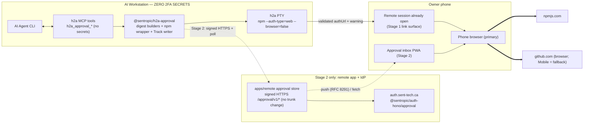

# SPEC_EVOL — Remote 2FA Relay and Action-Bound Phone Approval Chain

**Status:** Revision 8 (`r8`), 2026-11-23 — Security Design Specification. `r1` (author lane: Gemini 4 Neon XHigh) was revised to `r2` after the independent Carbon review (`.h2a/reviews/remote-2fa-relay-carbon.md`, VERDICT: CHANGES, findings `F-01`–`F-14`; dispositions in §14). `r3` folds the independent Opus round-2 review of `r2` (`.h2a/reviews/remote-2fa-relay-r2-opus.md`, VERDICT: CHANGES, findings `N-01`–`N-12`; dispositions summarised in §15, with full evidence in the `r3` delivery receipt) and the post-launch owner constraints (`.tmp/rv/remote-2fa-relay.constraints.md`). `r4` is a convergence pass folding the independent Opus round-3 review of `r3` (`.h2a/reviews/remote-2fa-relay-r3-opus.md`, VERDICT: CHANGES, findings `R3-01`–`R3-13`; dispositions summarised in §16, with full evidence in the `r4` delivery receipt). `r5` is the final convergence pass folding the independent Opus round-4 review of `r4` (`.h2a/reviews/remote-2fa-relay-r4-opus.md`, VERDICT: CHANGES, findings `R4-01`–`R4-09`): it closes the two Major findings (`R4-01`, `R4-02`) with the smallest correct change and adds nothing else; the seven Minor findings are dispositioned as open notes in §17 and in the `r5` delivery receipt (the round-4 review, §5, requires only the Majors to reach SOLID). `r6` is the final convergence pass folding the independent Opus round-5 review of `r5` (`.h2a/reviews/remote-2fa-relay-r5-opus.md`, VERDICT: CHANGES, findings `R5-01`–`R5-06`): it closes the two Major findings (`R5-01`, `R5-02`) with the smallest correct change and adds nothing else; the Minor findings are dispositioned as open notes in §18 and in the `r6` delivery receipt (the round-5 review, §5, requires only the Majors to reach SOLID). `r7` is the final convergence pass folding the independent Opus round-6 review of `r6` (`.h2a/reviews/remote-2fa-relay-r6-opus.md`, VERDICT: CHANGES, findings `R6-01`–`R6-03`): it closes the single Major finding (`R6-01`) with the smallest correct change and adds nothing else; the Minor findings are dispositioned as open notes in §19 and in the `r7` delivery receipt (the round-6 review, §6, requires only the Major to reach SOLID). `r8` is the final convergence pass folding the independent Opus round-7 review of `r7` (`.h2a/reviews/remote-2fa-relay-r7-opus.md`, VERDICT: CHANGES, findings `R7-01`–`R7-05`): it closes the single Major finding (`R7-01`) with the smallest correct change and adds nothing else; the Minor findings are dispositioned as open notes in §20 and in the `r8` delivery receipt (the round-7 review, §6, requires only the Major to reach SOLID). Draft for owner decisions. No code written, no deployment touched, no commit made.

**Owner need (22/11, verbatim):**
> « Je peux être en posture de remote control (je pilote la session depuis mon smartphone), et donc le 2FA doit pouvoir passer entre un composant local (éventuellement le navigateur Chrome utilisé par l'IA) et mon smartphone. L'idéal serait d'avoir une lib + une chaîne de dispositif permettant de faire ça de façon full secure, avec une élicitation (plugin MCP h2a). »

**Owner constraints added after launch (22/11):** GitHub Mobile is allowed **only as a fallback**. The primary channel works from the phone browser, or from the remote-control session plus a phone authenticator, with no vendor app installed. This spec builds on the three earlier Track demands listed in §2.1 and does not duplicate them.

**Primary use case:** npm (`npm publish`, staged-publish approval, token and maintainer changes — the account-identity/governance actions that bypass-2FA tokens lost in August 2026, §0.2 — and trusted-publisher changes, which separately require a 2FA-enabled account and a non-bypass credential).  
**Generic target scope:** npm, GitHub sudo & deployments, the sent-tech IdP (`auth.sent-tech.ca`) & internal Sentropic/h2a actions, remote Ubuntu `sudo`, and cloud consoles (OVHcloud, Cloudflare, Scaleway, GCP, AWS).

**Smallest first deliverable:** `FA-0` (3–5 agent-hours, **zero `h2a` code**, §12): a **migration, not a greenfield setup** — this repository already publishes directly from CI (§2.2 inventory). `FA-0` first **closes the direct-publish exposure at once, at zero code (step 0, owner on the phone, every package on the **step-0 list** — every package on the owner's npm account list and on the `@sentropic` organization list on `npmjs.com`, plus any unscoped package the account maintains; §2.2, DP-7)**: "disallow tokens" everywhere, every publish-allowed trusted-publisher connection deleted, bypass GATs revoked, `NPM_TOKEN` secret deleted — after step 0 no package on that list has a non-interactive publish path (*closed (no publisher)*). It then migrates one **leaf** canary package end to end (stage-only connection on `npmjs.com` in the phone browser, that package's CI switch to `npm stage publish` behind the bump-gate publish guard (a re-stage refusal fails visibly, never green), approval on npm's own Staged Packages tab), deletes the bootstrap-publish job and every token-publish target, and records the per-package table for every package on the step-0 list (*closed (no publisher)* / *migrated (stage-only)* / *open (release in progress)*, with CI dependents); each remaining package gets its stage-only connection at its next release. Two zero-code owner gates (`P-1`, `P-2`, §12) run before the first real release. The npm CLI handoff tool (`FA-min-A`) is a smaller, conditional follow-up for CLI-only commands, not the first deliverable.

**Non-negotiable owner invariants:**
- **INV-1 (Zero step-up credential on the AI host):** No credential that alone satisfies a relying party's step-up ever lives on the AI workstation: no TOTP seed, software authenticator key, recovery code, synced or exportable passkey, saved RP password (GitHub sudo accepts the password alone, §0.2), live sudo-mode session, or owner-identity token that can approve in the owner's name. This covers `.env`, agent workspaces, and every browser profile the AI can drive. A step-up credential stored on the AI host is equivalent to having no 2FA. INV-1 is a verified precondition (gate `P-1`, §12), never an assumption.
- **INV-2 (Exact action binding):** Every approval request explicitly names the exact action, target resource, and a deterministic cryptographic digest of the payload/parameters, shown to the owner on the phone before confirmation. Where we run the display, the server — never the host — recomputes the digest from the canonical payload and renders that payload (§3.5, §8.2).
- **INV-3 (Fail-closed & human-only):** Every timeout, cancellation, mismatch, replay, or non-human (NHI/agent) completion attempt denies the gated action.
- **INV-4 (Zero secret in LLM context or Track):** No OTP digits, passwords, bearer tokens, or session cookies ever enter the LLM prompt, MCP tool results returned to the model, shell history, or Track logs. **One named exception:** the npm `authUrl` itself (its path UUID is treated as a short-lived capability link, sensitivity otherwise `unknown`) must reach the owner through the Stage-1 tool result, so the model can see that one link. It is never restated in model prose, never logged raw, and Track stores only its hash (§3.1, §6.2).

---

## 0. Evidence conventions, pins, and official sources

[JUGEMENT] Every factual observation from local repositories or official external documentation is tagged `[FAIT]` with its source reference. Every architectural proposal, risk assessment, verdict, lot estimate, or trade-off is tagged `[JUGEMENT]`. Missing or unverified live state is marked `unknown`. Effort is stated strictly in **agent-hours** (zero human-time or calendar-date estimates). Zero Python is used anywhere in this design.

### 0.1 Local repository pins (read-only verification, re-read for `r4` on 2026-11-23)

| Prefix | Repository (local path) | Pin read for `r4` | Key inspected artefacts |
| --- | --- | --- | --- |
| [FAIT] `sen:` | `rhanka/sentropic` (`/home/antoinefa/src/sentropic`) | Working tree branch `fix/preprod-rp-id-parity-login-a` HEAD `97fe9f53`; `origin/main` `f9a87400`. Cited `elicitation.ts` lines match on both. `auth-hono` differs between working tree and `origin/main`; each claim names the side it was read from. The publish machinery also differs between the two pins (per-package `npm publish` recipes in the working-tree `Makefile`; a central publish call in `scripts/ci/publishable-manifests.mjs` on `origin/main`) — the §2.2 inventory names both shapes, and `FA-0` re-inventories at its merge base. `spec/SPEC_EVOL_REMOTE_FASTLANE.md` is an **untracked working-tree draft, now r15** (1 116 lines, SHA-256 `f1231134bed7a3529a516f486709de4e866da8142af6a81120b0724a7d81f4c1` at `r4` read time; it changed after the `r3` read — the hash-at-read pin is the control); the committed `origin/main` version is r11. FASTLANE statements below cite the r15 draft by that hash or r11 where the committed text is meant — never an unhashed "latest". | `packages/mcp-platform/src/elicitation.ts`, `packages/auth-hono/src/ports.ts`, `packages/auth-hono/src/webauthn-authentication.ts`, `deploy/k8s/base/35-auth-idp.yaml`, `spec/SPEC_EVOL_REMOTE_FASTLANE.md` (r15 draft / r11 committed), `.track/events.jsonl`, `.tmp/packets/COMMON-RULES.md`, `.github/workflows/ci.yml`, `Makefile` (both pins, §2.2) |
| [FAIT] `h2a:` | `rhanka/h2a` (`/home/antoinefa/src/h2a`) | The local checkout sits on the older side branch `docs/org-raci-wp7-hinfra` (HEAD `229573e3`, 2026-11-07); it is **not** `origin/main`. `r3` therefore cites `h2a` **at `origin/main` `4128b0b5`** (2026-11-22) for every line number: `stdio.ts:206` (`PROTOCOL_VERSION = "2025-06-18"`), `stdio.ts:1268` (`-32600`), `track/src/events/types.ts:156` (`ProvenanceAuth`). `runtime/drive/consent.ts` **exists** on `origin/main` (it is absent only in the local side-branch checkout). `FA-min-A` still re-locates every `h2a` surface before coding. | `packages/h2a/src/runtime/mcp/stdio.ts`, `packages/h2a/src/runtime/drive/consent.ts`, `packages/track/src/events/types.ts` (all at `origin/main` unless named otherwise) |
| [FAIT] `stp-apps:` | `rhanka/sentropic-apps` (`/home/antoinefa/src/sentropic-apps`) | Review pin `c13bf37c0222a506064eac18d4b1e6b84b80f1df`; local HEAD `561ad430` at `r2` read time (not re-read for `r3`). No claim in this revision depends on `stp-apps` file contents. | Home of `apps/remote` per `SPEC_EVOL_REMOTE_FASTLANE.md` |

### 0.2 External authoritative documentation cited

| Ref | Specification / Official Documentation | Scope verified |
| --- | --- | --- |
| [FAIT] `NPM-WEB` | npm Docs — `npm-login`, `npm-config` (`auth-type`); `npm/cli` `lib/utils/auth.js` + `lib/utils/open-url.js` + `lib/commands/login.js` + `lib/commands/publish.js`, re-read at the locally installed **npm 11.21.1 / Node 22.22.1** for `r3` (the Opus ledger read 11.21.3 and 12.2.3 with identical `open-url.js`; `FA-min-A` pins and re-verifies one CLI major, §3.1) | `--auth-type=web` default, `--otp` forcing `legacy`, `EOTP` `authUrl`/`doneUrl` polling (`auth.js:6-22`), TTY guard (`auth.js:10`), classic `Enter OTP:` branch (`auth.js:25-28`), `--browser=false` print-without-opening (`open-url.js:55-64`). `npm login` saves a token credential to the user config (`login.js:37-44`); official docs disagree on its type (legacy `publish` vs "Session token") and its lifetime is `unknown` — the ban (§3.1) does not depend on either. |
| [FAIT] `NPM-STAGE` | npm Docs — Staged Publishing (`https://docs.npmjs.com/staged-publishing`, re-read 2026-11-23) & `npm-stage` (installed-cli docs) | `npm stage publish`, `list`, `view`, `download`, `approve`, `reject`; npm `>=11.15.0`, Node `>=22.14.0`; interactive 2FA on **both** `approve` and `reject`; a `0.0.0-stage` public placeholder for new packages; Staged Packages shows package names, versions, dist-tags, publishers and SHASUMs (contents can be inspected/downloaded; no source diff is rendered); a staged version and its contents are **not publicly available until a maintainer approves**, so a public-registry lookup (`npm view`) does not see a pending stage; `npm stage list`/`view`/`approve`/`reject` require interactive authentication and cannot use OIDC tokens, so CI cannot read the staging queue; a staged version occupies its semver slot (that version cannot be published while staged) and several versions of one package can be staged; on `npmjs.com` the documented single-version flow offers **Approve** only — **Reject appears only under batch actions**, and batch approval (up to 100 versions, one version per package per batch) is **"rolling out gradually and may not be available on your account yet"** |
| [FAIT] `NPM-2FA-2026` | npm Docs — About Access Tokens, Trusted Publishing (re-read 2026-11-23), installed `npm-trust` docs | From August 2026 bypass-2FA GATs can no longer perform these account-identity/governance actions: change email/password, modify/disable 2FA, create/escalate/manage access tokens, add/remove maintainers, org/team governance. **Trusted-publisher and package-access changes are not in that list**; the bypass-GAT exclusion for `npm trust` is a separate prerequisite (2FA-enabled account, non-bypass credential, existing package). Bypass tokens can **still be used for direct publishing** until that ability is removed in January 2027. Stage-only GATs cannot publish (`E_STAGE_REQUIRED`) but keep other write rights (deprecate, move dist-tags) and are "not a general-purpose security boundary". Trusted publishers are configurable on `npmjs.com` (package → Settings → Trusted Publisher; "Allowed actions: `npm stage publish` is always allowed"); the CLI `npm trust` is the command-line equivalent. An unvalidated trusted-publisher configuration expires after 48 h (2 days, per the review ledger read of the Trusted Publishers docs). Trusted publishing does **not** displace tokens: npm accepts publishes from the authorized workflow "in addition to traditional authentication methods like npm tokens and manual publishes", and staged publishing alone "does not make your account or org more secure" — npm's hardening set is (1) delete bypass GATs, (2) per package select **"Require two-factor authentication and disallow tokens"** (the default accepts bypass GATs; "disallow tokens" blocks GATs regardless of their bypass setting **and affects only traditional token authentication — trusted publishers (OIDC) continue to work normally**, so it can be set on every package at once without breaking any OIDC job), and (3) restrict trust relationships to stage publish only (installed `npm-stage` docs "Best Practices", re-read for `r4`). A trusted-publisher connection can be **deleted at any time** with no validation; the 48 h expiry governs only a **newly created** unvalidated connection. Existing connections cannot be edited in place (delete and re-create, then publish within 2 days); connections created before 20 May 2026 default to allow `npm publish` only; with `workflow_call`/`workflow_dispatch`, validation checks the **calling** workflow's filename. The binding is repository + workflow filename, environment optional. npm docs disagree on trusted publishers per package (installed CLI docs say one, the web docs say up to 10) — recorded, not load-bearing; `FA-0` records the live behaviour per package. A recovery-code login starts a 72-hour hold during which the account cannot publish packages, create access tokens, or modify account settings (Configuring two-factor authentication; Recovering your 2FA-enabled account — read first-hand in the round-6 review ledger); whether that hold also stops OIDC publishes from an existing trusted-publisher connection is `unknown`. |
| [FAIT] `W3C-WA3` | W3C WebAuthn Level 3 (`https://www.w3.org/TR/webauthn-3/`, backup state §6.1.3, challenge generation §13.4.3) & FIDO CTAP 2.2 (§11.4 BLE, §11.5 Hybrid Transport); Google Chrome Help 13168025 (confirmed at search-result level in `r3`; read first-hand by the round-3 review ledger) | `"hybrid"` `AuthenticatorTransport`; cloud tunnel plus mandatory BLE proximity. Challenges must be randomly generated by the relying party in an environment it trusts (§13.4.3). That phone passkeys sync by default (`backedUp: true`, `signCount = 0`) is **vendor behaviour, not a W3C statement**: verified for Google Password Manager (passkeys "backed up and synced to your Google Account", usable on Linux Chrome signed into the same account); Apple behaviour not checked in this pass. Servers must read the actual BE/BS flags from each assertion instead of assuming either way. |
| [FAIT] `MCP-ELICIT` | Model Context Protocol — Elicitation 2025-11-25 (`https://modelcontextprotocol.io/specification/2025-11-25/client/elicitation`) and 2026-07-28 MRTR (`https://modelcontextprotocol.io/specification/2026-07-28/client/elicitation`) | Form Mode MUST NOT carry secrets; URL Mode for sensitive auth; `-32042 URLElicitationRequiredError`; MRTR `InputRequiredResult` (`input_required` + `requestState`) with per-request `_meta["io.modelcontextprotocol/clientCapabilities"]` |
| [FAIT] `RFC-6238` | IETF RFC 6238 (TOTP, §5.2) | 30 s time-step, skew window, verifier MUST NOT accept a second use of the same OTP value |
| [FAIT] `GH-DOCS` | GitHub Docs — Sudo Mode, Reviewing Deployments, REST workflow runs (re-read 2026-11-23) | Sudo mode is a **re-authentication, not a 2FA boundary**: "you can authenticate with your password. Optionally, … a passkey, a security key, GitHub Mobile, or a 2FA code" (2 h window; the protected-action list is "including but not limited to", so this spec's "browser approval triggers no fresh prompt" is an inference tagged `[JUGEMENT]` where used, not a GitHub statement). `POST /repos/{owner}/{repo}/actions/runs/{run_id}/pending_deployments` approves pending deployments as a required reviewer; classic tokens need only the `repo` scope, fine-grained tokens need the "Deployments" repository permission (write). Admins can bypass deployment protection rules **unless** the environment is configured to prevent it. `prevent self-reviews` blocks the workflow initiator from approving. On GitHub Free, Pro and Team, required reviewers and preventing admin bypass exist only for **public** repositories; deployment branch/tag rules also reach private repositories on Pro/Team, and GitHub matches those rules against `GITHUB_REF` before any reviewer acts. |
| [FAIT] `CLOUD-DOCS` | OVHcloud, Cloudflare, Scaleway, AWS IAM official MFA docs; Google 2-Step Verification (`https://support.google.com/accounts/answer/185839`) | Supported MFA factors and remote VM limits. (`r1` wrongly cited `answer/7682439`, which is account recovery.) |
| [FAIT] `PUSH-RFC` | IETF RFC 8030 (Web Push), RFC 8291 (`aes128gcm` payload encryption), RFC 8292 (VAPID) + WebKit iOS 16.4+ Home Screen PWA Web Push | Non-empty push payloads require RFC 8291 encryption with the subscription `(p256dh, auth)` keys; iOS requires Home Screen install and a visible notification |

---

## 1. Synthèse propriétaire — en phrases courtes

**Le problème.** Tu pilotes tes sessions depuis ton téléphone. Le poste est loin de toi. Une action sensible demande un double contrôle (2FA). Depuis août 2026, les jetons npm qui sautent ce contrôle ne peuvent plus toucher aux réglages du compte. Ils peuvent encore publier jusqu'en janvier 2027. Tu ne veux aucun secret 2FA sur le poste IA. Tu veux voir l'action exacte avant de dire oui. Le site `remote.sent-tech.ca` n'est pas encore en ligne. Le premier outil doit donc marcher sans ce site.

**Le point dur, dit dès le départ.** Ton poste IA porte déjà tes accès. Le programme `gh` y agit en ton nom sur GitHub. L'IA peut aussi conduire ton Chrome local. Ce Chrome peut contenir tes sessions, tes mots de passe et des passkeys copiés par ton compte Google. En plus, la CI publie déjà des paquets sans ton geste. Un job spécial publie aussi avec un jeton durable. Le poste porte aussi des accès cloud et Kubernetes. Sur un tel poste, cette chaîne a des limites franches. Avant l'étape 0 de `FA-0`, la voie directe reste ouverte. Après cette étape, aucun robot ne publie seul un paquet de la liste de l'étape 0. Après le transfert d'un paquet, la chaîne montre quel paquet part. Elle montre quelle version part. Elle ne peut pas prouver que toi seul as validé un déploiement GitHub. Un programme sur le poste peut valider ce déploiement avec ton accès GitHub, sans ton téléphone. Elle ne peut pas non plus prouver le contenu du paquet. npm montre le nom, la version et l'empreinte. npm ne montre pas le détail du code. Elle ne protège aucun compte ouvert dans le Chrome conduit par l'IA. La section 2.2 donne la liste complète.

**Tes règles du 22 novembre.** L'application GitHub Mobile sert de secours seulement. La voie normale passe par le navigateur du téléphone. Aucune application de fournisseur ne doit être installée. Ce texte prolonge tes trois demandes déjà notées dans Track. Il ne les remplace pas. Le détail est en section 2.1.

**Petit lexique.**
- **Passkey** : une clé dans ton téléphone. Ton visage ou ton empreinte la débloque. Par défaut, elle se copie dans ton compte Apple ou Google. Elle peut donc vivre sur un autre appareil lié au même compte.
- **Code à 6 chiffres** : un code qui change toutes les 30 secondes. Il ne dit pas quelle action il valide.
- **Paquet en attente** : le robot dépose le paquet npm sans le publier. Tu le relis sur `npmjs.com`. Tu le compares au passage CI qui l'a produit. Tu le valides avec ton téléphone. Selon ton compte, npm valide jusqu'à 100 paquets en attente avec un seul contrôle. Ce mode par lot arrive peu à peu. Le rejet par le site semble lié à ce mode par lot. Il faut vérifier les deux sur ton compte.
- **Empreinte** : un résumé mathématique du contenu exact. Un seul octet changé donne une autre empreinte.

**Avant tout outil : deux contrôles sans code.** Premier contrôle (`P-1`) : le Chrome conduit par l'IA a son propre profil. Ce profil n'est signé dans aucun de tes comptes Google ou Apple. La copie des mots de passe et des passkeys y est coupée. Aucun mot de passe de service n'y est gardé. Ton profil personnel n'est jamais conduit par l'IA. Aucun code de secours n'est gardé sur le poste. Les accès cloud, Kubernetes et CI du poste sont aussi listés. Toute exception acceptée porte un nom et une date de fin. Second contrôle (`P-2`) : une clé de secours hors ligne marche sur npm et sur GitHub. Tu la testes. Le téléphone demande le visage ou l'empreinte pour les clés. Ce réglage vaut partout, pas seulement loin de chez toi. Ces deux contrôles ne demandent aucun programme nouveau. Ils sont notés dans Track.

**Le plus petit premier outil utile.** Il s'appelle `FA-0`. Il coûte 3 à 5 heures-agent. Il ne demande aucun code dans `h2a`. C'est un transfert, pas un départ de zéro. Étape 0 : tu fermes tout de suite la voie directe. Tu coupes les jetons pour chaque paquet de la liste npm. La liste vient du compte npm. La liste vient aussi de l'organisation `@sentropic`. Elle ne vient pas des dépôts. Tu supprimes chaque accès de publication directe. Tu retires les jetons qui sautent le double contrôle. Tu supprimes le secret `NPM_TOKEN`. Après cette étape, aucun robot ne publie seul un paquet de cette liste. Chaque paquet fermé attend ensuite son transfert. Tu transferes alors un paquet test sans dépendance CI. Tu limites son robot à la mise en attente. Le robot ne redépose pas une version déjà en attente. Si le registre refuse un nouveau dépôt, le job échoue. Il ne passe pas au vert. Le job bootstrap et ses cibles jetons sont supprimés. La CI dépose le paquet test en attente. Tu vas sur `npmjs.com` par ton propre raccourci. Tu compares le nom au journal CI. Tu compares la version au journal CI. Tu compares l'empreinte au journal CI. Puis tu valides. Chaque paquet suivant reçoit son accès limité à sa prochaine sortie. La liste distingue trois états. Fermé sans accès. Transféré en attente seule. Ouvert pendant une sortie en cours.

**Et les accès forts du poste ?** Certains accès doivent quitter le poste IA. Ton accès GitHub personnel doit en partir. Un compte limité pour les robots le remplace. Ce compte ne valide pas les déploiements. Il ne contourne pas les règles. Tes passkeys et mots de passe doivent sortir du Chrome conduit par l'IA. Les codes de secours aussi. Un jeton npm fort aussi. Les accès cloud et Kubernetes sont traités en question `OQ-14`. D'autres accès peuvent rester. Un jeton npm limité à la mise en attente peut rester, si tu le choisis. Il peut encore changer une étiquette ou un avis de fin de vie. Ce risque reste écrit noir sur blanc. Tant que ton accès GitHub reste sur le poste, la validation GitHub est un frein utile. Elle n'est pas une preuve.

**L'outil de commande npm vient après, si besoin.** Il s'appelle `FA-min-A`. Il coûte 6 à 10 heures-agent. Il sert aux rares commandes sans écran web, comme les étiquettes. Tu touches alors le lien npm dans le bloc de l'outil nommé `h2a_approval_npm`. Jamais un lien recopié dans un texte. Jamais un écran de connexion npm. Après chaque commande de ce type, tu vérifies tout l'état des paquets couverts sur `npmjs.com`. Tu ne vérifies pas seulement le changement attendu.

**Ce que les revues ont corrigé.** Les premières versions promettaient trop. Un poste piraté peut afficher un faux résumé sous un vrai lien npm. Le petit code visuel ne prouve donc pas l'action. Pour nos propres services, le serveur doit recalculer l'action exacte et la montrer. Un résumé gentil avec une mauvaise action doit échouer. La commande `npm login` est interdite. Elle écrit un jeton sur le poste. La doc npm ne dit pas clairement sa durée. On l'interdit quand même. Le relais de code à 6 chiffres vers le Chrome local est retiré. L'IA verrait les chiffres sur la capture suivante. On ne le construit pas.

**Les voies qui restent.**
1. **Valider sur le site du service, depuis le téléphone.** C'est la voie normale. npm montre le vrai nom et la vraie version. Pour GitHub, cette voie devient une preuve seulement quand ton accès personnel a quitté le poste. Ton navigateur de téléphone suffit.
2. **Le lien npm de commande.** Il sert aux rares commandes sans écran web. Tu vérifies toujours le résultat sur `npmjs.com`. Tu ne coches jamais « se souvenir pendant 5 minutes ».
3. **Signer avec ton passkey pour nos propres services.** Cela viendra ensuite. Cela couvrira `auth.sent-tech.ca` et le `sudo` sur ton Ubuntu distant. npm et GitHub n'acceptent pas cette signature comme leur contrôle.
4. **Le QR code Bluetooth reste écarté.** Il demande une présence à quelques mètres. Il ne marche pas à distance.

**La suite, par étapes.** Étape 1 : les deux contrôles sans code, puis `FA-0` (3 à 5 heures-agent). `FA-min-A` suit seulement si tu en as encore besoin (6 à 10 heures-agent de plus). Étape 2 : la boîte de validation sur le téléphone, la signature passkey, les alertes push et le `sudo` Ubuntu (62 à 94 heures-agent). Étape 3 : un essai court seulement, pour relayer un passkey vers le Chrome local (6 à 10 heures-agent). Aucune construction n'est promise à l'étape 3 sans ton nouvel accord.

**Garde-fou vol de téléphone.** Un téléphone volé et déverrouillé peut taper des commandes et valider. Le code de l'appareil peut remplacer l'empreinte. La clé de secours et le réglage visage ou empreinte valent donc dès l'étape 1. Le réglage doit valoir partout, pas seulement loin des lieux connus. Le plan de secours nomme chaque canal d'accès à distance que tu utilises. Il dit comment couper chacun sans le téléphone. Il coupe aussi les accès GitHub et npm du poste. La section 13 te demande le niveau de frein voulu pour les actions graves.

**Tes 14 choix ouverts (section 13).** Chaque question donne 2 ou 3 options qui avancent. Chaque option dit ses risques. Chaque question dit aussi le risque de ne pas choisir. Les sujets sont le découpage, le code à 6 chiffres, la chaîne npm, les alertes, le domaine de signature, Track, les fenêtres de confort, le premier outil, le `sudo` et le passkey vers Chrome, le vol du téléphone, quel compte GitHub vit sur le poste (`OQ-11`), le profil du Chrome de l'IA (`OQ-12`), quel jeton npm vit sur le poste (`OQ-13`) et quels accès cloud et Kubernetes y restent (`OQ-14`).

---

## 2. Existing baseline in the sentropic ecosystem

[FAIT] Before designing new pieces, this section fixes what already exists at the verified pins (`§0.1`) and what is missing.

| Component | Current state at verified pin | Evidence | Gap for remote 2FA relay |
| --- | --- | --- | --- |
| [FAIT] `@sentropic/mcp-platform` `ElicitationManager` | Fail-closed state machine (`requested → rendered → answered → validated → resumed`; terminals `cancelled \| timed_out \| denied \| expired`), modes `form \| confirm \| consent \| url \| credential`. **Two gaps block direct reuse for phone approval:** (1) `HUMAN_TARGETED_MODES` is `{confirm, consent, credential}` — `'url'` is absent, so an NHI completer passes `answer()` in URL mode; (2) client binding (`completer.client !== actor.client → denied`) rejects legitimate cross-device completion (workstation client vs phone completer). `r1` wrongly claimed reuse alone guarantees human-only completion. | `sen:packages/mcp-platform/src/elicitation.ts:49-55,180-205` (re-read for `r2`; identical on working tree and `origin/main`) | Needs the contract change specified in §6.1 before any URL-mode approval relies on it. `FA-min-A` does not rely on it. |
| [FAIT] `h2a` MCP stdio transport | Serves client→server JSON-RPC and server→client notifications. Advertises `PROTOCOL_VERSION = "2025-06-18"`, which predates URL-mode elicitation. Method-less client JSON-RPC responses draw `-32600 Invalid Request`. | `h2a@origin/main:packages/h2a/src/runtime/mcp/stdio.ts:206,1268` (§0.1) | No server→client request correlation. Explicit tools stay the primary surface and native elicitation stays deferred (see §6). |
| [FAIT] `h2a_drive_consent_*` | Same-uid keys prove key possession, not human intent — stated in the source itself (`DRIVE_CONSENT_LIMIT`: "Signatures prove active-key possession, not intent … any same-uid lane can read a principal key"). The file exists on `origin/main`; it is absent only in the local side-branch checkout. | `h2a@origin/main:packages/h2a/src/runtime/drive/consent.ts:14` | The `requirePhoneIntent` upgrade stays out of scope. It brought no value to the npm and `sudo` cases. It can return under a separate decision. |
| [FAIT] `remote.sent-tech.ca` & `WET-2.2` trunk | **Not deployed.** The owner reported no Remote DNS record, no deployment, and no RM lot started at the 21 November decision point. Trunk channels: `ch = 0` (link) and `ch = 1` (catalogue) fixed; `ch >= 2` dynamically allocated to terminal sessions; a record on an unallocated `ch` closes the link. Remaining FASTLANE effort per the r15 draft: 305–464 agent-hours. | `sen:spec/SPEC_EVOL_REMOTE_FASTLANE.md` r15 draft (SHA-256 in §0.1): status line, channel allocation, effort summary (draft line 55) | Approvals must not depend on the trunk. Stage-2 approvals travel over signed HTTPS routes (§7.1), with zero trunk wire change. |
| [FAIT] `@sentropic/auth-hono` | WebAuthn registration/authentication with `AuthHonoChallengePort { create, findValid, markUsed, purgeExpired }`. Verification is check-then-act (`findValid` → verify → `markUsed`), not an atomic consume. `AuthHonoChallengeType` is closed to `'registration' \| 'authentication'`. Repository config sets `WEBAUTHN_RP_ID: "sent-tech.ca"` with `WEBAUTHN_ORIGIN: "https://auth.sent-tech.ca"`; the **live** IdP state is `unknown` (not probed by this text lane). The approval use needs `userVerification` forced to `'required'`; the resolver default differs between working tree (`'preferred'`) and `origin/main` (`'required'`), so the approval endpoint must hardcode it. | `sen:packages/auth-hono/src/ports.ts:24,124-129`, `webauthn-authentication.ts:104-148` and `:187-196` working tree vs `:189-198` on `origin/main`, `deploy/k8s/base/35-auth-idp.yaml:50-52` | No action-digest signing endpoint yet. Stage 2 adds it with an atomic consume, a challenge-type migration, and forced user verification (§5, §8). |
| [FAIT] `@sentropic/track` (`0.98.11`) | Record-only, h2a-free, hash-chained event store; supports additive event types, `Provenance` (`transport`, `proposed`, `auth: 'signed'`, `principal`, `sig`), and opaque `artifactLocator` (never verifies signatures or fetches artifacts). | `h2a@origin/main:packages/track/src/events/types.ts:156` (`ProvenanceAuth`), `model/verification.ts:15-48` | No `approval.recorded` event type yet for remote 2FA / action-approval evidence. |
| [FAIT] Local Chrome CDP (`127.0.0.1:9222`) | The browser the AI drives is **the owner's Chrome** (lanes "(re)launch the owner's Chrome with CDP"); Chromium snap launched with `--remote-debugging-port=9222` from a terminal loses BLE and breaks WebAuthn hybrid QR passkeys (15/11 incident root cause). `r3` also observed the CDP port listening on this host at review time, without connecting to it. | `sen:.tmp/packets/COMMON-RULES.md:131`, `sen:spec/SPEC_EVOL_GOOGLE_DRIVE_CONNECTOR.md:95-104` | Exposes full DOM/cookies/sessions — and any synced passkeys or saved passwords in that profile — to any same-uid process; lacks BLE for hybrid WebAuthn. No approval ever writes into this Chrome, and gate `P-1` (§12) forces a dedicated AI profile before Stage 1 relies on any of this (§2.2). |

### 2.1 Reconciliation with the three earlier Track demands

[FAIT] The owner constraints (`.tmp/rv/remote-2fa-relay.constraints.md:5`) require this spec to build on three existing Track items without duplicating them. `r1` named none of them (zero matches in the `r1` text, verified for `r2`). All three items exist in `sen:.track/events.jsonl`:

| Track item | Demand (title) | How this spec covers or stages it | Lot |
| --- | --- | --- | --- |
| [FAIT] `01M6VMG1S27VBVTADSR01PAV3Z` (`.track/events.jsonl:785`) | Installable SPA/PWA with push notifications and OTP; approve 2FA for third-party requests (for example `sudo` on the remote Ubuntu host) | **Staged, core of Stage 2.** The PWA approval inbox with Web Push is §7.2. The explicit `sudo` case is §4 Flow 4 and lot `FA-4`: a root-owned sudo-side verifier (`uid 0`) checks the phone-signed receipt, which gives a real OS boundary against an unprivileged (`uid 1000`) AI session — subject to the `FA-4` entry gate on the documented `argv` source (§3.5). The "OTP" wording is covered by phone-side approval, not by relaying digits (§3.3). | `FA-3`, `FA-4` |
| [FAIT] `01M58N4PFKASA3RXNH4P1HW45V` (`.track/events.jsonl:590`) | Sentropic as FIDO2/WebAuthn authenticator provider (phone passkey wallet, remote approval relay for AI-driven sessions) | **Staged as evaluation only (Stage 3).** The relay half is covered by Options (a), (d), and (e). The wallet half (local Chrome WebAuthn answered by the phone over IP, for example via a WebAuthn proxy extension) is studied in §3.6 with its origin-spoofing and session-hijack threats. No production build is committed in this revision. | `FA-6` (spike) |
| [FAIT] `01M58NA2051J9VQ72RCYBDKB7P` (`.track/events.jsonl:593`, under `WP-AUTH` `01KYNH2DD7Q4SRMQGRWW84H05S`) | Brainstorm: third-party FIDO2 authenticator / passkey provider (phone pop-up, nothing on PC; AI clicking + owner confirmation) | **Same Stage-3 spike as above.** Until then, third-party WebAuthn runs in the phone browser (Option (d)), never inside local Chrome. The owner chooses the fate of this demand in `OQ-9`. | `FA-6` (spike) |

[JUGEMENT] No new Track demand is created by this spec. Delivery lots in §12 reference these three items. Closing or superseding any of them stays an owner decision (`OQ-9`).

### 2.2 The current AI host: what this chain can and cannot protect (finding `N-01`, head-on)

[FAIT] This is the owner's actual posture today, not a hypothetical: the owner steers sessions remotely from the phone (verbatim need, above), AI lanes drive the owner's local Chrome over CDP `127.0.0.1:9222` (§2), and any same-uid process on that workstation can use whatever credentials the workstation already holds. The round-2 reviewer observed on this host that `gh` is signed in as the owner account (`rhanka`, keyring) with `repo` and `workflow` scopes among others (`gh auth status` without the token, 2026-11-23). `r3` did not re-run that command under this lane's no-secret rule; gate `P-1` (§12) re-checks it the same token-free way. A specification that does not settle this posture first protects the wrong thing.

**[JUGEMENT] The hard rule that follows:** the identity that holds an approval gate (GitHub required reviewer, npm maintainer 2FA, IdP approver) has **no credential on the AI host**. Anything that can satisfy a gate while sitting on a host the AI can drive is not a gate against that host — at best it is a pause button. §10.1 carries the per-credential inventory; `OQ-11` asks the owner to choose the replacement.

**[JUGEMENT] What this chain CAN protect, even while the owner's credentials still sit on the host:**
1. **npm release timing and identity — closed at once by step 0, promoted per migrated package.** Once `FA-0` step 0 lands ("disallow tokens" on every package on the step-0 list, every publish-allowed connection deleted, bypass GATs revoked, `NPM_TOKEN` deleted), **no package on that list — migrated or not — has a non-interactive publish path**: a *closed (no publisher)* package cannot be published by the host or CI at all until its stage-only connection is created at its next release (its publish job then fails closed, §12). For a package whose migration row is also complete (stage-only connection **and** "disallow tokens" **and** no bypass GAT anywhere), neither the host nor CI can put a version live without the owner's maintainer-2FA gesture on `npmjs.com`. The owner sees, on npm's own screen, the true package name, version, dist-tag, publisher, and SHASUM. A stolen stage-only token or a prompt-injected agent alone cannot promote that package. **Before step 0 lands, all of this is false**: the inventory below lists the direct paths that still publish with no gesture.
2. **Silent automation.** Nothing publishes, deploys through a configured environment pause, or runs internal privileged actions without at least one visible, owner-bound moment — approvals stop being implicit.
3. **Internal `sudo` (Stage 2).** A root-owned verifier plus a phone passkey stops a compromised user session (`uid 1000`) from minting or skipping the proof (§4 Flow 4), provided the owner reads the IdP-rendered command (§3.5), the `argv` comes from a documented per-command source, and sudo's credential cache is disabled (`timestamp_timeout=0`) (§3.5, `FA-4` entry gate).

**[JUGEMENT] What it CANNOT protect on this host until `OQ-11` / `OQ-12` are decided and applied:**
1. **GitHub deployment approval as a security boundary.** A token with the `repo` scope can approve pending deployments over REST as a required reviewer (`GH-DOCS`, §0.2) — from the agent's own shell, with no phone and no 2FA. Admin bypass is also possible unless the environment forbids it. GitHub environment approval is therefore **advisory only** against Adversaries 1 and 4 (§10) for as long as the owner's GitHub credential is usable on the host.
2. **The contents of a staged npm release.** The staged tarball is built by CI from a repository this host can push to and dispatch. npm renders identity fields and offers inspection/download; it does **not** render a source diff. Content integrity is no stronger than repository protection under a separate agent identity (§3.4, `OQ-11`).
3. **Anything reachable through the AI-driven Chrome profile.** Session cookies are usable as the owner; a saved GitHub password enters sudo mode alone; a Google-synced passkey usable on Linux Chrome would satisfy RP step-ups in that profile without the phone. Gate `P-1` turns this from an assumption into a checked state.
4. **A benign host summary.** In option (a) (§3.1) and — until §3.5's canonical rendering is built — option (e), the owner reads host-written text. Host-asserted framing buys awareness, not verification.
5. **npm releases before step 0, and release availability after it.** Until `FA-0` step 0 lands, the direct-publish paths in the inventory below put versions live with no phone gesture and no 2FA. Step 0 ends that exposure **at once for every package on the step-0 list**: deleting a connection needs no validation, and "disallow tokens" does not disturb OIDC (§0.2) — the 2-day validation governs only the stage-only connection each package later gets at its next release. The `r4` sentence that this exposure could only end package by package at each release is **withdrawn**. In exchange, a *closed (no publisher)* package cannot release at all until the owner creates its stage-only connection: its publish job fails closed on a version bump (expected red run, §12), and an emergency release means creating that connection first or the owner's own interactive publish from a non-remote posture.
6. **Cloud and Kubernetes actions reachable through host API credentials.** Cloud CLI/API credentials, a kubeconfig, and CI secrets usable through the host's GitHub credential act without any console MFA (§10.1). Console, (d), and (e) gates for those actions are advisory until `OQ-14` is decided and applied.
7. **Against a compromised root, a compromised phone, or account recovery.** Those stay out of scope here; the stolen-phone model is §10.2.

**[FAIT] Existing direct-publish paths (r4 inventory, finding `R3-01`; account scope added in `r6`, finding `R5-01`).** **The step-0 list is drawn from npm, not from repositories:** every package on the owner's npm account list and on the `@sentropic` organization list on `npmjs.com`, plus any unscoped package the account maintains; `FA-0` records that list (§12), and the per-package table and the exit gate cover it. Read at both `sen:` pins on 2026-11-23 (tracked files only; the two pins differ, §0.1). No `environment:` appears in `.github/workflows/ci.yml` at either pin, and no `npm stage` call exists in the tracked publish machinery at either pin. "Closes" means the exact change `FA-0` must land for that path. Package states in `FA-0` are *closed (no publisher)* (step 0 landed: no non-interactive publish path), *migrated (stage-only)* (stage-only connection + CI staging switch landed), and *open (release in progress)* (step 0 not yet landed for that package, or its release migration is under way); a package or repository the owner excludes from step 0 is named *open* in the table, and no universal claim in this spec covers it. Only an *open* package can still put code live with no phone gesture. Trigger reach is the same for DP-1/DP-2/DP-5/DP-7: the host's owner GitHub credential (§10.1) can push to `main`, dispatch workflows, and push tags in the repositories named below. The `NPM_TOKEN` type and expiry are `unknown` from this lane; only a bypass GAT publishes non-interactively, and bypass GATs can direct-publish until January 2027 (§0.2) — so DP-2 is treated as live until the token is revoked and seen gone.

| # | Direct-publish path (entry points; packages) | Exact closure in `FA-0` — or why it stays open |
| --- | --- | --- |
| DP-1 | **CI OIDC direct publish (`sentropic`).** `ci.yml` jobs with `id-token: write`, gated to `refs/heads/main`, running `make publish-<pkg>` → `npm publish --access public`: 22 npm jobs at the working-tree pin (`publish-llm-mesh`, `-llm-gateway`, `-chat-ui`, `-cited-source-viewer`, `-cowork-bridge`, `-oauth-verify`, `-mcp-auth`, `-mcp-platform`, `-auth-hono`, `-auth-client`, `-auth-ui`, `-cowork-desktop`, `-contracts`, `-events`, `-chat-core`, `-chat-server`, `-comments`, `-flow`, `-build-cli`, `-harness`, `-cli`, `-cluster-mesh`; per-package recipes in the working-tree `Makefile`); 21 at `origin/main` (`publish-artifacts` in, `-build-cli`/`-cli` out of CI; one central `npm publish` call in `scripts/ci/publishable-manifests.mjs` via the `Makefile` guard). `@sentropic/focus` in this repo has no steady-state job at either pin (DP-2/DP-3 only). | **Step 0 closes it at once; migration reopens staging only.** (owner, phone, step 0, every package on the step-0 list in one sitting) set Publishing access → "Require two-factor authentication and disallow tokens" **and delete every publish-allowed trusted-publisher connection** — the package is then *closed (no publisher)*: with no connection the CLI falls back to tokens (§0.2), tokens are disallowed, and CI holds none after DP-2, so no non-interactive publish remains. **Per package, with its next release:** (owner, phone) create its stage-only connection (inside the 2-day validation window); (repo) switch that package's publish command from `npm publish` to `npm stage publish` **behind the §12 bump gate (a re-stage refusal fails visibly, never green)** (its `Makefile` recipe at the working-tree pin; the central publish call's per-package path at `origin/main` — re-located at `FA-0` start) and bind the connection to an environment with deployment branch/tag rules (§3.4). A package is *open (release in progress)* only before its step-0 gestures land or while its release migration runs. |
| DP-2 | **CI bootstrap token publish (`sentropic`).** `workflow_dispatch` input `bootstrap_publish_target` + job `bootstrap-publish` (`ci.yml`, main only): writes `secrets.NPM_TOKEN` to a file and runs `make publish-<pkg>-token` → `npm publish --access public` (some recipes with `--no-provenance`/`--provenance=false`). Working-tree pin offers target `all`; `origin/main` has narrowed it to exactly one of 19 named packages with a guard step — still a direct publish with a standing CI secret. | **Delete** the `bootstrap-publish` job and the `bootstrap_publish_target` input; **delete** the `NPM_TOKEN` repository secret; (owner, phone) **revoke** that token and every bypass GAT on `npmjs.com`. New-package bootstrap no longer uses CI: a one-shot stage-only GAT (bypass off) is created on the phone, used once for the first `npm stage publish`, and revoked immediately after (§3.4) — never a standing CI secret. Closes in the `FA-0` canary change, for all packages at once. |
| DP-3 | **Local token publish targets (`sentropic`).** The same `publish-<pkg>-token` `Makefile` targets (23 at the working-tree pin incl. `-focus-token`; 21 at `origin/main`) run from any shell that can supply `NPM_TOKEN_FILE` — CI is only one caller. | **Delete** every `publish-<pkg>-token` target in the same change as DP-2 (the one-shot bootstrap above is a documented manual command, not a standing target). No token-publish harness remains in the repo. |
| DP-4 | **Manual shell publish with a host registry credential.** Any agent/human shell running `npm publish` in a non-private package directory (24 such `@sentropic/*` packages at the working-tree pin, including `@sentropic/skills`, which has neither a target nor a job) authenticated by the host `.npmrc` credential (§10.1); includes a mirror invocation under `OQ-13` Option B by design. | No repo edit can close this; its token half closes **npm-side for every package on the step-0 list at step 0**: "disallow tokens" everywhere (DP-1) plus revoking bypass GATs (DP-2) plus the `P-1`/`OQ-13` host-credential outcome. For a package not yet on npm (`unknown` per package until `FA-0` records it), the setting is applied immediately after its first staged bootstrap. The owner publishing manually with a fresh interactive 2FA stays possible by design — that is an owner gesture, not a host-alone path. |
| DP-5 | **Companion repo: `h2a` release OIDC publish.** `h2a@origin/main:.github/workflows/release.yml` (tag `v*.*.*` push or backfill dispatch; top-level `id-token: write`, no `environment:`) runs `npm publish --access public` on verified tarballs for `@sentropic/track`, `@sentropic/h2a-runtime`, `@sentropic/h2a`, `@sentropic/h2a-cli`, `@sentropic/focus`. Named here because `FA-0` already spans `h2a` (§12); it is not a path in `sentropic` itself. | Same two-phase closure as DP-1: **step 0 covers the five `h2a` packages in the same sitting** ("disallow tokens" + delete publish-allowed connections → *closed (no publisher)*); at the next `h2a` release each gets its stage-only connection and the five publish steps switch to `npm stage publish <verified.tgz>` behind the §12 bump gate (a re-stage refusal fails visibly, never green); the workflow's post-publish install/visibility steps then run only after owner approval, not in the staging run. The `sentropic` canary alone does not migrate it, but step 0 — not the canary — is what closes its direct-publish path. |
| DP-6 | **Container-image publish (not npm).** `publish-api-image` / `publish-ui-image` / `publish-e2e-image` (`Makefile` + CI jobs) push images to the registry named by CI secrets, with no phone gesture. | **Stays open by scope.** `FA-0`'s claim is npm versions only; image publication is a deploy input whose promotion belongs to the environment/deploy gates of §11 and to `OQ-11`/`OQ-14`. No sentence in this spec may read as "`FA-0` stops everything going live". |
| DP-7 | **Other owner repositories publishing to the same account/scope via OIDC on tag/dispatch.** At the local `origin/main` refs read first-hand by the round-5 review (`R5-01`, workflows cited there): `remote` (`@sentropic/remote-cli`, dispatch), `geo` (six `@sentropic/geo*` packages, tags), `agent-stats` (`@sentropic/agent-stats` core and CLI, tags), `bpmn-canvas` (`@sentropic/bpmn-canvas`, tags), `graphify` (one engram package, tags), and `sent-tech-design-system` (about 19 `@sentropic/design-system-*`, `diagram-*` and `graph` packages across 18 publish workflows, tags and dispatch) — about 30 packages, each with `id-token: write` and a direct `npm publish`, reachable by the host's owner GitHub credential (§10.1). Any unscoped package the account maintains is caught by the list-from-npm rule above even if unnamed here. | **Step 0 closes it like DP-1**, for every package on the step-0 list ("disallow tokens" + delete every publish-allowed connection → *closed (no publisher)*). Each repository then migrates **at its next release with its own guard shape** (its stage-only connection and guarded CI switch behind the §12 bump gate); until that migration lands its releases fail. If the owner excludes a repository, its packages are named *open* in the table and the universal claims do not cover them. |

**[JUGEMENT] Credentials that must move off the host (owner-gesture checklist, gate `P-1` + `OQ-11`/`OQ-12`):**
1. **The owner's GitHub credential** — `gh` keyring/token, any owner personal token, and git credentials that authenticate *as the owner* with reviewer or admin reach → replaced by the `OQ-11` identity (bot account or GitHub App with no reviewer, admin, or bypass rights).
2. **Owner passkeys and saved RP passwords in the AI-driven Chrome profile** — the AI profile must never be signed into the owner's Google/Apple account; sync off; no saved passwords for npm, GitHub, the IdP, or cloud consoles (`OQ-12`).
3. **Recovery codes, TOTP seeds, and password-manager vaults** that unlock owner RP accounts — off the host entirely; any set of recovery codes ever stored agent-readable is assumed exposed and regenerated from the phone.
4. **Owner-strength npm credentials** — any bypass or "publish and stage" token, any `npm login` token, **wherever they live**: on the host, and in CI (the standing `NPM_TOKEN` secret of DP-2 is revoked and deleted, and every bypass GAT is deleted on `npmjs.com`) → at most the stage-only token of `OQ-13` Option A (with its residual rights stated), or nothing (`OQ-13` Option C).
5. **Live owner sessions in the AI profile** — no signed-in npm/GitHub/IdP/cloud sessions, and conversely the owner's personal Chrome profile is never placed under CDP.
6. **Cloud, Kubernetes and registry write credentials** — inventoried at `P-1` (§10.1) and disposed of by `OQ-14` (removed, read-only, or accepted as a dated INV-1 exception); until then cloud/k8s gates stay advisory.

**[JUGEMENT] What may stay on the host, with stated limits:**
- The `OQ-11` bot/App credential for git/GitHub work (push and dispatch within rulesets; no reviewer, admin, or bypass rights). Content it pushes still needs repository protection and owner release checks — §3.4.
- The `OQ-13` Option A stage-only npm GAT (package-scoped, short expiry; residual deprecate / dist-tag writes, §10.1).
- Read-only tokens, and the `h2a` node key — it can create approval requests but can never approve (§6, §8). CI staged publishing uses short-lived OIDC and stores nothing on the host at all.

---

## 3. Comparative study of 2FA mechanisms in remote-control posture (a–f)

### 3.1 Option (a) — npm web auth (`--auth-type=web`, `authUrl` / `doneUrl`)

- **[FAIT] Mechanism (`NPM-WEB`):** `auth-type=web` (default since npm v9) sends interactive 2FA to a browser. On an `EOTP` challenge the registry returns `authUrl` (`https://www.npmjs.com/auth/cli/<uuid>`) and `doneUrl` (polled by the CLI). In the npm 11.x line re-read for `r3` this lives in `npm/cli` `lib/utils/auth.js` (`otplease`, `auth.js:6-33`), delegating URL opening to `lib/utils/open-url.js` and `npm-profile`. `FA-min-A` pins exactly one npm CLI major and re-verifies these files before enabling any command (the registry docs now also ship CLI v12 pages; nothing here assumes v11 behaviour carries over).
- **[FAIT] `--browser=false` is mandatory (`NPM-WEB`):** Without it, in a PTY the CLI prints "Press ENTER to open in the browser..." and can spawn a local browser on the AI workstation. With `--browser=false` it prints the `authUrl` at once and opens nothing (`open-url.js:55-64`). Every wrapper in this spec passes `--auth-type=web --browser=false`.
- **[FAIT] `npm login` is banned — inside and outside the wrapper (`NPM-WEB`):** `npm login` saves a token credential to the user config (`login.js:37-44`). Its type is described inconsistently by official documents and its lifetime is `unknown` (§0.2); completing it through any relay would plant a usable registry credential on the AI host and break **INV-1**. Per-command `EOTP` web auth, by contrast, yields only an ephemeral in-memory proof for the single retried request. Worse, the ban cannot stop at the wrapper: `npm login` runs from a plain non-TTY agent shell (no TTY check; the `Login at:` URL is printed before the TTY/browser check — `auth.js:71-76`, `open-url.js:60-64`). **Rules:** wrappers reject `npm login` unconditionally, a shell-level deny rule covers agent shells (§6.2), and the owner never completes an npmjs.com login page from remote posture (§6.2).
- **[FAIT] Explicit `--otp` and the classic prompt (`NPM-WEB`):** Passing `--otp=<code>` forces `legacy` mode; wrappers never pass it. If the registry answer lacks a web challenge, the CLI falls back to the interactive `Enter OTP:` prompt (`auth.js:25-28`). That text is a hard abort trigger for the wrapper: the PTY is killed and the outcome recorded `policy_refused` — under no circumstances are digits typed, asked for, or relayed.
- **[FAIT] TTY constraint (`NPM-WEB`):** The web-auth retry path (`otplease`) needs a TTY; without one the original `EOTP` error surfaces (`auth.js:10-12`). Wrappers run npm inside an `h2a` PTY.
- **[FAIT] Staged publish & 2026 changes (`NPM-STAGE`, `NPM-2FA-2026`):** `npm stage publish` (npm `>=11.15.0`, Node `>=22.14.0`) stages without 2FA. **Both** `npm stage approve` **and** `npm stage reject` require interactive 2FA. Since August 2026 bypass GATs cannot perform the account-identity/governance actions listed in §0.2; trusted-publisher changes are governed by their own non-bypass prerequisite; direct publishing with GATs remains possible until January 2027.
- **[FAIT] Remote use:** `authUrl` is a plain HTTPS URL and completion is server-side (`doneUrl`). The phone browser, signed in to the owner's npm account, can complete it with a passkey. No `localhost` redirect and no BLE are involved. What the `auth/cli/<uuid>` page itself displays about the operation is `unknown` today; `FA-min-A`'s first task records it against a live challenge, because if the page names the command the §3.1 consent-phishing residual shrinks.
- **[FAIT] The host credential is a prerequisite, not a detail:** Web 2FA is a step-up on an already authenticated registry request (`otplease` retries `fn` with the proof). Option (a) therefore needs a registry credential on the workstation, whose choice is `OQ-13`. Under the recommended stage-only GAT, `npm publish` is impossible (`E_STAGE_REQUIRED`), so **emergency CLI publish is not part of (a)** unless the owner picks `OQ-13` Option B for one occasion. The stage-only token also keeps residual write rights (deprecate, move dist-tags); it "is not a general-purpose security boundary" (§0.2), and §10.1 inventories it as such. **Interplay with the `FA-0` migration:** once a package is set to "disallow tokens" (DP-1), that token's writes *to that package* — publish for certain; stage, deprecate and dist-tag writes `unknown` until probed — may stop working. `FA-min-A`'s EOTP-or-out test therefore runs **under that setting** on the canary; if disallow-tokens empties the allowlist for migrated packages, option (a) ends for those packages and their CLI-only moves follow `OQ-13` Option C for them. An `OQ-13` Option B emergency direct publish on a migrated package likewise first needs its publishing-access setting changed on the phone — a recorded owner gesture, never a host-side toggle.
- **[JUGEMENT] Frozen wrapper allowlist (normative for `FA-min-A`):**
  - **Allow:** `npm deprecate <pkg>@<range> <message>` including an empty message (undeprecate — reversible, §12 exit gate); `npm dist-tag add|rm <pkg>@<version> <tag>`; `npm trust github|gitlab|circleci` and `npm trust revoke` **only** as the documented fallback when the npmjs.com Settings form cannot express the configuration (the reason is recorded per use).
  - **Deny everything else**, in particular: `npm login`, `npm adduser`, all of `npm token` (creation prints the new token value into the terminal stream — installed `token.js` — which INV-4 forbids; it also asks for the account password, so it stays out of reach only while `P-1` keeps passwords off the host), all of `npm profile` (reaches "disable 2FA"), `npm owner`, `npm access`, `npm publish` (except one-off under `OQ-13` Option B), and `npm stage approve` (the npmjs.com Staged Packages tab approves with npm's own display — a CLI path brings no added value). `npm stage reject` is likewise denied **unless** `FA-0` recorded that the owner's account shows no website Reject (single or batch, §0.2): only then may reject enter the allowlist, because a reject only removes a staged entry; while denied, a hostile staged entry merely squats its version slot (§0.2) and the workaround is a version bump or a reject from a non-remote posture. Read-only commands need no wrapper.
  - **EOTP-or-out rule:** a command only stays allowlisted while it demonstrably raises an `EOTP` web challenge under the chosen credential (verified on the canary in `FA-min-A`'s first task). If a write would complete with the host token alone, it is a host-token write, not an owner approval, and it leaves this option entirely.
- **[JUGEMENT] Strengths:** no 2FA secret touches the workstation; origin-bound WebAuthn on `npmjs.com`; works from anywhere; covers exactly the CLI-only commands in the allowlist. Token, maintainer, access, and trust governance run on npmjs.com forms in the phone browser instead (§11).
- **[JUGEMENT] Limits — consent phishing from a compromised host (decisive):** `npmjs.com/auth/cli/<uuid>` proves who the maintainer is. It does not reliably show which CLI operation the UUID authorizes, nor any tarball hash or diff. A compromised host can start `npm token create` (or publish a tampered tarball), take the genuine `authUrl`, and wrap it in a benign host-written summary with a matching digest and a matching visual code. Every host-side check passes, because the host holds the signing key and controls the terminal. **Therefore:**
  1. The visual match code only ties a phone card to the terminal session that emitted it. It never proves the action. (`r1` claimed it lets the owner "spot a swapped request". That claim is withdrawn.)
  2. Every `rp-web-auth` card and `FA-min-A` prompt shows, above the link: `HOST-ASSERTED SUMMARY — NOT VERIFIED BY NPM. VERIFY THE EXACT ACTION ON NPMJS.COM.` Host-written `summary`, `displayFields`, and `digest` are never shown as verified.
  3. The only trustworthy action display is the one the Relying Party renders itself: Staged Packages on `npmjs.com` for publishing, or a form the owner submits directly on `npmjs.com` for token, trust, access, and owner changes.
  4. `npm stage approve --auth-type=web` is **not** a fallback. Approving in the phone browser on Staged Packages uses the same browser and passkey and shows npm's own package data.
  5. **Post-action RP sweep, mandatory after every (a) use — fixed, not action-shaped:** checking only the *expected* change cannot reveal a substituted one, and an unknown change cannot be reverted. After every use, before the receipt counts as complete, the owner sweeps on `npmjs.com` in the phone browser: for **every package the host token covers** — versions, dist-tags, deprecations, maintainers, publishing access, trusted publishers; for **the account** — token list and 2FA methods. On any mismatch: **revoke the host token first**, then reconcile each difference from the sweep on npmjs.com, and record an incident in Track. For (a), this sweep is the only place the owner ever sees the real action with certainty. Whether a package-scoped token can also *start* maintainer/access changes is `unknown` from npm's token pages; those actions always require an interactive 2FA challenge — exactly the link the owner is trained to tap — so `FA-min-A` probes it (§12) instead of assuming.
- **[JUGEMENT] "Remember for 5 minutes":** never check it in remote mode. The installed `npm-trust` docs prove the skip exists at least for subsequent `npm trust` commands ("subsequent commands proceed without two-factor authentication"); whether the window is account-wide is `unverified`, and the ban does not depend on it. See `OQ-7`.
- **[JUGEMENT] URL handling and the model-context exception:** parse with `new URL()` and accept only the anchored pattern in §7.2. The `authUrl` is the single **INV-4 exception** — it enters the tool result (and thus the model context) because the owner must tap it; its path UUID is treated as a capability link whose sensitivity is otherwise `unknown`. It is never restated in model prose, and Track stores only origin plus SHA-256 hash. Expire in ≤ 300 s. If that exception is unacceptable to the owner, the consequence is `OQ-13` Option C (no `FA-min-A`), not a quieter violation.
- **[JUGEMENT] Verdict:** **Emergency CLI path only**, for allowlisted CLI-only commands with no staged queue and no direct phone-browser form. Never a peer default next to Option (d). `npm login` never uses it.

### 3.2 Option (b) — WebAuthn hybrid transport (phone as authenticator for local Chrome via QR + BLE)

- **[FAIT] Protocol mechanics (`W3C-WA3`):** W3C WebAuthn Level 3 defines `"hybrid"` in `AuthenticatorTransport`, backed by FIDO CTAP 2.2 (§11.4 BLE and §11.5 Hybrid Transport, formerly caBLE). Hybrid transport deliberately splits two planes:
  1. **Data tunnel:** CTAP2 CBOR messages travel over an internet cloud tunnel service.
  2. **Proximity proof:** Short-range **Bluetooth Low Energy (BLE)** exchange (CTAP 2.2 §11.5 hybrid transport; `0xFFFD` is the §11.4.5.1 pure BLE GATT service UUID — `r1` misattributed it to §11.5) binds the desktop client and phone to prove **physical co-location**.
- **[FAIT] Confirmed remote incompatibility (`W3C-WA3`):** The BLE proximity check is an intentional anti-relay / anti-AiTM defense so a remote attacker cannot trick a user miles away into scanning a forwarded QR code. Without physical BLE radio range (a few meters), the hybrid handshake fails by design. (The AWS IAM note often quoted here says only that **USB** security keys "will not work with a virtual machine, a remote connection, or a browser's incognito mode"; it does not say hybrid fails — AWS in fact recommends cross-device authentication in another setup — so this rejection rests on CTAP 2.2 proximity alone, not on AWS.)
- **[FAIT] Local operational breakage in sentropic (`sen:.tmp/packets/COMMON-RULES.md:131`):** Even when the owner *is* physically next to the workstation, launching snap Chromium with `--remote-debugging-port=9222` from a terminal breaks BLE access, disabling WebAuthn hybrid (QR) and causing an infinite loop on phone passkeys.
- **[JUGEMENT] Verdict:** **Confirmed unusable remotely — explicitly rejected.** Attempting to tunnel BLE packets over IP to defeat CTAP 2.2 proximity would undermine FIDO's anti-phishing invariant and requires fragile OS-level virtual HCI hacks.

### 3.3 Option (c) — OTP relay into local Chrome or CLI — **removed in `r2`, not built**

- **[FAIT] Protocol (`RFC-6238`):** TOTP is a 6-digit code over a 30 s step (verifiers commonly accept ±1 step). It binds **nothing** to an action or payload.
- **[FAIT] Local CDP exposure:** Chrome on `127.0.0.1:9222` gives any same-uid process full DOM, cookie, and input access.
- **[JUGEMENT] Why `r1`'s sealed design still failed:**
  1. **Plaintext reaches the LLM in normal operation (breaks INV-4).** `r1` injected the digits, zeroed its own buffer, and returned `approved` without submitting or clearing the field. The AI's next screenshot, DOM snapshot, or accessibility read — needed to click Verify — captures the digits from the input into the prompt and tool logs. Zeroing one Node buffer does not clear the page.
  2. **Focus confusion.** Checking the top-level tab origin does not check which frame holds focus. A cross-origin frame can receive the digits. Any concurrent CDP client can watch the injection.
  3. **Action substitution and session hijack.** The code fits any action on the account, and success leaves an elevated cookie inside an AI-driven browser.
- **[JUGEMENT] Decision (taken in `r2`, kept in `r3`): remove the mechanism.** No HPKE sealing, no CDP injector, no sealed modal, no `otp-relay-legacy` channel, and no delivery lot. Consoles that offer WebAuthn or passkeys in a phone browser (OVHcloud, Cloudflare, Scaleway, AWS, GCP per `CLOUD-DOCS`) run under Option (d). A console with truly no phone path is done later from a non-remote posture, or escalated to the owner as blocked. Digits are never pasted into chat, terminal, or CLI arguments.
- **[JUGEMENT] Preconditions if a future owner decision ever revives it** (new spec revision required, see `OQ-2`): verify top frame **and** focused-element frame origin plus input selector; inject **and submit** in one guarded step; wait for navigation or input removal (clear on failure) **before** returning to the caller; bind the sealed envelope with HPKE `info`/`aad` over `{ meshId, tenantId, nodeId, enrolmentRef, approvalId, targetOrigin, digestHex, serverNonce }`; persist the 120 s hashed bucket guard on disk, not in volatile memory; 45 s TTL; per-RP allowlist excluding npm, GitHub, and the IdP. None of this is in the current scope or estimates.

### 3.4 Option (d) — Approve-on-phone native RP flows (GitHub required reviewers, npmjs staged approval in phone browser)

- **[FAIT] npm Staged Publishing (`NPM-STAGE`, `NPM-2FA-2026`):**
  - CI (GitHub Actions via OIDC **stage-only Trusted Publisher**) runs `npm stage publish`. Staging needs **no 2FA** (new packages get a public `0.0.0-stage` placeholder; the staged contents stay non-public until approval).
  - The owner opens **Staged Packages** on `npmjs.com` in the **phone browser**, reads the package names, versions, dist-tags, publishers, and SHASUMs that npm itself renders, and approves with the phone passkey. Staged contents can also be inspected or downloaded from that tab, but npm renders **no source diff**. Batch approval covers up to 100 versions (one version per package per batch) **where rolled out on the account** — `FA-0` records whether the owner's account has it.
  - **[JUGEMENT] Identity, not content:** this screen proves **which package and version go live, and when**. It does not prove what code the tarball contains, because CI built it from a repository the AI host can push to today (§2.2). The npm screen alone also does not bind an entry to the run that produced it — and npm's publisher identity is the same "GitHub Actions" for a run staged from a modified `ci.yml` on another ref (the trust binding is repository + workflow filename, §0.2; no `environment:` exists in `ci.yml` today, §2.2). Under `OQ-13` A the host token can stage directly as well. The owner's approval routine is therefore part of the mechanism, on every release:
    1. Reach Staged Packages by the owner's own bookmark/navigation on `npmjs.com` — never from a host-sent link. (During a release, any `auth/cli` link arriving from the host is an attack by definition: this path needs none.)
    2. Approve **only entries on the owner's own release list** (the Track request, not the agent's prose). Any unexpected entry → reject it where the site offers Reject (§0.2), open an incident, and revoke the host credentials **and run the post-recovery persistence sweep** (§10.2) — do not approve around it.
    3. For each entry, open the producing run on `github.com` and check: its ref is the expected `main` commit (or release tag for `h2a`), its workflow file is the bound one (`ci.yml` / `release.yml`, the *calling* file, §0.2), and the run log's staged-package lines match npm's display — at the pinned CLI these are `+ <pkg>@<ver> (staged with id <stageId>)` and the tarball `shasum:` line (installed `publish.js`/`tar.js`, re-read for `r4`); `FA-0` records the exact lines the canary run prints, and how npm renders "publisher" for an OIDC stage versus a token stage, so each field is a usable check. A name/version that matches while the stage id or shasum does not is a **mismatch**, however right the run looks.
    4. Batch approval covers only entries that each passed steps 2–3, and the owner reads every line of npm's batch confirmation dialog before the single 2FA.
    Content integrity after `OQ-11` additionally rests on: release environments with the owner as required reviewer, rulesets on release branches and tags, and the trusted publisher bound to the exact workflow file (and environment, where used).
  - **[JUGEMENT] Ref binding from `FA-0`, not only after `OQ-11`:** each migrated package's connection is bound to a GitHub environment whose deployment branch/tag rules admit only the release ref (GitHub matches them against `GITHUB_REF` before any reviewer acts, §0.2). The environment carries **no required reviewer for the staging step** — the npm approval is the owner gesture; adding a reviewer here would double-gesture a safe step and, until `OQ-11`, would be approvable from the host anyway. Until `OQ-11` the host's admin token can still rewrite the environment and the workflow, so this binding raises the cost of branch staging without pretending to be a boundary; step 3 above remains load-bearing.
  - Bootstrap rule: trusted publishing attaches to an existing package. A brand-new package is staged once with a one-shot stage-only GAT (created on the phone, bypass off, revoked immediately after use — DP-2), then trusted publishing and "disallow tokens" are configured on the website settings form — never via the workstation CLI as the default (§12, `FA-0`).
- **[FAIT] GitHub Environments — Required Reviewers (`GH-DOCS`):**
  - The job pauses before it sees environment secrets or OIDC publish rights. The owner approves in the **phone browser** (primary). **GitHub Mobile is fallback only** (owner constraint, §0).
  - [JUGEMENT] Browser approval probably triggers **no** fresh passkey or sudo prompt and relies on the phone's signed-in GitHub session — GitHub does not state this and its sudo list is non-exhaustive (§0.2), so nothing in this spec may lean on a fresh prompt existing or not existing; `FA-0` may record the live behaviour. A fresh per-action proof exists only if Stage 2 adds an Option (e) gate next to it.
  - **[FAIT] Approving without the phone is possible while the owner's credential is on the host:** `POST …/pending_deployments` approves as a required reviewer with a `repo`-scope token (§0.2), and admins can bypass protection rules unless the environment prevents it. **[JUGEMENT]** Until `OQ-11` is decided and applied, GitHub environment approval in this design is an **advisory pause** (stops accidents and unnoticed automation), never a claim that a compromised host or injected agent could not approve (§10).
  - **`prevent self-reviews` is conditional, not permanently OFF:** while agent and owner still share one identity it deadlocks the owner and the gate is advisory anyway; the moment the initiator is the `OQ-11` bot/App identity it goes **ON**, together with "prevent admins from bypassing configured protection rules", owner as required reviewer, and rulesets on release branches/tags.
- **[FAIT] Direct phone-browser execution:** rare admin mutations (npm tokens and trusted publishers, GitHub sudo edits, cloud IAM) run directly on the RP site in the phone browser. `h2a` supplies the parameter checklist and records the receipt. The mutation never runs on the workstation.
- **[JUGEMENT] Strengths:** the RP renders the true *identity* of the action and checks the phone directly; no elevated session or secret lands on the host; once step 0 lands, even a fully compromised host cannot put **any package on the step-0 list** live without the owner (a *closed* package has no publisher at all; a *migrated* package promotes only by the owner's gesture on npm's own screen). Before step 0, for release *content*, and for GitHub-side gates the stronger statement in `r2` is **withdrawn** — see §2.2 for exactly which claims survive on this host.
- **[JUGEMENT] Limits:** needs an RP staging queue or a mobile-usable web UI; needs the `FA-0` pipeline switch for routine releases; batch approval depends on account rollout.
- **[JUGEMENT] Verdict:** **Primary choice** for npm publishing and staged approval and for high-risk RP admin changes; for GitHub deployments, primary **only once `OQ-11` is applied** (advisory pause before that). Phone browser first; vendor apps only as fallback.

### 3.5 Option (e) — Phone-side passkey signer for services we control

- **[FAIT] Primitives (`W3C-WA3`):** A phone browser can call `navigator.credentials.get()` with `userVerification: 'required'`. With `challenge = SHA-256(JCS(approvalEnvelope))`, the signed `clientDataJSON` binds the gesture to `{ approvalId, nonce, action, target, digest, expiresAt }`.
- **[FAIT] Phone passkeys sync by default at major vendors (`W3C-WA3` backup state §6.1.3; vendor behaviour, §0.2):** Google Password Manager passkeys are verified synced (`BE=1, BS=1`, `signCount = 0` as reported by synced providers); Apple behaviour was not checked in this pass. A passkey must therefore be treated as **not device-bound** until the server reads the actual BE/BS flags from a given assertion. (`FA-1` records those flags; replay defence rests on single-use server state, §8.)
- **[FAIT] RP ID constraint:** Repository config sets `WEBAUTHN_RP_ID` to `sent-tech.ca` with expected origin `https://auth.sent-tech.ca` only (§2; live state `unknown`). A signing page on `remote.sent-tech.ca` therefore needs either a top-level move to the `auth` origin or an exact `expectedOrigins` widening. The recommended option hosts the signing gesture on `auth.sent-tech.ca` (see `OQ-5`).
- **[JUGEMENT] Canonical payload rendering (anti-misdescription, finding `N-06`):** A digest over the action protects nothing if the owner reads host-written prose next to it. Every `phone-passkey-sign` request therefore carries the **canonical payload itself** — for `sudo`: `argv` (array, never a shell string), working directory, run-as user, host; for a k8s promote: image digest and target. The IdP recomputes `digestHex = SHA-256(JCS(payload))` **server-side**, rejects any client-supplied mismatch, binds that digest into the challenge, and renders the canonical fields as the approval screen on the `auth` origin (§5.2, §7.2, §8.2). The host's `summary`/`displayFields` may appear below, labelled `HOST-ASSERTED`, and can never substitute for the rendered payload. The Ubuntu sudo-side component creates its requests with a **root-held request credential** (readable by `uid 0` only) and accepts only a receipt for an `approvalId` it created itself, with a digest it recomputes locally from the exact `argv` — an unprivileged session can request noise, never a sudo-trusted prompt. **[FAIT] Where that `argv` cannot come from:** a PAM module never sees the command — the PAM item set (`pam_get_item(3)`: service, user, tty, ruser, rhost, authtok, conversation, …) carries no `argv`. The documented per-command source with the exact `argv` is sudo.ws's **approval plugin** `check(command_info, run_argv, run_envp)`, run after the policy check; sudo-rs documents no equivalent plugin source. This host runs `sudo-rs 0.2.13` (`sudo -V`, re-run for `r4`); the remote Ubuntu host's implementation is `unknown`. `FA-4` therefore has an entry gate, not an assumption (§12). Sudo also caches a successful authentication (`timestamp_timeout`, minutes by default; inside the window PAM is not consulted again), so one approval would silently cover later commands unless `Defaults timestamp_timeout=0` is set on the target host.
- **[JUGEMENT] Where (e) adds security:** any verifier we control that sits **off the workstation** — `auth.sent-tech.ca` itself, a broker or promotion service, and the root-owned Ubuntu sudo verifier (§4 Flow 4, entry gate above). It also stops prompt-injected agents on an uncompromised OS account. **Condition for cloud/k8s:** a (e)-gated promotion service is advisory while the same action stays reachable through write-capable cloud API credentials or a kubeconfig already on the host (§10.1) — it becomes a boundary there only under `OQ-14`.
- **[JUGEMENT] Where (e) adds nothing:** external RPs accept only their own 2FA, and a verifier running only on a compromised workstation can simply be skipped. This spec does not present (e) as a wrapper that upgrades (a) or (d); it only records Track evidence next to them.
- **[JUGEMENT] Verdict:** **Stage-2 mechanism** for sent-tech, IdP, and Ubuntu `sudo` approvals, with the canonical-rendering rule above. Not needed for Stage 1.

### 3.6 Option (f) — Remote WebAuthn proxy into local Chrome — **Stage-3 spike only**

[JUGEMENT] Track items `01M58N4PFKASA3RXNH4P1HW45V` and `01M58NA2051J9VQ72RCYBDKB7P` (§2.1) target a different shape from (b): local Chrome's `navigator.credentials.create/get` is forwarded over an authenticated relay to a phone passkey wallet (for example through a browser WebAuthn proxy extension API), so no FIDO private key sits on the PC and no BLE is needed. `r1` missed this shape entirely.

[JUGEMENT] **Why this spec does not build it:** (1) success still leaves an elevated authenticated cookie inside the AI-driven Chrome profile (`TB-4`, §10); (2) a compromised host controls the page and the extension surface, so origin display and request integrity need a dedicated review; (3) no current owner task is blocked on it, because Option (d) runs the same action in the phone browser. `FA-6` is a time-boxed spike (6–10 agent-hours) that must prove the API exists as assumed, demo one ceremony, and write the threat note. Any production build needs a new owner decision (`OQ-9`) and its own spec. No cost for a production proxy is included in §12 totals.

### 3.7 Comparative matrix

| Dimension | (a) npm web auth | (d) Native RP on phone | (e) Phone passkey signer |
| --- | --- | --- | --- |
| Secret stays off host | Yes (except banned `npm login`) | Yes | Yes |
| RP shows the true action | No — host summary only | npm: true identity/version, never content (§3.4); GitHub gates: only after `OQ-11` | Only for our own verifiers, with the server-rendered canonical payload (§3.5) |
| Holds vs compromised host | No (consent phishing, §3.1) | npm: no non-interactive publish for **any package on the step-0 list** once step 0 lands, staged promotion per *migrated* package (§2.2 DP-1/DP-7); before step 0, release content & GitHub approvals no until step 0 / `OQ-11`/`P-1` (§2.2) | Yes if verifier off-host **and** the IdP renders the canonical payload (sudo: plus the Flow 4 entry gate) |
| Elevated session on host | Short CLI proof only | None | None |
| Verdict | Emergency CLI only | **Primary** | Stage 2, internal + `sudo` |

[JUGEMENT] Removed from the matrix: (b) hybrid QR+BLE (rejected, §3.2), (c) OTP relay (removed, §3.3), (f) WebAuthn proxy (spike only, §3.6). They carry no delivery lot except the `FA-6` spike for (f).

---

## 4. Target architecture: the end-to-end approval chain

[JUGEMENT] Delivery ships in stages, smallest and least-coded first. **Stage 1 needs no hub and almost no new code:** `FA-0` is a migration — a zero-code step 0 that closes every npm direct-publish path for packages on the step-0 list at once, then per-package staging configuration on npm's own site plus that package's guarded CI switch, with the bootstrap/token deletions (Flow 1, §2.2); `FA-min-A`, only if still needed, hands the npm link through the session the owner already holds on the phone (Flow 0). Two zero-code gates (`P-1`, `P-2`, §12) precede the first real Stage-1 release. **Stage 2** adds the phone inbox and the passkey signer; approvals then travel over signed HTTPS routes (`/approval/v1/*`, §7.1) — never over the FASTLANE trunk, which stays untouched. `remote.sent-tech.ca` is not deployed today (§2); nothing in Stage 1 waits for it.

### 4.1 System overview



### 4.2 Sequence flows

#### Flow 0 — `FA-min-A`: npm web-auth handoff with no hub (Stage 1, conditional follow-up to `FA-0`)

```text
1. Agent asks for a command on the frozen allowlist (§3.1). Anything
   else — `npm login` first of all — is rejected at once. The same
   commands are denied in agent shells outside the wrapper (§6.2).
2. h2a prints a local preview (exact argv, package, version or tag) plus:
   HOST-ASSERTED SUMMARY — NOT VERIFIED BY NPM. VERIFY ON NPMJS.COM.
   NEVER CHECK "REMEMBER FOR 5 MINUTES".
3. h2a runs `npm <args> --auth-type=web --browser=false` in a PTY, with
   the OQ-13 credential, and captures output privately. Extractor
   (pinned CLI output, §6.2): exactly one line matching
   ^https://www.npmjs.com/auth/cli/<uuid>$ after `new URL()` parsing
   (§7.2), immediately after the fixed title line npm prints
   ("Authenticate your account at:"). All other lines are dropped.
   `Enter OTP:`, a second URL, or any token-shaped string kills the
   PTY and aborts. Token-shaped output never reaches the model (§6.2).
4. The validated link is shown inside the h2a tool-result block in the
   session the owner already holds on the phone. OWNER RULE: tap only
   an auth/cli link in a block whose client-rendered tool label is
   `h2a_approval_npm`; identical-looking text in assistant prose, any
   other tool block, plain terminal scrollback, or chat is never a
   handoff — have the tool re-emit it. Never complete an npmjs.com
   *login* page from remote posture.
5. Owner opens it in the phone browser and completes npm 2FA with the
   passkey. npm's own doneUrl poll finishes the CLI command.
6. MANDATORY post-action sweep (§3.1): the owner confirms the full
   fixed state on npmjs.com for every covered package and the account.
7. h2a writes a secret-free Track receipt (URL hash only, postCheck
   outcome included, §9).
```

[JUGEMENT] For npm, GitHub, and cloud actions that have a direct web form, `FA-min-A` instead emits the validated RP link plus a parameter checklist, and the owner executes in the phone browser (Option (d)). Nothing authenticates local Chrome.

#### Flow 1 — `FA-0` staged release approval (Option (d), Stage 1 first deliverable, zero `h2a` code)

```text
This is a MIGRATION of pipelines that already publish (§2.2, DP-1..DP-5, DP-7).
STEP 0 (owner, phone browser, zero code, one sitting, every package on
the step-0 list from npm — owner account + `@sentropic` organization
lists, plus any unscoped package the account maintains): Publishing
access -> "Require two-factor authentication and disallow tokens";
DELETE every publish-allowed trusted-publisher connection; revoke
every bypass GAT; delete the NPM_TOKEN secret. Every package on that
list is now closed (no publisher): no non-interactive publish remains
for any package on that list. The leaf canary (no CI
dependents, §12) goes straight to migrated in the same sitting:
Owner (phone browser): connection -> GitHub Actions (owner, repository,
CALLING workflow file, the §3.4 ref-binding environment), stage-only
(direct publish and dist-tag rights NOT granted; create inside the
2-day validation window).
Agent (repo only), same change: the canary's publish command becomes
`npm stage publish` (npm >= 11.15.0, Node >= 22.14.0) behind the §12
bump gate (stage only on a version bump; a re-stage refusal fails
visibly with a distinct message, never green — §12); delete the bootstrap-publish job
and every publish-*-token target (DP-2/DP-3).
CI (stage-only OIDC) -- npm stage publish --> npm staging queue (no 2FA)
Owner reaches Staged Packages by own bookmark, approves only entries
on the owner's release list, binds each to its run (ref, workflow,
staged-id and shasum log lines, §3.4), approves (batch only per §3.4).
Conductor records the Track receipt + the per-package table
(closed / migrated / open, with CI dependents) via existing events (§9).
Each closed package gets its stage-only connection + guarded CI switch
at its next release (each DP-7 repository with its own guard shape);
a dependent publishes only on a documented re-run
after its staged dependency is approved (§12). Floors migrate last.
New packages: one-shot stage (§3.4 bootstrap) creates the public
0.0.0-stage placeholder, then "disallow tokens" + stage-only attach.
The workstation takes no part, and no long-lived CI npm secret remains.
```

GitHub deployments follow the same outer shape: the environment pauses, the owner approves in the phone browser (GitHub Mobile only as fallback), CI proceeds. No fresh passkey prompt is claimed for that click, and — until `OQ-11` is applied — that pause is advisory, not a boundary (§3.4).

#### Flow 2 — Phone passkey signer (Option (e), Stage 2)

```mermaid
sequenceDiagram
  autonumber
  participant H2A as @sentropic/h2a-approval
  participant App as apps/remote (/approval/v1/*)
  participant IdP as auth.sent-tech.ca
  participant Phone as Phone inbox + browser
  H2A->>App: signed HTTPS create (node key, canonical payload, audience, idempotencyKey)
  App->>IdP: approval challenge (payload; IdP recomputes digest, §3.5)
  App--)Phone: push (metadata only) / inbox fetch
  Phone->>App: read card (host summary labelled as such, match code)
  Phone->>IdP: open https://auth.sent-tech.ca/approve/:id (signing origin; IdP renders canonical fields)
  Phone->>IdP: WebAuthn assertion (UV required, challenge = envelope hash)
  IdP->>IdP: atomic consume + verify; issue receipt (jti = approvalId)
  H2A->>App: poll status until terminal; ack delivery
  Note over H2A,App: approved and delivered are separate states (§8)
```

#### Flow 3 — OTP relay: removed

No flow. See §3.3. Any request for channel `otp-relay-legacy` fails closed with `policy_refused` until a future revision reopens it under `OQ-2`.

#### Flow 4 — Remote Ubuntu `sudo` (Stage 2, Track `01M6VMG1S27VBVTADSR01PAV3Z`)

```text
Entry gate (FA-4, §12): sudo implementation pinned per target host;
`Defaults timestamp_timeout=0`; argv taken only from a documented
per-command source (sudo.ws approval plugin run_argv/command_info).
A sudo-rs target has no such documented source today: FA-4 does not
start there. PAM alone never supplies argv (§3.5).
1. Unprivileged session (uid 1000) requests sudo for an exact argv.
2. Root sudo-side component (approval plugin, uid 0) creates a
   phone-passkey-sign approval with its own root-held request
   credential (Flow 2 shape). The canonical payload is
   { argv, cwd, runAs, host }, built from run_argv — never from text
   the uid 1000 session supplies. It records its own approvalId.
3. IdP renders that payload and the owner signs on the phone (§3.5).
   The root component verifies the receipt offline against the pinned
   IdP JWKS and accepts it only for its own approvalId, with digest
   (recomputed locally from run_argv), expiry, audience, and
   single-use jti all matching.
4. Only then does sudo proceed. A local console fallback path stays available
   so an IdP outage cannot lock the owner out of the host.
```

[JUGEMENT] The verifier runs as root and the secret stays on the phone, so — with the entry gate met — a compromised `uid 1000` agent session cannot mint, skip, **or misdescribe** the proof (the IdP, not the session, renders the command — §3.5). Without `timestamp_timeout=0`, sudo's credential cache would reuse one approval for later commands inside its window with no signature at all; that is why the setting is an entry gate, not a tuning note. Root compromise itself stays out of scope.

---

## 5. Library design: `@sentropic/h2a-approval` and sentropic subpaths

### 5.1 Repository and package split (aligned with `sentropic` / `h2a` / `stp-apps`)

[JUGEMENT] There is **no** `@sentropic/cluster-mesh/approval` subpath, no trunk codec, and no HPKE/CDP code. In the recommended topology the Stage-2 approval store lives in the remote app that already owns the database and the phone UI. `OQ-1` now also offers the IdP-hosted inbox variant (finding `N-12`): the signing gesture already runs on `auth.sent-tech.ca`, so hosting the inbox and push subscriptions there too would remove the cross-origin hop and could let `sudo` approval ship without waiting for the FASTLANE remote-app base — at the price of growing a UI and push surface on the IdP and coupling approvals to IdP availability. The table below is the recommendation; `FA-3`'s owner follows `OQ-1`.

| Owner | Package / Path | Responsibility | Stage |
| --- | --- | --- | --- |
| `h2a` | `packages/h2a/src/runtime/approval/` (thin module; promoted to `@sentropic/h2a-approval` only when Stage 2 needs a published SDK) | npm web-auth wrapper (`FA-min-A`), strict URL validation, digest builders, MCP tools, Track receipt writer, Stage-2 HTTPS client | 1, then 2 |
| `sentropic` | `@sentropic/auth-hono/approval` | WebAuthn action-digest challenge and verification with atomic consume, forced `userVerification`, receipt issuer and verifier (§5.2, §8) | 2 |
| `stp-apps` (or the IdP host under `OQ-1` Option C) | `sentropic-apps/apps/remote` | Approval store and `/approval/v1/*` routes (§7.1), 390 px inbox, Web Push (RFC 8291), RP handoff cards. The WebAuthn gesture itself runs on the `auth` origin (§7.2). Under Option C this row moves to the `auth` origin and `FA-3` is re-estimated. | 2 |
| `sentropic` (ops) | Ubuntu sudo-side verifier (approval plugin + PAM) | Root-owned receipt verifier for `sudo`, `argv` from the documented per-command source (Flow 4 entry gate) | 2 |

[JUGEMENT] `FA-min-A` deliberately creates no new published package. A thin in-repo module is enough for one wrapper plus tools, and it avoids a version dance before the owner has used anything.

### 5.2 Core SDK API (`@sentropic/h2a-approval`)

[JUGEMENT] All types are strict, JSON-canonicalizable (JCS RFC 8785), and fail-closed.

```ts
export type ApprovalChannel =
  | 'rp-phone-approve'    // Option (d): RP renders the action on the phone (primary)
  | 'rp-web-auth'         // Option (a): npm CLI authUrl, emergency only, never `npm login`
  | 'phone-passkey-sign'; // Option (e): Stage 2, verifiers we control
  // 'otp-relay-legacy' removed in r2 (§3.3) — requests fail closed.

export type RelyingPartyKind =
  | 'npm'
  | 'github'
  | 'sent-tech-idp'
  | 'h2a-local'
  | 'k8s'
  | 'ovhcloud'
  | 'cloudflare'
  | 'scaleway'
  | 'gcp'
  | 'aws'
  | 'custom';

export interface ApprovalAction {
  /** Stable machine verb, e.g. "npm.stage.approve", "npm.trust.set", "idp.client.register". */
  verb: string;
  /** Concise human-readable description shown verbatim on the phone (<= 240 UTF-8 bytes). */
  summary: string;
  /** Structured non-secret key/value preview rendered as a table on the phone (<= 12 entries). */
  displayFields: Readonly<Record<string, string>>;
  riskTier: 'standard' | 'high' | 'critical';
}

export interface ApprovalTarget {
  rp: RelyingPartyKind;
  /** Canonical target identifier, e.g. "pkg:@sentropic/cluster-mesh@0.27.0", "repo:rhanka/sentropic". */
  resource: string;
  /** Expected HTTPS origin for RP handoff, e.g. "https://www.npmjs.com". */
  origin: string;
  /** Optional RP-issued URL; validated by `new URL()` + anchored allowlist (§7.2). */
  rpUrl?: string;
  /** Optional npm stageId or GitHub deployment/run id. */
  rpRef?: string;
}

export interface ApprovalDigest {
  alg: 'sha256' | 'sha512';
  /** Lowercase hex digest computed deterministically over JCS(canonicalPayload) or artifact bytes. */
  hex: string;
  /** Schema tag identifying how `hex` was computed, e.g. "npm-tarball-v1", "jcs-action-v1". */
  canonicalFormat: string;
  /** 4-char Crockford Base32 visual match code derived from SHA-256(approvalId || hex). */
  matchCode?: string;
}

export interface ApprovalRequest {
  action: ApprovalAction;
  target: ApprovalTarget;
  digest: ApprovalDigest;
  channel: ApprovalChannel;
  /**
   * Canonical machine payload of the exact action. REQUIRED for
   * 'phone-passkey-sign': the IdP recomputes the digest from it and
   * renders it; a client digest that disagrees is rejected (§3.5).
   * Per-verb shapes: sudo { argv: string[], cwd, runAs, host };
   * k8s promote { imageDigest, target }; generic verbs use their
   * normalized parameters. Never free prose, never a shell string.
   */
  canonicalPayload?: unknown;
  /**
   * Intended verifier audience (one value, named here and bound into
   * the challenge and the receipt JWT `aud`, §8.2). REQUIRED for
   * 'phone-passkey-sign' so a receipt can be spent at exactly one
   * verifier instance.
   */
  audience?: string;
  /** Optional caller metadata for policy, Track correlation, and timeout bounding. */
  options?: {
    ttlSeconds?: number;          // Clamped to channel max (§8.1)
    idempotencyKey?: string;      // REQUIRED on the Stage-2 create route (§7.1); server-enforced dedup
    sessionRef?: string;          // Owning h2a/MCP session ID
    trackItemRef?: string;        // Optional Track item/WP ULID to link evidence
    requireFreshCeremony?: boolean; // Default true for high/critical
  };
}

export interface ApprovalReceipt {
  v: 1;
  approvalId: string;            // also the receipt JWT `jti` (single-use, §8)
  channel: ApprovalChannel;
  actionVerb: string;
  targetResource: string;
  digest: ApprovalDigest;
  approverSub: string;
  /** Workstation binding. Stage-2 ('phone-passkey-sign') receipts MUST
      carry both fields; verifiers require exact matches whenever a
      receipt carries them and reject Stage-2 receipts lacking them. */
  nodeId?: string;
  enrolmentRef?: string;
  sessionRef?: string;
  authTime: string;
  decidedAt: string;
  expiresAt: string;              // 60–120 s window; expiry alone is NOT replay defence
  receiptJwt?: string;            // EdDSA JWT from auth.sent-tech.ca (Option e)
  rpCompletionRef?: string;
  trackEventId?: string;
}

export type ApprovalResult =
  | { ok: true; status: 'approved'; receipt: ApprovalReceipt }
  | {
      ok: false;
      status:
        | 'denied'
        | 'cancelled'
        | 'timed_out'
        | 'expired'
        | 'policy_refused'
        | 'channel_unavailable'
        | 'digest_mismatch'
        | 'replayed';
      approvalId?: string;
      reason: string;
      trackEventId?: string;
    };

export declare function requestApproval(req: ApprovalRequest): Promise<ApprovalResult>;
export declare function computeActionDigest(
  canonicalFormat: string,
  payload: unknown
): ApprovalDigest;
export interface ConsumedJtiStore {
  /** Atomically record `jti` as spent. Returns false if already spent. */
  consume(jti: string, expiresAt: string): Promise<boolean>;
}
export declare function verifyApprovalReceipt(
  receipt: ApprovalReceipt,
  expected: {
    actionVerb: string;
    targetResource: string;
    digestHex: string;
    issuer: string;
    audience: string; // one audience per verifier instance (§8.2)
    // Required whenever the receipt carries them; a Stage-2 receipt
    // without them is rejected outright (§8.2).
    nodeId?: string;
    enrolmentRef?: string;
    now?: number;
  },
  consumedJtis: ConsumedJtiStore // REQUIRED: a stateless check is replayable (§8)
): Promise<{ valid: true; approverSub: string } | { valid: false; reason: string }>;
export declare function getApprovalStatus(approvalId: string): Promise<ApprovalResult | { status: 'pending'; expiresAt: string }>;
export declare function revokeApproval(approvalId: string, reason: string): Promise<void>;
```

### 5.3 Deterministic digest builders (preventing LLM-crafted ambiguity)

[JUGEMENT] To satisfy **INV-2** without trusting LLM-written prose, `@sentropic/h2a-approval` ships deterministic digest builders invoked by the CLI/runtime layer:
- **`npm-tarball-v1`:** computes `SHA-512` over the exact packed `.tgz` file produced by `npm pack` / `npm stage download`, plus JCS of `{ packageName, version, distTag, registry, tarballSha512, fileCount }`.
- **`npm-stage-v1`:** JCS of `{ stageId, packageName, version, registry, tarballSha512 }`.
- **`npm-admin-v1`:** JCS of `{ subcommand, packageOrOrg, repository?, workflowFile?, scope? }` (for `npm trust` / `npm access`).
- **`gh-deploy-v1`:** JCS of `{ repo, environment, commitSha, workflowRunId }`.
- **`jcs-action-v1`:** generic JCS (RFC 8785) over `{ actionVerb, targetResource, targetOrigin, canonicalPayload }` for sent-tech IdP, k8s promote, `sudo`, and cloud operations. **[JUGEMENT] For `phone-passkey-sign` this digest is a check value, not the truth:** the IdP recomputes it server-side from the submitted `canonicalPayload` and rejects a mismatch, and the rendered canonical payload — never the hex alone, never the host summary — is what the owner approves (§3.5).
- **Visual match code (`matchCode`):** 4 Crockford Base32 characters from `SHA-256(approvalId || ":" || digest.hex)`. It only helps the owner pair a phone card with the right terminal session when several benign sessions run at once. **It proves nothing about the action**, because a compromised host computes it over its own chosen digest (§3.1). UI copy must never present it as verification.

---

## 6. h2a MCP elicitation surface

### 6.1 What the standards actually allow (`MCP-ELICIT`)

- **[FAIT] Form Mode never carries secrets.** URL Mode is the sensitive-auth path. In MCP 2025-11-25, `elicitation/create (mode: "url")` returns `{ action: "accept" }` when the user consents to open the URL — **not** when out-of-band auth completes. Holding a `tools/call` open for 900–1 800 s therefore collides with client/SDK tool timeouts (their durations are client behaviour, not an MCP specification value; the ≤ 60 s waits in this spec are our own design bound). `r1` designed around that hold and omitted the error path. The correct primitives are `-32042 URLElicitationRequiredError` (2025-11-25) and, under 2026-07-28 MRTR, `InputRequiredResult` (`input_required` + `requestState`) with per-request `_meta["io.modelcontextprotocol/clientCapabilities"]`.
- **[FAIT] `h2a` today:** `stdio.ts` advertises protocol `2025-06-18` (before URL elicitation) and has no server→client request correlation (§2).
- **[FAIT] `ElicitationManager` today (§2):** URL mode is **not** human-only (`'url'` missing from `HUMAN_TARGETED_MODES`), and client binding denies phone completion. Reuse without change would break **INV-3** in both directions.

**[JUGEMENT] Required contract change (Stage 2 entry condition, in `@sentropic/mcp-platform` or its approval successor):**
1. Add `'url'` to the human-only set, or add an explicit `humanOnly: true` policy flag that rejects any completer with `isHuman: false` and ignores `delegationResolver` for approvals.
2. Split `initiatorClient` (routes `notifications/elicitation/complete`) from `completerClient` (phone PWA or IdP callback). Keep `initiator.sub == completer.sub`; stop requiring equal clients.
3. Tests must prove: NHI completion in URL mode is denied; phone completion with a different client and the same `sub` succeeds; a different `sub` is denied.

Until that change lands and `h2a` negotiates a URL-elicitation protocol version, **no code in this spec depends on native elicitation**.

### 6.2 `h2a` surface: explicit tools first

[JUGEMENT] Explicit tools are the product; native elicitation is a later adapter over the same state.

1. **`FA-min-A` tools (Stage 1, no hub):**
   - `h2a_approval_npm({ subcommand, args })` — the §3.1 frozen allowlist only; `login` and everything else rejected. Runs Flow 0 and returns the validated link, the warning text, and the local preview. **Plain tool output is the only Stage-1 surface** — `-32042` URL elicitation is *removed* from `FA-min-A`: `h2a` still advertises protocol `2025-06-18` (§2), servers must not send unsupported elicitation modes, and the day a protocol bump plus client-capability check is budgeted it arrives as its own change, not as "where supported" hand-waving.
   - **PTY extraction (normative, matches real npm output):** the tool never returns the raw PTY stream. At the pinned CLI, with `--browser=false` npm prints a title line then the URL (`open-url.js`: `` `${title}:\n${url}` ``, title "Authenticate your account at" from `auth.js`; with `--json` it emits `{ title, url }`), plus notice/warning lines. The extractor accepts **exactly one** URL line, immediately after that fixed title line, matching the §7.2 pattern after `new URL()`; it drops all other lines (or, equivalently, parses the `--json` object). `Enter OTP:`, a second URL, or any token-shaped string aborts with `policy_refused` instead of returning — INV-4 is enforced by the extraction, not by hope.
   - **Display-surface owner rule (also §1 and Flow 0):** tap only `https://www.npmjs.com/auth/cli/<uuid>` links in a block whose **client-rendered tool label is `h2a_approval_npm`**. Text inside any other tool block is never a handoff — an injected agent can print an identical-looking block, banner included, from a shell call; the label the client renders is the one part the model cannot forge. Never tap a link restated in model prose or scrollback; never complete an npmjs.com login page from remote posture. `FA-min-A` records the exact label as rendered in the owner's client. The supporting physics: npm's second factor is a security key/passkey (§0.2), so a look-alike domain receives no assertion at all; the rule is what covers *genuine-domain* substitution by a prompt-injected model.
   - **Shell-level deny rule (same lot, outside the wrapper) — a speed bump, not a boundary:** agent shells refuse **every npm write subcommand outside the wrapper** (the list is frozen in `FA-min-A` from the pinned CLI's command set; at minimum `login|adduser|token|profile|owner|access|trust|publish|stage|deprecate|dist-tag|unpublish`), via the PreToolUse-style guard that already runs in this environment — no new guard engine. A ban that only exists inside the wrapper does not exist (§3.1); equally, a string-matching shell guard cannot stop a direct registry HTTP call with the `.npmrc` token or an alternate invocation, so nothing in §10 may treat this rule as a security boundary — it exists to make the easy paths fail loudly.
   - `h2a_approval_handoff({ action, target, rpUrl, checklist })` — validates the RP URL (§7.2) and returns the phone-browser handoff card for Option (d). Refuses secret-shaped input.
2. **Stage-2 tools (same names, hub-backed):** `h2a_approval_request`, `h2a_approval_wait` (≤ 60 s per call, repeatable — never a 900 s hold), `h2a_approval_status`, `h2a_approval_cancel`. Results never contain OTPs, tokens, or cookies; the one validated link of Flow 0 remains the sole **INV-4** exception (§3.1).
3. **Native elicitation (deferred, no lot):** when a client negotiates URL elicitation and the §6.1 contract change has landed, `h2a` may map the same pending approval onto `elicitation/create` / MRTR `InputRequiredResult`. Building the `stdio.ts` dispatcher before then brings no owner value, so the dispatcher lot stays cut (and `-32042` is likewise absent from `FA-min-A`, item 1 above).
4. **Removed:** the `h2a_drive_consent` `requirePhoneIntent` upgrade (§2). No lot, no flag.

---

## 7. Phone channel and push delivery (Stage 2; Stage 1 needs none of it)

### 7.1 Signed HTTPS approval routes — zero trunk change

[FAIT] FASTLANE (r15 draft, §0.1) fixes trunk `ch = 0` (link) and `ch = 1` (catalogue); `ch >= 2` belongs to terminal sessions, and a record on an unallocated channel closes the link (§2). `r1`'s `ch = 2` approval channel would collide with the first terminal session, and `ready` is frozen under countersignature. **No `WET` bump is requested.**

[JUGEMENT] Stage-2 approvals use non-browser HTTPS routes signed with the enrolled node key, mirroring the *shape proposed in the FASTLANE r15 draft's clause 25* (`POST /enrolment/v1/refresh/challenge` + `/refresh`, rejecting `Cookie`/`Origin` headers). That surface exists today only in the untracked draft (§0.1) — the approval routes below are self-contained and rely on nothing FASTLANE being deployed. The workstation stays outbound-only; it polls for decisions.

| Route (remote app, or IdP host under `OQ-1` Option C) | Caller | Rule |
| --- | --- | --- |
| `POST /approval/v1/requests` | workstation (node-key signature over the JCS body, which itself carries `(meshId, tenantId, enrolmentRef, nodeId)`, a signed `createdAt` timestamp inside the §8.1 ±5 s skew, the `audience`, the canonical payload, and a **required** `idempotencyKey`) | Verify signature, live enrolment, fresh timestamp, URL allowlist (§7.2), fatigue caps (§8.3). Deduplicate on `(nodeId, idempotencyKey)` inside the TTL window: a replayed or retried create returns the existing request instead of minting a fresh phone prompt. Return `{ approvalId, expiresAt }`. (The challenge randomness is minted by the IdP, §8.2 — never by the remote app or the workstation.) |
| `GET /approval/v1/requests/:id` | workstation (signed poll) | Return state: `pending \| approved \| denied \| cancelled \| timed_out` plus receipt when approved. Polling is idempotent; a dropped connection loses nothing. |
| `POST /approval/v1/requests/:id/ack` | workstation | Mark `delivered` after receipt verification. `approved` and `delivered` are separate states; only expiry ends re-delivery (§8). |
| `POST /approval/v1/requests/:id/cancel` | workstation or owner session | Terminal cancel; clears the phone card. |
| Browser routes (`/approve/:id`, inbox, push subscribe) | phone (`__Host-` passkey-fresh session) | Cards per §7.2. The signing gesture opens `https://auth.sent-tech.ca/approve/:id`. |

[JUGEMENT] This removes `r1`'s trunk codec, golden trunk vectors, and trunk-wiring daemon lot in full. If approvals later need lower latency, bounded `ch = 0` control records (like `instance.*`) under a future countersigned contract remain possible — but nothing in this spec waits for that.

### 7.2 Phone inbox, Web Push, and the RP URL allowlist

1. **Web Push (`PUSH-RFC`):** VAPID (RFC 8292) **plus RFC 8291 `aes128gcm` payload encryption** with the subscription `(p256dh, auth)` keys for any non-empty payload. Payload stays metadata-only: `{ approvalId, verb, shortTarget, expiresAt }`. A zero-byte tickle plus inbox fetch is an acceptable simpler variant. The service worker always shows a notification.
2. **iOS partition (documented, not hidden):** a Home Screen PWA (`display: "standalone"`, required for iOS Web Push) has a cookie/storage partition separate from Safari, and iOS does not route tapped HTTPS links into it. On iOS the **push notification and the installed inbox are the primary path**. A Safari `/approve/:id` visit without a session shows: "Open your installed Remote app from the Home Screen, or sign in here." Stage 1 has no push, so this affects only Stage 2 (see `OQ-4`).
3. **Approval card:**
   - Workstation label and key fingerprint; match code shown as a session-pairing aid only (§5.3).
   - For `rp-web-auth`: the banner `HOST-ASSERTED SUMMARY — NOT VERIFIED BY NPM. VERIFY THE EXACT ACTION ON NPMJS.COM.` sits **above** any host-written fields, and "Never check 'Remember for 5 minutes'" sits next to the link. There is **no** "Confirm completed" decision button: completion is proven by the RP poll (`doneUrl`, stage state, run state), never by a phone tap. (`r1` sent the decision before RP verification and could lose a consumed approval on disconnect. Both defects are removed by poll-plus-ack in §7.1.)
   - For `phone-passkey-sign`: "Sign with passkey" opens `https://auth.sent-tech.ca/approve/:id` so the ceremony runs on the IdP origin with the existing passkey (§3.5). **That page renders the canonical payload fields recomputed server-side** (for `sudo`: the exact `argv`, directory, run-as user, and host, as a field table — never the host summary alone, which may appear only below, labelled `HOST-ASSERTED`). **Rendering hygiene (normative, this table is the anti-misdescription control at 390 px):** control, bidi and zero-width characters are escaped, never rendered raw; one `argv` element per row with its byte length; fields are never truncated (scroll instead). No `navigator.credentials.get()` runs on the remote origin in the recommended `OQ-5` option.
   - "Deny" and "Report unexpected prompt" stay as prominent as any approve control.
4. **RP URL allowlist (applies already in `FA-min-A`):** parse every `rpUrl` with `new URL()`; require `protocol === 'https:'`, empty `username`/`password`/`hash`; reject `.`/`..` path segments and encoded slashes (`%2f`); then match the normalized URL against anchored patterns:
   - `^https://www\.npmjs\.com/auth/cli/[0-9a-f-]{36}$` (the only CLI handoff; the `r1` login pattern is deleted with the `npm login` ban);
   - `^https://github\.com/rhanka/[^/]+/actions/runs/[0-9]+$` (owner org pinned; `r1` allowed any account);
   - Staged Packages, package settings, trusted-publishing, and token pages on `npmjs.com`: **no pattern is frozen in this spec.** `r1`'s `/package/.+/staged` was both porous (greedy `.+` crosses `..`, `?`, `#`) and wrong (it matches no documented settings route, so valid handoffs would fail). `FA-min-A` records the exact live pathnames from the official docs and a signed-in check, then freezes anchored patterns in code with tests. Until then those handoffs fail closed with `policy_refused` and the owner navigates manually from `npmjs.com`.
   Any non-matching URL is refused before it reaches the phone or the session output.

---

## 8. Timeouts, replay protection, and anti-fatigue controls

### 8.1 Bounded timeouts per channel

[JUGEMENT] Every approval has a strict, non-extendable server-enforced TTL (clock skew tolerance `±5 s` on signed timestamps):

| Channel | Default TTL | Hard max TTL | Behavior on expiry |
| --- | --- | --- | --- |
| `rp-web-auth` (npm `authUrl`) | **180 s** | **300 s** | Wrapper aborts; card (Stage 2) dismissed. Fail closed. |
| `rp-phone-approve` (staged / GH env) | no blocking wait | — | The RP keeps the item paused. Tool waits stay ≤ 60 s per call (§6.2). |
| `phone-passkey-sign` (Stage 2) | **120 s** | **300 s** | Challenge purged; no receipt issued. |
| Issued `ApprovalReceipt` | **60 s** | **120 s** | Expired receipts rejected **and** spent `jti`s rejected (§8.2). |

### 8.2 Multi-layer replay protection

[JUGEMENT] Replay defence is stateful at every layer. Synced passkeys report `signCount = 0`, so no layer uses `signCount` (`r1` layer 3 did; withdrawn).
1. **Server nonce — IdP-minted:** the **IdP** mints a 256-bit `serverNonce` per `approvalId` (challenges are randomly generated by the relying party in an environment it trusts, `W3C-WA3` §13.4.3). The remote app is TB-3 under `OQ-1` A: any nonce it supplies is routing data only and never feeds the challenge alone — the IdP either mints the value itself or mixes in its own fresh randomness. The workstation cannot pre-compute a challenge.
2. **Payload binding (Option (e)):** the IdP recomputes `digestHex = SHA-256(JCS(canonicalPayload))` and rejects a disagreeing client digest (§3.5), then `challenge = SHA-256(JCS({ v: 1, approvalId, serverNonce, meshId, tenantId, nodeId, enrolmentRef, audience, actionVerb, targetResource, targetOrigin, digestHex, expiresAt }))`. Any field change breaks verification.
3. **Atomic challenge consume at the IdP:** [FAIT] today verification is `findValid` → verify → `markUsed` (`ports.ts:124-129`, `webauthn-authentication.ts:104-148`), so two concurrent submissions of one assertion can both pass. Stage 2 adds `consumeValid(challenge, type, now)` as one conditional update, taken **before** receipt issuance, with `userVerification` hardcoded to `'required'` on the approval path and a DB migration adding the approval challenge type (today only `'registration' | 'authentication'`, `ports.ts:24`). A race test with two parallel submissions must yield exactly one receipt. The issuer also records the assertion's actual BE/BS backup flags (§0.2).
4. **Receipt single-use at every verifier:** [JUGEMENT] `verifyApprovalReceipt` requires a `ConsumedJtiStore` (§5.2). The verifier atomically spends `jti` (`approvalId`) and matches `(nodeId, enrolmentRef)` from the JWT claims. `r1`'s stateless check allowed replay for the full 60–120 s window; stateless verification is now forbidden by the type signature. The sudo-side verifier spends `jti`s in a root-owned file. **Binding tightened (`N-10`):** `nodeId`/`enrolmentRef` matches are *required* whenever the receipt carries them, and a Stage-2 receipt lacking them is rejected outright; the receipt `aud` names exactly **one verifier instance** (named in the request, §5.2) so one receipt cannot be spent once at each of several verifiers sharing an audience string.
5. **Delivery without loss:** `approved` → (signed poll) → `ack` → `delivered` (§7.1). Re-polling after a drop returns the same receipt; the workstation deduplicates spent `approvalId`s in its mode-`0600` local store. Nothing is marked consumed before the workstation acks.
6. **RP completion by poll:** for (a) and (d), success means the RP says so (`doneUrl`, stage state, run state). A phone "done" tap never creates an approval.

### 8.3 Anti-MFA-bombing / approval-fatigue defenses

[JUGEMENT] To prevent a rogue script or compromised host from spamming the owner's phone until accidental approval:
- **Concurrency cap:** At most **5 pending** approvals per user across all nodes (`ceremony_busy` beyond 5).
- **Rate cap:** At most **10 approval requests per 10 minutes** per enrolled workstation. (Stage 1 has no push surface; the wrapper still refuses to loop.)
- **Consecutive-denial circuit breaker:** **2 consecutive denials** (or 1 click on **"Report unexpected prompt"** on the phone card) immediately freezes approval requests from that workstation for 15 minutes AND feeds a high-severity signal into the `WET-2.2` anomaly engine (`SPEC_EVOL_REMOTE_FASTLANE.md` §6.8), enabling one-tap `h2a remote kill` or node revocation directly from the approval card.
- **No silent auto-retry:** A denied or timed-out request must never be auto-retriggered in a loop by the MCP server or SDK.

---

## 9. Evidence recorded in Track and audit sinks

[FAIT] The Track rule (`.tmp/packets/COMMON-RULES.md`, "every owner request, deliverable, lot and owner decision is recorded in sentropic Track") covers approvals. `@sentropic/track` is record-only, additive, and hash-stable; `ProvenanceAuth` is `'local-user' | 'unauthenticated' | 'signed'` (`h2a@origin/main:packages/track/src/events/types.ts:156`, re-read for `r3`).

[JUGEMENT] **Stage 1** writes its receipts with **existing** Track events (no `@sentropic/track` release blocks `FA-0` or `FA-min-A`). For every option-(a) use the Stage-1 receipt additionally records `rpPostCheck: 'confirmed' | 'mismatch' | 'pending'` (§3.1); a use is not complete while `pending`. **Stage 2** adds the typed event below (see `OQ-6`). Every terminal outcome (`approved`, `denied`, `cancelled`, `timed_out`, `policy_refused`, `replayed`) is recorded:
1. **An additive Track event `approval.recorded`** (Stage 2; optional fields drop-when-absent so no historical hash changes):
   ```ts
   export interface ApprovalRecordedPayload {
     approvalId: string;
     actionVerb: string;
     targetResource: string;
     targetOrigin: string;
     digestAlg: 'sha256' | 'sha512';
     digestHex: string;
     digestFormat: string;
     channel: 'rp-phone-approve' | 'rp-web-auth' | 'phone-passkey-sign';
     outcome: 'approved' | 'denied' | 'cancelled' | 'timed_out' | 'policy_refused' | 'replayed';
     approverSub?: string;            // Present only when a human signed
     authTime?: string;
     decidedAt: string;
     rpUrlHash?: `sha256:${string}`;  // Hash ONLY — never the raw authUrl
     rpPostCheck?: 'confirmed' | 'mismatch' | 'pending'; // option (a), §3.1
     rpCompletionRef?: string;
     wpRef?: string;
     artifactLocator?: string;
   }
   ```
   **Provenance rule (fixes `r1`, which attached a human signature to timeouts):** set `auth: 'signed'`, `principal: approverSub`, and `sig` **only** for `approved` or an explicitly signed `denied`. For `timed_out`, `cancelled`, `policy_refused`, and `replayed`, record the workstation or app NHI principal (`nodeId` / app signature) or `auth: 'local-user'`, with no `approverSub` and no user signature.
2. **Site and workstation audit (Stage 2):** the remote app writes its append-only audit row (no raw IPs); the workstation keeps its local journal entry so both sides reconcile by `approvalId` and digest.
3. **Strict Track redaction invariant (`INV-4`):** Track **never** stores OTP digits, passwords, bearer tokens, session cookies, raw `authUrl` tokens, or raw IP addresses. A CI/unit sanitizer test fails closed if any secret-shaped pattern appears in serialized event payloads.

---

## 10. Threat model

[JUGEMENT] Trust boundaries: **(TB-1)** phone and its passkeys (synced by default, §3.5 — high trust, but one device holds both terminal control and approvals, §10.2); **(TB-2)** external RPs and `auth.sent-tech.ca` (authoritative verifiers); **(TB-3)** the remote app (relay and policy only, holds no 2FA secret); **(TB-4)** AI workstation and local Chrome CDP (assumed compromised). Stage 1 has no TB-3 component at all.

### 10.1 Adversary 1 — Compromised AI host (same-uid malware, rogue CLI, or hijacked Chrome CDP)

**TB-4 credential inventory (the state this threat model is evaluated against).** Statuses: *observed* = seen on this host by the cited lane without reading any secret value; *to verify at `P-1`* = presence/shape checkable only by the owner, and assumed present until the gate records otherwise. No secret value appears here or in any receipt.

| Host credential | Status | Gate it can satisfy **alone**, with no phone |
| --- | --- | --- |
| Owner GitHub credential usable by `gh` / git (owner account, `repo` + `workflow` scopes observed) | *Observed* (review lane, 2026-11-23, `gh auth status` without the token; `r3` re-checked only file metadata and remotes under its no-secret rule) | **Approve GitHub pending deployments as the owner over REST** (§0.2); push branches/tags and dispatch workflows — i.e. steer what CI builds and stages (feeds the content limit in §3.4). |
| Owner sessions / cookies in the AI-driven Chrome profile (CDP, §2) | *To verify at `P-1`* (CDP port observed listening; contents never inspected) | Act as the owner on any site signed into that profile. |
| Synced passkeys in that profile (Google sync on Linux, §0.2) | *To verify at `P-1`* | Satisfy RP WebAuthn step-ups from the host browser, subject to the Google Password Manager PIN (or an Android device's lock-screen PIN, per the Chrome Help page). |
| Saved RP passwords in that profile | *To verify at `P-1`* | Enter **GitHub sudo mode with the password alone** (§0.2) and reuse its 2 h window. |
| npm registry credential (`.npmrc` file exists on host; content not read) | *To verify at `P-1` / `OQ-13`* | Whatever its type allows — from staging only (`OQ-13` A) up to direct publish and token governance for a bypass token. Treated as worst case until inventoried. Direct shell publish path DP-4 (§2.2). |
| CI secrets and OIDC trust reachable through the host GitHub credential in every owner repository that credential reaches (named in committed `ci.yml` in this repository, e.g. `NPM_TOKEN`, `SCW_SECRET_KEY`, kubeconfig secrets at the working-tree pin; values never read) | *Observed as named references* (`ci.yml`, both pins) / scopes *to verify at `P-1`* | Run any workflow the host can push or dispatch with those secrets — incl. direct npm publish (DP-1/DP-2/DP-7) and cloud/k8s writes — with no phone gesture. `FA-0` step 0 deletes `NPM_TOKEN` and every publish-allowed connection for every package on the step-0 list, so this row no longer reaches an npm publish for any such package after step 0 (DP-1/DP-2/DP-7); the rest are disposed of by `OQ-14`. |
| Cloud CLI / API credentials on the host (`~/.config/scw/config.yaml`, `~/.ovh.conf`, `~/.config/gcloud/credentials.db`, `~/.config/gcloud/application_default_credentials.json` present; `~/.aws/credentials` absent) | *Observed (presence only, 2026-11-23; contents not opened; types/scopes `unknown`)* | Operate the corresponding cloud accounts through their APIs **without the console's interactive MFA**, inside whatever scope the credential carries (`OQ-14`). |
| Kubernetes kubeconfig (`~/.kube/config`) | *Observed (presence only)*, scope `unknown` | Act on the cluster(s) it names, inside its RBAC scope, with no console or phone gate (`OQ-14`). |
| Container-registry credentials (`~/.docker/config.json`) | *Observed (presence only)*, scope `unknown` | Push/pull images as the stored registry identity allows (DP-6 is the CI mirror of this class). |
| Recovery codes / TOTP seeds / password-manager vault on the host | *To verify at `P-1`* (npm's own guidance tells users to copy codes "to your computer" — absence here must be checked, not assumed) | Full second-factor bypass and account recovery for the affected RPs. |
| SSH keys / git credential helpers authenticating as the owner | *To verify at `P-1`* | Push as the owner; same content-steering effect as the `gh` row. |
| `h2a` node key (same uid) | *Present by design* | Create approval requests and prove node possession. **Cannot approve anything** (§6, §8). |

**[JUGEMENT] Standing rule (restated from §2.2):** the identity holding an approval gate has no credential on this host. Every "holds against a compromised host" claim below is conditioned on the `P-1`/`OQ-11` outcome for the gate in question; until then the advisory labels of §3.4/§11 apply.

| Channel | What the compromised host can attempt | What holds (protections) | Residual risk & operational posture |
| --- | --- | --- | --- |
| **(d) Approve-on-phone native RP** | Before step 0, publish directly through any open path (DP-1–DP-5, DP-7, §2.2); pre-stage the exact `package@version` the owner expects with altered content (same "GitHub Actions" publisher, version slot taken, the legitimate run then fails visibly on the slot); steer CI content via the host's GitHub credential; approve a GitHub deployment as the owner over REST; display misleading prose in h2a. | **Once step 0 lands, no host credential can put any package on the step-0 list live:** a *closed* package has no publisher, and a *migrated* package promotes only by the owner's maintainer-2FA gesture on npmjs.com, which renders the true name/version/dist-tag/publisher/SHASUM — *provided the owner performs the §3.4 run-binding routine*, because npm's screen alone does not tie an entry to its run. **Before step 0 there is no such protection to claim: DP-1/DP-2/DP-7 publish with no gesture. GitHub deployment approval is not protected at all while the first inventory row stands** (REST approval + admin bypass, §0.2). | Owner follows §3.4 steps 1–4 on every approval (own bookmark, own release list, run ref + staged-id/shasum match, batch discipline). Unexpected staged entry = incident + host-credential revocation + the post-recovery persistence sweep (§10.2). Content integrity is only as strong as repository protection under the `OQ-11` identity split. GitHub gates stay *advisory pause only* until `OQ-11`. |
| **(a) npm web auth** | Start a hidden evil command, wrap its genuine `authUrl` in a benign summary with matching digest, match code, and valid node signature; or bypass the wrapper and surface a genuine `npm login` link from a plain shell (§3.1); or simply use the residual write rights of the host registry token without any challenge. | 2FA secret stays off-host; URL allowlist stops look-alike domains; no 5-minute window; the tool-label owner rule narrows link substitution (§6.2). The shell deny rule is a **speed bump** (§6.2), counted here as friction, not protection. **Nothing binds the host summary to the UUID.** | **HIGH residual risk — consent phishing (§3.1).** Emergency use only, `HOST-ASSERTED` banner, mandatory fixed post-action **sweep** (§3.1), frozen allowlist + EOTP-or-out (a command the host token can complete alone is a token write, not an approval). Releases and admin changes use (d). `OQ-13` C is the only option under which the host cannot originate any npm 2FA link at all. |
| **(e) Phone-passkey-sign** | Skip a local-only check; obtain a signature by **misdescription** — a benign summary next to a malicious digest, so the verifier's digest match blesses the wrong command (§3.5); or, for `sudo`, ride one approval inside sudo's credential-cache window for further commands. | Off-host (or root sudo-side) verifier checks signature, binding, and spent `jti`; **and** the IdP recomputes the digest from the canonical payload and renders that payload, so a mismatched digest is rejected and a malicious payload is displayed as itself. The sudo verifier accepts only its own `approvalId`, created with a root-held credential, and only with `timestamp_timeout=0` + a documented `argv` source (Flow 4 entry gate). | Local-only verification is bypassable. Critical actions always verify off the workstation user account. The `FA-5` adversarial case "benign summary + malicious digest" must fail. |
| **(c) OTP relay** | — | **Removed (§3.3).** No digits enter the host, the page, or the LLM through this design. | A legacy console with no phone path stays blocked until handled out of band (`OQ-2`). |

### 10.2 Adversary 2 — Stolen smartphone

| Scenario | Attack path | Controls | Recovery runbook |
| --- | --- | --- | --- |
| **Phone stolen while locked** | Open the inbox or sign challenges. | Every signing ceremony needs OS user verification; push payloads carry no secret; redact lock-screen previews. | Revoke per-RP credentials with the pre-tested backup key (below). |
| **Phone stolen unlocked, or OS PIN known — single-device collapse** | **Initiate and approve from one device:** the same phone holds write-capable remote terminal control and every RP passkey. WebAuthn `userVerification: 'required'` falls back to the device PIN when biometrics fail, and no Web API can disable that fallback. A thief with phone + PIN can type commands **and** approve their 2FA. **This already applies in Stage 1:** `FA-0`/`FA-min-A` put session driving and npm/GitHub approvals on the same phone (§1) — the `r2` sentence declaring Stage 1 unaffected is withdrawn. With today's inventory (§10.1) the thief needs no 2FA at all for GitHub deployments: the stolen remote-control session alone reaches the host's `gh` credential — and, **until step 0 lands**, can equally dispatch a direct CI publish (DP-1/DP-2/DP-7) with no 2FA; step 0 removes that publish path for every package on the step-0 list (the `gh` deployment path remains until `OQ-11`). (`prevent self-reviews` is not listed as a stolen-phone control; its correct use is conditional on `OQ-11`, §3.4.) | Owner choice in `OQ-10` (OS biometric-only settings, extra approval passphrase for `critical`, or a tapped hardware key for `critical`) — **applying from Stage 1**. Short sessions, `h2a remote kill`, audit. The server cannot attest the OS setting, and neither OS setting gates typing into an already-open remote-control session. | Put the phone in Lost Mode or remote-lock it (erase it if a lock is not possible; checklist step 5 below); kill **each remote-control channel named in the `P-2` runbook** — the channel(s) the owner actually uses today, each with its own off-phone kill step written at `P-2` time (this spec does not name them: which channel is in daily use is `unknown` from this lane, and an unnamed placeholder fails the gate) — and live sessions; revoke the push subscription; revoke the AI host's GitHub and npm credentials and rotate, at its issuer, every other §10.1 host credential the stolen session could read (cloud API keys, kubeconfig, registry credentials — they are reachable from the stolen session); revoke **every** credential ID at `auth.sent-tech.ca`, `npmjs.com`, and `github.com` (synced passkeys may survive on the cloud account, §3.5 — revoking one device entry is not enough); then re-establish owner control from the pre-tested backup hardware key. **Recovery is not complete until the post-recovery persistence sweep and the stolen-phone recovery checklist (next paragraphs) have run and their result is recorded in Track.** |

[JUGEMENT] **Post-recovery persistence sweep (mandatory after every §10.2 recovery and after every unexpected-entry incident, §3.4 step 2 / §10.1):** revocation alone removes no attacker-created state, so from a clean device, signed in with the `P-2` backup hardware key — a recovery code only as a last resort, because it starts the 72-hour hold (§0.2) and whether that hold stops OIDC publishes from a planted connection is `unknown`; if the backup key no longer signs in, start each RP's account recovery instead — the owner sweeps: **npm account**, in the fixed §3.1 sweep shape — revoke every token the owner did not create after recovery, check 2FA methods, e-mail and the linked GitHub account, and check `@sentropic` members, roles, teams and team-package grants against the `FA-0` baseline (an added member publishes and approves with its own 2FA); re-draw the step-0 list from npm and diff it against the `FA-0` table (a new package is an incident row); **every package on the step-0 list** — maintainers, publishing access, every trusted-publisher connection with its allowed actions (delete any connection not in the `FA-0` per-package table; a planted publish-allowed connection otherwise reopens direct publish with no token and no gesture, and keeps working under "disallow tokens", §0.2), staged entries, dist-tags, deprecations and published versions since the incident began (a version not on the owner's release list is an incident: deprecate it, and unpublish where npm policy allows) — then re-run the `FA-0` phone-visible negative checks (§12); **GitHub** — revoke every credential class (PATs, SSH/GPG keys, authorized OAuth/GitHub Apps, sessions), uninstall unknown **installed** GitHub Apps on the account and on any owner organization (revoking an authorization does not uninstall an app), review the security log (including recovery-code viewed/downloaded/printed, second-factor added, e-mail added, password changed and app-installed events), and in every owner repository the host credential reached, review deploy keys, webhooks, environments, rulesets and collaborators and rotate, at the issuing provider, every Actions and environment secret (a review does not invalidate a copied value). Record the sweep result in Track (differences found, state removed, checks re-run; never a secret value). Only after this sweep and the checklist below have run is this runbook complete and the step-0 claim — no package on that list has a non-interactive publish path — restored. The sweep costs owner gestures only: no new lot, mechanism or question, and no estimate changes.

[JUGEMENT] **Stolen-phone recovery checklist (in order, from a clean device with the `P-2` backup key; owner gestures on the official sites only — no new mechanism):** (1) **Change the password** at `npmjs.com` and at `github.com`. A copied password plus a recovery code signs in again, so revoking keys and tokens does not close this path (GitHub Docs — Recovering your account if you lose your 2FA credentials; npm Docs — Recovering your 2FA-enabled account). (2) **Regenerate the recovery codes at npm and at GitHub** and store the new set offline, neither on the phone nor on the host, findable without the phone. Only regeneration invalidates the old codes (npm Docs — Configuring two-factor authentication, "not your second factor device", and Recovering your 2FA-enabled account; GitHub Docs — Configuring two-factor authentication recovery methods). (3) **Remove every unknown second factor, e-mail address and session** at both RPs, **including every GitHub Mobile session**; a GitHub Mobile session on the stolen phone stays a second factor until it is revoked (GitHub Docs — Viewing and managing your sessions; Security log events for second-factor-added and e-mail-added events; npm Docs — About access tokens, interactive-2FA list). (4) **Check the mail account(s)** registered at npm and GitHub: revoke the stolen phone's sessions there, change its password, and review forwarding rules. Mail access plus a recovery code resets the GitHub password, so the mail account is part of the same path back in (GitHub Docs — Recovering your account if you lose your 2FA credentials). (5) **Remotely lock the phone, or erase it** if a lock is not possible (do this step as early as the runbook above allows; its place here is the final check that it took effect). A remote lock ends the sessions open on the phone at once; no npm page read documents a web-session list, so whether a password change ends an open npm session on the phone is `unknown` (Apple Support 120340, Lost Mode; Google Android Help 15146908, Find Hub remote lock; npm Docs — Managing your profile settings). The runbook is complete only when every step above and the sweep have run.

[JUGEMENT] **Mandatory Stage-1 gate `P-2` (moved up from Stage 2):** at least one offline hardware FIDO2 key (`backedUp: false`) enrolled **and test-used** at `npmjs.com` and `github.com` (and at `auth.sent-tech.ca` before Stage 2), the npm and GitHub recovery codes kept offline, off the phone and off the host, findable without the phone, plus the OS biometric-only protections set to apply **always** (Stolen Device Protection on "always require", Identity Check without trusted places — both are location-conditioned by default) or the location-conditioned residual accepted in writing — all **before the first real `FA-0` release** (§12). Zero code. Without the tested key, revoking a stolen phone can lock the owner out, and the runbook above cannot run. (`FA-5` only re-verifies this gate for Stage 2; it no longer introduces it.)

### 10.3 Adversary 3 — Compromised session relay (`remote.sent-tech.ca` server or network MitM)

| Attack path | Controls | Residual risk |
| --- | --- | --- |
| **Network MitM** | TLS on both hops; node-key signatures on `/approval/v1/*`; `__Host-` cookies with exact `Origin`. Stage 1 has no relay hop. | Standard residual TLS risk only. |
| **Compromised remote app forges an approval** | It holds no WebAuthn private key and no RP credential. The IdP and the RPs verify the phone directly. | No cryptographic forgery path. Denial of service stays possible. |
| **Compromised remote app tampers with action, digest, or `rpUrl`** | Requests are node-signed; receipts are IdP-signed and digest-checked; RP screens in (d) bypass the app entirely. | Tampered PWA JavaScript can still mislead the eyes. Strict CSP, pinned deploys, and the `auth`-origin signing page limit this. |

### 10.4 Adversary 4 — Prompt injection / rogue LLM agent (uncompromised OS account)

- **Attack:** Malicious repo content, issue text, or web page tricks the LLM into calling approval tools with deceptive parameters, attempting to self-approve, **or simply running shell commands that use host credentials directly** (the agent's shell can reach everything in the §10.1 inventory — an injection does not need a vulnerability to do this, only instructions).
- **Controls, stated per gate because one blanket sentence is false:** (1) **npm, once step 0 lands:** no tool or shell on the host can publish or promote any package on the step-0 list — a *closed* package has no publisher, and a *migrated* package's maintainer-2FA gesture happens on npmjs.com, whose own identity fields the owner reads, bound to the run by §3.4 steps 1–4. **Before step 0 the agent needs no approval at all**: DP-1/DP-2/DP-7 (push to `main`, tag push, dispatch) publish directly; after step 0 the remaining npm trick is pre-staging a hostile twin of an expected version for the owner to approve by mistake — which is what §3.4 step 3 exists to catch. (2) **GitHub deployments:** *no such control exists until `OQ-11`* — the injected agent approves over REST with the host token; the environment pause is advisory (§3.4). The `r2` blanket claim "no tool lets an agent complete an approval" is withdrawn. (3) **Internal (e):** completion happens only on the IdP signing page, which renders the canonical payload recomputed server-side (§3.5); Stage 2 also needs the §6.1 human-only contract fix before any elicitation reuse (today's `ElicitationManager` does **not** provide this in URL mode, §2). (4) *(a) link substitution:* the §6.2 tool-label owner rule plus origin-bound WebAuthn (look-alike domains get no assertion); every npm write subcommand is denied at shell level outside the wrapper — a **speed bump** (§6.2), since direct registry HTTP with the same token passes it. (5) Digest builders read the real tarball or command, not LLM prose; host-written fields are labelled `HOST-ASSERTED`. (6) No secret enters LLM context beyond the one Flow-0 link (`INV-4`) — with Option (c) removed there is no digit-bearing page field to screenshot; PTY output is extracted, never returned raw (§6.2). (7) Fatigue caps (§8.3). (8) **Cloud/k8s:** *no control exists until `OQ-14`* — the agent's shell reaches the cloud API credentials, kubeconfig and CI secrets of §10.1 directly; console and (e) gates for those actions are advisory.

---

## 11. Recommended chain per use case

[JUGEMENT] Order of preference: (d) first, then (e) for verifiers we control, then (a) as an emergency. (b) rejected, (c) removed, (f) spike only. **Phone browser is always the primary surface. GitHub Mobile and other vendor apps appear only in the Fallback column.**

| Use case | Primary (phone browser) | Fallback | Forbidden |
| --- | --- | --- | --- |
| **npm publish** | (d) Step 0 first (every package on the step-0 list *closed (no publisher)*), then CI stages per *migrated* package (`FA-0`); owner approves on Staged Packages by own bookmark, only own-list entries, each bound to its run (ref, staged id, shasum) before approving (batch only entries that passed, §3.4). **Until step 0 lands, DP-1/DP-2/DP-7 still publish directly; a *closed* package cannot publish at all until its stage-only connection exists.** | New packages: one-shot stage with a stage-only GAT (created/revoked on the phone), then attach trust + "disallow tokens" on the website (§3.4). Emergency direct CLI publish only as a recorded one-off under `OQ-13` Option B — never a routine path; on a migrated package it first needs the publishing-access change on the phone (§3.1). | `npm login`; bypass GATs; the standing CI `NPM_TOKEN` / bootstrap job (deleted by `FA-0`, DP-2); 5-minute window; `--otp`; routine local publishes via (a) |
| **npm staged approve / reject** | (d) Staged Packages in the phone browser (Approve there; Reject there **where the account offers it** — documented only as a batch action, §0.2; `FA-0` records the live state). | `npm stage reject` via `FA-min-A` **only** if `FA-0` recorded no website Reject (§3.1); otherwise version bump / non-remote reject. `npm stage approve --auth-type=web` is **never** a fallback (§3.1). | Any CLI approval that hides npm's own display |
| **npm tokens / maintainers / org governance** (interactive 2FA since August 2026) | (d) Execute the form directly on `npmjs.com`; `h2a` gives the checklist. | None from the AI host — `npm token`/`npm owner` are denied (token creation leaks the new value into terminal output, §3.1). | Bypass GATs; OTP relay; `npm token|owner|profile|access` via (a) |
| **npm trusted publishers** (2FA-enabled account + non-bypass credential; *not* part of the August list) | (d) Configure under package Settings on `npmjs.com` (`FA-0`); `npm trust` CLI is the documented equivalent used only when the form cannot express the configuration. | (a) `npm trust github|gitlab|circleci … --auth-type=web --browser=false` via `FA-min-A`, with the reason recorded and the §3.1 post-action sweep. | Bypass GATs for trust changes; configuring trust through a host summary without website verification |
| **npm deprecate / dist-tag** | (a) `FA-min-A` allowlist commands, each with the mandatory fixed post-action sweep on `npmjs.com` (§3.1) — or no remote move under `OQ-13` Option C. On migrated ("disallow tokens") packages these token writes may simply stop working (§3.1); `FA-min-A` records that per package instead of working around it. | Trusted-publisher dist-tag right in CI, only if the owner explicitly grants it at configuration time (then it is a CI capability, not an approval claim). | Silent dist-tag moves by the host token outside the wrapper (EOTP-or-out, §3.1) |
| **GitHub deployments** | (d) Environment approval in the **phone browser** — a proof **only after `OQ-11`**: owner = required reviewer, `prevent self-reviews` ON with the bot as initiator, admin bypass prevented, rulesets on release refs. **Before `OQ-11` this is an advisory pause only** (host token approves over REST, §3.4); no fresh passkey is claimed for the click. | **GitHub Mobile** approval push. | Claiming the gate holds while an owner credential on the host can approve; long-lived deploy tokens on the host |
| **GitHub sudo** | (d) Do the mutation on `github.com` in the **phone browser** (sudo there is the owner's own session: password, passkey, or security key). | None from remote posture. The earlier fallback — approving a **local (AI-driven) Chrome** sudo moment via GitHub Mobile — is **removed**: it would leave up to 2 h of sudo session inside the AI profile, exactly the defect used to reject option (f). | Any approval that writes into AI-driven Chrome; sudo cookie left in local Chrome; hybrid QR |
| **IdP and internal ops; Ubuntu `sudo`** | (e) Phone passkey signature over the IdP-rendered canonical payload, verified off-host or by the root sudo-side verifier (Stage 2, Flow 4 entry gate). Until then: direct IdP use in the phone browser. | Local console path for `sudo` lockout safety (Flow 4). | Same-uid keys as human proof; host-summary-only signing; claiming the `sudo` gate with sudo's credential cache still on |
| **Cloud consoles** | (d) IaC via CI OIDC + environment approval (advisory until `OQ-11` for GitHub-hosted gates), or the console in the **phone browser** (passkey, or a vendor prompt answered on the phone for that same phone-browser session). **Advisory against TB-4 until `OQ-14`**: write-capable cloud API credentials, a kubeconfig and CI secrets (§10.1) reach the same actions with no console MFA. | Vendor-app prompt **only** when the authenticated session stays on the phone (phone browser or phone app). If the prompt would authenticate the AI-driven Chrome, there is no fallback from remote posture. | TOTP relay into Chrome or chat; persistent admin cookies in CDP; vendor prompts used to log the AI Chrome in; presenting the console chain as a boundary while API-key paths stay open |

---

## 12. Delivery plan: lots, owners, dependencies, and effort (agent-hours)

[JUGEMENT] Effort in **agent-hours** only. The order below was re-sequenced in `r3` by one test — *least new code for the soonest owner value* — which cut or demoted more machinery: the former `FA-min-B` lot is **merged into `FA-0`** and no longer depends on the CLI tool (the trusted-publisher step it borrowed from `FA-min-A` is a website form, §3.4); `FA-min-A` is demoted to a conditional follow-up and loses `-32042` and the CLI staged-approve path. `r4` re-scopes `FA-0` as the DP-1–DP-5 **migration** (§2.2); `r6` adds DP-7 to that migration. `r5` splits it into **step 0 + leaf canary + per-release staging**: step 0 (zero code, owner gestures on every package on the step-0 list at once) closes DP-1/DP-2/DP-4-token/DP-7 immediately; the lot then delivers one leaf-canary migration behind the bump gate (a re-stage refusal fails visibly, never green), the DP-2/DP-3 deletions, and the per-package table with CI dependents; each *closed* package's stage-only connection and guarded switch still ride its next release (1 owner gesture on the phone plus its repo command switch) and are not a separate lot. The guard and step-0 table work move `FA-0` from 2–4 to **3–5 agent-hours** (owner gestures are not agent-hours). (The name `FA-0` also once denoted a removed `r1` contract-freeze lot; here it means only the zero-`h2a`-code lot below.) Nothing below depends on FASTLANE RM lots or on a trunk change. Under the recommended topology Stage 2 still needs a deployed remote app and IdP route from the FASTLANE programme (under `OQ-1` Option C it needs only the IdP host); Stage 1 needs neither.

### 12.1 Precondition gates (zero code, before Stage 1 goes live)

| Gate | Checklist (owner gestures; results recorded in Track as yes/no + date, **no secret value ever recorded**) | Exit condition |
| --- | --- | --- |
| **P-1 — INV-1 precondition** (finding `N-02`) | 1. The AI/CDP Chrome uses a **dedicated profile** never signed into the owner's Google or Apple account; password/passkey sync off; no saved RP passwords; the owner visually confirms (settings/passkeys pages — the agent never screenshots them) that no owner passkey is usable in that profile. 2. The owner's personal Chrome profile is **never launched with CDP**. 3. No TOTP seed, recovery-code set, or password-manager vault for owner RP accounts exists on the host; any found recovery set is treated as exposed and regenerated from the phone. Whether the npm account is linked to the GitHub account (npm uses that link to expedite account recovery) is recorded; while linked, GitHub-account recovery is treated as an npm-recovery path. 4. **Every §10.1 credential class** is inventoried by type and scope with token-free displays only (e.g. `gh auth status` without `--show-token`): host GitHub and npm credentials, CI secrets and OIDC trust reachable through them in every owner repository the host credential reaches, cloud CLI/API credentials, the kubeconfig, and container-registry credentials; `OQ-11`/`OQ-13`/`OQ-14` outcomes are applied per row. 5. The owner's npm and GitHub second factors are set to **WebAuthn only** (passkey/security key; TOTP removed where the RP allows, so no digit path into the AI browser exists). 6. **Standing procedures that contradict items 1–2 are settled in the same gate**: the shared lane rule that lanes "(re)launch the owner's Chrome with CDP" (`.tmp/packets/COMMON-RULES.md`, CDP rule) and the Drive-connector procedure that drives a CDP profile using "the already authenticated Google session" (`SPEC_EVOL_GOOGLE_DRIVE_CONNECTOR.md`) are either amended to the dedicated-profile rule or recorded as named exceptions (item 7). 7. Any row left present is written down as a **named INV-1 exception with an owner and an expiry** — INV-1 is non-negotiable (header), so an accepted-advisory row is an exception to it, never a satisfied invariant. `P-1` **re-runs whenever a lane rule touching Chrome, CDP, or credentials changes**, not only at `FA-5`. | Every row of the §10.1 inventory is either *absent/moved* or a *named, dated INV-1 exception* (owner + expiry), and the two standing procedures of item 6 are amended or excepted the same way. No row left at "assumed". |
| **P-2 — Stolen-phone brake** (finding `N-07`) | 1. One offline hardware FIDO2 key (`backedUp: false`) enrolled **and test-used** at `npmjs.com` and `github.com`. The npm and GitHub recovery codes are kept offline, off the phone and off the host, findable without the phone. 2. OS biometric-only protections set to apply **always**: Stolen Device Protection on "always require" / Identity Check without trusted places — or the location-conditioned residual accepted in writing (both default to trusted/familiar places only). 3. The §10.2 runbook **names each remote-control channel the owner actually uses today, with its off-phone kill step**, and the host GitHub/npm revocation steps, **the post-recovery persistence sweep and the stolen-phone recovery checklist (§10.2)**; it is written where the owner can reach it **without the phone**. An unnamed "the channel in use" does not pass this item. | Backup key sign-in demonstrated at both RPs; runbook reachable offline with named channels. Applies **from Stage 1** — `FA-0` can be *prepared* in parallel, but its first real (non-canary) release waits for this gate. |

### 12.2 Lot table

| Lot | Scope | Owner | Agent-hours | Depends on | Exit gate |
| --- | --- | --- | --- | --- | --- |
| **FA-0 — first deliverable (zero `h2a` code): step 0 closure + leaf-canary DP migration** | Flow 1 as a **migration** (§2.2 DP-1–DP-5, DP-7), re-inventoried at the merge base first (the two `sen:` pins differ, §0.1; at `r4` read time: 22 steady-state npm jobs at the working-tree pin, 21 at `origin/main`, plus DP-2/DP-3 token paths, the 5-package `h2a` DP-5, and DP-7's other owner repositories). Contents: (0) **step 0 — immediate closure, zero code (owner, phone, one sitting, every package on the step-0 list, drawn from npm — the owner's npm account list and the `@sentropic` organization list on `npmjs.com`, plus any unscoped package the account maintains — not from repositories):** Publishing access → "Require two-factor authentication and disallow tokens" **and delete every publish-allowed trusted-publisher connection** (**≈2 owner gestures × the step-0 list length; `FA-0` records the list and its length from npm before the sitting — the `r5` count covered only two repositories and is withdrawn**, plus token revocations in (2)); every such package is then *closed (no publisher)* — deletion needs no validation and "disallow tokens" leaves OIDC untouched (§0.2), so nothing here waits for a release. Packages not yet on npm take the same settings right after their first staged bootstrap (DP-4). (1) **leaf canary migrated end to end in the same sitting/change** — the canary is a package **no `wait-*` target and no dependency floor reads** (explicitly not `@sentropic/llm-mesh`, `@sentropic/mcp-auth`, or `@sentropic/auth-hono`, whose floors the gateway job waits on; floors migrate **last**): owner, phone: stage-only connection bound to the **calling** workflow file (`ci.yml`; with `workflow_call`/`workflow_dispatch` npm validates the caller's name, §0.2 — a reusable workflow file must therefore **not** be the bound filename) and to the §3.4 ref-binding environment ("disallow tokens" already set in step 0; **1 further gesture**); agent, same change: that package's publish command → `npm stage publish` (pinned npm ≥ 11.15.0 / Node ≥ 22.14.0) **behind the bump-gate publish guard**. [FAIT] The guard is load-bearing, not tuning: every steady-state recipe gates on public visibility (`if npm view <pkg>@<ver> … already exists; skipping publish`, e.g. `Makefile:572,772`; at `origin/main` the central script likewise skips on `present` and otherwise fails a conflict it cannot verify publicly), a staged version is **not public** until approval and CI cannot list the queue (§0.2), yet publish jobs fire on path changes, not only on bumps — so a bare command swap re-attempts the pending version on every covered change and turns `main` red until approval. **Guard (normative): a migrated package stages only when its version changed** (bump detection of the same shape as the `changes` job's OLD/NEW comparison, `.github/workflows/ci.yml:74-85`, adapted to the publish trigger at the merge base); `FA-0` (3) still deliberately re-stages the canary version once and **records the registry's exact refusal** (unknown until then — no string is invented here), **to word the failure message, never to classify it as present**: a re-stage refusal **fails the job** with a distinct message, for example "slot held by a stage this run did not make — unexpected entry per §3.4 step 2 unless this run's earlier attempt logged `staged with id` and the same `shasum:`", at both pins' guard shapes and, at DP-5/DP-7 migration, in each repository's own guard shape. The bump gate stays the primary guard, so ordinary covered-path runs stay green; red then appears only on a re-run or dispatch of a bump run, or under attack. CI cannot verify whose stage holds the slot (§0.2), so an unverifiable conflict must never report success. **Dependent sequencing (chosen: documented re-run, no wait removal):** a floor stages first; while it pends, a dependent's visibility wait (e.g. `Makefile:654-662`) fails closed — that red run is **expected and never bypassed**; after the owner approves the floor, the conductor **re-runs** the dependent's publish job, which then stages (or, if still *closed*, first takes its stage-only connection in that release). Same-run staging without a wait is **not** adopted. (2) **DP-2/DP-3 deletions in the canary change:** `bootstrap-publish` job + `bootstrap_publish_target` input + `NPM_TOKEN` secret deleted, that token and every bypass GAT revoked, every `publish-<pkg>-token` target deleted; new-package bootstrap = one-shot stage-only GAT note (§3.4). The branch declares the `BRxx-EXn` scope exception its `BRANCH.md` needs for `Makefile` (default-forbidden path, `rules/MASTER.md`) and for the central publish script if that is the merge-base shape. (3) Per-package records, from the phone: live trusted-publisher limits; whether single/batch **Reject** and batch approval are shown on the owner's account (§0.2 — feeds the §3.1 reject condition); the exact staged-id/`shasum:` log lines the canary run prints; **the registry's exact response to re-staging an already-staged version (to word the visible-failure message of (1))**; how "publisher" renders for OIDC vs token stages; repository visibility/plan facts `OQ-11` A depends on (§0.2). (4) The §3.4 owner approval routine written into the release checklist; for each kept connection, its owner/repository, calling workflow, environment and allowed actions recorded, plus the `@sentropic` member and team list (the baseline the §10.2 sweep compares against); the **per-package table** (every package on the step-0 list — DP-1/DP-5/DP-7: *closed (no publisher)* / *migrated (stage-only)* / *open (release in progress)*; any package or repository the owner excludes is named *open* there, **plus its CI dependents** — at the `r4` pins at least `llm-mesh`/`mcp-auth`/`auth-hono` → `llm-gateway` floors; completed at the merge base) recorded with existing Track events; packages without a steady-state job (e.g. `@sentropic/focus` in `sentropic`, DP-2/DP-3 only) get a row too. **No `FA-min-A` dependency and no `npm trust` CLI step** — the website form is the mechanism. Rollout after the canary: each *closed* package takes its stage-only connection + guarded switch at its next release (DP-7 repositories with their own guard shape; **floors last**; dependents by documented re-run per (1)); no new lot. A *closed* package's publish job stays green on non-bump changes (public guard skips) and **fails closed on a bump** until that release migration lands — that red run is the closure working, recorded as such, never "fixed" by restoring a publisher. | `sentropic` + `h2a` (CI/config only) | **3–5** (step-0 checklist/table for all packages + leaf canary with guard + deletions; re-estimated in `r5` — the `r4` 2–4 omitted the guard work and the all-package table; owner gestures uncounted; rollout rides later releases) | `P-1`/`P-2` run in parallel (the canary may precede both; the first real release may not), `OQ-8`, `OQ-3` | One **leaf**-canary version staged by CI and approved from the phone browser on Staged Packages via the §3.4 routine; a second covered-path CI run while it pends stays **green without re-staging** (bump gate); no `h2a` code change merged for it. **Phone-visible negative checks:** **every package on the step-0 list** shows "disallow tokens" and **no publish-allowed connection** (the canary shows its stage-only one); the npm token list shows **no bypass token**; the repository holds **no `NPM_TOKEN` secret**; `ci.yml` on `main` has **no bootstrap job** and the repo **no `publish-*-token` target**. Residuals stated in the receipt, per package: *closed* packages (incl. all of DP-5/DP-7) **cannot release** until their stage-only connection lands at their next release (bump runs fail closed as designed); dependents of a pending floor publish only by the documented re-run; until `OQ-11`, even a migrated package's approval does not prove tarball content (§3.4). |
| **FA-min-A — conditional CLI follow-up** | Thin `h2a` approval module for the §3.1 frozen allowlist only: PTY npm wrapper (`--auth-type=web --browser=false`, one pinned npm CLI major, `Enter OTP:` abort), **PTY extraction per §6.2** (title line + exactly one URL, or `--json`; second URL / token-shaped output aborts), `new URL()` allowlist + live `npmjs.com` pathname freeze with tests (§7.2), `HOST-ASSERTED` banner, `h2a_approval_npm` / `h2a_approval_handoff` tools (plain tool-result surface only; the owner's tool-label rule recorded as rendered, §6.2), the shell-level deny rule for **every npm write subcommand** outside the wrapper (named in §6.2 as a speed bump, not a boundary), mandatory fixed post-action **sweep** recording (§3.1), Track receipt via existing events. First tasks: re-locate current `h2a` surfaces at `origin/main` (§0.1); re-verify npm CLI behaviour at the pinned major; record what the `auth/cli/<uuid>` page displays; prove each allowlisted command raises `EOTP` under the `OQ-13` credential (EOTP-or-out) **on a package already migrated to "disallow tokens"** (§3.1); **deny-side probe:** enumerate which non-allowlisted writes the `OQ-13` token can still *start* (each must present as an `EOTP` link or fail), through the CLI **and** through the raw registry API with the same token — every write found is written into §10.1 as a named phishing surface, or becomes the recorded reason to pick `OQ-13` C. `stage reject` joins the allowlist only under the §3.1 recorded condition. Built **only if CLI-only pain remains after `FA-0`** (`OQ-13` A/B); skipped entirely under `OQ-13` Option C. | `h2a` | **6–10** | `FA-0`, `P-1`, `OQ-13` (A or B), `OQ-2` default | From a phone-held session, on an owner-designated canary version: `npm deprecate <canary> "canary"` completes via phone web auth and is then **cleared** with an empty message the same way (reversible — empty message undeprecates), each use followed by the recorded fixed sweep. Negative fixtures all pass: every denied write subcommand refused (wrapper *and* plain shell), bad URL refused, `Enter OTP:` aborts, a second/title-less URL aborts, token-shaped output aborts, no token written to user config, Track receipt carries hash only; the deny-side probe report is attached (CLI + raw API, incl. the disallow-tokens outcome per allowlisted command). (A publish dry run is **not** an exit gate: `--dry-run` never reaches the web-auth retry at all.) |
| **FA-1** (Stage 2) | `@sentropic/auth-hono/approval`: atomic `consumeValid`, forced UV, challenge-type migration, **IdP-minted challenge randomness** (§8.2), server-side canonical-payload digest recomputation + mismatch rejection, BE/BS recording, receipt issuer/verifier with mandatory `jti` store and the §8.2 binding/audience rules (§3.5, §5, §8); `auth`-origin signing page **rendering the canonical fields per the §7.2 hygiene rule**; §6.1 `ElicitationManager` contract fix with its three tests. (Live IdP state is `unknown` until this lot probes it, §2.) | `sentropic` | 14–20 | `OQ-5` | Parallel double-submit yields one receipt; NHI URL completion denied; cross-client same-`sub` completion works; a client digest disagreeing with the recomputed digest is rejected; a challenge fed only by app-supplied randomness is refused. |
| **FA-2** (Stage 2) | `h2a` Stage-2 client (promote module to `@sentropic/h2a-approval` only if a second consumer exists): signed HTTPS create/poll/ack with timestamp + required `idempotencyKey` dedup (§7.1), canonical payload builders (§5), `approval.recorded` Track event (§9), status tools. | `h2a` | 12–18 | `FA-1` types | Replayed create returns the existing request (no second phone prompt); dropped poll loses nothing; spent `approvalId` refused locally; Track hashes of history unchanged. |
| **FA-3** (Stage 2) | Approval store + `/approval/v1/*`, 390 px inbox and cards (§7.2 banners, no "confirm completed"), Web Push with RFC 8291 (or tickle + fetch per `OQ-4`), iOS partition copy — hosted in `apps/remote` under `OQ-1` A, or on the IdP origin under `OQ-1` Option C (re-estimate then). Covers the PWA half of Track `01M6VMG1S27VBVTADSR01PAV3Z`. The push slice stays deferrable (`OQ-4` Option B). | `stp-apps` (or IdP host per `OQ-1`) | 20–30 | `FA-1`, `OQ-1`, `OQ-4`; remote app base from FASTLANE (Option A only) | Phone E2E at 390 px: the IdP-rendered canonical fields — not the host summary — are what gets signed; tampered summary still labelled host-asserted; push payload encrypted and secret-free; iOS inbox path works. |
| **FA-4** (Stage 2) | Ubuntu `sudo` verifier (Flow 4): **entry gate first** — sudo implementation pinned per target host, `Defaults timestamp_timeout=0` applied, and a documented per-command `argv` source named (sudo.ws approval plugin `run_argv`/`command_info`); on a sudo-rs target with no documented equivalent the lot **does not start** and `sudo` approval stays unbuilt there (no PAM-only fallback: PAM carries no `argv`, §3.5). Then: root-owned verifier and **root-held request credential**, pinned JWKS, `jti` file, receipt bound to the `approvalId` the root component itself created, canonical `argv` digest recomputed locally from `run_argv`, local console fallback. Needs a request-creation surface: the `FA-3` store under `OQ-1` A (or the IdP-hosted one under Option C, which lets this lot ship without FASTLANE). Covers the `sudo` half of Track `01M6VMG1S27VBVTADSR01PAV3Z`. | `sentropic` | 8–14 | Entry gate above, `FA-1`, request surface (`FA-3` or `OQ-1` C) | `uid 1000` session cannot sudo without a fresh phone signature over the IdP-rendered exact `argv`; **a second command inside the former cache window still needs a fresh signature**; `sudo -s`, `sudo -i` and `sudoedit` are either bound to the same flow or refused; a receipt for a foreign `approvalId` is refused; replayed receipt refused; IdP-down drill keeps console access. |
| **FA-5** (Stage 2) | Qualification: real-phone UAT, adversarial suite — consent phishing, **the `N-06` case "benign summary + malicious digest" (must fail: mismatched digest rejected at the IdP; matched malicious payload displayed as itself)**, a **homoglyph/bidi/zero-width rendering case** against the §7.2 hygiene rule (escaped, untruncated, byte lengths shown), create-replay (no duplicate prompt), replay race, relay tamper, NHI bypass, fatigue; re-verification that gates `P-1`/`P-2` still hold (inventories drift; `P-1` also re-runs on any lane-rule change touching Chrome/credentials, §12.1); owner prod GO. | `stp-apps` + `sentropic` | 8–12 | `FA-2`, `FA-3`, `FA-4` | Signed Track receipt; `P-2` backup key also test-used at the IdP by now; no secret found in LLM or Track audit. |
| **FA-6** (Stage 3 spike) | WebAuthn-proxy evaluation for Track `01M58N4PFKASA3RXNH4P1HW45V` / `01M58NA2051J9VQ72RCYBDKB7P`: prove or refute the browser API on the owner's Chrome, one demo ceremony, threat note, go/no-go. **No production code.** | `h2a` | 6–10 | `OQ-9` | Written verdict with demo evidence. Production needs a new spec and decision. |

### 12.3 Effort summary

| Slice | Lots | Agent-hours |
| --- | --- | --- |
| Precondition gates | `P-1` + `P-2` (owner gestures) | **0 code** |
| **First usable** | `FA-0` (step 0 closed + leaf canary approved from the phone) | **3–5** |
| Stage 1 complete | `FA-0`, plus `FA-min-A` only if still needed | **3–5**, or **9–15** with `FA-min-A` |
| Stage 2 | `FA-1` .. `FA-5` (of which `FA-3` push/inbox 20–30 stays deferrable per `OQ-4`) | **62–94** |
| Stage 3 spike | `FA-6` | **6–10** (excluded from the build total) |
| **Build total (`r6`)** | Stage 1 + Stage 2 | **65–99** without `FA-min-A`; **71–109** with it (+1 at each end from `r4`: `FA-0` re-estimated 3–5 to carry the step-0 list table and the bump gate; Stage 2 unchanged, rollout still rides releases that happen anyway) |

[JUGEMENT] After step 0, no package on the step-0 list publishes the old way (§2.2) — a *closed* package simply cannot publish non-interactively — and after its migration row, its routine releases need no workstation relay at all, at zero `h2a` code. The table says which state each package is in. `FA-min-A` and Stage 2 then buy, in order, CLI-only convenience and reach (push inbox, internal signing, `sudo`) — not basic npm function.

---

## 13. Open owner questions (with options and explicit RISKS)

[JUGEMENT] Fourteen decisions. Every question offers 2–3 options; **each option moves forward**. Each option states its risks, and each question ends with the **risk of not deciding**. `FA-0` needs `OQ-8` + `OQ-3`, with gates `P-1`/`P-2` run as checklists in parallel; `OQ-11`, `OQ-12` and `OQ-14` decide how much of the §10.1 inventory remains as *named, dated INV-1 exceptions* in `P-1`; `OQ-13` decides whether `FA-min-A` exists at all. The rest gate Stage 2 and Stage 3.

### OQ-1 — Package topology

Context: `r2` already cut `@sentropic/cluster-mesh/approval`. What remains is where the client SDK and the approval store live.

- **Option A (Recommended): thin `h2a` module first; verifier in `auth-hono`; store in `apps/remote`.** Promote the module to published `@sentropic/h2a-approval` only when a second consumer appears.
  - **RISKS:** Stage-2 wire types must be versioned across `h2a` and `stp-apps` without a shared package at first; a later extraction costs a small refactor. Note: this option blocks no Stage-1 work, but Stage 2 spans `sentropic` (`FA-1`) and `stp-apps` (`FA-3`), so both repos must move together then.
- **Option B: published `@sentropic/h2a-approval` from the start,** with the store still in `apps/remote`.
  - **RISKS:** Release and bump overhead before the owner has used anything; early API freeze risk while `FA-0`/`FA-min-A` feedback is still missing.
- **Option C: host the approval inbox and store on the IdP origin** (`auth.sent-tech.ca`), next to the signing page that already lives there (`OQ-5` A1) — finding `N-12`. `FA-4` (`sudo`) then ships without the FASTLANE remote-app base, and the cross-origin hop disappears.
  - **RISKS:** the IdP grows a UI and a push-subscription surface next to credential verification; approvals now depend on IdP availability for both listing and signing; the inbox inherits the IdP's deployment and change cadence; `FA-3` needs re-estimation and the `apps/remote` PWA part of Track `01M6VMG1S27VBVTADSR01PAV3Z` is then satisfied by an IdP page, not the remote app.
- **Risk of not deciding:** Stage 1 (`FA-0`, `FA-min-A`) starts under any option. Indecision only stalls Stage-2 estimates — and with them the date `sudo` approval exists at all.

### OQ-2 — Fate of the OTP relay (Option (c), removed in `r2`)

Context: OVHcloud, Cloudflare, Scaleway, AWS, and GCP all support WebAuthn or passkeys usable from a phone browser today (`CLOUD-DOCS`). No owned console is known to force TOTP-only use; `FA-min-A` must name one explicitly if it finds one.

- **Option A (Recommended): keep it removed.** Phone-browser execution only. A blocked legacy console is escalated as blocked, never worked around with pasted digits.
  - **RISKS:** a truly TOTP-only urgent task waits for a non-remote posture; without a written escalation habit, pressure could push digits into chat — the spec forbids that path explicitly (§3.3).
- **Option B: reopen later as its own spec,** only for a named console that proves no phone path exists, with every §3.3 precondition (atomic inject-and-submit, frame-origin check, bound HPKE, disk-persisted dedup) as entry gates.
  - **RISKS:** even then, a compromised host can divert one code and keep the elevated session; the new lot adds real attack surface for one console.
- **Risk of not deciding:** agents improvise per incident. Silence here is how digits end up in a transcript. `FA-min-A` therefore ships with Option A as the default until the owner says otherwise.

### OQ-3 — npm release chain before the January 2027 cutoff

Context: bypass GATs lost the August-2026 account-identity actions (§0.2); in January 2027 npm removes direct publishing with **any** granular access token (§0.2). This repository still publishes directly today (DP-1/DP-2, §2.2), so the choice is a migration, not a new setup. Trusted publishing needs an existing package; new packages bootstrap with one one-shot stage-only GAT staging, then the website Settings form. Staged batch approval reaches 100 versions per 2FA challenge where the account has the rollout (§3.4).

- **Option A (Recommended): the `FA-0` migration — step 0 at once ("disallow tokens" on every package on the step-0 list, drawn from the owner's npm account list and the `@sentropic` organization list, + every publish-allowed connection deleted + bypass GATs revoked + `NPM_TOKEN` deleted), then stage-only OIDC (`npm stage publish`, guarded) per package at its next release in its own repository + phone-browser approval on Staged Packages** (Flow 1).
  - **RISKS:** about 2 owner gestures per package in the step-0 sitting (≈2 × the step-0 list length, plus token revocations; any repository the owner excludes stays named *open* and outside the claims), then 1 gesture per package at its release (48 h unvalidated window on the new stage-only connection) and one per release batch; each repository's releases **fail in CI** until that package's own migration lands (the owner creates its stage-only connection and its guarded CI switch lands), and an emergency release before that means migrating that package first or the owner's own interactive publish from a non-remote posture; **the approval screen proves identity, not content** — tarball content rests on the §3.4 run-binding routine until `OQ-11`, and after it on repository protection. "Disallow tokens" may also end the host token's stage/deprecate/dist-tag writes on migrated packages (§3.1) — CLI-only moves for them then need `OQ-13` to have an answer.
- **Option B: direct OIDC publish behind GitHub Environment approval in the phone browser** (GitHub Mobile only as fallback) — i.e. keep DP-1 publishing and pause it in GitHub instead of staging in npm.
  - **RISKS:** until `OQ-11` that gate is **bypassable from the host itself** (REST approval, §3.4), the click carries no proven fresh passkey step, a CI compromise after approval publishes without npm-side inspection of the final tarball, and the standing-token paths (DP-2/DP-4) still need the same deletions or the gate is decorative.
- **Option C: publish from the workstation via (a) web auth** — which requires `OQ-13` Option B's publish-capable token, since a stage-only GAT cannot publish at all (§3.1). **This option ends in January 2027** with direct GAT publishing, and on any package already set to "disallow tokens" it fails immediately.
  - **RISKS:** builds stay tied to the workstation, every publish carries the §3.1 consent-phishing exposure plus the mandatory fixed sweep, and a publish-capable credential sits on the AI host for its lifetime — the weakest display *and* the worst inventory row of the three, with a hard expiry date.
- **Risk of not deciding:** the January 2027 removal arrives with DP-1/DP-2 still direct and the standing token still in CI, forcing this migration under time pressure — and every week until then, versions keep going live with no owner gesture.

### OQ-4 — Phone notification channel (Stage 2)

Context: Stage 1 needs no push (the session is already on the phone). Stage 2 must wake a backgrounded phone. Non-empty push needs RFC 8291 encryption; on iOS the installed PWA inbox — not a tapped Safari link — is the primary path (§7.2).

- **Option A (Recommended): PWA (in `apps/remote`, or on the IdP origin under `OQ-1` Option C) + Web Push (RFC 8030/8291/8292), tickle-plus-fetch allowed.**
  - **RISKS:** iOS needs Home Screen install and visible notifications; the Safari/PWA cookie split (§7.2) needs the hint copy; battery throttling can delay delivery (the RP-side pause makes delay safe, only slow).
- **Option B: inbox without push** (badge on the open remote session only).
  - **RISKS:** approvals wait until the owner looks at the session; `sudo` and short-TTL signing time out more often. Saves the push slice of `FA-3`.
- **Option C: native companion app.**
  - **RISKS:** best push behaviour, but two native codebases and store review cycles (~180–300+ extra agent-hours) for a notification problem the PWA already solves.
- **Risk of not deciding:** `FA-3` cannot be estimated tightly, and Stage 2 either over-builds notifications or ships an inbox nobody sees in time.

### OQ-5 — Where the Stage-2 passkey ceremony runs

Context: [FAIT] Repository config sets `WEBAUTHN_RP_ID` to `sent-tech.ca` with `https://auth.sent-tech.ca` as the only expected origin (§2; live state `unknown`). Calling `navigator.credentials.get()` on `remote.sent-tech.ca` against the IdP credential fails or needs an origin widening. `r1` glossed over this and offered an IndexedDB key option; that option is deleted (no user-verification guarantee, XSS-extractable).

- **Option A1 (Recommended): sign on `https://auth.sent-tech.ca/approve/:id`.** The inbox card deep-links there; the existing IdP passkey signs on its own origin; no `expectedOrigins` change.
  - **RISKS:** one top-level hop between the two origins; approvals depend on IdP availability (the `sudo` console fallback covers lockout).
- **Option A2: sign inside `remote.sent-tech.ca`** with parent RP ID `sent-tech.ca`, adding `https://remote.sent-tech.ca` to `expectedOrigins` only on the approval verify route.
  - **RISKS:** any page under `*.sent-tech.ca` sharing the parent RP scope can trigger browser passkey sheets for `sent-tech.ca` (verification still fails server-side, but the prompt surface grows); one more origin to keep exact forever.
- **Option B: separate passkey under RP ID `remote.sent-tech.ca`.**
  - **RISKS:** tightest isolation, but a second passkey to enrol, back up with the offline hardware key, and revoke on phone loss.
- **Risk of not deciding:** `FA-1` and `FA-3` cannot freeze their route shapes; Stage 1 is unaffected.

### OQ-6 — Track recording for approvals

Context: Stage 1 already writes receipts with existing events (§9), so this gates only Stage-2 query quality.

- **Option A (Recommended for Stage 2): additive `approval.recorded` event** with the §9 provenance rule.
  - **RISKS:** one `@sentropic/track` minor release before `FA-2` closes; additive-hash tests must prove history is untouched.
- **Option B: stay on existing events** (`item.link-added` / evidence links) pointing at the app audit row.
  - **RISKS:** approvals stay hard to filter by channel and outcome; ad-hoc approvals need an item to hang from.
- **Risk of not deciding:** Stage-1 receipts accumulate in the loose shape, and a later migration must read both shapes forever.

### OQ-7 — Convenience windows (npm 5 minutes, GitHub sudo 2 hours)

Context: staged batch approval (up to 100 where rolled out, §3.4) removes most multi-prompt friction without any window on the host.

- **Option A (Recommended): ban both windows on the AI host.** Batch through Staged Packages — batching **only** entries that each passed the §3.4 run-binding check, reading every line of npm's confirmation dialog; do GitHub sudo work in the phone browser.
  - **RISKS:** a rare emergency multi-package CLI run without staging costs one prompt per package — **more prompts than expected if the owner's account has not yet received batch approval** (gradual rollout, §3.4), which is exactly when window temptation appears. And batching itself concentrates risk: one 2FA can carry a pre-staged hostile entry among dozens (§10.1), so the per-entry check is the price of the single gesture, not an optional extra.
- **Option B: allow the npm 5-minute window only inside an owner-opened Track release train,** still never on ad-hoc commands, still no GitHub sudo on the host.
  - **RISKS:** the window's scope beyond subsequent `npm trust` commands is `unverified` (§3.1), so a compromised host may be able to write outside the train during those minutes, and the train ID does not scope npm's grant in any case.
- **Risk of not deciding:** each agent run decides alone, and the first checked box quietly becomes the norm. `FA-min-A` ships with Option A copy until the owner picks B.

### OQ-8 — Close everything now (step 0), migrate per release, or wait for the full hub chain?

Context: FASTLANE still carries 305–464 agent-hours with no deployment (§2, r15 draft), while npm 2FA blocks work now. `FA-0` needs 3–5 agent-hours and no `h2a` code (Flow 1); its step 0 needs no code at all — deleting a connection needs no validation and "disallow tokens" leaves OIDC working (§0.2) — so the direct-publish exposure can end at once instead of at each release. `FA-min-A` needs 6–10 more, and only for CLI-only commands.

- **Option A (Recommended): close now, migrate at release — gates `P-1`/`P-2` in parallel + `FA-0` step 0 at once** (owner, phone: "disallow tokens" on every package on the step-0 list — the owner's npm account list and the `@sentropic` organization list on `npmjs.com`, plus any unscoped package the account maintains — delete every publish-allowed connection, revoke bypass GATs, delete `NPM_TOKEN`) **+ leaf-canary migration with the DP-2/DP-3 deletions; every other package migrates at its next release in its own repository (DP-7 with its own guard shape); `FA-min-A` afterwards only if CLI-only pain remains; Stage 2** once its host exists (`OQ-1`).
  - **RISKS:** every repository's next release fails in CI until that package's own migration lands (its stage-only connection and guarded CI switch; agent work per repository); about 2 gestures per package in one sitting (≈2 × the step-0 list length, plus token revocations; any repository the owner excludes stays named *open* and outside the claims), then the §3.4 run-binding check on every approval; an emergency release of a *closed* package means migrating that package first or the owner's own interactive publish from a non-remote posture; first real release still waits for the two zero-code gates (step 0 and the canary do not publish a real release and need not).
- **Option B: per-release migration without step 0** (the `r4` Option A) — canary now with the DP-2/DP-3 deletions, each package taking "disallow tokens" + stage-only only at its next release; `FA-min-A` together or afterwards per remaining CLI-only pain.
  - **RISKS:** DP-1 and the token half of DP-4 stay open per package until its next release — unbounded for rarely released packages; until then an injected agent, a compromised host, or a thief driving the session publishes those packages with no gesture (§10.1, §10.2, §10.4); the repo runs in mixed mode for as long as the slowest package takes, and building `FA-min-A` alongside additionally spends 6–10 hours on a weaker-display path before any usage feedback exists.
- **Option C: build the unified Stage-2 chain first,** no standalone interim step.
  - **RISKS:** remote npm work stays blocked for the full FASTLANE-plus-Stage-2 duration, with strong pressure toward manual code or token workarounds meanwhile — and the January 2027 npm cutoff does not wait for FASTLANE.
- **Risk of not deciding:** this question (with `OQ-3`) gates the smallest deliverable. Every week without a choice is a week of blocked or improvised 2FA, and the gates' inventory stays assumed instead of checked.

### OQ-9 — Staging of the earlier Track demands (`sudo` and the Chrome passkey wallet)

Context (§2.1): `01M6VMG1S27VBVTADSR01PAV3Z` asks for `sudo` approval; `01M58N4PFKASA3RXNH4P1HW45V` and `01M58NA2051J9VQ72RCYBDKB7P` ask for local Chrome WebAuthn answered by the phone (Option (f), §3.6).

- **Option A (Recommended): `sudo` in Stage 2 (`FA-4`, behind its entry gate); wallet as the `FA-6` spike in Stage 3,** production only after a fresh decision on spike evidence.
  - **RISKS:** until Stage 3, desktop-only WebAuthn flows run in the phone browser instead of local Chrome; the `sudo` console fallback needs drilling so an IdP outage cannot lock the host; if the remote Ubuntu host turns out to run sudo-rs with no documented `argv` source, `FA-4` does not start there at all (§3.5) and `sudo` approval waits for an implementation decision this spec does not make.
- **Option B: build the wallet in Stage 2** next to `sudo`.
  - **RISKS:** a large new surface (extension, bridge, phone credential store) whose success still leaves an elevated cookie in AI-driven Chrome; delays `sudo`, which has a clear privilege boundary today.
- **Option C: close the two wallet items as superseded by phone-browser execution,** keep `sudo` in Stage 2.
  - **RISKS:** permanently drops "AI clicks locally, owner confirms by pop-up" for desktop-shaped flows; reopening later restarts from zero evidence.
- **Risk of not deciding:** the three Track items drift — duplicated by new work or silently dropped — against the owner constraint that created §2.1.

### OQ-10 — Stolen-phone brake for critical approvals (§10.2)

Context: one phone can both drive the terminal and approve — already in Stage 1, where the owner steers from the phone and completes npm/GitHub 2FA with its passkey — and passkey user verification falls back to the OS PIN. With today's host inventory a thief needs no 2FA at all for GitHub deployments (§10.2). Gate `P-2` (tested backup hardware key + OS biometric-only settings, set to apply always) therefore applies under **every** option below including Option C, and from Stage 1; this question sets only the *additional* brake for `critical` approvals.

- **Option A (Recommended): a separate approval passphrase at the IdP for `riskTier: 'critical'` only** (on top of `P-2`).
  - **RISKS:** extra typing on rare critical actions; the underlying OS setting cannot be attested by the server, so it stays an owner-side habit.
- **Option B: tapped hardware key for `critical`** (`backedUp: false` enforced at enrolment policy; on top of `P-2`).
  - **RISKS:** strongest proof, immune to cloud-sync copies — but the key must travel with the owner for any critical approval.
- **Option C: `P-2` only — no extra brake for `critical`.**
  - **RISKS:** phone plus shoulder-surfed PIN yields full drive-and-approve control until revocation; simplest daily use. (The former wording "standard OS verification alone" contradicted `P-2`, which imposes the OS setting under every option; withdrawn.)
- **Risk of not deciding:** Stage 1 already collapsed driving and approving onto one device, so silence here silently *keeps* Option C strength today — with today's host credential, a stolen unlocked phone approves GitHub deployments with no 2FA at all — while the §10.2 runbook assumes a stronger brake. (The former claim that Stage 1 is unaffected is withdrawn, §10.2.)

### OQ-11 — Which GitHub identity lives on the AI host?

Context: [FAIT] On this host `gh` acts as the owner account with `repo`/`workflow` reach, and a `repo`-scope token approves pending deployments over REST (§0.2, §2.2, §10.1). As long as that holds, GitHub environment approval is advisory and staged-content integrity rests on the owner's §3.4 run-binding routine alone. Repository visibility and plan are a precondition, recorded at `FA-0`: on Free/Pro/Team, required reviewers and preventing admin bypass exist only for public repositories (§0.2).

- **Option A (Recommended): a separate bot account or GitHub App for all AI-host GitHub work;** the owner credential lives only on the phone; release environments get owner-as-reviewer with `prevent self-reviews` ON and admin bypass prevented **where the repository's visibility and plan offer them** (public repo on Free/Pro/Team, §0.2 — on a private repo without them, this arm degrades to branch/tag rules + rulesets and is recorded as such); rulesets protect release branches and tags; and the npm trusted publisher binds the exact calling workflow file (and the §3.4 environment).
  - **RISKS:** per-repository setup work; the owner personally merges and approves from the phone, so agent autonomy narrows exactly at release moments; existing automation that silently uses the owner token today must be found and migrated, and may break until it is; making a repository public, or changing plan, to unlock the protection rules is a separate owner decision this option may surface.
- **Option B: keep the owner identity, but replace the broad token with a fine-grained token** stripped of deployment and administration permissions. [FAIT] The mapping is now documented: the pending-deployments endpoint needs the **"Deployments" repository permission (write)** for fine-grained tokens (§0.2) — the former `unverified` note is withdrawn; withholding that permission does close the REST-approval path.
  - **RISKS:** what remains is everything else the owner identity carries: push/workflow rights on the same identity, any signed-in web session reachable from the host, and the self-review deadlock (so the §3.4 environment hardening stays OFF); audit cannot tell owner acts from agent acts; one permission grant added later re-opens REST approval silently.
- **Option C: keep the current credential and declare GitHub-side gates advisory** against Adversaries 1 and 4 (TB-4), in writing.
  - **RISKS:** any host compromise or prompt injection can approve deployments and steer CI content in the owner's name; npm staged approvals then rest on unverified content and on the owner never skipping the §3.4 run-binding routine; stolen-phone exposure stays maximal (§10.2).
- **Risk of not deciding:** option (d) stays unproven for GitHub while paperwork calls it "primary", and every npm staged approval silently inherits an unverified-content assumption. Gate `P-1` cannot close its first inventory row.

### OQ-12 — Which Chrome profile may the AI drive?

Context: [FAIT] The AI drives the owner's local Chrome over CDP (§2), into which Google can sync passkeys usable on Linux when the profile is signed into the owner's Google Account (§0.2), and a saved GitHub password enters sudo mode alone (§0.2). INV-1 covers this profile, and gate `P-1` needs a posture to check against.

- **Option A (Recommended): a dedicated AI profile,** never signed into the owner's Google or Apple account, sync off, no saved RP passwords; the owner's personal profile is never placed under CDP.
  - **RISKS:** AI browser work needs separate logins or unsigned flows; tasks that today ride on the owner's live sessions stop working until given their own test accounts; one-time migration pain across the agent tooling that launches Chrome.
- **Option B: keep the owner's profile under CDP, with passkey and password sync disabled on this machine** and the settings re-audited at each `P-1` re-verification.
  - **RISKS:** browser settings drift silently (updates, sign-in prompts, per-profile toggles), and the owner's npm/GitHub session cookies remain inside AI reach either way — same-uid session theft survives the setting. INV-1 then rests on configuration hygiene, not on structure.
- **Risk of not deciding:** INV-1 holds by assumption only. The first silent sync or saved-password event quietly converts (d) and every RP step-up into a host-local action, with no log anywhere saying it happened.

### OQ-13 — Which npm registry credential lives on the AI host?

Context: [FAIT] Option (a) needs an already-authenticated registry credential on the workstation (§3.1); `npm login` is banned; a stage-only GAT cannot publish (`E_STAGE_REQUIRED`) but keeps deprecate/dist-tag writes. This decision also decides whether `FA-min-A` exists. Two interactions with the `FA-0` migration apply to every option: on a package set to "disallow tokens", the Option-A token's stage/deprecate/dist-tag writes may stop working (scope beyond publishing `unknown` until the `FA-min-A` probe, §3.1) — its EOTP-or-out test runs under that setting; and Option C is the **only** option under which the host cannot originate any npm 2FA link at all.

- **Option A (Recommended): one stage-only GAT on the host** — package-scoped, short expiry, IP-range-limited where the host address is stable, **created with "Bypass 2FA" explicitly OFF** (the npm default is off; the creation form is checked on the phone — otherwise EOTP-or-out empties `FA-min-A` while the token keeps writing silently) and later revoked from the phone; `FA-min-A` is limited to its §3.1 allowlist and the EOTP-or-out rule.
  - **RISKS:** no emergency CLI publish is possible from the host at all; the token keeps its residual write rights (deprecate, move dist-tags) in a compromised-host or injection scenario until they are shown to raise `EOTP` per command — and on migrated packages "disallow tokens" may remove those rights (and the allowlist with them) in any case; expiry bookkeeping lands on the owner.
- **Option B: a short-lived, non-bypass "publish and stage" GAT, created on the phone for one specific emergency and deleted right after use.** Direct publishing with any GAT **ends in January 2027** (§0.2), and on a migrated package this option first needs its publishing-access setting changed on the phone (§3.1).
  - **RISKS:** a publish-capable credential sits on the AI host for its whole lifetime, however short; each use additionally carries the §3.1 consent-phishing exposure and the mandatory fixed sweep; "one occasion" provisions have a way of becoming the standing setup under deadline pressure — and after January 2027 the provision stops existing, so any habit built on it breaks mid-emergency.
- **Option C: no host credential and no `FA-min-A`;** CLI-only actions wait for a non-remote posture or an existing web/CI path. The host then cannot originate any npm 2FA link — the consent-phishing surface of §3.1 disappears with the tool.
  - **RISKS:** dist-tag and deprecation emergencies wait, possibly mid-incident; the pressure that creates gets discharged somewhere — the risk is that "somewhere" becomes an unrecorded workaround rather than a recorded Option B one-off.
- **Risk of not deciding:** an agent or a hurried human provisions whatever works — most likely `npm login` — recreating the banned-token failure this whole section exists to prevent, silently and outside any inventory.

### OQ-14 — Which cloud and Kubernetes credentials may stay on the AI host?

Context: [FAIT] Cloud CLI/API credential files, a kubeconfig, registry credentials, and CI secrets reachable through the host GitHub credential are present on this host (presence only, §10.1; types and scopes `unknown` until `P-1` inventories them token-free). [JUGEMENT] API keys, application-default credentials and kubeconfigs act without the console's interactive MFA by design, so until this is decided the §11 cloud row and any (e)-gated promotion are advisory against TB-4/Adversary 4.

- **Option A (Recommended): no write-capable cloud/k8s credential on the host.** Writes run through CI OIDC behind environment gates, or in the console in the phone browser; the host keeps read-only roles where the provider supports them.
  - **RISKS:** agents lose direct deploy/debug writes, so each routine write first needs a CI path; migration time per provider; a debug session that today is one CLI command becomes a pipeline change.
- **Option B: keep scoped write credentials** — per-project keys, namespace-scoped RBAC, short expiry — and label cloud/k8s gates advisory in §11.
  - **RISKS:** a compromised host or injected agent acts directly inside that scope with no phone gesture; expiry and rotation bookkeeping lands on the owner; scopes drift wider over time unless `P-1` re-runs catch it.
- **Option C: keep today's credentials and accept advisory status in writing** (each kept row becomes a named, dated INV-1 exception at `P-1`).
  - **RISKS:** any host compromise operates the clouds and the cluster as the owner; the §11 cloud row protects nothing against TB-4; the exception list becomes the de facto posture and tends to outlive its expiry dates.
- **Risk of not deciding:** `P-1` cannot close these §10.1 rows, and options (d)/(e) for cloud and Kubernetes stay on paper while the spec's scope statement (§ header) keeps naming those consoles as covered.

---

## 14. r2 changes

This section records what revision 2 changed against revision 1 (snapshot `.tmp/rv/remote-2fa-relay-r2.before.md`) after the Carbon review (VERDICT: CHANGES). Finding-by-finding evidence lives in the delivery receipt; the summary below is normative for reading this revision.

**Simplifications (mechanisms and lots removed, not added):**
- Option (c) OTP relay removed in full: no HPKE sealing, no CDP injector, no sealed modal, no channel type, no lot (§3.3).
- Trunk approval channel removed: no `ch = 2`, no `appr.*` wire records, no `WET` bump, no trunk codec or daemon lot. Stage 2 uses signed HTTPS polling (§7.1).
- `@sentropic/cluster-mesh/approval` package cut; approval store lives in `apps/remote` (§5.1).
- Standalone contract-freeze lot `FA-0` cut and folded into build lots; native-elicitation dispatcher lot cut (tools first, §6); `h2a_drive_consent` upgrade cut (§2).
- "Confirm completed" phone decision cut; RP poll is the only completion proof (§7.2, §8.2).
- Build total falls from 146–226 to 70–108 agent-hours, with the first usable tool at 6–10 (`FA-min-A`).

**Security corrections:**
- `npm login` banned; its URL pattern deleted (§3.1, §7.2). Match code downgraded to a pairing aid; `HOST-ASSERTED` banner on every CLI handoff; staged approval only on `npmjs.com` (§3.1, §5.3, §7.2).
- `ElicitationManager` gaps named and turned into a tested contract change; no approval depends on it before then (§2, §6.1).
- Atomic challenge consume, forced user verification, challenge-type migration, mandatory `jti` spend at every verifier, `approved`/`delivered` split (§5.2, §8.2).
- Signing ceremony moved to the `auth` origin in the recommended option; synced-passkey reality replaces device-bound and `signCount` claims (§3.5, `OQ-5`).
- URL allowlist rebuilt on `new URL()` with anchors and a pinned GitHub owner; unverified `npmjs.com` settings patterns fail closed until frozen in `FA-min-A` (§7.2).
- Stolen-phone model now covers single-device collapse and OS-PIN fallback, with a tested backup-key gate (§10.2, `OQ-10`). Track provenance attaches human signatures only to human-signed outcomes (§9).

**Scope and staging corrections:**
- The three prior Track demands are reconciled and staged (§2.1): PWA + `sudo` in Stage 2, Chrome passkey wallet as a Stage-3 spike only (§3.6).
- GitHub Mobile is fallback-only everywhere; phone browser is primary; no fresh passkey is claimed for environment approval; `prevent self-reviews` stays off in single-owner repos (§3.4, §11).
- FASTLANE pin corrected to r14 (working tree) with its undeployed status stated; `FA-min` removes the old critical path through RM lots (§0.1, §2, §12).
- Factual fixes: `auth.js` (not `otplease.js`) and `--browser=false`; 2FA on `npm stage reject`; existing-package rule for `npm trust`; batch approval up to 100; August (not July) 2026; CTAP `0xFFFD` attribution; MCP `-32042` and MRTR `InputRequiredResult`; RFC 8291 push encryption; Google support URL; iOS PWA partition (§0.2, §3, §6, §7.2).
- Owner questions rewritten as `OQ-1`–`OQ-10`: every option moves forward, every question states the risk of not deciding (§13). Dead-end options from `r1` (unrestricted windows, broad unsealed OTP, IndexedDB keys, Track omission) are deleted.

---

## 15. r3 changes

This section records what revision 3 changed against revision 2 (snapshot `.tmp/rv/remote-2fa-relay-r3.before.md`, SHA-256 `a536d69d32d5b98a81f39d7985b8849a64bdbe58b49f936692fe61d746594213`) after the independent Opus round-2 review (`.h2a/reviews/remote-2fa-relay-r2-opus.md`, VERDICT: CHANGES, `N-01`–`N-12`). §14 above remains the historical `r2` record; where `r3` supersedes an `r2` statement, this section says so explicitly. Finding-by-finding evidence lives in the `r3` delivery receipt; the summary below is normative for reading this revision. No finding was rejected outright; one review statement of current state needed a date update (`N-08`: the FASTLANE working-tree draft is now r15) and two review proposals were tightened past the reviewer's text by the simplify directive (below).

**The sequencing inversion (simplest usable value first):**
- New first deliverable `FA-0` (2–4 agent-hours, **zero `h2a` code**): stage-only trusted publishing configured on the npmjs.com Settings form — a website mechanism, not a CLI step — plus one CI switch and phone approval on Staged Packages (Flow 1, §12). The former `FA-min-B` lot is **deleted as a separate lot** (merged into `FA-0`), and its dependency on `FA-min-A` for `npm trust` is gone (`N-04`).
- `FA-min-A` is demoted to a **conditional** follow-up (built only under `OQ-13` A/B) with a smaller surface: frozen allowlist (`deprecate`, `dist-tag`, fallback-only `trust`), everything else denied, and the reviewer's proposed `stage reject` allowance **cut entirely** because the website already approves and rejects with npm's own display. `-32042` URL elicitation is removed from it; the exit gate is now a reversible canary **deprecate → clear** (the former `npm trust`-first gate routed a governance mutation through the weakest path, and the "publish dry run" alternative exercised no handoff at all) (`N-03`, `N-05`).
- Two **zero-code precondition gates** precede Stage 1 going live: `P-1` (INV-1 verified against the §10.1 inventory: dedicated AI Chrome profile, no sync/saved passwords/recovery codes, WebAuthn-only second factors) and `P-2` (tested offline hardware key + OS biometric-only settings + a runbook that also kills today's remote-control channel) (`N-02`, `N-07`).
- Build total: **64–98 agent-hours** without `FA-min-A`, 70–108 with it; first usable value moves from 6–10 (CLI tool) to 2–4 (configuration).

**Security corrections (the chain now states what it cannot do):**
- **New §2.2 answers `N-01` head-on for this exact host** (owner steering from the phone, AI driving the owner's Chrome on CDP 9222, `gh` acting as the owner): what the chain can protect (npm release identity/timing, anti-silent-automation, Stage-2 `sudo`) and cannot (GitHub deployment approval as a boundary while a `repo`-scope owner token can approve over REST; staged-tarball *content*, which npm never renders as a diff — inspection/download exist, a diff does not; anything inside the AI-driven profile). The credentials that must move off the host and the limited ones that may stay are listed, with the per-credential inventory in §10.1. Consequently: `r2`'s "FULL protection / holds against a fully compromised host" for (d) is **withdrawn** for GitHub gates and content (§3.4, §3.7, §10.1); `prevent self-reviews` becomes conditional (ON once the `OQ-11` bot initiates, with admin bypass prevented and rulesets); §10.4's blanket "no tool lets an agent complete an approval" is replaced by per-gate controls; §11 marks GitHub deployment approval *advisory pause only* until `OQ-11`.
- INV-1 widened to **any credential that alone satisfies an RP step-up** (GitHub sudo accepts the password alone; sudo mode is a re-authentication, not a 2FA boundary), and turned into a checked precondition instead of an assertion (`N-02`). The two `r2` fallbacks that authenticated the AI-driven Chrome are removed or fenced to the phone (§11).
- Option (a) completed as a real design: named host credential (`OQ-13`; under the recommended stage-only GAT, emergency publish does not exist), frozen allowlist with the **EOTP-or-out** rule, `Enter OTP:` hard abort, PTY extraction/redaction before any tool result, the tool-result display rule, an agent-shell deny rule outside the wrapper (a wrapper-only `npm login` ban was bypassable from a plain non-TTY shell), the named INV-4 single-link exception, and a **mandatory post-action RP check** after every use (`N-03`, `N-05`).
- Option (e) anti-misdescription: requests carry a canonical payload (`argv[]`, never a shell string), the IdP recomputes the digest server-side and **renders the payload as the approval screen**; PAM creates requests with a root-held credential and accepts only its own `approvalId`. The "benign summary + malicious digest" case must fail at `FA-5` (`N-06`).
- Stolen phone: §10.2 applies **from Stage 1**; the `r2` "Stage 1 is unaffected" claim is withdrawn; the hardware-key gate moved from `FA-5` to gate `P-2`; the runbook now also revokes today's remote-control channel and the host's GitHub/npm credentials (`N-07`).
- Stage-2 contract residuals closed: `nodeId`/`enrolmentRef` binding required-or-reject; one verifier-instance audience per receipt; create-route signatures carry a fresh timestamp and a **required, server-enforced `idempotencyKey`** so a replayed create cannot mint a second phone prompt (`N-10`).

**Evidence and pin hygiene (`N-08`, `N-09`):**
- `h2a` is now cited at `origin/main` `4128b0b5` (`stdio.ts:206,1268`; `ProvenanceAuth` at `types.ts:156`; `drive/consent.ts` exists there — the `r2` "no longer exists" was a side-branch artefact); the local checkout is described as the older side branch it is. FASTLANE's working-tree file is recorded as the **untracked r15 draft with its SHA-256** (committed `origin/main` is r11); clause 25 is cited as *proposed in that draft*; IdP live state is `unknown` (repository YAML ≠ deployment).
- External claims re-read first-hand for `r3` (npm Staged Publishing / Trusted Publishers / About Access Tokens, GitHub REST + sudo + deployment-review docs, the installed npm 11.21.1 CLI sources, Chrome passkey-help) instead of following the earlier review ledger. Corrections folded: exact August-2026 action list (trust changes are a separate prerequisite; bypass publish survives until Jan-2027); `npm login` token type/lifetime `unknown` (ban unaffected); backup state at WebAuthn §6.1.3 with sync as vendor behaviour (BE/BS read from the assertion); "no fresh prompt" retagged `[JUGEMENT]`; "~60 s" attributed to clients; the AWS note narrowed to USB keys; the 5-minute window's scope `unverified`; batch approval as a gradual rollout (one version per package); npm CLI major pinned by `FA-min-A`; the unencrypted-push vendor claim deleted.

**Owner questions (`N-11`, `N-12`):** `OQ-1` gains the IdP-hosted inbox as Option C (which also unblocks `FA-4` from FASTLANE); `OQ-3`, `OQ-7`, `OQ-8`, and `OQ-10` corrected as above; three decisions added, each with 2–3 forward options and a risk of not deciding — `OQ-11` (GitHub identity on the host), `OQ-12` (AI-driven Chrome profile), `OQ-13` (npm credential on the host, which also decides whether `FA-min-A` exists). Owner constraints still hold everywhere: phone browser (or remote session + phone authenticator) primary, GitHub Mobile fallback only, no vendor app required, the three Track demands staged without duplication (§2.1).

---

## 16. r4 changes

This section records what revision 4 changed against revision 3 (snapshot `.tmp/rv/remote-2fa-relay-r4.before.md`, SHA-256 `d1690e1927287bf80e823704fe7386a8cb1223c40a0e2d530683d2a07703f3e7`) after the independent Opus round-3 review (`.h2a/reviews/remote-2fa-relay-r3-opus.md`, VERDICT: CHANGES, `R3-01`–`R3-13`). §§14–15 remain the historical `r2`/`r3` records; where `r4` supersedes an earlier statement, this section says so explicitly. Finding-by-finding evidence lives in the `r4` delivery receipt; the summary below is normative for reading this revision. **Convergence discipline:** every change is the smallest text change that closes a finding; no new mechanism, lot, channel, or service was added (the only additions are one owner question the review required and the §2.2 inventory table). No finding was rejected; two carry pin nuances recorded below, and one review fix-option was taken in its narrower arm (`R3-06`).

**The blocking correction — `FA-0` is a migration (`R3-01`, with `R3-12`):**
- `r3`'s central npm claim ("no version goes live without the owner's gesture", former spec lines 67/122/207/708/733 in their conditional-free readings) was false in this repository and is withdrawn for every un-migrated package. New §2.2 inventory **DP-1–DP-6** lists every existing direct-publish path at both `sen:` pins (22 steady-state OIDC jobs at the working-tree pin, 21 at `origin/main`; the `bootstrap-publish`/`NPM_TOKEN` job; the local `publish-*-token` targets; manual shell publish via the host credential; the 5-package `h2a` `release.yml` as companion DP-5; container-image publish as explicitly out-of-scope DP-6) and the exact change that closes each, or its stated reason for staying open.
- `FA-0` is re-scoped accordingly: canary migration end to end (npm's three hardening steps — delete bypass GATs, per-package "disallow tokens", stage-only trust), DP-2/DP-3 deleted in the same change, per-package rollout at each next release (2-day connection validation; immutable connections; the bound filename is the **calling** workflow file, so `r3`'s "reusable release-workflow YAML" is gone), the `BRxx-EXn` exception for the default-forbidden `Makefile` path, stated package counts and 2 owner gestures per package, and a phone-visible **negative** exit gate (stage-only + disallow shown, no bypass token listed, no `NPM_TOKEN` secret, no bootstrap job or token targets). Header, §1, §2.2, §3.4, §3.7, §4/Flow 1, §10.1, §10.4, §11, and `OQ-3`/`OQ-8` are conditionalised per migrated package; DP-4/DP-5/DP-6 say plainly what stays open and why. Pin nuance vs the review text: `origin/main` has already narrowed the bootstrap input to one explicit package (no `all`) and centralised the publish call — still a direct publish, so the finding stands unchanged; the inventory records both shapes and `FA-0` re-inventories at its merge base.

**Security corrections (`R3-02`–`R3-05`):**
- Staged approval gains its missing binding (§3.4 routine steps 1–4): own-bookmark navigation, owner's-own-list expected set with an incident rule for unexpected entries, per-entry run binding (expected ref, bound workflow file, staged-id and `shasum:` log lines vs npm's display), batch discipline, a ref-binding environment from `FA-0` (no required reviewer on the staging step; editable by the host admin until `OQ-11`, said plainly), and `FA-0` records for the publisher rendering and the exact canary log lines. `OQ-7` A carries the batch risk (`R3-02`).
- Option (a) post-action control becomes a **fixed sweep** of every covered package and the account, token revoked first on mismatch; `FA-min-A` gains a deny-side probe (CLI + raw registry API, incl. under "disallow tokens"), the shell deny rule covers every npm write subcommand and is named a **speed bump, not a boundary**, and the display discriminator is the client-rendered `h2a_approval_npm` **tool label** (§3.1, §6.2, Flow 0, §10.1, §10.4). `OQ-13` states that Option C alone leaves the host unable to originate any npm 2FA link (`R3-03`).
- The §10.1 inventory gains the missing credential classes — CI secrets/OIDC reachable through the host GitHub credential, cloud CLI/API credentials, kubeconfig, registry credentials (presence re-checked for `r4`, contents never opened) — with §2.2, §3.5, §10.4 and the §11 cloud row labelled advisory until the new **`OQ-14`** is applied; `P-1` item 4 covers them (`R3-04`).
- `sudo` Flow 4 is corrected on mechanism and cache: PAM carries no `argv` (`pam_get_item(3)`), so `argv` must come from the documented approval-plugin source, sudo's implementation is pinned per host, `timestamp_timeout=0` is required, a sudo-rs target blocks `FA-4` (entry gate, two-command + `-s`/`-i`/`sudoedit` exit tests; §2.1, §2.2, §3.5, Flow 4, §5.1, §8.2, §10.1, §11, `FA-4`, `OQ-9`) (`R3-05`).

**Minor corrections (`R3-06`–`R3-13`), each the smallest change:**
- Website Reject is documented only as a still-rolling-out batch action: `FA-0` records the live state; CLI `stage reject` stays denied unless no website Reject exists (the review's narrower arm), with the version-squatting residual and bump workaround stated. This supersedes the `r3` deviation that denied CLI reject because "the website rejects" (§0.2, §3.1, §11) (`R3-06`).
- `P-1` now settles the two standing procedures that contradict it (COMMON-RULES CDP rule, Drive-connector session reuse), writes accepted rows as named, dated INV-1 exceptions, records the npm↔GitHub account link, and re-runs on any lane-rule change touching Chrome/credentials (§12.1) (`R3-07`).
- `P-2` requires the OS brakes set to *always* (or written residual), and the runbook must name each remote-control channel with its off-phone kill step — unnamed fails the gate (which channel is in daily use stays `unknown` from this lane and is not invented); `OQ-10` C reworded to "`P-2` only" (§10.2, §12.1) (`R3-08`).
- Owner questions settled by docs: `OQ-11` B fine-grained mapping ("Deployments" write; the `unverified` note withdrawn), `OQ-11` A public-repo/plan precondition, `OQ-13` A bypass-off at creation, `OQ-13` B / `OQ-3` C end with direct GAT publishing in January 2027, "disallow tokens" interplay in `OQ-3`/`OQ-13`, and new `OQ-14` (3 forward options as drafted by the review) (`R3-09`). Question count is now fourteen (§1, §13).
- Pin hygiene: `consent.ts:14`; Chrome Help evidence label aligned to "search-result in `r3`, first-hand in the round-3 ledger" — which supersedes the §15 sentence listing Chrome passkey-help among the `r3` first-hand re-reads; "desktop unlock" deleted for the GPM/Android PIN wording; the CTAP "platform attestation and latency" clause deleted; FASTLANE re-pinned at 1 116 lines, SHA-256 `f1231134…c1` (§0.1, §0.2, §2, §3.2, §10.1) (`R3-10`).
- Flow 0's extractor now matches npm's real output (fixed title line + exactly one URL, or `--json`; second URL aborts) instead of aborting every legitimate run (Flow 0, §6.2) (`R3-11`); `FA-0` binds the calling workflow file, plans the per-package rollout, and declares its scope exception and gesture counts (`R3-12`, folded above); Stage-2 challenge randomness is IdP-minted (WebAuthn §13.4.3) and the signing page gains the escaping/no-truncation rendering rule with an `FA-5` homoglyph/bidi case (§7.1, §7.2, §8.2, `FA-1`, `FA-5`) (`R3-13`).

**Effort:** unchanged (build total 64–98, or 70–108 with `FA-min-A`). `FA-0` stays 2–4 agent-hours because the lot is now the canary + deletions + rollout table, and the rollout rides releases that happen anyway; no estimate was raised to absorb a finding, and no mechanism was added to spend one on. Owner constraints still hold everywhere: phone browser (or remote session + phone authenticator) primary, GitHub Mobile fallback only, no vendor app required, the three Track demands staged without duplication (§2.1).

---

## 17. r5 changes

This section records what revision 5 changed against revision 4 (snapshot `.tmp/rv/remote-2fa-relay-r5.before.md`, SHA-256 `e40de0f8d6d9b9df2a0869a2af996bbfa22ecdf89394b1a8dd0f2b1d55f72d0c`) after the independent Opus round-4 review (`.h2a/reviews/remote-2fa-relay-r4-opus.md`, VERDICT: CHANGES, `R4-01`–`R4-09`: 0 Blocking, 2 Major, 7 Minor). §§14–16 remain the historical `r2`/`r3`/`r4` records; where `r5` supersedes an earlier statement, this section says so explicitly. Finding-by-finding evidence lives in the `r5` delivery receipt; the summary below is normative for reading this revision. **Convergence discipline for this final pass:** close the remaining Major findings with the smallest correct change; add nothing else. No new mechanism, lot, channel, service, or owner question was added. Repository pins in §0.1 were not re-read in this text lane beyond two spot checks cited in `FA-0` (`Makefile` visibility guards, `ci.yml` OLD/NEW); external npm facts newly relied on are the round-4 ledger's first-hand reads, folded into §0.2.

**Major `R4-02` — the exposure closes now, at zero code (step 0):**
- New `FA-0` **step 0** (owner, phone, one sitting, every published `sentropic` and `h2a` package): "disallow tokens" everywhere, every publish-allowed trusted-publisher connection deleted, bypass GATs revoked, `NPM_TOKEN` deleted. Evidence in §0.2: deletion needs no validation (the 48 h expiry governs only new connections) and "disallow tokens" affects only token authentication (OIDC unaffected), so neither gesture waits for a release; with no connection the CLI falls back to tokens, tokens are disallowed, and CI holds none after DP-2. After step 0 every package is *closed (no publisher)*; its stage-only connection still arrives at its next release.
- Superseded statements, withdrawn wherever they appeared (header, §1, §2.2 CAN-1/CANNOT-5, DP-1/DP-4/DP-5, §3.4, §3.7, §4/Flow 1, §10.1, §10.2, §10.4, §11, §12, `OQ-3`, `OQ-8`): the `r4` claim that un-migrated packages "stay direct-publishable … until their row lands" and that the exposure "ends package by package, never by declaration". Claims are now conditioned on **step 0 landed vs not yet landed**, and the price is stated with them: a *closed* package cannot release until its stage-only connection exists (bump runs fail closed; emergency = create the connection or owner interactive publish off-remote). The per-package table reads *closed (no publisher)* / *migrated (stage-only)* / *open (release in progress)*.
- Owner choice offered, still three options each: `OQ-3` Option A and `OQ-8` Option A (recommended) are now close-now/step-0 with its risks (≈54 step-0 gestures for 27 packages, red release run until connection, emergency path); `OQ-8` Option B keeps the `r4` per-release migration as the explicit alternative with its unbounded-open risk. No option count changes (14 questions, 38 options).

**Major `R4-01` — the command swap no longer collides with CI guards or dependency waits:**
- Facts folded into §0.2 and `FA-0`: staged contents are not public until approval (so `npm view` guards cannot see a pending stage), stage queue reads need interactive auth (CI cannot list it), publish jobs fire on path changes, and every recipe/central script gates on public visibility (`Makefile:572,772` spot-checked in this lane). A bare `npm publish` → `npm stage publish` swap would re-attempt the pending version and redden `main`, pushing the rollout to stall on the gateway floors.
- Smallest fixes, all inside `FA-0`/Flow 1 (still zero `h2a` code): the canary is a **leaf** package (no `wait-*`/floor reader; `llm-mesh`, `mcp-auth`, `auth-hono` migrate **last**); a migrated package stages **only on a version bump** (OLD/NEW-shaped detection, `ci.yml:74-85`), with the deliberately recorded exact re-stage refusal classified as "already staged" as backstop at both guard shapes and later in `h2a` `release.yml`; dependents use the **documented re-run** sequencing (floor approved first, dependent job re-run; waits never bypassed, same-run wait-free staging explicitly not adopted); the per-package table gains a **CI-dependents** column. The exit gate proves it: a second covered-path run while the canary pends stays green without re-staging.
- **Re-estimate, stated as the review required:** `FA-0` 2–4 → **3–5 agent-hours** (the `r4` figure omitted the guard work and the all-package step-0 table; owner gestures remain uncounted). Consequential totals only: Stage 1 complete 3–5 (9–15 with `FA-min-A`); build total **65–99** (71–109 with `FA-min-A`). Stage 2 estimates unchanged. §§15–16 keep their historical figures and are superseded by this paragraph.

**Minor findings `R4-03`–`R4-09` — dispositioned, not edited in this pass:** by the lane rule above (Majors only, nothing else added), the seven Minors stay **open notes**; the round-4 review (§5) requires only `R4-01`/`R4-02` to reach SOLID, and each Minor's exact one-paragraph fix text remains in the review for a future text pass if the owner wants it. They are: `R4-03` (anchor the §3.4 expected set in what the owner personally named, not Track), `R4-04` (exit gate: write-access accounts beyond the owner — the every-connection half is already entailed by step 0's "delete every publish-allowed connection" and its negative check; the accounts half and its sweep addition stay open), `R4-05` (`OQ-13` C-until-commissioned + `stage approve`/`reject` deny-side probe priority), `R4-06` (retag the single-use proof and `auth/cli` URL shape as `unknown`; probe reuse), `R4-07` (fully qualified tool identity + client distinguishability test), `R4-08` (sudo cache rationale vs the approval-plugin gate), `R4-09` (evidence-label/pin hygiene, incl. FASTLANE r16 re-pin and the now-met public-repo precondition). None is silently claimed closed anywhere in this revision.

**Owner constraints still hold everywhere:** phone browser (or remote session + phone authenticator) primary, GitHub Mobile fallback only, no vendor app required, the three Track demands staged without duplication (§2.1). Open owner questions are unchanged in number and remain `OQ-1`–`OQ-14` (§13); `FA-0` still needs `OQ-8` + `OQ-3` first, now in their close-now vs per-release form.

---

## 18. r6 changes

This section records what revision 6 changed against revision 5 (snapshot `.tmp/rv/remote-2fa-relay-r6.before.md`, SHA-256 `7be7a11a9a65013ccca9726ed0b92e041eb41d7e4aff98aed70e5c3f488c7c30`) after the independent Opus round-5 review (`.h2a/reviews/remote-2fa-relay-r5-opus.md`, VERDICT: CHANGES, `R5-01`–`R5-06`: 0 Blocking, 2 Major, 4 Minor, plus the carried Minor findings it lists). §§14–17 remain the historical `r2`/`r3`/`r4`/`r5` records; where `r6` supersedes an earlier statement, this section says so explicitly. Finding-by-finding evidence lives in the `r6` delivery receipt; the summary below is normative for reading this revision. **Convergence discipline for this final pass:** close the remaining Major findings with the smallest correct change; add nothing else. No new mechanism, lot, channel, service, or owner question was added. The DP-7 repository facts below are the round-5 review's first-hand reads (workflows cited there); this text lane did not re-read those repositories, any §0.1 pin, or any external page.

**Major `R5-01` — step 0 is account-scoped, drawn from npm (DP-7):**
- `FA-0` **step 0 now lists packages from npm, not from repositories**: every package on the owner's npm account list and on the `@sentropic` organization list on `npmjs.com`, plus any unscoped package the account maintains — this is the **step-0 list** (header, §2.2 inventory intro). The per-package table and the `FA-0` exit gate cover that list (§12). The `r5` two-repository scope ("every published `sentropic` and `h2a` package") and its 27-package / ≈54-gesture count are **withdrawn** wherever they appeared as current claims; gesture counts now read **≈2 × the step-0 list length**, with the list and its length recorded from npm in `FA-0` before the sitting.
- New §2.2 row **DP-7 — other owner repositories publishing to the same account/scope via OIDC on tag/dispatch**, naming the six repositories the review read (`remote`, `geo`, `agent-stats`, `bpmn-canvas`, `graphify`, `sent-tech-design-system`; about 30 packages). Step 0 closes DP-7 like DP-1; each repository then migrates at its next release **with its own guard shape**, and its releases fail until that migration lands. If the owner excludes a repository, the table names its packages *open* and the claims say so (no universal claim covers them).
- Every universal closure claim now reads "every package on the step-0 list" (header, §1, §2.2 CAN-1/CANNOT-5, DP-1/DP-4, §3.4, §3.7, §4/Flow 1, §10.1, §10.2, §10.4, §11, §12). The §10.1 CI-secrets row and `P-1` item 4 extend to **every owner repository the host credential reaches**. `OQ-3` A and `OQ-8` A state the account-wide scope, the ≈2 × list-length count, and that each repository's releases fail until its own migration lands. §17's statements of the two-repository step 0 are superseded by this paragraph.

**Major `R5-02` — a re-stage refusal fails visibly, never green:**
- The `r5` backstop — the guard classifying the recorded re-stage refusal as "already staged" (present, green) — is **withdrawn** wherever it appeared (header, §1, DP-1/DP-5, Flow 1, §12/§12.3, exit gate); the round-4 proposal that introduced it was withdrawn by the round-5 review. The guard is now named the **bump gate** only: a migrated package stages only on a version bump, and a re-stage refusal **fails the job** with a distinct message (example wording in `FA-0` (1)). `FA-0` (3) still records the registry's exact refusal, to word that message. The bump gate stays primary, so ordinary covered-path runs stay green; red appears only on a re-run or dispatch of a bump run, or under attack (CI cannot verify whose stage holds the slot, §0.2).
- The `FA-0` exit gate now reads "(bump gate)" only, and §10.1 (channel (d)) reads "the legitimate run then **fails visibly** on the slot". §17's green-backstop wording is superseded by this paragraph. `R4-01`'s goal still holds through the bump gate alone.

**Minor findings — dispositioned, not edited in this pass:** by the lane rule above (Majors only, nothing else added), `R5-03`–`R5-06` and the carried `R4-03`, `R4-04` (accounts half), `R4-06`, `R4-07`, `R4-08` and `R4-09` stay **open notes** (`R4-05` as re-filed in `R5-06`); the round-5 review (§5) requires only `R5-01`/`R5-02` to reach SOLID, and each Minor's exact fix text remains in that review for a future text pass if the owner wants it. They are: `R5-03` (bump-gate anchor job name, push/dispatch rule, "floors last" and floor-first batch approval), `R5-04` (closure price states "connection + guarded CI switch"; estimate the DP-5 rewrite; name the `h2a` release freeze), `R5-05` (step 0 and the exit gate also delete/check dist-tag-allowed connections), `R5-06` (replace "migrated" with "every package after step 0"; condition three claims on a clean `P-1`; widen the `auth/cli` owner rule; `OQ-13` C until commissioned), `R4-03` (§3.4 expected set anchored in Track), `R4-04` accounts half (write-access accounts beyond the owner), `R4-06` (single-use proof and `auth/cli` shape tagged `[FAIT]`), `R4-07` (tool-label discriminator), `R4-08` (sudo cache rationale), `R4-09` (evidence labels and pins, incl. FASTLANE r16). None is silently claimed closed anywhere in this revision; wording that `R5-01` required in `OQ-3`/`OQ-8` (a repository's releases fail until its own migration lands) does not by itself close `R5-04`.

**Estimates unchanged:** `FA-0` stays 3–5 agent-hours and the build total stays 65–99 (71–109 with `FA-min-A`); the wider step-0 list adds owner gestures (uncounted) and table rows, rollout still rides releases, and the DP-5/DP-7 per-repository switch estimates remain the open `R5-04` note. **Owner constraints still hold everywhere:** phone browser (or remote session + phone authenticator) primary, GitHub Mobile fallback only, no vendor app required, the three Track demands staged without duplication (§2.1). Open owner questions are unchanged in number and remain `OQ-1`–`OQ-14` (§13); `FA-0` still needs `OQ-8` + `OQ-3` first, now at account scope.

---

## 19. r7 changes

This section records what revision 7 changed against revision 6 (snapshot `.tmp/rv/remote-2fa-relay-r7.before.md`, SHA-256 `25e74bd3c7ce5320f16d43ed0ad151987eccdb533bac6407a1228406233af5eb`) after the independent Opus round-6 review (`.h2a/reviews/remote-2fa-relay-r6-opus.md`, VERDICT: CHANGES, `R6-01`–`R6-03`: 0 Blocking, 1 Major, 2 Minor, plus the carried Minor findings it lists). §§14–18 remain the historical `r2`/`r3`/`r4`/`r5`/`r6` records; where `r7` supersedes an earlier statement, this section says so explicitly. Finding-by-finding evidence lives in the `r7` delivery receipt; the summary below is normative for reading this revision. **Convergence discipline for this final pass:** close the remaining Major finding with the smallest correct change; add nothing else. No new mechanism, lot, channel, service, or owner question was added. The recovery-hold fact newly relied on in §0.2 is the round-6 review's first-hand read; this text lane did not re-read any §0.1 pin, any other repository, or any external page.

**Major `R6-01` — incident recovery now removes attacker-created state, not only credentials:**
- §10.2 recovery is no longer revocation-only. The stolen-phone runbook is **not complete** until the new **post-recovery persistence sweep** has run and its result is recorded in Track: from a clean device with the `P-2` backup hardware key (recovery code only as a last resort — 72-hour hold, §0.2; RP account recovery if the backup key no longer signs in), the owner sweeps the npm account in the §3.1 fixed shape (tokens not created by the owner after recovery revoked; 2FA methods, e-mail, linked GitHub checked), **every package on the step-0 list** (maintainers, publishing access, every trusted-publisher connection with its allowed actions — any connection not in the `FA-0` per-package table deleted — staged entries, dist-tags, deprecations), then re-runs the `FA-0` negative checks; and on GitHub revokes every credential class (PATs, SSH/GPG keys, authorized OAuth/GitHub Apps, sessions), reviews the security log, and reviews deploy keys, webhooks, Actions secrets, environments, rulesets and collaborators in every owner repository the host credential reached. Only then is the step-0 claim restored after an incident; any earlier reading of the §10.2 runbook as complete on revocation alone is superseded by this paragraph.
- `P-2` item 3 (§12.1) now names the sweep, so the offline runbook written at `P-2` time contains it before any incident. Both incident hooks now point to it: §3.4 step 2 (unexpected entry) and §10.1 channel (d) (unexpected staged entry) read incident + host-credential revocation **+ the post-recovery persistence sweep (§10.2)**.

**Minor findings — dispositioned, not edited in this pass:** by the lane rule above (Major only, nothing else added), `R6-02`, `R6-03`, `R5-03`–`R5-06` and the carried `R4-03`, `R4-04` (accounts half), `R4-06`, `R4-07`, `R4-08` and `R4-09` stay **open notes** (`R4-05` as re-filed in `R5-06`); the round-6 review (§6) requires only `R6-01` to reach SOLID, and each Minor's exact fix text remains in that review (and, for the carried findings, in the round-4/5 reviews) for a future text pass if the owner wants it. They are: `R6-02` (DP-7 inventory incomplete: two more publishing repositories, standing-token paths, step-0 token half scoped to one repository, token-list bypass attribute unverified), `R6-03` (no owner rule against host-initiated device-code/OAuth consent on GitHub and cloud CLIs), `R5-03` (bump-gate anchor job name, push/dispatch rule, "floors last" and floor-first batch approval), `R5-04` (closure price states "connection + guarded CI switch"; estimate the DP-5/DP-7 switches; name the `h2a` release freeze), `R5-05` (step 0 and the exit gate also delete/check dist-tag-allowed connections), `R5-06` (replace "migrated" with "every package after step 0"; condition three claims on a clean `P-1`; widen the `auth/cli` owner rule; `OQ-13` C until commissioned), `R4-03` (§3.4 expected set anchored in Track), `R4-04` accounts half (write-access accounts beyond the owner), `R4-06` (single-use proof and `auth/cli` shape tagged `[FAIT]`), `R4-07` (tool-label discriminator), `R4-08` (sudo cache rationale), `R4-09` (evidence labels and pins, incl. FASTLANE r16). None is silently claimed closed anywhere in this revision.

**Estimates unchanged:** `FA-0` stays 3–5 agent-hours and the build total stays 65–99 (71–109 with `FA-min-A`); the sweep costs owner gestures only (uncounted) and adds no code. **Owner constraints still hold everywhere:** phone browser (or remote session + phone authenticator) primary, GitHub Mobile fallback only, no vendor app required, the three Track demands staged without duplication (§2.1). Open owner questions are unchanged in number and remain `OQ-1`–`OQ-14` (§13); `FA-0` still needs `OQ-8` + `OQ-3` first, at account scope.

---

## 20. r8 changes

This section records what revision 8 changed against revision 7 (snapshot `.tmp/rv/remote-2fa-relay-r8.before.md`, SHA-256 `b1f7b7fe45bb2ff62812f497bd43c516f0f007ba99355568234a95e76e5d6587`) after the independent Opus round-7 review (`.h2a/reviews/remote-2fa-relay-r7-opus.md`, VERDICT: CHANGES, `R7-01`–`R7-05`: 0 Blocking, 1 Major, 4 Minor, plus the carried Minor findings it lists). §§14–19 remain the historical `r2`/`r3`/`r4`/`r5`/`r6`/`r7` records; where `r8` supersedes an earlier statement, this section says so explicitly. Finding-by-finding evidence lives in the `r8` delivery receipt; the summary below is normative for reading this revision. **Convergence discipline for this final pass:** close the remaining Major finding with the smallest correct change; add nothing else. No new mechanism, lot, channel, service, or owner question was added. The official-page facts newly relied on in §10.2 are the round-7 review's first-hand ledger (§4 of that review); this text lane did not re-read any §0.1 pin, any other repository, or any external page.

**Major `R7-01` — stolen-phone recovery now also removes the thief's way back in, its other identities, and the copies it could take:**
- §10.2 keeps the `r7` sweep and adds a short ordered **stolen-phone recovery checklist** (owner gestures on the official sites only, each step with its official source): (1) change the password at npm and GitHub; (2) regenerate the recovery codes at npm and GitHub and store the new set offline, off the phone and off the host; (3) remove every unknown second factor, e-mail address and session, including every GitHub Mobile session; (4) check the mail account(s) registered at npm and GitHub (revoke the stolen phone's sessions there, change its password, review forwarding rules); (5) remotely lock the phone, or erase it if a lock is not possible. Recovery is not complete, and the step-0 claim is not restored, until the sweep **and** this checklist have run; any earlier reading of the §10.2 runbook as complete after revocation and the `r7` sweep alone is superseded by this paragraph. The review's alternative — conditioning "restored" on no secret having reached the thief — is not adopted: it cannot be checked after the fact.
- The §10.2 runbook now puts the phone in Lost Mode or a remote lock (erase if a lock is not possible) with the channel kills, and rotates, at its issuer, every §10.1 host credential the stolen session could read (cloud API keys, kubeconfig, registry credentials), not only the GitHub and npm credentials. The sweep now also checks `@sentropic` members, roles, teams and team-package grants, re-draws the step-0 list from npm (a new package is an incident row), checks published versions since the incident began, uninstalls unknown **installed** GitHub Apps, names the security-log events to search, and rotates Actions and environment secrets at the issuing provider (a review does not invalidate a copied value). `FA-0` (4) now records, for each kept connection, the owner/repository, calling workflow, environment and allowed actions, plus the `@sentropic` member and team list, as the baseline the sweep compares against. `P-2` (§10.2 and §12.1) now keeps the npm and GitHub recovery codes offline, off the phone and off the host, findable without the phone, and the offline runbook now names the checklist with the sweep.

**Minor findings — dispositioned, not edited in this pass:** by the lane rule above (Major only, nothing else added), `R7-02`, `R7-03`, `R7-04`, `R7-05`, `R6-02`, `R6-03`, `R5-03`–`R5-06` and the carried `R4-03`, `R4-04` (accounts half), `R4-06`, `R4-07`, `R4-08` and `R4-09` stay **open notes** (`R4-05` as re-filed in `R5-06`); the round-7 review (§6) requires only `R7-01` to reach SOLID, and each Minor's exact fix text remains in that review (and, for the carried findings, in the round-4/5/6 reviews) for a future text pass if the owner wants it. They are: `R7-02` (npm 72-hour hold: complete the §0.2 list and state that a hold blocks the npm half of the sweep and that a thief can start it), `R7-03` (stolen-phone lockout risk and recovery-factor order in `P-2`/`OQ-10`/runbook), `R7-04` (§1 owner synthesis still presents recovery as revocation only), `R7-05` (Google Password Manager counter value tagged `[FAIT]` unverified), `R6-02` (DP-7 inventory incomplete: two more publishing repositories, standing-token paths, step-0 token half scoped to one repository, token-list bypass attribute unverified), `R6-03` (no owner rule against host-initiated device-code/OAuth consent on GitHub and cloud CLIs), `R5-03` (bump-gate anchor job name, push/dispatch rule, "floors last" and floor-first batch approval), `R5-04` (closure price states "connection + guarded CI switch"; estimate the DP-5/DP-7 switches; name the `h2a` release freeze), `R5-05` (step 0 and the exit gate also delete/check dist-tag-allowed connections), `R5-06` (replace "migrated" with "every package after step 0"; condition three claims on a clean `P-1`; widen the `auth/cli` owner rule; `OQ-13` C until commissioned), `R4-03` (§3.4 expected set anchored in Track), `R4-04` accounts half (write-access accounts beyond the owner), `R4-06` (single-use proof and `auth/cli` shape tagged `[FAIT]`), `R4-07` (tool-label discriminator), `R4-08` (sudo cache rationale), `R4-09` (evidence labels and pins, incl. FASTLANE r16). None is silently claimed closed anywhere in this revision; the `R7-01` organization check above is post-incident only and does not by itself close the `R4-04` accounts half or `R7-02`–`R7-05`.

**Estimates unchanged:** `FA-0` stays 3–5 agent-hours and the build total stays 65–99 (71–109 with `FA-min-A`); the checklist, the rotations and the added sweep checks cost owner gestures only (uncounted) and add no code. **Owner constraints still hold everywhere:** phone browser (or remote session + phone authenticator) primary, GitHub Mobile fallback only (its sessions are revoked after a theft, never a primary channel), no vendor app required, the three Track demands staged without duplication (§2.1). Open owner questions are unchanged in number and remain `OQ-1`–`OQ-14` (§13); `FA-0` still needs `OQ-8` + `OQ-3` first, at account scope.
