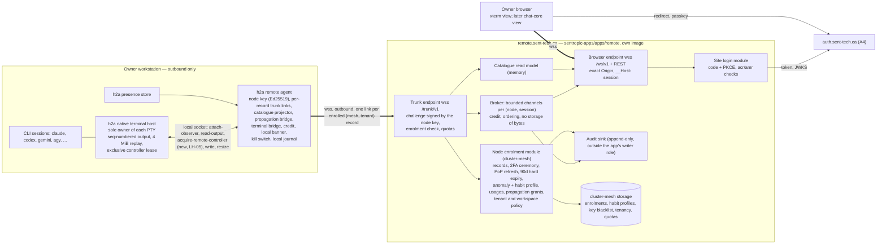
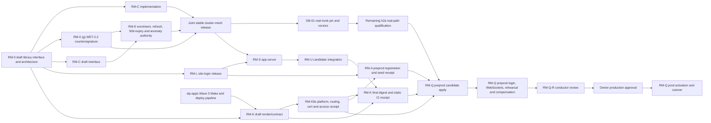

# SPEC_EVOL — Remote control at `remote.sent-tech.ca`: a multi-CLI remote on the cluster-mesh trunk, write-capable from day 1

Status **r16 — launch authorized by the owner on 21 November 2026; enrolment security revised by the owner decision of 22 November 2026 (`WET-2.2`, revised after independent Carbon reviews `RV12`/`RV13` and the Opus round-3 and round-4 reviews `RV14`/`RV15`).** Start sentropic library work and stp-apps deployment preparation immediately. The owner reported no Remote DNS record, no deployment and no RM lot started at the 21 November decision point. h2a has merged work against a simulated trunk (section 3.1). The sentropic conductor guarantees the architecture across libraries and deployments and owns the go-live review. sentropic builds the libraries and stp-apps executes app deployment. The history-rewrite freeze leaves the commit to the conductor. Section 22 reconciles the independent r10 review against the archived r10 snapshot. Section 23 records the r12 enrolment-security revision (`WET-2.2`). Section 24 folds the ten findings of the r12 Carbon review (`RV12`). Section 25 folds all four findings of the r13 Carbon review (`RV13`, against `.tmp/rv/remote-fastlane-r14.before.md`), replacing passive `lastPongAge < 30 s` with an active `2 s` nonce-tagged `ping` probe on displaced links, removing `refreshGeneration` / `auth.stale_refresh_generation` and the dead 14-day `networkWarmupState` timer, fixing `net.new_prefix_known_asn` promotion under the learning freeze, cutting non-user-value bookkeeping lot `RM-Z`, pinning canonical JCS/HKDF/`clientFamily`/step-up UX & `auth_time` skew framing, and aligning `§6.9` archive-excluded `PG12` counts. Section 26 folds the eleven findings of the r14 Opus round-3 review (`RV14`, against `.tmp/rv/remote-fastlane-r15.before.md`), simplifying clause 27 to evidence classes (soft signals never revoke or force re-enrolment), removing `hours.unusual`, `volume.spike`, additive scoring and the `clientTime` refusal, binding anomaly step-up to a displayed snapshot, and withdrawing the shared-ingress `EDGE-IP-01` recipe (IP signals optional and off, prerequisite external to this spec). Section 27 folds the ten findings of the r15 Opus round-4 review (`RV15`, against `.tmp/rv/remote-fastlane-r16.before.md`), re-classifying the current link at step-up confirmation, scoping the `EDGE-IP-01` address constraint to the shared load balancer and naming a dedicated `443`-only candidate as input to `k8s operations`, compromising a proven-duplicated `keyId` on every site, and removing the prefix-hash and fingerprint-hash layers (clause 27 keeps exactly two outcomes).

## 1. Résumé propriétaire — une page

**Ce que tu as demandé.** Tu veux piloter toutes tes sessions d'agents depuis `remote.sent-tech.ca` dès le premier jour. Cela couvre Claude Code, Codex, Gemini et les autres outils lancés par h2a. L'accès inclut l'écriture dès le premier jour. L'étape suivante ajoute une vue conversation en direct dans les deux sens, comme Claude Code à distance. Le 22 novembre, tu as fixé quatre règles de sécurité pour l'inscription des postes : double facteur (2FA) par poste, rafraîchissement automatique, réinscription complète obligatoire tous les 90 jours, et détection d'anomalies avec mémoire des habitudes.

**Le premier jour, étape par étape.**
- *Inscrire chaque poste avec un nouveau contrôle 2FA.* Tu lances `/h2a:remote` dans l'agent ou `h2a remote enrol` dans un terminal. Le poste affiche un code et une empreinte (une courte suite qui identifie sa clé). Tu saisis ce code sur le site. Le site affiche la même empreinte et la durée de validité (90 jours). Tu valides avec un nouveau contrôle 2FA lié à cette demande précise (jamais en réutilisant une connexion précédente). Le poste ne reçoit jamais de mot de passe ni de jeton.
- *Garder le lien actif sans refaire l'inscription.* Le poste prouve périodiquement qu'il détient sa clé privée via un appel HTTPS signé (toutes les 24 heures, avec une fenêtre de 14 jours hors ligne) et lors de chaque reconnexion. Ce rafraîchissement reste silencieux et sans jeton. Un inconnu qui envoie de fausses signatures ne peut jamais bloquer ni révoquer ton poste. Si ton poste reste hors ligne plus de 14 jours, tu dois refaire une inscription complète avec 2FA.
- *Réinscrire tous les 90 jours.* L'inscription expire de façon stricte au bout de 90 jours (réglage configurable dans la bibliothèque, fixé à 90 jours sur notre instance). Le site et le poste te préviennent 14 jours, 7 jours et 1 jour avant la fin. À l'échéance, le site coupe le lien aussitôt, sans délai de grâce. Tu refais alors une inscription complète avec 2FA. Tes habitudes confirmées sont conservées lors d'une réinscription normale. Si une clé est révoquée car deux programmes l'utilisaient en même temps, le poste révoque cette même clé sur tous tes sites. Tu dois alors créer une nouvelle clé. Tu dois réinscrire chaque site touché. Tes autres clés restent actives.
- *Détecter les anomalies sans te bloquer.* Le premier jour, le site surveille uniquement ce qu'il voit vraiment : un ancien lien qui répond encore à un test précis, et un changement du programme client. Avant de compter un conflit, le site interroge l'ancien lien pendant 2 secondes. Une coupure Wi-Fi normale ne répond pas. Elle ne te bloque jamais. Le site garde seulement tes habitudes confirmées par un contrôle 2FA. Un écart garde la lecture ouverte. Il demande un nouveau contrôle 2FA avant la prochaine écriture. Le site affiche alors le réseau ou le programme à confirmer. Il vérifie aussi le lien en cours avant de libérer ton action. Un poste laissé sans surveillance ne se bloque jamais tout seul. Aucun écart simple ne révoque le poste. Aucun écart simple ne force une réinscription. Seule une preuve que deux programmes utilisent la même clé en même temps révoque le poste. Le site bannit alors cette clé. Ton poste la révoque aussi sur tes autres sites. Tu dois créer une nouvelle clé sur le poste. Si ton lien en cours est remplacé sans cette preuve, le poste t'alerte. Il te dit de révoquer cette clé partout puis de créer une nouvelle clé. Le site ne stocke jamais ton adresse IP brute. Il ne montre tes habitudes qu'à toi seul. **Signaux par adresse IP (hors premier jour)** : le répartiteur OVH masque l'adresse IP réelle aujourd'hui. Les règles basées sur l'IP, l'opérateur (ASN) et le pays restent éteintes au lancement. Cette étape ne bloque pas le lancement. L'équipe opérations k8s devra d'abord prouver une méthode sûre. Une piste existe sans toucher au répartiteur partagé. Elle passe par un répartiteur dédié en port 443 pour tes sites. Cette méthode ne doit pas toucher le port 80. Elle ne doit pas toucher les autres sites du cluster. Elle ne doit pas changer le répartiteur partagé ni son adresse. Sans cette preuve, ces règles restent éteintes. Si la preuve arrive un jour, un contrôle 2FA enregistrera ton premier réseau de confiance.
- *Ouvrir la liaison.* `h2a remote up` connecte le poste vers le site. Rien n'écoute sur le poste. Ce lien authentifié forme le « tronc » commun avec `pages.sent-tech.ca`. Tu inscris le poste une fois par site, avec le même geste. Sous un poste inscrit, chaque instance locale de h2a peut être autorisée ou retirée à part.
- *Parcourir et écrire.* Depuis ton téléphone ou un ordinateur, tu vois tes postes et jusqu'à 512 sessions autorisées par poste. Tu ouvres le terminal d'une session en direct. Tu cliques sur « Prendre la main » pour taper, répondre aux autorisations et utiliser la barre de touches (Échap, Tab, flèches, Ctrl-C, Entrée). Tu peux aussi arrêter une session après confirmation.
- *Une seule main à la fois.* Le site prend la main seulement si personne n'a tapé sur le poste depuis 30 secondes. Pendant le contrôle à distance, la fenêtre locale affiche « contrôle à distance actif ». Ta première touche sur le poste reprend la main aussitôt et n'est pas envoyée à la session. Sans fenêtre locale ouverte, tu reprends la main en rouvrant la session sur le poste ou avec l'arrêt d'urgence. Ce partage n'existe pas encore dans h2a. Il est construit et testé avant le reste. S'il échoue, le chantier s'arrête pour te prévenir.

**Ce qui est pilotable.** Toute session lancée par h2a sur un poste inscrit est pilotable (`h2a claude`, `h2a codex`, `h2a gemini`…). Une session ouverte hors h2a est listée mais pas pilotable. `h2a remote` propose, avec ton accord, de lancer tes outils via h2a sur ce poste (décision 1).

**La cible, étape suivante.** La session devient une conversation en direct : messages, appels d'outils, boutons Autoriser / Refuser et zone de saisie. Le terminal reste accessible à côté. Claude et Codex arrivent d'abord, puis Gemini et les autres outils dès que leur flux structuré est vérifié.

**Avant / après.**
```
AVANT                                  APRÈS — premier jour
Une fenêtre de terminal par agent,     Téléphone : remote.sent-tech.ca
à regarder et piloter sur place.       ┌────────────────────────────────┐
                                       │ Poste « bureau »   ● en ligne  │
Loin du poste : rien à voir,           │  claude  spec-remote  au travail│
rien à taper.                          │  codex   build-ui     bloquée   │
                                       │  gemini  revue        en attente│
                                       ├────────────────────────────────┤
                                       │ $ … le terminal, en direct …   │
                                       │ Autoriser l'outil ? 1 oui 2 non│
                                       │ [Prendre la main] [Échap][Tab] │
                                       └────────────────────────────────┘
                                       CIBLE : même session en conversation,
                                       boutons Autoriser / Refuser, saisie.
```

**La sécurité de l'écriture.** Taper dans un terminal revient à exécuter des commandes sur ton poste. Plusieurs garde-fous te protègent :
- Chaque connexion au site exige un vrai contrôle 2FA.
- Chaque inscription de poste et chaque alerte d'anomalie exigent un nouveau contrôle 2FA lié à cette demande précise.
- Tu es le seul utilisateur autorisé le premier jour.
- Un poste répond seulement s'il est inscrit, non expiré et démarré par `h2a remote up`.
- Un arrêt d'urgence existe sur le site et sur le poste (`h2a remote kill`).
- Un retrait coupe le lien en moins d'une seconde et bannit la clé du poste.
- Deux journaux enregistrent les volumes : un journal en ajout seul côté site (hors d'atteinte du programme du site) et un journal signé côté poste. Aucun des deux ne stocke le texte tapé ni d'adresse IP brute. Le journal du site n'est pas encore scellé par une chaîne inviolable le premier jour.
- Les variables d'environnement, fichiers de clés, secrets et chemins locaux ne quittent jamais le poste.
- **Limites connues** : le texte affiché dans un terminal ouvert traverse la mémoire du site sans être enregistré. Si la clé du poste est volée, un faux poste peut afficher un faux écran. Si ta clé est volée et utilisée pendant que ton poste est éteint, le site ne le voit pas le premier jour, sauf si le programme client diffère. Le test d'un ancien lien encore vivant limite ce risque. L'expiration à 90 jours limite aussi ce risque. La révocation limite aussi ce risque.

**Écarts par rapport aux règles précédentes.** Les écarts sont tous nommés en section 8.4 : écriture terminal, réponses d'autorisation tapées, terminal avant la vue conversation, écran partagé avant la politique de partage, partage par poste, contenu en transit sur le site, liste des sessions pilotée par la session site sans bail signé, et journal en ajout seul sans chaîne scellée. Les quatre écarts d'écriture expirent d'eux-mêmes 60 jours après la première inscription en production si tu ne les prolonges pas. Les autres sont revus à la même date sans coupure automatique.

**Lancement et répartition.** Le chantier est lancé depuis le 21 novembre à partir de zéro côté déploiement. h2a a déjà intégré les commandes locales, l'état du terminal et la liste des sessions sur un lien simulé. Le conducteur sentropic valide l'architecture d'ensemble et publie les bibliothèques (`cluster-mesh` et `auth-hono`). stp-apps assemble le site, construit l'image unique, gère les noms DNS et déploie en répétition puis en production. La production attend une répétition réussie avec ta clé 2FA, l'avis du conducteur et ton feu vert.

**Effort restant.** Compter **305 à 464 heures-agent restantes**, socle de déploiement compris : sentropic **106 à 158**, stp-apps **151 à 227**, h2a **48 à 79**. L'adaptateur tmux ajouterait **10 à 16** heures-agent si l'inventaire le demande. Le prérequis `EDGE-IP-01` est hors de ce plan. Il appartient aux opérations k8s. Son coût est inconnu. Une activation plus tard ajouterait **3 à 6** heures-agent chez stp-apps. Cette activation reste hors chemin de lancement. Les délais externes (plateforme, contrat commun avec pages, clé de répétition) restent sans date confirmée.

**Tes accords avant la mise en service.** Trois choix restent ouverts aux sections 13 et 14, chacun avec des options qui avancent et leurs risques : (1) valider l'exposition du premier jour et le feu vert production après répétition, (2) choisir si tu demandes une étude sûre pour les règles par adresse IP, ou si tu renonces à ces règles, et (3) choisir le repli uniquement si le test du partage local (`G-RM-ARB`) échoue. Les autres réglages restent fixés par défaut en section 14.


## 2. Authority, evidence and binding inputs

[JUGEMENT] This is a design specification, not a delivery receipt. `[FAIT]` marks an observation read in a source tree or a named file, with a file-and-line reference; `[JUGEMENT]` marks a proposed design, gate, estimate or future action. A tag at the start of a paragraph, list item or table row applies to its whole content. Missing evidence is `unknown`; a value quoted from another document and not re-read by this lane is `unverified`. Effort is in agent-hours only; no human-time estimate is given, and every external wait whose length this lane cannot read is `unknown`. Every deployed state is `unknown` unless a line says otherwise. Nothing was written to any deployment, branch, Track log or commit by this lane.

| Prefix | Source and pin |
|---|---|
| [FAIT] `sen:` | `/home/antoinefa/src/sentropic`, r12/r13 local `origin/main = 6d3b8ddc56ca58afc79a6aab2dbb95203c7cf66a` (`@sentropic/cluster-mesh` `0.27.0-dev.3`, `@sentropic/auth-hono` `0.18.1`, checked via `git show origin/main:<path>`). Historical pins: r11 `768a5f4af5dcd24b44b133f9f58a8febe737eefb` (`0.27.0-dev.2`) and r10 `d8151a38fcda0422f6910e64a695f74e653d7859` (identical tree `ef452dbb…`); r9 `25ba09a6…`. Registry and live platform state require separate evidence (§3.5). |
| [FAIT] `h2a:` | `/home/antoinefa/src/h2a`, r11 local `origin/main = c0844a886dd4a6de51a1b5bc1dc830fea19f15e2` (21 November 2026, merge of #514); r13 checked `origin/main = fb29a1f3e9a08c95ba8ec0a0880d64c868d84d19`, where `packages/h2a/src/runtime/remote-agent/types.ts` remains on the provisional `WET-2.1` contract (`TrunkAuthPayload` / `TrunkReadyRecord` at `:48–86`). Historical pins: r10 `a445b139…`; older line ranges inherited from r9 retain `fd067eea…` unless refreshed in place. Both h2a manifests pin cluster-mesh `0.26.0` (`packages/h2a/package.json:83`, `packages/h2a-runtime/package.json:31`). |
| [FAIT] `poc-k8s:` | `/home/antoinefa/src/poc-k8s`, r12/r13 local `origin/main = 0d8f968232ad47e7b6ab37503ea49fd03ebac504` (merge of #83, consolidating OVH nodepool to 2× `r2-15` nodes; prior r11 pin `577ccd5e14d45d9dec871c2eeb5183f48fa84848`). Checked via `git -C /home/antoinefa/src/poc-k8s show origin/main:<path>`. |
| [FAIT] `R4:n` | Local archival `spec/SPEC_EVOL_REMOTE_FASTLANE.r4.md`, line `n`, SHA-256 `3dbcb23a…c7c7`. The underlying sentropic source claims used by r9 were checked directly at the r10 pin. Historical measurements, owner reports and other repositories retain their own provenance. |
| [FAIT] `RC16:n` | `.tmp/remote-ctl/plan-remote-ctl-v1.6-draft.md`, line `n`; SHA-256 `6168b73ba9b236530bde6bb4998929de1ede0c92d61aa0fc07fcd4f9983b7b18` (re-checked). A draft whose independent acceptance is open. |
| [FAIT] `CM:n` | `spec/SPEC_EVOL_CHAT_MESH_PROPOSAL.md` (working tree), line `n`; SHA-256 `21d1a10e8381d408857071c3e0aa908c54581027aa18e16bd12fa25f5c562f4c`. The launch packet names it « r3 »; the file on disk states **round 4** (`CM:3`). This document cites round 4. |
| [FAIT] `PG12:n` | `spec/SPEC_EVOL_PAGES_TRI_FRAMEWORK_DEMO.md`, **revision 12** on disk (`2,412` lines, SHA-256 `867099aec18faab77f7a65ee8eec19a867f4cbf3aaa545ff34be8001643952ae`, directly checked in r13 at `PG12:3, 20, 561–567, 846–913, 1223–1251, 1358–1366, 1470, 1502`). Revision 12 already closed r9's `WET-1` contradictions by citing `WET-2.1` (`r11`, `b3c8a8fa…`) clause by clause; section 6.9 lists the exact `PG12 → PG13` delta required to adopt `WET-2.2`. Historical `PG9:n` (`df868b0f…`) and `PG8:n` citations retained in older change logs keep their archived meaning. |
| [FAIT] `LH:n` | `/home/antoinefa/src/h2a/tmp/h-cond/remote/PLAN-h2a-RM-H.md`, line `n`: the workstation build plan (lots `LH-00` to `LH-12`, dependency lot `DB-01`, questions `Q-01` to `Q-18` at `LH:153` to `:174`), written by the h2a conductor against r5. Lot boundaries of section 10.2 follow it. |
| [FAIT] `RV5:n` | `.h2a/reviews/remote-r5-muse.md`, line `n`: the independent review of r5, verdict REWORK (blocker `B1` at `RV5:9`, majors `M1` to `M13`, minors `m1` to `m8`). |
| [FAIT] `RV6:n` | `.h2a/reviews/remote-r6-spark.md`, line `n`: the independent review of r6 (pinned at SHA-256 `c4ba68e9…8493`), verdict REWORK (blockers `B1` to `B4` at `RV6:19` to `:25`, majors `M-A` to `M-F` at `RV6:29` to `:39`, minors `m-a` to `m-f` at `RV6:43` to `:53`). Section 18 maps each finding to its r7 fix. |
| [FAIT] `RV7:n` | `.h2a/reviews/remote-r7-spark.md`, line `n`: the independent review of r7 (pinned at SHA-256 `95ac39fe…a92b1`), verdict REWORK (blockers `B-1` and `B-2` at `RV7:35` to `:47`, majors `M-1` and `M-2` at `RV7:49` to `:61`, minors `m-1` to `m-4` at `RV7:63` to `:83`). Section 19 maps each finding folded in r8 (`B-1`, `B-2`, `m-1` to `m-4`) to its fix. |
| [FAIT] `PD4:n` | `.tmp/pages-demo-dossier/owner-decisions-r4.yaml`, line `n`: the owner answers to the pages dossier, binding. |
| [FAIT] `OA:n` | `.tmp/remote-dossier/owner-answer-r1.md`, line `n`: the owner's refusal of r4, binding. |
| [FAIT] `SA:n` | `spec/SPEC_EVOL_SENTROPIC_APPS_MONOREPO.md` (working tree), line `n`; SHA-256 `1bc1040dc89b7c7098b34974a1f49c25aecbf7566c3ced45a7f6821a4f9c4db7`. A study. [FAIT] Since 15/11 20:16 `/home/antoinefa/src/sentropic-apps` is a git repository (remote `rhanka/sentropic-apps`, public) holding `LICENSE` and `README.md` only (listing and `git log` read 16/11); wave 0 (deploy pipeline) is still not met. Repository home stays `sentropic-apps/apps/remote` (owner `APPS-1 b`). |
| [FAIT] `CR:n` | `.tmp/packets/COMMON-RULES.md`, line `n`. |
| [FAIT] `RV8:n` | `.tmp/rv/remote-r8-review-hydrogen.out`, line `n`: independent review of r8 (Hydrogen), verdict REWORK; folded in r9 (section 20). |
| [FAIT] `RV10:n` | `.h2a/reviews/remote-fastlane-neon-r10.md`, line `n`, verdict CHANGES. The reviewed file matches `.tmp/rv/remote-fastlane.r10.snapshot.md` at SHA-256 `094f8d7b66f97a9e2808cf2d52f9b62206da842f4303c43e47364c60407d8cbc`. Section 22 maps each finding to its change and evidence. |
| [FAIT] `RV12:n` | `.h2a/reviews/remote-fastlane-r12-carbon.md`, line `n`, independent review of r12 (Carbon), verdict CHANGES (3 Blocking, 6 Major, 1 Minor). The reviewed file matches `.tmp/rv/remote-fastlane.r12.snapshot.md` (`992` lines, SHA-256 `f8a3804b616a98f597980146d25d8049952fe821ef84c83f530cbe3ef3ae11e1`). Section 24 maps each finding to its r13 disposition and evidence. |
| [FAIT] `RV13:n` | `.h2a/reviews/remote-fastlane-r13-carbon.md`, line `n`, independent review of r13 (Carbon), verdict CHANGES (3 Major, 1 Minor). The reviewed file matches `.tmp/rv/remote-fastlane-r14.before.md` (`1,049` lines, SHA-256 `7bed004455e96d884abfa40732751819b75ce9803c9367f6e409606822603443`). Section 25 maps each finding to its r14 disposition and evidence. |
| [FAIT] `RV14:n` | `.h2a/reviews/remote-fastlane-r14-opus.md`, line `n`, independent round-3 review of r14 (Claude Opus 5.5), verdict CHANGES (0 Blocking, 5 Major, 6 Minor; Findings 1–11). The reviewed file matches `.tmp/rv/remote-fastlane-r15.before.md` (`1,093` lines, SHA-256 `a5a337cc6d2f3e3e6b6a26edda149033fd3e15bff4ea83dab8e23ce90c515e47`). Section 26 maps each finding to its r15 disposition and evidence. |
| [FAIT] `RV15:n` | `.h2a/reviews/remote-fastlane-r15-opus.md`, line `n`, independent round-4 review of r15 (Claude Opus 5.5), verdict CHANGES (3 Major, 7 Minor; Findings 1–10, removals R1–R2). The reviewed file matches `.tmp/rv/remote-fastlane-r16.before.md` (`1,116` lines, SHA-256 `f1231134bed7a3529a516f486709de4e866da8142af6a81120b0724a7d81f4c1`). Section 27 maps each finding to its r16 disposition and evidence. |

### 2.1 Binding owner orders

[FAIT] 22/11 owner decision on enrolment security (verbatim, binding for r12–r16 / `WET-2.2`, `RV12:14`): « 2fa par poste je veux du 2fa. Faut un mecanisme de refresh. Requis de reenrollement hard configurable dans la lib et pour notre instanciation on le fera une fois aux 90j. Il faut mettre en place aussi des mecanismes de detection d'anomalie (chgt d'ip etc mais avec memorisation des habitudes pour reduire le nombre de reenrollements) »

[FAIT] 21/11 instructions to the r10 lane. Start Remote immediately from zero RM deployment. The sentropic conductor is accountable for the global architecture, including libraries and deployments. sentropic builds the libraries. stp-apps owns and executes the Remote app, image, DNS and Kubernetes deployment. h2a owns its workstation lots and DB-01.

[FAIT] 15/11 ~09:50: « De meme je veux pouvoir activer le remote controle asap quitte a ce que ce soit remote.sent-tech.ca basé sur cluster mesh. » (`R4:5`).

[FAIT] 15/11 ~17:50, refusing r4 (`OA:5`): « poiur remote controle je refuse le dossier pas assez ambition, je veux un vrai claude remote multi-cli des le premier jour avec un h2a remote dans les commandes de plugin pour s'enregistrer. h2a devra s'enregistrer au cluster-mesh de remote.sent-tech.ca comme sur pages.sent-tech.ca pour pouvoir synchroniser chaque session. chaque session sera complètement fonctionnelle depuis le chat sur remote.sent-tech.ca avec une vue complete de la session exécutée sur le psote de travail. le jour 1 pourrait être un parcour des session mode terminal pty forwardé mais avec accès écriture. l'idéal serait un rerender, avec streaming dans les deux sens- vraiemnt comme claude code en acces remote. »

[FAIT] Pages answers that define the trunk and the enrolment (`PD4:36`, `PD4:40`, binding): PS-O5 — the artifact MCP « sera celui de cluster-mesh. l'enrolement inter cluster mesh évitera d'avoir un mcp pour pages.sent-tech.ca ET en local h2a »; by default only the registered server is reachable, and « depuis l'admin de chaque tenant de la fédération on pourra autoriser la propagation a d'autre tenants avec la validation de l'utilisateur depuis chaque tenant sur lequel il est autorisé ». PS-O6 — « le "trunk" est cette fédération cluster-mesh … L'enrolement inter tenant peut se faire par n'importe quel utilisateur depuis son poste vers ses propres workspaces, a partir du moment ou l'utilisateur est enrolé sur le tenant. Le niveau de synchronisation dans le workspace et administré par l'administrateur du workspace et les ressources privées de chaque utilisateur peuvent être refusée par chaque utilisateur du tenant … L'admin global d'un tenant alloue des quota par défaut pour un utilisateur et des workspaces. on ajoute potentiellement la notion d'organisation au sein d'un tenant. un workspace est affecté en ressource a une organisation (et admin d'organisation) ou directement un utilsateur par défaut (admin du workspace). »

[FAIT] Repository home: the owner chose « sentropic-apps par étapes » (launch packet of this lane). The staging plan has the remote board and the pages site « built at `sentropic-apps/apps/*` » in its wave 1, after wave 0 creates the repository and its deploy pipeline (`SA:312` and the wave table that follows it); in that repository the board « gets its own image built from published `cluster-mesh` and `auth-*` packages » (`SA:185`), and a shared module that a library also needs « is a library and is published from a library repository » (`SA:207`).

### 2.2 Settled decisions carried, and what is void

[FAIT] Carried, from the remote-control plan (`RC16:50`): enrolled-2FA OIDC at session authentication; repeated explicit actions, consent changes and machine switches under the same valid login need zero additional MFA; no periodic control unlock; explicit sharing and explicit action intent; « complete structured conversation and source-issued permission context from first qualified monitoring, including at 390 px. A terminal supplements this view. » [FAIT] « deux moteurs, un registre »: h2a supervises the CLI process, the model and tool loop stays inside that CLI, cluster-mesh owns the common Sessions registry (`RC16:52`). [FAIT] Not authorized by that plan: implicit sharing, delegated human control, process migration, automatic plugin installation (`RC16:54`).

[FAIT] Carried: the A4 identity provider at `auth.sent-tech.ca`, live and accepted since 15/11 ~11:23 (`R4:79`).

[JUGEMENT] Void: the 13 owner decisions of r4 (D1 to D10, D17 to D19) as a set. Their analysis is reused where it still holds; none of their answers is assumed. The relaxations RX-1 to RX-8 of r4 are withdrawn with the watch board they qualified; section 8.4 names the relaxations r5 needs, from scratch.

[FAIT] Rules that bind this plan: owner copy in functional words with jargon explained and before/after pictures (`CR:116`); 0 Python (`CR:8`); every request and decision recorded in Track (`CR:23`); no plan adopted without an architect review at max effort (`CR:83`); reviews on Opus 5.5 (`CR:112`); wagon lanes push branches and the train lane merges (`CR:43`, `CR:55`); the client IP is not visible behind the load balancer (`CR:119`); relayed owner GOs do not count for the k8s session (`CR:139`); « No human-effort or time estimates in any document » (`CR:10`), which is why this document gives no calendar date. [FAIT] The owner decisions of 15/11 18:20 on the apps repository: `APPS-1 b` (by stages), `APPS-2 a` (a bump task on every `@sentropic/*` publish), `APPS-3 a` (one deploy package per app), `APPS-4 a`; « stages 2–3 (repo creation, pages + remote born there) = stp-apps »; `@sentropic/cluster-mesh` `0.26.0` merged by #1040 at 18:17 and publishing (`CR:131`). [FAIT] Lanes on 15/11 evening: Fable out until 22/11 09:00, author lanes on Opus 5.5 (`CR:131`); Codex out until 20/11 07:05 (`CR:107`); Muse back since 15/11 19:00 (`CR:113`); Gemini through the h2a launcher broken headless (`CR:115`).
## 3. What exists today

### 3.1 On the workstation: h2a owns the terminals, and already exposes most of what a remote needs

| Subject | Evidence |
|---|---|
| [FAIT] h2a launches every supported CLI | `run` is described as « Start a local tmux session for a host adapter, in a path », with shortcuts for `codex`, `claude`, `agy`, `gemini`, `mistral`, `muse`, `vibe`, `opencode`, `shell`, plus `attach` (« Attach this terminal to a live local or remote session »), `stop`, `ls` (`h2a:packages/h2a/src/cli-command-map.ts:268` to `:282`). The plugin host table lists eight hosts at parity, `claude`, `codex`, `gemini`, `agy`, `hermes`, `opencode`, `muse`, `vibe`, each with its own hook mechanism, e.g. `claude-settings-hook`, `codex-app-server`, `gemini-hooks`, `agy-plugin-poll` (`h2a:packages/h2a/src/hosts/plugin.ts:63` to `:71`, `:84` to `:150`). |
| [FAIT] A session runs under one of two terminal hosts; **the default for a new session is the native host** | A session's launch context records either `tmux` coordinates or an owning `nativePty` session (`h2a:packages/h2a/src/session.ts:68` to `:84`); a launch result's host is `native` or `tmux` (`h2a:packages/h2a/src/runtime/mcp/agent-launch.ts:371` to `:378`); `attach` dispatches by recorded host. [FAIT] `resolveSessionHostKind` returns `native` unless `--tmux` is passed or `H2A_SESSION_HOST=tmux` (the fleet valve) is set, and never re-routes an existing session (`h2a:packages/h2a-runtime/src/native-host.ts:49` to `:64`). The tmux wording r5 cited sits in a list marked « DOCUMENTATION ONLY. Routing never consults this list » (`h2a:packages/h2a/src/cli-command-map.ts:260` to `:262`, per `RV5:57`). [JUGEMENT] Spike (c) is therefore no longer « which host by default » but a fleet inventory: recorded host per existing session plus the valve value on the owner's workstations (helper in lot `LH-00`, section 10.2). |
| [FAIT] **The native terminal host owns the PTY** and speaks a versioned local protocol | Protocol version 1; operations `ping`, `create`, `list`, `state`, `read-output`, `attach-observer`, `acquire-controller`, `acquire-controller-if-no-recent-human`, `release-controller`, `write`, `resize`, `stop`, `stop-if-incarnation`; replay of at most 4 MiB per session; at most 64 connections (`h2a:packages/h2a-runtime/src/native-terminal/protocol.ts:6` to `:27`, `:47` to `:60`). The PTY child runs inside a guardian with process-group and memory isolation, and refuses to start if isolation fails (`h2a:packages/h2a-runtime/src/native-terminal/session-scope.ts:1` to `:12`). |
| [FAIT] Output is sequenced, replayable and gap-aware | Each output chunk is `{ seq, data }`; a replay returns chunks, a `gap { fromSeq, toSeq }` or `null`, the `latestSeq`, and a `terminalModePrefix` « immediately before the retained chunks » (`h2a:packages/h2a-runtime/src/native-terminal/replay-buffer.ts:3` to `:19`); at most 65 536 chunks per session (`:27`). The session state carries `generation`, `incarnation`, `status` (`running`, `stopping`, `exited`), `latestSeq` (`h2a:packages/h2a-runtime/src/native-terminal/host.ts:560`, `:577` to `:585`). |
| [FAIT] Input is exclusive, epoch-fenced and aware of the local human | A controller lease is `{ role: "controller", id, generation, incarnation, controllerId, epoch }`; an observer is `{ role: "observer", … controllerEpoch }` (`host.ts:613` to `:628`). The state exposes `controlled`, `controllerEpoch`, the controller's identity, and `lastHumanActivityAt`, with the rule that « callers that inject input must fail closed » on it (`host.ts:586` to `:600`); a controller is tagged `human` or `automation` (`host.ts:562`, `:563`). |
| [FAIT] **The arbitration r5 assumed does not exist** (review blocker B1) | `acquireAutomationControllerIfNoRecentHuman` refuses whenever any controller exists (`h2a:packages/h2a-runtime/src/native-terminal/host.ts:1238` to `:1240`), **before** the recent-human test (`host.ts:1241` to `:1248`); only with no holder does it grant, as `automation` (`host.ts:1249`). A local `h2a attach` holds that lease for its whole lifetime, and local take-back today is `h2a attach --takeover` at launch — the host refuses a second controller without `takeover` and names that command (`host.ts:1195` to `:1198`); the attach polls state and detaches when its epoch is fenced (`h2a:packages/h2a-runtime/src/native-terminal/op.ts:1395` to `:1410`). No keystroke-triggered takeover and no observer-mode attach view exist. The only banner surface is the attach process's own status bar (`op.ts:603` onward): with no local attach running there is no local view to banner. [JUGEMENT] Section 5.4 specifies the one mechanism r6 builds instead (lots `LH-04`/`LH-05` ahead of the agent). |
| [FAIT] PTY size and holder are exposed after LH-04 | PR #512 merged at `39e833936`. Current `h2a:packages/h2a-runtime/src/native-terminal/host.ts:587–605` and `2381–2398` expose current size, last local size and holder kind. The remote arbitration and local keystroke hand-back still require LH-05. |
| [FAIT] Replay resume is `readAfter(afterSeq)` | The buffer returns chunks with `seq > afterSeq` and a gap `afterSeq+1 .. oldest-1` (`h2a:packages/h2a-runtime/src/native-terminal/replay-buffer.ts:120` to `:136`): `afterSeq` is the last **applied** sequence, not the next wanted one. Section 7.3 uses that meaning. |
| [FAIT] Uncertain input is already dropped locally, never replayed | On a broken response path the attach drops the one in-flight chunk — « The host may have accepted the write before the response path broke… replaying it could duplicate a command » (`op.ts:1472` to `:1475`) — and logs `input-delivery-uncertain` (`op.ts:1432` to `:1441`). Exactly-once resend is therefore unattainable as r5 claimed; section 7.3 rule 2 adds the `uncertain` result and a persisted deduplication log. |
| [FAIT] A server-side screen renderer exists | `renderTerminalScreen(raw, cols, rows)` replays bytes into `@xterm/headless` and returns the visible screen (`h2a:packages/h2a-runtime/src/native-terminal/screen.ts:1` to `:16`). |
| [FAIT] A host adapter binds remote-action proofs to native terminal sessions | It reads `id`, `generation`, `incarnation`, `controllerEpoch`, `latestSeq` and the PTY pid; a proof verifies only while the session runs, on its incarnation, under the current permission mode; « No route, no transport, no effect » (`h2a:packages/h2a-runtime/src/native-terminal/remote-action-authority.ts:1` to `:15`). |
| [FAIT] h2a signs and pushes a sanitized session catalogue | `h2a remote mirror` pushes the instance registration and its live sessions, one-shot or as a daemon at `--interval-ms >= 5000`, stopping on repeated 401/403, kill switch `H2A_MIRROR_PUSH_OFF` (`h2a:packages/h2a/src/cli.ts:496`); every live session of the instance is sent (`h2a:packages/h2a/src/runtime/mirror/build.ts:84` to `:86`); nothing local reaches the body verbatim — no working directory, command line, tmux coordinates, pid, workspace path or `file://` endpoint (`build.ts:11` to `:15`); a mirrored session carries `sessionId`, `instance`, `host`, `name`, `startedAt`, `heartbeatAt`, `state`, `interests`, `subscribedTopics`, `workStatus`, `lastMcpActivityAt`, `version`, `workspace` (`h2a:packages/h2a/src/runtime/mirror/sanitize.ts:591` to `:604`). The limits of its acceptance function and of its HTTP ingester are in `R4:138`, `R4:139`. |
| [FAIT] `h2a remote` is already a verb group, for other things | `h2a remote serve`, `send`, `mirror-serve`, `mirror` (`h2a:packages/h2a/src/cli.ts:493` to `:496`); `drive`, `drive receive`, `drive serve` — the last one an inbound HTTP listener (`cli.ts:497` to `:499`). |
| [FAIT] Same-user keys prove possession, not intent | « Signatures prove active-key possession, not intent … any same-uid lane can read a principal key, so co-signature is explicit but NOT attributable to human intent » (`h2a:packages/h2a/src/runtime/drive/consent.ts:14`). Drive consent grants last one hour by default, 24 hours at most (`consent.ts:10` to `:13`). |
| [FAIT] A PTY actuator targets either host | `ActuationTarget` is `native-terminal` (session id, socket path, instance) or `tmux` (volatile pane target) (`h2a:packages/h2a/src/runtime/drive/pty-actuator.ts:24` to `:41`), implementing cluster-mesh's `PtyActuatorPort` (`:14` to `:21`). |
| [FAIT] A terminal event vocabulary exists, private | `@sentropic/remote-protocol` is `0.0.0`, `private: true` (`h2a:packages/remote-protocol/package.json:1` to `:4`); it defines `terminal.opened`, `terminal.input`, `terminal.output`, `terminal.resized`, `terminal.exited` (`h2a:packages/remote-protocol/src/constants.ts:79` to `:83`) with schemas whose data is `utf8` only (`h2a:packages/remote-protocol/src/schemas/terminal.ts:27` to `:79`) inside a sequenced envelope (`h2a:packages/remote-protocol/src/examples.ts:64` to `:75`). |
| [FAIT] The Remote skill exists in h2a source | LH-03 delivered `packages/h2a/skills/remote/SKILL.md` in PR #461. The current Claude manifest declares the skills directory (`h2a:packages/h2a/.claude-plugin/plugin.json:10`). Real enrolment and transport are separate release gates. |
| [FAIT] Presence is not the catalogue source of truth | Presence rows exist only for sessions whose MCP sidecar opened one; a mirrored workspace reference is a local h2a value `{ id, host, label }` and « None of the three transmits a path » (`h2a:packages/h2a/src/runtime/mirror/sanitize.ts:465` to `:479`): it is never a cluster-mesh workspace. The native host's own `list`/`state` is authoritative for live PTYs. [JUGEMENT] Section 5.3 defines the catalogue as a join of the two, keyed by `launchContext.nativePty.session` (`h2a:packages/h2a/src/session.ts:80` to `:84`). |

[FAIT] Workstation status on 21 November. PR #460 (`a1a8d681c`) merged LH-00. PR #461 (`dea9549af`, implementation `00c38bc20`) merged LH-01, LH-02 and LH-03. PR #512 (`39e833936`) merged LH-04. PR #515 (`a445b1397`) merged LH-06. PR #514 (`c0844a886`) merged LH-07 against the provisional trunk. LH-05, LH-08–LH-12 and DB-01 remain open in this launch plan.

[FAIT] At that h2a pin, `packages/h2a/src/runtime/remote-agent/types.ts:4,165,500` references provisional types and accepts a monolithic fixture `cat.snapshot`. `service.ts:100,217` exposes the stub effect path. `packages/h2a/test/remote-agent-lh07-catalogue.test.js` exercises the provisional catalogue path. [JUGEMENT] DB-01 waits for the joint RM-C + RM-E npm release, switches both packages' production entry points to the published contract, and runs the shared vectors. LH-06 and LH-07 close on the real path after DB-01 (§10.2).

### 3.2 In cluster-mesh: a session relay contract, closed; no server-to-server federation

| Subject | Evidence |
|---|---|
| [FAIT] The relay is a packed contract, fail-closed | « DEP-FED is a source-gap, so no mesh wiring is registered in production and every connect resolves to the typed refusal relay_grant_unavailable — all live routes, including direct B→A, stay DISABLED » (`sen:packages/cluster-mesh/src/sessions/relay.ts:9` to `:12`); exported as `./sessions/relay` (`sen:packages/cluster-mesh/package.json:59` to `:61`). |
| [FAIT] Its wire framing is defined — and caps **every** record at 8 192 encoded bytes | « every relay record on a link is 4-byte big-endian length + JCS bytes, 1..8192 per record » (`sen:packages/cluster-mesh/src/sessions/relay-wire.ts:1` to `:5`); the encoder and decoder both throw outside `1..8192` (`relay-wire.ts:9` to `:10`, `:21`). The numbers `24576 encoded / 16384 decoded` belong to a **different object**, the base64 ciphertext data frame (`sen:packages/cluster-mesh/src/sessions/relay-frames.ts:17`, `:33` to `:34`). [JUGEMENT] r5 conflated the two; trunk therefore defines its own record maximum in section 7.1 and carries terminal bytes base64-encoded, so expansion is the fixed 4/3 of base64 and never the up-to-6× of JSON string escaping (each ESC byte encodes as `\u001b`). |
| [FAIT] Its flow control is credit-based | Per link and direction the credit ledger is absolute and monotonic; a credit frame carries `receivedThroughFrame`, `receivedThroughOffset`, `sendLimitFrame`, `sendLimitOffset`; `RELAY_LINK_MAX_FRAMES = 8`, `RELAY_LINK_MAX_PAYLOAD_BYTES = 131072` (`relay-credit.ts:1` to `:25`). The stream iterator buffers at most 8 events or 131 072 encoded bytes, then emits one `relay_backpressure` and ends; mid-event EOF is `relay_protocol_refused`, never a partial record (`relay-lane-stream.ts:1` to `:8`). |
| [FAIT] Session control is routed and closed | `drive`, `wake`, `relaunch` routes (`sen:packages/cluster-mesh/src/hono/session-router.ts:115` to `:118`), with a `PtyActuatorPort` contract `isAvailable`, `probeState`, `actuate` over an opaque `commandRef` that « Actuators MUST NOT interpret » (`sen:packages/cluster-mesh/src/runtime/registration.ts:82` to `:106`); the product instruction resolver returns `null` (`R4:123`). |
| [FAIT] The session origin registry uses in-memory state and the chat module is gated | `sen:packages/cluster-mesh/src/sessions/registry.ts:67–69` constructs state using maps (`src/sessions/registry-store.ts:49–56`). `chat-server` is in the gated list (`src/modules/contracts.ts:42`). |
| [FAIT] The current cluster-mesh package scopes itself to one server and its attached workstations | `sen:packages/cluster-mesh/README.md:102–104`. The documents cited in PG8 were re-read at origin/main. `sen:spec/SPEC_DECISION_DEPLOYMENT_PLANE.md:12,56` drops D11R IdP federation. `sen:spec/SPEC_EVOL_CLUSTER_MESH_CENTRAL_CONTROL_PLANE.md:37` excludes server-to-server federation. The owner’s later PS-O5/PS-O6 orders define the planned trunk in section 6. |
| [FAIT] The existing Cowork device-code attachment issues a session token pair | `sen:api/src/routes/namespaces/session-device.ts:43–56,78–86` consumes an approved poll and accepts a session cookie or bearer for approval without an assurance or Origin check in that handler. `sen:api/src/services/device-code-store.ts:4–33,40–41` implements process-local entries with neither an instance nor a key field. `sen:api/src/services/auth/session-adapter.ts:14,29–39` defines the legacy session cookie. |
| [FAIT] Cowork carries no session relay | `@sentropic/cowork-bridge` `0.2.0`: « Portable client bridge … client core, transport-agnostic auth and local-tool protocol/permission contracts » (`sen:packages/cowork-bridge/package.json:2` to `:4`). |

### 3.3 Identity, step-up and the closed remote evidence route

| Subject | Evidence |
|---|---|
| [FAIT] Per-client passkey ACR and subject allowlist | `sen:packages/auth-hono/src/oauth/authorize-handler.ts:81–94,406–424` enforces the exact requested passkey level and checks allowed subjects. `sen:packages/auth-hono/src/oauth/token-handler.ts:465,508–515` seals `acr`, `amr` and `auth_time` into the ID token. |
| [FAIT] **« Passkey-fresh » names a session flag, not a fresh ceremony** | The ACR is derived from the IdP session's `mfaVerified` flag alone (`sen:packages/auth-hono/src/oauth/session-resolver.ts:50` to `:51`); authorize forces re-authentication only when that derived ACR is not met (`authorize-handler.ts:81` to `:83`); `authTime` is the IdP session **creation** time (`authorize-handler.ts:129`). An IdP session created with a passkey long before can therefore open a remote session with no ceremony that day. [JUGEMENT] Sections 5.2 and 8.1 now require `prompt=login` plus an `auth_time` age bound; decision 5 is reworded accordingly. |
| [FAIT] Forced re-authentication exists | `prompt=login` or `select_account` forces re-auth (`authorize-handler.ts:64` to `:69`), without forcing re-consent (`:326`). |
| [FAIT] « Enrolled 2FA » in a token is `hwk`, `user`, `mfa` | `sen:api/src/services/auth/remote-evidence.ts:41`. The evidence route refuses requests with a nonempty `Origin` or `Cookie` header and refuses outside the identity-provider role (`sen:api/src/routes/auth/remote-evidence.ts:32` to `:37`). |
| [FAIT] Passkey login on the rehearsal provider waits for a data seed | The preprod provider uses the parent RP ID `sent-tech.ca` with passkey registration disabled; « this key alone breaks passkey login until the prod-data seed lands » (`sen:deploy/k8s/overlays/preprod/patch-auth-idp-config.yaml:29` to `:32`, `:42`, `:47`). State of that seed: `unknown`. |
| [FAIT] The pages owner decision anticipates account-written content under the same parent domain | Local `PD4:67–74` records the Public Suffix List proposal for `artefacts.sent-tech.ca` and same-origin safeguards. The live artifact origin and PSL rollout are outside the source check. Sections 5.2 and 8.5 enforce exact-origin checks independently of either. |

### 3.4 Plans this document builds on

| Subject | Evidence |
|---|---|
| [FAIT] The remote-control plan's first milestone | A Claude CLI session opened from the web, « sees its live structured conversation and PTY view … sends one explicit harmless input, and sees one native effect » (`RC16:44`). |
| [FAIT] Its capture model is per-CLI and bit by bit | Five independent bits, `ptyBytes`, `structuredDeltas`, `completePermissionContext`, `literalInput`, `permissionResponse`, each `unavailable`, `contract-only` or `installed-qualified` (`RC16:495`); Claude's feasibility probes for deltas, permission context and literal input (`RC16:497` to `:503`); PTY and structured streams are different presentations whose sequence spaces are never spliced (`RC16:510`). |
| [FAIT] It forbids raw write as control | « The generic fallback is view-only … Raw `write`, approval-like bytes, ANSI prompt parsing, shell commands, resize/stop and auto-approve flags cannot become control fallbacks » (`RC16:518`); content sharing, PTY capture included, stays disabled until the R15 policy supplement (`RC16:162`); the workstation initiates every connection (`RC16:231`); the federation successor is `source-gap` (`RC16:191`). |
| [FAIT] Chat wire protocol v1 | SSE with `id:` resume and a sealed, bounded session cursor (`CM:714` to `:723`); event types `content_delta`, `tool_call_start`, `tool_call_result`, steer statuses, a capability-gated `approval_required` with `approvalId`, `toolCallId`, `argsDigest`, `expiresAt` (`CM:731` to `:745`); `Idempotency-Key` on mutating routes and a 64 KiB cap per SSE event (`CM:747` to `:769`); the neutral `session-db` (`CM:201` to `:209`). |
| [FAIT] The pages plan at revision 12 (`PG12`) already cites `WET-2.1` and now needs the `WET-2.2` delta | `PG12` on disk (`spec/SPEC_EVOL_PAGES_TRI_FRAMEWORK_DEMO.md`, `2,412` lines, SHA-256 `867099ae…`) already withdrew revision 9's device-code enrolment and duplicate `api/src/services/**` build (`PG12:561–567, 846–913, 1232, 1358`) and aligned clause by clause on `WET-2.1` (`r11`, `b3c8a8fa…`). However, `PG12` still carries `renewBy` (`approvedAt + 180 days`) and 30-day site-panel renewal (`PG12:564, 566, 567, 872, 880, 904, 1232, 1247, 1358`), cites `WET-2.1` (`220` of `228` lines / `1,098` of `1,124` occurrences excluding historical `§19`/`§20` at `L2338–L2412`) and `b3c8a8fa…` (`36` of `39` lines / `38` of `41` occurrences excluding historical `§19`/`§20` lines `L2340, L2348, L2395`), omits `WET-2.2` scalar lifecycle fields on `ready` (`PG12:897`), and quotes r11 `RM-*` external hours (`PG12:1470`). [JUGEMENT] Section 6.9 enumerates the exact `PG12 → PG13` changes required to adopt `WET-2.2` and unlock `RM-0 (g)` / `PS-K8`. |

### 3.5 r11–r16 verification ledger

[FAIT] Every r9 claim about sentropic shipped code was checked against the origin/main blobs at the r10 pin. r11 rechecked the review findings on local origin/main, and r13/r14 rechecked the `WET-2.2` OIDC, IP-extraction, package-version, `PG12` archive-excluded count and cluster-edge facts, r15 re-verified the `RV14` evidence (shared Traefik Service ports 80/443, `matchid.io` HTTP-01 on `web`, `infra/ovh/variables.tf` nodepool `min = max = 1`, `PG12:125`/`PG12:1502` literal text, and `h2a:` `clientTime` in `remote-agent/types.ts:57, 75`), and r16 re-verified the `RV15` evidence at the same pins (`Service/traefik` `annotations: {}` with `web` port `80` and `websecure` port `443` on one `LoadBalancer` and no `externalTrafficPolicy` at `poc-k8s:platform/overlays/ovh/20-traefik.yaml:241, 250, 254, 259`; `sent-tech.ca` solved by Cloudflare DNS-01 and HTTP-01 on `web` only for `matchid.io` at `poc-k8s:platform/30-clusterissuer.yaml:41–48, 49–59, 74–81, 82–92`; every preprod ingress host an A record to `51.79.100.177` at `poc-k8s:docs/runbooks/ovh-operations.md:86`; `sen:packages/auth-hono/src/oauth/token-handler.ts:509, 514, 525` at `6d3b8ddc…`; `h2a:…/remote-agent/types.ts:57, 75` at `fb29a1f3…`; `PG12:125, 897, 1502` read literally with `WET-2.1` recounted at `220` lines / `1,098` occurrences before `## 19.`), against `sen:` `6d3b8ddc…` (`@sentropic/cluster-mesh` `0.27.0-dev.3`, `@sentropic/auth-hono` `0.18.1`), `poc-k8s:` `0d8f9682…`, `h2a:` `fb29a1f3…` and `PG12` (`867099ae…`, §2). The relay exports, framing and per-link credit (section 3.2) still match. The relay record codec enforces `1..8 192` both ways. `24 576 / 16 384` are ciphertext-frame bounds. The product session-control resolver remains `async () => null` (`sen:api/src/routes/namespaces/session.ts:79–82`). `createClusterMeshPlugin` composes supplied modules from runtime context and receipts, and the runtime factory accepts injected ports (`sen:packages/cluster-mesh/src/hono/plugin.ts:23–34`, `src/runtime/generation.ts:31–38`, `src/index.ts:14,28`). The IdP composition uses the product adapter (`sen:apps/auth-idp/idp-app.ts:33,178–179`). The single `/apps` slot, mount override and separate WebSocket/authority adapter in §5.5 use this seam. The registry rejects duplicate slots and the closed slot union has neither `/remote` nor `/trunk` (`sen:packages/cluster-mesh/src/runtime/namespace-registry.ts:20–39`, `sen:packages/contracts/src/cluster-mesh-namespace.ts:3–35,45–52`). The package exports PostgreSQL and SQLite storage and currently lacks `./trunk` and `./node-enrolment` (`sen:packages/cluster-mesh/package.json:59–72`).

[FAIT] Section 3.3 records the verified ACR, forced re-authentication, ID-token claims, remote-evidence handler and preprod RP ID settings. In addition, r13/r14 verified `sen:packages/auth-hono/src/oauth/token-handler.ts:509–525` (`idJti = options.ports.random.uuid()` sealed as `jti`, and `auth_time: toEpochSeconds(codePayload.authTime)` truncated to integer seconds) and `sen:packages/auth-hono/src/oauth/authorize-handler.ts:129,248–254,317` (`prompt=login` forces a new IdP session distinct from `forceReauthSessionId` and records its `createdAt` as `authTime`). Clause 12 and `RM-L` therefore key single-use step-up consumption on the verified ID-token `jti` bound to the specific target request rather than `(siteSessionId, authTime)` and allow a `5 s` inter-pod NTP skew leeway (`auth_time >= floor(stepUpIssuedAt) - 5`) while OIDC `nonce` and `forceReauthSessionId` guarantee a freshly minted IdP session. The preprod overlay sets `https://preprod.auth.sent-tech.ca` as issuer (line 38) and disables WebAuthn registration (line 47). The source warning establishes the seed dependency. Live seed completion remains unknown. Historical A4 acceptance comes from `R4:79` and the launch notes.

[FAIT] `git show origin/main:<path>` does not resolve the local `CM`, `PG12`, `SA`, `R4`, `OA`, `PD4`, `CR` and local review documents. Section 2 identifies each as draft, archival, owner or review evidence. The two settled architecture documents in section 3.2 resolve and were checked. The design-system origin/main tree contains `AppShell.vue`, `DataTable.vue` and `MessageStatusBadge.vue` under `packages/components-vue/src` and no terminal/xterm filename. The sentropic-apps origin/main tree at `1c27a0201790538765e085abb71e0d49e02abe47` contains `LICENSE` and `README.md`. The platform repository shows a reserved `sentropic-remote` namespace and an OVH MKS BHS Traefik overlay (`poc-k8s` `0d8f9682…`, `tenants/sentropic-remote/00-namespace.yaml`, `docs/runbooks/ovh-operations.md:1–4,86–87,115`, `platform/overlays/ovh/20-traefik.yaml:1–17,108–150,240–259`, `platform/30-clusterissuer.yaml:25–36,64–66`). RM-K8s verifies environment-specific platform availability before apply.

[FAIT] **r12/r13 edge client-IP forwarding check, extended in r15 and r16.** Verified against `poc-k8s` `origin/main` (`0d8f968232ad47e7b6ab37503ea49fd03ebac504`) and `sen:` `origin/main` (`6d3b8ddc56ca58afc79a6aab2dbb95203c7cf66a`): Cloudflare records on `sent-tech.ca` are DNS-only (`proxied: false`, `poc-k8s:docs/runbooks/ovh-operations.md:86–87`), so Cloudflare is not in the HTTP/WebSocket path and adds no `CF-Connecting-IP` or `CF-IPCountry` header. Public traffic lands directly on the OVHcloud Octavia `LoadBalancer` Service in front of Traefik v3.7.1, which runs **`replicas: 1`** (`20-traefik.yaml:108`) with hostname `podAntiAffinity` (`:131–137`) on a **2-node** `r2-15` `consolidated` nodepool (`ovh-operations.md:115`), with empty Service `metadata.annotations: {}` (`:240–241`), **`externalTrafficPolicy` omitted (defaulting to `Cluster`, `:247–259`)**, and no `--entrypoints.*.proxyProtocol.trustedIPs` or `--entrypoints.*.forwardedHeaders.trustedIPs` flags (`:8–17,139–150`). Because `replicas: 1` runs on a 2-node cluster with `externalTrafficPolicy: Cluster`, cross-node `kube-proxy` SNAT rewrites Octavia's source IP to a node/CNI internal IP on roughly half of connections — so no single shared-Service switch restores the client IP, and this spec derives no recipe from that fact. [FAIT] **r15 port-80 / sibling-tenant check (`RV14` Finding 5, re-verified at the same `poc-k8s:` pin):** `Service/traefik` exposes ports `80` and `443` on one Octavia load balancer (`platform/overlays/ovh/20-traefik.yaml:250, 254` in r14 numbering; `web` entrypoint `:8000` redirects to `websecure` at `:143–147`), the OpenStack `loadbalancer.openstack.org/proxy-protocol` annotation is Service-wide, and `matchid.io` certificates renew by ACME HTTP-01 through Traefik's `web` entrypoint (`platform/30-clusterissuer.yaml:15–23, 49–59, 82–92`, solver `router.entrypoints: web`). A recipe that enables PROXY protocol on that shared Service, or that reconfigures the `web` entrypoint, therefore touches port 80 and a sibling tenant's renewal path. [FAIT] **r16 dedicated-path check (`RV15` Finding 2, re-verified at the same pin):** `sent-tech.ca` certificates need no port 80 at all — both ClusterIssuers solve that zone by Cloudflare DNS-01 (`platform/30-clusterissuer.yaml:41–48, 74–81`), and HTTP-01 on `web` serves only `matchid.io` (`:49–59, 82–92`) — while every preprod ingress host is a DNS-only A record to the shared LB `51.79.100.177` (`docs/runbooks/ovh-operations.md:86`), so moving only the Remote/Pages hosts to a dedicated load balancer is a DNS change for those hosts, not a change to the shared Service. Whether OVH quota and Octavia PROXY support admit such a dedicated `443`-only load balancer is `unknown` to this lane. [JUGEMENT] r16 therefore scopes the address constraint to that shared load balancer and names the dedicated design only as a candidate input to `k8s operations` (§5.5); it prescribes no recipe and no lot waits on it. This confirms `CR:119`, `sen:deploy/ci/preprod-a4/verification-boundary.mjs:5–6` and `sen:api/src/middleware/auth-rate-limiters.ts:47–49`: today the LB/kube-proxy path SNATs every client source address before Traefik. In `sentropic`, `sen:api/src/utils/client-ip.ts:108–142` lives inside `api/src/` (which `apps/remote` must not import, §5.2) and falls back to `TRUSTED_PROXY_HOPS` (default `1`, `sen:api/src/config/env.ts:216–224`), which must never be used for anomaly detection. Therefore, IP-based anomaly signals stay **OFF** on day 1 (`edgeClientIpMode = "unavailable"`), `@sentropic/cluster-mesh/node-enrolment` (`RM-E`) exports a dedicated CIDR-only `resolveTrustedClientIp` helper with zero hop-count fallback, and [JUGEMENT] this specification prescribes **no** shared-ingress recipe for enabling real client-IP forwarding: IP-based signals are an **optional, off-by-default** library capability, and any future prerequisite **`EDGE-IP-01`** is **external to this spec**, owned by `k8s operations`, outside the launch critical path, and must not touch port 80 or any sibling tenant's routes (§5.5, §10.2, Clause 27). If `k8s operations` cannot certify such a method, `trusted-proxy` stays off indefinitely.

## 4. Day 1, the target, and the step between them

### 4.1 Day 1 — a write-capable, multi-CLI terminal remote

[JUGEMENT] **Principle.** Multi-CLI on day 1 is a property of the transport, not of per-CLI work: every CLI that h2a launches draws on a PTY owned by an h2a terminal host (section 3.1), so forwarding that PTY serves Claude Code, Codex, Gemini, agy, Hermes, OpenCode, Muse, Vibe, Mistral and a plain shell alike. The per-CLI work (capture adapters) belongs to the target.

| Day-1 question | Answer |
|---|---|
| [JUGEMENT] Which sessions are **listed** | The first 512 eligible sessions per node in ascending `sid` order, across the enrolled account's h2a instances and CLIs. The UI shows the omitted-row count (§7.2). The catalogue is a **join**: liveness and operability from the native host's `list`/`state`, display fields from presence narrowed by the mirror allowlist (`sanitize.ts:591` to `:604`), keyed by `launchContext.nativePty.session` (section 5.3 states the missing-side behaviour). Fields: CLI host, session name, workspace label, work status, start time, last heartbeat — plus terminal host kind, which is **locally derived** by the agent and is not a member of that allowlist. The join is polled every 2 s; deltas are coalesced every 250 ms; a row disappears when the host reports the session exited or absent, and a presence-only row (no host entry) disappears 15 s after its last heartbeat, the plan's freshness bound (`RC16:396`). Stale presence alone never deletes a row whose PTY lives; it degrades its work status to `unknown`. The displayed fields exceed the settled coarse listing projection; that widening is named RX-W10 (section 8.4). |
| [JUGEMENT] Which sessions are **operable** | Eligible sessions in the authorized projection whose launch context names an owning native terminal session (`nativePty`, `session.ts:80` to `:84`) — which is the default for every new session (section 3.1). Sessions recorded under tmux are listed as « not operable (tmux) » on day 1 **unless** the fleet inventory (spike (c), helper in `LH-00`) meets the build threshold of section 10.2 (tmux share ≥ 20 % of inventoried live sessions **and at least 5 tmux sessions in absolute count** on the target workstations, or the fleet valve set to tmux — a percentage of a tiny fleet never triggers the build alone), in which case the conditional adapter RM-H3/`LH-12` is built with its degraded contract stated there; otherwise that lot is dropped with its inventory evidence recorded. Sessions with no h2a terminal host are listed with the label « open with h2a to operate » (decision 1). Sessions the owner excluded on the workstation (`h2a remote off`) are listed as « not shared ». |
| [JUGEMENT] Which **actions** | Browse; open the terminal of a session (live output, scrollback replay from the host buffer); **take control** (an exclusive controller lease), type, paste behind a paste guard, use a key bar (Esc, Tab, arrows, Ctrl-C, Ctrl-D, Enter), resize the PTY to the browser while in control; **release** control; **stop** a session behind a confirmation (`stop-if-incarnation`, so a stop never hits a relaunched process); disconnect a workstation; the emergency stop of all remote control; enrol and revoke workstations. Not on day 1: starting a new session from the site, file transfer, sharing a session with another account. |
| [JUGEMENT] Which **devices** | Any browser holding the owner's passkey; designed at 390 px first (`RC16:50`). |
| [JUGEMENT] Who | The owner alone (subject allowlist of one, at the identity provider and in the site); other accounts of the tenant come at step 2d (decision 6). |

### 4.2 The target — the re-rendered session, streaming both ways

[JUGEMENT] For each session whose CLI has the qualified bits (`RC16:495`), the site renders the session as a conversation with the chat components of the design system: user and assistant messages streaming as deltas, tool calls with their arguments and results, the CLI's own permission requests as Allow / Deny buttons carrying the exact request context, steer and stop, and a composer that delivers a literal input to the same process. The terminal stays one tap away. Both directions stream live, with resume after a network cut and no lost or duplicated event. The browser speaks **chat wire protocol v1** (`CM:686` onward) to the remote app, so the chat-core view components render a CLI session the way they render a native chat session; the trunk carries the CLI's structured events, which the app maps per CLI (section 7.6). Each mode is chosen per session from its capability bits; losing a bit closes the matching control path and labels the loss, as the plan requires (`RC16:512`).

### 4.3 From day 1 to the target

| Step | What the owner gets | Predecessors | Agent-hours |
|---|---|---|---|
| [JUGEMENT] 2a — structured view, Claude and Codex | The conversation view, read side, for Claude Code and Codex sessions; the terminal beside it. | Day 1; per-CLI capture adapters — Claude through its hooks and an incremental transcript tail qualified by the delta probe (`RC16:501`), Codex through its app-server mechanism (`plugin.ts:93` to `:99`); the design-system `chat-core` creation lots the view depends on (`CM:686` onward) and the chat-core Vue view in the app. Payloads above the 24 KiB serialized inline cap of section 7.6 are truncated with a marker at this step; by-reference delivery waits for the `session-db` of step 3. | 55–85 |
| [JUGEMENT] 2b — structured input and approvals | The composer and the Allow / Deny buttons, per CLI, each only once its `literalInput` or `permissionResponse` bit is installed-qualified (`RC16:503`); otherwise the terminal stays the input path. | 2a; the input and context probes per CLI. | 30–45 |
| [JUGEMENT] 2c — the other CLIs | Gemini, agy, Muse, Vibe, Hermes, OpenCode, each when its adapter is qualified. | 2a. | 12–20 per CLI |
| [JUGEMENT] 2d — widening | End-to-end encryption between workstation and browser (decision 4); other accounts of the tenant, each on their own workstations; start a new session from the site; phone notifications. | Day 1 in service; each its own review. | 25–40 for encryption; others `unknown` |
| [JUGEMENT] 3 — convergence | The trunk's records ride cluster-mesh relay lanes after the transport qualification in §7.7. the common Sessions registry holds the catalogue; native Sentropic chat runs appear beside CLI sessions (`/chat` slot opened by the chat-mesh plan). | The chat-mesh plan's calendar; the session-db. | `unknown` |

## 5. Architecture

### 5.1 Overview



[JUGEMENT] Three properties carry the design. **The workstation initiates every connection** (`RC16:231`): the agent dials out — maintaining one authenticated trunk link per live enrolled `(meshId, tenantId)` record (`WET-2` clauses 4, 6, 17), and carrying cross-pair transfers between its own enrolled links only when destination policy and user validation authorize them (`WET-2` clause 19) — while nothing listens on the workstation and `h2a drive serve` is not used. **The PTY has one owner**: the native terminal host on the workstation; the agent is one more client of its socket, beside a local `h2a attach`; the server and the browser hold views, never the PTY. **The server stores no terminal byte**: output and input cross the broker in bounded memory buffers (and input deduplication outcomes live in the workstation log, queried over `term.in.sync` on reconnect without server-side log storage); only bounded metadata and counts reach the site audit sink. Input digests stay in the workstation journal.
### 5.2 `remote.sent-tech.ca` as a cluster-mesh app in `sentropic-apps`

| Concern | Design |
|---|---|
| [JUGEMENT] Home | `sentropic-apps/apps/remote` owns the Hono composition root, broker, catalogue read model, browser routes and UI, application policy/configuration, image and deploy unit. `sentropic` owns the published cluster-mesh runtime/storage, `./trunk`, `./node-enrolment` and `@sentropic/auth-hono/site-login`. The app uses the published plugin and injected ports (RM-0/RM-S), with no source import from the product API or IdP application. Preprod apply follows the stp-apps Wave 0 pipeline exit (`SA:310–312`). |
| [JUGEMENT] What « on cluster-mesh » means on day 1 | The Remote root mounts one `/apps` namespace module through `createClusterMeshPlugin`, with explicit mounting and separate WebSocket handling (§5.5), and three cluster-mesh capabilities do real work: (1) the **node enrolment module** (new, section 6) with its store on cluster-mesh storage; (2) the **trunk** (new, section 7): on day 1 one outbound **node attachment link** per enrolled `(meshId, tenantId)` record between the workstation and that record's mesh — keeping the package's no-server-to-server-link topology (`sen:packages/cluster-mesh/README.md:102` to `:104`), with cross-pair propagation carried by the node itself across its own enrolled links under destination tenant-admin policy and destination user validation (`WET-2` clause 19, built in RM-E / RM-H2 (LH-07 real qualification) / RM-S) — whose records use length-prefixed JCS framing in the relay's style with trunk's own size bound (section 7.1) and the relay's credit discipline (`relay-credit.ts:11`, `:12`), while **server-to-server federation** (one mesh server dialing another mesh server, the later contract step noted in `WET-2` clause 19 and PS-O16) is not built on day 1; (3) tenancy — mesh, tenant, user, workspace and quotas — from cluster-mesh identity, with mesh/endpoint and tenant carried separately (`WET-2` clause 1). Whether a cluster-mesh runtime can be built outside `api/src` with a few dozen lines is still `unknown` (`R4:157`, `R4:267`); spike (a) of RM-0 now carries a stop condition and a named fallback (section 10.2, RM-0). |
| [JUGEMENT] Replicas on day 1: **one** | Catalogue and channels live in process memory, a node link and a browser socket must meet in one broker process, and `WET-2` clause 18 closes a revoked link within one second. The app therefore runs **exactly one replica** on day 1 (asserted in the RM-K manifests and gate); an app restart drops every link and socket, which section 7.5 already handles by reconnection. Sticky routing plus a revocation bus is the named later step if a second replica is ever needed; it is not built on day 1. |
| [JUGEMENT] Names | `https://preprod.remote.sent-tech.ca` for rehearsal and `https://remote.sent-tech.ca` for production (nested preprod rule, `R4:269`). Section 5.5 defines the Kubernetes placement and DNS publication. |
| [JUGEMENT] Login | The shared site-login module with the six requirements of `R4:274` (exact `Origin` on every state-changing route **and on every WebSocket upgrade**, no state change on `GET`, `__Host-` cookies only, `state` bound to the initiating browser, a session that carries its site and its assurance, a test contract run on both sites' policies). OIDC client `remote`, `requiredAcr = passkey-fresh`, subject allowlist of one on day 1. Because that ACR is only a session flag (section 3.3), initial site login **always sends `prompt=login`** — this is the session authentication the settled rule requires, not a periodic unlock — and the login module **refuses an `id_token` whose `auth_time` is older than 10 minutes** at callback, then re-checks `acr` and `amr ⊇ {hwk, user, mfa}`. Site session: absolute 8 hours, no sliding renewal. **In-session step-up (`RM-L`)**: `POST /auth/step-up` launches a **new** `prompt=login` ceremony bound to a specific target request (`{ purpose: "enrol-approve", ceremonyRef }` for `WET-2.2` clause 12, or `{ purpose: "anomaly-step-up", enrolmentRef, stepUpChallengeId }` for clause 27, launched only after the immutable snapshot and held action are displayed, promoting exactly that snapshot and releasing the held action only after the current link's own retained handshake observation is re-classified clear, clause 27) with a browser-bound, exact-path-allowlisted `returnTo`, **preserving `siteSessionId`, live browser WebSockets and the original absolute 8-hour `expiresAt`**, validating `jti`, `floor(stepUpIssuedAt) - 5 <= auth_time <= now + 5` (`5 s` inter-pod NTP skew leeway between Remote and `auth-idp`, since OIDC `nonce` + `prompt=login`'s `forceReauthSessionId` at `authorize-handler.ts:252` already guarantee a new IdP session), `now - auth_time <= maxStepUpProofAge`, `acr` and `amr`, and minting a single-use, target-bound `stepUpProof` keyed by the ID token's UUID `jti` (never reusing a prior login). **Browser WebSocket continuity (`RM-U`)**: `RM-U` opens `POST /auth/step-up` in a same-origin auxiliary popup/tab whose `returnTo` landing page notifies the opener via same-origin `BroadcastChannel` and closes itself, keeping the opener tab's `/ws/v1` WebSocket uninterrupted; if a mobile browser blocks popups and navigates full-tab, the tab restores cleanly over `§7.5` `resume` without losing `siteSessionId`. RM-L publishes this reusable implementation in `@sentropic/auth-hono/site-login`. RM-S supplies environment-specific policy and wires the browser endpoints. |
| [JUGEMENT] WebSocket rather than SSE for terminals | A terminal needs low-latency input interleaved with output; the chat protocol keeps SSE for its own routes and reserves WebSocket for live canvas (`CM:695`). The browser endpoint uses one WebSocket per site tab for terminal channels; the structured view of the target uses chat wire protocol v1 over SSE and POST, unchanged (section 7.6). The upgrade request is refused unless its `Origin` equals the site origin exactly and it carries the `__Host-` session cookie: a cross-site WebSocket hijack is the classic failure of cookie-authenticated WebSockets. |
| [JUGEMENT] Storage and bootstrap | Enrolments (including refresh lease, hard expiry and anomaly/step-up state), pending ceremonies, consumed single-use step-up `jti` and refresh-nonce rows, per-node habit profiles (privacy-bounded per `WET-2.2` clause 27, zero raw IPs), revoked public-key blacklists, tenancy, quotas, propagation allow-rules / user-validation grants (`WET-2` clause 19) and per-session sharing flags in cluster-mesh storage (PostgreSQL in production); catalogue and channels in memory only; audit to a sink outside the app's database writer role (`RC16:717`). The app has its **own** cluster-mesh store (`WET-2` clause 21): provisioning its database is a named act of lot RM-K/RM-K8s (section 10.2), with stp-apps owning the request and namespaced provisioning. Shared platform grant requests follow section 13. The empty store is bootstrapped by **first-login provisioning** (lots RM-E/RM-S): when a subject on the IdP allowlist first signs in, the app idempotently creates the `owner` tenant (`tenantId = owner`, `WET-2` clause 1) in its mesh (`remote-prod` in production, `remote-preprod` on preprod) if absent, that subject's approved tenant membership, its personal workspace, the default quota rows (`WET-2` clause 13) and the subject as tenant administrator, each write audited. A subject not on the allowlist provisions nothing. The second tenant of clause 1, `isolation-fixture`, is **never** created by this bootstrap: it comes only from the RM-E/RM-S test fixture seed on test and preprod stores. The gate runs against an empty store (section 10.2, RM-S). |
### 5.3 Workstation side — `h2a remote` and its plugin command

[JUGEMENT] New sub-verbs in the existing `h2a remote` group (section 3.1), which keep `serve`, `send`, `mirror-serve` and `mirror` unchanged:

| Verb | Effect | Who may run it |
|---|---|---|
| [JUGEMENT] `h2a remote enrol [--site <url>] [--tenant <id>] [--name <device>] [--re-enrol] [--rotate-key]` | Stores node keys in a mode-`0600` local keyring indexed by `keyId` (= `fingerprint`), referenced per local `(meshId, tenantId, enrolmentRef)` record (`WET-2.2` clause 3). Generates the default node key on first enrolment and reuses that `keyId` and `nodeId` on additional `(meshId, tenantId)` pairs or clean scheduled re-enrolments (`WET-2.2` clause 26); passing `--rotate-key` (mandatory after a revocation or key loss) generates a **new** Ed25519 key under a new `keyId` for that record **without overwriting or deleting any prior key still referenced by live sibling records on other `keyId`s** (after a `proven-custody` revocation the agent has already revoked every record on the compromised `keyId`, clause 27, so no live record on that key remains to preserve). Opens the ceremony of section 6.3 (with requested usages and workspace scope inside the signed request, clause 9), prints ceremony code, node identifier and key fingerprint, waits by signed poll for approved, denied or expired, and stores `(meshId, tenantId, enrolmentRef, endpoint, keyId, hardExpiresAt)` locally. Every workstation enrolment or hard re-enrolment requires its own **new** site-side 2FA ceremony bound to that `ceremonyRef` (clause 12). Stores no token. | An interactive terminal only (TTY check and a typed confirmation). [JUGEMENT] That check is a guard against **non-interactive invocation** only: a same-account program can allocate a PTY and type (h2a's own business is spawning PTYs), and a same-account signature proves possession, not intent (`consent.ts:14`). The human boundary is the **site-side 2FA approval with fingerprint comparison** (clauses 10 to 12); the refusal text of `LH-02` says so. |
| [JUGEMENT] `h2a remote up` / `down` | Starts or stops the agent, as a user service or in the foreground; `up` opens one outbound trunk link per live enrolled `(meshId, tenantId)` record (re-arming any previously `superseded` record), shows what will be shared per enrolled record (all h2a sessions of this account for records holding `sessions.observe`, the sharing default of decision 2), and asks for confirmation the first time. | `up`: interactive terminal only. `down`: anyone. |
| [JUGEMENT] `h2a remote status` | Link state per enrolled `(meshId, tenantId)` record (including per-record `superseded` (shown as a key-compromise alert with « revoke every site on this `keyId`, then `--rotate-key` » guidance when it arrived on that record's current socket, §7.5), `hard-expired`, `refresh-expired` (the 14-day refresh window lapsed; guidance: run `h2a remote enrol --re-enrol` for a full 2FA ceremony), `step-up-required`, or a `clock-drift` diagnostic computed from `serverTime` (never a refusal), `keyId`, `lastRefreshedAt`, `refreshExpiresAt`, `hardExpiresAt` countdown/warnings and active clause 19 propagation grants), sessions shared, who holds control of what, last refusals. | Anyone, MCP included. |
| [JUGEMENT] `h2a remote off <session>` / `on <session>` | Per-session opt-out and back. | `off`: anyone, MCP included (it only narrows). `on`: interactive terminal only. |
| [JUGEMENT] `h2a remote kill` | Emergency stop: releases every remote controller lease, closes **every** enrolled trunk link of this node, stops the agent, and sets a local kill flag that only `h2a remote up` from a terminal clears. Also bound to the environment kill switch `H2A_REMOTE_OFF`, on the model of `H2A_MIRROR_PUSH_OFF` (`cli.ts:496`). | Anyone, MCP included. |
| [JUGEMENT] `h2a remote revoke [--enrolment <ref> \| --all]` | Asks the target site, signed by the record's referenced `keyId`, to revoke the named `(meshId, tenantId)` enrolment record (defaulting to the sole record when only one is enrolled, or every enrolled record under `--all`), removes that record's local enrolment entry on acknowledgement, and deletes a local key file **only** once zero live local enrolled records reference its `keyId`. | Anyone. |

[JUGEMENT] **The plugin command.** A new skill `packages/h2a/skills/remote/SKILL.md`, user-invocable as `/h2a:remote` in Claude Code and through the Codex plugin manifest, explains and drives these verbs; matching MCP tools `h2a_remote_status`, `h2a_remote_off`, `h2a_remote_kill` give every CLI host the safe directions. The skill never runs `enrol`, `up` or `on` itself: it prints the command for the owner to type in a terminal. That rule keeps every agent surface on the narrowing side; the human act that bounds the risk is the site-side approval (sections 5.3 verb table, 8.5), not the terminal check alone.

[JUGEMENT] **The agent.** One process per OS account and workstation, **enforced** (not merely stated): the agent holds an exclusive OS advisory lock on a lock file inside the keyring directory for its whole life (released by the OS on exit, so every process able to open the key contends on that same lock — a PID file or runtime-directory socket does not satisfy this rule), refuses to start when that lock cannot be taken on the keyring's filesystem, and a second local `up` able to open the keyring is refused by that lock. **Normative socket rules (the clause 17 probe depends on these, and on nothing else about agent behaviour):** per `enrolmentRef` the agent keeps at most one current socket; before dialing a replacement it abortively closes the old socket (unsent frames discarded, no further frame is ever sent on it); it never answers `ping { probeId }` and never acts on `superseded`, `revoked`, `kill` or `enrol.lifecycle` received on any socket other than the current socket for that record. A `superseded` therefore stops a record only when it arrives on that record's current socket (§7.5, `LH-07` gate) — and then, because a compliant agent never supersedes its own current socket, it is surfaced as a key-compromise alert, not a neutral state (§7.5). It builds the catalogue as the join of section 4.1 — host `list`/`state` for liveness and operability, presence for display fields through the mirror allowlist, keyed by `launchContext.nativePty.session` — with this missing-side behaviour, each case a fixture of lot `LH-06`: host-only (live PTY, no presence row, e.g. a plain shell) → listed and operable, display fields minimal, work status `unknown`; presence-only (no host entry) → listed as « not operable », removed 15 s after the last heartbeat; both present → full row; stale presence with a live PTY → row kept, work status `unknown`; exited PTY → row removed at the next 2 s poll, any open channel closed with `term.exit`. It keeps **one outbound trunk link per live enrolled `(meshId, tenantId)` record** (`enrolmentRef`, `WET-2.2` clauses 3, 4, 6, 17; lot `LH-07`), isolating link sequence `s`, `linkGeneration`, `catSeq`, channel credit ledgers, and the per-instance lifecycle of clause 4 (`instance.bind` for local instances that must bind under that record, `instance.revoked` applied at once to that record with the behaviour of section 7.2) **per record**, and projecting the session catalogue only onto links whose record holds `sessions.observe`. For each live record, the agent performs periodic automatic **proof-of-possession refresh** over HTTPS (`POST /enrolment/v1/refresh/challenge` then `POST /enrolment/v1/refresh`, `WET-2.2` clause 25, proactively at 75 % of `refreshInterval` — 18 hours on the 24-hour instance setting — plus atomic lease refresh on reconnect under clause 17, with zero channel-0 refresh wire records) without prompting the owner or storing any token, computes a clock-drift diagnostic from each `serverTime` (in `ready` and in the refresh `200`) for `h2a remote status` without ever being refused for `clientTime` skew, and reacts to channel-0 `enrol.lifecycle` notifications (`expiry-warning`, `step-up-required`, `step-up-cleared`, `hard-expired`). **Node-carried propagation (`NodePropagationBridge` in `LH-07`, `WET-2` clause 19)**: by default (`PD4:36`), resources never cross between two links of the node; when destination link B's active authority image contains a grant for `(fromMeshId, fromTenantId)` supported by B's tenant admin rule and the user's destination validation, the `NodePropagationBridge` carries explicitly authorized resource descriptors from source link A's `(fromMeshId, fromTenantId, fromEnrolmentRef)` onto destination link B via `prop.push` / `prop.ack` (section 7.2), halting immediately on a `prop.grant` invalidation or revocation of the source record/instance. For each open terminal channel on a link holding `sessions.operate` or `sessions.observe`, the agent is a client of the native terminal host socket: `attach-observer` and `read-output` for output, the new remote-acquire operation of section 5.4 (identifying the holder per `(enrolmentRef, ch)`) then `write` and `resize` for input, `release-controller` on release, `stop-if-incarnation` for stop. While it holds a controller lease the host reports the remote holder in session state (lot `LH-05`); a local attach in observer mode renders the banner « remote control active — remote.sent-tech.ca — type to take back » from that state, outside the PTY byte stream; with no local attach open, the banner fallback is `h2a remote status`, the agent journal and a best-effort desktop notification (`unknown` per desktop environment, never gated). Spike (b) of RM-0 proves this arbitration against a real host and is a stop/go gate for lot `LH-09` (section 5.4). Its local node-key files are mode `0600` under the h2a configuration directory (indexed by `keyId`); section 8.2 states what that does and does not protect. **`superseded`, `revoked`, `hard-expired` and the handshake refusal `enrolment-refresh-expired` (surfaced as status `refresh-expired`) are scoped per `(meshId, tenantId)` record (`enrolmentRef`), and each acts only on that record's current socket**: on any of those terminal states for a given record's link, the agent releases any remote controller leases held for that record, stops reconnecting **that record's link**, and surfaces the exact state for that record in `h2a remote status` (never fighting in a reconnect loop, section 7.5), while every other enrolled `(meshId, tenantId)` record's link and channels keep running undisturbed (stopping the idle agent loop only if no other live un-superseded record remains) — **with one exception**: a `revoked` carrying `reason: proven-custody` (§7.2) compromises that record's `keyId` (clause 27): the agent immediately sends a signed revoke (the `h2a remote revoke` path above) for every other local record referencing the same `keyId`, closes those links, raises a key-compromise alert and refuses to reconnect any record on that `keyId`; records on other `keyId`s keep running.

[JUGEMENT] **Refresh, hard re-enrolment, key loss and stop authority** (`WET-2.2` clauses 25–27; replaces r11's ceremony-free 180-day site-panel renewal). **(a) Routine refresh**: while the enrolment is `live` (or `step-up-required`), within both `refreshExpiresAt` (14-day rolling offline window on this instance) and the effective `hardExpiresAt` (90 days from approval on this instance, clause 26), the workstation agent automatically refreshes (a pending soft-signal `step-up-required` never blocks refresh; only `revoked` or `hard-expired` does) the server-side enrolment lease via **one single HTTPS signed proof-of-possession protocol** (`POST /enrolment/v1/refresh/challenge` + `POST /enrolment/v1/refresh` proactively at 75 % of `refreshInterval` — 18 h on 24 h — plus atomic lease refresh on `clause 17` reconnect) with zero ceremony, zero 2FA prompt, zero bearer token and zero channel-0 refresh wire state machine. **(b) Hard re-enrolment**: at the effective `hardExpiresAt` (configurable `maxEnrolmentAge` in `@sentropic/cluster-mesh/node-enrolment`, 90 days on this instance), or earlier if `refreshExpiresAt` lapses (handshake refused `enrolment-refresh-expired`, agent status `refresh-expired`, no reconnect loop), the enrolment stops authorizing links with zero write grace (`0 s`). No anomaly signal forces re-enrolment: soft signals at most require a displayed, snapshot-bound 2FA step-up, and only proven simultaneous key custody revokes (clause 27). The site panel never offers a ceremony-free renewal button; instead, the site and `h2a remote status` warn at 14 days, 7 days and 1 day before `hardExpiresAt`, and the owner runs `h2a remote enrol --re-enrol` (or `h2a remote enrol`) to complete a **full new ceremony with a new request-bound 2FA approval** (clauses 9–12, 26). On a clean scheduled re-enrolment for the same `nodeId` (from `live`, `step-up-required` — its pending snapshot dropped, never promoted — or `hard-expired`), the new `enrolmentRef` supersedes the old record atomically and carries over **only 2FA-confirmed** learned habits (clause 27). There is no anomaly-triggered re-enrolment path; after a proven-custody revocation the agent first revokes every other record on that `keyId` (above), then `--rotate-key` is **mandatory** for each affected record and habits are wiped with the revoked records. **(c) Revocation and key loss**: revoking a record (owner-initiated or `anomaly-engine`) permanently blacklists that `publicKey` from re-enrolment and wipes the habit profile; node-key loss is a named local state (`LH-01`): revoke the old record(s) on each enrolled site (its fingerprint is shown there), remove any unreferenced local key file, and re-enrol with `--rotate-key` (which allocates a new `keyId` without disturbing live sibling `(meshId, tenantId)` records on other `keyId`s) — never a silent re-key under the old `keyId`. **(d) Stop authority**: stop (`term.stop`, section 7.2) may be sent by the controlling browser connection **or** by an observer connection of the same owner on that channel, always behind the confirmation; it is fenced by incarnation and ends the controller lease with the incarnation; the audit names which connection sent it.
### 5.4 Who owns the PTY, and how size and control are arbitrated

[JUGEMENT] **The one mechanism** (settles review blocker B1 and question Q-01). r5 described take-back by keystroke as if the host already provided it; it does not (section 3.1). r6 specifies exactly one mechanism — **an atomic host operation plus an observer-mode local attach with keystroke take-back** — built as host lots `LH-04` (size in state) and `LH-05` (arbitration and banner surface) **ahead of** the agent lots, and proven by RM-0 spike (b) as a stop/go gate (below). The existing `acquireAutomationControllerIfNoRecentHuman` is left unchanged for its current callers; nothing in this section alters its refusal semantics.

| Rule | Design |
|---|---|
| [JUGEMENT] Ownership | The native terminal host holds the PTY master and is the only writer of the output sequence (`latestSeq` per incarnation). A relaunch is a new incarnation; every channel is bound to one `(generation, incarnation)` and closes when it ends. |
| [JUGEMENT] Holder reporting (`LH-04`, `LH-05`) | Session state gains `cols`, `rows` (current PTY size), `lastLocalSize` (the size last set by a human controller), and `holderKind: none \| human \| automation \| remote` with the holder's `controllerId` and `since`. Size is set on create and on controller resize; a human resize also updates `lastLocalSize`, a remote resize never does. Older readers that ignore unknown fields still parse state. |
| [JUGEMENT] The atomic operation (`LH-05`) | New host operation `acquire-remote-controller-if-no-recent-human { id, controllerId, activityWindowMs }`, executed entirely inside the host's serialized request handler (the same atomicity the existing automation acquire documents, `host.ts:1216` to `:1220`), returning either a controller lease (with the new `epoch`) or a typed refusal. Semantics, exactly one row applies: **(i)** no holder — grant iff `lastHumanActivityAt` is null (no human activity since creation) or at least `activityWindowMs` old; missing safety signal (older host) → refuse `recent-human`, fail closed as today. **(ii)** holder `human` (a local attach) — recent activity inside the window → refuse `recent-human`; no activity inside the window → **displace**: bump `controllerEpoch`, fence the old holder (its next `write`/`resize`/`release` fails as stale and its state poll observes the epoch change), grant to the remote agent with `holderKind: remote`. **(iii)** holder `automation` (any non-remote programmatic controller) → refuse `held-by-automation`; the remote agent never displaces another automation. **(iv)** holder `remote` — same `controllerId` → refuse `already-held` with the current epoch (idempotent re-ask after a link break is handled by lease keeping, section 7.5, not by re-acquire); different `controllerId` → refuse `held-by-remote`. The window is 30 s on day 1 (decision 3) and is a host-call parameter, so tuning it needs no protocol change. |
| [JUGEMENT] Observer attach and take-back (`LH-05`) | A local `h2a attach` that finds `holderKind: remote` attaches as **observer** instead of detaching: it renders output and the banner « remote control active — remote.sent-tech.ca — type to take back » from host state. A displaced former controller transitions to that same observer view (it does not exit). The **first local keystroke** in observer mode (except the detach chord, which only detaches) calls the existing human acquire with `takeover: true`: the host bumps the epoch, fences the remote lease and restores `lastLocalSize` if set — and that take-back keystroke is **discarded, never delivered as input** (reclaiming the terminal must not type a stray character into the session); human input starts at the next keystroke. The agent observes the fencing on its next host call or state poll and emits `term.ctl.state: taken-back`; every later remote input is refused `stale-epoch` until a new acquire. With **no** local attach open there is no keystroke surface: take-back is then `h2a attach <session> --takeover` (opens and takes in one gesture), or `h2a remote kill` / `off` — the owner summary (section 1) and decision 3 say exactly this and no more. |
| [JUGEMENT] One controller, browser side | Control is bound per terminal channel to one browser connection `(siteSession, connectionId, ch)`. A second tab or device of the same owner on the same session is observer until the controlling connection releases, its socket grace expires (section 7.5), or control is taken back locally. `term.ctl.state: granted` carries the `epoch` every later `term.in` must present (section 7.2); a reconnecting browser whose `resume` presents a stale `epoch` (fenced by take-back, grace expiry or idle release) resumes as observer until a fresh `term.ctl` acquire succeeds (section 7.5). |
| [JUGEMENT] Size | The PTY has one size. The controller sets it; observers scale their view. On remote release or local take-back the host resizes the PTY back to `lastLocalSize` when set; `term.opened.size` reads `cols`/`rows` from state (`LH-04`). |
| [JUGEMENT] Idle and grace | A remote controller lease with no input for 15 minutes is released by the agent (`idle-released`); taking it again is one tap, without a new passkey prompt (settled `RC16:50`, decision 5). Across a link or browser-socket break the lease is kept, input-refusing, for 30 s, then released (`lost-link`); an explicit `term.close`, release, kill or revocation releases at once (section 7.5). |
| [JUGEMENT] Stop/go gate `G-RM-ARB` | RM-0 spike (b) is no longer a reading note: it must demonstrate, against a real native host with a scripted PTY writer, displacement of an idle local attach, refusal against a recently-typing human, observer banner rendering, keystroke take-back fencing the remote epoch (with the take-back keystroke itself discarded, not typed), and size restore. **Go** → `LH-05` is built as specified and `LH-09` may start. **Stop** (any point unbuildable without writing into the PTY stream or breaking attach/drive regression suites) → the build pauses, the owner is told before `LH-09` starts, and the fallback (documented detach/`--takeover` return only, no observer keystroke) needs a reworded decision 3; r6 does not silently fall back. |
### 5.5 Deployment architecture

[JUGEMENT] The sentropic conductor guarantees the deployment and library architecture. RM-0 records its baseline and RM-Q-R reviews the complete production change. stp-apps implements these invariants and supplies the rendered resources and evidence.

| Concern | Day-1 invariant and acceptance evidence |
|---|---|
| Placement and resource ownership | Use OVHcloud MKS in BHS with the RM-K8s-verified context. Use separate `sentropic-apps-remote-preprod` and `sentropic-apps-remote-prod` namespaces, stores, CI identities, quotas, network policies, application and audit identities. `sentropic-remote` is reserved for h2a session Pods. RM-K renders two resource sets with distinct owners for apply. RM-K8s prepares namespace, quotas, access, platform policies, exact-host route and cert-manager TLS, and assigns PostgreSQL and audit bindings. The preprod route may target the named Service before it exists. RM-K8s can prepare the production namespace, certificate and access before approval. The rendered production route stays staged for RM-Q prod. RM-Q alone applies the candidate workload set (migration Job, versioned configuration, named credential bindings, app policy, Service and Deployment) and runs functional checks. RM-K verifies static contracts and CI artefacts. RM-A verifies IdP registration and seed postconditions. |
| DNS and TLS | Preprod `preprod.remote.sent-tech.ca` first, then `remote.sent-tech.ca`. Use exact-host Traefik `websecure` Ingress and a DNS-only Cloudflare A record to the verified OVH Traefik LB IPv4 (the shared load balancer and every existing record targeting it stay unchanged by this plan; only a later `EDGE-ACT-01` cutover after an accepted `EDGE-IP-01` receipt may move the Remote/Pages hosts' own records to a dedicated load-balancer address stated in that receipt, under this same DNS process). RM-K8s names stp-apps' authorized zone operator and process in its receipt. Use TTL 300 s for cutover, record the prior target and TTL or absence, and check authoritative and recursive answers, exact SNI/SAN and HTTPS. Use `letsencrypt-staging` DNS-01 first and require a browser-trusted `letsencrypt-prod` certificate in each namespace's `remote-ingress-tls` before functional acceptance. cert-manager's DNS-01 solver has a separate platform identity. The production address record is published by RM-Q prod after approvals. DNS-01 can complete before address publication. |
| Image and pins | CI builds one `ghcr.io/rhanka/sentropic-apps-remote` OCI image from merged `apps/remote`, using a pinned base image digest, frozen lockfile and exact published library versions. Record source commit, digest, pin integrities, `wet2TextHash`, wire-vector manifest SHA-256, SBOM, provenance and scan. `deploy.yml(app, env, digest)` applies by digest. Promote the preprod-qualified digest with the reviewed production configuration. Overlay differences are limited to reviewed tier bindings. A pin change rebuilds and requalifies the image. |
| Configuration and storage | Version `remote-config` with `REMOTE_PUBLIC_ORIGIN`, `REMOTE_MESH_ID`, `REMOTE_OIDC_ISSUER`, `REMOTE_OIDC_CLIENT_ID`, `REMOTE_OIDC_REDIRECT_URI`, write-policy mode and review interval, `REMOTE_MAX_ENROLMENT_AGE_DAYS=90`, `REMOTE_REFRESH_INTERVAL_HOURS=24`, `REMOTE_REFRESH_WINDOW_DAYS=14`, `REMOTE_EXPIRY_WARNING_DAYS=14,7,1`, `REMOTE_EDGE_CLIENT_IP_MODE` (`unavailable` — IP signals optional and OFF, zero MMDB bundled; `trusted-proxy` may be configured only by a later, separate activation after an external `EDGE-IP-01` receipt satisfying §5.5/§10.2, with `TRUSTED_PROXY_CIDRS` taken from that receipt and a CI license/age-audited offline ASN/Country MMDB), anomaly policy overrides (`WET-2.2` clause 27), quotas and feature switches. Mesh IDs are `remote-preprod` and `remote-prod`. Credential references are `REMOTE_OIDC_CLIENT_SECRET`, `REMOTE_SESSION_KEY`, `REMOTE_REFRESH_NONCE_KEY` (server HMAC key for stateless clause 25 refresh challenges), `REMOTE_DB_URL`, `REMOTE_DB_MIGRATION_URL`, `REMOTE_AUDIT_APPEND_URL`, `REMOTE_AUDIT_APPEND_CREDENTIAL` and optionally `remote-image-pull` (no anomaly hash salt exists: clause 27 stores only coarse `(asn, country)` pairs and the client tuple — removals R1–R2, section 27). Receipts contain reference names and immutable versions. Conflicting origin, issuer, mesh, out-of-bounds enrolment security config or tenant storage bindings keep startup unready. Use one dedicated private PostgreSQL database per tier with backups, separate app and migration roles, and a separate audit writer. Catalogue and terminal buffers reside in memory. App CI has access only to its tier and workload set and has no IdP authority. |
| Cluster-mesh public interface | RM-0 fixes the Remote Hono root at `/`. It explicitly mounts `createClusterMeshPlugin` at `/` with a single enabled `/apps` namespace module, using the mount override `mounts: { '/apps': '/' }`. That module supplies enrolment HTTP subroutes under `/enrolment/v1` (ceremony open, poll, approve, non-browser `refresh/challenge` and signed `refresh` — the sole clause 25 refresh surface — anomaly `step-up/confirm`, `habit/reset` and revoke, with ceremony-free renewal removed under `WET-2.2`), using RM-E's public router factory, admission, anomaly/habit, `resolveTrustedClientIp` and receipt ports. The root mounts RM-L's site login under `/auth` (including `POST /auth/step-up`) and RM-S's UI and browser routes explicitly. RM-S's Hono server WebSocket adapter installs `/trunk/v1` against RM-C's public/transport-independent connection, wire and verifier interfaces (binding only the coarse `(asn, country)` network descriptor once at HTTP upgrade when `trusted-proxy` mode is later active, immediately discarding raw IP), and `/ws/v1` against the broker and site-login guard. The plugin only contributes HTTP router composition. RM-0 proves this with installed tarballs and freezes the mount map and public signatures. RM-C/RM-E deliver the typed ports, schemas and migrations in the joint tarball. RM-S wires them and checks both upgrades, endpoint/tenant refusal and the exact set of mounted routes from the tarballs alone. |
| Authority and mutual authentication | Use one immutable local `(serviceId, meshId, endpoint, admission, receiptPort)` binding per process. The reviewed config supplies `serviceId = remote`, the tier mesh and the exact `wss://<tier-host>/trunk/v1` derived from its public origin. RM-E admission resolves the enrolled tuple and current tenant policy from the tier PostgreSQL store; runtime receipts use the configured tier audit adapter. Validate endpoint, registry/store mesh, injected port compatibility and receipt readiness at startup. A node verifies TLS for the exact enrolled WSS hostname and endpoint, then proves possession of its enrolled Ed25519 key over the full WET-2.2 clause 17 challenge. The app binds to the admitted `(meshId, tenantId, userId, enrolmentRef, nodeId)` and completes §7.2 state sync before use. Browser OIDC/site sessions use a separate identity path. |
| Broker single replica and health | Set one replica, `Recreate`, and no HPA. `/startupz` checks binding and schema compatibility. `/readyz` requires initialized authority, database, usable audit path and accepting broker. `/livez` checks process health locally. Authority or audit failure fences mutations and drops readiness. RM-K commits numeric resource requests/limits, connection/channel caps, startup/readiness/liveness periods and thresholds, drain and termination grace in the overlays, with load budget and quota-fit checks. RM-Q measures memory, CPU and connection limits in preprod under those caps and tests shutdown: drop readiness, fence input, release reachable leases and close sockets by the rendered drain deadline. Reconnect after process replacement opens in observation with fresh acquire (§7.5). |
| Observability and audit | RM-K8s's receipt identifies the collector, scrape identity, audit sink endpoint and append identity per tier, read and admin access owners, backup/retention setting and checks that the app identity cannot update or delete events. Provision a binding through the platform operator if needed. RM-K renders collector wiring. RM-Q proves scrape, audit append and readout, update/delete denial and alerts. Count links, sockets, channels, reconnects, lag, credit stalls, truncation, protocol refusals, enrolment/refresh/hard-expiry/revocation outcomes, bounded `auth.signature_rejected` operational counters (never mutating enrolment state), anomaly detections by action (`step-up-2fa` / `revoke-proven-custody`) and signal code, `networkSignalsMode`, release latency, failed input/audit and rollout health. Alert on readiness, audit loss, WebSocket churn, revocation or hard-expiry close over one second, proven-custody anomaly revocations, refresh-failure spikes and certificate expiry. Keep metric labels bounded to environment, surface and outcome (never raw IP, node ID or user ID). Apply §8.6 data rules. |

[JUGEMENT] **IdP registration matrix.** RM-A owns the tier-specific registration through the existing authorized IdP operator identity and the versioned `oauth-register-client-job` in each **IdP namespace**, using the tier input via its existing credential provider. Keep Remote tier-local in the seed/sync configuration, register preprod and check the same policy after repeating the seed/sync. Stage production inputs for RM-Q prod under the same operator path. Verify exact policy, the passkey seed and tier-local owner mapping before issuing the preprod receipt. Request `openid` and check the client ID as the OIDC ID-token audience. The app checks issuer, audience, state/nonce, signature, bound callback and §5.2 assurance at callback. Record names and policy results only.

| Tier | Issuer | Client / ID-token audience | Only callback | Grant, PKCE and token auth | Required ACR and allowed subjects |
|---|---|---|---|---|---|
| Preprod | `https://preprod.auth.sent-tech.ca` | `remote` / `remote` | `https://preprod.remote.sent-tech.ca/auth/callback` | Authorization code, S256, `client_secret_basic` | `urn:sentropic:loa:passkey-fresh`, exactly one subject resolved at the preprod issuer |
| Prod | `https://auth.sent-tech.ca` | `remote` / `remote` | `https://remote.sent-tech.ca/auth/callback` | Authorization code, S256, `client_secret_basic` | `urn:sentropic:loa:passkey-fresh`, exactly one subject resolved at the prod issuer |

[JUGEMENT] **Flow matrix.** Default deny applies in the Remote namespaces. NetworkPolicy controls L3/L4. Verify the actual ports and selectors in the platform binding, including any Service DNAT behaviour. The IdP client pins each tier's exact HTTPS issuer and allows only its `/.well-known/openid-configuration`, `/api/v1/auth/oauth/token` and `/.well-known/jwks.json` for back-channel IdP requests. Validate TLS and refuse redirects or discovery values outside those exact destinations (`sen:apps/auth-idp/idp-app.ts:173–185`, `packages/auth-hono/src/oauth/wellknown-handler.ts:52–59`). **Edge client-IP forwarding (`WET-2.2` clause 27, external prerequisite `EDGE-IP-01`)**: because OVH Octavia currently SNATs client addresses before Traefik with DNS-only Cloudflare and `replicas: 1` / `externalTrafficPolicy: Cluster` across the 2-node cluster (§3.5, `CR:119`), `apps/remote` launches on day 1 with **`REMOTE_EDGE_CLIENT_IP_MODE=unavailable`** (IP-based anomaly signals strictly **OFF**, caller-supplied forwarding headers ignored, zero MMDB bundled), keeping day-1 launch independent of shared Traefik changes. **This specification prescribes no shared-ingress change to enable IP-based signals.** The r14 recipe (Service-wide Octavia PROXY protocol, `externalTrafficPolicy: Local`, pinned `websecure` `trustedIPs`) is **withdrawn**: re-verified evidence (§3.5) shows it would touch port 80 and the `matchid.io` HTTP-01 renewal path on the shared `Service/traefik`. Any future prerequisite **`EDGE-IP-01`** is **external to this spec**, owned by `k8s operations`, and outside the launch critical path (§10.2). Its design is theirs to propose; this spec sets only the acceptance constraints for ever turning `trusted-proxy` on, and names one candidate design as an input to that proposal (not as a recipe, not as a lot): a **dedicated load balancer carrying only `443` for the Remote/Pages hosts, with PROXY protocol, in front of an ingress used only by those hosts** — what it makes visible is the client address from the PROXY header, trusted only from the receipt's CIDRs; who does what is `k8s operations` for the load balancer and ingress and `stp-apps` for the DNS cutover and `EDGE-ACT-01`; its known costs are one extra load balancer, with OVH quota and PROXY support `unknown`; it needs no port 80 for certificates because `sent-tech.ca` already uses Cloudflare DNS-01 (§3.5), which the DNS row above already requires. Acceptance constraints: (i) port 80, the Traefik `web` entrypoint, every sibling tenant's Ingress routes and the `matchid.io` HTTP-01 path are left unchanged, and the **shared** load balancer (`51.79.100.177` today) and every existing record targeting it stay unchanged — the Remote/Pages hosts may move to a dedicated load-balancer address only as stated in the receipt and cut over by `stp-apps` under the DNS process above; (ii) the receipt proves the real client IP reaches the Remote/Pages pods on the `443` path from two distinct external sources **on every node path that can carry that traffic** (the receipt lists the nodes and how each path was exercised — or a node-local traffic policy with health checks replaces the per-path exercise) with at least 10 successful TLS handshakes per source per node path and zero handshake failures, and caller-forged `X-Forwarded-For`/`X-Real-IP`/`CF-*` are ignored (including from a non-Traefik pod, which NetworkPolicy must keep from the app port); (iii) the receipt states the exact trusted source CIDR(s) to configure and, if the hosts move, the dedicated address. Until such a receipt exists — which may be never — `REMOTE_EDGE_CLIENT_IP_MODE` stays `unavailable`, no MMDB is bundled, and no lot in this spec waits on it. Only after that receipt may a separate `stp-apps` activation (`EDGE-ACT-01`, §10.2, outside launch totals) pin `TRUSTED_PROXY_CIDRS` from the receipt (evaluated by `RM-E`'s CIDR-only `resolveTrustedClientIp` with zero hop-count fallback), bundle a CI license- and age-audited offline ASN/Country MMDB (zero external GeoIP egress; `stp-apps` owns its recurring refresh, and a snapshot older than `90 d` fails net signals closed to `unavailable`), and switch `REMOTE_EDGE_CLIENT_IP_MODE=trusted-proxy` (seeding each workstation's first confirmed network directly on ceremony 2FA approval or via one non-destructive, idempotent, snapshot-bound `step-up-2fa` when `knownNetworks[]` is empty, per clause 27).

| Source → destination | Port and enforcement |
|---|---|
| Browser and h2a → Traefik LB → Remote Service | Public TCP 443 (TCP 80 HTTPS redirect), Traefik `websecure` (platform reference pod port 8443), then private application TCP 8080 from the Traefik namespace/workload only. Public UI, auth/enrolment and both upgrades. Disable WebSocket compression and permit messages of at least 32 772 bytes on the full route. |
| Kubelet and tier collector → Remote admin listener | Private TCP 9090. Kubelet probes use the platform's node-to-pod path. Restrict `/metrics` to the named collector and its scrape identity. No admin Service port, Ingress path or application listener handler exposes probes or metrics publicly. |
| Remote → tier IdP HTTPS entrypoint | TCP 443 to the verified tier HTTPS ingress destination via the platform-supported L3/L4 rule. The application enforces the configured host and endpoint checks above. |
| Remote → dependencies | Permit only approved cluster DNS (UDP/TCP 53), private PostgreSQL (TCP 5432), and the named audit ingress endpoint (TLS, port and selectors in the RM-K8s receipt). Separate app, migration, audit and cross-tier network/role tests. |

[JUGEMENT] **Production activation.** The approved config revision contains the production write approval and a 60-day review interval. A migration installs a per-mesh review row managed by the deployed authority. RM-S wires the RM-E transaction hook so that the first successful production enrolment persists `firstEnrolledAt` in UTC and `writeReviewAt = firstEnrolledAt + 60 days` exactly once in the same PostgreSQL transaction. A singleton key and insert-if-absent semantics protect concurrent first approvals and retry. Persisted review state survives restart, rollback, re-enrolment and revocation, including revocation of the first node. Each control acquire and mutating terminal action requires the versioned production approval, valid unexpired review state, clear rollout and kill fences, and a usable audit path. Missing, invalid or expired state fences writes and permits authorized observation. RM-Q prod records the exact timestamps and provenance in Track before its write acceptance check. The effective deadline is `writeReviewAt`, unless the active config references a persisted later deadline approved under §8.4. Extensions preserve both original timestamps. Preprod uses its isolated rehearsal approval and store with the same clock and fence evaluator, so the acceptance run can test expiry and rollback without affecting production.

[JUGEMENT] **Rollout and compensation.** RM-Q preprod applies the candidate after RM-K, RM-K8s and RM-A receipts, runs the real callback (`G-PREPROD-LOGIN`), verifies both upgraded sockets for 10 minutes with the 15 s heartbeat, then runs §10.4, drain and rollback drills. RM-Q-R reviews those receipts and the exact production digest/config and activation and compensation plan. After the owner GO, RM-Q prod journals the previous approved digest/config or their absence, versions of named credential references, schema compatibility and backup provenance, the tier IdP registration state, Ingress/certificate and DNS target/TTL or absence. Fence control via the durable operations-owned rollout fence, then run the compatible migration, apply and verify the workload, activate the reviewed IdP binding, verify routing/TLS and publish DNS. Verify readiness and owner login before clearing the rollout fence. Run first enrolment or read the original review timestamps, capture Track evidence, and run production observation and write acceptance.

[JUGEMENT] On failure, set or retain the rollout fence and release reachable leases. If authority cannot confirm the fence, take the workload out of service before compensation. Restore the previous compatible image, configuration and credential reference versions on the current compatible schema, restore the prior IdP binding via its operator and restore the prior Ingress/TLS and DNS target and TTL. Confirm each restored step from its receipt, smoke the prior release and reopen in observation. At first launch, withdraw the Remote app route and DNS, disable or remove the newly activated Remote IdP client through the same operator, verify that login/upgrade is unavailable, and retain data, original review timestamps and audit. Preprod simulates failure after each external mutation (migration, workload/config/credential binding, IdP, ingress/TLS and DNS) and a retry during compensation. Receipts prove control remains fenced and the applicable prior state is restored. Keep destructive data restore under its existing approval path.

## 6. Shared contract: workstation enrolment and trunk, version 2.2 (`WET-2.2`)

[JUGEMENT] This section is the **single source** of the shared enrolment and trunk contract, cited by both this plan and the pages plan as « `WET-2` clause n » (revision **`WET-2.2`**). r12 proposed **`WET-2.2`**, r13 refined it after independent review `RV12`, r14 refined it after independent review `RV13`, r15 simplified it after the Opus round-3 review `RV14` (clause 27 becomes evidence classes with zero additive scoring — soft signals never revoke or force re-enrolment, only a `probeId`-pong-proven simultaneous key custody revokes; `hours.unusual`, `volume.spike`, `activeHourHistogram`, `volumeBaseline`, the warmup/profile state and the `force-re-enrol` tier are removed; anomaly step-up promotes only an immutable displayed snapshot; the `clientTime` ±5 min refusal is removed, `clientTime` remaining a signed diagnostic; `probeId` is pinned to 22 base64url characters; the effective hard-expiry predicate is wired; `asn`/`country` never enter the append-only audit sink; and IP signals stay optional and off with no shared-ingress recipe in this spec), and r16 converges it after the Opus round-4 review `RV15` (confirmation re-classifies the current link's retained observation before releasing the held action and snapshots record their `source`; a proven duplication compromises the `keyId` on every site; the `/24`–`/48` prefix-hash layer and the fingerprint HMAC are removed, leaving exactly two clause 27 outcomes over confirmed `(asn, country)` pairs and client tuples; `step-up-required` may re-enrol; a lapsed refresh window gets its handshake code and agent end state), preserving clause numbers 1 to 24 and clauses 25 to 27 for the binding 22 November 2026 owner decision on enrolment security (§2.1). It supersedes r11's `WET-2.1` draft for freeze and release. Because clauses 3, 4, 7, 9, 10, 12, 17, 18, 20 to 23 changed and clauses 25 to 27 were added, RM-0 (g) requires a fresh Remote/pages countersignature against `PG12 → PG13` (§6.9), a two-run verified `wet2TextHash`, regenerated fakes/vectors and conformance reruns. A change to a clause needs the countersignature of both plans' conductors and a new contract version. It applies the owner's PS-O5, PS-O6 and 22/11 enrolment-security orders (section 2.1) and reuses the seven ceremony rules of r4 (`R4:296` to `:302`), which hold unchanged where not amended here. Section 6.9 lists precisely what Pages revision 12 (`PG12`) must change to cite this frozen `WET-2.2` revision; RM-0 exit condition (g) is that countersignature, with the SHA-256 of both texts recorded — lot RM-E does not start before it, and **RM-C's golden vectors are not frozen or published before it either**: RM-C builds the countersigned wire and signing clauses too (clause 17 challenge binding, clause 24 fingerprint, clause 25 HTTP refresh signing parity, section 7.1 framing), so its implementation may proceed on draft vectors but the freeze/publication waits for (g). Until then the `LH-00` contract fakes are versioned against the exact SHA-256 of this section 6 text (`wet2TextHash` carried in the fake fixtures); if the countersignature changes any clause, the fakes are regenerated and the RM-C/RM-H2 gates re-run against the countersigned text.

### 6.1 Objects

1. [JUGEMENT] **Mesh and tenant are carried separately, always as the pair `(meshId, tenantId)`, and no name is ever both.** **Mesh**: one cluster-mesh deployment, identified by `meshId` and reached at one enrolment/trunk endpoint. **Tenant**: one tenant **row inside** a mesh; its accounts are subjects of `auth.sent-tech.ca` approved for that tenant. Worked example, binding for every gate in this plan: the remote deployment is the mesh `meshId = remote-prod` (endpoint `remote.sent-tech.ca`; preprod is the separate mesh `remote-preprod`). Its **tenant inventory** is exactly two rows: `tenantId = owner` — the production tenant, created by first-login bootstrap (section 5.2) and holding the owner subject on day 1 — and `tenantId = isolation-fixture` — a **test-only** tenant created by the RM-E/RM-S fixture seed on test and preprod stores, never by production bootstrap, holding only fixture subjects so the isolation gate (sections 8.5, RM-S) can run « one user on two tenants » inside this one mesh. The pages deployment is a different mesh (`pages-prod`) with its own tenant rows, named by that plan. A `tenantId` is therefore always a row inside exactly one mesh, and `remote` / `pages` alone name deployments and sites, never tenants. Every record, challenge, link binding, quota and audit row of this contract carries both fields. The tenant's global administrator holds the switches and quotas of clause 13.
2. [JUGEMENT] **Organisation** (optional): a grouping inside a tenant with its own administrators. **Workspace**: assigned either to an organisation or directly to a user, who is then its administrator by default (`PD4:40`). A workspace id is meaningful only inside its `(meshId, tenantId)`.
3. [JUGEMENT] **Node**: the local h2a mesh of one OS account on one workstation. Identifier: a random 128-bit value chosen at first enrolment, shown as a short reference; key: Ed25519, generated on the workstation, never leaving it, stored in a mode-`0600` local keyring indexed by `keyId` (= `fingerprint`, clause 24) so each local `(meshId, tenantId, enrolmentRef)` record references its `keyId`. One node may hold enrolments with several `(mesh, tenant)` pairs, each a separate record (clause 4), reusing the active default `keyId` and `nodeId` unless `--rotate-key` allocates a fresh key for one rotated record without overwriting or deleting any prior key still referenced by live sibling records on other `keyId`s (a `proven-custody` revocation first revokes every record on the compromised `keyId`, clause 27). **Instance**: one h2a actor registration under that OS account, with its own instance id and its own Ed25519 instance key in the local keyring. An instance is a **sub-identity of a node record** (clause 4), never a separate enrolment: one OS account can hold very many instance registrations (26 964 counted under one account on 24/09, `R4` evidence), which is why the node — not each instance — is the enrolled object, while refusal, revocation and audit remain available per instance.
4. [JUGEMENT] **Enrolment record**, one live record per `(meshId, tenantId, user, node)`: `enrolmentRef`, `meshId`, `endpoint`, `tenantId`, `userId` (the IdP subject), `nodeId`, `publicKey`, `fingerprint` (clause 24), `deviceName`, `usages`, `workspaceScope` (default: the user's personal workspace only), `approval { client, acr, amr, authTime, jti }`, `approvedAt`, `hardExpiresAt` (stored `approvedAt + maxEnrolmentAge` at approval; every authorization, clamp and display uses `effectiveHardExpiresAt = min(storedHardExpiresAt, approvedAt + activeMaxEnrolmentAge)`, clause 26 — past it the record is `hard-expired` and requires a full new ceremony with 2FA), `lastRefreshedAt`, `refreshExpiresAt` (`min(lastRefreshedAt + refreshWindow, effectiveHardExpiresAt)`, clauses 25–26 — kept alive by periodic node-key proof-of-possession refresh), `status` (`live | step-up-required | hard-expired | revoked`; zero `re-enrol-required` status — no anomaly path forces re-enrolment), `stepUpRequired` (`boolean` + `stepUpChallengeId?` + `stepUpReason?` + `stepUpSetAt?` + `stepUpSnapshot?`, the immutable displayed observation snapshot of clause 27: `{ source: handshake | refresh, signalCodes[], asn?, country?, clientMeta, linkGeneration?, observedAt }` — `linkGeneration` present only when `source` is `handshake` — held only in the purgeable anomaly store, never in the append-only audit sink), `anomalyState` (latest action (`step-up-2fa | revoke-proven-custody`), its `signalCodes[]` and `lastEvaluatedAt`; zero numeric score), `previousEnrolmentRef?` (set when superseding a prior record on clean hard re-enrolment), `revokedAt`, `revokedBy` (`user`, `workspace-admin`, `org-admin`, `tenant-admin`, `node`, `anomaly-engine`), and **`instances`**: the list of instance sub-identities bound under this record, each `{ instanceId, instancePublicKey, instanceFingerprint, status: live | revoked, boundAt, revokedAt, revokedBy }`. An instance binds only by proof of possession of its instance key, presented at enrolment (clause 9) or over the node's authenticated link by the `instance.bind` record of section 7.2, answered by `instance.bound`; a later per-instance revocation is pushed on the live link as `instance.revoked` (section 7.2, clause 18). Binding, refusal and revocation of one instance never affect the node record or its other instances. Every audited act that an instance performs (a pages publication, a catalogue row's origin) names `(enrolmentRef, instanceId)`. Revoking the node record revokes all its instances with it, permanently blacklists its `publicKey` against future re-enrolment (clause 18) and wipes its habit profile (clause 27); revoking one instance leaves the node link and the other instances working.
5. [JUGEMENT] **Usages**: `sessions.observe` (list and view sessions), `sessions.operate` (type into, resize and stop sessions), `artifacts.publish` (publish artifacts). A record may hold several; each is granted by the approval that created it, and each usage is **bound to its owning client** (clause 12): `sessions.*` only from client `remote`, `artifacts.publish` only from the pages client.
6. [JUGEMENT] **Link** (the trunk on day 1): one authenticated, outbound WebSocket from a node to one mesh endpoint, bound for its whole life to one `(meshId, tenantId, user, node)` record, carrying the records of section 7. On day 1 this is a **node attachment link** (section 5.2); « federation » names only the cross-tenant and server-to-server routes of clause 19.

### 6.2 What enrolment never does

7. [JUGEMENT] It creates no session and hands no token, cookie or bearer credential of any kind to the node; the node receives only the status of its request (pending, enrolled, denied, expired), the `enrolmentRef`, and the lifecycle timestamps (`hardExpiresAt`, `refreshExpiresAt`). Neither initial enrolment nor clause 25 refresh ever issues a bearer token. Cowork's device-code cycle is neither called, modified nor extended (`R4:296`).
8. [JUGEMENT] It moves no secret, environment variable, file path or key body to the tenant. The public key and the fingerprint are the only key material the tenant holds.

### 6.3 Ceremony

9. [JUGEMENT] **Proof of possession, and the request names what it asks for.** The signed request carries `meshId`, `endpoint`, `tenantId`, `nodeId`, `publicKey`, `deviceName` hint, the bounded client-asserted `clientMeta` tuple of clause 17, **requested usages**, **requested workspace scope**, any instance bindings requested with it (each with its own instance-key signature), and a server-issued challenge — the whole object signed by the node key. A node key or instance key the workstation does not hold cannot be enrolled or bound. A `publicKey` previously blacklisted by a node revocation (clause 18) is refused at ceremony open with `public-key-revoked`. When `edgeClientIpMode = "trusted-proxy"` is active (only after a separate activation following an external `EDGE-IP-01` receipt, clause 27; off by default), ceremony open resolves the workstation's verified client IP once to its coarse `{ asn, country }` pair, discards the raw IP immediately, and stores only that pair on the pending ceremony row (purged on expiry/denial) so 2FA approval seeds `knownNetworks[0]` as a confirmed entry. In every mode, 2FA approval likewise seeds `knownFingerprints[0]` as a confirmed entry from the signed request's `clientMeta` tuple (stored as that tuple per clause 27 and shown at approval), so a freshly enrolled workstation does not step up against its own first handshake. This ceremony is **one ceremony for both sites**: it is not Cowork's device-code lifecycle (clause 7), and its short code is called the **ceremony code** to keep the two apart. There is no staged variant without proof of possession.
10. [JUGEMENT] **Ceremony code — per workstation.** 10 characters from a 32-character alphabet (50 bits), valid 10 minutes, at most 5 wrong entries per account per 10 minutes and at most 5 attempts per code. **Every workstation enrolment** — first workstation, each additional workstation, each additional `(meshId, tenantId)` pair, and every hard re-enrolment (clause 26) — opens its own independent ceremony (`ceremonyRef`); approving one workstation never approves or pre-authorizes another. The node prints the code, `nodeId` short reference and fingerprint. The site, once the code is typed, shows **what approval grants** before any confirm: the same three values, the device-name hint, the client tuple (`clientFamily`, platform, arch, from `clientMeta`), the `(mesh, tenant)` pair, the **requested usages by name**, the **requested workspace scope**, and the **configured hard re-enrolment lifetime** (`maxEnrolmentAge`, e.g. 90 days on `remote`); approval proceeds only after that full display and only through clause 12's **new, request-bound 2FA ceremony**. An approval grants at most what was displayed: usages or scope beyond the signed request cannot be added by the approval.
11. [JUGEMENT] **Approval** is accepted only from a site session of the shared login module, on a POST with the exact-`Origin` check; never from the legacy API's `session` cookie nor from a bearer token. The record stores the approving step-up proof's client, `acr`, `amr`, `authTime` and consumed `jti`.
12. [JUGEMENT] **Library-wide per-workstation, request-bound fresh 2FA assurance, exact UX timing and usage-to-client binding.** Enforced **library-wide in `@sentropic/cluster-mesh/node-enrolment` for EVERY workstation enrolment and EVERY anomaly step-up across ALL usages** (`sessions.observe`, `sessions.operate`, `artifacts.publish` and any future usage — zero site carve-out):
    - **New second-factor ceremony bound to the request (never a recent login)**: approving any workstation enrolment (`purpose: "enrol-approve"`, `targetId: ceremonyRef`) or confirming any clause 27 anomaly step-up (`purpose: "anomaly-step-up"`, `targetId: enrolmentRef + ":" + stepUpChallengeId`) requires a **brand-new `prompt=login` 2FA ceremony** initiated via `@sentropic/auth-hono/site-login` (`POST /auth/step-up`, `RM-L`) and bound to `{ siteSessionId, userId, purpose, targetId }`. Initial site login (`purpose: "site-login"`) is **never** accepted as an enrolment approval or anomaly step-up proof, closing both same-second `toEpochSeconds(auth_time)` collisions (`sen:packages/auth-hono/src/oauth/token-handler.ts:514`) and stolen-session bypasses inside the login window.
    - **Single-use `jti` consumption and bounds**: on OIDC callback, `site-login` preserves `siteSessionId`, live browser WebSockets (opened by the UI in a same-origin auxiliary popup/tab notifying the opener via same-origin `BroadcastChannel` on `returnTo`, with `§7.5` `resume` fallback on mobile full-tab navigation) and the original absolute 8-hour `expiresAt`, verifies `acr`/`amr` against the usage policy (`passkey-fresh` + `amr ⊇ {hwk, user, mfa}` on Remote and Pages; library-configurable `requiredAcr`/`requiredAmr`), verifies `floor(stepUpIssuedAt) - 5 <= auth_time <= now + 5` (`5 s` inter-pod NTP skew leeway between Remote and `auth-idp`, since OIDC `nonce` + `prompt=login`'s `forceReauthSessionId` at `authorize-handler.ts:252` + single-use `jti` + `purpose !== "site-login"` already guarantee a newly minted IdP session; `stepUpIssuedAt > stepUpSetAt` for anomaly step-up is checked on Remote's own clock) and `now - auth_time <= maxStepUpProofAge` (library default **`5 minutes`**, allowed bounds **`1 .. 10 minutes`**, never `> 10 minutes`), and mints a single-use `stepUpProof` keyed by the verified ID token's unique UUID **`jti`** (`token-handler.ts:509,525`). `RM-E` consumes `jti` atomically inside the approval or step-up-confirm store transaction, refusing mismatched target (`step-up-target-mismatch`), replayed `jti` (`step-up-already-consumed`), expired proof, or missing step-up (`step-up-required`). The step-up redirect never extends the ceremony's 10-minute code TTL.
    - **Usage-to-client binding**: a usage is grantable only from its owning client — `sessions.*` only from client `remote`, `artifacts.publish` only from the pages client — whoever else asks, and a record approved on one site never carries a usage of the other site.
    - **Exact UX — when the user is asked for 2FA**: (i) at **site login**, opening the site forces a fresh 2FA ceremony (`prompt=login`, `auth_time ≤ 10 min`), giving an 8-hour site session for normal browsing and operating already-enrolled workstations with **zero** routine per-action prompts (`RC16:50`); (ii) at **each workstation enrolment or hard re-enrolment approval**, after the user types the ceremony code and views the fingerprint, client tuple, usages, scope and 90-day lifetime, clicking « Approve with 2FA » runs a new `POST /auth/step-up` passkey ceremony bound to that `ceremonyRef` and returns to finalize approval; (iii) **never during routine clause 25 refresh** (silent HTTPS node-key proof of possession); (iv) at **anomaly `step-up-2fa`** (clause 27), on the next `sessions.operate` control acquire (or Pages `artifacts.publish`) for the flagged workstation, that exact action is held, the site **first displays the immutable `stepUpSnapshot` being confirmed** (device name, reason/`signalCodes`, its `source` (`handshake` or `refresh`), coarse network `asn`/`country` when present, client tuple, and — for a `handshake` snapshot only — its link generation with `observedAt` as its connect time, or — for a `refresh` snapshot — `observedAt` as its refresh time with no link generation invented, and the held action), and only then clicking « Verify with 2FA to confirm this workstation state » runs a new `POST /auth/step-up` passkey ceremony initiated after `stepUpSetAt` and bound to `(enrolmentRef, stepUpChallengeId)`; confirmation promotes **exactly that snapshot** (never `lastObserved`), grants at most what was displayed, and releases the held action only after the current link's retained handshake observation is re-classified clear (clause 27) — otherwise a fresh displayed step-up keeps the action held. Proven simultaneous key custody (clause 27) offers **no** such confirmation. Ceremony-free site-panel renewal (`+180 days`) is withdrawn.

### 6.4 Policy, quotas and refusals (PS-O6)

13. [JUGEMENT] **Tenant administrator**: switches each usage on or off tenant-wide; sets default quotas per user (nodes, concurrent terminal channels, bytes per second through the trunk) and per workspace; revokes any record.
14. [JUGEMENT] **Workspace or organisation administrator**: for each workspace they administer, sets the sync level per usage — `none`, `metadata`, `content`, `operate` — that a node may use in that workspace; revokes records for that workspace's scope.
15. [JUGEMENT] **User**: enrols their own nodes to their own workspaces once their account is approved on the tenant; may refuse that their private resources (sessions, artifacts) be synchronized into any shared workspace, which is the default; revokes their records.
16. [JUGEMENT] **Day-1 enforcement on remote**: the tenant switch, the per-user quotas, the personal workspace only, and user and tenant-administrator revocation (of the node record and of single instances, clause 4) are enforced; the workspace levels and organisations exist as schema and refuse everything above `none` for shared workspaces. **Workspace mapping for remote rows**: a remote session's presence workspace is a local h2a reference `{ id, host, label }` (section 3.1) and is **display only**; for authorization every remote row belongs to the record's `workspaceScope` — on day 1 the user's **personal workspace by definition** — and no code path maps a presence workspace id to a cluster-mesh workspace. The pages plan states its own day-1 subset by clause number.

### 6.5 Link authentication and revocation

17. [JUGEMENT] On each connection the mesh sends a challenge `{ nonce, meshId, endpoint, tenantId, serverTime }` whose `nonce` is **at least 128 bits, single-use, expiring 60 s after issue**; the node answers with an Ed25519 signature over the JCS form of the **full challenge plus** `{ nodeId, enrolmentRef, protocolVersions, clientMeta, clientTime }` — where `clientMeta` is the bounded client-asserted `{ clientVersion, platform, arch }` tuple (each ≤ 32 unescaped ASCII bytes; `clientFamily` is deterministically the substring of `clientMeta.clientVersion` before the first `.`, or the full string if no `.` appears, stripping minor, patch and prerelease suffixes — e.g. `"h2a/0.27.0"` → `"h2a/0"`), and tenant and endpoint are inside the signed bytes, so a challenge relayed to another tenant or endpoint never verifies. **Verification order and failure isolation**: the mesh verifies the Ed25519 signature against the record's stored `publicKey` **first**; an invalid signature immediately closes that pre-auth socket with `auth-bad-signature` and **never** mutates `lastObserved`, habit profiles, enrolment status or locks out valid proofs (clause 23). `clientTime` stays inside the signed bytes as a diagnostic only: freshness comes from the server-issued single-use `60 s` `nonce`, the mesh **never** refuses a handshake for `clientTime` skew (zero `auth-clock-skew` code), never treats skew as an anomaly signal, and returns `serverTime` in `ready` so the agent can display clock drift in `h2a remote status`. Next, the mesh checks that the record is not `revoked` or `hard-expired`, and not past `refreshExpiresAt` / `effectiveHardExpiresAt` (clause 26) — a handshake past `refreshExpiresAt` (but before `effectiveHardExpiresAt`) is refused by closing the pre-`ready` socket with `err { code: "enrolment-refresh-expired", retryable: false }` (§7.2), which the agent treats as terminal per record (status `refresh-expired`, no reconnect loop, §7.5) — and checks that the record holds the usages the link will use (a `step-up-required` record may still attach for `sessions.observe` while fencing `sessions.operate` until fresh 2FA clears it). **Active displacement probe before clause 27 evaluation**: a record has at most one live link; if a prior link is still registered for `enrolmentRef` when the new verified handshake arrives, the server sends a fresh `ping { probeId }` (§7.2; `probeId` is a fresh 128-bit random value encoded as exactly **22 base64url characters**, no padding, like `bindNonce`) on the prior link and waits up to **`2 s`** (bounded within handshake completion, serialized per `enrolmentRef` before sending `superseded` or `ready`). The server raises `link.active_supersede` for clause 27 **only** if the prior link answers a valid `pong` echoing that exact `probeId` **after** the new socket opened — proving two live processes simultaneously hold the key. No other frame proves liveness: a post-arrival trunk frame, an advancing `s`, a routine `pong` without that `probeId`, and any bytes buffered or retransmitted from before the new socket opened all prove nothing, and an abandoned half-open Wi-Fi/NAT roam socket never answers. This proof is sound only under the normative agent socket rules of §5.3/§7.5 (exclusive advisory lock on a file inside the keyring directory, abortive close before redial, never answering or acting on a non-current socket), which `LH-07`/`DB-01` must gate; the probe depends on no other agent behaviour. The mesh then evaluates clause 27: on proven simultaneous custody, clause 27 revokes the record — both the prior link and the new socket are closed immediately with `revoked { reason: "proven-custody" }` (§7.2), **no** `ready` is issued to either, and no remote 2FA confirmation can undo it; otherwise the prior link is closed with `superseded` (acting only on an agent for which that socket is still current — it stops that record, surfaces a key-compromise alert and never retries in a loop, section 7.5), soft signals from this handshake at most set or keep `step-up-required` with a bound snapshot, this handshake's own observation (its soft-signal set and observed fields) is **retained in memory with the new link** for clause 27's confirmation-time re-classification and discarded when the link ends, the handshake atomically refreshes `lastRefreshedAt = now`, `refreshExpiresAt = min(now + refreshWindow, effectiveHardExpiresAt)` and `linkAuthExpiresAt = min(now + refreshInterval, effectiveHardExpiresAt)` **without consuming clause 23's `6/h` HTTPS refresh cap**, binds the link to `(meshId, tenantId, user, node)` for its whole life, and sends `ready` (carrying `serverTime`).
18. [JUGEMENT] An authorized node-record revocation (`revokedBy` including `anomaly-engine`, which clause 27 allows **only** for `probeId`-pong-proven simultaneous key custody) closes the link with `revoked { reason }` within one second (`reason: "proven-custody"` for that case, `"revoked"` for every owner/admin/node revocation, §7.2), refuses later handshakes and refreshes, permanently blacklists the record's `publicKey` against future re-enrolment **in that store**, and wipes its habit profile (clause 27); no server calls another site's server — the cross-site effect of a `proven-custody` revocation is carried by the agent, which revokes every other record on the same `keyId` (clause 27, §5.3). **Revocation interplay with refresh**: revocation is strictly monotonic and always wins over any concurrent or subsequent clause 25 HTTPS refresh; every refresh verifies live unrevoked state inside the authoritative store transaction with an atomic conditional update (`status IN ('live','step-up-required') AND revoked_at IS NULL AND now < refresh_expires_at AND now < LEAST(hard_expires_at, approved_at + activeMaxEnrolmentAge)` — the `effectiveHardExpiresAt` of clauses 4/26, wired into this predicate and every clamp), so a racing revocation causes the refresh to fail closed with `enrolment-revoked` and push `revoked`. The node removes that enrolment's local metadata and deletes the local key file only if zero live sibling records reference its `keyId`. An instance revocation is durable, immediately refuses future instance-dependent acts at the server, and pushes `instance.revoked` on the active link within one second. The node marks the instance revoked before offering another act for it and reflects the status in the next eligible catalogue update. Sibling instances and existing terminal channels remain available under clause 20. If delivery cannot be made on time, fence the link and require §7.2 synchronization on reconnect. Every initial or resumed link applies a full image of revocations and destination policy before use. The record holds at most **4 096 bound instance identities including revoked identities**. Binding at capacity returns `instance-quota-exceeded` and audits refusal. Reserve revocation state when binding an identity, so revocation at capacity always succeeds. No tombstone ages out on a live record (across refreshes included) and a revoked identity cannot rebind there. Enrolment, instance binding, approval, refresh, refresh refusal, expiry warning, hard expiry, re-enrolment, anomaly detection/escalation/step-up, habit reset, refusal and revocation audit rows name `(meshId, tenantId, enrolmentRef, instanceId?)` with fingerprint, never key body and never raw IP address (and **every** anomaly audit event in the append-only sink omits `asn` and `country` per clause 27 — those live only in the purgeable, owner-only anomaly store).

### 6.6 Several tenants — the federation of PS-O5

19. [JUGEMENT] **Propagation — the one day-1 transfer mechanism.** A node enrols separately with each `(meshId, tenantId)` pair on which its user is approved; the default is the pair the user enrolled with first (« par défaut, seul le serveur enregistré sera accessible », `PD4:36`). A resource of pair A reaches pair B only if B's tenant administrator allows propagation from A and the user validates it on B. On day 1 the **node itself carries** such a transfer between its own two links — under the worked example of clause 1, say a link bound to `(remote-prod, owner)` and a second link bound to its pages pair — which keeps the transfer model of the pages plan (`PG8:403`) and makes the trunk its carrier; the same node-carried rule applies unchanged when both pairs sit in one mesh (two tenants, still two links, still no server calling a server). **This clause carries the day-1 transfer** (pages federation item F4 maps here, section 6.9); clause 21 states deployment topology only and defines no second transfer route. Each attachment has at most **256 effective destination grant tuples** (one entry per `(fromMeshId, fromTenantId)` with a bounded set of resource kinds). A mutation that would exceed the cap is refused as `propagation-quota-exceeded` with an audit event and the current policy preserved. Disabling and revoking permissions remain available at capacity. RM-E persists an authority revision per attachment, atomically advances it with every relevant policy or revocation change, and supplies a consistent full image to §7.2. The destination rechecks current policy and validation on every transfer. An inconsistent or over-quota stored image refuses link activation with `sync-state-invalid`. A server-to-server link is a later version of this contract, reviewed against the decisions that dropped federation (`PG8:399`).

### 6.7 Consumers

20. [JUGEMENT] **Remote** uses `sessions.observe` and `sessions.operate`, the link, clauses 1 to 19 and 23 to 27, and the trunk records of section 7. Its command is `h2a remote enrol`. Catalogue rows name the origin instance where the join knows it (clause 4); operating a session needs the node record live, never a particular instance binding. Its instance security configuration sets `maxEnrolmentAge = 90 days`, `refreshInterval = 24 hours`, `refreshWindow = 14 days`, `expiryWarningThresholds = [14d, 7d, 1d]`, and `edgeClientIpMode = "unavailable"` (IP signals optional and off; any future `EDGE-IP-01` is external to this spec, owned by `k8s operations`, clause 27).
21. [JUGEMENT] **Pages** uses `artifacts.publish`, the ceremony (including clause 12's library-wide request-bound per-workstation 2FA), the policy clauses, the instance sub-identities of clause 4 (a publication must carry a live `(enrolmentRef, instanceId)` binding, refused per instance, audited per instance), the single HTTPS clause 25 PoP refresh + clause 17 reconnect refresh, configurable hard re-enrolment (clause 26, `90 days` on `pages-preprod`/`pages-prod`), anomaly/habit detection (clause 27, starting in `edgeClientIpMode = "unavailable"`, IP signals optional and off with any future `EDGE-IP-01` external to this spec), and the link for its publication channel (`PS-P2`, `PG12:567, 1358`); its command is `h2a sentropic enrol` (`PG12:565`). Remote and pages are two deploy units — two distinct meshes in the sense of clause 1 (`remote-prod` and `pages-prod`), each holding its own tenant rows, with their own cluster-mesh stores on day 1 (`APPS-3 a`, `CR:131`): a workstation therefore enrols once per `(mesh, tenant)` pair it uses, with the same ceremony and the same h2a client library. Cross-pair movement of resources is the node-carried propagation of clause 19 alone; no mesh server calls the other mesh here, and this clause defines no transfer route of its own. The remote mesh holding two tenants (`owner` plus the test-only `isolation-fixture`) is what lets the isolation gate run inside the remote mesh despite the two deployments keeping separate stores. A single store shared by both sites is a later convergence, not a day-1 need; at that convergence the usage-to-client binding of clause 12 is what keeps each site's approvals from granting the other's usages.
22. [JUGEMENT] **Home of the code — built once, priced once**: the record (node plus instance sub-identities), the ceremony, the link verifier, the configurable HTTPS refresh and hard re-enrolment lifecycle (`EnrolmentSecurityConfig` with `maxEnrolmentAge` defaults and bounds), the anomaly/habit engine, the CIDR-only `resolveTrustedClientIp` helper and `NetworkLookupPort` (with zero dependency on `api/src/`) are a cluster-mesh module (proposed `@sentropic/cluster-mesh/node-enrolment`, with `./trunk` for section 7), published, because both h2a (a library repository) and the apps consume them (`SA:207`). In-session `POST /auth/step-up` lives once in `@sentropic/auth-hono/site-login` (`RM-L`). Lot RM-E builds the enrolment module in `sentropic`; **no second enrolment build exists in any other plan** (`PG12` already removed its duplicate `api/src/services/**` build). Each deploying app supplies only its instance overrides (e.g. `maxEnrolmentAge = 90 days` in `sentropic-apps/apps/remote`). h2a moves, in dependency lot `DB-01`, to the **first stable published release ≥ 0.27.0 carrying both subpaths** with the countersigned contract and vector hashes (current and historical pins in §2); the bump task of `APPS-2 a` is the intended carrier.

### 6.8 Abuse bounds, fingerprint encoding, refresh, hard re-enrolment and anomaly detection

23. [JUGEMENT] **Ceremony, handshake and refresh bounds — unauthenticated safety invariant.** **Hard invariant: an unauthenticated party or invalid-signature request NEVER locks out a `publicKey`, throttles valid Ed25519 proofs, mutates `lastObserved`/habit profiles, or triggers enrolment revocation.** Because client IP is not visible behind the load balancer today (`CR:119`, §3.5), bounds stay per-key/account/global and never per-IP (even if `EDGE-IP-01` later enables edge IP forwarding):
    - **Ceremony open & poll**: at most **3 pending ceremonies per node public key**, at most **10 per approving account**, at most **1 000 pending per mesh**; a pending ceremony **expires after 10 minutes** (the code's validity) and expired rows are purged by the same sweep that enforces the caps; at any cap open returns `ceremony_busy` and writes no row. Status poll is **signed** by the requesting node key over `{ ceremonyRef, pollNonce }` (`pollNonce` bootstrapped in open response, rotated per answer; stale, unknown or badly signed polls answer identically to unknown ceremony). Ceremony open/poll reject `Cookie` or `Origin` headers with `400`.
    - **Pre-auth `/trunk/v1` handshakes**: capped at **64 concurrent pre-auth sockets per mesh endpoint** (`handshake_busy`), with **at most 1 `auth` attempt per pre-auth socket** (an invalid Ed25519 signature immediately closes that socket with `auth-bad-signature`). Failed-signature operational audit rows (`auth.signature_rejected`, code + fingerprint only) are rate-sampled at **at most 5 audit rows per `publicKey` per 10 minutes** (counting suppressed attempts in a metric) while **never refusing a valid Ed25519 proof for that `publicKey`**.
    - **HTTPS refresh (`POST /enrolment/v1/refresh/challenge` and `POST /enrolment/v1/refresh`)**: both reject `Cookie` or `Origin` headers with `400 non-browser-header-forbidden`. `/refresh/challenge` issues a **stateless HMAC-sealed 60 s `refreshNonce`** and writes **zero store rows** (bounded at **64 concurrent requests per mesh endpoint**, so an unauthenticated caller can never exhaust DB rows or per-`enrolmentRef` challenge slots). `/refresh` is bounded at **64 concurrent pre-verify requests per mesh endpoint** (`refresh-busy`), uses the same bounded `auth.signature_rejected` audit sampling without locking out valid signatures, and caps **committed successful refreshes at `6` per `enrolmentRef` per hour** (`429 refresh-rate-limited`, counted **only** after a valid Ed25519 signature commits; `clause 17` reconnect handshakes are exempt).
24. [JUGEMENT] **Fingerprint encoding** (fixed here, vectored in RM-C/RM-E): take the SHA-256 of the **raw 32-byte Ed25519 public key** (not SPKI, not PEM); the fingerprint shows exactly the **first 10 bytes** of that hash (80 bits), encoded RFC 4648 base-32 (alphabet `A–Z2–7`, most-significant bit first, **no padding**) as 16 characters grouped `XXXX-XXXX-XXXX-XXXX` (hyphen-separated groups of 4). The remaining 22 hash bytes are never shown. The stored `fingerprint` is that 19-character string; the same rule applies to `instanceFingerprint`. Golden vectors in both consuming repositories must agree byte-for-byte, so node-printed and site-shown fingerprints cannot diverge by implementation.
25. [JUGEMENT] **Refresh mechanism — one simple HTTPS proof-of-possession flow (zero bearer token, zero channel-0 refresh wire state machine, zero `refreshGeneration` counter).** A live enrolment stays active without a new ceremony or 2FA prompt while it remains valid, unrevoked, and within `effectiveHardExpiresAt` (clause 26); a pending soft-signal `step-up-required` never blocks refresh:
    - **What is refreshed**: server-side lease timestamps (`lastRefreshedAt`, `refreshExpiresAt`, and active link `linkAuthExpiresAt`) on the enrolment record. Consistent with clause 7, refresh **never** issues a bearer token, JWT, cookie or secret to the workstation, and carries **no** monotonic `refreshGeneration` counter (replay is already prevented by the single-use `60 s` `refreshNonce` recorded in `consumed_refresh_nonces`, eliminating lost-HTTP-`200` lockouts while active-probe `link.active_supersede` detects simultaneous live key custody).
    - **Cadence and library bounds**: configured in `@sentropic/cluster-mesh/node-enrolment` via `refreshInterval` (link lease duration; library default **`24 hours`**, allowed bounds **`1 hour .. 7 days`**; Remote instance **`24 hours`**) and `refreshWindow` (offline refreshable window; library default **`14 days`**, allowed bounds **`1 day .. 30 days`**; Remote instance **`14 days`**), subject to the startup-enforced invariant `2 × refreshInterval ≤ refreshWindow ≤ maxEnrolmentAge`. On an open trunk link, the agent proactively executes the HTTPS refresh flow below at **75 % of `refreshInterval`** (18 h on the 24 h setting); on commit, RM-E's in-process live-link callback updates the open link's in-memory `linkAuthExpiresAt` (no channel-0 refresh wire records exist). An open link that misses refresh past **`min(linkAuthExpiresAt + 5 min, effectiveHardExpiresAt)`** is closed by the server (`enrol.lifecycle { kind: "hard-expired" }` if `now >= effectiveHardExpiresAt`, else orderly close requiring reconnect — never relaxing clause 26's `0 s` grace). On reconnect (clause 17), a valid signed handshake within `refreshExpiresAt` and `effectiveHardExpiresAt` atomically refreshes `lastRefreshedAt`, `refreshExpiresAt` and `linkAuthExpiresAt` without consuming the `6/h` HTTPS refresh cap.
    - **Single HTTPS protocol (shared identically by Remote and Pages)**:
      1. `POST /enrolment/v1/refresh/challenge` (non-browser: `Cookie`/`Origin` → `400`; request body `{ meshId, endpoint, tenantId, enrolmentRef, nodeId }` ≤ 1 024 B): writes **zero** DB rows and returns `200` `{ refreshNonce, serverTime, expiresAt }`, where `refreshNonce = <128-bit random id>.<issuedAtEpochSec>.<base64url(HMAC-SHA256(refreshNonceKey, UTF8(JCS(["wet-2.2/refresh-nonce/v1", meshId, endpoint, tenantId, enrolmentRef, nodeId, id, issuedAtEpochSec]))))>`, valid **`60 s`**.
      2. `POST /enrolment/v1/refresh` (non-browser: `Cookie`/`Origin` → `400`; request body `{ meshId, endpoint, tenantId, enrolmentRef, nodeId, refreshNonce, clientMeta, clientTime, sig }` ≤ 4 096 B):
         - Verify `refreshNonce` HMAC (over the canonical JCS array UTF-8 bytes above), tuple binding and `60 s` TTL first (zero DB write; invalid/expired → `401 { code: "refresh-nonce-invalid", retryable: true }`).
         - Load record `publicKey` and verify Ed25519 `sig` over the JCS form of `{ action: "enrol.refresh", meshId, endpoint, tenantId, enrolmentRef, nodeId, refreshNonce, clientMeta, clientTime }` **before any state mutation** (invalid → `401 { code: "refresh-bad-signature", retryable: false }`, audited via clause 23 bounded sampling only; zero lockout, zero anomaly outcome, zero `lastObserved` mutation).
         - Treat `clientTime` as a signed diagnostic only: **never** refuse for skew (zero `refresh-clock-skew` code), never count it as a failed proof or an anomaly signal; freshness is the single-use `60 s` `refreshNonce` above, and the `200` returns `serverTime` for the agent's drift display.
         - Inside the atomic clause 18 conditional store transaction: insert `(enrolmentRef, nonceId, expiresAt)` into `consumed_refresh_nonces` (unique key; duplicate → `401 refresh-nonce-invalid`, swept past expiry); check `6/h` committed-refresh cap (`429 { code: "refresh-rate-limited", retryable: true, retryAfterSec }`); verify `status IN ('live','step-up-required') AND revoked_at IS NULL AND now < refresh_expires_at AND now < LEAST(hard_expires_at, approved_at + activeMaxEnrolmentAge)` (else `403` `enrolment-revoked` | `enrolment-hard-expired` | `enrolment-refresh-expired`, `retryable: false`; zero `enrolment-reenrol-required` code); run clause 27 per-event classification (soft signals on a refresh at most set or keep the snapshot-bound `step-up-required`; they never refuse this refresh); update `lastRefreshedAt = now`, `refreshExpiresAt = min(now + refreshWindow, effectiveHardExpiresAt)` and `linkAuthExpiresAt = min(now + refreshInterval, effectiveHardExpiresAt)`. Refresh **never** extends past `effectiveHardExpiresAt` and **never** modifies `approvedAt`, `usages`, `workspaceScope` or `publicKey`.
         - Return `200 { serverTime, lastRefreshedAt, linkAuthExpiresAt, refreshExpiresAt, hardExpiresAt, expiryWarningDays?, stepUpRequired }` (`hardExpiresAt` here is the `effectiveHardExpiresAt` the agent must display), updating any open link in memory via RM-E's callback.
    - **Revocation and anomaly interplay**: a racing clause 18 revocation atomically fails the conditional transaction with `403 enrolment-revoked` and closes the live link within ≤ 1 s; `step-up-2fa` keeps `sessions.observe` alive and refreshes the lease idempotently while fencing `sessions.operate`; only `revoke` (owner/admin, or clause 27 proven custody) and `hard-expired` refuse refresh (`403`) and close any open link within ≤ 1 s — there is no anomaly `force-re-enrol` refresh refusal. Every committed refresh or refusal emits its clause 18 audit event (`enrolment.refreshed` / `enrolment.refresh_refused`).
26. [JUGEMENT] **Hard re-enrolment (`maxEnrolmentAge`) — mandatory full 2FA ceremony at maximum lifetime.** Every enrolment has an absolute maximum lifetime after which silent refresh stops and a **full new enrolment ceremony with a new request-bound 2FA approval** (clauses 9–12) is required:
    - **Library configuration**: `maxEnrolmentAge` in `@sentropic/cluster-mesh/node-enrolment` (`EnrolmentSecurityConfig`), library default **`90 days`**, documented bounds **`[7 days, 365 days]`**, validated fail-closed at module construction (zero, negative or unbounded values refuse startup; unit tests advance time only via the injected clock port, never by disabling bounds). **Our instance value (`remote-prod` and `remote-preprod`)**: **`90 days`** (`REMOTE_MAX_ENROLMENT_AGE_DAYS=90`).
    - **Effective deadline**: `hardExpiresAt = approvedAt + maxEnrolmentAge` stored at approval, and `effectiveHardExpiresAt = min(storedHardExpiresAt, approvedAt + activeMaxEnrolmentAge)` is the only expiry any code path may test. It is wired, not merely defined: (i) at configuration load, before serving, one transaction rewrites `hard_expires_at = LEAST(hard_expires_at, approved_at + activeMaxEnrolmentAge)` for every non-revoked record; and (ii) the clause 17 handshake check, the clause 18/25 conditional predicate, every `refreshExpiresAt`/`linkAuthExpiresAt` clamp, every warning threshold and every display compute the same `LEAST(...)` form, so a lowered `maxEnrolmentAge` takes effect at once even if the rewrite has not run. Tightening therefore applies immediately without waiting for legacy lifetimes; lengthening never revives an already-expired record, and the stored column is never lengthened by the rewrite.
    - **Expiry warnings**: configurable `expiryWarningThresholds` (library default and Remote instance **`[14 days, 7 days, 1 day]`** before `effectiveHardExpiresAt`; bounds: descending positive durations `< maxEnrolmentAge`). Crossing each threshold delivers an `enrol.lifecycle` warning on any open link (surfaced in `h2a remote status`, workstation journal and best-effort local notice), displays a countdown banner on the site UI (info at 14 d, warning at 7 d, urgent at 1 d), and writes one deduplicated `enrolment.expiry_warning` audit event per threshold per enrolment.
    - **Grace period**: **none (`0 s`)** for authorization, refresh, or remote control.
    - **Behaviour at expiry (`now ≥ effectiveHardExpiresAt`)**: the server atomically marks the record `hard-expired`, releases every active remote controller lease, pushes `enrol.lifecycle { kind: "hard-expired" }` on any open link and closes that link within **≤ 1 s** (matching clause 18 revocation latency), writes `enrolment.hard_expired`, and refuses all later handshakes, refreshes and usages with `enrolment-hard-expired`. The agent stops reconnecting **that `enrolmentRef`** while sibling `(meshId, tenantId)` links stay alive. Recovery requires running `h2a remote enrol` (or `--re-enrol`) and completing a new request-bound 2FA approval on the site (clauses 9–12). A clean scheduled re-enrolment on the same `nodeId` (**from `live`, `step-up-required` or `hard-expired`**, on an unrevoked node — re-enrolling a `step-up-required` record is a full 2FA ceremony whose pending `stepUpSnapshot` is dropped, never promoted) atomically issues a new `enrolmentRef` with `previousEnrolmentRef` set, resets `approvedAt = now` and `hardExpiresAt = now + maxEnrolmentAge`, and **carries over only 2FA-confirmed habits** (clause 27: the confirmed entries of `knownNetworks[]` and `knownFingerprints[]` only — every entry of those sets is confirmed by construction — discarding any pending `stepUpSnapshot` and `lastObserved`) so routine 90-day renewal causes no anomaly cold start. There is no anomaly-triggered re-enrolment state to re-enrol from. Key rotation (`--rotate-key`, allocating a fresh `keyId` in the workstation's keyed local keyring without disturbing live sibling records **on other `keyId`s**) is optional for scheduled re-enrolment and **mandatory** after any `revoke`, including clause 27 proven-custody revocation — for **each** record the agent revoked on the compromised `keyId` (since each site's `revoke` blacklists the old `publicKey` in its store); a re-enrolment that keeps a blacklisted key is refused `public-key-revoked` (clause 9).
27. [JUGEMENT] **Anomaly detection with habit memory — evidence classes, no scoring.** `@sentropic/cluster-mesh/node-enrolment` evaluates **only cryptographically verified Ed25519 requests** (a clause 17 handshake or a clause 25 HTTPS refresh; `clientTime` is never verified and never a signal) against a bounded per-node habit profile so genuine workstation habits do not trigger spurious re-enrolments. **There is no numeric score, no weight, no threshold and no evaluation window.** Each single verified event is classified exactly once by evidence class: **(P) proven simultaneous key custody** — the clause 17 `probeId` `pong` proof alone — which is the **only** anomaly outcome that may revoke; **(S) soft signals** — every other signal below — which may **at most** set a snapshot-bound `step-up-2fa` (fresh 2FA bound to the exact displayed snapshot and held action, clauses 12/27), and which **never**, alone or combined, in any number, on any timescale, revoke a record or force re-enrolment. Two soft signals on one event produce one step-up listing both codes; soft signals never compound into a stronger outcome:
    - **Unauthenticated safety invariant**: invalid signatures (`auth-bad-signature`, `refresh-bad-signature`) **never** enter clause 27, **never** mutate `lastObserved` or habit profiles, and **never** trigger `step-up-2fa` or `revoke` (`auth.failed_proofs` is not an anomaly signal). `clientTime` skew on a verified request likewise never enters clause 27: there is no clock-skew refusal and no clock-skew signal (zero `auth-clock-skew` / `refresh-clock-skew` codes, clauses 17/25).
    - **Normative evaluation rule (the whole algebra)**: clause 27 runs once per verified event, in this order — (i) if the event is a clause 17 handshake and the displacement probe proves simultaneous custody, apply outcome **P** and stop (no soft evaluation, no habit update, no snapshot); (ii) otherwise compute this event's soft-signal set from this event's own signed/observed fields and set membership in the confirmed habit sets (table below); if the set is non-empty, apply outcome **S-step-up** once with a single snapshot listing every soft code observed on this event; else no anomaly outcome. No state from earlier events enters the classification except the confirmed habit sets, whether a step-up is already pending, and — as the single admitted extra input — the current link's retained handshake observation at step-up confirmation (clause 17), which is re-classified under this same rule (step (ii) only; custody was already probed when that link arrived) against the just-updated confirmed sets before any held action is released. Link traffic that is not a handshake or refresh (terminal opens, terminal input bytes, catalogue or instance-bind volume, reconnect counts, request hours) is **never** an input to clause 27: zero `hours.*` signals and zero `volume.*` signals exist, because hours on signed requests measure refresh cadence and link flaps rather than the owner, and browser-originated volume measures the owner's own actions — neither is evidence about custody of the node key.
    - **Server-visible signals vs the external edge-IP prerequisite (`EDGE-IP-01`)**: because OVHcloud Octavia + `externalTrafficPolicy: Cluster` SNATs client addresses today with DNS-only Cloudflare (§3.5, `CR:119`), the server cannot learn a client IP today, so **`edgeClientIpMode` is `"unavailable"` and every `net.*` signal is simply absent** (not scored, not estimated: `networkSignalsMode = "unavailable"`, untrusted `X-Forwarded-For` / `X-Real-IP` / `CF-*` headers ignored, zero MMDB bundled). IP-based signals are an **optional** capability of the library, **off by default and possibly off forever**. This specification contains **no recipe** for making the client IP visible and prescribes **no change** to the shared Traefik Service, its port 80, its `web` entrypoint, or any sibling tenant's routes: any future **`EDGE-IP-01`** is **external to this spec**, owned by `k8s operations`, outside the launch critical path, and must satisfy the acceptance constraints of §5.5/§10.2 (port 80 and sibling routes untouched, the **shared** load balancer and its records unchanged — only the Remote/Pages hosts may move to a dedicated address stated in the receipt — two-source real-IP proof on every node path, forged-header rejection including from a non-Traefik pod, exact trusted CIDRs stated; §5.5 names a dedicated `443`-only PROXY-protocol load balancer for those hosts as the candidate input to `k8s operations`). Only a later, separate `stp-apps` activation after such a receipt (`EDGE-ACT-01`) may pin `TRUSTED_PROXY_CIDRS` from the receipt and bundle a CI license/age-audited offline ASN/Country MMDB (zero external GeoIP egress); if that receipt never arrives, `net.*` stays absent and nothing in this spec is blocked or degraded except the `net.*` rows themselves. `RM-E` exports a dedicated CIDR-only `resolveTrustedClientIp(peerIp, xffHeader, trustedProxyCidrs)` helper (zero hop-count fallback, failing closed to `"unavailable"` when `trustedProxyCidrs` is empty or `peerIp` is untrusted, and likewise when `NetworkLookupPort` has no MMDB snapshot or its snapshot is older than `90 d` — in every such case `net.*` is absent for that event and no step-up is raised from network data the server could not actually learn). When `"trusted-proxy"` is active, `/trunk/v1` resolves `{ asn, country }` via `NetworkLookupPort` and discards raw IP **once at HTTP WebSocket upgrade**, binding only that coarse pair to the live connection (and retaining it in that link's handshake observation, clause 17); `POST /enrolment/v1/refresh` evaluates its fresh HTTP request the same way. No address prefix is ever derived or stored: a same-`(asn, country)` address change produces no signal and no log row — the stated trade-off of removing the prefix layer (section 27, R1).
    - **Signals and validated library bounds** (the only numeric anomaly settings are `habitRetentionDays` and the habit capacities below, validated fail-closed at startup in `EnrolmentSecurityConfig`; zero thresholds, zero weights, zero floors, zero `supersedeConflictRevokeCount`, zero warmup settings — a config carrying any removed scoring key, or the removed `habitPromoteDays` key, is refused at startup rather than silently ignored):

      | Signal | Class → outcome | Availability | Rule |
      |---|---|---|---|
      | `link.active_supersede` | **P → revoke** (the only revoking signal) | **Day 1** (server-measured, handshakes only) | Fires **only** when the displaced link answers the server's fresh `2 s` `ping { probeId }` (22 base64url chars, clause 17) with a `pong` echoing that exact `probeId` after the new socket opened. No count, no window: one proof revokes, zero proofs never accumulate. A post-arrival trunk frame, a routine `pong`, retransmitted bytes and a silent half-open Wi-Fi/NAT socket prove nothing. Sound only under the §5.3/§7.5 agent socket rules, gated in `LH-07`/`DB-01` |
      | `client.meta_change` | **S → step-up** | **Day 1** (**client-asserted**, signed in `clientMeta`) | Fires when this event's `(clientFamily, platform, arch)` tuple is absent from `knownFingerprints[]` (every entry confirmed by a 2FA act); a same-`clientFamily` minor/patch bump never fires (`clientFamily` = substring of `clientVersion` before first `.`, clause 17). Secondary only: it catches an accidental/unmodified key copy and does not defeat deliberate spoofing of 3 ASCII fields, which is why it can never do more than ask for one displayed 2FA |
      | `net.new_network` | **S → step-up** | Only when `trusted-proxy` was activated after an external `EDGE-IP-01` receipt; otherwise **absent** | Fires when the observed `(asn, country)` pair holds **no** entry in `knownNetworks[]` (every entry confirmed by a 2FA act). One signal covers a new ASN and a new country (zero separate `net.new_asn` / `net.country_change` / `net.geo_jump` codes, zero jump window): travel, VPN exits and ISP failover are ordinary and indistinguishable from a foreign key use at this granularity, so the outcome is exactly one displayed 2FA — never revocation, never forced re-enrolment, whatever else is observed on the same event. Promotes that `(asn, country)` only through that snapshot-bound 2FA. Stated limit: inside an already confirmed `(asn, country)` — the owner's own large residential ISP, say — no network signal fires at all, so no network step-up is promised there |
      | Retention (`habitRetentionDays`) | — | Always | Default `90 d`, validated bounds `[14..180 d]`. Zero warmup and zero unprompted promotion: there is no `profileState`, no `habitWarmupDays`, no `habitMinObservations` and no `habitPromoteDays` — habit sets are seeded as confirmed entries at enrolment (clause 9) and extended only as the rows above state, so no learning period is needed and none can drift empty |
      | Capacity (`knownNetworks` / `knownFingerprints`) | — | Always | Defaults `16` / `4`, validated bounds `[4..64]` / `[2..16]`. No candidate store exists, so nothing unconfirmed can evict a confirmed entry |

    - **Per-node habit profile and anti-poisoning rules** (stored per `(meshId, tenantId, enrolmentRef)` with fixed row/memory caps):
      - **No profile state and no warmup** (zero `profileState`, zero `activeHourHistogram`, zero `volumeBaseline`): the profile is exactly the two confirmed sets below, each entry inserted only at a 2FA act. Nothing is ever learned from request timing, traffic volume or an unconfirmed observation, so there is no statistic to warm up, decay, freeze or poison.
      - **Seeding (the only way a set gains its first entry)**: enrolment approval seeds `knownFingerprints[0]` as a confirmed entry from the signed ceremony `clientMeta` in every mode, and — only while `"trusted-proxy"` is active — `knownNetworks[0]` as a confirmed entry from the ceremony-open network (clause 9). While `edgeClientIpMode = "unavailable"`, every `net.*` signal is absent. If `"trusted-proxy"` is ever activated for an already-enrolled workstation whose `knownNetworks[]` is empty, its first verified event raises **one** non-destructive, idempotent, snapshot-bound `step-up-2fa` (`net.new_network`; `sessions.observe` stays open, an unattended workstation never locks out, and by class S it can never revoke or force re-enrolment) so the owner's displayed 2FA confirmation seeds `knownNetworks[]`.
      - `knownNetworks[]` (≤ `16`, each `{ asn, country, firstSeenAt, lastSeenAt }`). **2FA-gated promotion, snapshot-bound**: a new `(asn, country)` or new `(clientFamily, platform, arch)` becomes habitual **only** via a fresh 2FA act — enrolment approval (clause 9 seeding), or confirmation of the immutable `stepUpSnapshot` that displayed exactly that observation (outcome S-step-up below) — inserting exactly the snapshot's `(asn, country)` and/or client tuple as confirmed entries, and nothing else. `lastObserved` is never a promotion source. There is no unprompted promotion and no candidate store: slow repeated observations over any number of days change nothing, and nothing unconfirmed can evict a confirmed entry.
      - `knownFingerprints[]` (≤ `4`, each `{ clientFamily, platform, arch, firstSeenAt, lastSeenAt }` — the tuple itself, stored in clear in the purgeable store: it is a non-secret, client-asserted value already shown at approval and carried in every snapshot, so hashing it would protect nothing (section 27, R2); `clientFamily` by clause 17's deterministic rule): confirmed entries protected from unconfirmed eviction; `lastSeenAt` enforces `habitRetentionDays` expiry.
      - **No learning from unconfirmed events**: a verified event may update only `lastSeenAt` of an already-matching habit entry. Every other habit mutation requires the 2FA acts above. While `stepUpRequired === true`, **zero** habit updates are applied, and later verified events never move, extend or replace the pending `stepUpSnapshot` (a later link's observation is retained only in memory with that link, clause 17, for confirmation-time re-classification).
      - `lastObserved`: `{ observedAt, asn?, country?, clientMeta }` updated **only** by cryptographically verified Ed25519 requests, held in the purgeable anomaly store for owner-only display/diagnostics, and **never** used as a promotion source, a step-up snapshot, or a classification input beyond the current event's own observation (the confirmation-time input is the current link's retained handshake observation, not `lastObserved`).
      - **Carryover & wipe (complete list)**: a clean scheduled clause 26 re-enrolment (including from `step-up-required`) carries over **only** the confirmed entries of `knownNetworks[]` and `knownFingerprints[]`, each with its `firstSeenAt` and `lastSeenAt` unchanged (retention keeps running from `lastSeenAt`); any pending `stepUpSnapshot`/`stepUpRequired` and `lastObserved` are **not** carried over — the new record starts with a freshly seeded client tuple from its own ceremony (clause 9) plus the carried confirmed entries, and no other habit state exists to carry. `revoke` or owner « Reset learned habits » wipes the whole profile (sets, snapshot, `lastObserved`) immediately.
    - **Outcomes (exactly two; no third anomaly outcome exists)**:
      1. **S-step-up (`step-up-2fa`, the strongest outcome any soft signal can ever produce)**: if no step-up is pending, set `stepUpRequired = true`, allocate a fresh 128-bit `stepUpChallengeId`, set `stepUpSetAt = now`, and store the **immutable `stepUpSnapshot`** taken from this one event — `{ source: handshake | refresh, signalCodes[]` (every soft code on this event), `asn?`, `country?`, `clientMeta`, `linkGeneration?` (only for `source: handshake`), `observedAt }` — in the purgeable anomaly store; push `enrol.lifecycle { kind: "step-up-required" }`, keep `sessions.observe` alive, and **refuse the next `sessions.operate` control acquire** (`term.ctl.state: refused-step-up-required`; on Pages, fence `artifacts.publish`) until that snapshot is confirmed. **Display before 2FA (clause 12)**: the confirmation screen shows the snapshot (device name, `signalCodes`/reason, `source`, coarse `asn`/`country` when present, client tuple, and for a `handshake` snapshot its link generation/connect time from `linkGeneration`/`observedAt` or for a `refresh` snapshot its refresh time from `observedAt` with no link generation shown) and the exact held action, and states that confirming adds exactly that network/client tuple to the confirmed habits; an undisclosed observation can never be promoted. **Idempotency (zero unattended lockout)**: while `stepUpRequired === true`, every later verified refresh or reconnect — with the same, different or no soft signals — stays `step-up-required` with the **same** snapshot and challenge; nothing escalates, ever, and refreshes keep committing (clause 25). Clearing requires a **NEW** `POST /auth/step-up` (`prompt=login`) 2FA ceremony initiated strictly after `stepUpSetAt` and bound to `(enrolmentRef, stepUpChallengeId)` (`jti` single-use, clause 12) after that display; it clears `stepUpRequired`, deletes the snapshot, and promotes **exactly the snapshot's** network/client tuple as confirmed entries — never `lastObserved`. **Confirmation-time re-classification (the held action never runs on an unevaluated link)**: immediately after that promotion, if a link is current for the record, its retained handshake observation (clause 17) is re-classified against the updated confirmed sets; the held action (`sessions.operate` acquire, or Pages `artifacts.publish`) is released **only if** that re-classification yields no soft signal — otherwise a **fresh** snapshot-bound step-up is raised from that retained observation (new `stepUpChallengeId`, displayed before any further 2FA) and the action stays held, so a different process that connected while the first step-up was pending gains nothing from the owner's tap and faces its own displayed step-up before its link can serve the held action. If no link is current at confirmation, nothing is released (no link can serve the action) and the next verified handshake is classified normally before any operate/publish. Audit: `enrolment.anomaly.step_up_required` / `enrolment.anomaly.step_up_cleared` (sink rows carry `signalCodes` and `action` only; the snapshot's `asn`/`country` never enter the sink).
      2. **P (`revoke-proven-custody`, from `link.active_supersede` alone)**: execute full clause 18 revocation (`revokedBy: "anomaly-engine"`), closing **both** links ≤ 1 s with `revoked { reason: "proven-custody" }` and issuing `ready` to neither (clause 17), permanently blacklist `publicKey` in that store, wipe the habit profile, create **no** snapshot and offer **no** remote 2FA confirmation for this event — a remote tap cannot tell the two processes apart, so neither is ever handed `sessions.operate`. **The `keyId` is compromised on every site** (no server-to-server call): on that `proven-custody` revocation the agent immediately sends a signed revoke (the existing `h2a remote revoke` path, §5.3) for every other local record referencing the same `keyId`, then closes those links, raises a key-compromise alert and refuses to reconnect any record on that `keyId` — merely closing the sibling links without revoking them would leave the duplicate unopposed there, because the probe needs a live genuine link to fire. The workstation panel instead shows the revocation with both links' generations and connect times only (generations from the P sink row's `linkGenerations[]`, connect times from the link open/close audit rows of §8.6 — no per-link descriptor is kept, so the immediate profile wipe destroys nothing the panel needs) so the owner can inspect it locally. Recovery requires a **new Ed25519 node key** (`h2a remote enrol --rotate-key`, **mandatory** for each affected record, preserving live sibling records only on other `keyId`s) and a full 2FA ceremony per record; re-enrolling the blacklisted key is refused. Audit: `enrolment.anomaly.revoked` + `enrolment.revoked` (P sink rows carry the signal code and `linkGenerations[]` with exactly the two generations, never `asn`/`country`). Zero `force-re-enrol` outcome, zero `re-enrol-required` status and zero `enrol.lifecycle { kind: "reenrol-required" }` exist in this contract.
    - **Privacy and owner-only visibility**:
      - Raw client IP addresses are **never** stored at rest, written to audit events, logged, or placed in metric labels.
      - In `trusted-proxy` mode, request ingress resolves `{ asn, country }` via the offline `NetworkLookupPort` and discards the raw IP immediately; no prefix, hash, salt or subkey is ever derived from it (removals R1–R2: the stored surface is the coarse pair and the non-secret client tuple, nothing more identifying rests anywhere).
      - **Retention & audit minimization (two stores, kept apart)**: the **purgeable anomaly store** (habit sets, `stepUpSnapshot`, `lastObserved`) is the only place `asn` and `country` may rest; its habit entries expire after `habitRetentionDays` (default `90 days`, bounds `14 .. 180 days`) from `lastSeenAt`, are wiped immediately on `revoke` or manual reset, purged within 30 days after an unrenewed `hard-expired` enrolment, and a `stepUpSnapshot` is deleted when its step-up is confirmed (its confirmed entries then live in the habit sets under the same retention) — a never-confirmed snapshot is deleted with the profile on wipe, hard-expiry purge or re-enrolment carryover (above). The **append-only audit sink** (append-only by decision `RX-W11`, §8.4, so nothing in it can be retention-purged) receives **no** `asn` or `country` on **any** row, at either outcome: every anomaly sink row records exactly `{ meshId, tenantId, enrolmentRef, nodeId, fingerprint, action, signalCodes[], networkSignalsMode }`, and a proven-custody (P) row additionally records exactly `linkGenerations[]` with the two link generations (the only row shape carrying that field; zero raw IP, zero key body, zero terminal content, zero score). There is no «tier audit retention policy» left undefined for coarse location, because coarse location never enters the sink.
      - **Who may read what**: detailed habit-profile data (`knownNetworks[]` `{ asn, country }`, `knownFingerprints[]`, any `stepUpSnapshot`, `lastObserved`) is readable **solely by the owning user** (`userId === session.userId`). Anomaly **sink** rows (which carry no coarse location, above) are readable by the owning user and by the tenant administrator for security operations; workspace/organisation administrators see enrolment status, anomaly action and counts only, never `signalCodes` detail tied to a snapshot and never any purgeable-store field. No schedule or hour profile exists to read (zero `activeHourHistogram`).

### 6.9 Alignment with the pages plan — what Pages `r12` (`PG12`) must change to cite `WET-2.2`

[FAIT] On disk, `spec/SPEC_EVOL_PAGES_TRI_FRAMEWORK_DEMO.md` is already **revision 12 (`PG12`)** (`2,412` lines, SHA-256 `867099aec18faab77f7a65ee8eec19a867f4cbf3aaa545ff34be8001643952ae`), aligned clause by clause to `WET-2.1` (`r11`, `b3c8a8fa…`). `PG12` already closed revision 9's `WET-1` contradictions: it withdrew Cowork's device-code lifecycle (`UNUSED`), removed the duplicate `api/src/services/**` enrolment build, adopted the node record + `instances[]` sub-identities, carried `(meshId, tenantId)` separately (`('pages-preprod', 'pages')`, `('pages-prod', 'pages')`), mapped `F1`/`F4`–`F7`, rewrote `R16`, and moved `h2a sentropic publish` onto `/trunk/v1` in `PS-P2` (`PG12:561–567, 846–913, 1232, 1358`). [JUGEMENT] To align `PG12` to frozen **`WET-2.2`** (`PG12 → PG13`) and unlock `RM-0 (g)` / `PS-K8`, Pages revision 13 must make precisely these five changes (this plan does not edit the pages file; `RM-0 (g)` carries this list directly to the pages conductor):

1. [JUGEMENT] **Withdraw `renewBy (+180 days)` and site-panel renewal (`PG12:564, 566, 567, 872, 880, 904, 1232, 1247, 1358`, plus non-normative notes at `:1397`)**: delete every reference to `renewBy` (`approvedAt + 180 days`) and *"renews within 30 days of `renewBy`"*; replace with `WET-2.2` clauses 4, 25 and 26 — silent HTTPS PoP refresh (`POST /enrolment/v1/refresh/challenge` + `POST /enrolment/v1/refresh`, plus `clause 17` reconnect refresh; zero bearer token, zero channel-0 refresh wire records, zero `refreshGeneration` counter; `clientTime` a signed diagnostic only, `serverTime` returned in `ready` and the refresh `200`) clamped to `effectiveHardExpiresAt` — the wired `LEAST(hard_expires_at, approved_at + activeMaxEnrolmentAge)` of clauses 18/25/26 (`maxEnrolmentAge = 90 days` on `pages-preprod` and `pages-prod`, warnings `[14 d, 7 d, 1 d]`, `0 s` grace, recovery via full 2FA ceremony `h2a sentropic enrol --re-enrol`, and **mandatory** `--rotate-key` under the keyed local keyring after any revocation since `publicKey` is blacklisted per clauses 9 & 18).
2. [JUGEMENT] **Normalize `WET-2.1` → `WET-2.2`, expand `§4.12` clause index `1–24` → `1–27`, and update `ready` (`PG12:3, 20, 50, 67, 125, 846–913`)**: replace `RF11:n` with `RF16:n` pinned to frozen Remote `r16` — **not** `RF15` — including the `PG12:125` `RF11:n` authority row, whose literal text cites the r11 lot range « `RM-0`..`RM-Z` » with r11 hours (rewrite that row to the `r16` lot set, in which `RM-Z` does not exist and `EDGE-IP-01` is external/`unknown` with optional `EDGE-ACT-01` `3–6`), record the verbatim 22/11 owner decision in `§2.4` and summarize in `§1`, normalize `WET-2.1` citations (**`220` of `228` lines / `1,098` of `1,124` occurrences** in `PG12`, excluding historical `§19`/`§20` archive rows at `L2338–L2412`) to `WET-2.2`, update clauses `3, 4, 7, 9, 10, 12, 17, 18, 20–23` and add rows for **`WET-2.2 clause 25`**, **`clause 26`** and **`clause 27`** in `§4.12`, and update `§4.12` item 2 (`PG12:897`) so collection-free `ready` includes the scalar `WET-2.2` lifecycle fields (`serverTime`, `linkAuthExpiresAt`, `refreshExpiresAt`, `hardExpiresAt` as `effectiveHardExpiresAt`, `expiryWarningDays?`, `stepUpRequired` — zero `refreshGeneration`, zero `reenrol-required` lifecycle kind) alongside channel-0 `enrol.lifecycle` (with zero channel-0 `enrol.refresh.*`), and cite clause 9's `clientMeta` in the signed ceremony request with clause 10's client-tuple display and fingerprint seeding.
3. [JUGEMENT] **Adopt library-wide request-bound per-workstation 2FA and state explicit Pages Clauses 25–27 bindings (`PG12:566, 739–740, 880, 903–911, 1339, 1356`)**: update `pages`'s `WET-2.2 clause 12` assurance policy to enforce the library-wide **new, request-bound `jti` 2FA step-up** (`POST /auth/step-up` → `prompt=login`, `RM-L`, never reusing a prior login) for every workstation enrolment/re-enrolment and anomaly `step-up-2fa` confirmation, the anomaly confirmation **displaying the immutable `stepUpSnapshot` (with its `source`, clause 12) and the held `artifacts.publish` action first, promoting exactly that snapshot** (never `lastObserved`) **and releasing the held publish only after the current link's retained handshake observation is re-classified clear** (clause 27), with **no** remote confirmation offered for proven simultaneous custody; state Pages instance values (`maxEnrolmentAge = 90 d`, `refreshInterval = 24 h`, `refreshWindow = 14 d`, `expiryWarningThresholds = [14 d, 7 d, 1 d]`, `0 s` grace, `edgeClientIpMode = "unavailable"` — IP signals optional and off, citing `EDGE-IP-01` as an external `k8s operations` prerequisite under the §5.5 constraints (shared load balancer and its records unchanged; only the Remote/Pages hosts may move to a dedicated address stated in a receipt; every-node-path proof) rather than restating any ingress recipe, since Pages shares the same Traefik load balancer today — dedicated tier `PAGES_REFRESH_NONCE_KEY` with **no anomaly hash salt** (clause 27 stores only `(asn, country)` pairs and client tuples), and snapshot-bound `step-up-2fa` gating `artifacts.publish` on `/trunk/v1`); confirm `/enrolment/v1/{refresh/challenge,refresh,step-up/confirm,habit/reset}` and `/auth/step-up` are mounted strictly on the site origin (`404` on `*.pages` / `*.artefacts`, `400` on `Cookie`/`Origin` for `/refresh/*`, covered by `/enrolment/v1/*` and `/auth/*` in `PS-H11`'s immutable `/__reader/app/*` denylist); and update the `§4.9` privacy notice (`PG12:740`) for the zero-raw-IP, owner-only habit profile (`90 d` retention in the purgeable store, manual reset, wipe on revoke, **no `asn`/`country` in any append-only audit row** — P rows additionally carry exactly `linkGenerations[]` — no prefix stored anywhere, no hour/schedule profile, and the clause 27 reader rules).
4. [JUGEMENT] **Update `PS-S0`, `PS-P2`, `PS-G2`, `PS-V1`/`PS-V2`, `PS-R1` and `§7.3` upstream hours (`PG12:923, 1228, 1232–1233, 1246–1247, 1358–1366, 1470`)**: update `PS-P2` (plus Svelte, Vue+Vapor `PS-V1` and Preact+Signals `PS-V2` UI descriptions) and `PS-G2` from `+180 d` renewal to the `r16` `WET-2.2` model in `PS-P2`, `PS-G2`, `PS-V1`, `PS-V2` and `PS-R1`: request-bound per-workstation 2FA, HTTPS PoP refresh with diagnostic-only `clientTime`, `90 d` warnings/zero-grace **effective** expiry, evidence classes with **zero scoring** and **exactly two outcomes** (soft signals — client change, optional new network — at most one displayed snapshot-bound step-up and **never** revoke or force re-enrolment; zero hour histogram, zero browser-volume counters, zero warmup, zero prefix/fingerprint hashing, zero `force-re-enrol`/`re-enrol-required`), active-probe proven custody closing **both** links with `revoked { reason: "proven-custody" }`, **marking the `keyId` compromised in the agent, which revokes every record on that key — including the Pages record — before `h2a sentropic enrol --rotate-key`** (Pages' sibling-preservation tests must not preserve a record on a compromised `keyId`, only records on other `keyId`s), the step-up screen displaying and promoting exactly the bound snapshot and releasing the held publish only after confirmation-time re-classification, `--re-enrol` (also from `step-up-required`)/`--rotate-key`, the `enrolment-refresh-expired` handshake refusal with agent `refresh-expired` end state, and zero-raw-IP / zero-coarse-location-in-sink assertions (confirming any UI delta on `PS-P2` in the pages lane), and update `§7.3` (`PG12:1470`) external `RM-*` reference hours to Remote `r16`'s frozen ranges (`RM-0` `14–21`, `RM-C` `24–37`, `RM-E` `46–67`, `RM-L` `16–24`, `RM-H1` `6–10`, `RM-H2` `24–39`, `RM-HE` `7–11`, `DB-01` `3–5` — unchanged from r15, section 27 — plus external `EDGE-IP-01` `unknown` (k8s operations, outside launch totals) and optional post-receipt `EDGE-ACT-01` `3–6`).
5. [JUGEMENT] **Countersignature (`PS-K8` / `RM-0 (g)`, `PG12:911, 1502, 1949, 2388–2402`)**: replace the `WET-2.1` `wet2TextHash` (`b3c8a8fa…`, **`36` of `39` lines / `38` of `41` occurrences**, excluding historical `§19`/`§20` archive lines `L2340, L2348, L2395`) with Remote `r16`'s two-run verified `WET-2.2` `wet2TextHash` (section 27; **not** r15's `35062e20…` and **not** r14's `845c45bd…`, neither of which §6 any longer hashes to, since `RV15` Findings 1–3 and removals R1–R2 edit §6), rewrite the `PG12:1502` `PS-K8` text — literally « coordinated via `RM-Z` at `RF11:587, 605` » — to reference `RM-0 (g)` directly at `RF16` (lot `RM-Z` was cut in r14 and does not exist), append `## 21. r13 changes`, record the external full-file SHA-256 of frozen `PG13` in `.tmp/rv/pages-r13.md` / Track without self-reference, and explicitly accept `WET-2.2` clauses `1–27` and Remote `§7.2`.

[JUGEMENT] Until `PG13` lands and `RM-0 (g)` / `PS-K8` is countersigned, RM-0 (g) is failing by construction: RM-E does not start and the RM-C vector freeze/publication does not happen (section 10.2). Implementation work does not stop meanwhile — `LH-00` to `LH-10`, RM-C's implementation and RM-L proceed against this section's current text hash (`wet2TextHash`, section 6 preamble) — but nothing built on a pre-countersignature text counts as frozen until its gates re-run after (g).

## 7. Protocol — trunk protocol v1

### 7.1 Layers and wire format

[JUGEMENT] Two hops, one record vocabulary.

| Hop | Transport | Framing |
|---|---|---|
| [JUGEMENT] Node ↔ app (the trunk) | `wss://remote.sent-tech.ca/trunk/v1` (or the enrolled record's exact `endpoint`), outbound from the node, one link per enrolled `(meshId, tenantId)` record, TLS terminated at the ingress. | Binary WebSocket messages, one record per message: 4-byte big-endian length followed by the JCS (RFC 8785) bytes of one JSON object. `TRUNK_RECORD_MAX_BYTES = 32 768` encoded JCS bytes before the prefix. `term.out` carries up to 16 384 raw bytes in `dataB64` (21 848 base64 characters plus an envelope of at most 512 bytes). `term.in` carries up to 4 096 raw bytes. Each catalogue record (`cat.snapshot.part`, `cat.snapshot.end`, `cat.delta`) has an **8 192 encoded JCS byte** cap. Every other day-1 record except `term.out` also fits in 8 192 encoded bytes. The session relay's verified 8 192-byte bound informs the catalogue limit, while the shared framing shape permits a larger trunk terminal record. Step 2 caps `sx.event` at 24 576 serialized payload bytes plus at most 512 bytes of envelope. Segment terminal output and page catalogue records before encoding. Refuse malformed or oversize wire records before application. |
| [JUGEMENT] Browser ↔ app | `wss://remote.sent-tech.ca/ws/v1`, exact `Origin`, `__Host-` session cookie. | One UTF-8 JSON record per text WebSocket message, with the same record-size accounting using JCS. Encode catalogue records as canonical JCS on both hops. The browser hop omits trunk-only link, authority sync, enrolment lifecycle, instance, propagation and `term.in.sync` records and adds browser-to-app `resume` (section 7.2). |

[JUGEMENT] Every record has `{ v: 1, t: <type>, ch: <channel>, s: <link sequence> }`. **Channel allocation is explicit**: channel `0` (the link itself) and channel `1` (the catalogue) are fixed and pre-allocated at handshake, and terminal channels (`ch ≥ 2`) are dynamically allocated by the requester — the app allocates `ch` in `term.open`, the node echoes the same `ch` in `term.opened`, and credit (section 7.4) is accounted per allocated `ch` (`ch = 1` and each active `ch ≥ 2`); a record on an unallocated `ch` is a protocol error that closes the link. On the browser hop the browser allocates its own `ch ≥ 2` values (in `term.open` or `resume`) and the app keeps the 1-to-1 mapping browser-`ch` ↔ trunk-`ch` for the channel's life. `s` is scoped **per hop** — it increases by exactly one per direction within one connection generation (trunk `linkGeneration` on each enrolled `(meshId, tenantId)` trunk link, browser-socket generation on the browser hop), and the app translates between the two sequence spaces; `s` is never an end-to-end number across hops with different lifetimes. A missing or repeated `s` on either hop is a protocol error that closes that connection (`relay-lane-stream.ts:5`: never a partial record). Terminal payload is the host's UTF-8 chunk text (`replay-buffer.ts:3` to `:6`) carried as `dataB64` (base64 of its UTF-8 bytes); byte limits are counted on the raw UTF-8 bytes before encoding. The type names are **aligned with** — not identical to — the `terminal.*` vocabulary of `@sentropic/remote-protocol` (`constants.ts:79` to `:83`), which is cited, not imported: that package stays private for day 1. The sentropic `@sentropic/cluster-mesh/trunk` export is the shared wire source for DB-01 and the app.
### 7.2 Record types

[JUGEMENT] **Catalogue encoding and limits.** The logical per-node `cat.snapshot` has one ceiling: **256 KiB (`262 144` encoded JCS bytes)**, with at most 512 rows. Sum the complete encoded JCS bytes of every part and the end record for one `(nodeId, snapId)` on each hop, including envelopes and delimiters. The 4-byte trunk prefixes and WebSocket overhead are outside this counter and channel `1` credit. The 8 192-byte per-record limit and the 256 KiB logical cap are independently enforced; every accepted record counts cumulatively toward the logical cap when it belongs to a snapshot. Delta records use the per-record limit and the published row quota. A logical snapshot is a sequence, with no `t: "cat.snapshot"` wire record.

[JUGEMENT] A row is at most 480 JCS bytes. Strip C0 and DEL from `name` and `workspaceLabel`; each is at most 64 UTF-8 bytes and at most 64 JCS-escaped content bytes. If either limit is exceeded, use the longest whole Unicode-scalar prefix within both 61-byte limits plus `…` (3 bytes). This counts quote and backslash as two JCS bytes each. The row schema also bounds `sid` and `instanceId` to 36 ASCII bytes, `cliHost` and `workStatus` to 16, `terminalHost` and `instanceStatus` to 8, and ISO-8601 timestamps to 24. A remove identifier is at most 36 ASCII bytes. The full record envelope outside row/item encodings, including keys, sequence numbers, identifiers, counters and all delimiters, must fit in 256 JCS bytes. Use `snapId` of at most 36 ASCII bytes and unsigned safe-integer counters with the narrower count bounds above. Allowlisted identifiers use unescaped ASCII. The validator checks encoded sizes directly on both hops. One page or delta is at most `16 × 480 + 256 = 7 936` encoded bytes. The end fits in 256 bytes. At most 32 pages and one end record put a full legal 512-row snapshot at `512 × 480 + 33 × 256 = 254 208` encoded bytes (`254 340` including trunk prefixes).

[JUGEMENT] For each authenticated attachment, the sender projects the first 512 eligible rows in ascending ASCII byte order of `sid`. It counts omitted rows as `truncatedRows`, audits changes in that count and exposes it on the affected node's browser slice. It emits one atomic replacement snapshot if the omission count changes or a change at the cap shifts the membership of a truncated slice. Coalesce changes for 250 ms. Freeze the snapshot's projection and counters until its end, then reconcile with the latest projection. Use deltas of up to 16 entries for steady-state changes within the published projection, including ordinary upserts/removals below the cap and status-only changes; split those entries over consecutive deltas. Never send omitted rows as overflow deltas or as a second overflow snapshot. A would-be snapshot still above the logical limit after sanitization and projection sends `err { ch: 1, code: catalogue-too-large, retryable: false }` before parts. The receiver checks counts and cumulative bytes before staging and at end. A bad order or budget breach discards staging and closes the offending connection, preserving the last fully applied slice. Reconnect obtains fresh authorized slices.

[JUGEMENT] At each browser WebSocket upgrade, bind the socket to exactly one authorized `(meshId, tenantId, userId)` resolved from the site session and its checked tenant membership. Resolve `nodeId` within that scope to the unique admitted `enrolmentRef` for that user. Check observation or operation permissions on the selected attachment for catalogue, terminal open, resume and subsequent actions. Internally key link, catalogue and terminal state by the authenticated attachment (including `enrolmentRef`), with `sid` scoped inside it. `(nodeId, snapId)` is the staging key only within one already-authorized connection. Tenant change closes the old socket, releases its channels, purges its visible and staged data, and opens a fresh connection. Resume and credit never cross scopes.

| Group | Type | Direction | Fields and meaning |
|---|---|---|---|
| [JUGEMENT] Link | `hello` / `auth` / `ready` | app→node / node→app / app→node | Clause 17 challenge for one authenticated attachment (`auth` includes bounded client-asserted `clientMeta { clientVersion, platform, arch }`). The Ed25519 signature verifies first (invalid signature closes with `auth-bad-signature` without lockout or anomaly mutation); `clientTime` inside the signed `auth` is a diagnostic only and is **never** checked (zero `auth-clock-skew` wire code), freshness being the single-use server `nonce`, and `ready.serverTime` carries the server clock for the agent's drift display. After proof, any `2 s` active displacement `ping { probeId }` probe on a prior link, and clause 27 anomaly evaluation, bounded channel-0 `ready { linkGeneration, serverTime, bindNonce, syncGeneration, stateSync: "full", linkAuthExpiresAt, refreshExpiresAt, hardExpiresAt, expiryWarningDays?, stepUpRequired }` announces the initial authority image and current enrolment lifecycle bounds (`hardExpiresAt` on the wire is always the `effectiveHardExpiresAt` of clause 26). The shared v1 schema fixes transport limits (§§7.1, 7.4), bounds generations to positive safe integers, UTC ISO instants to 24 bytes and the single-use 128-bit `bindNonce` to 22 base64url characters. The record contains no collections. |
| [JUGEMENT] Authority sync | `state.begin` / `state.part` / `state.end` | app→node | On channel 0. `state.begin { syncGeneration, stateRevision, revocationCount, grantCount, partCount }`; `state.part { syncGeneration, part, kind, entries }`; `state.end { syncGeneration, stateRevision, partCount, imageSha256 }`. All are bounded as described below. |
| [JUGEMENT] Authority sync | `state.applied` / `state.active` | node→app / app→node | Both carry `{ syncGeneration, stateRevision, imageSha256 }` on channel 0. The node acknowledges completed validation and application; the app confirms after checking current authority. |
| [JUGEMENT] Enrolment lifecycle | `enrol.lifecycle` | app→node | On channel `0` (`≤ 8 192` encoded bytes): `{ kind: "expiry-warning" \| "step-up-required" \| "step-up-cleared" \| "hard-expired", hardExpiresAt, daysRemaining?, reason? }`. Routine `WET-2.2` clause 25 PoP refresh runs over HTTPS (`/enrolment/v1/refresh/challenge` + `/enrolment/v1/refresh`, zero channel-0 refresh wire records) and updates an open link's in-memory `linkAuthExpiresAt` via RM-E's live-link callback. On `expiry-warning` or `step-up-required` / `step-up-cleared`, the link stays open (`sessions.observe` preserved while `step-up-required` fences `sessions.operate`) and the agent surfaces the status in `h2a remote status` and its journal. On `hard-expired`, the app releases all remote controller leases and closes the link within ≤ 1 s; the agent stops reconnecting **that `enrolmentRef`** while sibling records keep running. Zero `reenrol-required` kind exists; a lifecycle record arriving on a non-current socket is ignored (§7.5). |
| [JUGEMENT] Link | `ping` / `pong` | both | Every 15 s; a link without a `pong` for 45 s is closed. Carries optional `probeId?` (exactly **22 base64url characters**, no padding, encoding a fresh 128-bit random value; omitted on routine heartbeats; echoed verbatim in `pong` when present, used by `WET-2.2` clause 17's `2 s` active displacement liveness probe — a `pong` without that exact `probeId` proves nothing, and the agent never answers a probe on a non-current socket, §7.5). |
| [JUGEMENT] Link | `revoked`, `superseded`, `kill`, `bye` | app→node (`kill` also browser→app) | Revocation or replacement by a newer link **scoped to this `(meshId, tenantId)` record's link**: `revoked { reason: "proven-custody" \| "revoked" }` (`proven-custody` only for clause 27 outcome P, triggering the agent's same-`keyId` cascade of §5.3; `revoked` for every owner/admin/node revocation), `superseded` (on the current socket a key-compromise alert, §7.5); `enrol.lifecycle` carries `hard-expired` and a pre-`ready` `err { code: "enrolment-refresh-expired" }` carries the lapsed-refresh-window refusal, each with the same per-record stop-reconnect rule and acting only on that record's current socket (§7.5); workstation emergency stop (`kill`, section 8.3), orderly close (`bye`). |
| [JUGEMENT] Catalogue | `cat.snapshot.part`, `cat.snapshot.end`, `cat.delta` | node→app (and app→browser) | `catSeq` starts at 1 and advances by exactly 1 over all catalogue records on channel 1 per sender direction and connection generation. On a trunk the `nodeId` (≤ 36 ASCII bytes) must match the authenticated attachment. On a browser socket the same counter and credit span every authorized node. After `state.active` plus `watch.start`, and on browser subscription, send each logical snapshot in ordered `cat.snapshot.part { catSeq, nodeId, snapId, part, rows }` pages (0–32 parts, zero-based indexes, 1–16 rows each) and one `cat.snapshot.end { catSeq, nodeId, snapId, partCount, totalRows, truncatedRows }`. Empty or offline slices use only the end record with zero parts and rows. Deltas use `{ catSeq, nodeId, upserts, removes }` with at most 16 entries total and follow the projection rules above. Joined instances contribute `instanceId` and `instanceStatus: live \| revoked` when known (clause 4). |
| [JUGEMENT] Instance | `instance.bind` | node→app | `{ instanceId, instancePublicKey, instanceFingerprint, bindNonce, sig }` on the link channel `0`: binds one instance sub-identity under the link's record (clause 4). `sig` is an Ed25519 signature **by the instance key** over the JCS form of `{ meshId, endpoint, tenantId, enrolmentRef, nodeId, instanceId, instancePublicKey, bindNonce }`, where `bindNonce` is the fresh server nonce from `ready` (single-use, rotated in every `instance.bound`); a signature by the node key alone, or over another tenant/endpoint/record, never binds. |
| [JUGEMENT] Instance | `instance.bound` | app→node | `{ instanceId, status: live \| refused, reason, bindNonce }`: the answer to a bind (and the next `bindNonce`). On `refused` (`bad-signature`, `unknown-instance`, `instance-revoked`, `record-revoked`, `instance-quota-exceeded`) the agent surfaces the refusal in `h2a remote status` and does not retry that instance in a loop; the link stays open. Every outcome writes its clause 18 audit row naming the instance. |
| [JUGEMENT] Instance | `instance.revoked` | app→node | `{ instanceId, revokedAt, revokedBy, stateRevision }` on channel 0. Push within one second through the RM-E live-link callback. The agent marks that instance revoked immediately for this attachment and rejects its next act with `instance-revoked`. Echo the status in the next catalogue update as allowed by the projection. The full image carries offline and prior revocations on each reconnect. |
| [JUGEMENT] Propagation | `prop.grant`, `prop.push`, `prop.ack` | app→node / node→app / app→node | Carried on link channel `0` (`≤ 8 192` encoded bytes per record), implementing `WET-2` clause 19 node-carried propagation across two live links of the same node. `prop.grant { stateRevision }` is a bounded policy invalidation, pushed within one second when a destination allow-rule or validation changes, with a closed link if notification cannot meet the deadline. It fences propagation for that attachment until a complete new image is active. `prop.push { xferId, fromMeshId, fromTenantId, fromEnrolmentRef, instanceId?, resourceKind, resourceId, meta }` is sent on destination link B by the agent's `NodePropagationBridge` (`LH-07`) **only** when B has a matching grant in its active authority image and the source record (and optional `instanceId`) is live on source link A; B's server (`RM-E` / `RM-S`) re-verifies both destination tenant-admin policy from `(fromMeshId, fromTenantId)` and the user's live validation grant on B, writes one audit row naming both `(meshId, tenantId, enrolmentRef)` and `(fromMeshId, fromTenantId, fromEnrolmentRef)`, and answers `prop.ack { xferId, status: accepted \| refused, reason }` (`propagation-not-allowed`, `propagation-unvalidated`, `instance-revoked`, `quota-exceeded`). |
| [JUGEMENT] Catalogue | `watch.start`, `watch.stop` | app→node | Sent after initial `state.active` when an authorized site session subscribes in the attachment's scope or ends (logout, expiry, last tab closed). A link with no watch has link maintenance and a one-line liveness row per 5 s. Catalogue rows flow only for a valid, authorized subscription, which is how the listing stays bounded by the login (`RC16:408`) without an owner-signed lease (section 8.4, RX-W7). |
| [JUGEMENT] Terminal | `term.open` | browser→app→node | `{ ch, sid, nodeId?, mode: observe \| control, afterSeq \| null, receivedSegBytes, cols, rows }`; `ch` allocates the channel on that hop (section 7.1; `nodeId` is required on `browser→app` and omitted on the already bound trunk); `afterSeq` is the host's `afterSeq` — the last **fully applied** sequence (section 7.3 rule 1), `null` for a fresh open; `receivedSegBytes` is the raw byte count already received for an in-progress segmented chunk at `afterSeq + 1` (`0` otherwise). |
| [JUGEMENT] Terminal | `resume` | browser→app | `{ ch, sid, nodeId, generation, incarnation, afterSeq, receivedSegBytes, epoch, lastAckedInSeq }` (`≤ 8 192` encoded bytes), sent by a reconnecting browser for each open terminal channel on dynamically allocated browser channel `ch ≥ 2` (section 7.5): `afterSeq` (`number \| null`) and `receivedSegBytes` (`0` or raw byte prefix buffered at `afterSeq + 1`) resume output without gaps or duplicate bytes; `epoch` is `number \| null` (`null` when already observer) and `lastAckedInSeq` (`0` when `epoch` is `null` or before the first ack in `epoch`) names the browser's highest contiguous acknowledged `inSeq`. Whenever `epoch !== null` on a matching `(generation, incarnation)`, the app forwards `term.in.sync` on the mapped trunk channel so `lastAckedInSeq` reaches the workstation log and logged input outcomes return across both hops (section 7.5). |
| [JUGEMENT] Terminal | `term.in.sync` / `term.in.synced` | app→node / node→app→browser | `term.in.sync { sid, generation, incarnation, epoch, lastAckedInSeq }` (`≤ 8 192` encoded bytes) on trunk channel `ch ≥ 2`, sent by the app on browser `resume` (when `epoch !== null`) and after `term.open` on a `Node ↔ app` reconnect when an active lease had `epoch`. Without calling the host PTY, the node advances `maxAckedInSeq` for `(sid, epoch)` to `max(maxAckedInSeq, lastAckedInSeq)` (eagerly pruning active-epoch acknowledged entries behind `maxAckedInSeq - 256` and ended-epoch acknowledged entries per section 7.3 rule 2), replays `term.in.ack { inSeq, result, reason }` in `inSeq` order for every entry with `inSeq > lastAckedInSeq` present in the workstation deduplication log for `(sid, generation, incarnation, epoch)`, and closes the batch with `term.in.synced { sid, epoch, syncedThroughInSeq, evicted }` (`syncedThroughInSeq` = highest replayed `inSeq`, or `lastAckedInSeq` when none; `evicted: true` only when `epoch` is an old ended epoch already FIFO-evicted past the 4-ended-epoch cap). |
| [JUGEMENT] Terminal | `term.opened` | node→app→browser | `{ ch, sid, generation, incarnation, status, latestSeq, gap, modePrefix, controllerEpoch, holderKind, size { cols, rows } }` from the host's replay and state (`host.ts:603` to `:611`, size and holder per `LH-04`/`LH-05`). `generation` is carried because the incarnation-fenced stop needs the pair. |
| [JUGEMENT] Terminal | `term.out` | node→app→browser | `{ sid, incarnation, firstSeq, lastSeq, seg, segLast, dataB64 }`; sequence numbers are the host's own. A record covers a contiguous run `firstSeq..lastSeq` (coalescing, section 7.4 rule 3); a single host chunk above 16 384 raw bytes is segmented with `firstSeq = lastSeq`, `seg` counting from 0 and `segLast` on the final segment (section 7.3 rule 1). |
| [JUGEMENT] Terminal | `term.gap` | node→app→browser | `{ fromSeq, toSeq }`: bytes the host no longer holds; followed by a re-sync (section 7.4). |
| [JUGEMENT] Terminal | `term.in` | browser→app→node | `{ sid, generation, incarnation, epoch, inSeq, ackThrough, origin: user \| terminal-reply, dataB64 }`, at most 4 096 raw bytes. `ackThrough` carries the browser's highest contiguous `lastAckedInSeq` (`0` before the first ack in `epoch`), letting the node eagerly prune browser-acknowledged entries during sustained typing (section 7.3 rule 2). `origin` separates owner keystrokes from the browser emulator's deterministic replies, which are allowlisted at both ends (section 8.5). |
| [JUGEMENT] Terminal | `term.in.ack` | node→app→browser | `{ inSeq, result: applied \| refused \| uncertain, reason }`; reasons include `stale-epoch`, `not-controller`, `recent-human`, `held-by-automation`, `excluded`, `killed`, `already-acked`, `log-full`. `uncertain` means the host write may have been accepted before the answer path broke: that input is **never auto-resent** (section 7.3 rule 2). Also emitted as a log-only replay (no host PTY call) between `term.in.sync` and `term.in.synced`. |
| [JUGEMENT] Terminal | `term.ctl` / `term.ctl.state` | browser→node / node→browser | `term.ctl { sid, generation, incarnation, action: acquire \| release, epoch? }` (`epoch` present on release, naming the lease given up). The 30 s activity window is **not** a browser-supplied or link-negotiated field: it is an agent-side constant (30 000 ms, decision 3) that the agent passes as the host call's `activityWindowMs` (section 5.4), so no client can shrink the local human's protection. States: `granted { epoch, generation, incarnation }` — the `epoch` every later `term.in` must present — `refused-recent-human`, `refused-held`, `refused-step-up-required` (`WET-2.2` clause 27 soft-signal step-up fencing the next `sessions.operate` until the displayed snapshot is confirmed by fresh 2FA **and** the current link's retained observation is re-classified clear — a fresh step-up raised by that re-classification refuses again with its own snapshot), `taken-back`, `idle-released`, `lost-link`, `released`; a `resume` presenting a stale `epoch` receives the current loss state (alongside replayed pre-loss outcomes via `term.in.sync` / `term.in.synced`) and is treated as observer until a fresh `term.ctl` acquire succeeds (section 7.5). |
| [JUGEMENT] Terminal | `term.resize`, `term.stop`, `term.exit`, `term.close` | as named | Resize by the controller only; stop by `stop-if-incarnation`; exit code and signal; channel close. |
| [JUGEMENT] Flow | `credit` | receiver→sender, per hop | `{ ch, receivedThroughSeq, receivedThroughBytes, sendLimitSeq, sendLimitBytes }`: an absolute, monotonic ledger, the relay's credit model (`relay-credit.ts:4` to `:25`). Sequence and byte units per channel (section 7.4 rule 2): on `ch = 1` (catalogue), `catSeq` and encoded JCS record bytes; on `ch ≥ 2` (terminal output), 1-based per-channel output-record ordinal within the connection generation and raw UTF-8 terminal bytes. |
| [JUGEMENT] Errors | `err` | any | `{ ch, code, retryable, serverTime? }`; a typed code, never record content (zero `auth-clock-skew` code exists; clock drift is diagnosed from `ready.serverTime` and the refresh `200` `serverTime`, never from an error). |
[JUGEMENT] **Bounded authority synchronization.** Each new link starts at `syncGeneration = 1`; a replacement image on that link uses the next generation. RM-E reads a consistent full authority image at one durable, monotonic, nonnegative safe-integer `stateRevision` for the authenticated attachment. It streams revocations sorted by ASCII `instanceId`, then effective grants sorted by ASCII `(fromMeshId, fromTenantId)`. Each `state.part` holds up to 16 entries of one kind (`revocations` or `grants`), with contiguous zero-based part indexes, full pages except the last of each kind, and no empty pages. Bounds are 4 096 revocations, 256 grants and 272 parts. Revocations are `{ instanceId, revokedAt, revokedBy }`; grants are `{ fromMeshId, fromTenantId, resourceKinds }`. Use unescaped ASCII identifiers (36 bytes for instance IDs and 64 for mesh/tenant IDs), exact clause-4 actor enum, 24-byte UTC timestamps and at most 8 sorted distinct resource kinds from the release's schema (≤ 16 unescaped ASCII bytes each). Bound each entry to 384 JCS bytes and the envelope including delimiters to 512, yielding at most 6 656 JCS bytes per part. Retain the 8 192-byte wire guard on every state record. Bound the sender's queue to one pending page under the §7.4 link buffer; use incremental hashing and one bounded image in staging at the node. The hash is SHA-256 over the concatenated JCS encodings of the complete `state.begin` and ordered `state.part` records, excluding framing prefixes. An empty image still has begin, end and acknowledgement.

[JUGEMENT] Validate sequence, generation, counts, record sizes, canonical order, uniqueness, image digest and monotonic authority before atomically applying the complete image for this attachment. Advance the local applied revision only at successful end; resume always uses a fresh full image. Discard incomplete staging on failure or disconnect. Missing, stale, over-limit or invalid synchronization fails closed with `sync-state-invalid`, or times out and closes if it does not reach activation within 15 s of `ready` or refresh begin. On initial sync, pass only sync and connection maintenance/closure records until `state.active`. Keep watch/catalogue, terminal open/resume/control, instance binding and propagation closed during that interval. After `state.applied`, the app compares the revision with current authority before serializing `state.active`; if authority changed in flight, restart from a new consistent generation within the existing deadline. While active, revocations are pushed in order and checked at the server immediately. A policy invalidation schedules a full refresh and fences instance-dependent propagation until confirmed. A revocation during refresh still denies that instance immediately, never gets overwritten by an older image, and invalidates stale staging; established unrelated terminal channels can continue. Dispatch of live policy changes and activation is serialized per attachment. A stale or incomplete image grants no authority.

### 7.3 Ordering

1. [JUGEMENT] **Output** is totally ordered by the host's `seq` within one `(sid, generation, incarnation)`; the node never renumbers. Coalescing (section 7.4 rule 3) merges consecutive complete chunks into one record carrying `firstSeq` and `lastSeq`; the payload is their concatenation in sequence order. A coalesced record is **atomic at the browser**: it is applied whole or discarded whole — the browser buffers the complete record payload and only then feeds it to the terminal, advancing `appliedSeq` straight to `lastSeq`; no partial application of a coalesced record exists, and on re-delivery it either sits fully at or below `appliedSeq` (dropped) or starts exactly at `appliedSeq + 1` (applied whole). The only in-progress buffer across records is the segmented single chunk: a single chunk above 16 384 raw bytes is sent as segments (`seg` from 0, `segLast` on the last), never coalesced with neighbouring chunks; segmentation splits raw UTF-8 bytes (a multi-byte character may straddle two segments), so the browser concatenates segment **bytes** and decodes only the reassembled chunk. The browser tracks `appliedSeq` (the last fully applied host sequence) plus `receivedSegBytes` (raw bytes received and buffered so far for the in-progress segmented chunk at `appliedSeq + 1`, and `0` everywhere else — `appliedSeq` advances only when `segLast` arrives and the complete reassembled chunk is decoded and applied, resetting `receivedSegBytes` to `0`). It applies a record iff `firstSeq = appliedSeq + 1`, or — for a segmented chunk — `firstSeq = lastSeq = appliedSeq + 1` continuing its segments in `seg` order, discarding any already-received byte prefix of length `receivedSegBytes` on re-delivery. It drops any record fully at or below `appliedSeq`, and treats `firstSeq > appliedSeq + 1` as a gap it asks to fill. **Resume names `afterSeq = appliedSeq`** (plus `receivedSegBytes`), which is the host's `readAfter(afterSeq)` argument returning `seq > afterSeq` (section 3.1). For an in-progress segmented chunk (`receivedSegBytes > 0`) the node re-sends that chunk from `seg 0` and the browser discards the received prefix of length `receivedSegBytes` — output re-delivery is safe because applying terminal output twice to a reset screen is prevented by the re-sync rule (section 7.4 rule 4), never by guessing.
2. [JUGEMENT] **Input** is ordered by `inSeq`, assigned by the browser, strictly increasing from `1` within one `(sid, epoch)`. The node applies it in order and records every outcome in a **persisted deduplication log on the workstation**, keyed by `(sid, generation, incarnation, epoch, inSeq)` → `applied | refused | uncertain`, surviving agent restarts. **Explicit retention bound and eager pruning (sustained control never blocked)**: `term.in.ackThrough` (during live typing) and `term.in.sync.lastAckedInSeq` (forwarded by the app on browser `resume` and on trunk reopen, section 7.2) advance the node's monotonic `maxAckedInSeq` for `(sid, epoch)`; entries with `inSeq > maxAckedInSeq` are **unacknowledged**, and entries with `inSeq ≤ maxAckedInSeq` are **browser-acknowledged** (never resent by `resume`). **(a) Active-epoch unacknowledged entries** (`inSeq > maxAckedInSeq`) are retained in full — bounded in normal operation to at most 256 entries by the section 7.4 rule 5 window — up to a hard fail-closed cap of **512 unacknowledged entries** in the active epoch; **only** on unacknowledged overflow at 512 does the node refuse new `term.in` with reason `log-full` rather than forgetting an unacknowledged `applied` or `uncertain` entry. **(b) Active-epoch recent-acknowledged window** (`inSeq ≤ maxAckedInSeq`): at most the **most recent 256 browser-acknowledged entries** (`maxAckedInSeq - 255 .. maxAckedInSeq`) are retained for duplicate suppression, while older acknowledged entries (`inSeq ≤ maxAckedInSeq - 256`) are **eagerly pruned** as `maxAckedInSeq` advances, keeping only the scalar high-water mark `prunedThroughInSeq = maxAckedInSeq - 256` (any duplicate presenting `inSeq ≤ prunedThroughInSeq` is answered `refused: already-acked` without writing). **(c) Ended epochs**: as soon as an epoch ends (release, local take-back, idle release, or `lost-link` past the 30 s grace), **all browser-acknowledged entries of that ended epoch are pruned eagerly** during the live incarnation; unacknowledged entries of an ended epoch are kept only so a reconnecting browser's `resume` → `term.in.sync` can replay `term.in.ack` (`applied` / `refused` / `uncertain`) + `term.in.synced` from the workstation log without calling the host PTY, bounded to at most the **most recent 4 ended epochs** (≤ 512 entries each, pruned up to `lastAckedInSeq` on `term.in.sync` and evicted once synced or FIFO on a fifth ended epoch, and all cleared at incarnation end; evicting an old ended epoch sets `term.in.synced.evicted = true` and never risks a double write because every `term.in` with `epoch < controllerEpoch` is unconditionally refused `stale-epoch`). Total retained state per `(sid, incarnation)` is therefore bounded at **at most 2 816 entries** (`512` active unacked + `256` active recent-acked + `4 × 512` ended unacked) at every instant, independent of session duration, total keystrokes typed, or number of epochs. A repeated `inSeq` in the log is answered from the log without writing again. **Retry rule**: reusing an `inSeq` is only the break-recovery resend of section 7.5 (the same unacknowledged input after a cut, except `uncertain`, which is never resent); a **new human attempt** after a `refused` ack — e.g. typing again once `refused-recent-human` has cleared — allocates a **new** `inSeq`, so it is judged fresh instead of being answered `refused` from the log forever. If the agent↔host write's outcome is unknown (the socket broke during the write, no host answer), the log records `uncertain` — the same case the local attach already refuses to replay (`op.ts:1472` to `:1475`) — the ack says `uncertain`, the browser shows « may have been delivered — check the screen », and that input is **never auto-resent** by any side; the owner retypes only after looking. Exactly-once is therefore claimed only where the log proves it; both the multi-epoch sustained-typing case and the agent-restart resend case are gates of lot `LH-09`. Input carrying an older `epoch` than the host's controller epoch is refused (`stale-epoch`): a lease that changed hands cannot receive late keystrokes.
3. [JUGEMENT] **Output and input are not interleaved by the protocol**: their order on the PTY is the order in which the host applied the writes and produced the output, exactly as for a local terminal.
4. [JUGEMENT] **The catalogue** is ordered by the connection-wide channel-1 `catSeq` in its sender direction and per-hop `s`. Stage the consecutive parts for `(nodeId, snapId)` inside that authorized connection, at most one slice staged at a time. Commit only at the matching end after checking order, `partCount`, `totalRows`, distinct `sid` values, declared truncation and the 262 144-byte cumulative budget including the end. Replace only that attachment's browser slice and preserve siblings. A duplicate/gap in either sequence, delta or second snapshot interleaving into staged parts, wrong link `nodeId`, bad end or exceeded bound discards staging and closes the connection. A disconnect discards incomplete staging and the new connection starts both catalogue sequence and part indexes afresh.
### 7.4 Backpressure

1. [JUGEMENT] **The PTY is never blocked by a slow viewer.** The host keeps draining the PTY into its ring of at most 4 MiB and 65 536 chunks (`protocol.ts:7`, `replay-buffer.ts:27`), whatever any client does. A slow phone therefore costs a gap, never a stalled agent.
2. [JUGEMENT] **Two-hop credit on output and catalogue.** Each credit-controlled channel grants a window of **8 records and 128 KiB (`131 072` bytes)** (`relay-credit.ts:11`, `:12`), with sequence domain and resume defined per channel class: **(a) Terminal channels (`ch ≥ 2`)** count 1-based output-record ordinals on `ch` within the connection generation (`receivedThroughSeq`/`sendLimitSeq`) and raw UTF-8 terminal bytes (`receivedThroughBytes`/`sendLimitBytes`); the browser grants the app that window per channel, the app grants the node the smaller of its own free buffer and the browser's window, and out of credit the node stops reading that channel from the host and resumes from its last sent host `seq` (`readAfter(lastSentSeq)`) when credit returns. **(b) Catalogue channel (`ch = 1`)** counts `catSeq` (1-based catalogue record ordinal per connection generation and sender direction on `ch = 1`) and **encoded JCS record bytes** (each catalogue record is ≤ 8 192 encoded bytes, so eight consume at most 65 536 bytes of the 131 072-byte window). Node↔app channel `1` credit is granted per trunk link by the app's catalogue ingester (staging at most one 256 KiB attachment snapshot inside the 1 MiB per-link buffer of rule 6). It advances credit as validated parts enter bounded staging so a full snapshot can cross multiple windows. A slow browser cannot stall trunk catalogue ingestion. The app→browser channel `1` runs its own independent `catSeq` and 8-record / 128 KiB credit ledger per browser socket across all authorized nodes in the socket's fixed scope. Out of credit on `ch = 1` mid-snapshot, the sender pauses at `catSeq` and resumes from `catSeq + 1` (the next `cat.snapshot.part` or `cat.snapshot.end`) when `credit` advances, holding post-snapshot changes for that `nodeId` without interleaving `cat.delta`; while out of credit during steady state, it coalesces the latest bounded projection and omission count per authorized attachment. When credit returns it sends the next eligible delta or replacement snapshot by §7.2, starting at the next connection-wide `catSeq`, even when the next record is for a different node.
3. [JUGEMENT] **Coalescing.** The node merges consecutive **complete** chunks into one record up to 16 384 raw bytes or 16 ms, whichever comes first, carrying `firstSeq`/`lastSeq` (section 7.3 rule 1). A chunk that must be segmented is sent alone, unmerged. Credit on terminal channels is consumed in raw bytes and records, counted identically on both hops.
4. [JUGEMENT] **Re-sync on eviction.** If the host has evicted the bytes after the last sent `seq`, the node sends `term.gap`, then a fresh `term.opened` with the mode prefix and the retained replay; the browser resets its terminal and repaints. A visible marker « output skipped » is drawn at the gap. Resume after any break likewise restarts from the last **fully applied** `seq` (`afterSeq = appliedSeq`, plus `receivedSegBytes` for an in-progress segmented chunk): an unapplied coalesced record is re-sent whole (section 7.3 rule 1), never spliced.
5. [JUGEMENT] **Input.** At most **256 unacknowledged `term.in` records and 16 KiB raw bytes** per channel, **resends included**: every `term.in` carries `ackThrough = lastAckedInSeq` so the workstation prunes browser-acknowledged entries continuously (section 7.3 rule 2), and on `resume` the browser first waits for `term.in.synced` (which delivers replayed `term.in.ack` outcomes from the workstation log via `term.in.sync`), then re-offers remaining unlogged inputs (`inSeq > syncedThroughInSeq`) in `inSeq` order only within that 256-record / 16 KiB window and waits for `term.in.ack` acknowledgements before sending more (section 7.5); beyond the window the browser stops sending and shows « sending… ». A paste above 4 KiB asks for confirmation, and any paste is wrapped in bracketed-paste markers when the session has that mode on; the host tracks DEC mode 2004 among its terminal modes (`h2a:packages/h2a-runtime/src/native-terminal/terminal-modes.ts:2`, `:9`).
6. [JUGEMENT] **Per-link and per-tenant caps.** At most 1 MiB buffered in the app per link; per-user throughput quota from `WET-2` clause 13; beyond it the app sends zero credit and the node throttles.
### 7.5 Reconnection

| Break | Behaviour |
|---|---|
| [JUGEMENT] Node ↔ app | Scoped **per enrolled `(meshId, tenantId)` record (`enrolmentRef`)**: **before dialing any replacement socket the agent abortively closes that record's old socket** (break-before-make; unsent frames discarded, nothing further is ever sent or answered on it — a `ping { probeId }`, `superseded`, `revoked` or `enrol.lifecycle` arriving on any socket other than the record's current socket is ignored and changes no state, §5.3), under the exclusive advisory lock on a file inside the keyring directory (a second local `up` able to open the keyring is refused by the lock, §5.3). The broken link then reconnects with backoff from 1 s, doubling, capped at 30 s, with jitter (interactive needs a faster return than the mirror daemon's 5 s to 300 s, `R4:282`), while any sibling `(meshId, tenantId)` link on the same node stays connected undisturbed. New handshake (refreshing `lastRefreshedAt`, `refreshExpiresAt` and `linkAuthExpiresAt` atomically without consuming clause 23's `6/h` HTTPS refresh cap; `clientTime` is never refused, and `ready.serverTime` refreshes the `h2a remote status` clock-drift display), new `linkGeneration`, complete authority sync and `state.active` before reopening, `catSeq` reset to 1, and a fresh attachment-scoped catalogue snapshot (`cat.snapshot.part` … `cat.snapshot.end`). **App reopen source for `afterSeq`, `receivedSegBytes`, and active input leases**: because `credit` on `ch ≥ 2` counts 1-based per-hop output-record ordinals rather than host `seq` (`§7.2`), the app tracks per open browser-mapped channel `(lastDeliveredSeq, deliveredSegBytes)` as `term.out` records are written to that channel's browser WebSocket — `lastDeliveredSeq` advances to `lastSeq` whenever a complete unsegmented/coalesced record or the final `segLast = true` segment is written to the browser socket (resetting `deliveredSegBytes = 0`), while in-progress segments `seg = 0..k` with `segLast = false` accumulate raw byte length in `deliveredSegBytes` without advancing `lastDeliveredSeq` (and a browser `resume` overwrites the pair with `resume.afterSeq` and `resume.receivedSegBytes`). On trunk reconnect, the app discards any half-staged `nodeId` catalogue snapshot and any unforwarded partial terminal bytes from the dead link, re-opens each terminal channel still wanted by a browser with `term.open { afterSeq: lastDeliveredSeq, receivedSegBytes: deliveredSegBytes }` (`afterSeq = null, receivedSegBytes = 0` if no complete `seq` was delivered yet; when `deliveredSegBytes > 0`, the node re-sends chunk `afterSeq + 1` from `seg 0` and the browser discards its already-received `deliveredSegBytes` prefix per section 7.3 rule 1), and — whenever that channel held an active remote controller lease `(epoch, lastAckedInSeq)` — after `term.opened` for that channel is received (never before; if `incarnation` changed, the app closes and re-opens without `term.in.sync`) (tracking the highest `ackThrough` from the browser and `resume.lastAckedInSeq`, never from an unconfirmed `node→app` `term.in.ack`) — sends `term.in.sync { sid, generation, incarnation, epoch, lastAckedInSeq }`, and the kept lease is confirmed by `term.opened` reporting `holderKind: remote` with `controllerEpoch === epoch` (within its 30 s grace) or emits the loss `term.ctl.state` alongside replayed `term.in.ack`s + `term.in.synced`. A remote controller lease is kept by the node for 30 s across the break, accepting no input; then it is released (`lost-link`). On `superseded` received on that record's **current** socket there is no reconnect for **that record**: the agent releases any leases held for that record, stops that record's link and surfaces it **as a key-compromise alert** (in `h2a remote status`, the agent journal and a best-effort desktop notice: under the normative socket rules a compliant agent never supersedes its own current socket, so this means another process authenticated with the key while the `2 s` probe went unanswered — guidance: « revoke every site on this `keyId`, then `--rotate-key` »; unlike proven custody it does **not** auto-revoke siblings, since the probe produced no proof) until a human runs `up` again, without affecting other enrolled records on the node; a `superseded` arriving on an abandoned socket after a self-reconnect is ignored and never stops the new link. On `revoked` (with the `proven-custody` cascade of §5.3 when `reason` says so), `hard-expired` or the pre-`ready` `enrolment-refresh-expired` refusal (for that record, current socket; surfaced as status `refresh-expired` with re-enrolment guidance) or `kill` (node-wide) likewise no reconnect. |
| [JUGEMENT] Browser ↔ app | The browser reconnects from 1 s, capped at 15 s, resets channel-1 `catSeq` to 1, verifies the same authorized browser scope before any resume, and receives fresh per-`nodeId` chunked catalogue snapshots (`cat.snapshot.part` … `cat.snapshot.end` per enrolled workstation, each atomically replacing only its own `nodeId` slice) on channel `1`, and sends `resume { ch, sid, nodeId, generation, incarnation, afterSeq, receivedSegBytes, epoch, lastAckedInSeq }` (`§7.2`) per open terminal channel (`epoch` is `null` and `lastAckedInSeq` is `0` when already observer). **Same `(generation, incarnation)` and active `epoch`**: output resumes by `readAfter(afterSeq)` (discarding `receivedSegBytes` on an in-progress segmented chunk), and the app sends `term.in.sync { sid, generation, incarnation, epoch, lastAckedInSeq }` on the mapped trunk channel; the node advances `maxAckedInSeq`, prunes acknowledged entries, and returns replayed `term.in.ack` records (without calling the host PTY) for every `inSeq > lastAckedInSeq` already present in the workstation log (including any `uncertain` entry), closed by `term.in.synced { sid, epoch, syncedThroughInSeq, evicted: false }` forwarded to the browser. After `term.in.synced`, any replayed `uncertain` outcome is surfaced as « may have been delivered — check the screen » and **never resent**, while remaining unlogged inputs (`inSeq > syncedThroughInSeq`) are re-offered in `inSeq` order **only within the section 7.4 rule 5 unacknowledged window (at most 256 records and 16 KiB raw bytes in flight)** and wait for `term.in.ack` acknowledgements before sending further buffered inputs (section 7.3 rule 2). **Stale `epoch` on `resume`**: if `resume` presents a non-null `epoch` that no longer matches an active remote lease bound to `(siteSession, connectionId, ch)` at the host's current `controllerEpoch` (because local take-back fenced it, the 30 s grace expired, the 15-minute idle timer fired, or another controller now holds the lease), the channel **resumes as observer** — output still resumes from `afterSeq` / `receivedSegBytes`, the app emits the loss `term.ctl.state` (`taken-back`, `lost-link`, `idle-released`, or `released`) **and** sends `term.in.sync { sid, generation, incarnation, epoch, lastAckedInSeq }` on the trunk channel so the node eagerly prunes browser-acknowledged entries (`inSeq ≤ lastAckedInSeq`) of that ended epoch (`§7.3` rule 2(c)) and replays `term.in.ack` records + `term.in.synced` for outcomes already recorded in the workstation log before the epoch ended without calling the host PTY, no unlogged inputs from that stale epoch are sent to the PTY (any `term.in` with the stale `epoch` is refused `stale-epoch`), and the connection stays observer until a fresh `term.ctl { action: acquire }` succeeds with a new `granted { epoch }`. New incarnation: a fresh open. **Lease timing**: a browser-socket drop (network cut, tab close — indistinguishable, and no close beacon is relied on) keeps the channel and its controller lease for the same 30 s grace, input-refusing; an explicit `term.close`, explicit release, logout or session expiry releases at once; past the grace the lease is released (`lost-link`) and control is never re-taken automatically — the owner taps again, which allocates a fresh acquire under section 5.4. Control stays bound to the original `(siteSession, connectionId, ch)` for the grace's duration; a different connection resuming the same session is observer until release or grace expiry. The upgrade rechecks exact `Origin`, the site session and authorized scope. On tenant change purge the preceding socket's catalogue and channels; open a fresh connection with no terminal resume across the boundary. |
| [JUGEMENT] App restart | Every link and browser socket drops and reconnects; no terminal state lives in the app, and the host's replay restores the view. But all broker state is gone: channels reopen **observe-only** (though a browser `resume` carrying a prior `epoch` still triggers `term.in.sync` once the node link is back so ended/expiring-epoch outcomes in the workstation log are reported and pruned without calling the host PTY) and control is **never resumed automatically** across an app restart — the node's kept lease (30 s grace above) simply expires input-refusing, and the owner takes control again with a fresh `term.ctl` acquire under section 5.4. |
| [JUGEMENT] Host restart on the workstation | The incarnation changes; every channel bound to the old one closes with `term.exit`. |
### 7.6 The target's structured channel

[JUGEMENT] Step 2 adds records `sx.event { sid, producer, cliSeq, kind, payload }` from the node, each produced by one qualified capture adapter per stream (`RC16:497`, `:512`). The inline cap fits the trunk bound of section 7.1 — **the JCS-serialized `payload` is at most 24 576 bytes (24 KiB), so the whole `sx.event` record (payload + envelope ≤ 512 bytes by schema) stays under `TRUNK_RECORD_MAX_BYTES = 32 768` for every legal record**, with no `sx` segmentation at this step and no by-reference delivery: the cap is measured on the serialized bytes (escaping included), and a larger payload is truncated by the adapter to that bound with an explicit `truncated` marker (the full content remains visible in the terminal on the workstation); by-reference delivery is deferred to step 3, where the chat-mesh `session-db` (`CM:201` to `:209`, `:747`) is the named store. The mapped chat-wire SSE event (payload plus its own envelope) likewise stays under that protocol's 64 KiB event cap (`CM:747` to `:769`) by construction. (r6's « at most 48 KiB inline » could not ride a 32 768-byte record — review B1 at `RV6:19` — and is withdrawn.) `sx.input { sid, inputId, text }` and `sx.permission { sid, requestId, decision, argsDigest }` go to the node, accepted only for sessions whose `literalInput` or `permissionResponse` bit is installed-qualified. The app maps `sx.event` to chat wire protocol v1 events (`content_delta`, `tool_call_start`, `tool_call_result`, `approval_required`, steer and `done`, `CM:731` to `:745`) and serves them on the v1 SSE routes with the sealed cursor and `Last-Event-ID` resume (`CM:714` to `:723`); `inputId` is the `Idempotency-Key` of the v1 command routes (`CM:748`). The structured sequence space is never spliced with the terminal's (`RC16:510`).

### 7.7 Versioning and conformance

[JUGEMENT] `hello` lists the versions each side speaks; the highest common one is used; a record type a side does not know closes the link unless its name starts with `x-`. The record schemas, the JCS framing, the credit arithmetic and the handshake verifier live in `@sentropic/cluster-mesh/trunk` (`WET-2` clause 22) with golden vectors; h2a and the app run the same vectors in CI. Step 3 may carry the same atomic trunk records on relay lanes only after qualifying a transport segmentation/reassembly mapping or a versioned relay limit that admits the full 32 768-byte trunk record. The current relay codec rejects JCS records above 8 192 bytes. Prove ordered reassembly, bounded memory and refusal on partial EOF before enabling that mapping. Step 3 qualification is outside DB-01.

[JUGEMENT] **WET-2.2 vector freeze and lot partition.** RM-C publishes an exact-byte wire-and-signing vector manifest (**Suites 1–7**) for sections 7.1–7.5 and `WET-2.2` clauses 17, 24 and 25 alongside the countersigned `wet2TextHash` from section 6; RM-E publishes the enrolment-authority, lifecycle, anomaly and privacy conformance suite (**Suites 8–9**) for `WET-2.2` clauses 10–12, 18 and 25–27. Version the wire vectors independently and record their manifest SHA-256 in the release receipt. **Execution partition (eliminating cross-repo server-state leakage)**: **Suites 1–7** run on actual wire encoders, decoders and signature verifiers in **`RM-C`, `DB-01` (including `LH-06`/`LH-07`), `RM-H2`, `RM-HE` and `RM-S`**; **Suites 8–9** run on the enrolment authority and app stack in **`RM-E` and `RM-S`** (never gating `./trunk` or `h2a` serializers on server-only PostgreSQL/MMDB state machines):

1. Encoded-record guard at exactly 8 192 and at 8 193 bytes, before semantic schema checks. Legal max-shape catalogue records and an oversize framed proposal verify both schema and byte checks, including the excluded length prefix. Legacy monolithic `t: "cat.snapshot"` is refused by the real codec.
2. 0, 1, 16, 17, 512 and 513 source rows. Assert zero through 32 ordered parts, the end counters, bounded scalar and escape-dense labels, and visible `truncatedRows = 1` with an audit event for the 513th. The 512-row vector asserts the 254 208-byte upper bound with end record included. Exercise the aggregate guard independently with accumulator fixtures at 262 144 and 262 145 bytes, since valid record shapes top out below that boundary. Overflow and an overflow caused by adding the end both retain the previous slice and discard staging.
3. Exhaust the eight-record channel-1 credit with node A's 112 rows in seven parts and its end record, queue node B and advance the shared credit. B's next record is `catSeq = 9`, including across a node boundary; no send occurs at zero credit. Separately pause a longer snapshot after eight records and confirm the visible slice changes only at its end. Interrupt a snapshot mid-parts and reconnect with `catSeq = 1` and fresh slices. Refuse repeated/skipped sequences and invalid parts/end, staged interleaving and trunk node mismatch. Split a legal 17-entry steady-state delta.
4. Project 513 ordered rows, insert before the quota frontier and remove at it, and change the omission count with a change outside the visible slice. Require atomic replacements, exact visible/audited omissions and no leaked overflow delta. Reassemble two 512-row nodes on one socket without overwriting the sibling.
5. Enrol the same `nodeId` in two tenants with distinct catalogue and terminal fixtures. Prove that catalogue ingestion, terminal open and resume resolve only the authorized attachment, including a same-`sid` collision. Tenant switch clears the old slice and channels and starts a new credit domain. Attempt open and resume against an unauthorized attachment, endpoint and tenant.
6. Encode bounded `ready` including `bindNonce` and lifecycle bounds, and catch up from a multi-record image containing both offline revocations and grants. Interrupt before end and again after the node ack, reconnect with a full image and deny an act from a revoked instance before and immediately after activation. Test empty image, maximum counts, quota refusal without state change, revocation at quota, skipped/duplicate/tampered pages, stale revision during refresh and preservation of sibling links and terminal channels.
7. **Wire & HTTPS refresh PoP signing parity vectors (`WET-2.2` clauses 17, 24, 25; executed in `RM-C`, `DB-01`, `RM-H2`, `RM-HE`, `RM-S`)**: encode and verify `auth` with `clientMeta` (including deterministic `clientFamily` extraction before first `.`) and signed-diagnostic `clientTime`, bounded `ready` lifecycle scalars including `serverTime` (zero `refreshGeneration`, zero `auth-clock-skew` code), `ping { probeId? }` / `pong { probeId? }` with `probeId` at exactly 22 base64url characters (21-char, 23-char and padded encodings refused), `enrol.lifecycle` (zero `reenrol-required` kind), `term.ctl.state: refused-step-up-required` (all within `≤ 8 192` encoded bytes), canonical JCS-framed `refreshNonce` HMAC (`UTF8(JCS(["wet-2.2/refresh-nonce/v1", ...]))`), and byte-identical Ed25519 JCS signing/verification parity for `POST /enrolment/v1/refresh/challenge` and `POST /enrolment/v1/refresh` (`{ action: "enrol.refresh", meshId, endpoint, tenantId, enrolmentRef, nodeId, refreshNonce, clientMeta, clientTime }`) plus clause 24 fingerprint vectors (`XXXX-XXXX-XXXX-XXXX`). Assert refusal on bad signature (`auth-bad-signature` / `refresh-bad-signature`), expired/tampered/replayed `refreshNonce` (`refresh-nonce-invalid`) and cross-tenant/endpoint replay, and `400 non-browser-header-forbidden` on `Cookie` or `Origin`; and assert the **negative** clock-skew vectors: a valid-signature handshake and a valid-signature refresh with `clientTime` skewed by (for example) `−1 h` and `+1 h` both **succeed** (no refusal, no anomaly state change), with `serverTime` present in `ready` and in the refresh `200`, while the same `nonce`/`refreshNonce` replayed still fails — freshness is the nonce, not the client clock. Assert the wire shapes of `revoked { reason }` (unknown `reason` refused) and the pre-`ready` `err { code: "enrolment-refresh-expired", retryable: false }`. **Agent-side probe-gate vectors (executed in `DB-01` and `RM-H2` only, never in `RM-C`/`RM-S`)**: the exclusive advisory lock on a file inside the keyring directory refuses a second local `up` able to open the keyring (including from a second OS account, container or VM sharing that keyring, and refuses start when the lock cannot be taken on that filesystem); a reconnect abortively closes the old socket before dialing; a `probeId` ping, `superseded` or `enrol.lifecycle` delivered on a replaced socket is ignored (new link unaffected, no pong emitted on the old socket); an outage shorter than the server's detection window whose buffered trunk frames flush on reconnect produces **no** `link.active_supersede` (pong-only proof); `superseded` on the current socket raises the key-compromise alert (status, journal, guidance) without auto-revoking siblings; `revoked { reason: "proven-custody" }` sends a signed revoke for every other record on that `keyId` and refuses reconnect on it, while `revoked { reason: "revoked" }` and `enrolment-refresh-expired` (status `refresh-expired`) stop only that record with no reconnect loop.
8. **Enrolment authority, request-bound 2FA, refresh/revocation race & hard re-enrolment suite (`WET-2.2` clauses 10–12, 18, 23, 25–26; executed in `RM-E` and `RM-S`)**: assert `EnrolmentSecurityConfig` validation rejects out-of-bounds `maxEnrolmentAge` (`0`, `6 d`, `366 d`), `refreshWindow < 2 × refreshInterval`, out-of-bounds `habitRetentionDays`/habit capacities, and **any removed key** (a thresholds/weights/floors/warmup key or `habitPromoteDays` refuses startup rather than being ignored), and accepts Remote instance values (`90 d`, `24 h`, `14 d`, retention `90 d`). Assert stateless HMAC `/refresh/challenge` writes zero store rows, `6/h` committed-refresh cap refuses the 7th committed refresh (`429 refresh-rate-limited`) while `clause 17` reconnects do not consume the `6/h` cap, retrying after a dropped HTTP `200` refresh response with a fresh challenge succeeds cleanly without lockout, `refreshExpiresAt` and `min(linkAuthExpiresAt + 5 min, effectiveHardExpiresAt)` clamp strictly to `effectiveHardExpiresAt`, and concurrent clause 18 revocation atomically beats an in-flight HTTPS refresh (`403 enrolment-revoked`). Assert the refresh `200` and `ready` carry `serverTime` and that a `±1 h` `clientTime` skew refreshes successfully. **Effective-expiry vector**: enrol at `maxEnrolmentAge = 90 d`, advance the injected clock `45 d`, reload config at `30 d`, and assert the startup `LEAST(...)` rewrite plus the in-predicate `LEAST(...)` make the next handshake and refresh refuse `enrolment-hard-expired` and close any live link ≤ 1 s (a literal stored-column-only implementation fails this vector). Using an injected clock port, step across `14 d`, `7 d` and `1 d` warning thresholds (one deduplicated `enrol.lifecycle` + audit event each) to `effectiveHardExpiresAt`: assert `0 s` grace, immediate lease release, `enrol.lifecycle { kind: "hard-expired" }`, link close ≤ 1 s, refusal of subsequent handshakes/refreshes, and sibling-link preservation. Assert **library-wide across ALL usages (`sessions.*` and `artifacts.publish`)** that initial login (`purpose: "site-login"`) is refused for enrolment approval and anomaly step-up, that a `jti` bound to `ceremonyRef` A cannot approve `ceremonyRef` B or replay twice, that `floor(stepUpIssuedAt) - 5 <= auth_time <= now + 5` tolerates `5 s` inter-pod NTP skew while rejecting older/future `auth_time`, that enrolment approval seeds `knownFingerprints[0]` (and, in a `trusted-proxy` fixture, `knownNetworks[0]`) as confirmed entries from the displayed signed request, that a lapsed `refreshExpiresAt` handshake is refused `enrolment-refresh-expired` (pre-`ready` `err`, no refresh committed), that clean scheduled re-enrolment **from `step-up-required`** succeeds by full 2FA ceremony with the pending snapshot dropped and never promoted, and that clean scheduled re-enrolment carries over **only confirmed** network/client entries (with `firstSeenAt`/`lastSeenAt` intact; any pending snapshot and `lastObserved` dropped) whereas `revoke` permanently blacklists `publicKey` (`public-key-revoked`), wipes habits, and **mandatorily** requires `--rotate-key`.
9. **Anomaly detection, unauthenticated safety, anti-poisoning, habit memory & privacy suite (`WET-2.2` clause 27; executed in `RM-E` and `RM-S`)**: assert **unauthenticated / invalid-signature safety invariant** (100 bad signatures on `/trunk/v1` and `/enrolment/v1/refresh` never lock out a valid Ed25519 proof, never mutate `lastObserved` or habits, never trigger `step-up-2fa` or `revoke`, and emit bounded sampled `auth.signature_rejected` audit rows), valid-signature `clientTime` skew (`±1 h`) succeeding with no anomaly state change (the agent-side probe gates themselves are Suite 7's agent-side vectors, executed in `DB-01`/`RM-H2` only). Exercise deterministic golden vectors for the Clause 27 evidence-class table — per-event vectors naming the event kind (handshake vs HTTPS refresh), the observed fields, the confirmed sets before the event, and the single expected outcome — in both `edgeClientIpMode = "unavailable"` (untrusted `X-Forwarded-For` / `X-Real-IP` / `CF-*` headers ignored, every `net.*` signal absent; **active `2 s` displacement `ping { probeId }` probe (pong-only)**: a displaced link answering the exact fresh `probeId` (22 base64url chars) is the single P vector → `revoke { reason: "proven-custody" }`, both links closed without `ready`, no snapshot created, no step-up offered, `publicKey` blacklisted, the P sink row carrying `linkGenerations[]` with exactly the two generations, and re-enrolment without `--rotate-key` refused; every other displaced-link behaviour is a negative vector with **no** anomaly outcome — silent half-open Wi-Fi roam socket (even after a routine `pong` `5 s` earlier), a routine `pong` without the `probeId`, a `pong` echoing a stale/wrong `probeId`, and buffered post-arrival trunk frames with advancing `s` flushed after an outage shorter than the 45 s server window — across repeated abrupt roams; client-asserted `client.meta_change` (major-family/platform/arch change, deterministic `clientFamily`) = one snapshot-bound `step-up-2fa`, a minor/patch bump = no outcome; and assert **absence vectors**: requests at any hour, any reconnect burst, `20` terminal opens, a `64 KiB` paste and `20` instance binds within 5 minutes each produce no anomaly outcome at all (zero `hours.*`, zero `volume.*`)) and `edgeClientIpMode = "trusted-proxy"` **fixtures only** (no live ingress is touched by any vector: CIDR-only `resolveTrustedClientIp` with zero hop-count fallback — empty/untrusted CIDRs and a missing or `> 90 d`-old MMDB snapshot each make `net.*` absent with no step-up — WebSocket upgrade capture-once-and-discard, confirmed seeding on 2FA approval, and a single non-destructive idempotent snapshot-bound `step-up-2fa` when `knownNetworks[]` is empty on activation; a changed address inside a confirmed `(asn, country)` = no outcome and no log row (zero prefix state in the store schema); `net.new_network` (new ASN and new country are the same vector, any timing) = one snapshot-bound step-up; offline `NetworkLookupPort` lookup returning only `{ asn, country }`, with zero prefix/hash/salt columns anywhere in the store schema). Assert the **`RV14` compound negative vectors** (the r14 false-revoke scenarios, now each capped at one snapshot-bound step-up): router LTE failover at night with a reconnect burst (new network only), a laptop abroad on a flapping hotel network, a VPN-exit toggle, and an h2a major-family change followed by a 20-session fan-out — in each, status is at most `step-up-required` with a single snapshot, `sessions.observe` and refresh keep working, and one displayed 2FA recovers fully with **no** revocation and **no** re-enrolment. Assert **snapshot binding and confirmation-time re-classification**: the snapshot stored at step-up creation is byte-identical after later verified events from a *different* network/client tuple, records `source: handshake` with its `linkGeneration` or `source: refresh` with no `linkGeneration`, the confirmation screen's data equals that snapshot (a refresh snapshot shows no link generation), confirmation promotes exactly it, an undisclosed snapshot field cannot be confirmed, and the proven-custody path creates no snapshot and accepts no confirmation; **G1/G2 vectors**: a snapshot raised from link generation G1 stays pending while G2 connects with another client tuple (or, in a `trusted-proxy` fixture, another network) — confirmation promotes G1's snapshot and the held acquire is **refused** with a fresh displayed step-up showing G2's tuple, G2's observation never promoted by that tap — and the same sequence with G2 carrying no soft signal **releases** the held acquire; an implementation that defers G2's classification to its next refresh fails both vectors. Assert **anti-poisoning**: a new `(asn, country)` and a new `(clientFamily, platform, arch)` never promote without the displayed snapshot-bound 2FA (slow repeated observations over many days change nothing), repeated unconfirmed observations cannot evict confirmed entries, no habit update occurs while `stepUpRequired === true`, `lastObserved` is never promoted, and no timing/volume statistic exists to drift (zero histogram, zero baseline rows in the store schema). Assert **idempotent `step-up-2fa`**: repeated background refreshes and reconnects while `stepUpRequired === true` — with the same, different or no soft signals — never escalate (no outcome above S-step-up exists for soft signals), never replace the pending snapshot or challenge, and keep committing refreshes; `/enrolment/v1/step-up/confirm` rejects any `jti` from prior login or with `stepUpIssuedAt ≤ stepUpSetAt`, and succeeds only on a new `POST /auth/step-up` `jti` bound to `(enrolmentRef, stepUpChallengeId)`, promoting exactly that snapshot and deleting it. Assert **privacy**: zero raw IP in storage/audit/logs/metrics; **zero `asn` or `country` in any append-only sink row at either outcome** (step-up and proven-custody rows scanned field-by-field; P rows carry exactly the pinned shape plus `linkGenerations[]` and nothing else), those fields existing only in the purgeable store where `knownNetworks[]`/`knownFingerprints[].lastSeenAt` expire at `90 d`, a confirmed snapshot is deleted and a never-confirmed snapshot dies with the profile (and the P panel renders from sink/link rows after the wipe, generations and connect times only); detailed habit/snapshot/`lastObserved` readouts are refused to non-owning admins, sink rows are readable only by the owner and tenant administrator, workspace admins see counts only, and no hour/schedule profile exists in the schema.


## 8. Security of write access from the browser

[JUGEMENT] Write access to a CLI session is remote code execution on the workstation by design: a CLI can run shell commands, and a shell session is a shell. Every control below is sized for that, not for a viewer.

### 8.1 Who may type, and when

| Condition | Rule |
|---|---|
| [JUGEMENT] Identity | A site session of the subject allowlist (the owner on day 1), opened by a login that **forced a fresh passkey ceremony**: the authorization request carries `prompt=login` and the `id_token` is refused when `auth_time` is older than 10 minutes, then `acr = passkey-fresh` and `amr ⊇ {hwk, user, mfa}` are re-checked (sections 3.3, 5.2). Absolute 8 hours; logout and expiry close every WebSocket of that session at once and send `watch.stop`. |
| [JUGEMENT] Enrolment | The node's record is live (not `revoked` or `hard-expired`), within both `refreshExpiresAt` and `effectiveHardExpiresAt` (90 days on this instance, `WET-2.2` clauses 25–26), holds `sessions.operate`, and was approved with its own per-workstation fresh 2FA ceremony (`WET-2.2` clauses 10–12, 17). |
| [JUGEMENT] Workstation consent | The agent runs because a human typed `h2a remote up` in a terminal of that workstation and confirmed what is shared (section 5.3); the session is not excluded by `h2a remote off`; the local kill flag is clear. |
| [JUGEMENT] Session state | The session runs under an h2a terminal host, on the incarnation the browser opened; the host grants the controller lease, which it refuses while the local human typed within the window (`host.ts:595` to `:600`, decision 3). |
| [JUGEMENT] Step-up | None during routine browsing and operating within a valid 8-hour session — the login itself is a fresh 2FA ceremony (`prompt=login` + 10-minute `auth_time` bound, `RC16:50`), not a periodic unlock. Two explicit `WET-2.2` events **always** trigger a **new, request-bound 2FA ceremony** (`POST /auth/step-up` → `prompt=login`, single-use ID-token `jti`, never reusing a recent login, preserving `siteSessionId` and live WebSockets): (1) approving **each** workstation enrolment or hard re-enrolment (`purpose: "enrol-approve"`, bound to `ceremonyRef`, clause 12), and (2) confirming a soft-signal anomaly `step-up-2fa` after its immutable snapshot and the held action are displayed (`purpose: "anomaly-step-up"`, initiated strictly after `stepUpSetAt` and bound to `(enrolmentRef, stepUpChallengeId)`, promoting exactly that snapshot and releasing the held action only after the current link's retained observation is re-classified clear, clause 27; proven simultaneous custody offers no such confirmation). Compensations: the 8-hour absolute session, the 15-minute idle release of control, the 90-day hard re-enrolment bound, and the local banner. |
| [JUGEMENT] Tenant | `sessions.operate` is on for the tenant and within the user's quotas (`WET-2` clause 13). |

### 8.2 What leaves the workstation, and what never does

| Class | Rule |
|---|---|
| [JUGEMENT] Never | Environment variables, key and secret files, the node's private key, the h2a keyring, working directories, command lines, process identifiers, tmux coordinates and `file://` endpoints in the catalogue (the mirror allowlist, `build.ts:11` to `:15`). The agent sends no file and has no file-read operation. |
| [JUGEMENT] Catalogue | The allowlisted rows of section 4.1, only while watched. |
| [JUGEMENT] Terminal content | **Whatever the session displays**, for the sessions the owner opens on the site, while open. If a CLI prints a secret, the secret crosses the trunk and the app's memory. It is not stored, logged or put in a metric, and the audit records only counts and digests (section 8.5). No filter is claimed: pattern-based redaction of a terminal stream is unreliable and would give a false assurance. Decision 4 proposes end-to-end encryption as the next step. |
| [JUGEMENT] Key custody | The node key is a 0600 file of the OS account. Any process of that account can read it (`consent.ts:14`), agents included. A process that steals it cannot approve an enrolment (that act is site-side, clauses 10 to 12) — but the theft radius is wider than r5 stated and is stated fully here: a fake node holding the key can open a link as the node, **present a fabricated catalogue and terminal, and receive whatever the owner types into it** (passwords, commands); it can also try to supersede the real agent's link: if the real agent is still live enough to answer the clause 17 `probeId` probe, custody is proven duplicated and **both** links are revoked (`reason: proven-custody`) with no `ready` and no remote confirmation — and the genuine agent then revokes that same `keyId` on every other site it is enrolled on (clause 27), the panel showing both generations/connect times (sections 5.3, 7.5); if the probe goes unanswered and the genuine link is merely superseded, the genuine agent raises a key-compromise alert telling the owner to revoke that `keyId` everywhere and rotate (§7.5); if the real agent is offline or silent, no proof exists, the fake link is admitted at most behind any snapshot-bound soft-signal step-up its client/network triggers, and that residual is bounded only by the 90-day expiry and owner revocation — this spec claims no more. Answers: revoke the workstation on the site (clause 18), per-instance revocation where only an instance key leaked (clause 4), and the key-loss runbook of section 5.3. The local kill flag and `h2a remote off` are files of the same account: they protect against mistakes, not against a hostile local process. An OS key store or hardware key for the node is a later hardening, `unknown` in cost. |

### 8.3 Kill switches and revocation

| Switch | Scope | Effect |
|---|---|---|
| [JUGEMENT] `h2a remote kill` or `H2A_REMOTE_OFF` on the workstation | That node | Remote leases released, link closed, agent stopped, local flag set; only `h2a remote up` from a terminal clears it. |
| [JUGEMENT] « Release control » in the browser | One session | Lease released at once. |
| [JUGEMENT] « Disconnect and block until a terminal `up` » on the site | One node | `kill` sent on the link; the node behaves as for the local kill — **including setting the local kill flag**, which the control's name and confirmation text state openly (the r5 name « disconnect » hid that effect). Clearing it needs `h2a remote up` typed in a terminal of the workstation; no additional site-side act is required after a kill, by design: the kill is a local safety stop, the human boundary already sits at enrolment approval, and a site-side unblock would let a compromised site lock the owner out of their own workstation's recovery. |
| [JUGEMENT] « Stop all remote control » on the site | Every node of the user | `kill` on every link of that user, in parallel. |
| [JUGEMENT] Revoke a workstation | One record (every record on its `keyId` when proven) | `WET-2.2` clause 18: the link closes with `revoked { reason }` within one second; `publicKey` is permanently blacklisted in that store; habit profile is wiped; the node forgets its enrolment. On `reason: proven-custody` the agent additionally revokes every other record on the same `keyId` (§5.3). |
| [JUGEMENT] Hard re-enrolment expiry (90 days) or proven key duplication | One record (proven duplication: every record on that `keyId`) | `WET-2.2` clauses 26–27: at `effectiveHardExpiresAt` (zero grace), remote leases release immediately and the link closes within ≤ 1 s (`enrol.lifecycle { kind: "hard-expired" }`), refusing refresh until a full new 2FA ceremony. Soft anomaly signals never close a link, never refuse refresh and never force re-enrolment (at most a displayed snapshot-bound step-up fences the next operate/publish). Only on `probeId`-pong-proven simultaneous custody does full clause 18 revocation apply (`revokedBy: "anomaly-engine"`, `reason: proven-custody`, both links closed, key blacklisted in that store and revoked by the agent on every other site holding that `keyId`, `--rotate-key` mandatory per affected record). |
| [JUGEMENT] Tenant switch | Whole tenant | `sessions.operate` off: every controller lease is released and every `term.in` refused with `killed`; viewing may stay on. |
| [JUGEMENT] Review-date expiry | Whole production mesh | On missing, invalid or expired persisted deadline the site fences `sessions.operate`, releases leases and keeps authorized viewing. RM-Q records the original deadline in Track from the PostgreSQL transaction (§5.5); extension requires owner approval. |

### 8.4 Relaxations of settled decisions, named, with review dates

[JUGEMENT] The first successful production enrolment sets the durable 60-day review clock (§5.5); RM-Q records its value in Track. An owner-approved extension uses the same review process and is applied with a versioned policy receipt and persisted extension while preserving the original timestamps. Per-relaxation expiry differs and is stated per row after the table: the write-enabling relaxations (**RX-W1, RX-W2, RX-W4, RX-W6**) **auto-expire** — past the review date without an approved, recorded and applied extension, the app refuses `sessions.operate` tenant-wide on its own and viewing stays; **RX-W3, RX-W5, RX-W7, RX-W9, RX-W10, RX-W11** are **review-only** (no automatic behaviour change; the review must still happen at the review date and be recorded — for RX-W9 the recorded outcome is whether the second-host venue stays); **RX-W8** is narrowed in scope to outbound node attachment links (`WET-2` clause 6, one link per enrolled `(meshId, tenantId)` record) plus node-carried cross-pair propagation (`WET-2` clause 19, no server dialing a server), and its review trigger is named and recorded in Track at RM-Q: the specification that succeeds `WET-2` clause 19 / PS-O16 for server-to-server federation, identified by document name and version once it reaches an APPROVE review (`unknown` until such a document exists — until then RX-W8 is also re-examined at the common review date so it cannot drift unreviewed). r5's single date « 15/01/2027 for all » is withdrawn.

| ID | Settled rule relaxed | Source of the relaxation | What stays protected | Blast radius |
|---|---|---|---|---|
| [JUGEMENT] RX-W1 | Raw PTY `write` is never a control path (`RC16:518`). | Owner order of 15/11 17:50, « mode terminal pty forwardé mais avec accès écriture » (`OA:5`). Recorded, not re-asked. | Login, enrolment, local consent, lease and human-activity guard, kill switches, audit. | A compromised app or a stolen live site session types into any operable session of the owner's workstations: arbitrary command execution under the owner's OS account. |
| [JUGEMENT] RX-W2 | Approval-like bytes are not a control path (`RC16:518`). | Same order: a session is « complètement fonctionnelle » only if its permission prompts can be answered. Recorded. | The owner sees the prompt in the terminal before answering; audit counts every input. | A permission granted from a terminal view whose context may be truncated on a phone; no source-issued context (`RC16:50`) on day 1. |
| [JUGEMENT] RX-W3 | Complete structured conversation from the first qualified monitoring; the terminal only supplements it (`RC16:50`). | Same order: « le jour 1 pourrait être un parcours des sessions mode terminal ». Recorded. | Step 2a restores the structured view per CLI. | Day-1 monitoring is a terminal view only. |
| [JUGEMENT] RX-W4 | Content sharing, PTY capture included, stays off until the R15 policy supplement (`RC16:162`). | Same order. Recorded. | Per-workstation consent, per-session opt-out, no storage. | Screen content of opened sessions transits the app (section 8.2). |
| [JUGEMENT] RX-W5 | Named sessions by default; future sessions only by explicit owner choice (`RC16:406`, `RC16:941` O7). | **Decision 2.** | Listing and operating need an enrolled node, a running agent and no exclusion. | A session opened later, for another client, is listed and operable without a new act. |
| [JUGEMENT] RX-W6 | The relay carries ciphertext (`relay-frames.ts:17`). | **Decision 4.** | TLS on both hops; no storage; memory only. | Whoever controls the app process or the TLS termination reads terminal content in transit. |
| [JUGEMENT] RX-W7 | A listing lease of at most 60 s, owner-signed and bounded by login (`RC16:408`). | Design of section 7.2 (`watch.start` / `watch.stop`); recorded with the decisions. **A security-bound change, not a matter of form** (the owner summary no longer calls it one). | The node sends rows only while an owner site session watches; freshness 15 s. | The bound is asserted by the app, not signed by the owner: a compromised app can keep a watch open. |
| [JUGEMENT] RX-W10 | The coarse listing projection, which excludes session name/free text and CLI detail (`RC16:406`). | The day-1 catalogue design (sections 4.1, 5.3): the owner must tell sessions apart to operate them. | Only while watched (RX-W7); the join ships exactly the named fields — CLI host, session name, workspace label, work status, start, heartbeat, locally derived host kind, bounded to 64 UTF-8 / JCS-escaped bytes on `name` and `workspaceLabel` — and the `LH-06` gate proves no other field leaves. | Session names and workspace labels are visible to whoever holds a live site session; a name can itself disclose a client or project. |
| [JUGEMENT] RX-W11 | The audit is hash-chained with a separate checkpoint signer (`RC16:715` to `:719`). | **Decision 8**: day 1 ships an append-only sink outside the app's writer role plus the workstation journal, without the chain or checkpoint. Recorded here as a named relaxation against `RC16`; the owner summary says so. | The app cannot rewrite through its own writer role; the workstation journal (keyed digest, section 8.6) allows cross-checking counts. | Whoever controls the sink's storage or a broader database role can rewrite history undetectably until the chain is built. |
| [JUGEMENT] RX-W8 | The federation successor is a `source-gap` and no direct registration may bypass it (`RC16:191`). | Owner direction PS-O6, « le "trunk" est cette fédération cluster-mesh » (`PD4:40`). Scope: day 1 builds outbound **node attachment links** of `WET-2` clause 6 (one link per enrolled `(meshId, tenantId)` record) plus the **node-carried cross-pair propagation** of clause 19 (gated on destination tenant-admin policy and destination user validation, no server dialing a server); the successor for **server-to-server federation** stays a `source-gap` owned by the post-clause-19 / PS-O16 specification. The scope is recorded in Track under `RM-0` and `RM-Q prod` (standalone bookkeeping lot `RM-Z` cut in r14). | One outbound link per enrolled `(meshId, tenantId)` record on the node, enrolment-bound and independently revocable; cross-pair propagation off by default and verified on destination (`prop.grant` / `prop.push`). | Server-to-server routes (one mesh server calling another without the owner's workstation links) are not covered and not implied. |
| [JUGEMENT] RX-W9 | First piloting on `sentropic.sent-tech.ca` (`RC16:44`, `RC16:939` O5). | Owner order of 15/11 09:50 (section 2.1). Recorded; **review-only trigger**: re-examined at the common review date (no automatic change), the recorded outcome being whether the second-host venue stays or folds back into the Sentropic app. | The legacy closed routes stay closed. | A second public host to secure. |

[JUGEMENT] Not relaxed: two-factor login; consent changes under the same login; outbound-only topology (`RC16:231`); no process migration; no automatic plugin installation (the `/h2a:remote` skill ships with the plugin and acts only when called; `enrol` and `up` need a human in a terminal); no secret in the browser or in a Wasm guest.
### 8.5 Threats and controls

| Threat | Control |
|---|---|
| [JUGEMENT] An artifact page, same-site under `sent-tech.ca`, drives the site | Exact-`Origin` on every state-changing route and on every WebSocket upgrade; `__Host-` cookies; no state change on `GET`; `state` bound to the initiating browser (`R4:274`). A same-site page cannot open the browser WebSocket with the owner's cookie. |
| [JUGEMENT] Script injection in the site; terminal escape policy | Strict content security policy (`default-src 'self'`, no inline script, `frame-ancestors 'none'`); the terminal renders output as terminal text, never as HTML; links in output open only `https:` URLs after a confirmation; the clipboard-write escape sequence (OSC 52) is blocked so session output cannot write the owner's clipboard. Terminal-to-host **query replies are an explicit allowlist, not all-off and not all-on** (r5 asserted all-off without evidence; several target TUIs probe the terminal and may stall with every reply suppressed): RM-U owns spike (j) and its fixtures. RM-Q preprod runs Claude Code and Codex through the chosen emulator settings and fixes the list — starting set: primary/secondary device attributes (DA1/DA2), cursor-position report, and mode reports with fixed deterministic values, generated by the browser's parser and sent as `term.in` with `origin: terminal-reply`; the agent independently refuses any `terminal-reply` payload that is not an exact allowlisted response shape, rate-limits replies to at most **10 per second per channel with a burst of 20** (past the limit replies are dropped and the count audited, never queued), and blocks OSC 52 payloads and all request-string (DCS/APC) replies at both ends. RM-Q preprod records real CLI results for the conductor. |
| [JUGEMENT] Escape sequences in input | The browser sends what the owner typed; pastes are bracketed when the mode is on and confirmed above 4 KiB (section 7.4). |
| [JUGEMENT] A local agent exposes its own workstation | Stated at its true strength: `enrol`, `up`, `on` refusing without an interactive terminal stops **non-interactive invocation** (scripts, MCP calls, piped input) — it does not bound a same-account program that can allocate a PTY and type, the adversary h2a itself embodies. The human boundary is therefore the **site-side passkey approval with fingerprint comparison showing the requested usages** (clauses 9 to 12, `prompt=login` + freshness bound); MCP tools offer only `status`, `off`, `kill`, so no agent surface can widen exposure (section 5.3). |
| [JUGEMENT] Stolen node key | Revocation on the site (clause 18, permanently blacklisting `publicKey`) and per-instance revocation (clause 4); a fake node can harvest typed secrets through a fabricated terminal (section 8.2) — `WET-2.2` bounds both exposure window and stealth: 90-day hard re-enrolment (`maxEnrolmentAge`, clause 26), rolling 14-day `refreshWindow` (clause 25), and anomaly detection by evidence class (clause 27): a **single** `link.active_supersede` proven *only* by a `pong` echoing the fresh 22-character `probeId` on the displaced link (buffered frames and silent half-open Wi-Fi roams prove nothing) **revokes both links** (`reason: proven-custody`) with no `ready` and no remote confirmation, the panel showing both generations/connect times, and the genuine agent revoking that `keyId` on every other enrolled site (closing the sibling enrolments that store-local blacklisting alone would leave live for `artifacts.publish` whenever the genuine link there is down); a genuine link merely superseded while its probe went unanswered raises a key-compromise alert with revoke-everywhere-and-rotate guidance (§7.5); a step-up confirmed for one link never releases the held action onto a different current link, whose retained observation is re-classified first (clause 27); every other signal is soft — secondary client-asserted `clientMeta` change (detecting accidental/unmodified key copy, not deliberate spoofing of 3 ASCII fields) and, only if an external `EDGE-IP-01` receipt ever activates `"trusted-proxy"`, a new `(asn, country)` — and can at most require one displayed snapshot-bound 2FA, never revoke and never force re-enrolment. A thief who connects while the genuine agent is silent produces no proof and is bounded only by those soft step-ups, the 90-day bound and owner revocation (§8.2). Unauthenticated bad signatures never lock out or revoke a node (clause 23). |
| [JUGEMENT] Long-lived silent compromise or anomalous workstation movement | Periodic HTTPS key-PoP refresh without bearer tokens (`WET-2.2` clause 25), mandatory 90-day hard re-enrolment with new request-bound 2FA (clauses 12, 26), and per-node anomaly detection with anti-poisoning habit memory (clause 27) — snapshot-bound 2FA-gating of new network/client promotion (never from `lastObserved`, with confirmation-time re-classification of the current link), soft signals capped at one displayed step-up so owners are never locked out by travel, ISP failover, client upgrades or their own terminal volume, unattended `step-up-required` strictly idempotent, no hour/volume profiling, and never storing raw IP addresses or any coarse location in the append-only sink (only `(asn, country)` pairs and client tuples in the purgeable store — no address prefix anywhere — owner-only habit readouts). |
| [JUGEMENT] Replay of records | `s` per link generation, `inSeq` per epoch, `epoch` fencing, challenge-response per link and stateless HMAC single-use `refreshNonce` consumed on valid proof per refresh (sections 6.5, 6.8, 7.3). |
| [JUGEMENT] Cross-tenant or cross-user leakage | Every link, channel and catalogue row is keyed by the authenticated attachment, with session identity scoped to it. The broker routes only within the browser socket's fixed authorized `(meshId, tenantId, userId)`; a test fixture on the remote mesh's named tenant inventory (clause 1) — two users on tenant `owner`, and one user approved on both `owner` and the test-only `isolation-fixture` tenant of the same mesh — proves no crossing. |
| [JUGEMENT] Resource abuse | Quotas per user (nodes, channels, throughput) and per link buffer (section 7.4); the client IP is not visible behind the OVH Octavia load balancer today (`CR:119`, §3.5), so limits stay per account, per key and global (never locking out valid proofs on unauthenticated bad signatures, clause 23, and remaining per-key/global even after `EDGE-IP-01`). |
| [JUGEMENT] Audit tampering | Day 1 (decision 8, RX-W11): the audit sink is outside the app's database writer role (`RC16:717`) — append-only through the app, **not** hash-chained, and the owner copy says so. The workstation journal cross-checks counts (section 8.6). Building the `RC16` chain plus checkpoint signer with a tamper test remains the named alternative if the owner refuses decision 8. |

### 8.6 Audit

[JUGEMENT] One record per: login (outcome, reason, `auth_time` age); enrolment, instance binding, approval (including consumed request-bound step-up `jti`), HTTPS refresh (`enrolment.refreshed`), refresh refusal (`enrolment.refresh_refused`), expiry warning (`enrolment.expiry_warning`, deduplicated per threshold), hard expiry (`enrolment.hard_expired`), re-enrolment (`enrolment.reenrolled`, noting `keyRotated` and `habitCarriedOver`), anomaly outcomes (`step_up_required`, `step_up_cleared`, `revoked` — every sink row without `asn` or `country`, P rows carrying exactly `linkGenerations[]` in addition, and zero `force_reenrol` event), habit reset (`enrolment.habit_reset`), refusal and revocation (`WET-2.2` clauses 18, 25–27); ceremony, handshake and refresh cap refusals plus bounded sampled `auth.signature_rejected` operational alerts (clause 23, code and fingerprint only); link open and close (node, generation, reason, including `superseded`, `revoked` and `hard-expired` — zero `auth-clock-skew` and zero `reenrol-required` reasons); terminal channel open and close (session, mode); controller acquire, refuse (including `refused-step-up-required`), release, take-back, idle release; stop (with the sending connection); kill (source); quota refusal; catalogue truncation count changes (per attachment, with counts only). **No raw IP address is ever written** to the audit sink, habit store, application logs or metric labels, and **no coarse location either enters the append-only sink** (clause 27: every sink row omits `asn` and `country` and carries only `action`, `signalCodes[]` and `networkSignalsMode` — P rows additionally exactly `linkGenerations[]`; coarse location rests only in the purgeable anomaly store under `habitRetentionDays`, as owner-only `{ asn, country }` pairs with no address prefix stored anywhere, readable per the clause 27 reader rules — sink rows by owner and tenant administrator, detailed store data by the owner alone). **Site side, input is recorded as counts only** per 10-second window — byte counts and record counts, **no hash of the bytes**: an unsalted SHA-256 over a window holding one typed password is dictionary-recoverable by any audit reader, so r5's window hash is withdrawn. Output is not audited beyond byte counts. The **workstation journal** keeps the same events plus, per input window, a **keyed HMAC digest whose key never leaves the workstation** (lot `LH-10`), so the owner can compare both sides' counts and verify digests locally without either side storing typed bytes. A comparison view exists on the workstation only (`h2a remote status` journal summary, `LH-10`); no site-side tool reads the workstation journal.

## 9. Gap analysis per repository

| Repository | Status | Capability | Evidence | Lot |
|---|---|---|---|---|
| [FAIT] sentropic (libraries) | EXISTS | Relay framing and credit evaluators, packed but fail-closed | Section 3.2 | RM-C reuses them inside cluster-mesh |
| [FAIT] sentropic | EXISTS | cluster-mesh storage with PostgreSQL and SQLite subpaths | `sen:packages/cluster-mesh/package.json:63` to `:72` | RM-E stores records there; its API is `unknown` to this lane |
| [FAIT] sentropic | EXISTS | Provider with per-client `passkey-fresh`, subject allowlist, `prompt=login` | Section 3.3 | RM-A |
| [JUGEMENT] sentropic | NEW | `@sentropic/cluster-mesh/trunk`: records (including `nodeId`-scoped catalogue chunks, `name`/`workspaceLabel` byte caps, `resume`, `term.in.sync`/`term.in.synced`, `prop.grant`/`prop.push`/`prop.ack`, `enrol.lifecycle`, `revoked { reason }` and the `enrolment-refresh-expired` pre-`ready` refusal, `ping`/`pong` `probeId?`, client-asserted `clientMeta` in `auth` and in the signed ceremony request, diagnostic-only `clientTime` with `serverTime` in `ready`/refresh `200` (zero `auth-clock-skew`), `probeId` at 22 base64url characters, scalar lifecycle fields in `ready` without `refreshGeneration` and without any `reenrol-required` kind, `refused-step-up-required` in `term.ctl.state` — zero channel-0 refresh wire records), JCS framing, credit ledger, handshake & HTTPS refresh PoP JCS sign/verify parity, `wet2TextHash`-stamped `WET-2.2` wire/signing golden vectors (Suites 1–7) | Nothing exports a link of this kind; the relay exports only its contract surface (`relay.ts:1` to `:7`) | RM-C |
| [JUGEMENT] sentropic | NEW | `@sentropic/cluster-mesh/node-enrolment`: `WET-2.2` clauses 1 to 27 — store (node + instance sub-identities + consumed step-up `jti` & refresh-nonce tables + per-node habit profiles + revoked public-key blacklist + clause 19 propagation rules/grants), ceremony router with library-wide `jti` request-bound per-workstation 2FA and unauthenticated-safe clause 23 bounds, single HTTPS PoP refresh engine (stateless JCS-framed HMAC challenge, atomic clause 18 revocation race, `6/h` committed cap, zero `refreshGeneration`), configurable `maxEnrolmentAge` (default 90 d, bounds `7–365 d`, zero-grace hard expiry & warnings), anomaly/habit engine (Clause 27 evidence classes with zero scoring and exactly two outcomes — pong-only proven custody revokes with `reason: proven-custody`, soft signals at most one displayed snapshot-bound step-up, zero hours/volume/warmup/prefix state — active `2 s` displacement `ping { probeId }` probe at 22 base64url chars, ceremony-seeded confirmed client/network entries, snapshot-bound anti-poisoning promotion with confirmation-time re-classification, idempotent `step-up-2fa`, wired `effectiveHardExpiresAt`, purgeable-store-only coarse `(asn, country)` pairs and client tuples with owner-only readouts), CIDR-only `resolveTrustedClientIp` helper and `NetworkLookupPort` (zero `api/src/` import), audit, first-login bootstrap, conformance Suites 8–9 | The device attachment hands out a session and cannot carry a node (`R4:162`) | RM-E (single build; pages PS-P2 consumes, section 6.9) |
| [JUGEMENT] sentropic | NEW | `@sentropic/auth-hono/site-login`: reusable OIDC login callback (`prompt=login`, `auth_time ≤ 10 min`, exact-origin WebSocket guard) plus in-session `POST /auth/step-up` (browser-bound exact-path-allowlisted `returnTo`, preserving `siteSessionId`/WebSockets/8 h `expiresAt`, minting single-use `jti`-keyed target-bound `stepUpProof` for enrolment approval and anomaly step-up) | `@sentropic/auth-hono` (`0.18.1`) has no `./site-login` export (`packages/auth-hono/package.json`) | RM-L |
| [JUGEMENT] sentropic | TO RESOLVE | A cluster-mesh runtime for an app outside `api/src` | `R4:157` | RM-0 (a) |
| [FAIT] h2a | EXISTS | Native terminal host with sequenced replay, exclusive lease, human-activity guard; presence; mirror allowlist; plugin with skills | Section 3.1 | RM-H0 extends; RM-H1, RM-H2 consume |
| [JUGEMENT] h2a | PARTIAL | LH-04 size and holder merged. LH-05 remote-acquire, observer-mode attach and keystroke take-back open | Section 3.1 and `G-RM-ARB` | RM-H0 before LH-09 |
| [FAIT] h2a | MERGED, SIMULATED | LH-00 to LH-03 fakes, node key, verb skeleton and Remote skill | Section 3.1, PRs #460/#461; `remote-agent/types.ts:48–86` remains on provisional `WET-2.1` fakes. The LH-02 test suite covers the flag and interactive gate. Shell-wrapper offer, `WET-2.2` fake updates and `keyId`-indexed multi-record keyring remain | RM-H1 closes inventory, wrapper, `WET-2.2` fakes and keyed keyring |
| [JUGEMENT] h2a | PARTIAL | LH-06 catalogue projector merged on fakes. LH-07 per-enrolment trunk pool and proof of possession merged at #514 on the provisional contract. Post-DB-01 LH-06/LH-07 real-path qualification (including `WET-2.2` HTTPS PoP refresh, `enrol.lifecycle`, `revoked { reason }` with the proven-custody same-`keyId` cascade, `refresh-expired` end state, `superseded` key-compromise alert, `clientMeta`, diagnostic-only `clientTime`/`serverTime` drift, and the §5.3/§7.5 keyring advisory lock + abort-before-dial + stale-socket rules), LH-08 to LH-10 terminal/lifecycle bridges and LH-11 real enrolment + `--re-enrol`/`--rotate-key` remain | Section 3.1 | RM-H2, DB-01, RM-HE |
| [JUGEMENT] h2a | CONDITIONAL | A tmux control-mode adapter with a **degraded** contract (section 10.2) | New sessions default to native (`native-host.ts:49` to `:64`); recorded tmux share measured by the `LH-00` inventory | RM-H3/`LH-12`, only at the section 10.2 threshold; else dropped with evidence |
| [FAIT] h2a | DEPENDENCY | Both h2a source manifests pin `@sentropic/cluster-mesh` `0.26.0`. The sentropic source manifest is `0.27.0-dev.3` (`6d3b8ddc…`) | Section 2 | DB-01 takes the first stable release ≥ 0.27.0 containing both new subpaths and runs wire/signing Suites 1–7 |
| [FAIT] sentropic-apps | REPOSITORY EXISTS | `rhanka/sentropic-apps` contains `LICENSE` and `README.md` at the origin/main pin | Section 3.5 | stp-apps Wave 0 starts now and is costed separately in section 10.2 |
| [JUGEMENT] stp-apps | NEW | `apps/remote` composition, app server (`WET-2.2` 90-day config, `REMOTE_EDGE_CLIENT_IP_MODE=unavailable` on day 1, HTTPS refresh/step-up/habit routes, `/auth/step-up` wiring), UI (unified request-bound 2FA step-up, warnings, owner-only habit view & anomaly controls), published site-login integration, image (zero Day-1 MMDB) and deployment | Sections 5.2 and 5.5 | RM-S, RM-U, RM-K, RM-K8s, RM-A and RM-Q |
| [FAIT] design-system | MISSING | A terminal component | No file name containing `terminal` or `xterm` on `origin/main` (`git ls-tree`, count 0) | RM-U embeds `@xterm/xterm` in the app; a design-system component is a later lot. The new dependency passes the repository's dependency scan in RM-K |
| [FAIT] design-system | EXISTS | Shell, table and status badge for Vue | Current origin/main tree, section 3.5 | RM-U |
| [JUGEMENT] stp-apps | NEW | Exact DNS hosts, certificates, Remote namespace pair, app stores, WebSocket ingress, day-1 `REMOTE_EDGE_CLIENT_IP_MODE=unavailable` confirmation and environment bindings | Section 5.5 and §3.5 | RM-K renders. RM-K8s prepares platform and preprod DNS. RM-Q applies candidate and executes prod cutover. |
| [FAIT] poc-k8s | RESERVED / SNAT EDGE | `sentropic-remote` namespace declaration for session Pods (`tenants/sentropic-remote/00-namespace.yaml:1–27`); shared OVH Traefik runs `replicas: 1` on 2× `r2-15` nodes with `externalTrafficPolicy: Cluster` and no PROXY protocol (`platform/overlays/ovh/20-traefik.yaml:8–17,108–150,240–259`, `ovh-operations.md:86–87,115`) | Section 3.5 | Remote app has dedicated namespaces (§5.5); IP-based anomaly signals are optional and off, and this spec prescribes no change to that shared edge — any future **`EDGE-IP-01`** is external (`k8s operations`), must not touch port 80, sibling routes or the shared load balancer (only the Remote/Pages hosts may move to a dedicated `443` address stated in a receipt, §5.5), and gates only a separate later activation |
## 10. Lots, gates, effort and critical path

### 10.1 Ownership and release interfaces

[JUGEMENT] `sentropic` owns the global architecture, libraries, shared-contract coordination and the conductor's go-live review. `stp-apps` owns the Remote assembly, configuration, image, DNS, identity registration and Kubernetes deployment. `h2a` owns workstation implementation and DB-01. The k8s operator provisions shared platform access through its existing interface. stp-apps owns the Remote request, DNS changes and every namespaced deployment action. A review or service dependency leaves the lot owner unchanged.

| Handoff | Producer → consumer | Required artefacts |
|---|---|---|
| Shared contract and placement | sentropic → h2a, stp-apps | RM-0 conductor design baseline, §5.5 invariants, supported runtime/storage ports, versioned wire interface, `wet2TextHash` after pages countersignature, exact protocol vector manifest contract. |
| Library release | sentropic → h2a (DB-01), stp-apps (RM-S/RM-K) | One exact stable `@sentropic/cluster-mesh` npm version ≥ 0.27.0 containing both `./trunk` and `./node-enrolment` and their supported migrations. Include CI tag, registry tarball integrity, both export import checks, `wet2TextHash` and vector manifest SHA-256. RM-L separately hands off the exact `@sentropic/auth-hono` npm version and integrity with `./site-login`. |
| Workstation release | h2a → stp-apps and conductor | DB-01 pin/conformance receipt plus compatible released h2a and h2a-runtime versions, post-DB real-trunk receipts for LH-06–LH-11, LH-05 arbitration evidence and feature-flag policy. |
| Image and environment | stp-apps → conductor (RM-Q-R) | Source commit and immutable image digest with the lock/provenance/scan record, rendered preprod/prod deployment and config revisions, names-only Secret references, service/mesh/IdP binding, DNS and TLS readiness, isolated store and audit role tests, rollout/rollback and preprod UAT receipts. |
| Promotion review | conductor → stp-apps (RM-Q prod) | Recorded APPROVE for the reviewed digest, immutable config including activation policy, and acceptance and compensation evidence. The production environment also requires the owner's approval (§13). |

### 10.2 Lot table — day 1

| Lot | Content | Owner | Remaining agent-hours | Depends on | Measurable exit gate or handoff |
|---|---|---|---|---|---|
| [JUGEMENT] RM-0 | Review and record r16 architecture and `WET-2.2` contracts for all lanes. Prove (a) a small cluster-mesh composition outside `api/src` from installed packages, with the single `/apps` mount, adapter/binding interfaces, `EnrolmentSecurityConfig` / `NetworkLookupPort` / `resolveTrustedClientIp` port contracts and storage profile for `WET-2.2` (§5.5), (d) reuse of relay credit under the trunk bounds, and (g) carry the section 6.9 (`PG12 → PG13`) list directly to the pages conductor and obtain the renewed `WET-2.2` countersignature (clauses 1–27), recording the `RX-W1..RX-W11` baseline (§8.4) in Track (absorbing retired bookkeeping lot `RM-Z`). Record the edge client-IP mode decision (`unavailable`; IP signals optional and off, any future `EDGE-IP-01` external to this spec and never on its critical path). Review h2a evidence for (b) `G-RM-ARB` and (c) fleet inventory as it arrives. Review downstream stp-apps evidence as follow-through, after baseline exit, for (f) platform/WebSocket fit, (h) the preprod IdP seed and (j) real CLI terminal replies in its lots. | sentropic | 14–21 | Start now. (b)/(c) get h2a evidence via RM-H0/RM-H1. stp-apps starts platform and Wave 0 review in parallel | Architect review of r15 and recorded library interface/architecture baseline (including `EnrolmentSecurityConfig` bounds with zero scoring keys, the snapshot-bound `POST /auth/step-up` contract, `RX-W1..RX-W11` baseline, and the optional/off edge-IP port contract with its external-prerequisite constraints). On (a) failure (standalone composition needs more than ~200 lines or cannot serve the records), stop RM-E/RM-S and return with a bounded extraction proposal. On (b) STOP, hold LH-09 and refer fallback to §14. For (g) record the citing `PG13` text hash and canonical two-run `wet2TextHash` (SHA-256 of LF-normalized UTF-8 §6, from its `## 6.` heading up to the byte before `## 7.`). (g) gates RM-E start and RM-C vector freeze/publication. The downstream evidence (b)/(c)/(f)/(h)/(j) follows its named delivery gates and does not block the initial (a)/(d) draft or (g) countersignature. Record work in Track under existing workflow after the freeze. |
| [JUGEMENT] RM-C | `@sentropic/cluster-mesh/trunk`: record schemas (section 7.2 field-for-field, including `cat.snapshot.part`/`cat.snapshot.end`/`cat.delta` with `catSeq` and `nodeId`, deterministic 64-UTF-8-byte / 64-JCS-escaped-byte truncation of `name` and `workspaceLabel`, `resume` on browser→app, `term.in.sync`/`term.in.synced` on node↔app, `prop.grant`/`prop.push`/`prop.ack` for clause 19, `receivedSegBytes` on `term.open`/`resume`, `ackThrough` on `term.in`, **`enrol.lifecycle` for `WET-2.2` clauses 26–27, `ping`/`pong` `probeId?` (22 base64url chars) for clause 17's `2 s` active displacement probe, `clientMeta` in `auth` and in the signed ceremony request (with deterministic `clientFamily` extraction), diagnostic-only `clientTime` with `serverTime` in `ready` (zero `auth-clock-skew`), scalar lifecycle fields in `ready` (zero `refreshGeneration`, zero `reenrol-required` kind), and `refused-step-up-required` in `term.ctl.state` — zero channel-0 `enrol.refresh.*` wire records**), JCS framing at `TRUNK_RECORD_MAX_BYTES = 32 768` with `dataB64` payloads, channel allocation, credit ledger (terminal raw-byte and channel-`1` `catSeq`/encoded-byte domains), handshake sign and verify (clause 17, full challenge + `clientMeta`), HTTPS refresh PoP JCS sign and verify parity (clause 25, including canonical JCS-framed `refreshNonce` HMAC), fingerprint vectors (clause 24), bounded `ready` and authority-sync schemas and transport-independent upgrade connection/verifier ports (§§5.5, 7.2), `wet2TextHash`-stamped `WET-2.2` wire-and-signing golden vectors (**Suites 1–7**) | sentropic | 24–37 | RM-0 (d) and draft interface for implementation. RM-0 (g) for freeze. RM-E green for joint publication | Vectors pass under `make test-cluster-mesh ENV=test-remote`, including **escape-dense** full-screen output at the 16 384-raw-byte bound (encoder splits, never throws), **all §7.7 wire-and-signing Suites 1–7** (leaving server-only Suites 8–9 to `RM-E` and `RM-S`), both hops with `catSeq`/JCS credit, `firstSeq`/`lastSeq` coalescing with atomic whole-record application, segmented-chunk resume by `afterSeq`/`receivedSegBytes` including a **multi-byte UTF-8 character straddling a segment boundary** (bytes reassembled before decode), **`resume` and `term.in.sync`/`term.in.synced` schemas and vectors** (including `evicted: false` and `evicted: true`), **`prop.grant`/`prop.push`/`prop.ack`, `ping`/`pong` `probeId?` (22-char encoding vectors), `enrol.lifecycle`, diagnostic `clientTime`/`serverTime` with ±1 h skew succeeding, JCS `refreshNonce` HMAC, deterministic `clientFamily` and HTTPS refresh JCS signing parity vectors** within ≤ 8 192 encoded bytes, an `sx.event` at the 24 576-byte serialized payload cap passing and one byte above refused/truncated by the adapter rule (section 7.6), the `instance.bind`/`instance.bound`/`instance.revoked` schemas with a bind signature over a second tenant/endpoint/record refused, a challenge or refresh proof replayed to a second tenant/endpoint refused, fingerprint vectors (first-10-bytes truncation, clause 24) byte-identical to `LH-01`'s; **`wet2TextHash` gate**: the vector manifest exports `wet2TextHash` and records it in Track, and the freeze/publication check compares that recorded `wet2TextHash` against the countersigned RM-0 (g) hash in Track, failing closed and forcing vector regeneration + full RM-C gate re-run on mismatch; the subpath uses only its declared dependencies; **joint stable npm release** with RM-E, version ≥ 0.27.0. Verify both exports, tarball integrity, public ports and wire-vector manifest SHA-256 through the pack and stable CI publishing gates below. Give the same signed-off pin to DB-01 and stp-apps (publication included) |
| [JUGEMENT] RM-E | `@sentropic/cluster-mesh/node-enrolment`: `WET-2.2` clauses 1 to 27 — store (node record + instance sub-identities + **consumed single-use step-up `jti` & `consumed_refresh_nonces` tables** + **per-node habit profile** + **revoked public-key blacklist** + **clause 19 destination tenant-admin propagation allow-rules and user-validation grants**), ceremony router with **library-wide `jti`-keyed request-bound per-workstation 2FA across ALL usages** (clause 12, never accepting initial login, `5 s` inter-pod `auth_time` skew leeway), optional `trusted-proxy` ceremony-open coarse-network capture (clause 9), signed poll and unauthenticated-safe clause 23 bounds (zero per-key lockout), **single HTTPS PoP refresh engine** (`/enrolment/v1/refresh/challenge` stateless JCS-framed HMAC-sealed writing zero DB rows + `/enrolment/v1/refresh` atomic conditional check against clause 18 revocation with wired `effectiveHardExpiresAt`, diagnostic-only `clientTime` returning `serverTime` (zero `refresh-clock-skew`), `6/h` committed cap exempting `clause 17` reconnects, zero `refreshGeneration`, live-link callback updating `linkAuthExpiresAt`, clamping to `effectiveHardExpiresAt`), **configurable `maxEnrolmentAge`** (`EnrolmentSecurityConfig`, library default 90 d, bounds `7–365 d`, fail-closed validation including refusal of removed scoring/`habitPromoteDays` keys, startup `LEAST(...)` rewrite, `14 d`/`7 d`/`1 d` deduplicated warnings, `0 s` grace closing link ≤ 1 s, clean re-enrolment — including from `step-up-required` — carrying over only confirmed network/client entries), **anomaly detection + anti-poisoning habit engine** (Clause 27 evidence classes with zero scoring/thresholds/warmup/prefix state and exactly two outcomes — pong-only proven custody revokes both links with `reason: proven-custody`, soft signals at most one snapshot-bound step-up and never force re-enrolment — unauthenticated bad-signature zero-mutation invariant, active `2 s` displacement `ping { probeId }` probe at 22 base64url chars retaining each link's handshake observation in memory, `edgeClientIpMode` `unavailable` optional/off vs fixture `trusted-proxy`, CIDR-only `resolveTrustedClientIp` helper with zero hop-count fallback failing closed on missing/stale MMDB, `NetworkLookupPort` returning only `{ asn, country }`, ceremony confirmed client/network seeding, snapshot-bound 2FA-gated network/client promotion & confirmed-entry eviction protection, zero learning from unconfirmed events, idempotent snapshot-bound `step-up-2fa` with request-bound `stepUpChallengeId` + `stepUpIssuedAt > stepUpSetAt` promoting exactly the displayed snapshot and re-classifying the current link before releasing the held action, purgeable-store-only coarse location with clause 27 reader rules, `/step-up/confirm` and `/habit/reset`), assurance and client binding per usage (clause 12), day-1 policy subset and workspace mapping (clause 16), revocation (node and per-instance) with **live-link callback wiring** (`instance.revoked`, `prop.grant`, `enrol.lifecycle`), audit rows (zero raw IP, zero key body, zero `asn`/`country` in any sink row; P rows exactly the pinned shape plus `linkGenerations[]`), first-login bootstrap and transactional first-enrolment review timestamp hook, PostgreSQL migration, immutable admission/receipt interfaces and the one `/apps` HTTP module factory (§5.5), quota enforcement and revisioned state image (§§6.5–6.6, 7.2), the test-only `isolation-fixture` tenant seed (clause 1) | sentropic | 46–67 | RM-0 (a) and (g), plus RM-C draft handshake/schema interface. Implementation runs alongside RM-C | Under `make test-cluster-mesh ENV=test-remote`: no route issues a session or a token; a request signed by another key is refused; approval refused without exact `Origin`, with the legacy `session` cookie, with a bearer, below `passkey-fresh`, with initial site-login `jti` (must be a new `POST /auth/step-up` `jti` bound to `ceremonyRef`), when `jti` was already consumed or targets another ceremony (enforced **across all usages**, `sessions.*` and `artifacts.publish`), or granting a usage from the wrong client; approval display data equals the signed request (client tuple + usages + scope + configured `maxEnrolmentAge`, seeding the displayed fingerprint on approval); pending caps and 10-minute TTL refuse with `ceremony_busy` and purge; unsigned poll answers as unknown; one live record per `(meshId, tenantId, user, node)`; same `nodeId` under two users and two tenants of one mesh isolated; **all §7.7 Suites 8–9 assertions green** — stateless `/refresh/challenge` writes zero DB rows, `400` on `Cookie`/`Origin`, a `±1 h` `clientTime` skew refresh **succeeds** returning `serverTime` (zero `refresh-clock-skew`), retrying after a dropped HTTP `200` refresh response with a fresh challenge succeeds without lockout, 100 unauthenticated bad signatures never lock out a valid proof or mutate status/`lastObserved`/habits, `6/h` committed cap exempts `clause 17` reconnects, `refreshExpiresAt` and `min(linkAuthExpiresAt + 5 min, effectiveHardExpiresAt)` clamp to `effectiveHardExpiresAt`, concurrent clause 18 revocation atomically beats an in-flight refresh, the Suite 8 lowered-config vector (`90 d` enrolment, `+45 d`, reload at `30 d` → `enrolment-hard-expired`, link closed ≤ 1 s) passes, `maxEnrolmentAge` and the remaining habit bounds validate fail-closed and any removed scoring key refuses startup, `5 s` inter-pod `auth_time` leeway accepts `floor(stepUpIssuedAt) - 5 <= auth_time <= now + 5`, injected-clock `14 d`/`7 d`/`1 d` warnings and `0 s`-grace hard expiry close link ≤ 1 s, clean scheduled re-enrolment (including from `step-up-required`, snapshot dropped) carries over confirmed network/client entries only (snapshot/`lastObserved` dropped) while `revoke` permanently blacklists `publicKey`, wipes habits and mandatorily requires `--rotate-key`, anomaly engine passes the deterministic Clause 27 evidence-class vectors of Suite 9 in both `unavailable` (pong-only P vector revoking both links with `reason: proven-custody` and the P row's `linkGenerations[]`; buffered-frame/routine-pong/silent-roam negatives with no outcome across repeated roams; hour/volume absence vectors) and `trusted-proxy` **fixtures** (`resolveTrustedClientIp` CIDR-only failing closed on missing/stale MMDB, ceremony seeding, same-pair address change with no outcome, `net.new_network` snapshot step-up, the `RV14` compound negatives capped at one step-up, zero prefix/hash/salt state, zero raw IP and zero coarse location in the sink), anti-poisoning (snapshot-bound promotion only, confirmed-entry eviction protection, zero learning while a step-up pends, snapshot byte-stability and `source` correctness against later different observations, G1/G2 confirmation-time re-classification refusing then releasing the held action), idempotent unattended snapshot-bound `step-up-2fa` requiring new `POST /auth/step-up` after `stepUpSetAt` and promoting exactly the displayed snapshot, and the clause 27 audit-reader rules; an unknown or revoked **instance** is refused while sibling instances and the node link keep working, and the audit row names the instance; per-instance revocation delivers `instance.revoked` ≤ 1 s; **clause 19 propagation verification** passes; a node revocation closes that record's fake live link ≤ 1 s; records survive a restart; quotas and tenant switch refuse; bootstrap on an **empty store** creates tenant, membership, personal workspace, quotas and tenant admin once; one audit row per event, no key body, no raw IP. Verify over-quota refusals, revocation at capacity, stale authority during sync, and one durable original deadline after concurrent first enrolments, restart and re-enrolment. Supply the tested schema/migration assets and export receipt for RM-C's joint publication |
| [JUGEMENT] RM-L | Published `@sentropic/auth-hono/site-login` with reusable OIDC callback, exact-origin WebSocket guard, **and in-session `POST /auth/step-up`** (`prompt=login` with browser-bound exact-path-allowlisted `returnTo` back to pending ceremony or anomaly step-up confirmation, preserving `siteSessionId`, live browser WebSockets and the original absolute 8-hour `expiresAt`, validating `jti`, `floor(stepUpIssuedAt) - 5 <= auth_time <= now + 5` (`5 s` inter-pod NTP skew leeway), `now - auth_time <= maxStepUpProofAge`, `acr` and `amr`, and minting single-use target-bound `stepUpProof` keyed by `jti`). App-side policy and mounts live in RM-S | sentropic | 16–24 | RM-0 library interface baseline | The r4 login tests on both policies via `make test-auth-hono ENV=test-remote` (`R4:401`), plus: a callback whose `auth_time` is 11 minutes old is refused, 9 minutes accepted; an upgrade whose `Origin` is absent, `null`, a sibling or parent of `sent-tech.ca`, or vouched only by `Sec-Fetch-Site` is refused with a live session; **`POST /auth/step-up` tests**: rejects non-allowlisted/open-redirect `returnTo`, rejects cross-browser callback `state`, preserves `siteSessionId` and original 8 h `expiresAt` (no sliding renewal, live socket continuity), tolerates `5 s` inter-pod `auth_time` skew while rejecting older/future `auth_time` and prior-login reuse, rejects mismatched `purpose`/`targetId`, rejects sub-assurance `acr`/`amr`, and emits a unique `jti`-keyed `stepUpProof` surviving sub-second re-auth without `toEpochSeconds` collision. The CI publication receipt carries the exact npm version and tarball integrity to stp-apps. |
| [JUGEMENT] RM-H0 | LH-04 merged. Remaining LH-05: prove and build remote-acquire arbitration, observer-mode attach, local keystroke take-back, banner and size restore | h2a | 8–14 | Use LH-04 main; h2a provides the spike (b) evidence for conductor `G-RM-ARB` before completing LH-05/LH-09 | `LH-04`: created size reported; controller resize updates current size, human resize also `lastLocalSize`, observer read changes neither; old readers still parse. `LH-05`, all four holder cases of section 5.4 exercised: recent-human human holder refused; idle human holder displaced and fenced (stale write/release refused); automation holder refused `held-by-automation`; no holder granted with epoch returned; displaced attach observes observer mode with banner state visible through the host read path, clearing on release/take-back/stop; first observer keystroke takes back and restores `lastLocalSize`, and that keystroke is asserted **discarded** (no byte reaches the PTY); existing attach-takeover, drive and host suites green |
| [JUGEMENT] RM-H1 | LH-00 to LH-03 merged. Complete the opt-in shell-wrapper offer, run target-workstation inventory (c) (host selection, presence coverage, login shells, per-CLI launcher health and tmux count), **update `LH-00` simulated fakes for `WET-2.2`** (`clientMeta` in `auth` and in the signed ceremony request, diagnostic `clientTime`/`serverTime` with zero `auth-clock-skew`, 22-char `probeId`, scalar lifecycle fields in `ready`, `enrol.lifecycle` without `reenrol-required`, updated `wet2TextHash`), **and upgrade `LH-01` local key storage to a `keyId` (= `fingerprint`)-indexed mode-`0600` keyring** so `--rotate-key` never breaks live sibling `(meshId, tenantId)` enrolments on other `keyId`s | h2a | 6–10 | Start on h2a main; send inventory to RM-0, RM-H3 and RM-Q | Flag off ⇒ no new verb starts a link and no agent code runs; **`LH-00` `wet2TextHash` gate**: contract fakes carry `WET-2.2` fields (`clientMeta`, `ready` lifecycle scalars, `enrol.lifecycle`) and `wet2TextHash` (SHA-256 of the canonical LF-normalized §6 `WET-2.2` slice), a CI check asserts equality against the pinned §6 text, and a negative test feeding a modified §6 text asserts immediate failure on mismatch; fake handshake accepts the fixture signature (including a ±1 h skewed `clientTime`), refuses a wrong key, and surfaces clock drift from `ready.serverTime` with zero `auth-clock-skew` code in the fakes; inventory reports native/tmux/`unknown` shares and presence coverage from fixtures. **`LH-01` keyed keyring**: mode-`0600` local keys indexed by `keyId` (= `fingerprint`, clause 24 vectors), multi-record `(meshId, tenantId, enrolmentRef, keyId)` metadata with no token-shaped field in the tree, rotating one record's key leaves sibling record's key file untouched, deleting a key file only when zero live local records reference its `keyId`, key loss a named state. `enrol`/`up`/`on` refuse without a TTY and typed confirmation — piped input included — with refusal text naming the site approval as the human boundary; `down`/`status`/`off`/`kill` run without a TTY; `serve`/`send`/`mirror-serve`/`mirror` byte-identical. **Wrapper offer** (decision 1): offer printed once by `up`, install only after a typed yes in a TTY, shells `bash` and `zsh` only and only where the spike (c) shell inventory recorded that shell in use (any other login shell is reported « unsupported » by name, never guessed at), changes confined to one marked block, uninstall restores the profile **byte-identical** (fixture diff empty). MCP lists exactly the three new tools; their absence for `enrol`/`up`/`on` is asserted; the skill is listed by both plugin manifests |
| [JUGEMENT] RM-H2 | **The remote agent** (`LH-06` `nodeId`-tagged catalogue join projector; `LH-07` per-record trunk client pool, link authentication with `clientMeta`, proactive HTTPS PoP refresh at 75 % of `refreshInterval` via shared client helper, `enrol.lifecycle`, diagnostic `clientTime`/`serverTime` drift handling, the exclusive advisory lock on a file inside the keyring directory, abort-before-dial/stale-socket rules, the `proven-custody` same-`keyId` revoke cascade, the `superseded` key-compromise alert and the `refresh-expired` end state (§5.3/§7.5), and `NodePropagationBridge` for clause 19; `LH-08` output bridge; `LH-09` input bridge with persisted deduplication log and `term.in.sync` replay; `LH-10` lifecycle, kill switches, `hard-expired`/`refresh-expired`/`step-up-required`/`superseded`-alert/`clock-drift` status surfacing, journal). LH-06 and LH-07 are merged on the provisional contract. Remaining effort covers post-DB-01 real qualification of both (including authority sync, projection and `WET-2.2` HTTPS refresh/lifecycle changes) and LH-08–LH-10 | h2a | 24–39 | Fakes before DB-01. LH-05/`G-RM-ARB` for LH-09, DB-01 for real-trunk closure | **`wet2TextHash` gate**: the `RM-H2` test receipt records the `wet2TextHash` exercised (`LH-00` fake hash pre-`DB-01`, published `RM-C` vector hash post-`DB-01`), and lot closure / RM-Q readiness compares that recorded hash against the countersigned RM-0 (g) hash in Track, failing closed and forcing a full `RM-H2` gate re-run whenever they differ. Join fixtures for all five missing-side cases (section 5.3); a hostile fixture field (path, command line, pid, coordinates) never leaves; excluded session unopenable; plain shell listed from host state alone; **LH-06 real catalogue:** run §7.7 Suites 1–6 on the post-DB-01 stream, including 8 192-byte record checks, the 256 KiB aggregate limit and channel `1` credit. **`LH-07` multi-record links, `WET-2.2` HTTPS refresh/`enrol.lifecycle`, per-record `superseded` and clause 19 `NodePropagationBridge`**: one node enrolled on two `(meshId, tenantId)` records maintains two independent live links (each using its record's `keyId`); `auth` carries `clientMeta`; proactive HTTPS `/enrolment/v1/refresh/*` runs at 75 % of `refreshInterval` without writing a token or sending `Cookie`/`Origin` headers; a ±1 h skewed `clientTime` handshake/refresh **succeeds** (zero `auth-clock-skew`/`refresh-clock-skew` codes) and `h2a remote status` shows drift from `serverTime`; wrong-key and cross-tenant/endpoint challenge or refresh replays refused; duplicate/skipped link sequence closes only that link; **agent socket gates**: a second local `up` able to open the keyring is refused by the keyring advisory lock (Suite 7 agent-side vectors, including shared-keyring and lock-unavailable cases), a reconnect abortively closes the old socket before dialing (call-order asserted), a `probeId` ping on the replaced socket gets no `pong`, and `superseded`/`enrol.lifecycle` on a replaced socket change no state and never stop the new link, while buffered frames flushed after a sub-45 s outage trigger no server `link.active_supersede`; `superseded` on the current socket surfaces the key-compromise alert without auto-revoking siblings, `revoked { reason: "proven-custody" }` revokes every other record on that `keyId` and refuses reconnect on it, and `enrolment-refresh-expired` stops only that record as `refresh-expired`; **`superseded`, `revoked` or `hard-expired` on record A's current socket stops/closes only record A's link (no retry loop on A, asserted by call count) and surfaces the exact state in `h2a remote status` while record B's link and open terminal channel keep working**; `expiry-warning` and `step-up-required` keep observe channels alive and surface in `status`/journal; zero credit pauses, then catalogue resumes at the next `catSeq` and terminal output from its last sent host sequence; `NodePropagationBridge` sends zero `prop.push` records across links by default, forwards `prop.push` onto link B only when link B's active authority image contains a matching grant (answering `prop.ack: accepted`), and stops immediately on policy invalidation until a new matching grant becomes active or the source record/instance is revoked. `LH-07` instance lifecycle: a correctly instance-signed `instance.bind` answers `live`; `instance.revoked` received mid-link marks the instance revoked locally for that record, its next presented act is refused `instance-revoked` with the audit row naming it, `cat.delta` echoes `instanceStatus: revoked`, and the node link, a sibling instance and an open terminal channel all keep working throughout; a revocation from a multi-page authority sync is applied before catalogue, terminal resume or propagation; interruption and stale-revision cases in §7.7 pass. Against a real host: output order matches a numbered-line program, duplicates dropped, and a coalesced record interrupted before application is re-sent and applied **whole** (no splice, no double paint — `LH-08`); forced eviction ⇒ one `term.gap`, fresh `term.opened`, repaint, no partial record; typed input echoes once in order; resent `inSeq` acked from the log without a second write **including across an agent restart**; **`LH-09` `term.in.sync` and sustained-control retention proof**: `term.in.sync` advances `maxAckedInSeq`, prunes ended-epoch acknowledged entries, and replays logged `applied` / `refused` / `uncertain` `term.in.ack` records + `term.in.synced` without calling the host PTY; a long session across ≥ 20 epochs and ≥ 10 000 acknowledged `term.in` records eagerly prunes browser-acknowledged entries (behind `maxAckedInSeq - 256` / `prunedThroughInSeq` in the active epoch and immediately across ended epochs), stays ≤ 2 816 entries and **never triggers `log-full`**, while unacknowledged overflow at 512 in the active epoch still refuses `log-full`; a refused input retried by the owner with a **new** `inSeq` after the refusal clears is applied once, while the same `inSeq` stays answered `refused` from the log (refused-retry, `LH-09`); a host-write break yields `uncertain`, is never resent, and surfaces as unknown delivery; `stale-epoch`, `recent-human`, non-controller resize refused; keystroke take-back observed as `taken-back`, later remote input refused until a new acquire; stop ends only the opened `(generation, incarnation)`; with zero credit for 60 s the PTY writer never blocks; link cut 20 s: no loss, no duplicate, lease kept; cut 40 s: lease released; `kill` (local, env switch, and site-sent) releases every lease, closes **every** enrolled link on the node and exits in ≤ 1 s, and no non-TTY `up` clears the flag; journal scan finds no typed bytes, path or environment value |
| [JUGEMENT] RM-HE | **Real enrolment ceremony & HTTPS refresh client** (`LH-11`: signed request with `clientMeta` + usages + scope per `(meshId, tenantId)`, code/fingerprint/client-tuple display, signed poll, shared HTTPS `/enrolment/v1/refresh/*` client helper, `--re-enrol` / `--rotate-key` hard re-enrolment recovery preserving live sibling keys on other `keyId`s (a compromised `keyId` preserved nowhere), per-record or `--all` revoke-then-delete-unreferenced-key) | h2a | 7–11 | DB-01 with both published subpaths | Against the published `WET-2.2` wire/signing vectors (Suite 7) and fake verifier: other-key request refused; approval-view data (code, node reference, fingerprint, device hint, client tuple, requested usages, workspace scope, configured `maxEnrolmentAge`) identical on both sides from one fixture; expired/over-attempt code refused; missing/reused step-up `jti` approval refused; one live record per `(meshId, tenantId, user, node)` enforced while allowing a second `(meshId, tenantId)` record under the same `keyId`; clean `--re-enrol` replaces `enrolmentRef` and updates local `hardExpiresAt` with a full ceremony (including from `step-up-required`); a `public-key-revoked` refusal instructs `--rotate-key` and succeeds with a new `keyId` **while preserving a live sibling `(meshId, tenantId)` record on another `keyId` (its prior key file undisturbed) — and preserving no record on a `proven-custody`-compromised `keyId`, every such record having been revoked by the cascade first**; HTTPS refresh client signs clause 25 JCS payloads byte-identically without `Cookie`/`Origin` headers, succeeds with a ±1 h skewed `clientTime`, and surfaces drift from the `200` `serverTime` (zero `refresh-clock-skew` code); revocation of one record closes only that record's fake link ≤ 1 s and deletes a local key file only when zero live local enrolled records reference its `keyId`; no step writes a token |
| [JUGEMENT] DB-01 | Pin both h2a packages to the joint stable cluster-mesh npm release. Switch the real trunk path to `./trunk` and `./node-enrolment`; replace the provisional LH-06/LH-07 wire shapes with the published paging, authority sync and `WET-2.2` `enrol.lifecycle`/`clientMeta`/HTTPS-refresh signing schemas at the production boundary; keep fakes in tests. The private `@sentropic/remote-protocol` remains a naming reference. | h2a | 3–5 | Receipt for RM-C + RM-E with both exports in the same registry tarball | Build both packages with the tested Make wrapper below and assert import boundaries, flag-off behavior and exact `wet2TextHash` parity with the countersigned RM-0 receipt. Assert the published wire-vector manifest SHA-256 and run **section 7.7 wire-and-signing Suites 1–7** on the real serializer/verifier (excluding server-only Suites 8–9), including rejection of the monolithic fixture shape. Deliver the pin/integrity/conformance receipt to stp-apps. |
| [JUGEMENT] RM-H3 | **Conditional** tmux control-mode adapter (`LH-12`) with its **degraded contract**: adapter-synthesized sequence ring (no host-grade replay), **no fencing of direct tmux clients** (a direct tmux write is observed, never fenced), no recent-human signal (remote acquire therefore also requires the session to show no tmux client attached, else refused `held`), size set per pane not per client | h2a | 10–16, conditional | RM-H2; **build iff** the `LH-00` inventory shows tmux ≥ 20 % of live sessions **and ≥ 5 tmux sessions in absolute count** on the target workstations, or the fleet valve is set to tmux | The `LH-08`/`LH-09` gate list against a fixture tmux server with each degraded point **asserted as degraded**; a session with no adapter target listed « not operable ». If the threshold is not met, the lot is recorded **dropped** with its inventory evidence in Track and no adapter code lands; day-1 completeness (section 10.4) is then judged on native sessions only |
| [JUGEMENT] RM-S | `apps/remote` server: trunk endpoint (capturing/discarding raw IP once at HTTP upgrade via `RM-E`'s `resolveTrustedClientIp` when `trusted-proxy` mode is later active, and running clause 17's `2 s` active displacement `ping { probeId }` probe before `superseded`/`ready`), broker (per-connection controller binding, `(lastDeliveredSeq, deliveredSegBytes)` tracking for trunk reopen, `resume` ↔ `term.in.sync` bridging, and `refused-step-up-required` enforcement on next `term.ctl` acquire — released only after confirmation-time re-classification — while preserving `sessions.observe`, sections 5.4, 7.2, 7.5), browser endpoint, catalogue (authorized attachment state, per-socket snapshot staging and shared `catSeq` credit, section 7.2), enrolment (`WET-2.2` instance config with `REMOTE_MAX_ENROLMENT_AGE_DAYS=90`, `REMOTE_REFRESH_INTERVAL_HOURS=24`, `REMOTE_REFRESH_WINDOW_DAYS=14`, `REMOTE_EDGE_CLIENT_IP_MODE=unavailable` default on day 1, `REMOTE_REFRESH_NONCE_KEY` and no anomaly salt, HTTPS `/enrolment/v1/refresh/*`, `/step-up/confirm`, `/habit/reset`, channel-0 `enrol.lifecycle` and RM-E live-link callback wiring), clause 19 propagation policy/grant endpoints and `RM-L` login + `POST /auth/step-up` mounted under `/auth`, first-login bootstrap, audit sink writer (counts only, RX-W11, zero raw IP and zero `asn`/`country` on any sink row; P rows exactly plus `linkGenerations[]`), quotas, durable review and rollout fences, health and counters. Wire only the public library ports; §5.5 registration, authority, storage, audit and health invariants apply | stp-apps | 42–61 | Stub contract after RM-0. Real integration after joint RM-C + RM-E and RM-L npm pins | Integration tests with simulated multi-node/multi-link agents and browsers: every RM-H2 ordering, backpressure, segmentation and reconnection check end to end, **two nodes with 512 visible rows each, 513-row/truncation and frontier-change fixtures, no overflow rows, audited omission counts, channel-1 continuity across nodes, independent replacement and cross-tenant same-nodeId catalogue/terminal refusal (§7.7)**, **`Node ↔ app` break while a browser stays connected reopening `term.open` from the app's tracked `(lastDeliveredSeq, deliveredSegBytes)`**, **active-epoch and stale-epoch browser `resume` with `term.in.sync`**, **all §7.7 Suites 1–9 integration checks** (new `POST /auth/step-up` `jti` required for every enrolment approval and anomaly step-up while preserving `siteSessionId` and live WebSockets, rejecting initial-login reuse and cross-target reuse; HTTPS PoP refresh updating open link in memory + dropped-`200` retry + concurrent revocation race; unauthenticated bad-signature zero-lockout/zero-revocation proof; ±1 h `clientTime` skew **succeeding** on handshake and refresh (zero skew codes) with `serverTime` returned; active `2 s` `ping { probeId }` pong-only displacement probe (silent roams, routine pongs and buffered frames produce no outcome; one exact-probeId pong revokes both links with no `ready` and no step-up offer); injected-clock 90-day effective hard expiry (including the lowered-config `90 d → +45 d → 30 d` vector) closing link ≤ 1 s with `0 s` grace; `unavailable` mode + `trusted-proxy` **fixtures** (no ingress touched) with ceremony confirmed seeding, same-pair address change with no outcome, `net.new_network` snapshot step-up and zero prefix/hash/salt state; exactly the two clause 27 outcomes (snapshot-bound step-up with displayed snapshot promoting only itself and confirmation-time re-classification, proven-custody revoke) with the `RV14` compound negatives capped at one step-up and hour/volume absence vectors; idempotent unattended step-up; clause 27 audit-reader rules with zero coarse location in the sink); cross-site WebSocket hijack refused; on the clause 1 inventory, two users on tenant `owner` and one user with one node holding two live links to `(remote-preprod, owner)` and `(remote-preprod, isolation-fixture)` never cross by default, **and clause 19 node-carried propagation (`prop.push` → `prop.ack`) across those two links stays refused until both destination tenant-admin policy and destination user validation are enabled, then succeeds with its audit row and no server-to-server call**, while production bootstrap never creates `isolation-fixture`; a second browser connection on a controlled session stays observer through the 30 s socket grace and past it until release; stop-all reaches every link of the user; bootstrap on an empty store (RM-E gate) exercised through a real first login; past the persisted review date control acquire and `term.in` are refused with `killed` and viewing still works; **no raw IP address**, terminal byte, typed byte or input hash in any log line, metric label, audit record or stored row (scan test outputs). Run §7.7 (**Suites 1–9**) using only the packed libraries, assert expected mounts/upgrades, and refuse a mismatched endpoint, tenant or out-of-bounds enrolment config. Assert invalid binding fails readiness. Qualify the actual tier login and sockets in RM-Q preprod. Receipts go to RM-Q-R. |
| [JUGEMENT] RM-U | UI: workstations and sessions list (grouped by `nodeId` within one authorized socket, with per-node truncation count, `hardExpiresAt` countdown/warning badges and anomaly posture), CLI badge, terminal view (`@xterm/xterm` with the spike (j) reply allowlist), take and release control (including `step-up-2fa` prompt on `refused-step-up-required`), uncertain-delivery state, key bar, paste guard, stop with confirmation, workstation panel (approve a ceremony after showing usages + fingerprint + client tuple + 90-day lifetime via « Approve with 2FA » calling `POST /auth/step-up` bound to `ceremonyRef` in a same-origin auxiliary popup/tab notifying the opener via `BroadcastChannel` so `/ws/v1` stays open, with `§7.5` `resume` fallback on mobile full-tab navigation; show `enrolledAt`, `lastRefreshedAt`, `hardExpiresAt`, 14 d / 7 d / 1 d warnings, recent anomaly activity, transparent `networkSignalsMode` indicator, owner-only learned-habits summary, « Start re-enrolment », the snapshot-bound « Verify with 2FA to confirm this workstation state » (snapshot and held action displayed first), « Reset learned habits », revoke — node record and per-instance — (zero « Force re-enrolment » control: no such state exists), a proven-custody revocation view showing both link generations/connect times with no confirm button, validate/revoke clause 19 inbound propagation from an allowed source `(meshId, tenantId)`, disconnect-and-block — with ceremony-free renewal removed), stop all, French and English, 390 px first. Owns spike (j): browser terminal reply allowlist with real Claude Code and Codex | stp-apps | 33–49 | RM-S API contract for fixture work; real stack for integration | Component tests at 390 px and desktop; multi-workstation catalogue renders each atomic replacement and omission count independently, and tenant switch purges old slices and terminal channels; no token in storage or DOM; OSC 52 blocked and only allowlisted deterministic replies emitted as `terminal-reply` — pass fixtures before apply. RM-Q preprod proves the RM-U reply allowlist against **real Claude Code and Codex sessions** through the deployed candidate (each reaches its prompt and accepts typed input); « Approve with 2FA » stays disabled until node reference, fingerprint, client tuple, requested usages, scope and 90-day lifetime are all shown, and **always routes through `POST /auth/step-up` (`prompt=login`) bound to `ceremonyRef` via auxiliary popup/tab + `BroadcastChannel` keeping open `/ws/v1` WebSockets uninterrupted (plus mobile full-tab `§7.5` `resume` fallback test)** (exercised in the gate for both initial and second workstation enrolments, asserting initial-login bypass is refused); 14 d / 7 d / 1 d warning banners and `hard-expired` / proven-custody-`revoked` (both generations/connect times, mandatory `--rotate-key` guidance, no confirm button) recovery states render clearly with no ceremony-free renew button and no « Force re-enrolment » control; `refused-step-up-required` blocks exactly that control acquire, displays the stored snapshot (reason, `source`, coarse network when present, client tuple, generation/connect time for a handshake snapshot or refresh time with no generation for a refresh snapshot) and the held action before any 2FA, routes through `POST /auth/step-up` bound to `(enrolmentRef, stepUpChallengeId)` after `stepUpSetAt`, and returns to confirm promoting **exactly that displayed snapshot** (a changed or later observation is never promoted by it) **with the held acquire released only when confirmation-time re-classification clears the current link — the G1/G2 fixture (Suite 9) shows the fresh G2 step-up keeping the acquire refused, and the clear-G2 fixture releasing it** — or to revoke by separate explicit owner action; detailed habit/snapshot views render only for the owning user; clause 19 propagation validation offered only when policy permits and refused below assurance; `taken-back` and `uncertain` (« may have been delivered ») states visible within one render and `uncertain` input offers no resend button; disconnect control names the kill-flag effect. Pass fixture/component and candidate integration gates before apply; supply the final real-CLI evidence through RM-Q preprod to RM-Q-R. |
| [JUGEMENT] RM-K | Build and pin the image. Render independent platform and candidate resource sets, static ingress and binding contract, `WET-2.2` enrolment config (`REMOTE_MAX_ENROLMENT_AGE_DAYS=90`, refresh/warning/anomaly keys, **`REMOTE_EDGE_CLIENT_IP_MODE=unavailable` on day 1 with zero MMDB bundled**), `REMOTE_REFRESH_NONCE_KEY` binding with zero anomaly-salt binding, numeric resources/capacity/probes/drain settings, migration, observability and backup integration under §5.5. Supply the scripts and thresholds for spike (f). (Only a separate post-receipt `EDGE-ACT-01` activation — never day-1 `RM-K` — adds a CI check verifying offline MMDB redistribution-license compatibility for the image visibility and max snapshot age `≤ 90 days`, with `stp-apps` owning the recurring MMDB refresh thereafter.) | stp-apps | 17–25 | Wave 0 targets and RM-0 baseline for draft; RM-S/U for final candidate and RM-K8s receipt for final binding verification | Static/CI exit: digest, frozen pins, names-only bindings (including `REMOTE_ANOMALY_HASH_SALT` and `REMOTE_REFRESH_NONCE_KEY`), `REMOTE_MAX_ENROLMENT_AGE_DAYS=90` and `REMOTE_EDGE_CLIENT_IP_MODE=unavailable` pinned in day-1 prod/preprod config (zero MMDB binary bundled on day 1; the `EDGE-ACT-01` CI gate asserting license compatibility and `≤ 90 d` age whenever `trusted-proxy` + MMDB is ever enabled after an external receipt), resource and quota fit, one replica/no HPA, `Recreate`, no public admin route, role/network isolation checks, compatible migrations (including consumed step-up `jti`, `consumed_refresh_nonces`, habit profile and key-blacklist tables), SBOM/scan/provenance, and rendered overlay/diff and rollback scripts. Submit the candidate receipt to RM-Q preprod. |
| [JUGEMENT] RM-K8s | Request platform access and prepare the §5.5 platform set for both tiers, preprod first. Own namespace, route, certificates, policy and access preparation plus DNS authority and stp-apps preprod DNS setup. Record the edge client-IP mode as `unavailable` (IP signals optional and OFF; this lot makes **no** shared-ingress change and waits on no `EDGE-IP-01`). Stage the prod route, TLS and DNS cutover inputs for RM-Q prod. | stp-apps | 7–11 | Start platform request from §5.5. Wave 0 manifest target and RM-K draft resource contract for platform prepare; platform operator grant if required | Receipt identifies context, grants, namespaces, verified LB, DNS-only record/TTL and trusted preprod certificate, **confirmed `REMOTE_EDGE_CLIENT_IP_MODE=unavailable`** (IP-based signals optional/OFF, with port 80 and every sibling route untouched by anything in this lot), platform quotas/port bindings, PostgreSQL/backup isolation, collector/audit identities and append-only denial, and staged prod bindings. Static routing/TLS verification can run before the candidate. No candidate workload apply. |
| [JUGEMENT] RM-A | Register Remote via the operator-owned IdP Job for the exact tier policy, verify the seed and stage the production client policy for RM-Q prod (§5.5). | stp-apps | 4–7 | RM-L interface, RM-K8s verified host mapping and preprod owner passkey seed | Preprod registration receipt has the exact issuer/client/audience/callback, code + PKCE S256, token auth, exact ACR, one tier-local subject and seed evidence. Re-run the seed/sync and prove those postconditions persist. Stage prod matrix/compensation; preprod callback is a later RM-Q preprod test. |
| [JUGEMENT] RM-Q preprod | Apply the candidate workload, verify the real callback login, `POST /auth/step-up` and both WebSockets, run §10.4 rehearsal against the isolated preprod tier including real CLI, `WET-2.2` enrolment-security drills (per-workstation request-bound 2FA, HTTPS PoP refresh, unauthenticated bad-signature zero-lockout probe, simulated 90-day hard expiry, day-1 anomaly + habit drills, zero-raw-IP scan) and shutdown/load tests, and drill compensation after each external mutation. | stp-apps | 12–19 | Wave 0, RM-S/U/K/K8s/A pre-apply receipts, DB-01, real h2a release and qualification receipts, RM-H3 if triggered | Candidate applied on the preprod overlay. `G-PREPROD-LOGIN` proves real owner passkey with exact issuer/client/callback, proves `POST /auth/step-up` preserves live WebSockets without sliding 8 h expiry, and rejects stale assurance, bearer and non-allowlisted subjects. Prove 10 minutes of traffic with heartbeat on both upgraded paths, all rehearsal, `WET-2.2` lifecycle/anomaly/privacy, quota/threshold/drain and compensation checks in §5.5 and §10.4, and capture digest/overlay, resulting IdP/edge and receipts for RM-Q-R. |
| [JUGEMENT] RM-Q-R | Conductor reviews the composite architecture, preprod results and exact proposed production change. | sentropic | 6–9 | Successful RM-Q preprod, RM-S/U/K/K8s/A receipts and compatible released h2a with DB-01 conformance | Check exact RM-C/DB-01/RM-H2 wire-vector parity (**Suites 1–7**) and RM-E/RM-S authority-suite parity (**Suites 8–9**), `wet2TextHash` parity, `REMOTE_MAX_ENROLMENT_AGE_DAYS=90`, `REMOTE_EDGE_CLIENT_IP_MODE=unavailable` and anomaly/privacy receipts (zero raw IP), static/rendered and functional evidence, production write policy, preprod-qualified digest plus exact production config/migrations, IdP, DNS/TLS and rehearsed rollback. Record APPROVE for that change or return blocking differences. |
| [JUGEMENT] RM-Q prod | Promote the exact digest and approved production revision. Execute staged IdP registration and production route/DNS cutover under the named authorities, §5.5 fencing/compensation and verification. | stp-apps | 6–10 | Successful RM-Q preprod, RM-Q-R APPROVE and owner-approved protected `remote-prod` environment | Live pre-change ledger and a receipt for every changed system; all §10.4 production checks (including `WET-2.2` 90-day hard expiry and HTTPS refresh check). Capture the durable first-enrolment deadline and RX-W8 trigger in Track. On failure, fence and compensate, verifying pre-change state and observation or first-launch withdrawal. |
| [JUGEMENT] **EDGE-IP-01** *(external prerequisite — **not a lot of this spec**, never on its critical path)* | **No work is specified here.** This spec prescribes no recipe and no change to the shared OVHcloud MKS cluster edge: in particular nothing here sets any Octavia/PROXY annotation, changes `externalTrafficPolicy` or replica counts, or pins any entrypoint `trustedIPs` (the r14 recipe is withdrawn — re-verified evidence §3.5 shows it would touch port 80 and `matchid.io` HTTP-01 on the shared `Service/traefik`, and its `replicas: 2` premise also contradicts `poc-k8s:infra/ovh/variables.tf` `min = max = 1`). If `k8s operations` ever proposes a method of its own, this spec accepts its receipt only under the §5.5 constraints; §5.5 names a dedicated `443`-only PROXY-protocol load balancer for the Remote/Pages hosts as the candidate input to that proposal (input only — no recipe, no lot, no shared-edge change specified here). Until then — possibly forever — `REMOTE_EDGE_CLIENT_IP_MODE` stays `"unavailable"` and every `net.*` signal is absent. | **`k8s operations` (external)** | `unknown` (external; outside every total in this spec) | Nothing in this spec depends on it; owner grant routed directly (§13, `CR:139`) if ever pursued | Acceptance constraints for any future receipt (outcome only, no recipe): port 80, the Traefik `web` entrypoint, every sibling tenant's Ingress routes and the `matchid.io` HTTP-01 path are **unchanged** (config diff empty for all of them), and the **shared** load-balancer address (`51.79.100.177`) and every existing record targeting it are unchanged (the Remote/Pages hosts may move to a dedicated address stated in the receipt); traffic from two distinct external source IPs delivers the real client IP to the Remote/Pages pods on the `443` path **on every node path** (≥ 10 successful handshakes per source per path, zero failures, or a node-local policy with health checks, §5.5); caller-forged `X-Forwarded-For`/`X-Real-IP`/`CF-*` are ignored, including from a non-Traefik pod; the receipt states the exact trusted source CIDR(s) and any dedicated address. Any receipt touching port 80, a sibling route or the shared load balancer is refused by this spec, whatever else it proves. |
| [JUGEMENT] **EDGE-ACT-01** *(optional, only after an accepted `EDGE-IP-01` receipt; outside launch totals)* | Activate `trusted-proxy` in Remote (and the Pages equivalent through its own lane): pin `TRUSTED_PROXY_CIDRS` from the receipt, bundle a CI license/age-audited offline ASN/Country MMDB (zero external GeoIP egress), wire the `≤ 90 d` staleness fail-closed rule, flip `REMOTE_EDGE_CLIENT_IP_MODE=trusted-proxy`, cut the Remote/Pages DNS records over if the receipt moves those hosts to a dedicated address (§5.5 DNS process), and verify the clause 27 `trusted-proxy` Suite 9 fixtures plus the empty-`knownNetworks[]` seeding step-up live. **`stp-apps` owns the recurring MMDB refresh** for as long as the mode stays on (image rebuild at least every `90 d`; a stale snapshot fails `net.*` closed to `unavailable`). | stp-apps | 3–6, post-receipt only | An accepted external `EDGE-IP-01` receipt; never gates day-1 launch | Activation receipt: receipt CIDRs pinned verbatim, MMDB license + age CI green, forged-header probe from a non-Traefik pod ignored, `net.*` vectors green, and port 80 / sibling-route diffs still empty. Absent this lot, `trusted-proxy` is never configured. |

| Owner | Remaining day-1 scope | Agent-hours |
|---|---|---:|
| sentropic | RM-0, RM-C, RM-E, RM-L, RM-Q-R *(RM-Z cut in r14)* | **106–158** |
| stp-apps | RM-S, RM-U, RM-K, RM-K8s, RM-A, both RM-Q phases | **121–182** |
| h2a | Remaining RM-H0/H1/H2/HE and DB-01 | **48–79** |
| **Remote total** | Before shared deployment pipeline and optional tmux | **275–419** |
| stp-apps Wave 0 | Shared deployment pipeline prerequisite (`SA:310–312`) | **30–45** |
| **Launch total including Wave 0** | stp-apps including Wave 0 is **151–227** | **305–464** |
| Optional RM-H3 | h2a only when the inventory triggers it | **+10–16** |
| External prerequisite `EDGE-IP-01` | `k8s operations` (external; no work specified or costed here) | **`unknown`** |
| Optional `EDGE-ACT-01` | stp-apps, only after an accepted `EDGE-IP-01` receipt (outside launch total) | **+3–6** |

[JUGEMENT] The estimates cover remaining agent work. **r16 keeps every day-1 lot range and every total unchanged from r15** (`305–464` launch, `275–419` Remote, sentropic `106–158`, stp-apps `121–182` / `151–227` incl. Wave 0, h2a `48–79`): [JUGEMENT] the r16 removals (prefix-hash layer with its HKDF subkeys, salts, candidates and distinct-day promotion, the fingerprint HMAC, and the S-log outcome) shrink `RM-E`/`RM-S`/`RM-K`, and the confirmation-time re-classification, the proven-custody same-`keyId` cascade with `revoked { reason }`, the keyring advisory lock, the `superseded` alert and the `refresh-expired` end state add back a comparable amount (the review estimated the fixes at about `3–6` agent-hours) across `RM-E`, `RM-S`, `RM-U`, `RM-H2` and `RM-HE` — net inside the existing ranges, so no lot boundary, owner or critical-chain number moves (section 27). External `EDGE-IP-01` is `unknown` and costed nowhere here; optional post-receipt `EDGE-ACT-01` (`3–6` h, stp-apps, recurring MMDB refresh included in its ownership) sits outside the launch total. Keep LH-06/LH-07 qualification after DB-01. Platform queue, preprod seed and owner verification, pages countersignature and freeze/release waits are external elapsed-time dependencies; `EDGE-IP-01` is **not** an elapsed-time dependency of anything in this spec. An extraction STOP in RM-0 requires a fresh estimate.


#### Realization increments and test entry points

[JUGEMENT] Each named increment below inherits its parent lot's sole owner. Aim for approximately 150 changed lines per increment, splitting a larger diff at independently testable boundaries. Start each increment with the named fixture and test. Run its scoped target and record the expected red below, implement the smallest change, rerun for green and capture the fixture, result and applicable version/hash in the lot receipt. Evidence increments use a missing or contradictory receipt as the red case. Paths are relative to each owning repository. Proposed test files are created in their increment. Keep the parent exit gates above as acceptance. Production execution follows preprod verification and the approvals in §13.

| Target in its owning repository | Invocation and release check |
|---|---|
| Cluster-mesh | `make test-cluster-mesh SCOPE=<test-path> ENV=test-remote`, then `make test-cluster-mesh ENV=test-remote`. Gate joint RM-C/E release on `make pack-cluster-mesh ENV=test-remote`, public import and vector checks from the packed candidate, then the stable CI `publish-cluster-mesh` path. |
| Auth-hono | `make test-auth-hono ENV=test-remote` with the RM-L files below, then `make pack-auth-hono ENV=test-remote` and the CI `publish-auth-hono` path. Check the packed site-login import. |
| stp-apps Wave 0 | Deliver and test `make test-remote ENV=test-remote`, `make test-remote-manifests ENV=test-remote`, and `make test-remote-smoke ENV=test-remote` before consumers depend on them. Support `SCOPE=<test-path>` for fixture runs. The manifest target renders both resource sets. The smoke target exercises the fixture deployment and the authorized candidate using the same assertions. Use sentropic's `k8s-deploy`, `k8s-deploy-preprod` and `k8s-smoke` as reference. Those targets apply or probe sentropic's own releases. stp-apps Wave 0 owns its separate app workflow. |
| h2a | The existing `.github/workflows/ci.yml:415–427` suite discovers `packages/h2a/test/remote-agent-lh00.test.js` through the listed LH files, including `remote-agent-lh06.test.js`, `remote-agent-lh07.test.js` and `remote-agent-lh07-catalogue.test.js`. Its native host leg runs `replay-buffer.test.ts`, `host.test.ts`, `server.test.ts` and `process.functional.test.ts` under `packages/h2a-runtime/src/native-terminal/`. DB-01 delivers a tested scoped `make test-remote ENV=test-remote` wrapper over these CI runner entry points and the paired package builds, including flag-off and import checks. The wrapper uses the isolated runner and preserves its failure status. H2/HE real-path exit uses this wrapper. |

| Lot and increment | Fixture and test file | Target and expected red |
|---|---|---|
| RM-0 (a), assembly proof | Package-only Remote root and invalid endpoint/tenant, `packages/cluster-mesh/tests/remote/assembly.spec.ts` | `test-cluster-mesh`: second mount or wrong binding slips through, or an expected upgrade fails. |
| RM-0 (d), credit proof | Relay evaluator plus Remote two-node window, `packages/cluster-mesh/tests/remote/credit.spec.ts` | `test-cluster-mesh`: the next ordinal or byte window disagrees. |
| RM-0 (g), contract baseline | Unsigned or stale pages receipt, amended §6 fixture, and a missing `RX-W1..RX-W11` Track record (the baseline `RM-0 (g)` now owns, §8.4 — the negative case retired with `RM-Z` in r14, restored here per `RV14` F11), `packages/cluster-mesh/tests/remote/contract-receipt.spec.ts` | `test-cluster-mesh`: stale countersignature, changed text, absent `PG13` revision **or absent `RX-W1..RX-W11` record** can pass. |
| RM-C codec | Max-size, byte-escaped and truncated binary frames, `packages/cluster-mesh/tests/remote/trunk-codec.spec.ts` | `test-cluster-mesh`: accepts oversize/partial or rejects a valid full frame. |
| RM-C catalogue | §7.7 JCS corpus and 513-row frontier changes, `packages/cluster-mesh/tests/remote/catalogue.spec.ts` | `test-cluster-mesh`: split/stage or omitted-row count differs. |
| RM-C credit | Two-node A→B zero-credit, next-ordinal and reconnect corpus, `packages/cluster-mesh/tests/remote/credit.spec.ts` | `test-cluster-mesh`: B starts at 1 or sends past credit. |
| RM-C handshake and ports | Wrong signed binding, bounded `ready` with lifecycle bounds, partial and maximum-state images, `packages/cluster-mesh/tests/remote/state-sync.spec.ts` | `test-cluster-mesh`: bad proof or stale image accepted, or valid multipage image refused. |
| RM-C enrolment lifecycle wire | `enrol.lifecycle` (zero `reenrol-required`), `ping`/`pong` `probeId?` (22 base64url chars; 21/23-char and padded forms refused), `auth` `clientMeta`/`clientFamily`, diagnostic `clientTime`/`serverTime` (±1 h skew passes, zero `auth-clock-skew`), `refused-step-up-required`, JCS `refreshNonce` HMAC and HTTPS refresh JCS signing parity (§7.7 Suite 7, zero `refreshGeneration`), `packages/cluster-mesh/tests/remote/enrolment-lifecycle-wire.spec.ts` | `test-cluster-mesh`: bad refresh/auth signature or replay accepted, a valid lifecycle/probe frame or a skewed-`clientTime` valid proof refused, or a removed wire code/kind accepted. |
| RM-C terminal wire | Split UTF-8, sync replay, eviction and coalesced records, `packages/cluster-mesh/tests/remote/terminal-wire.spec.ts` | `test-cluster-mesh`: valid bytes change or invalid order passes. |
| RM-C publication with RM-E | Tarball with missing export or different text/vector hash, `packages/cluster-mesh/tests/remote/package.spec.ts` | `test-cluster-mesh` then `pack-cluster-mesh`: one bad import/hash passes. Green goes through stable CI publish after RM-E. |
| RM-E persistence | Empty PostgreSQL, concurrent first approval, consumed step-up `jti` / refresh-nonce / habit profile / key-blacklist tables, restart and old compatible schema, `packages/cluster-mesh/tests/remote/enrolment-store.spec.ts` | `test-cluster-mesh`: duplicate or reset activation clock, or migration breaks rollback. |
| RM-E ceremony | Valid, stale, wrong-key, blacklisted-key, initial-login reuse and cross-target `jti` requests across all usages plus `5 s` inter-pod `auth_time` leeway and capped pending queue (§7.7 Suite 8), `packages/cluster-mesh/tests/remote/ceremony.spec.ts` | `test-cluster-mesh`: accepts a bad poll/approval, accepts prior login or reuses `jti` across ceremonies/usages, or misses a typed refusal. |
| RM-E refresh and hard expiry | Stateless JCS-framed HTTPS `/refresh/challenge` (zero DB rows), signed `/refresh` (zero `refreshGeneration`, dropped-`200` retry, ±1 h `clientTime` skew succeeding with `serverTime`), concurrent revocation race, `clause 17` reconnect exemption, out-of-bounds `maxEnrolmentAge` and removed scoring keys, the lowered-config effective-expiry vector (`90 d` → `+45 d` → reload `30 d`), injected-clock 14 d/7 d/1 d warnings and 90-day `0 s`-grace hard expiry (§7.7 Suite 8), `packages/cluster-mesh/tests/remote/enrolment-refresh-expiry.spec.ts` | `test-cluster-mesh`: unauthenticated caller locks out/exhausts challenges, dropped-`200` retry locks out, a skewed valid refresh is refused, refresh survives revocation or extends past `effectiveHardExpiresAt`, a lowered config still refreshes, or skips zero-grace close. |
| RM-E anomaly and habit memory | Unauthenticated bad-signature zero-mutation invariant, active `2 s` `ping { probeId }` **pong-only** probe (exact-pong P vector revokes both links with `reason: proven-custody`; buffered-frame/routine-pong/silent-roam negatives), Clause 27 evidence-class per-event vectors incl. hour/volume **absence** vectors and the `RV14` compound negatives capped at one step-up, `unavailable` vs `trusted-proxy` **fixtures** (CIDR-only `resolveTrustedClientIp` failing closed on missing/stale MMDB + ceremony confirmed seeding, same-pair address change with no outcome, `net.new_network` snapshot step-up), zero prefix/hash/salt state, anti-poisoning with snapshot byte-stability/`source` and G1/G2 confirmation-time re-classification, idempotent snapshot-bound `step-up-2fa` requiring post-`stepUpSetAt` `jti` and promoting exactly the displayed snapshot, reader rules with zero coarse location in the sink (§7.7 Suite 9; agent lock/abort gates themselves in Suite 7), `packages/cluster-mesh/tests/remote/enrolment-anomaly.spec.ts` | `test-cluster-mesh`: a bad signature, a buffered frame or an abrupt roam revokes/locks out, any soft compound exceeds one step-up or forces re-enrolment, a later observation is promoted by an earlier tap or the held action runs on an unevaluated link, raw IP or any `asn`/`country` reaches the sink (or a P row carries anything beyond `linkGenerations[]`), a forged `X-Forwarded-For` is trusted, a non-owner reads habit/snapshot data, an hour/volume/prefix signal exists, or any outcome other than the two clause 27 outcomes runs. |
| RM-E policy and revocation | Capacity, last revocation, cross-tenant and stale-image fixtures, `packages/cluster-mesh/tests/remote/authority.spec.ts` | `test-cluster-mesh`: a revoked or unscoped act succeeds, or a quota blocks revocation. |
| RM-E public mount, bootstrap and audit | One `/apps` module (including `/refresh/*`, `/step-up/confirm`, `/habit/reset`), empty store and failing audit writer, `packages/cluster-mesh/tests/remote/enrolment-http.spec.ts` | `test-cluster-mesh`: unexpected routes mount, `Cookie`/`Origin` accepted on `/refresh/*`, bootstrap duplicates or denied act lacks audit. |
| RM-L callback, origin and in-session step-up | Two-tier login, stale age, hostile origins, and `POST /auth/step-up` preserving `siteSessionId`/WebSockets/8 h `expiresAt` with `5 s` inter-pod `auth_time` leeway and `jti`-keyed target-bound `stepUpProof`, `packages/auth-hono/tests/site-login.spec.ts` | `test-auth-hono`: accepts stale auth, open-redirect `returnTo`, prior-login reuse, or a non-exact origin, or drops session/WebSocket on step-up. |
| RM-L publication | Tarball without site-login export, `packages/auth-hono/tests/site-login-package.spec.ts` | `test-auth-hono` then `pack-auth-hono`: missing import or ABI mismatch passes. |
| RM-H0 arbitration and attach | Real idle/recent host, scripted PTY and first take-back key, `packages/h2a-runtime/src/native-terminal/{host,op}.test.ts` | Native host CI leg, with the attach suite added for this gate: stale write or stray take-back key reaches PTY, or prior size is lost. |
| RM-H1 inventory, wrappers, `WET-2.2` fakes and keyed keyring | Mixed hosts, unsupported shell, consent, modified §6 `wet2TextHash`, `WET-2.2` fakes and `--rotate-key` sibling-key preservation on other `keyId`s, `packages/h2a/test/remote-agent-lh00.test.js`, `remote-agent-lh01.test.js`, `remote-agent-lh02.test.js` | h2a CI suite: stale hash or unsolicited wrapper passes, uninstall changes original profile, or key rotation breaks a live sibling record on another `keyId`. |
| RM-H2 real LH-06/LH-07 | Published catalogue corpus (Suites 1–7), simultaneous links, proactive HTTPS PoP refresh, ±1 h `clientTime` skew succeeding with `serverTime` drift display, keyring advisory lock (incl. shared-keyring) / abort-before-dial / stale-socket-ignore / buffered-frame-no-proof vectors, `superseded` alert without cascade vs `proven-custody` cascade, `refresh-expired` stop, `enrol.lifecycle` and revocation across interrupted sync, `packages/h2a/test/remote-agent-lh07-catalogue.test.js` and `remote-agent-lh07.test.js` | h2a CI suite and tested wrapper after DB-01: provisional monolithic format, mismatched scope, a second `up` able to open the keyring passes the lock, a stale socket answers a probe or its `superseded` stops the new link, `superseded` shows no alert or wrongly cascades, a `proven-custody` sibling survives, a skewed valid proof is refused, missed refresh/refresh-expiry/hard-expiry stop, or revoked instance gets through. |
| RM-H2 output (LH-08) | Segmented UTF-8 and eviction, `packages/h2a/test/remote-agent-lh08.test.js` | h2a CI suite: gap marker absent or a line applies twice. |
| RM-H2 input (LH-09) | Host restart, 20 epochs and uncertain write, `packages/h2a/test/remote-agent-lh09.test.js` | h2a CI suite: duplicate write, stale epoch, lost replay status or retention over cap. |
| RM-H2 lifecycle (LH-10) | Two live attachments, `hard-expired`/`refresh-expired`/`revoked` per-record stop (current socket only; stale-socket records ignored), `proven-custody` cascade across both attachments on one `keyId`, `superseded` alert, and kill, `packages/h2a/test/remote-agent-lh10.test.js` | h2a CI suite: a link survives a node-wide kill, a stale-socket record stops the new link, reconnects after hard or refresh expiry, a compromised-`keyId` sibling survives, or input appears in the journal. |
| RM-HE ceremony & HTTPS refresh (LH-11) | Expiry, bad proof, HTTPS refresh parity (Suite 7), `--re-enrol` (incl. from `step-up-required`), blacklisted key (`--rotate-key` preserving siblings on other `keyId`s only) and per-record revoke, `packages/h2a/test/remote-agent-lh11.test.js` | h2a CI and wrapper: wrong proof or blacklisted key enrolls, key rotation breaks a live sibling on another `keyId`, a valid sibling on another `keyId` is removed (or a compromised-`keyId` sibling is preserved), or poll/refresh writes a token. |
| DB-01 wrapper and pin | CI runner failure, Suites 1–7 serializer check and wrong packed version/hash, `packages/h2a/test/remote-dependency.test.js` | h2a CI suite, then `test-remote`: runner failure is swallowed, Suite 1–7 fails, or one package imports the provisional contract. |
| RM-H3 conditional adapter | Fixture tmux server with attached direct client and degraded replay, `packages/h2a/test/remote-agent-lh12.test.js` | h2a CI and wrapper: acquire with attached client or overstated replay capability. |
| Wave 0 target bootstrap | Green and failing app/manifest/smoke fixture and digest/source dispatch, `apps/remote/tests/pipeline.test.ts` | The three stp-apps targets: missing dispatch or failing fixture exits success. |
| RM-S composition and scope | Tarball-only mounts, real upgrades, same node and sid across tenants, `apps/remote/tests/assembly.test.ts` | `test-remote`: duplicate mounts or wrong binding/catalogue/open/resume passes. |
| RM-S catalogue and broker | B after A, 513 rows, cut during segment, replay/release, `apps/remote/tests/{catalogue,broker}.test.ts` | `test-remote`: wrong ordinal, leaked overflow, sibling overwritten or repeated input. |
| RM-S enrolment security and anomaly wiring | 90-day effective-expiry config (incl. lowered-config vector), snapshot-bound `POST /auth/step-up` + `jti` binding with displayed snapshot, HTTPS refresh/revocation race, ±1 h skew succeeding, bad-signature zero-lockout, pong-only dual-custody revoke of both links, `unavailable` vs `trusted-proxy` fixtures, soft compounds capped at one step-up, clause 27 reader rules, zero-raw-IP and zero-coarse-location-in-sink scans, `apps/remote/tests/enrolment-security.test.ts` | `test-remote`: initial login bypasses approval/step-up, an undisclosed or later observation is promoted, a soft signal revokes or forces re-enrolment, a buffered frame revokes, bad signature locks out node, out-of-bounds or removed-key config starts, or raw IP / coarse location leaks to the sink, DB or logs. |
| RM-S durable controls and health | Empty store, concurrent enrolment, expired clock and broken audit sink, `apps/remote/tests/activation.test.ts` | `test-remote`: timestamp resets or acquire/input succeeds through a fence. |
| RM-U catalogue and terminal | Two nodes, tenant switch, policy-blocked reply, 390 px viewport, `apps/remote/tests/{catalogue-ui,terminal-ui}.test.ts` | `test-remote`: truncation hidden, old tenant persists or blocked reply sent. |
| RM-U ceremony and controls | Unified « Approve with 2FA » step-up on workstation 1 & 2 via auxiliary popup/tab + `BroadcastChannel` (plus mobile full-tab `§7.5` `resume` fallback), client-tuple display, 14 d/7 d/1 d warnings, snapshot-bound `step-up-2fa` operate recovery (snapshot with `source` + held action shown before 2FA, exactly that snapshot promoted, held acquire released only after re-classification — G1/G2 fixtures) without WebSocket drop, proven-custody revoked view (both generations, no confirm button), owner-only habits, stale lease and uncertain input, `apps/remote/tests/controls-ui.test.ts` | `test-remote`: approval/step-up bypasses `POST /auth/step-up` or drops opener `/ws/v1`, the step-up can be tapped before its snapshot/action render or promotes a later observation, a « Force re-enrolment » or ceremony-free renew control appears, a confirm button is offered for proven custody, a non-owner sees habit/snapshot data, or UI offers an uncertain resend. |
| RM-K image build | CI tag/provenance fixture, `REMOTE_MAX_ENROLMENT_AGE_DAYS=90`, `REMOTE_EDGE_CLIENT_IP_MODE=unavailable` (zero Day-1 MMDB), `REMOTE_REFRESH_NONCE_KEY` with zero anomaly-salt binding, and mismatched lock integrity, `apps/remote/tests/image-contract.test.ts` | `test-remote-manifests`: wrong digest, missing 90-day pin, unverified MMDB bundled on day 1, or an anomaly-salt binding passes. |
| RM-K overlays | Bad replica, public admin port, unbounded drain, quota overflow, `apps/remote/tests/overlay-contract.test.ts` | `test-remote-manifests`: bad render accepted. |
| RM-K qualification harness | No heartbeat, stuck readiness or broken restore fixture, `apps/remote/tests/candidate-contract.test.ts` | `test-remote-smoke`: fixture fails to detect a dead socket, bad drain or untested compensation. |
| RM-K8s platform and DNS | Missing collector/sink, wrong TLS SAN, stale DNS target, day-1 `unavailable` confirmation or quota mismatch, `apps/remote/tests/platform-receipt.test.ts` | `test-remote-manifests`: invalid platform receipt accepted before candidate apply. |
| RM-A tier registration | Seed/sync replay, wrong ACR or owner mapping, `apps/remote/tests/idp-receipt.test.ts` | `test-remote-smoke`: bad registration survives postcondition checks. |
| RM-Q preprod qualification | Candidate callback, `POST /auth/step-up`, socket heartbeat, real CLI, `WET-2.2` HTTPS refresh/bad-sig zero-lockout/90d-expiry/day-1 anomaly/zero-raw-IP drills and resource/drain scenarios, `apps/remote/tests/preprod-acceptance.test.ts` | `test-remote-smoke`: skewed callback, cut upgrade, prior-login step-up bypass, missed hard-expiry close, raw-IP leak or stuck shutdown passes. |
| RM-Q preprod compensation | Fault after each external mutation and during retry, `apps/remote/tests/compensation.test.ts` | `test-remote-smoke`: a fence clears early or prior binding is not recovered. |
| RM-Q-R review | Mismatched `WET-2.2` release/activation policy, missing Suite 1–7 / 8–9 or 90-day/anomaly receipt, or missing compensation receipt, `packages/cluster-mesh/tests/remote/release-receipt.spec.ts` | `test-cluster-mesh`: incomplete evidence accepted for exact production pair. |
| RM-Q prod cutover | Absent or previous release, exact approved digest, audit unavailable and prod clock, `apps/remote/tests/prod-acceptance.test.ts` | `test-remote-smoke` fixture prior to rollout: wrong digest or unfenced/expired write passes, or first-launch withdrawal leaves OIDC active. Green receipt includes approved live checks after cutover. |
| `EDGE-IP-01` *(external, `k8s operations`; no test in this spec touches the live ingress)* | Receipt review only: empty config diff for port 80, the `web` entrypoint, every sibling Ingress route, the `matchid.io` HTTP-01 path, the shared load balancer and its records; two-source real-IP proof on the `443` path on every node path (≥ 10 handshakes per source per path, zero failures, or node-local policy with health checks); forged `X-Forwarded-For`/`X-Real-IP`/`CF-*` ignored incl. from a non-Traefik pod; exact trusted CIDRs (and any dedicated Remote/Pages address) stated | External runbook owned by `k8s operations`: any diff on port 80, a sibling route or the shared load balancer, a forged header trusted, or an unexercised node path refuses the receipt for this spec (a dedicated Remote/Pages address stated in the receipt does not). |
| `EDGE-ACT-01` *(optional, post-receipt, stp-apps)* | Receipt CIDRs pinned, MMDB licence/age (`≤ 90 d`) CI, stale-MMDB fail-closed, `trusted-proxy` Suite 9 fixtures live, empty-network seeding step-up, `apps/remote/tests/edge-activation.test.ts` | `test-remote`: a non-receipt CIDR is trusted, a stale/unlicensed MMDB still yields `net.*`, or the activation changes port 80 / a sibling route. |

### 10.3 Critical path and ETA order



[JUGEMENT] **DB-01 priority and relative ETA.** Start RM-0 (14–21 agent-hours) and release the draft interface after its standalone/credit proofs. RM-C starts on that draft (24–37). RM-E (46–67) starts after the standalone proof, RM-C's interface draft and RM-0 (g). With two sentropic library lanes, early handoff and zero external wait, budget **38–58** work-hours from kickoff to RM-C readiness and **60–88** to RM-E readiness and joint publication, then **3–5** for DB-01, or **63–93** overall. A single `cluster-mesh` lane takes **84–125** to publication and **87–130** through DB-01. RM-L (`16–24`) runs alongside the pair (or adds `16–24` if strictly serialized).

[JUGEMENT] stp-apps starts Wave 0, platform requests, image/config contracts and app fixtures now. The overlapping production chain through RM-0 → RM-E/joint release → RM-S → RM-U final integration → RM-K final build/render → RM-Q preprod → RM-Q-R → RM-Q prod spans **141–209 agent-hours** before infrastructure, sign-off and release waits. The range includes 10–15 hours of the RM-U estimate and 5–7 of RM-K for final integration and build/render, with their other work and h2a/platform preparation overlapping. RM-A logs the required IdP/seed postcondition first. RM-Q preprod applies the candidate on these receipts and then tests its real callback and sockets. Only successful preprod, conductor APPROVE and owner GO authorize RM-Q prod.

### 10.4 Day-1 definition of done

[JUGEMENT] Day 1 is done when every check below passes on production with the owner's own passkey and own workstation; the quota boundary and destructive failure simulations use the named isolated preprod fixtures and receipts.

1. [JUGEMENT] `/h2a:remote` explains the steps; `h2a remote enrol` typed in a terminal shows a code, a node reference and a fingerprint; the site shows the same reference and fingerprint before « confirm »; afterwards the workstation's h2a files hold no token.
2. [JUGEMENT] After `h2a remote up`, the site lists the workstation and, within 5 s, the authorized projection of eligible live h2a sessions of the account, up to 512 per node in `sid` order. The acceptance set is **tied to spike (c)'s per-CLI launcher-health probe, not to a fixed list of CLI names**: on the acceptance workstation stp-apps starts one session of each CLI that the probe (re-run at RM-Q) shows startable under h2a that day — **at least three distinct working CLIs plus a plain shell** — and below the cap those and the other eligible live sessions appear with CLI badge, name, workspace label and work status. A CLI whose launcher path is broken that day (Gemini through the h2a launcher is recorded broken headless, `CR:115`, until its fix is proven by the probe) is **substituted, not required**: the check records the probe output as its evidence, names each substituted CLI and its launcher-health Track item, and passes on the working set — production is never blocked on a session that cannot start for reasons outside this build, and no CLI is silently dropped from the list either: a substituted CLI returns to the check the day its probe passes. A plain shell under h2a with no presence row is listed from host state. Below the cap a new eligible session appears within 5 s and an ended one disappears within 15 s. At the cap the UI shows the omitted count. Preprod proves 513 rows, insert and removal at the cutoff, and two separate 512-row nodes with auditable counts (§7.7).
3. [JUGEMENT] Opening a session shows its scrollback and live output; output order matches the workstation's local view (a numbered-line test program); Claude Code and Codex each reach their real prompt in the browser terminal under the spike (j) reply allowlist (no fixture).
4. [JUGEMENT] « Take control », type a command, see its effect in the session and on the workstation's local view. (The latency target — keystroke-to-echo p95 ≤ 250 ms over 100 keystrokes from the owner's phone on a mobile network — is **measured and reported** at RM-Q; it is deliberately **outside** this pass/fail list, since it depends on the carrier, and a miss is reported, not hidden.)
5. [JUGEMENT] A permission prompt of Claude Code is answered from the phone by typing; the site audit shows input **counts only**, the workstation journal its keyed digest, neither the bytes.
6. [JUGEMENT] The section 5.4 gesture, end to end: with the session open in a workstation terminal, the site is refused control while the local human typed within 30 s; after 30 s idle the site takes control and the local view shows the observer banner; **the first keystroke typed in that local observer view takes control back** (and is itself discarded — the session shows no stray character from the gesture), the phone shows « taken back », the PTY size returns to the last local size, and the site cannot retake control inside the window.
7. [JUGEMENT] A burst of 50 MiB of output does not slow the CLI; the phone shows a gap marker and repaints.
8. [JUGEMENT] Airplane mode on the phone for 20 s, then back: the terminal resumes with no missing and no duplicated line, control still held; Wi-Fi of the workstation cut for 20 s: same; cut for 60 s: control released, view resumes.
9. [JUGEMENT] `h2a remote kill` on the workstation ends remote control in ≤ 1 s; « stop all remote control » on the site does the same for every workstation; revoking a workstation closes its link in ≤ 1 s and it cannot reconnect.
10. [JUGEMENT] A session excluded with `h2a remote off` is listed as « not shared » and cannot be opened.
11. [JUGEMENT] A same-site page under `sent-tech.ca`, with the owner signed in, can neither open the site's WebSocket nor change state; another account of the provider cannot sign in.
12. [JUGEMENT] No catalogue row, log line, metric label, audit record or stored row contains a path, an environment value, typed bytes or terminal output (grep of a full test session's server-side outputs).
13. [JUGEMENT] Stop with confirmation ends the session's current incarnation only; a relaunched session with the same name is unaffected.
14. [JUGEMENT] Verify the original production review timestamps and active, approved policy (§5.5). In preprod exercise concurrent first approvals, an already-expired persisted deadline, restart, re-enrolment, revocation, rollback and audit outage. Assert the clock stays anchored, writes are fenced on expiry or authority/audit failure, and authorized viewing remains available after release of control.
15. [JUGEMENT] Input safety under failure: with the agent killed and restarted between a send and its resend, no command executes twice; an input whose delivery the break made uncertain is shown « may have been delivered », is never resent automatically, and the session screen confirms what actually ran.
16. [JUGEMENT] Per-instance control (the pages requirement, proven here because the module is shared): revoking one enrolled instance from the workstation panel pushes `instance.revoked` to the live agent (section 7.2), refuses that instance's next act and names it in the audit, while a second instance under the same node record and the node link itself keep working; binding a fresh instance over the link (`instance.bind`) with its own instance-key signature answers `live`, and the same bind signed with the node key alone is refused.
17. [JUGEMENT] Enrolment security (`WET-2.2`, 22/11 owner decision): every workstation enrolment approval (first and second workstation) and every anomaly `step-up-2fa` confirmation requires a **new** `POST /auth/step-up` 2FA ceremony bound to that specific request after its snapshot and held action are displayed, promoting exactly that snapshot and releasing the held action only after confirmation-time re-classification clears the current link (`jti` single-use, refusing initial-login reuse, tolerating `5 s` inter-pod `auth_time` skew, and preserving open WebSockets via auxiliary popup/tab + `BroadcastChannel` with mobile full-tab `resume` fallback); automatic HTTPS PoP refresh extends `refreshExpiresAt` without a ceremony, token or `refreshGeneration` counter (recovers cleanly from a dropped HTTP `200`, and succeeds with a ±1 h skewed `clientTime`, `serverTime` returned); unauthenticated bad signatures never lock out or revoke a workstation; preprod fixtures verify `14 d`/`7 d`/`1 d` warnings and `0 s`-grace 90-day effective hard expiry (closing the link ≤ 1 s and requiring a full 2FA ceremony to recover, carrying over only confirmed network/client habits on clean re-enrolment while mandatory-after-revoke `--rotate-key` preserves live sibling records on other `keyId`s only), verify the two day-1 anomaly outcomes and nothing else (pong-only active `2 s` `ping { probeId }` probe: no outcome on repeated abrupt Wi-Fi roams, routine pongs or buffered frames — with the keyring-lock/abort/stale-socket gates proven — and one exact-`probeId` pong revoking **both** links with no `ready`, no confirm offer, `publicKey` blacklisted and the same `keyId` revoked on the node's other site; soft client change capped at one idempotent unattended snapshot-bound `step-up-2fa` including the `RV14` compound negatives, with a later different observation never promoted by the tap and never handed the held action before its own step-up; zero hour/volume outcomes from any hour, reconnect burst, terminal-open fan-out, paste or instance-bind burst), verify the lowered-config effective-expiry vector, and verify zero raw IP and zero coarse location appear in the append-only sink (and zero raw IP in storage, logs or metrics) with habit/snapshot readouts owner-only. Production verifies `REMOTE_MAX_ENROLMENT_AGE_DAYS=90`, `REMOTE_EDGE_CLIENT_IP_MODE=unavailable` (IP signals optional/OFF, no `EDGE-IP-01` wait), and active HTTPS PoP refresh.

## 11. Relation to the other plans

| Plan | Relation |
|---|---|
| [JUGEMENT] Pages site (`PG12`) | Shares `WET-2.2` (section 6, single source; exact `PG12 → PG13` delta in section 6.9), the site-login module (including `POST /auth/step-up`), sentropic-apps waves 0 and 1, and the k8s request procedure (IP signals optional/OFF on both sites; any future `EDGE-IP-01` is external and cited, never restated as an ingress recipe, by either plan). `PG12` already withdrew its duplicate `api/src/services/**` enrolment build and consumes `RM-E`/`RM-C` in `PS-P2`; `PG13` replaces `+180 d` `renewBy` with the `r16` `WET-2.2` clauses 25–27 and updates `PS-K8` to Remote `r16`'s `wet2TextHash` (coordinated directly by `RM-0 (g)`, not via the retired `RM-Z`). Federation items F4 to F7 map to `WET-2.2` clauses 19, 13 to 16, 13 and 2; F2/F3 remain pages items. stp-apps submits the Remote platform request on the fast-lane schedule. |
| [JUGEMENT] Remote-control plan (`RC16`) | This plan is its first activation, under the relaxations RX-W1 to RX-W11 (each scoped in section 8.4 and recorded in Track under `RM-0` and `RM-Q prod`; standalone bookkeeping lot `RM-Z` cut in r14); its capture lots (probes, per-CLI adapters, action path) are the content of steps 2a and 2b. |
| [JUGEMENT] Workstation build plan (`LH`) | The h2a conductor's PR-sized lots `LH-00` to `LH-12` plus `DB-01` are the execution form of RM-H0/RM-H1/RM-H2/RM-HE/RM-H3 (section 10.2); its 18 questions are answered in section 16, and no `LH` lot may silently choose a side those answers did not take. |
| [JUGEMENT] Chat-mesh proposal (`CM`) | The target view speaks its wire protocol v1 and renders with chat-core; convergence (step 3) uses its `/chat` slot and `session-db`. No day-1 dependency. |
| [JUGEMENT] T6 fast lane (paused, `CR:121`) | No dependency in either direction: remote no longer touches the legacy app. |
| [JUGEMENT] sentropic-apps staging plan (`SA`) | Remote is born in `sentropic-apps/apps/remote` per that plan; its wave 0 is on remote's critical path (section 10.3). |
| [FAIT] h2a's own « remote » | h2a also uses « remote » for cloud session Pods in the `sentropic-remote` namespace (`R4:154`) and for `attach`/`stop` of a « local or remote session » (`cli-command-map.ts:278`, `:280`). [JUGEMENT] The new verbs live under `h2a remote` as the owner asked; their help text says « remote control from remote.sent-tech.ca » to keep the two meanings apart, and no lot of this plan touches the session-Pod path. |

## 12. Risks and pre-mortem

| Risk | Likelihood / impact | Answer |
|---|---|---|
| [JUGEMENT] A compromise of the app, or a stolen live site session, types into the owner's sessions (RX-W1) | Low / severe | Section 8; kill switches on both sides; enforced review date; end-to-end encryption at step 2d bounds the read side, not the write side. |
| [JUGEMENT] A secret shown in a terminal crosses the app (RX-W4, RX-W6) | Medium / high | No storage; the « what leaves » panel says it; decision 4. |
| [JUGEMENT] Many sessions were opened outside h2a, or recorded under tmux, so « every session operable » is not met on day 1 | Medium / high — bounded by measurement: new sessions default to the native host (section 3.1), so the exposure is the recorded tmux share and the outside-h2a share | Decision 1 (wrapper offer, `LH-02`); spike (c) inventory; RM-H3 only at its stated threshold, else dropped with evidence. |
| [JUGEMENT] The section 5.4 arbitration cannot be built without writing into the PTY stream or breaking attach/drive behaviour | `unknown` until spike (b) / high | `G-RM-ARB` stop/go before `LH-05`/`LH-09`; on STOP the build pauses, the owner is told, and decision 3 is re-asked in its fallback form — never a silent scope change. |
| [JUGEMENT] Real TUIs stall or degrade under the browser terminal's reply policy, or the allowlist re-opens a reply-injection path | `unknown` until spike (j) / medium-high | Spike (j) with real Claude Code and Codex during RM-Q preprod. RM-U supplies the fixtures and the browser and agent each enforce the allowlist. |
| [JUGEMENT] The pages countersignature of `WET-2.2` (section 6.9) slips, blocking RM-E while other lanes proceed | Medium / medium | RM-E start and the RM-C freeze/publication wait; RM-C's implementation, RM-L and `LH-00` to `LH-10` proceed on fakes carrying `wet2TextHash` (enforced by the `LH-00` mismatch-failure gate, recorded in `RM-C` and `RM-H2` receipts, and mechanically compared against the countersigned RM-0 (g) hash in `RM-C`, `DB-01`, `RM-H2` and `RM-Q`, forcing gate re-runs whenever any §6 clause moved, section 10.2); the chain (section 10.3) already runs through RM-E, so slippage is visible at once. |
| [JUGEMENT] Edge client IP hidden behind OVH Octavia LB and `externalTrafficPolicy: Cluster` (`CR:119`, §3.5) means the server cannot learn a client IP, so IP/ASN/country anomaly signals are absent | Certain today on the shared edge; **no recipe on that shared edge is prescribed here** / medium | `edgeClientIpMode = "unavailable"` is the designed state, not a degraded wait (IP signals optional and strictly OFF, forged forwarding headers ignored, zero MMDB bundled, zero SNAT false positives); day-1 detection runs only on signals the server can actually learn (pong-only active `2 s` `ping { probeId }` `link.active_supersede`, plus secondary client-asserted `clientMeta`). This spec prescribes **no** shared-ingress change: the r14 recipe would touch port 80 and `matchid.io` HTTP-01 (§3.5) and is withdrawn; §5.5 names a dedicated `443`-only load balancer for the Remote/Pages hosts only as a candidate input to `k8s operations` (it touches nothing shared and needs no port 80, since `sent-tech.ca` uses DNS-01 — OVH feasibility `unknown`). Only an external `k8s operations` receipt satisfying §5.5 (port 80, sibling routes and the shared load balancer unchanged; every-node-path proof) could ever let a separate `EDGE-ACT-01` activation turn on the optional `net.*` rows with zero library code changes; if none arrives, they stay off forever (§14 Q2, including the explicit-waiver option). |
| [JUGEMENT] Anomaly false positives or unauthenticated attacks trigger lockouts or excessive re-enrolments | Low / medium | By construction now, not by tuning: soft signals have **no outcome above one snapshot-bound step-up** — travel, ISP/LTE failover, VPN toggles, client upgrades, any hour and the owner's own terminal volume can never revoke or force re-enrolment, alone or combined (the `RV14` compound scenarios are Suite 9 negative vectors); unauthenticated bad signatures never lock out, mutate habits or revoke (clauses 17, 23, 27) and `clientTime` skew is never refused; the pong-only probe plus the normative keyring-lock/abort/stale-socket rules keep abrupt Wi-Fi/NAT roams and buffered frames from ever proving custody, while one exact-`probeId` pong is the only revoking proof; removing `refreshGeneration` eliminates lost-HTTP-`200` lockouts; an address change inside a confirmed `(asn, country)` produces no outcome at all; unattended `step-up-required` is strictly idempotent with an immutable snapshot (and confirmation re-classifies the current link before releasing the held action); `--rotate-key` uses a `keyId`-indexed local keyring preserving live sibling enrolments on other `keyId`s; clean 90-day re-enrolment carries over confirmed habits. Residual: a *genuine* second live process holding the key does revoke — including an owner-run copy that bypasses the keyring lock and any process that reaches the keyring without contending on that lock (a dev container or VM bind-mounting the h2a configuration directory without the lock file's filesystem semantics, a second login sharing a home directory where the advisory lock is not honoured, a WSL instance reading the Windows profile outside that lock) — each then needs a second live process answering the probe, exactly the proof P is defined on; that is the one case physical recovery is required across every site on that `keyId`, and the panel shows both links. |
| [JUGEMENT] 90-day hard re-enrolment expires while the owner is away from the workstation | Medium / low-medium | Warnings at 14 d, 7 d and 1 d on both workstation (`h2a remote status`) and site UI; proactive `h2a remote enrol --re-enrol` works any time before `effectiveHardExpiresAt` with zero downtime and confirmed habit carryover; `0 s` grace at expiry ensures the hard bound stays strict (and a lowered `maxEnrolmentAge` config takes effect at once by the wired `LEAST(...)` rule). |
| [JUGEMENT] Habit profile or anomaly audit data exposes personal network PII | Low / high | No schedule is collected at all (zero hour histogram) and no address prefix is ever derived (r16 R1–R2). Raw IP is resolved in memory to its coarse `(asn, country)` pair and discarded immediately; zero raw IP stored, logged, audited or in metrics; **no `asn`/`country` ever enters the append-only sink** (which cannot be purged; P rows carry only `linkGenerations[]` in addition), coarse location resting only in the purgeable store; detailed habit/snapshot/`lastObserved` readouts are restricted strictly to the owning user (sink rows: owner + tenant administrator; workspace admins counts only); fixed-size purgeable store with `90 d` retention (`lastSeenAt` on networks and client tuples, snapshot deleted on confirm) and immediate wipe on revoke or manual reset. |
| [JUGEMENT] A 120-column CLI interface is hard to read and type into at 390 px; resizing the PTY to the phone reflows the workstation's own view | High / medium | The controller sets the size and the local size is restored at take-back (section 5.4); landscape and zoom in the UI; the structured view (step 2a) is the real phone answer. |
| [JUGEMENT] Cross-repository release skew delays real integration | Medium / schedule | One RM-C + RM-E publication unblocks both DB-01 and RM-S, then the released h2a kit and app digest meet in preprod. Section 10.1 pins every cross-owner handoff. |
| [JUGEMENT] The ingress or load balancer cuts long-lived WebSockets | `unknown` / medium | RM-Q preprod runs the upgraded-connection and heartbeat checks after apply, using RM-K/RM-K8s contracts in section 5.5. Section 7.5 qualifies reconnect and control fencing. |
| [JUGEMENT] Pages revision 12 (`PG12`) still cites `WET-2.1` (`+180 d` `renewBy`) instead of `WET-2.2` | Open until `PG13` lands / medium | RM-0 (g) + section 6.9 (`PG12 → PG13` five-item list): countersignature before RM-E starts and RM-C freezes; `RM-0 (g)` records `PG13` directly in Track. |
| [JUGEMENT] The preprod passkey seed has no date | `unknown` / blocks production | stp-apps resolves the provider readiness in RM-A and hands off the seed and registration receipt. RM-Q preprod supplies real passkey evidence after candidate apply and before promotion. |
| [JUGEMENT] Tenant and workspace administrators expect PS-O6 controls that day 1 enforces only partly | Medium / low | Clause 16 states the day-1 subset; refusals are explicit. |

[JUGEMENT] **Pre-mortem — « six weeks later, remote control is not used »**, and what would have caused it: the owner's sessions were mostly opened outside h2a (decision 1 not applied); typing into a Claude Code interface on a phone was too painful before the structured view (step 2a delayed); reconnection on mobile networks lost control too often (the 30 s grace too short — it is a configuration value, tuned from the day-1 measurements); the local banner disturbed work at the workstation (it is shown only while a remote controller holds the lease); anomaly detection annoyed the owner with repeat re-enrolments (mitigated by construction in r15–r16: soft signals can never force a re-enrolment at all, the snapshot-bound step-up is idempotent, enrolment seeds the confirmed client tuple so there is no cold start, and snapshot confirmation promotes exactly the displayed habit while re-classifying the current link before releasing the held action). Each has a measured check in section 10.4 or a decision in section 14.
## 13. Remaining owner GO

- **Production promotion.** After RM-Q-R approves the preprod-qualified digest and reviewed production configuration, the owner approves the `remote-prod` environment and the day-1 exposure in section 14. This approval covers the staged production OIDC client and Remote DNS cutover in that change.
- **Shared platform grant, only if required.** If namespace, quota or platform provisioning requires an explicit owner grant, the request routes directly to the platform operator and the owner approves directly there (`CR:139`). The external **`EDGE-IP-01`** is not part of this grant path and no lot here waits on it: this spec prescribes no shared-edge change at all, so nothing about port 80, the Traefik `web` entrypoint or sibling routes is ever approved through this plan. If the owner ever wants the optional IP signals, that is a separate direct request to `k8s operations` for a method of their own design under the §5.5 constraints — carrying the dedicated `443`-only load-balancer candidate of §5.5 as input (§14 Q2) — or an explicit waiver leaving them off. Remote launches and operates indefinitely in `edgeClientIpMode = "unavailable"` either way.

The 21/11 launch decision authorizes work to start, and the 22/11 decision fixes the `WET-2.2` enrolment security baseline. Pipeline setup, package publication, design review and preprod acceptance are delivery gates under their respective owners.

## 14. Product decisions and defaults

[JUGEMENT] Every open owner question below presents **2–3 options that each move forward**, with each option's concrete risks and the risk of not deciding. Binding owner decisions already settled (15/11 write-capable day-1 terminal remote, 21/11 immediate launch & ownership split, 22/11 `WET-2.2` enrolment-security rules) are not re-asked.

### Open owner questions

1. [JUGEMENT] **Day-1 production exposure & promotion (`Decisions 2, 4, 8` + `remote-prod` GO after `RM-Q-R`)** — *When: before `RM-Q prod` cutover.*
   - **Option A (Recommended) — Launch day 1 with the scoped 60-day relaxations (`RX-W5`, `RX-W6`, `RX-W11`)**: promote the preprod-qualified digest to `remote-prod` with workstation-wide opt-in + per-session `h2a remote off` (Decision 2), TLS + memory-only terminal relay with zero server storage (Decision 4; auto-expires at +60 d unless extended), and append-only site audit sink + local workstation HMAC journal (Decision 8).
     - *Risks*: a new session started later on an opted-in workstation is operable unless excluded; a compromised app process or TLS edge can read open terminal bytes in transit; a DB/storage admin outside the app writer role could alter site audit rows undetected (mitigated by local workstation counts/digests).
   - **Option B — Build hash-chained site audit (`RC16` chain + checkpoint signer) in `RM-S` before day-1 production, keeping Decisions 2 and 4**: withdraw `RX-W11` on day 1 (`+8–14` agent-hours on the critical chain in `RM-S`), keeping workstation opt-in and TLS memory-only relay.
     - *Risks*: adds `8–14` critical-chain agent-hours before first production use for a single-user deployment; terminal bytes in app memory (Decision 4) and workstation-wide opt-in (Decision 2) still apply.
   - **Option C — Build end-to-end encryption (`step 2d`, `+25–40` agent-hours) before day-1 production, keeping Decisions 2 and 8**: withdraw `RX-W6` on day 1 by encrypting terminal bytes workstation-to-browser.
     - *Risks*: adds `25–40` agent-hours on the critical path, shifts browser key custody and future step-2 structured rendering into the browser, and still cannot stop a compromised site serving hostile JS from injecting commands.
   - **Risk of not deciding**: `RM-Q prod` remains fenced behind the owner GO; preprod runs, but `remote.sent-tech.ca` never goes live and day-1 remote control is not delivered.

2. [JUGEMENT] **Optional IP-based anomaly signals (external `EDGE-IP-01`)** — *When: never blocking; launch and operation are complete without it. This spec contains no recipe for it: re-verified evidence (§3.5) shows the previously sketched shared-Service PROXY recipe would touch port 80 and the `matchid.io` HTTP-01 path, so no option below authorizes any such change — but §5.5 does name what would make the client IP visible without touching anything shared (a dedicated `443`-only load balancer for the Remote/Pages hosts), as an input to `k8s operations`, whose feasibility there is `unknown`. The settled 22/11 rule is carried as a library capability (`net.*` implemented, optional, off); only its live activation is in question here.*
   - **Option A (Recommended) — Launch and run in `unavailable` mode; ask `k8s operations`, directly and outside this spec, to design a method satisfying §5.5, carrying the dedicated `443`-only PROXY-protocol load-balancer candidate as input** (what it makes visible: the client address from the PROXY header, trusted only from the receipt's CIDRs; `k8s operations`: load balancer and ingress, `stp-apps`: DNS cutover and `EDGE-ACT-01`; port 80, the `web` entrypoint, sibling routes, `matchid.io` HTTP-01, the shared load balancer and its records all unchanged; two-source real-IP proof on every node path; forged headers ignored incl. from a non-Traefik pod; exact CIDRs; no port 80 needed for certificates since `sent-tech.ca` uses DNS-01). Only an accepted receipt lets the separate `EDGE-ACT-01` (`3–6` h, stp-apps) turn on `trusted-proxy` + audited offline MMDB with zero library changes; `k8s operations` effort is `unknown` and theirs to estimate.
     - *Risks*: `k8s operations` may answer that OVH quota or PROXY support blocks even the dedicated design, in which case IP/ASN/country rules stay off (day-1 relies on pong-only proven custody, secondary `clientMeta`, per-workstation 2FA and the 90-day bound); a stolen key used quietly from a foreign network while the genuine workstation is offline then triggers at most a client-change step-up; and the candidate costs one extra load balancer for as long as the mode stays on.
   - **Option B — Ask `k8s operations` for that study in parallel now**: same external request as Option A (dedicated candidate included), started during the build instead of after cutover; `apps/remote` still launches in `unavailable` whenever the answer lands, and no lot in this spec waits on it.
     - *Risks*: spends owner/platform attention during the launch window on a question whose answer may still be « not feasible on this platform »; no launch dependency is created either way.
   - **Option C — Explicit owner waiver: stay permanently in `unavailable` mode and waive live activation of the IP-change part of the 22/11 expectation**: run Remote and Pages solely on non-IP signals (pong-only proven custody, `clientMeta`, 90-day hard re-enrolment, per-workstation 2FA) with zero shared-edge change and zero MMDB maintenance, recording in Track that « chgt d'ip » detection is implemented in the library but its activation is waived by the owner. This option is a **waiver of a settled expectation**, not a re-asking of it: it takes effect only if the owner says so explicitly.
     - *Risks*: as Option A's residual, permanently: a stolen key connecting quietly from a foreign country/ASN while the genuine workstation is offline is detected only if its client tuple differs, until the 90-day hard re-enrolment or an active link conflict.
   - **Risk of not deciding**: none for launch (nothing waits on it); the only cost is that the optional `net.*` capability stays off with no recorded owner stance — indistinguishable in operation from Option C but without the explicit waiver on record.

3. [JUGEMENT] **Local/remote handoff fallback (`Decision 3`)** — *Triggered ONLY if stop/go gate `G-RM-ARB` (§5.4) stops; baseline single-controller + 30 s window + observer attach + first-keystroke take-back proceeds unless `G-RM-ARB` fails.*
   - **Option A (Recommended fallback if `G-RM-ARB` stops) — Require explicit local detach before browser acquire (`h2a attach --takeover` to reclaim)**: keep day-1 write access, drop observer-mode attach and keystroke take-back; the site acquires control only when no local `h2a attach` is attached, and local take-back uses `h2a attach <session> --takeover` or `h2a remote kill`.
     - *Risks*: a session left attached in a workstation terminal before walking away cannot be operated remotely until detached locally; no local observer banner exists on the workstation window.
   - **Option B — Launch day 1 read-only (`sessions.observe` only) while re-engineering native-host arbitration**: deploy `remote.sent-tech.ca` on schedule for viewing sessions and enrolment/refresh/anomaly flows, holding `sessions.operate` until a revised host arbitration design passes `G-RM-ARB`.
     - *Risks*: delays day-1 remote write access against the 15/11 write-capable day-1 objective until the second arbitration build completes.
   - **Option C — Displace idle local attach by clean forced detach (exit with notice; reclaim via `h2a attach --takeover`)**: after 30 s local idle, the host fences and exits the local `h2a attach` with a clear banner instead of keeping an observer view; the local user re-attaches with `h2a attach --takeover`.
     - *Risks*: more disruptive to the local terminal workflow than observer mode (local attach exits to shell prompt rather than displaying live scrollback) and requires an extra command to resume locally.
   - **Risk of not deciding** *(if `G-RM-ARB` stops)*: `LH-09` and the workstation write path stay frozen indefinitely; day-1 delivery stalls with no authorized fallback.

### Settled day-1 defaults

Day-1 defaults keep the decision numbers used elsewhere. **1** offers a reversible shell wrapper for inventoried `bash`/`zsh` with typed local consent. **5** requires a fresh 2FA ceremony at site login, a **new request-bound 2FA ceremony** (`POST /auth/step-up`, single-use `jti`, `5 s` inter-pod `auth_time` leeway, never reusing a prior login) at every workstation enrolment/re-enrolment approval (`WET-2.2` clause 12) and at anomaly `step-up-2fa` confirmation after its snapshot and held action are displayed (`clause 27`, soft signals only — proven custody offers no confirmation), and zero routine per-action prompt during a normal authorized session. **6** restricts the site to the owner. **7** holds production until a real preprod passkey login succeeds. **22/11 enrolment security baseline (`WET-2.2`)**: `maxEnrolmentAge = 90 days` (library default `90 days`, bounds `7–365 days`, wired as `effectiveHardExpiresAt`), `refreshInterval = 24 hours`, `refreshWindow = 14 days` (single stateless-nonce HTTPS PoP flow + clause 17 reconnect refresh, zero `refreshGeneration`, `clientTime` diagnostic only with `serverTime` returned), warnings at `14 d / 7 d / 1 d`, `0 s` grace at expiry, and anomaly detection by **evidence class with zero scoring**: only signals the server can learn (pong-only proven simultaneous custody → revoke both links; secondary client-asserted `clientMeta` change → at most one displayed snapshot-bound step-up), zero hour/volume/warmup signals, snapshot-bound anti-poisoning habit memory with confirmation-time re-classification (ceremony-seeded confirmed client tuple; optional `net.new_network` step-up only in a fixture/activated `trusted-proxy` mode, habit memory at `(asn, country)` granularity with no prefix stored) and zero-raw-IP / zero-coarse-location-in-sink privacy (`edgeClientIpMode = "unavailable"`, IP signals optional and off with any future `EDGE-IP-01` external under `k8s operations` and never on the critical path).


## 15. r5 changes

1. [JUGEMENT] **Reorientation on the owner's refusal of r4** (`OA:5`): day 1 is a write-capable, multi-CLI terminal remote; the read-only watch board, the stop-only step 2 and the step ladder of r4 are withdrawn; the 13 r4 decisions are void.
2. [JUGEMENT] **Target and step defined**: re-rendered structured view through per-CLI capture adapters mapped to chat wire protocol v1 (sections 4.2, 4.3, 7.6).
3. [JUGEMENT] **Protocol specified**: wire format (the relay's length-prefixed JCS records over WebSocket), record types, ordering, two-hop credit backpressure, reconnection, PTY ownership by the h2a native terminal host (sections 5.4, 7).
4. [JUGEMENT] **Enrolment becomes a shared contract `WET-1`** (section 6): the enrolled object is the node, not each h2a instance; the trunk is the cluster-mesh federation link (PS-O6); tenant, organisation, workspace and user controls and quotas (PS-O6); several tenants (PS-O5); usages `sessions.observe`, `sessions.operate`, `artifacts.publish`. r4's record shared through the legacy API is withdrawn.
5. [JUGEMENT] **`h2a remote` verbs and the `/h2a:remote` plugin command** (section 5.3), with the rule that `enrol`, `up` and `on` need a human in a terminal.
6. [JUGEMENT] **Security rewritten for write access** (section 8): kill switches on both sides, revocation in one second, audit without typed bytes, enforced review date, threat table including cross-site WebSocket hijacking and terminal escape sequences.
7. [JUGEMENT] **Relaxations RX-W1 to RX-W9** replace r4's RX-1 to RX-8, each with its source and the review date 15/01/2027.
8. [JUGEMENT] **Repository home**: `sentropic-apps/apps/remote` with its own image, per the staging plan and `APPS-3 a`; r4's API-image option and its decision are void; libraries carry the contract and the enrolment.
9. [JUGEMENT] **Effort**: day 1 171–257 agent-hours (181–273 with tmux), chain 62–93; no calendar date, per `CR:10`. r4 gave 105–156 for a read-only board.
10. [JUGEMENT] **Pins moved**: `sen:` to `83ea058f…` (cluster-mesh `0.26.0` merged), `h2a:` to `32a87af9…`; the chat-mesh proposal cited at round 4; the pages plan at revision 8; its revision 9, in progress at the time of writing, does not touch the enrolment.
11. [JUGEMENT] **Seven new owner decisions** (section 14), each with one recommendation.

## 16. Answers to the workstation plan

[JUGEMENT] The workstation plan (`LH:153` to `:174`) asked 18 questions « for the r6 fold » and built no lot on an unanswered side. Each answer below is binding for both texts; section numbers point at the folded rule. Where the r5 review (`RV5`) made the same point, both sources are named.

- [JUGEMENT] **Q-01 — Controller arbitration (blocking). Settled: option (a) of decision 3.** The mechanism is the one specified in section 5.4 and no other: a new atomic host operation `acquire-remote-controller-if-no-recent-human` with the four holder cases stated there, plus an observer-mode local attach whose first keystroke takes control back; size and holder reporting from `LH-04`; banner from host state with the no-attach fallback of section 5.3. Lots `LH-04`/`LH-05` are adopted as RM-H0 **ahead of** RM-H2, with **8–14 remaining agent-hours** for `LH-05` after `LH-04` merged (section 10.2; originally 10–17 in r6). RM-0 spike (b) is the stop/go gate `G-RM-ARB`; on STOP, decision 3 option (b) is re-asked — `LH-09` must not implement any other gesture meanwhile. Owner copy (section 1), decision 3 and DoD check 6 are rewritten to this gesture. (`RV5:9` B1; `LH:157`.)
- [JUGEMENT] **Q-02 — Record size and snapshot budget.** Sections 7.1–7.4 define 32 768 JCS bytes per trunk record, 8 192 per catalogue record and 262 144 total per logical per-node snapshot. The two catalogue limits use the same JCS byte unit and are independently enforced. Sections 7.2 and 7.7 define paging, refusal and release vectors. Terminal raw-byte limits and the step-2 bound remain in sections 7.1 and 7.6.
- [JUGEMENT] **Q-03 — Sequence, channel, epoch, generation. Settled in sections 7.1–7.5.** `term.out` carries `firstSeq`/`lastSeq` (coalescing of complete chunks only) plus `seg`/`segLast` for one oversized chunk; resume is `afterSeq = last fully applied` (+ `receivedSegBytes` for raw bytes buffered so far in an in-progress segmented chunk — renamed from `appliedSeqBytes`/`afterSeqBytes` in r8, review m-1 at `RV7:63`, since `appliedSeq` advances only when `segLast` arrives and the reassembled chunk is decoded and applied), matching host `readAfter`; on a `Node ↔ app` break where `credit` on `ch ≥ 2` counts record ordinals rather than host `seq`, the app derives `term.open.{afterSeq, receivedSegBytes}` from per-channel `(lastDeliveredSeq, deliveredSegBytes)` tracked on writes to the browser WebSocket (reopening an in-progress segmented chunk from `seg 0`, r9 review `MINOR-3` at `RV8:52`); channels `0` (link) and `1` (catalogue) are fixed at handshake and terminal channels `ch ≥ 2` are allocated in `term.open`/`term.opened` (and `resume` on the browser hop), with per-channel credit (`catSeq` + encoded bytes on `ch = 1`, output-record ordinal + raw bytes on `ch ≥ 2`; r8 review B-1 at `RV7:35`); `granted` carries `epoch` (+ `generation`, `incarnation`); `term.opened` and `resume` (defined in section 7.2, r9 review `MAJOR-1` at `RV8:22`) carry `generation`; browser-drop keeps the lease 30 s input-refusing, explicit close/release/logout releases at once; control is bound to `(siteSession, connectionId, ch)`, and a `resume` presenting a stale `epoch` is downgraded to observer while still forwarding `term.in.sync` to prune ended-epoch entries and return pre-loss logged outcomes via `term.in.ack` + `term.in.synced` until a fresh `term.ctl` acquire succeeds (r8 review m-4 at `RV7:80`, r9 review `MAJOR-1` at `RV8:22`). Coalesced `term.out` records are atomic at the browser (whole-record application; segment bytes reassembled before any UTF-8 decode); `term.ctl` carries `{ sid, generation, incarnation, action, epoch? }` with the 30 s window as an agent-side host-call constant, never a client field; link sequence `s` is scoped per hop, and an app restart forces a fresh acquire with no automatic control resume. `LH-00` types and `LH-08`/`LH-09` implement exactly these fields. (`RV5:24` M3; `RV6:33`, `RV6:45`, `RV6:47`; `RV7:35`, `RV7:63`, `RV7:80`; `RV8:22`, `RV8:52`; `LH:159`.)
- [JUGEMENT] **Q-04 — Input after a break. Settled: persisted log *and* `uncertain`, `term.in.sync` trunk carrier, eager pruning so sustained control never blocks.** Section 7.3 rule 2 adopts the `LH-09` persisted deduplication log (survives agent restarts; that restart case is in the RM-H2 gate and DoD check 15) and the `uncertain` ack for the host-write window the local attach already proves unresolvable (`h2a:packages/h2a-runtime/src/native-terminal/op.ts:1472` to `:1475`). Exactly-once is claimed only where the log proves it. r8 and r9 fix the retention bound and its trunk carrier (`RV7:42` B-2, `RV7:75` m-3, `RV8:22` `MAJOR-1`, replacing r7's cumulative 4 096 cap): `term.in` carries `ackThrough` (`lastAckedInSeq`), browser `resume` (section 7.2) triggers `term.in.sync { sid, generation, incarnation, epoch, lastAckedInSeq }` `app→node` which advances `maxAckedInSeq`, prunes acknowledged entries, and replays logged `term.in.ack` records + `term.in.synced` without calling the host PTY, the browser window is ≤ 256 unacknowledged records and ≤ 16 KiB raw bytes (with `resume` waiting for `term.in.synced` and re-offering only unlogged `inSeq > syncedThroughInSeq` inside that window, sections 7.4 rule 5 and 7.5), the log retains active-epoch unacknowledged entries (hard cap 512, `log-full` only on active-epoch unacknowledged overflow) plus at most 256 recent browser-acknowledged entries (older pruned eagerly behind `prunedThroughInSeq`), and eagerly prunes all browser-acknowledged entries of ended epochs during the incarnation (retaining unacked remnants of at most the last 4 ended epochs, ≤ 2 816 entries total per `(sid, incarnation)`), so sustained typing across many epochs and thousands of inputs never triggers `log-full`. Break-recovery alone reuses an `inSeq` (never `uncertain`), and a new human attempt after a `refused` ack allocates a new `inSeq`. (`RV5:28` M4; `RV6:37`, `RV6:49`; `RV7:42`, `RV7:75`; `RV8:22`; `LH:160`.)
- [JUGEMENT] **Q-05 — Fresh login and per-workstation 2FA. Settled (`WET-2.2`): forced 2FA at login, and a new request-bound 2FA ceremony for every workstation approval and anomaly step-up.** The site always sends `prompt=login` and refuses `auth_time` older than 10 minutes at login (sections 5.2, 8.1); under `WET-2.2` clause 12 (library-wide across all usages) every workstation enrolment/re-enrolment approval and every clause 27 soft-signal anomaly `step-up-2fa` confirmation — after its immutable snapshot and the held action are displayed, promoting exactly that snapshot and releasing the held action only after confirmation-time re-classification of the current link — runs a **new** `POST /auth/step-up` (`prompt=login`, `RM-L`) ceremony bound to that specific request (`jti` single-use, `5 s` inter-pod `auth_time` leeway, never reusing a prior login, preserving `siteSessionId` and live WebSockets via auxiliary popup/tab + `BroadcastChannel` with mobile full-tab `§7.5` `resume` fallback; proven custody offers no confirmation). Routine actions during a normal session add zero prompt. (`RV5:32` M5; `LH:161`; 22/11 owner decision; `RV12` Finding 3; `RV13` Finding 4; `RV14` Findings 1, 3; `RV15` Finding 1.)
- [JUGEMENT] **Q-06 — Ceremony, handshake and refresh surface bounds. Settled in `WET-2.2` clauses 9, 10, 12, 17, 23, 24, 25.** Pending caps 3 per node key / 10 per account / 1 000 per mesh, 10-minute pending TTL with purge, `ceremony_busy` at cap, signed poll; requested usages + workspace scope + configured `maxEnrolmentAge` in the signed request and on the approval screen; usage-to-client binding; challenge signature over the full challenge including `(meshId, endpoint, tenantId)`, client-asserted `clientMeta` (deterministic `clientFamily` extraction before first `.`, also carried in the signed ceremony request for display and fingerprint seeding) and diagnostic-only `clientTime`, nonce ≥ 128 bits single-use 60 s (freshness from the nonce alone, never the client clock); active `2 s` **pong-only** displacement `ping { probeId }` probe (22 base64url chars) on prior links before `superseded`/`ready`, sound only under the normative keyring advisory lock/abort/stale-socket rules; **unauthenticated safety invariant**: bad signatures never lock out or revoke a node (64 concurrent pre-auth handshakes per endpoint, 1 `auth` attempt per socket, bounded failed-signature audit sampling, zero `auth-clock-skew`/`refresh-clock-skew` codes with `serverTime` returned for drift display); single HTTPS refresh flow (`/enrolment/v1/refresh/challenge` stateless JCS-framed HMAC-sealed writing zero DB rows + `/enrolment/v1/refresh` with zero `refreshGeneration` counter, capped at 6 committed refreshes per `enrolmentRef` per hour, exempting `clause 17` reconnects); fingerprint = the first 10 bytes of the SHA-256 of the raw 32-byte key, RFC 4648 base-32 without padding as `XXXX-XXXX-XXXX-XXXX` (truncation fixed in r7, review M-B at `RV6:31`), vectored in RM-C and `LH-01`; the first `pollNonce` rides the ceremony-open response and rotates per poll answer (r7, review m-f). (`RV5:36` M6; `RV6:31`, `RV6:53`; `LH:162`; 22/11 owner decision; `RV12` Findings 1–2; `RV13` Findings 1–2, 4; `RV14` Findings 4, 6, 8; `RV15` Findings 4, 8.)
- [JUGEMENT] **Q-07 — Human boundary, key radius, per-record links and `superseded`. Settled as proposed, scoped per enrolment record.** The TTY rule is restated as a non-interactive-invocation guard (sections 5.3, 8.5); the human boundary is the site passkey approval with fingerprint comparison; the first `up` after a kill needs **no** site-side act (rationale in section 8.3); the stolen-key radius now includes the fabricated-terminal harvest (section 8.2); the agent and `LH-07` maintain **one outbound trunk link per live enrolled `(meshId, tenantId)` record** under an enforced exclusive advisory lock on a file inside the keyring directory with abort-before-dial and stale-socket-ignore rules, and `superseded` / `revoked` on a record's **current** socket stop or close **only that record's link** (a stray record on a replaced socket never stops the new link; `superseded` there raises a key-compromise alert without cascade) without disturbing sibling records' links on the same node — **except** `revoked { reason: proven-custody }`, which revokes every record on that `keyId` — never fighting in a retry loop (sections 5.1, 5.3, 7.5; `LH-07` gate incl. the lock/abort/stale-socket vectors, r9 review `MAJOR-3` at `RV8:32`; `RV14` Finding 4; `RV15` Findings 3, 4, 6). (`RV5:40` M7; `RV7:49`; `RV8:32`; `LH:163`.)
- [JUGEMENT] **Q-08 — App topology.** The conductor defines section 5.5 and approves its preprod evidence before go-live. stp-apps renders the workload in RM-K, prepares platform and IdP dependencies in RM-K8s/RM-A, then applies and qualifies the candidate in RM-Q preprod. Day 1 uses one replica and a dedicated PostgreSQL store per environment. First-login bootstrap is RM-E/RM-S. h2a verifies a typed refusal when the link is unprovisioned.
- [JUGEMENT] **Q-09 — Audit shape. Settled: downgrade, named (decision 8, RX-W11).** Site side counts only, no input hash; workstation journal keeps the keyed HMAC whose key never leaves the workstation (`LH-10` as planned); owner copy downgraded to « append-only sink outside the app's writer role »; the difference from `RC16:715` to `:719` is recorded as RX-W11, with chain + checkpoint as the priced alternative in decision 8. (`RV5:48` M9; `LH:165`.)
- [JUGEMENT] **Q-10 — Catalogue source, field width and paging.** LH-06 joins `list`/`state` and presence on `launchContext.nativePty.session`, with the five missing-side fixtures of section 5.3. It polls every 2 s, coalesces changes every 250 ms and expires presence-only rows at 15 s. DB-01 converts the simulated projector to the published per-node `cat.snapshot.part`/`cat.snapshot.end` and `cat.delta` schemas, preserving the section 7.2 label bounds, 512-row capacity and the 256 KiB per-node cap. The browser uses one credit ledger across all node slices in its authorized scope. §7.7 freezes the ordering, truncation and isolation vectors.
- [JUGEMENT] **Q-11 — Default terminal host. Settled on the code fact.** Native by default (`h2a:packages/h2a-runtime/src/native-host.ts:49` to `:64`); r5's `unknown` is withdrawn; spike (c) becomes the recorded-host + valve + coverage inventory; `LH-12` is built only at the threshold of section 10.2 (≥ 20 % recorded tmux **and ≥ 5 in absolute count**, or valve set — the absolute minimum added in r7, review m-f), else dropped with its evidence; spike (c) also inventories login shells and per-CLI launcher health (the probe DoD check 2 is tied to, r7 review B4); owner copy and risk table re-present the probability. (`RV5:56` M11; `LH:167`.)
- [JUGEMENT] **Q-12 — Chain and tmux gate.** The r11 ETA order is in section 10.3. RM-H3/LH-12 follows the inventory threshold. Test its adapter-synthesized sequence ring, unfenced direct clients, no-attached-client acquisition rule and per-pane size as the declared degraded contract.
- [JUGEMENT] **Q-13 — Browser escapes.** stp-apps runs spike (j) and the real CLI gate in RM-U under the section 8.5 deterministic-reply allowlist and h2a enforcement. The conductor reviews the evidence in RM-Q-R.
- [JUGEMENT] **Q-14 — Wrapper offer.** LH-02 merged the verb and interactive gate. RM-H1 completes the optional `bash`/`zsh` wrapper in decision 1. Installation requires a typed yes in a TTY and removing the marked block restores the original profile byte-for-byte.
- [JUGEMENT] **Q-15 — Lifecycle ends. Settled in section 5.3 and `WET-2.2` clauses 25–27.** Ceremony-free 180-day site-panel renewal is withdrawn: live enrolments stay active via one single automatic HTTPS node-key PoP refresh (`POST /enrolment/v1/refresh/*` at 75 % of 24 h `refreshInterval`, 14-day rolling `refreshWindow`, plus atomic `clause 17` reconnect refresh — zero channel-0 refresh wire records, zero `refreshGeneration` counter), and hard expiry at the wired `effectiveHardExpiresAt` (`maxEnrolmentAge` 90 days on this instance, warnings at 14 d / 7 d / 1 d, `0 s` grace; a lowered config applies at once) requires a full new ceremony with a new request-bound 2FA approval (`h2a remote enrol --re-enrol`, carrying over only confirmed network/client habits on clean re-enrolment — any pending snapshot and `lastObserved` dropped, re-enrolment from `step-up-required` allowed with its snapshot dropped; no anomaly path forces re-enrolment, soft signals at most one displayed snapshot-bound step-up); a lapsed 14-day refresh window ends in the `enrolment-refresh-expired` handshake refusal and agent `refresh-expired` state requiring the same full ceremony; revocation — owner/admin or the single proven-custody case — permanently blacklists `publicKey` in that store, wipes habits and mandatorily requires `--rotate-key` (proven custody first revoking every record on that `keyId` agent-side); `--rotate-key` allocates a new `keyId` in the workstation's keyed local keyring without breaking live sibling `(meshId, tenantId)` records on other `keyId`s, and key loss follows the revoke-remove-unreferenced-key-reenrol runbook (`LH-01` named state); stop may come from the controlling **or** an observer connection of the same owner, confirmed and incarnation-fenced; the site control is renamed « disconnect and block until a terminal `up` » so the kill-flag effect is on its face. (`RV5:78` m5; `LH:171`; 22/11 owner decision; `RV12` Findings 1, 5, 6; `RV13` Findings 2–3; `RV14` Findings 1–4, 7–8; `RV15` Findings 3, 7–8.)
- [JUGEMENT] **Q-16 — Runtime-outside-the-API. Settled as a gated spike, not an assumption.** Spike (a) now has the stop condition and owner-visible fallback of section 10.2 (RM-0), including who is told (owner + pages conductor, before RM-E/RM-S start) and the storage-profile choice as part of its exit; `DB-01` records the branch taken. (`RV5:80` m6; `LH:172`.)
- [JUGEMENT] **Q-17 — Shared contract vs pages. Settled by `WET-2.2` (section 6) as the single source, aligned against `PG12` on disk (`§6.9` `PG12 → PG13`), with the r12–r16 enrolment-security clauses (9–12, 17–18, 25–27 as simplified in r15 and converged in r16), r11 bounded state-sync revision, multi-link propagation and `wet2TextHash` mechanically gated.** Mesh/endpoint and tenant carried separately under one worked example — mesh `remote-prod` holding tenants `owner` (production, bootstrap) and `isolation-fixture` (test-only seed), pages a distinct mesh `pages-prod`; no name is both a mesh and a tenant (clause 1, rewritten in r7 for reviews B3/M-A); per-instance granularity kept as sub-identities under the node record with per-instance refusal, revocation and audit (clauses 3, 4) — pages does **not** drop its granularity, and remote does not enrol per instance — with the wire lifecycle defined in section 7.2 (`instance.bind` / `instance.bound` / `instance.revoked`, catalogue `instanceStatus`, RM-E live-link callback, `LH-07` gate; r7 review B2); cross-pair transfer is the node-carried propagation of clause 19 alone (F4 maps there), built by the `LH-07` per-record link pool + `NodePropagationBridge` over `prop.grant`/`prop.push`/`prop.ack` (section 7.2) and destination policy/user-validation verification in RM-E, RM-S and RM-U (r9 review `MAJOR-3` at `RV8:32`), while clause 21 states topology only; one ceremony with proof of possession for both sites (clauses 7, 9) and library-wide request-bound per-workstation 2FA, HTTPS PoP refresh, configurable `maxEnrolmentAge` hard re-enrolment and anomaly/habit detection built once in RM-E + RM-L (clauses 10–12, 22, 25–27); workspace mapping for remote stated (clause 16); `PG12` already removed its duplicate `api/src/services/**` enrolment build (clause 22). Section 6.9 lists the exact five-item `PG12 → PG13` delta (with archive-excluded counts); renewed RM-0 (g) / `PS-K8` Remote/pages countersignature for `WET-2.2` gates RM-E's start **and** RM-C's vector freeze/publication, with `wet2TextHash` (two-run canonical LF-normalized SHA-256 of §6) mechanically enforced in the `LH-00` fake mismatch gate, recorded in `RM-C` and `RM-H2` receipts, and compared against the countersigned (g) hash in `RM-C`, `DB-01`, `RM-H2` and `RM-Q` to force re-runs on mismatch (r7 review M-D, r9 review `MAJOR-4` at `RV8:37`, `RV12` Finding 9, `RV13` Finding 4). (`RV5:16` M1; `RV6:21`, `RV6:23`, `RV6:29`, `RV6:35`; `RV7:49`, `RV7:56`; `RV8:32`, `RV8:37`; `LH:173`; 22/11 owner decision; `RV12`; `RV13`; `RV14` Findings 5, 9–11; `RV15` Findings 1–3, removals R1–R2.)
- [JUGEMENT] **Q-18 — Shared wire source.** `@sentropic/cluster-mesh/trunk` supplies day-1 schemas, wire limits, framing and vectors. h2a's private `@sentropic/remote-protocol` supplies naming precedent and stays private for day 1. Section 7.7 is the DB-01 conformance gate, including paged authority sync, reconnect and the shared browser catalogue credit domain. Future relay transport compatibility is qualified separately in step 3.
## 17. r6 changes

1. [JUGEMENT] **Blocker B1 settled — one arbitration mechanism** (section 5.4): atomic `acquire-remote-controller-if-no-recent-human` with four holder cases + observer-mode attach with keystroke take-back; new host lot RM-H0 (`LH-04`/`LH-05`, 10–17 agent-hours) placed ahead of the agent; RM-0 spike (b) becomes stop/go gate `G-RM-ARB`; section 1, decision 3 and DoD check 6 rewritten to the chosen gesture. New code facts recorded in section 3.1 (refusal order, missing size, banner surface).
2. [JUGEMENT] **Section 6 becomes `WET-2`, the single source** of the enrolment/trunk contract: `(meshId, tenantId)` carried separately (clause 1); per-instance sub-identities under the node record with instance key, per-instance refusal/revocation/audit (clauses 3–4); one proof-of-possession ceremony for both sites with requested usages/scope displayed at approval (clauses 9–10); usage-to-client binding and the 10-minute `authTime` bound (clause 12); remote workspace mapping (clause 16); full-challenge signature with ≥ 128-bit single-use 60 s nonce (clause 17); day-1 link renamed node attachment link, « federation » reserved to clause 19; new clause 23 (ceremony/handshake abuse bounds, signed poll) and clause 24 (fingerprint = SHA-256 of the raw key); build home priced once in RM-E (clause 22); section 6.9 lists the nine precise changes the pages plan must make to cite `WET-2`.
3. [JUGEMENT] **Protocol made implementable** (section 7): trunk's own 32 768-byte bound with base64 payloads and stated arithmetic (M2); `firstSeq`/`lastSeq` + segmentation, `afterSeq` resume semantics, explicit channel allocation, `epoch` in `granted`, `generation` in `term.opened`/`resume`, per-connection controller binding and lease timing on socket drop (M3); `uncertain` ack + persisted deduplication log, never-resend rule (M4); day-1 inline cap without by-reference delivery, `session-db` named for step 3, « aligned with » wording (m7).
4. [JUGEMENT] **Login made fresh in fact**: `prompt=login` everywhere + refusal of `auth_time` older than 10 minutes (sections 3.3, 5.2, 8.1; M5); decision 5 reworded and re-recommended on that basis.
5. [JUGEMENT] **Security claims restated at their true strength**: TTY check as non-interactive guard with the site approval named as the human boundary, first-`up`-after-kill decided (no site act), stolen-key radius including the fabricated-terminal harvest, `superseded` stop-and-surface (M7); one-replica day 1, database provisioning act, first-login bootstrap with empty-store gate (M8); audit downgraded and named RX-W11 with counts-only site records and the workstation HMAC journal (M9, decision 8); terminal replies as a spike-fixed allowlist enforced at both ends, RM-U gated on real CLIs (M13).
6. [JUGEMENT] **Catalogue defined as a join** (host liveness + presence display, keyed by `launchContext.nativePty.session`, five missing-side cases), widening named RX-W10, presence coverage added to spike (c) (M10); **native-default fact corrected** and RM-H3 re-presented as threshold-gated with a degraded contract (M11, M12).
7. [JUGEMENT] **Lots realigned on the workstation plan**: RM-H0/RM-H1/RM-H2/RM-HE/RM-H3 executed as `LH-00` to `LH-12` in that order — fakes and inventory first, host prerequisites ahead of the agent, `LH-11` waiting for the RM-E publication through new dependency lot `DB-01` (bump to first release ≥ 0.27 with both subpaths + protocol-publication decision); RM-C/RM-E/RM-S/RM-U gates extended per M2/M6/M8/M13; shell-wrapper offer assigned to `LH-02` with a byte-identical-restore gate (m3); lifecycle ends closed (m5); spike (a) stop condition and fallback (m6); chat-core predecessor added to step 2a (m7).
8. [JUGEMENT] **Effort and chain recomputed**: day 1 **209–323** agent-hours (219–339 with RM-H3 at its threshold), chain **82–122** on RM-E → RM-S (90–134 if RM-U integration cannot be absorbed); RM-0 repriced to ten spikes plus review; publication acts inside lot hours (M12, m8). DoD check 4's latency target moved outside the pass/fail list, check 2 tied to the inventory, checks 15–16 added (m4).
9. [JUGEMENT] **Relaxations re-scoped**: per-relaxation expiry (auto-off vs review-only), review date anchored to first production enrolment + 60 days set at RM-Q, RX-W7 no longer « form », RX-W8 narrowed to the attachment link, RX-W10/RX-W11 added (m1, m2). Owner decisions: 1, 3 and 5 rewritten; decision 8 (audit strength) added — eight genuine decisions remain, each with one recommendation.
10. [JUGEMENT] **Pins and homes updated**: `sen:` `25ba09a6…` (cluster-mesh `0.27.0-dev.1`), `h2a:` `fd067eea…`, pages cited at revision 9 (`PG9`), new citation prefixes `LH` and `RV5`; `sentropic-apps` repository recorded as existing (public, README only) with home unchanged at `apps/remote` (`APPS-1 b`); build lanes recorded as Muse Ember with Muse Spark 1.3 fallback, specification by Muse Wonder; section 16 answers `Q-01` to `Q-18` one by one.

## 18. r7 changes

[JUGEMENT] r7 folds **exactly** the findings of the independent review of r6 (`.h2a/reviews/remote-r6-spark.md`, verdict REWORK) — blockers B1 to B4, majors M-A to M-F, and the minors m-a to m-f, all six being cheap text fixes — and nothing else: the owner's binding input (`.tmp/remote-dossier/owner-answer-r1.md`), the r6 architecture, lot boundaries and effort (209–323 agent-hours, chain 82–122) are unchanged. Effort stays as verified by that review (`RV6:55`), since every fix below sharpens a bound, a wire schema or a gate inside already-priced lots. Each item names the finding and where its fix lives.

**Blockers**

1. [JUGEMENT] **B1 (`RV6:19`) — structured events fit the trunk.** `sx.event`'s JCS-serialized `payload` is capped at 24 576 bytes (24 KiB), envelope ≤ 512 bytes by schema, so the whole record stays under `TRUNK_RECORD_MAX_BYTES = 32 768` with no `sx` segmentation; the cap is measured on serialized bytes (escaping included), larger payloads truncate with the marker, and the mapped SSE event stays under chat-wire's 64 KiB cap by construction. r6's 48 KiB inline figure is withdrawn. Fixed in sections 7.1 (the named step-2 exception), 7.6 (bound, arithmetic, truncation rule), 4.3 (step 2a cap named), the RM-C gate (24 576 pass / +1 fail vectors), and answers Q-02/Q-18.
2. [JUGEMENT] **B2 (`RV6:21`) — per-instance lifecycle has a wire.** Section 7.2 now defines `instance.bind` (instance-key signature over `{ meshId, endpoint, tenantId, enrolmentRef, nodeId, instanceId, instancePublicKey, bindNonce }`, nonce from `ready`, rotated per answer), `instance.bound` (live/refused with reasons), `instance.revoked` (pushed ≤ 1 s through the RM-E live-link callback, else folded into `ready.revokedInstances`), catalogue `instanceId` / `instanceStatus` fields with a status-only delta echo, and the agent behaviour on each. `WET-2` clauses 4 and 18 name the wire; section 5.3 carries it agent-side; RM-E gates the callback and wrong-signer refusals; `LH-07` tests inside RM-H2 prove a revoked instance is refused with a named audit row while the node link, siblings and an open terminal keep working; DoD check 16 exercises bind and revoke on production.
3. [JUGEMENT] **B3 (`RV6:23`) — the remote tenant set is named, so the isolation gate can run.** Clause 1 is rewritten around one inventory: mesh `remote-prod` (preprod `remote-preprod`) holding tenant `owner` (production, first-login bootstrap) and tenant `isolation-fixture` (test-only, created by the RM-E/RM-S fixture seed on test/preprod stores, never in production); `remote`/`pages` name deployments only, and no name is ever both a mesh and a tenant. Section 5.2's bootstrap creates `owner` (r6's bare « `remote` tenant » is gone); sections 8.5 and RM-S run the two-users/one-user-two-tenants fixture on these named rows; clause 21 states why two separate deployment stores do not contradict a single-mesh two-tenant test.
4. [JUGEMENT] **B4 (`RV6:25`) — day-1 acceptance no longer requires a known-broken launcher path.** Spike (c) now includes a per-CLI launcher-health probe (RM-0), and DoD check 2 is tied to it, re-run at RM-Q: at least three distinct working CLIs plus a plain shell, drawn from whatever the probe shows startable; a broken-path CLI (Gemini headless, `CR:115`) is substituted with the probe output and its Track item as evidence and returns to the check when its probe passes — never silently dropped, never blocking production. Check 2's fixed four-name list is withdrawn.

**Majors**

5. [JUGEMENT] **M-A (`RV6:29`) — one vocabulary for mesh, tenant and transfer.** Clauses 1, 19 and 21 now share the clause 1 worked example: clause 19 alone carries day-1 propagation (the node carries between its own two links, same-mesh or cross-mesh alike, and pages item F4 maps there), clause 21 states deployment topology only and defines no second transfer route; section 6.9 item 3 keeps its fix, now with the example to cite.
6. [JUGEMENT] **M-B (`RV6:31`) — fingerprint truncation fixed.** Clause 24 now states exactly which bits are shown: the first 10 bytes (80 bits) of the SHA-256 of the raw key, RFC 4648 base-32, no padding, as `XXXX-XXXX-XXXX-XXXX`, the remaining hash bytes never shown; the RM-C/`LH-01` byte-identical vector gate is unchanged and now has a unique value to agree on. Q-06 updated.
7. [JUGEMENT] **M-C (`RV6:33`) — coalesced output is atomic.** Coalesced `term.out` records are applied whole or discarded whole at the browser (`appliedSeq` advances straight to `lastSeq`; `appliedSeqBytes` exists only inside a segmented chunk, whose raw bytes are concatenated before any UTF-8 decode so a straddling multi-byte character is safe). Stated in section 7.3 rule 1 and section 7.4 rule 4 (resume from the last fully applied `seq`), gated in RM-C vectors and the RM-H2/`LH-08` interrupted-coalesced case, and recorded in Q-03.
8. [JUGEMENT] **M-D (`RV6:35`) — RM-0 (g) gates the right subset.** The `WET-2` countersignature now gates RM-E's start **and** RM-C's golden-vector freeze/publication (RM-C builds clause 17, clause 24 and section 7.1 too); RM-C implementation and `LH-00` to `LH-10` proceed against fakes versioned by the section 6 text hash (`wet2TextHash`), with RM-C/RM-H2 gates re-run after (g) if any clause moved. Fixed in the section 6 preamble, section 6.9's closing paragraph, RM-0 and RM-C, the countersignature risk row, and Q-17 (r6's "gates RM-E only" withdrawn).
9. [JUGEMENT] **M-E (`RV6:37`) — refused input can be retried.** Section 7.3 rule 2 now states the retry rule: an `inSeq` is reused only by break-recovery resend of the same unacknowledged input (except `uncertain`, never resent); a new human attempt after a `refused` ack allocates a new `inSeq` and is judged fresh. The refused-retry case (new `inSeq` applied once, old one still answered from the log) is an `LH-09` case in the RM-H2 gate; Q-04 updated.
10. [JUGEMENT] **M-F (`RV6:39`) — approval freshness inside the 8-hour session.** An approval or renewal attempted with an `authTime` older than 10 minutes is not dead-refused: « confirm » stays disabled and the screen redirects through `prompt=login`, returning to the same pending ceremony (whose code validity is not extended). Stated in clause 12 and gated in RM-U with an 11-minute-old `authTime` (approve disabled until fresh).

**Minors — all six folded (each was cheap)**

11. [JUGEMENT] **m-a (`RV6:43`) — the take-back keystroke no longer types.** It is discarded, never delivered to the PTY; human input starts at the next keystroke. Fixed in section 5.4 (mechanism and `G-RM-ARB` proof list), gate RM-H0 (asserted discarded), DoD check 6, decision 3, and the owner summary (section 1) — the owner-visible behaviour, stated in the recommendation itself.
12. [JUGEMENT] **m-b (`RV6:45`) — `term.ctl` request shape stated.** `term.ctl { sid, generation, incarnation, action: acquire | release, epoch? }` in section 7.2, with the 30 s window fixed as an agent-side constant passed as the host call's `activityWindowMs` — never a browser field or link-negotiated value, so no client can shrink the local human's protection. Q-03 updated.
13. [JUGEMENT] **m-c (`RV6:47`) — sequence scope and restart binding stated.** Link sequence `s` is scoped per hop (trunk link generation / browser-socket generation, translated by the app, never end-to-end), and an app restart reopens channels observe-only with a fresh acquire — control is never resumed automatically across it. Fixed in sections 7.1 and 7.5.
14. [JUGEMENT] **m-d (`RV6:49`) — log and window bounds completed.** The deduplication log is capped in total (1 024 per epoch, 4 096 per `(sid, incarnation)`, fail-closed `log-full` refusal of new input past the cap); resume resends are batched inside the 16 KiB unacknowledged window (section 7.4 rule 5); catalogue rows are schema-capped at 512 encoded bytes and 512 rows per node, so the 256 KiB snapshot cap holds by construction, with overflow counted and audited (`truncatedRows`). Fixed in sections 7.2, 7.3 rule 2, 7.4 rule 5; Q-04 updated.
15. [JUGEMENT] **m-e (`RV6:51`) — RX-W8/W9 review triggers made actionable.** RX-W8's trigger is named (the specification succeeding `WET-2` clause 19 / PS-O16, by document name and version at its APPROVE review; `unknown` until it exists, with re-examination at the common review date meanwhile) and RM-Q records it in Track; RX-W9 gets a review-only trigger at the common review date (outcome: keep or fold the venue) instead of sitting in the table with no expiry. Fixed in section 8.4 and RM-Q.
16. [JUGEMENT] **m-f (`RV6:53`) — small-N and environment assumptions bounded.** The RM-H3 threshold gains an absolute minimum (≥ 20 % **and** ≥ 5 tmux sessions; sections 4.1, 10.2, Q-11); spike (c) inventories login shells and per-CLI launcher health, and the `LH-02` wrapper offer applies only to inventoried `bash`/`zsh` (other shells reported unsupported); terminal replies get a numeric rate limit (10/s per channel, burst 20; section 8.5); `pollNonce` bootstrap and rotation are stated (first nonce in the ceremony-open response, single-use, clause 23); multi-byte-at-a-segment-boundary vectors are in the RM-C gate; the RM-K gate asserts no autoscaler beside replicas: 1.


## 19. r8 changes

[JUGEMENT] r8 folds **exactly** the two blockers (`B-1`, `B-2`) and all four minors (`m-1` to `m-4`, each a localized protocol/gate fix) of the independent review of r7 (`.h2a/reviews/remote-r7-spark.md`, verdict REWORK): the owner's binding input (`.tmp/remote-dossier/owner-answer-r1.md`), section 6 (`WET-2`, byte-identical to r7), lot boundaries and effort (209–323 agent-hours without RM-H3, 219–339 with RM-H3, critical chain 82–122) remain unchanged. Each item maps the finding to its fix.

**Blockers**

1. [JUGEMENT] **B-1 (`RV7:35`) — catalogue snapshots and deltas chunked onto the trunk, with channel `1` credit and sequence domain specified.** Section 7.2 replaces monolithic `cat.snapshot` with an ordered run of `0..16` `cat.snapshot.part { catSeq, snapId, part, rows }` records (`1..32` rows each, `≤ 15 872 ≤ 16 384` encoded bytes, well below `TRUNK_RECORD_MAX_BYTES = 32 768`) closed by one `cat.snapshot.end { catSeq, snapId, partCount, totalRows, truncatedRows }` (`≤ 512` encoded bytes), staged and applied atomically at `cat.snapshot.end` with interleaved `cat.delta` forbidden; `cat.delta { catSeq, upserts, removes }` is capped at 32 entries and 16 384 encoded bytes per record with overflow split into consecutive `cat.delta` records. Channel `1` credit (section 7.4 rule 2, section 7.2 `credit`) uses `catSeq` (1-based catalogue record ordinal per connection generation) and encoded JCS record bytes under an independent 8-record / 128 KiB window per hop, pausing at `catSeq` on zero credit and resuming from `catSeq + 1` without stalling on slow browsers. The two universal sentences in section 7.1 (per-record bounds and encoder split/chunk rule), section 7.3 rule 4, section 7.5 reconnect, the gates of RM-C (multi-record snapshot reassembly and `cat.delta` overflow vectors), RM-H2/`LH-06` (chunked snapshot/delta and credit pause/resume fixtures), RM-S (large-store-to-identical-browser-view integration test), and answers Q-02, Q-03, Q-10 and Q-18 are updated accordingly.
2. [JUGEMENT] **B-2 (`RV7:42`) — input deduplication retention bounded with eager pruning so sustained control never blocks.** `term.in` gains `ackThrough` (`lastAckedInSeq`, section 7.2) alongside `resume.lastAckedInSeq` (section 7.5), and the browser in-flight window is bounded to at most 256 unacknowledged `term.in` records and 16 KiB raw bytes (section 7.4 rule 5). Section 7.3 rule 2 states the explicit workstation log bound per `(sid, incarnation)`: active-epoch unacknowledged entries (`inSeq > maxAckedInSeq`) are retained in full up to a hard fail-closed cap of 512 (`log-full` applies **only** to active-epoch unacknowledged overflow); active-epoch browser-acknowledged entries keep at most a 256-entry sliding window (`maxAckedInSeq - 255 .. maxAckedInSeq`), eagerly pruning older entries behind scalar `prunedThroughInSeq` (`already-acked` without writing); ended epochs eagerly prune **all** browser-acknowledged entries immediately during the live incarnation and keep unacknowledged remnants for at most the last 4 ended epochs (≤ 512 each, FIFO evicted, all cleared at incarnation end; stale-epoch `term.in` always refused `stale-epoch`), bounding total retained entries at **at most 2 816** regardless of session length, total inputs or epoch count. Gated in RM-H2/`LH-09` (≥ 20 epochs and ≥ 10 000 acknowledged inputs never triggering `log-full`, while agent restart still deduplicates resends) and recorded in Q-04.

**Minors — all four folded**

3. [JUGEMENT] **m-1 (`RV7:63`) — segmented-chunk byte counter renamed to `receivedSegBytes`.** Renamed from `appliedSeqBytes` / `afterSeqBytes` to `receivedSegBytes` across section 7.2 (`term.open`), section 7.3 rule 1, section 7.4 rule 4, section 7.5 (`resume` and trunk reopen), the RM-C gate, and Q-03: `receivedSegBytes` counts buffered raw bytes of the in-progress segmented chunk at `appliedSeq + 1` (`0` otherwise), `appliedSeq` advances only when `segLast` arrives and the reassembled chunk is decoded and applied, and the discard-prefix rule on re-delivery operates on `receivedSegBytes`.
4. [JUGEMENT] **m-2 (`RV7:68`) — snapshot row and envelope accounting stated explicitly and proven under 256 KiB.** Section 7.2 caps each serialized catalogue row at **480 encoded JCS bytes** (max 512 rows per node) and each catalogue record envelope (keys, `catSeq`, `snapId`, counters, array brackets and up to 31 commas) at **≤ 512 encoded bytes**: 16 `cat.snapshot.part` records (≤ 32 rows each, `≤ 15 872` bytes) plus 1 `cat.snapshot.end` record (`≤ 512` bytes, carrying `truncatedRows`) total at most `512 × 480 + 16 × 512 + 512 = 254 464` encoded JCS bytes (`254 532` including the seventeen 4-byte wire length prefixes) `< 262 144` bytes (256 KiB). Asserted in RM-C vectors and proven by worst-case fixture assertions in RM-H2/`LH-06`; Q-02 and Q-10 updated.
5. [JUGEMENT] **m-3 (`RV7:75`) — browser `resume` resend bounded by the unacknowledged window.** Section 7.5 states explicitly that `resume` re-offers unacknowledged inputs (`inSeq > lastAckedInSeq`, excluding `uncertain`) only within the section 7.4 rule 5 unacknowledged window (at most 256 records and 16 KiB raw bytes in flight) and waits for `term.in.ack` acknowledgements before sending further buffered inputs. Q-04 updated.
6. [JUGEMENT] **m-4 (`RV7:80`) — stale-epoch `resume` downgraded to observer until fresh acquire.** Sections 5.4, 7.2 (`term.ctl.state`) and 7.5 state that a `resume` presenting a stale `epoch` resumes output as observer, receives the loss `term.ctl.state` (`taken-back`, `lost-link`, `idle-released`, or `released`), refuses any stale-epoch `term.in` with `stale-epoch` (reporting only outcomes already logged before the epoch ended), and stays observer until a fresh `term.ctl` acquire grants a new `epoch`. Added to the RM-S integration gate (section 10.2) and Q-03.

## 20. r9 changes

[JUGEMENT] r9 folds **exactly** the four majors (`MAJOR-1` to `MAJOR-4`) and all three minors (`MINOR-1` to `MINOR-3`) of the independent review of r8 (`.tmp/rv/remote-r8-review-hydrogen.out`, cited `RV8:n`, verdict REWORK): the owner's binding input (`.tmp/remote-dossier/owner-answer-r1.md`), section 6 (`WET-2`, byte-identical to r7 and r8), section 19 (the r8 change log), lot boundaries and effort (209–323 agent-hours without RM-H3, 219–339 with RM-H3, critical chain 82–122) remain unchanged. Each item maps the finding to its fix.

**Majors**

1. [JUGEMENT] **MAJOR-1 (`RV8:22`) — `resume` added to section 7.2 and paired with a `node ↔ app` input-log sync carrier (`term.in.sync` / `term.in.synced`).** Section 7.2 adds the browser-to-app `resume { ch, sid, nodeId?, generation, incarnation, afterSeq, receivedSegBytes, epoch, lastAckedInSeq }` row and defines the trunk carrier `term.in.sync { sid, generation, incarnation, epoch, lastAckedInSeq }` (`app→node`) answered without calling the host PTY by replayed `term.in.ack` records (in `inSeq` order for every `inSeq > lastAckedInSeq` recorded in the workstation deduplication log for `(sid, generation, incarnation, epoch)`, including `uncertain`) closed by `term.in.synced { sid, epoch, syncedThroughInSeq, evicted }` (`node→app→browser`). Sections 7.1, 7.3 rule 2, 7.4 rule 5 and 7.5 specify how `term.in.sync` delivers `lastAckedInSeq` to prune active and ended-epoch entries on the workstation and reports pre-break / pre-loss logged outcomes across both active-epoch and stale-epoch `resume` (as well as < 30 s `Node ↔ app` breaks) without storing any terminal or input log on the server. Gated in RM-C (schemas and vectors), RM-H2/`LH-09` (log-only replay and ended-epoch pruning on `term.in.sync`), and RM-S (active-epoch and stale-epoch `resume` end-to-end); Q-03, Q-04 and Q-18 updated.
2. [JUGEMENT] **MAJOR-2 (`RV8:27`) — `nodeId` scoping added to catalogue snapshots and deltas so multi-workstation `app→browser` channel `1` never overwrites sibling nodes or hits the single-node 512-row ceiling.** Section 7.2 adds `nodeId` (`≤ 36` ASCII bytes) to `cat.snapshot.part`, `cat.snapshot.end` and `cat.delta`: on `node→app` `nodeId` must match the authenticated link's `nodeId` (mismatch closes the link); on `app→browser` the browser stages parts per `(nodeId, snapId)` and atomically replaces **only that `nodeId`'s slice** at `cat.snapshot.end` (forbidding interleaved `cat.delta` per `nodeId` while keeping each workstation's full `0..16`-part / 512-row capacity). Updated in sections 7.3 rule 4, 7.4 rule 2, 7.5, RM-C vectors, RM-H2/`LH-06`, RM-S (multi-node > 512-combined-row integration test), RM-U, Q-10 and Q-18.
3. [JUGEMENT] **MAJOR-3 (`RV8:32`, closing r7 `M-1` at `RV7:49` without altering §6 `WET-2`) — one outbound trunk link per enrolled `(meshId, tenantId)` record (`enrolmentRef`), per-record `superseded` scope, and built/gated clause 19 node-carried propagation.** Sections 5.1, 5.2, 5.3, 7.1, 7.2, 7.5, 8.4 (`RX-W8`) and 9 change the agent and `LH-07` from a single link per node to one outbound link per live enrolled `(meshId, tenantId)` record sharing the node key (`superseded` and `revoked` scoped per record so one record's replacement or revocation never disturbs another record's link or open terminal channels, while `kill` stays node-wide). Day-1 cross-pair propagation (`WET-2` clause 19, pages `F4`) is assigned to `NodePropagationBridge` in `LH-07` (`RM-H2`) over `prop.grant` / `prop.push` / `prop.ack` (section 7.2, `≤ 8 192` encoded bytes on channel `0`, seeded by `ready.propagationGrants`) and verified on destination by `RM-E` + `RM-S` + `RM-U`, off by default and accepted/audited only when both destination tenant-admin policy and fresh-assurance user validation on destination hold. Gated in RM-C, RM-E, RM-H1, RM-H2/`LH-07`, RM-HE, RM-S and RM-U; Q-07, Q-17 and Q-18 updated.
4. [JUGEMENT] **MAJOR-4 (`RV8:37`, closing r7 `M-2` at `RV7:56`) — `wet2TextHash` versioning mechanically gated in `LH-00`, `RM-C`, `RM-H2`, `DB-01` and `RM-Q`.** Section 10.2 defines the canonical `wet2TextHash` slice (LF-normalized UTF-8 SHA-256 of §6 `WET-2` from `## 6.` to before `## 7.`), adds a CI equality + mutated-§6 negative failure test to `RM-H1`/`LH-00`, requires `RM-C` vector manifests and `RM-H2` test receipts to record the `wet2TextHash` exercised in Track, and gates `RM-C` freeze/publication, `DB-01` pin bump, `RM-H2` closure and `RM-Q` release readiness on exact equality with the countersigned RM-0 (g) hash, mechanically forcing regeneration and gate re-runs on mismatch. Risk row in section 12 and Q-17 updated.

**Minors**

5. [JUGEMENT] **MINOR-1 (`RV8:44`) — document status header updated and r8/r9 folds referenced.** Line 3 updates the stale `proposal r7` status left in r8 to `Status: **proposal r9, launches nothing.**`, explicitly records that r8 (`spec/SPEC_EVOL_REMOTE_FASTLANE.r8.md`, mapped in section 19) folded `RV7` and r9 (mapped in section 20) folds `RV8`, adds `RV8:n` to section 2's source table, and aligns RM-0's review artifact target to `r9`.
6. [JUGEMENT] **MINOR-2 (`RV8:48`) — explicit UTF-8 and JCS-escaped byte caps and truncation rule stated for `name` and `workspaceLabel`.** Section 7.2 strips C0/DEL control characters (`U+0000..U+001F`, `U+007F`) and caps both `name` and `workspaceLabel` at **at most 64 UTF-8 bytes and at most 64 JCS-escaped string content bytes**, truncating on the highest whole Unicode scalar boundary ≤ 61 UTF-8 and ≤ 61 JCS-escaped bytes plus `…` (`U+2026`, 3 bytes) alongside explicit ASCII byte caps on sibling row fields, proving every row ≤ 467 ≤ 480 encoded JCS bytes and every envelope (with `nodeId`) ≤ 240 ≤ 512 encoded bytes. Gated in RM-C and RM-H2/`LH-06`; Q-02 and Q-10 updated.
7. [JUGEMENT] **MINOR-3 (`RV8:52`) — `Node ↔ app` reopen source for `afterSeq` and `receivedSegBytes` specified in section 7.5.** Because `credit` on `ch ≥ 2` counts per-hop record ordinals rather than host `seq`, section 7.5 specifies that the app tracks per open browser-mapped channel `(lastDeliveredSeq, deliveredSegBytes)` as `term.out` records are written to the browser WebSocket (resetting `deliveredSegBytes` to `0` on complete records or `segLast = true`, accumulating raw segment bytes while `segLast = false`, and overwritten by `resume.{afterSeq, receivedSegBytes}` on browser reconnect), reopening `term.open` from `(lastDeliveredSeq, deliveredSegBytes)` so any in-progress segmented chunk restarts at `seg 0` and deduplicates cleanly via the browser's `receivedSegBytes` prefix discard. Gated in RM-S and recorded in Q-03.

## 21. r10 changes

1. Applied the owner’s 21/11 authorization to start from zero Remote DNS and deployment. Assigned global architecture and go-live review to the sentropic conductor and app execution to stp-apps.
2. Designed the OVH MKS environment pair, ingress/DNS/TLS, immutable image promotion, config and credential names, PostgreSQL/audit isolation, mesh registration and mutual authentication, health, sizing, observability and rollout/rollback. Split conductor review (`RM-Q-R`) from rollout (`RM-Q`). Assigned RM-A and RM-K8s execution to stp-apps and RM-L library publication to sentropic.
3. Unified sections 7.1–7.4 around an 8 192-byte catalogue record cap and a single 262 144-byte logical per-node snapshot cap. Named deterministic paging, atomic replacement, oversize refusal and shared WET-2 wire vectors in section 7.7. Section 6 retains its r9 text and numbering.
4. Re-verified sentropic source facts at the r10 origin/main pin, identified draft-only citations and refreshed h2a through merged LH-06 and open PR #514. DB-01 depends on one RM-C + RM-E npm release and qualifies the real wire path against the frozen vectors.
5. Re-estimated remaining work by owner, priced the Wave 0 prerequisite and gave a relative ETA order for RM-0, RM-C and RM-E. Reduced owner approval to production exposure/promotion and conditional decisions on platform access or arbitration.

## 22. r11 changes

[JUGEMENT] All five blockers and six additional corrections from `RV10` are incorporated. The evidence below distinguishes the reviewed r10 snapshot from the source pins in §§2–3.5. The 21 November ownership and approval decisions remain binding.

[FAIT] The r11 draft's canonical §6 SHA-256 is `b3c8a8fa7f3eff0c7066d0618c6d4fae1ce7f018e4ce58439e0598f23975035c`. [JUGEMENT] RM-0 (g) records the countersigned Remote and pages hashes, then RM-C and consumers regenerate or confirm their vectors and rerun the release and conformance checks.

| Finding | Change in r11 | Evidence checked |
|---|---|---|
| B1 — one browser catalogue credit domain (`RV10:16–20`) | §§7.2–7.5 define one contiguous `catSeq` per direction, channel and connection generation. Browser socket binds to one authorized tuple, projects attachment-keyed data and clears scope on tenant change. §7.7 and RM-S prove A→B continuation, reconnect reset and catalogue/terminal isolation for the same node. | r10 §§7.2/7.4 conflict after eight records. `sen:packages/cluster-mesh/src/sessions/relay-credit.ts:4–25` establishes link/direction absolute credit; WET-2 clauses 3–6 establish separate attachment records. |
| B2 — preprod bootstrap cycle (`RV10:22–26`) | RM-K exits on static evidence, RM-K8s prepares platform resources, and RM-A exits on IdP and seed receipts. RM-Q preprod applies the sole candidate then qualifies real login/WebSockets and hands results to RM-Q-R. RM-Q prod follows the approvals. | r10 §10.2 made prior RM-K/RM-A gates depend on candidate traffic. `sen:deploy/k8s/base/36-oauth-register-client-job.yaml:1–24` and the tier ingress manifests establish separate registration and edge preparation; neither is candidate execution. |
| B3 — cluster-mesh library seam (`RV10:28–32`) | §5.5 specifies one `/apps` HTTP module mounted at Remote root, WET-2 routes, public connection/verifier and admission/receipt ports, separate Hono upgrade adapter and immutable tier binding. RM-0 proves, RM-C/E publish and RM-S qualifies packed imports, route/upgrade surface and wrong endpoint/tenant refusal. | `sen:packages/cluster-mesh/src/hono/plugin.ts:17–34`, `src/runtime/namespace-registry.ts:20–39`, and `sen:packages/contracts/src/cluster-mesh-namespace.ts:3–35,45–52` expose the mount map, duplicate guard and closed slot union. |
| B4 — activation and reproducible rollback (`RV10:34–38`) | Approve a versioned 60-day policy. Write the original timestamps once in PostgreSQL on first production enrolment. Gate writes on approval, persisted expiry, fences and audit. Journal previous digest/config/references/schema/IdP/edge, test ordered compensation and first-launch withdrawal including OIDC. | r10 §§5.5/10.2 required changing approved config after enrolment. `sen:Makefile:1657–1665` and the tier Ingress manifests show separate IdP and ingress operations; platform runbook §§5–6 show DNS has an independent operator path. |
| B5 — bounded resume authority (`RV10:40–44`) | Compact `ready` with nonce and sync generation, followed by capped full ordered state pages, validated completion and activation. Durable quotas and typed refusals in clauses 18–19 retain revocation capacity. Reconnect uses a full image and fences use until activation. RM-0 (g) renews WET-2.1 countersignature and hashes; §7.7 covers interruption and revoked acts. | r10 §7.1 caps handshakes at 8 192 bytes, r10 §7.2 sends unbounded collections and omits the first nonce from `ready`. The current relay byte guard (`sen:packages/cluster-mesh/src/sessions/relay-wire.ts:5–24`) corroborates the framing precedent. |
| IdP and DNS authority (`RV10:50`) | §5.5 records exact tier login policy, operator Job and repeat seed/sync postconditions, plus Cloudflare operator, DNS-only record, TTL, validation and compensation. App CI and ACME authority remain scoped separately. | `sen:api/src/scripts/oauth-register-client.ts:150–228`, `packages/auth-hono/src/oauth/authorize-handler.ts:366`, `token-handler.ts:508–522`, `Makefile:1657–1665`, `deploy/k8s/overlays/preprod/idp-identity-sync/client-postcondition.sql:1–13`; `poc-k8s:docs/runbooks/ovh-operations.md:82–96`. |
| Runtime health, sizing and egress (`RV10:51`) | §5.5 flow matrix separates public edge from admin probes/metrics, uses L3/L4 filtering plus application IdP endpoint validation, and requires named collector and append-only audit receipts. RM-K renders thresholds and resource fit; RM-Q tests capacity and shutdown fencing/reconnect. | `sen:deploy/k8s/overlays/{preprod,prod}/ingress.yaml` specifies `websecure`; `poc-k8s:platform/overlays/ovh/20-traefik.yaml:144–163,253–256` binds 8443. RM-K8s verifies the Remote collector/sink bindings at delivery. |
| Catalogue truncation and acceptance (`RV10:52`) | §7.2 fixes the stable 512-row projection, coalesced replacements at quota frontier or omission changes, and audited visible counts. RM-S/RM-U and §10.4 test boundary changes and independent sibling slices. | r10 §§7.2/7.3 bounded visibility but §§10.2/10.4 promised overflow or all rows. Relay record checks at `sen:packages/cluster-mesh/src/sessions/relay-wire.ts:5–24` and the verified r10 254 208-byte legal maximum support the retained layered bounds. |
| Future relay framing (`RV10:53`) | Step 3 requires transport segmentation and record-atomic reassembly, or a versioned larger relay bound. DB-01 covers the WebSocket trunk. | `sen:packages/cluster-mesh/src/sessions/relay-wire.ts:5–24` enforces 8 192 JCS bytes; §7.1 allows 32 768 on the trunk. |
| Test-first increments and Make targets (`RV10:54`) | §10.2 breaks every lot into named small increments with fixture, file, target and expected red before green, shared package gate and Wave 0 app target bootstrap. DB-01 adds a tested wrapper over h2a CI. | `sen:Makefile:1279–1286,1422–1425,1820–1825,2961–2962,4156–4174,4363–4370` and `.github/workflows/ci.yml` establish test/pack/stable publish entry points. h2a `.github/workflows/ci.yml:415–427` runs its suites and origin/main has no root Makefile. The pinned sentropic-apps tree contains only README and LICENSE. |
| h2a provenance and effort (`RV10:55`) | §§2, 3.1, 9 and 10 record merged LH-07 with provisional wiring, move historical version facts out of WET-2 clause 22, and retain real qualification of LH-06/LH-07 after DB-01. Recompute owner totals and ETA. | h2a origin/main `c0844a886` contains #514 and merges #460/#461/#512/#515; `packages/h2a/src/runtime/remote-agent/types.ts:4,165,500`, `service.ts:100,217`, the catalogue test and both `0.26.0` pins confirm provisional status. |
| sentropic source pin and verified baselines (`RV10:57–77`) | §§2 and 3.5 date both refs, record tree identity and keep source claims separate from deployment receipts. Preserve the approved ownership, limits, tarball handoffs and owner GO gates. | r11 `768a5f4af5dcd24b44b133f9f58a8febe737eefb` and r10 `d8151a38fcda0422f6910e64a695f74e653d7859` both resolve to `ef452dbb588cfd38a0eef7f4d0ae31834c401cf2`. The reviewed source probes are covered in §§3.2–3.5; platform availability, registry publishing and seed state remain delivery gates. |

## 23. r12 changes

[JUGEMENT] r12 translates the binding 22 November 2026 owner decision on enrolment security (§2.1) into **`WET-2.2`** (§6) and propagates it across architecture, protocol, security, lots, vectors, gates, risks and effort, leaving all other r11 decisions, pins and ownership boundaries untouched.

[FAIT] The r12 draft's canonical §6 SHA-256 (`awk '/^## 6\./{f=1} /^## 7\./{f=0} f' spec/SPEC_EVOL_REMOTE_FASTLANE.md | sha256sum`, verified twice) is `f74a83963c4a814edc445afe75ccafb74731d6534bad315145ef7bdc59dc8546`. [JUGEMENT] RM-0 (g) records the renewed Remote and pages countersignature for `WET-2.2` against this hash before RM-E starts and before RM-C freezes or publishes vectors.

1. [JUGEMENT] **Contract version bumped to `WET-2.2` (§6 preamble, clauses 4, 10, 12, 17, 18, 20–23, new clauses 25–27, §6.9).** Preserves clause numbers 1–24 and adds clauses 25–27; replaces r11's ceremony-free 180-day site-panel renewal (`renewBy`) with periodic key-PoP refresh (`refreshExpiresAt`, `linkAuthExpiresAt`) and mandatory hard re-enrolment (`hardExpiresAt = approvedAt + maxEnrolmentAge`).
2. [JUGEMENT] **Per-workstation 2FA approval with exact UX timing (clauses 10–12, §1, §5.3, §8.1, RM-E, RM-U, Q-05).** Each workstation enrolment (initial, additional workstation, additional `(meshId, tenantId)` pair, or hard re-enrolment) opens an independent ceremony and consumes its own fresh `(siteSessionId, authTime)` (`authTime ≤ 10 min`, `passkey-fresh` / `amr ⊇ {hwk, user, mfa}` on Remote, or configured second factor in the library). Approving a second workstation in the same site session keeps « Confirm » disabled until a fresh `prompt=login` 2FA detour completes; routine browsing/operating and silent clause 25 refreshes never prompt.
3. [JUGEMENT] **Proof-of-possession refresh without bearer tokens (clause 25, clause 7, clause 18, §5.3, §7.2 `enrol.refresh.*`, §7.7 suite 7).** Refreshes server-side `lastRefreshedAt`, `refreshExpiresAt` (`refreshWindow` default `14 d`, bounds `1–30 d`, Remote `14 d`) and `linkAuthExpiresAt` (`refreshInterval` default `24 h`, bounds `1 h–7 d`, Remote `24 h`, agent proactive at 75 % / 18 h) via Ed25519 signature over a single-use 128-bit 60 s `refreshNonce` on channel `0` or HTTPS `/enrolment/v1/refresh/*`, clamped to `hardExpiresAt` and rate-capped (6/h per `enrolmentRef`, shared 5/10 min bad-signature cap). Clause 18 revocation strictly wins over concurrent refresh via atomic conditional store update. §5.3 renewal rules rewritten accordingly.
4. [JUGEMENT] **Configurable hard re-enrolment — 90 days on this instance (clause 26, §5.3, §5.5, §7.2 `enrol.lifecycle`, §7.7 suite 8).** Library-level `maxEnrolmentAge` in `@sentropic/cluster-mesh/node-enrolment` (default `90 d`, documented bounds `[7 d, 365 d]`, fail-closed validation); Remote pins `REMOTE_MAX_ENROLMENT_AGE_DAYS=90`. Deduplicated warnings at `14 d`, `7 d` and `1 d` on both workstation and site UI; **zero grace period (`0 s`)** at `hardExpiresAt` — immediate lease release, `enrol.lifecycle { kind: "hard-expired" }`, link close ≤ 1 s, refusal of refresh/handshake until a full new ceremony with fresh 2FA (`h2a remote enrol --re-enrol`). Clean scheduled re-enrolment carries over the habit profile; `revoke` permanently blacklists `publicKey` (requiring `--rotate-key`) and wipes habits.
5. [JUGEMENT] **Anomaly detection with habit memory, privacy bounds and verified edge IP visibility (clause 27, §3.5, §5.5, §7.2, §7.7 suite 9, §8.5–§8.6).** Verified `poc-k8s` (`0d8f9682...`, `platform/overlays/ovh/20-traefik.yaml:8–17,140–150,250–259`, `docs/runbooks/ovh-operations.md:86–87`) and `sentropic` (`api/src/utils/client-ip.ts`, `verification-boundary.mjs:5–6`, `auth-rate-limiters.ts:47–49`): OVH Octavia SNATs client IPs today with DNS-only Cloudflare (`CR:119`). Therefore `edgeClientIpMode` defaults fail-safe to `"unavailable"` (ignoring untrusted `X-Forwarded-For`/`CF-*`; day-1 anomaly detection runs on client fingerprint, UTC hours, volume spikes, `link.supersede_conflict` and failed proofs with zero SNAT false positives) and switches to `"trusted-proxy"` with `TRUSTED_PROXY_CIDRS` + bundled offline ASN/Country MMDB (zero external egress) once the platform enables Octavia PROXY protocol + Traefik `proxyProtocol.trustedIPs`. Bounded per-node habit profile (`14 d` warmup, ≤ 16 LRU hashed `/24`/`/48` prefixes + ASN/country, 168-byte UTC hour histogram, ≤ 4 fingerprint hashes, EWMA volume, `90 d` retention; raw IP never stored, audited or logged). Four deterministic severity responses: `log-only`, `step-up-2fa` on next `sessions.operate` (`refused-step-up-required` while keeping `sessions.observe`, promoting habit on 2FA confirmation), `force-re-enrol` (close ≤ 1 s), and `revoke` (`revokedBy: "anomaly-engine"`, key blacklisted).
6. [JUGEMENT] **Propagation across owner summary, lots, vectors, risks, gates and effort (§1, §5, §7.7, §8–§14, §16).** Rewrote §1 in simple, short ASD-STE100 French sentences; added §7.7 vector suites 7–9 and DoD check 17; updated lots RM-0, RM-C, RM-E, RM-H2, RM-HE, DB-01, RM-S, RM-U, RM-K, RM-K8s, RM-Q preprod/R/prod and RM-Z under the libs (`sentropic`) / deploy (`stp-apps`) / workstation (`h2a`) split; added four enrolment-security risks (§12); updated remaining day-1 effort from `265–407` to **`309–471` agent-hours** including Wave 0 (`sentropic 109–163`, `stp-apps 152–229`, `h2a 48–79`; critical chain **`143–212`**; DB-01 path **`65–96`** on two library lanes).

## 24. r13 changes

[JUGEMENT] r13 folds all ten findings (3 Blocking, 6 Major, 1 Minor) of the independent Carbon review of r12 (`.h2a/reviews/remote-fastlane-r12-carbon.md`, `RV12`, verdict `CHANGES`, against `.tmp/rv/remote-fastlane.r12.snapshot.md`, SHA-256 `f8a3804b616a98f597980146d25d8049952fe821ef84c83f530cbe3ef3ae11e1`), keeping the binding 22 November 2026 owner decision intact (2FA per workstation, refresh, configurable hard re-enrolment at 90 days on this instance, anomaly detection with habit memory) and simplifying by removing redundant or fragile mechanisms rather than layering workarounds.

[FAIT] The r13 draft's canonical §6 SHA-256 (`awk '/^## 6\./{f=1} /^## 7\./{f=0} f' spec/SPEC_EVOL_REMOTE_FASTLANE.md | sha256sum`, verified twice) is `7d390beba5b1562d5080b3fab7493928b372c3d813920d6695fb3d99011d6a03`. [JUGEMENT] RM-0 (g) / `PS-K8` records the renewed Remote and Pages (`PG13`) countersignature for `WET-2.2` against this hash before `RM-E` starts and before `RM-C` freezes or publishes vectors.

| Finding (`RV12`) | Disposition | Change in r13 | Verified evidence |
|---|---|---|---|
| **F1 [Blocking]** — Channel-0 refresh deadlock, missing wire fields/refusals, uncapped HTTP challenge, reconnect `6/h` conflict, `hardExpiresAt` clamp | **Accepted — simplified by removal** | Removed channel-0 `enrol.refresh.*` wire records completely (§§5.3, 6.8 cl. 25, 7.1–7.2, `RM-C`, `RM-H2`). Standardized on **one** HTTPS PoP refresh flow (`POST /enrolment/v1/refresh/challenge` stateless HMAC-sealed writing zero DB rows + `POST /enrolment/v1/refresh` with exact schemas, `400` `Cookie`/`Origin` guard and typed errors, updating live links via RM-E callback) plus atomic `clause 17` reconnect refresh (exempt from `refreshGeneration` increment and `6/h` committed cap). Clamped open-link miss deadline to `min(linkAuthExpiresAt + 5 min, hardExpiresAt)`. | Confirmed in `.tmp/rv/remote-fastlane.r12.snapshot.md:274,301,362,377,381–383,451,454,508,518`. |
| **F2 [Blocking]** — Unauthenticated bad signatures weaponize `Clause 23` lockout and `Clause 27` `revoke`; post-sleep NTP skew cascade | **Accepted — simplified by removal** | Removed per-`publicKey` 5-failure lockout (cl. 23) and removed `auth.failed_proofs` from anomaly scoring (cl. 27). Enforced hard invariant: unauthenticated/invalid signatures never lock out valid proofs, mutate `lastObserved`/habits, or revoke a node (1 `auth` attempt/socket, `64` concurrent/endpoint, bounded sampled `auth.signature_rejected` audit). Verified Ed25519 signature ahead of `±5 min` `clientTime` skew, returning `auth-clock-skew` / `400 refresh-clock-skew` with `{ serverTime }` and `0` anomaly score. | Confirmed in `.tmp/rv/remote-fastlane.r12.snapshot.md:337,348,362–363,377,382,393,396,401,407,498`. |
| **F3 [Blocking]** — Anomaly `step-up-2fa` bypass in 10-min login window, incomplete library-wide 2FA scope, `toEpochSeconds(auth_time)` collision, untouched `RM-L` | **Accepted — unified & fixed** | Enforced library-wide across **all** usages (cl. 12): every workstation enrolment approval (`ceremonyRef`) and every anomaly step-up (`enrolmentRef:stepUpChallengeId`, initiated strictly after `stepUpSetAt`) requires a **new** `POST /auth/step-up` (`prompt=login`) ceremony bound to that request, keyed on single-use ID-token UUID **`jti`** (never reusing initial login, closing integer-second collisions). Updated `RM-L` (`12–18` → `16–24` h, §§5.2, 9, 10.2) to build in-session `POST /auth/step-up` preserving `siteSessionId`, live WebSockets and original 8 h `expiresAt`. | Verified `sen:packages/auth-hono/src/oauth/token-handler.ts:509,514,525` (`idJti = uuid()`, `toEpochSeconds`) and `authorize-handler.ts:129,248–254,317` (`prompt=login` forces new IdP session) on `origin/main` `6d3b8ddc…`. |
| **F4 [Major]** — Day-1 key-theft blind spot (`superseded` count mismatch, self-asserted `clientMeta`, unscored `refreshGeneration` split-brain) | **Accepted** *(HTTP-disable sub-item superseded by F1's single-HTTP simplification)* | Marked `clientMeta` explicitly as client-asserted secondary signal (cl. 17, 27, §8.5). Replaced `link.supersede_conflict` with server-measured `link.active_supersede` (`pong < 30 s` ago; dead socket = `0`), scoring a **single** live takeover as `55` (`step-up-2fa`) on day 1 (`≥ 2` → `force-re-enrol`; `≥ 3` → `revoke`). Added valid-signature `auth.stale_refresh_generation` split-brain scoring (`85` → `force-re-enrol`; `+ link.active_supersede` → `revoke`). | Confirmed in `.tmp/rv/remote-fastlane.r12.snapshot.md:274,362–363,391–394,406–407,498,587`. |
| **F5 [Major]** — Slow-attacker habit poisoning & `knownNetworks[]` LRU eviction | **Accepted — simplified & fixed** | Gated new `(asn, country)` and `(clientFamily, platform, arch)` promotion strictly on fresh 2FA (`confirmedBy2fa`); restricted `2 d` auto-promotion to `/24`/`/48` inside an already `confirmedBy2fa` `(asn, country)` (`≤ 4`/ASN); isolated `pendingNetworkCandidates[]` (`≤ 8`) so unconfirmed probes cannot evict `confirmedBy2fa` entries; froze learning on `score ≥ logOnly` or `stepUpRequired === true`; replaced EWMA variance with `max(minFloor, spikeMultiplier × ewmaMean)` (`≤ +25 %/day` drift cap); carried over only `confirmedBy2fa` habits on clean re-enrolment and reset cleanly on `force-re-enrol`. | Confirmed in `.tmp/rv/remote-fastlane.r12.snapshot.md:389,396–406`. |
| **F6 [Major]** — False-positive owner lockouts (`repeated unresolved step-ups`, `--rotate-key` breaking siblings, `unavailable → trusted-proxy` cold start, missing numeric bounds) | **Accepted — simplified & fixed** | Removed *"repeated unresolved step-ups"* from `force-re-enrol` and made `stepUpRequired` idempotent across unattended refreshes; upgraded workstation keys to a `keyId` (= `fingerprint`)-indexed mode-`0600` local keyring preserving live sibling `(meshId, tenantId)` enrolments on `--rotate-key` (cl. 3, §5.3, `RM-H1`/`RM-HE`); added independent `networkWarmupState` (`off \| learning \| active`); tabulated explicit numeric defaults, validated `[min, max]` bounds and 5-min volume floors in Clause 27. | Confirmed in `.tmp/rv/remote-fastlane.r12.snapshot.md:265,270,313,336,389,391,396–409,520`. |
| **F7 [Major]** — Edge client-IP prerequisite incomplete (`externalTrafficPolicy: Cluster` cross-node SNAT, forbidden `api/src` import, WS upgrade binding) | **Accepted — simplified & fixed** | Kept IP-based signals strictly **OFF** on day 1 (`REMOTE_EDGE_CLIENT_IP_MODE=unavailable`, zero Day-1 MMDB) and created one named post-day-1 prerequisite lot **`EDGE-IP-01`** (`4–8` h, owner: **cluster edge / `k8s operations`**, §§3.5, 5.5, 10.2, 12, 13, cl. 27) requiring Octavia `proxy-protocol: "true"`, `externalTrafficPolicy: Local` + multi-node Traefik/Octavia healthchecks (or all-node non-SNAT proof), live Octavia CIDR pin, and all-node two-source IP + forged-header receipt. Exported CIDR-only `resolveTrustedClientIp` (zero hop-count fallback, zero `api/src/` import) from `RM-E` and bound WS upgrade resolution once-and-discard. | Verified `poc-k8s` `0d8f9682…` (`platform/overlays/ovh/20-traefik.yaml:8–17,108,131–150,240–259`, `ovh-operations.md:86–87,115`: 2-node `r2-15`, `replicas: 1`, `Cluster`) and `sen:` `api/src/utils/client-ip.ts:108–142`, `env.ts:216–224`. |
| **F8 [Major]** — Privacy & salt-rotation weaknesses (`/24` inversion, cross-tenant correlation, IPv6 encoding, salt wipeout, `knownFingerprints[].lastSeenAt`, `log-only` audit leak, schedule profiling) | **Accepted — fixed** | Switched to canonical binary prefix bytes (`0x04\|\|3B` IPv4 `/24`, `0x06\|\|6B` IPv6 `/48`) + per-node `HKDF-SHA256` subkey tagged with `saltKeyId` supporting `current`/`previous` dual-key rotation without habit wipe; added `lastSeenAt` to `knownFingerprints[]`; omitted `asn`/`country` from `log-only` audit rows (`≥ step-up-2fa` only); restricted detailed habit readouts (`activeHourHistogram`, `knownNetworks`) strictly to the owning user. | Confirmed in `.tmp/rv/remote-fastlane.r12.snapshot.md:300,397–399,408–409,596`. |
| **F9 [Major]** — `§6.9` cites obsolete `PG9` instead of `PG12`; `RM-C`/`DB-01` gated on server-only `RM-E` Suites 8–9; `RM-H1` omits `WET-2.2` fakes/multi-key | **Accepted — fixed** | Updated `§2`, `§3.4`, `§6.9`, `§11`, `§12`, `Q-17` to cite `PG12` on disk (`2,412` lines, SHA-256 `867099ae…`) with the exact 5-item `PG12 → PG13` `WET-2.2` delta. Partitioned `§7.7` into **Suites 1–7** (wire/signing: `RM-C`, `DB-01`, `RM-H2`, `RM-HE`, `RM-S`) vs **Suites 8–9** (authority/anomaly/privacy: `RM-E`, `RM-S`). Updated `RM-H1` (`4–7` → `6–10` h) for `LH-00` `WET-2.2` fakes and `LH-01` `keyId` keyring. | Verified `spec/SPEC_EVOL_PAGES_TRI_FRAMEWORK_DEMO.md` r12 (`2,412` lines, `867099ae…`, `228` lines / `1,124` `WET-2.1`, `39` lines / `41` `b3c8a8fa…`, `renewBy` at `:564,566,567,872,880,904,1232,1247,1358`) and `h2a:packages/h2a/src/runtime/remote-agent/types.ts:48–86`. |
| **F10 [Minor]** — Paraphrased owner quote at `§2.1`, unpinned `sen:`/`poc-k8s:` provenance, MMDB license/staleness check, stale `Q-01` effort | **Accepted — fixed** | Quoted verbatim 22/11 owner order at `§2.1`; pinned `sen:` (`6d3b8ddc…`, `0.27.0-dev.3`), `poc-k8s:` (`0d8f9682…`, exact `20-traefik.yaml` span `:8–17,108–150,240–259` where `annotations: {}` sits at `:241`), `h2a:` (`fb29a1f3…`), `PG12` and `RV12` in `§2`/`§3.5`/`§9`; removed Day-1 MMDB from `RM-K` (`18–27` → `17–25` h) and required CI license + `≤ 90 d` snapshot-age checks when `trusted-proxy` activates post-`EDGE-IP-01`; updated `Q-01` to `8–14` remaining (`LH-05`). | Verified `sen:packages/cluster-mesh/package.json:3` (`0.27.0-dev.3`), `poc-k8s:platform/overlays/ovh/20-traefik.yaml:108,139–150,240–241`, `§10.2` (`8–14`) vs `Q-01` (`10–17`). |

[JUGEMENT] **r13 effort reconciliation.** Remaining day-1 effort moves from `309–471` to **`310–472` agent-hours** (`+1/+1` net vs r12; `+45–65` vs r11 `265–407`): `sentropic` **`111–166`** (`RM-C −2/−3`, `RM-L +4/+6`), `stp-apps` **`121–182`** apps / **`151–227`** incl. Wave 0 (`RM-K −1/−2`), `h2a` **`48–79`** (`RM-H1 +2/+3`, `RM-H2 −2/−3`); Remote total **`280–427`**; critical chain unchanged at **`143–212`**; 2-lane `DB-01` path unchanged at **`65–96`** (`89–133` single `cluster-mesh` lane); post-day-1 prerequisite **`EDGE-IP-01`** (`4–8` h, cluster edge: `k8s operations`) sits outside the day-1 launch total beside optional `RM-H3` (`+10–16` h).

## 25. r14 changes

[JUGEMENT] r14 folds all four findings (3 Major, 1 Minor) of the independent Carbon review of r13 (`.h2a/reviews/remote-fastlane-r13-carbon.md`, `RV13`, verdict `CHANGES`, against `.tmp/rv/remote-fastlane-r14.before.md`, `1,049` lines, SHA-256 `7bed004455e96d884abfa40732751819b75ce9803c9367f6e409606822603443`), keeping the binding 22 November 2026 owner decision intact (2FA per workstation, refresh, configurable hard re-enrolment at 90 days on this instance, anomaly detection with habit memory), simplifying by removing two fragile/redundant mechanisms (`refreshGeneration` and the dead 14-day `networkWarmupState` timer) and cutting one non-user-value bookkeeping lot (`RM-Z`), and framing every open owner question in `§14` with 2–3 forward-moving options, each option's risks, and the risk of not deciding.

[FAIT] The r14 draft's canonical §6 SHA-256 (`awk '/^## 6\./{f=1} /^## 7\./{f=0} f' spec/SPEC_EVOL_REMOTE_FASTLANE.md | sha256sum`, verified twice) is `845c45bda909aef5a4eeb604f01b84fd6093317399dc79ca6a28c1d4fcb7b8a8`. [JUGEMENT] `RM-0 (g)` / `PS-K8` records the renewed Remote and Pages (`PG13`) countersignature for `WET-2.2` against this hash before `RM-E` starts and before `RM-C` freezes or publishes vectors.

| Finding (`RV13`) / Simplification | Disposition | Change in r14 | Verified evidence |
|---|---|---|---|
| **F1 [Major]** — Passive `lastPongAge < 30 s` in `link.active_supersede` misclassifies abrupt Wi-Fi roams / NAT flaps as live takeovers and locks the owner out (`force-re-enrol`) | **Accepted — fixed** | Replaced passive `lastPongAge < 30 s` in Clauses `17` & `27` with an **active post-arrival liveness probe** on the displaced link: when a new verified `/trunk/v1` handshake arrives while a prior link is still registered for `enrolmentRef`, the server sends a fresh 128-bit nonce-tagged `ping { probeId }` (`§7.2`, optional `probeId?` ≤ 36 ASCII bytes echoed in `pong`) on the prior link and waits up to **`2 s`** before `superseded` / `ready`, scoring `link.active_supersede` **only** if the prior link answers matching `probeId` (or a valid post-arrival trunk frame), then evaluating Clause 27 (closing both links without `ready` on `force-re-enrol`/`revoke`); abandoned half-open roam sockets never answer and score `0`. Updated `§§1, 6.5 cl. 17, 6.8 cl. 27, 7.2, 7.7 Suites 7 & 9, 8.5, 9, 10.2, 10.4 DoD 17, 12, 14, 16 Q-06`. | Confirmed in `.tmp/rv/remote-fastlane-r14.before.md:368, 414, 488, 530`: `15 s` heartbeat + `1 s` reconnect yields `lastPongAge ∈ [1 s, 18 s] < 30 s` on ~100 % of abrupt roams; two roams in 10 min scored `85 ≥ 80` (`force-re-enrol`). |
| **F2 [Major]** — Lost HTTP `200` response on `POST /enrolment/v1/refresh` triggers deterministic `force-re-enrol` lockout via `refreshGeneration` (`auth.stale_refresh_generation`) | **Accepted — simplified by removal** | **Removed `refreshGeneration`, `409 refresh-generation-mismatch`, and `auth.stale_refresh_generation` completely** across Clauses `4, 17, 18, 25, 27`, `§6.9`, `§7.2 ready`, `§7.5`, `§7.7 Suites 7–9`, `§8.5`, `§9`, `§10.2`, `§10.4`, `§12`, `§14`, `§16` and `§1`. Replay is already prevented by single-use `60 s` HMAC `refreshNonce` (`consumed_refresh_nonces`), Clause 18's atomic conditional update (`status IN ('live','step-up-required') AND revoked_at IS NULL AND now < refresh_expires_at AND now < hard_expires_at`) preserves revocation dominance, and active-probe `link.active_supersede` (F1) detects dual live key custody without lost-ACK lockouts. | Confirmed in `.tmp/rv/remote-fastlane-r14.before.md:339, 368, 389–398, 415, 484`: proactive refresh updates live link to `current`, so retrying a dropped HTTP `200` with `N = current - 1` immediately scored `85` (`force-re-enrol`), while `Clause 17` reconnects already bypassed `refreshGeneration`. |
| **F3 [Major]** — `Clause 27` learning freeze (`score ≥ logOnly = 20`) blocks `net.new_prefix_known_asn = 20` from ever promoting under `habitPromoteDays`; unconfirmed 14-day `networkWarmupState = "learning"` timer is a no-op | **Accepted — simplified by removal & fixed** | Lowered `net.new_prefix_known_asn` default from `20` to **`10`** (bounds `[0..39]`, startup-validated invariant `0 ≤ net.new_prefix_known_asn < thresholds.logOnly` with `logOnly` bounds `[15..40]`) so lone rotated `/24`/`/48` prefixes inside a `confirmedBy2fa` `(asn, country)` do not freeze learning and auto-promote after `habitPromoteDays = 2` while still compounding with other signals. **Removed `networkWarmupState` (`"off" \| "learning" \| "active"`) completely**: under `"trusted-proxy"`, new enrolments seed `knownNetworks[0]` (`confirmedBy2fa = true`) directly on 2FA approval from the workstation's ceremony-open non-raw network descriptor (Clause 9), and already-enrolled workstations with empty `knownNetworks[]` raise one non-destructive, idempotent `step-up-2fa` on next operate/publish to seed `confirmedBy2fa = true`. Updated `§§1, 5.5, 6.3 cl. 9, 6.8 cl. 27, 7.7 Suites 8–9, 9, 10.2, 12, 14`. | Confirmed in `.tmp/rv/remote-fastlane-r14.before.md:413, 419, 423, 428–429, 433, 437`: `net.new_prefix_known_asn (20) ≥ logOnly (20)` triggered learning freeze unconditionally, and 2FA-only ASN promotion (`:429`) meant `networkWarmupState = "learning"` promoted zero entries in 14 d. |
| **F4 [Minor]** — Canonical delimiter framing in `refreshNonce` / `HKDF` & `clientFamily` extraction, browser step-up WebSocket continuity UX & inter-pod `auth_time` skew leeway, and `§6.9` `PG12` archive-excluded counts | **Accepted — fixed** | (1) Framed `Clause 25` `refreshNonce` HMAC with `UTF8(JCS(["wet-2.2/refresh-nonce/v1", ...]))` (base64url tag), `Clause 27` RFC 5869 `HKDF-SHA256` with empty `salt = ""`, `L = 32` and `info = UTF8(JCS(["wet-2.2/prefix/v1" \| "wet-2.2/fp/v1", meshId, tenantId, nodeId]))`, deterministic `clientFamily` = substring of `clientMeta.clientVersion` before first `.` (Clause 17), and `fingerprintHash = HMAC-SHA256(fpSubkey, UTF8(JCS([clientFamily, platform, arch])))`. (2) Specified `RM-U` browser step-up via same-origin auxiliary popup/tab + `BroadcastChannel` keeping opener `/ws/v1` open (with `§7.5` `resume` fallback on mobile full-tab navigation), and `5 s` inter-pod NTP skew leeway (`floor(stepUpIssuedAt) - 5 <= auth_time <= now + 5`) in Clause 12, `§5.2` and `RM-L`. (3) Stated exact archive-excluded `PG12` counts in `§3.4` and `§6.9`: `220` of `228` lines (`1,098` of `1,124` occurrences) for `WET-2.1` and `36` of `39` lines (`38` of `41` occurrences; excluding `§19`/`§20` `L2340, L2348, L2395`) for `b3c8a8fa…`, updating `§6.9` to Remote `r14` (`RF14:n`). | Verified `sen:packages/auth-hono/src/oauth/token-handler.ts:509–525` (`toEpochSeconds`, `uuid()`), `authorize-handler.ts:248–254` (`forceReauthSessionId`), and direct `grep`/`sed` counts on `spec/SPEC_EVOL_PAGES_TRI_FRAMEWORK_DEMO.md` (`PG12`, `2,412` lines, `## 19.` at `L2338`, `867099ae…`). |
| **Simplification — Cut `RM-Z` & structure `§14` owner options** | **Applied** | Cut standalone bookkeeping lot **`RM-Z`** (`3–5` h, zero direct user value, not on critical path, duplicating `RM-0 (g)`'s `PG13` handoff and `contract-receipt.spec.ts` gate to amend unaccepted draft `RC16`), folding `PG13` handoff and `RX-W1..RX-W11` baseline recording cleanly into `RM-0 (g)` / `RM-Q prod` (`§§6.9, 8.4 RX-W8, 10.2, 11, 12`). Structured all three open owner questions in `§14` (and summarized in `§1`) with 3 concrete forward-moving options each, per-option risks, and the risk of not deciding. | Confirmed in `.tmp/rv/remote-fastlane-r14.before.md:671, 689, 721, 762, 767–799` (`RM-0 (g)` and `RM-Z` shared the same `contract-receipt.spec.ts` file) and `PG12:1470` (which omitted `RM-Z` from upstream hours). |

[JUGEMENT] **r14 effort reconciliation.** Remaining day-1 effort drops by **`−5 / −8` agent-hours** from `310–472` to **`305–464` agent-hours** (`+40–57` vs r11 `265–407`): `sentropic` **`106–158`** (`RM-E` `48–70` → `46–67` from removing `refreshGeneration` and `networkWarmupState`; standalone lot `RM-Z` `3–5` cut), `stp-apps` unchanged at **`121–182`** apps / **`151–227`** incl. Wave 0, `h2a` unchanged at **`48–79`**; Remote total **`275–419`**; critical chain drops to **`141–209`** (`−2/−3`); 2-lane `DB-01` path drops to **`63–93`** (`60–88` to RM-E & joint publication; single `cluster-mesh` lane **`84–125`** to publication / **`87–130`** through DB-01); optional `RM-H3` (`+10–16` h) and post-day-1 prerequisite **`EDGE-IP-01`** (`+4–8` h, cluster edge: `k8s operations`) remain outside the day-1 launch total.

## 26. r15 changes

[JUGEMENT] r15 folds all eleven findings (5 Major, 6 Minor; verdict `CHANGES`, 0 Blocking) of the independent round-3 review of r14 by Claude Opus 5.5 (`.h2a/reviews/remote-fastlane-r14-opus.md`, `RV14`, against `.tmp/rv/remote-fastlane-r15.before.md`, `1,093` lines, SHA-256 `a5a337cc6d2f3e3e6b6a26edda149033fd3e15bff4ea83dab8e23ce90c515e47`, byte-identical to the r14 file at the start of this lane). The binding 22 November 2026 owner decision is kept intact: 2FA per workstation, a refresh mechanism, hard re-enrolment configurable in the library at 90 days on this instance, and anomaly detection with habit memory to reduce re-enrolments. The revision **simplifies the anomaly part** under an explicit direction: soft signals alone must never revoke or force re-enrolment; only proven key-compromise evidence may revoke; soft signals may at most log or require a fresh 2FA step-up bound to the exact displayed action; any signal the server cannot learn, or that measures the owner's own actions, is dropped; no mechanism may depend on agent behaviour this spec does not require; and the `EDGE-IP-01` prerequisite must not touch port 80 or any sibling tenant's routes — with no certain safe recipe, the IP signal is optional and off and the prerequisite is owned externally by `k8s operations`, outside this spec's critical path. Each finding below was re-verified against the r14 text and, where the review cited external sources, against `sen:6d3b8ddc…`, `h2a:fb29a1f3…`, `poc-k8s:0d8f9682…` and `PG12` (`867099ae…`) directly by this lane; dispositions marked « rejected in part » name the exact sub-claim rejected and its evidence. No finding is silently dropped.

[FAIT] The r15 draft's canonical §6 SHA-256 (`awk '/^## 6\./{f=1} /^## 7\./{f=0} f' spec/SPEC_EVOL_REMOTE_FASTLANE.md | sha256sum`, executed **twice** with identical output; slice `## 6.` to before `## 7.`, `122` lines / `74,220` bytes) is `35062e208ed694b1e6b532cc58d13ff018eac06e31ab063dada31fdf56e1887a`. [JUGEMENT] `RM-0 (g)` / `PS-K8` records the renewed Remote and Pages (`PG13`) countersignature for `WET-2.2` against **this** hash before `RM-E` starts and before `RM-C` freezes or publishes vectors; Pages must not countersign the r14 hash `845c45bd…`.

[JUGEMENT] **What was removed, in place of being tuned** (the `RV14` §5 standard, extended by the direction): (R1) additive scoring entirely — every weight, threshold (`logOnly`/`stepUp2fa`/`forceReenrol`/`revoke`), evaluation window, severity tier, `score` field and the automatic `force-re-enrol` outcome with its `re-enrol-required` status, `enrol.lifecycle { kind: "reenrol-required" }` and `enrolment-reenrol-required` code; (R2) `hours.unusual` with the 168-bucket `activeHourHistogram`, its smoothing/decay and its owner readout (zero schedule profile remains anywhere); (R3) `volume.spike` **entirely** — `channelOpens`, `termInBytes`, `reconnects` *and* `instanceBinds`, with `volumeBaseline`, EWMA/drift machinery and every floor/multiplier; (R4) the « valid post-arrival trunk frame » alternative liveness proof and the 1st/2nd/`≥N`th supersede counting (`supersedeConflictRevokeCount`); (R5) the `clientTime` ±5 min refusal with `auth-clock-skew`/`refresh-clock-skew`; plus the warmup/profile state (`profileState`, `habitWarmupDays`, `habitMinObservations`), the separate `net.geo_jump`/`net.new_asn`/`net.country_change` codes and jump window (one `net.new_network` soft signal), the learning-freeze rule in its score form, `asn`/`country`/`prefixHash` from every append-only sink row, and the shared-ingress `EDGE-IP-01` recipe (Service-wide PROXY annotation, `externalTrafficPolicy: Local`, multi-node `replicas: 2`, pinned `websecure` `trustedIPs`) with its `4–8` h estimate. What remains of clause 27 is three outcomes — S-log, S-step-up (snapshot-bound), P-revoke (pong-proven custody alone) — over two confirmed habit sets seeded only at a 2FA act.

| Finding (`RV14`) | Disposition | Change in r15 | Verified evidence |
|---|---|---|---|
| **1 [Major]** — Additive soft-signal sums reach `force-re-enrol`/`revoke` with no key-compromise evidence (LTE failover `30+50+25`, travel `50+50`, VPN `60+25`, day-1 `meta_change`+`volume` `100`) | **Accepted — fixed by removal of scoring** | Clause 27 is now evidence classes with **zero score/weight/threshold/window**: soft signals (`client.meta_change`, `net.new_network`, log-only `net.new_prefix_known_asn`) may at most log or set **one** snapshot-bound step-up and **never** revoke or force re-enrolment, alone or combined; only pong-proven `link.active_supersede` revokes. The `force-re-enrol` outcome, `re-enrol-required` status/kind/code, all thresholds and the compounding note are deleted across clauses 4, 17, 18, 25–27, §§1, 5.3, 7.2, 7.5, 7.7 Suite 9, 8, 9, 10, 12, 14, 16. The four `RV14` scenarios are Suite 9 **compound negative vectors**, each capped at one step-up with observe/refresh alive. §§1, 12 and 14 now state the cap the r14 text contradicted (« never auto-escalating »). | Recomputed from the r14 table (`.tmp/rv/remote-fastlane-r15.before.md:410–422, 438–440` in r14 numbering): thresholds `20/50/80/100` with `client.meta_change 50 + volume.spike 50 = 100`, `net.new_asn 30 + volume 50 + hours 25 = 105`, `net.geo_jump 60 + hours 25 = 85`; `enrol`/`--rotate-key` interactive-only (r14 `:268`), so each sum was a physical-presence lockout, and `revoke` was irreversible. |
| **2 [Major]** — `hours.unusual` unlearnable under the freeze and measured on refresh cadence; `volume.spike` scores the owner's own browser actions (`channelOpens`/`termInBytes`, `reconnects` double-count) | **Accepted — both signals removed entirely; the « keep `instanceBinds` only » alternative is rejected** | `hours.unusual`, `activeHourHistogram` (±1 h smoothing, decay, readout) and `volume.spike` (`volumeBaseline`, EWMA, floors, multiplier) are deleted, with Suite 9 **absence vectors** (any hour, reconnect burst, 20 opens, 64 KiB paste, 20 binds ⇒ no outcome). With no statistic left, the warmup/`profileState` machinery is deleted too: habit memory is the two 2FA-seeded confirmed sets (networks, fingerprints), carrying the owner's « chgt d'ip » example once IP is ever learnable. `instanceBinds` was deleted with the rest of `volume.spike`, the branch `RV14` allowed (rationale corrected in r16 per `RV15` Finding 10: a process holding the node key can bind instance keys it generates itself, so no unforgeability was ever claimed for it). §§1/14 no longer mention hours/volume. | `hours.unusual 25 ≥ logOnly 20` with the freeze exempting only `net.new_prefix_known_asn`, and `25 < 50` never reaching a confirming step-up (r14 clause 27), so a new hour could never promote — the `RV13` F3 contradiction left for hours; the histogram carried no `confirmedBy2fa` flag, so 90-day carryover read as an empty active profile; refresh at 75 % of 24 h walks the clock every 18 h (clause 25). `term.open`/`term.in` are `browser→app→node` (§7.2), and `RC16:50`/clause 12 promise zero routine per-action prompts, which a paste-driven step-up broke. |
| **3 [Major]** — Step-up confirmation promotes an unbound, undisplayed observation; proven dual custody hands the link to the newer process; rotation only « recommended » after it | **Accepted — fixed** | Clauses 4/12/27 now store an **immutable `stepUpSnapshot`** (`signalCodes`, `prefixHash?`, `asn?`, `country?`, `fingerprintHash`, `clientMeta`, `linkGeneration`, `observedAt`) in the purgeable store at step-up creation; later events never move it; the screen displays snapshot + held action before 2FA and confirmation promotes **exactly** it (never `lastObserved`), then deletes it. Proven dual custody (P) offers **no** remote confirmation: both links close `revoked` with no `ready`, `publicKey` blacklisted, nothing promoted, both generations/connect times shown, `--rotate-key` **mandatory** (clauses 26–27, §5.3, §8). Enrolment seeding closes the cold start this creates: clause 9's signed request now carries `clientMeta`, clause 10 displays the client tuple, and approval seeds `knownFingerprints[0]` (and `knownNetworks[0]` in `trusted-proxy` fixtures). Suite 9 vectors snapshot byte-stability, non-promotion of a later different observation, and the no-confirm dual-custody path; §6.9/RM-U/RM-S updated. | r14 clause 27 promoted « the observed network/hour/fingerprint » with no binding to the raising event while `lastObserved` kept updating; the r14 screen text was only « Verify with 2FA to confirm workstation » against clause 10's « at most what was displayed »; on a first supersede the newer link got `ready` and the prior `superseded` (r14 clause 17, §7.5); rotation was « recommended » (r14 clauses 26–27). |
| **4 [Major]** — Probe false-positive safety rests on unrequired agent behaviour; « post-arrival trunk frame » accepts pre-existing frames; stray `superseded` can stop the new link | **Accepted — fixed; safety now rests only on required behaviour** | The trunk-frame alternative is deleted: only a `pong` echoing the fresh `probeId` proves custody, and buffered/retransmitted/routine frames prove nothing (clauses 17/27, §7.2). The behaviour the proof needs is now **normative and gated**, not assumed: exclusive per-OS-account agent lock (second `up` refused), abortive close of the old socket before redial (unsent frames discarded), never answering a probe or acting on `superseded`/`revoked`/`enrol.lifecycle` on a non-current socket (§§5.3, 7.5; `LH-07`/`DB-01` gates in RM-H2, Suite 9 agent-side vectors incl. the sub-45 s outage with buffered frames and the second-`up` lock refusal). A stray `superseded` on an abandoned socket is explicitly ignored. | r14 §7.5/`LH-07` contained no break-before-make, abortive-close, stale-socket or lock rule (searched: absent), while links close only after 45 s without `pong` (§7.2) and redial starts at 1 s (§7.5), so flushed pre-arrival frames could « prove » a second process; per-record `superseded` stoppage (§7.5) plus terminal-only `up` (§5.3) made one stray frame a physical lockout. |
| **5 [Major]** — The `EDGE-IP-01` recipe breaks port 80 on the shared ingress, incl. `matchid.io` HTTP-01 renewal | **Accepted as a defect; the review's prescribed fix (pin `trustedIPs` on both entrypoints) is rejected** | The recipe is **withdrawn**, not repaired: this spec now prescribes **no** shared-ingress change at all (§§3.5, 5.5, 6 clause 27, §9, §10.2, §§12–14). Rejecting the both-entrypoints fix is required by the direction (the prerequisite must not touch port 80 or any sibling tenant's routes — configuring PROXY on `web` does touch exactly that surface — and no safe rollout order for a Service-wide annotation is certain from the evidence read). Instead IP signals are **optional and off** (`net.*` absent, possibly forever), `EDGE-IP-01` is an **external** `k8s operations` prerequisite outside the critical path with outcome-only acceptance constraints (empty diff for port 80/`web`/sibling routes/`matchid.io` HTTP-01, two-source proof, forged-header rejection incl. non-Traefik pods, unchanged LB address `51.79.100.177`, exact CIDRs), and a separate optional `EDGE-ACT-01` (`3–6` h) owns any later activation. The two-source/forged-header/LB-address receipt elements of the review's fix are kept as acceptance criteria; its port-80 redirect probe and staging HTTP-01 fetch are not adopted, because under the no-touch constraint the stronger evidence is an **empty config diff** for that whole surface. | Re-verified at `poc-k8s:0d8f9682…`: one `Service/traefik` LB serves ports 80+443 (`20-traefik.yaml`, Service ports `web:80`/`websecure:443`, `annotations: {}`, `replicas: 1`), `web` (`:8000`) redirects to `websecure`, the OpenStack proxy-protocol annotation is Service-wide, and `matchid.io` solvers use `router.entrypoints: web` (`30-clusterissuer.yaml`) — so the r14 `websecure`-only pinning breaks redirects at once and ACME renewals latently. |
| **6 [Minor]** — `clientTime` ±5 min refusal adds no security next to the single-use server nonce | **Accepted — removed** | `clientTime` stays inside the signed `auth`/refresh bytes as a diagnostic only (the h2a fakes already carry it); no code path refuses for skew (zero `auth-clock-skew`/`refresh-clock-skew` codes on wire, status and suites), `ready` and the refresh `200` return `serverTime`, and `h2a remote status` displays drift computed from it (clauses 17/25/27, §§5.3, 7.2, 7.5, Suites 7–9, RM-C/E/H1/H2/HE/S). Suite 7 carries the negative vectors: ±1 h skew **succeeds** while nonce replay still fails. | Freshness was already the server-issued single-use 60 s `nonce`/`refreshNonce` (clauses 17/25); a client-asserted signed time cannot add replay protection. `h2a:fb29a1f3…:packages/h2a/src/runtime/remote-agent/types.ts:57, 75` carries `clientTime` in the provisional payload, so keeping the signed field costs no wire change. |
| **7 [Minor]** — Lowering `maxEnrolmentAge` is not wired into the refresh/handshake predicate | **Accepted — fixed** | Clause 26 defines `effectiveHardExpiresAt` and wires it twice: a startup transaction rewrites `hard_expires_at = LEAST(hard_expires_at, approved_at + activeMaxEnrolmentAge)` before serving, **and** the clause 17 check, the clause 18/25 conditional predicate, every clamp, warning and display (incl. wire `hardExpiresAt`) compute the same `LEAST(...)`. Suite 8 adds the exact vector (enrol at 90 d, +45 d, reload at 30 d ⇒ `enrolment-hard-expired`, link closed ≤ 1 s), which a stored-column-only implementation fails. | r14 clause 26 stated the effective value in prose only, while clauses 17/18/25 tested stored `hard_expires_at` and nothing rewrote it. |
| **8 [Minor]** — Clause 27 scoring algebra under-specified (window, Nth-supersede weight, « clean windows », per-signal sources, `probeId` encoding, carryover) | **Accepted — fixed mostly by deletion** | The algebra is gone with scoring: clause 27's normative evaluation rule is per single verified event (handshake ⇒ P-check, then soft set; refresh ⇒ soft set), with sources named per row and no window/count/clean-window concept left to define. `probeId` is pinned to exactly 22 base64url characters (128-bit, no padding; Suite 7 refuses 21/23-char and padded forms). Carryover is a complete list (only `confirmedBy2fa = true` network/fingerprint entries with `saltKeyId`/`firstSeenAt`/`lastSeenAt`; auto-promoted prefixes, candidates, snapshot and `lastObserved` dropped; no profile state exists to restart). The one remaining temporal rule, prefix auto-promotion, is pinned to distinct **UTC** days with the pending-step-up exclusion and both boundary vectors. | Each undefined term sat in r14 clause 27 as cited (`evaluation window`, supersede weights with a configurable count, « clean active windows », implicit sources, « 128-bit yet ≤ 36 bytes » `probeId` vs `bindNonce` at 22 chars, unflagged histogram/baseline carryover). Deleting the scored signals removes most of them rather than specifying machinery the direction drops. |
| **9 [Minor]** — Anomaly audit retention undefined while the sink is append-only (`asn`/`country` on `≥ step-up-2fa` rows) | **Accepted — fixed by keeping coarse location out of the sink** | Clause 27/§8.6 now separate two stores: `asn`/`country`/`prefixHash` rest **only** in the purgeable anomaly store under `habitRetentionDays` (snapshot deleted on confirm, dies with the profile otherwise), and **no** sink row at any outcome carries them (sink shape pinned to `{ meshId, tenantId, enrolmentRef, nodeId, fingerprint, action, signalCodes[], networkSignalsMode }`). Readers are stated: purgeable detail owner-only; sink rows owner + tenant administrator; workspace admins counts only. Suite 9 scans every outcome's sink rows field-by-field. | r14 clause 27 sent `asn`/`country` to `≥ step-up-2fa` rows « under the tier audit retention policy », a policy defined nowhere, into a sink that is append-only by `RX-W11` decision (§8.4) — i.e. unpurgeable coarse location with only habit-readout (not audit) visibility stated. |
| **10 [Minor]** — IP-visibility path partly owned/costed; `replicas: 2` vs Terraform `min=max=1`; pod-CIDR trust unstated; §14 option C re-asks a settled rule | **Accepted in part; the requested in-spec activation costing of the edge itself is rejected** | With the recipe withdrawn (F5), the replica premise and the shared-Service trust question leave this spec with it. What remains is owned: a separate optional **`EDGE-ACT-01`** (`3–6` h, stp-apps, outside launch totals) owns post-receipt activation, pins `TRUSTED_PROXY_CIDRS` **from the receipt** (never a generic pod CIDR), owns the **recurring** MMDB refresh with the `≤ 90 d` fail-closed rule, and gates on a forged-header probe **from a non-Traefik pod** (NetworkPolicy keeps such pods off the app port, §5.5). The edge prerequisite itself is costed `unknown`/external — rejecting a numeric estimate for a design this spec deliberately does not contain. §14 Q2 option C is reframed as an **explicit owner waiver** of live IP-activation (the library capability stays), and « risk of not deciding » is now honestly « none for launch ». | r14 §10.2 had no activation lot/hours and no recurring MMDB owner (only a CI age gate implying ≤ 90 d rebuilds); `poc-k8s:infra/ovh/variables.tf` declares the consolidated pool `min = 1, max = 1` while the runbook records a 1→2 API change, so a Terraform apply reverts the recipe's second node; `TRUSTED_PROXY_CIDRS` as « Traefik pod CIDR » is in practice the pod range; §14 said settled rules are not re-asked (r14 `:868`) yet option C dropped « chgt d'ip » without naming a waiver. |
| **11 [Minor]** — Pages-delta imprecision (`PG12:125`, `PG12:1502`) and the RX-record negative test lost with `RM-Z` | **Accepted — fixed** | §6.9 item 2 now names `PG12:125` literally (the `RF11:n` row citing « `RM-0`..`RM-Z` » with r11 hours → rewrite to the r15 lot set at `RF15`) and item 5 names `PG12:1502` literally (« coordinated via `RM-Z` at `RF11:587, 605` » → `RM-0 (g)` at `RF15`), with `RF14`/`845c45bd…` explicitly *not* to be countersigned. The `RM-0 (g)` test row again asserts the negative cases « absent `PG13` revision **or absent `RX-W1..RX-W11` record** » on `contract-receipt.spec.ts`, since `RM-0 (g)` now owns that baseline. | Read directly: `PG12:125` is the `RF11:n` authority row carrying the `RM-0`..`RM-Z` range and r11 hours; `PG12:1502` (`PS-K8`) reads « coordinated via `RM-Z` at `RF11:587, 605` »; the retired `RM-Z` row asserted « Absent `PG13` revision or RX record » (r13 text) while the surviving `RM-0 (g)` row checked only stale countersignature/changed text. `PG12` recount confirmed for §6.9: `2,412` lines, SHA-256 `867099ae…`, `WET-2.1` on `228` lines / `1,124` occurrences. |

[JUGEMENT] **Owner-mandate check (22/11, §2.1).** « 2fa par poste »: unchanged and strengthened in presentation — every enrolment approval displays the client tuple it seeds, and every soft-signal step-up displays its snapshot and held action before the tap (clauses 9–12). « Mecanisme de refresh »: unchanged single HTTPS PoP flow plus reconnect refresh, now also immune to client-clock drift (clauses 17/25). « Reenrollement hard configurable dans la lib … une fois aux 90j »: unchanged values, now actually wired when the config is lowered (clause 26, F7). « Detection d'anomalie (chgt d'ip etc mais avec memorisation des habitudes pour reduire le nombre de reenrollements) »: detection keeps exactly the signals the server can learn — proven simultaneous custody (revoke), client change and, in the library, new network/prefix rotation — with habit memory (ceremony seeding, snapshot-confirmed promotion, distinct-day prefix promotion, confirmed-only 90-day carryover) whose stated effect is now structural: a soft anomaly costs at most one remote 2FA and can never again cost a re-enrolment. The IP-change rows are implemented and vectored as fixtures; their *live* activation waits on an external receipt this spec no longer tries to engineer, or on the owner's explicit waiver (§14 Q2) — the one place where r15 consciously delivers capability without a promised activation date, because the only recipe on the table would have broken port 80 and a sibling tenant.

[JUGEMENT] **r15 effort reconciliation.** Remaining day-1 effort is **unchanged from r14 at `305–464` agent-hours** (sentropic `106–158`, stp-apps `121–182` apps / `151–227` incl. Wave 0, h2a `48–79`; Remote total `275–419`; critical chain `141–209`; DB-01 paths unchanged). [JUGEMENT] The deletions above (scoring engine, histogram, volume baseline, warmup state, geo-jump window, force tier, skew refusal) are offset within the same lot ranges by the snapshot store/display/promotion path (`RM-E`/`RM-S`/`RM-U`), the close-both proven-custody path and its panel (`RM-E`/`RM-S`/`RM-U`), the normative agent lock/abort/stale-socket work and its gates (`RM-H2`/`LH-07`, DB-01 vectors), the effective-expiry wiring (startup rewrite + predicate, `RM-E`) and the two-store audit split (`RM-E`/`RM-S`) — the same net-zero judgement `RV14` §5 recorded for its smaller deletion set, extended here because the further deletions (whole `volume.spike`, warmup, geo codes) fund the further additions (ceremony `clientMeta` seeding, compound/absence/snapshot-stability vectors). Outside the launch total: external `EDGE-IP-01` is now `unknown` (was `+4–8` for a withdrawn recipe — that number is deleted, not moved), and the new optional `EDGE-ACT-01` is `+3–6` h post-receipt only. Optional `RM-H3` (`+10–16` h) is unchanged. No lot boundary, owner or critical-path entry changes.

## 27. r16 changes

[JUGEMENT] r16 folds all ten findings (3 Major, 7 Minor; verdict `CHANGES`) of the independent round-4 review of r15 by Claude Opus 5.5 (`.h2a/reviews/remote-fastlane-r15-opus.md`, `RV15`, against `.tmp/rv/remote-fastlane-r16.before.md`, `1,116` lines, SHA-256 `f1231134bed7a3529a516f486709de4e866da8142af6a81120b0724a7d81f4c1`, byte-identical to the r15 file at the start of this lane), plus its two recommended removals R1–R2. The binding 22 November 2026 owner decision is kept intact without exception: 2FA per workstation, a refresh mechanism, hard re-enrolment configurable in the library at 90 days on this instance, and anomaly detection with habit memory. This is a convergence pass: each finding is closed with the smallest correct change, no mechanism is added beyond what a finding requires (the only additions are rules on existing paths — retained per-link observation, `revoked { reason }`, one handshake refusal code), and scope is removed where the review showed it bought nothing (R1–R2). Each finding below was re-verified against the r15 text and, where the review cited external sources, against `sen:6d3b8ddc…`, `h2a:fb29a1f3…`, `poc-k8s:0d8f9682…` and `PG12` (`867099ae…`) directly by this lane; the single rejected sub-claim (Finding 6's optional journal comparison) names its evidence. No finding is silently dropped. Section 26 is preserved as the r15 record with one in-place correction (Finding 10).

[FAIT] The r16 draft's canonical §6 SHA-256 (`awk '/^## 6\./{f=1} /^## 7\./{f=0} f' spec/SPEC_EVOL_REMOTE_FASTLANE.md | sha256sum`, executed **twice** with identical output; slice `## 6.` to before `## 7.`, `119` lines / `77,451` bytes) is `ce2eaa14f27d667fe14ae171f4ab9ca02880addc531237d3d64b1b1f21cde3ba`. [JUGEMENT] `RM-0 (g)` / `PS-K8` records the renewed Remote and Pages (`PG13`) countersignature for `WET-2.2` against **this** hash before `RM-E` starts and before `RM-C` freezes or publishes vectors; Pages must countersign neither r15's `35062e20…` nor r14's `845c45bd…`.

[JUGEMENT] **What was removed, in place of being maintained** (`RV15` §6, accepted): (R1) the whole `/24`–`/48` prefix layer — `net.new_prefix_known_asn` with its S-log outcome, `pendingNetworkCandidates[]`, distinct-UTC-day auto-promotion with its per-pair cap and `confirmedBy2fa = false` network entries, `habitPromoteDays`, and `prefixHash` with its per-node HKDF subkey, `saltKeyId` dual-key rotation and `REMOTE_ANOMALY_HASH_SALT(_PREVIOUS)` secrets — whose only outcome was a log row while storing the most identifying datum at rest; network habit memory now lives at `(asn, country)`, the granularity of the only network signal with an outcome, and a same-pair address change writes no log row (the stated trade-off, clause 27); (R2) the fingerprint HMAC (`fpSubkey`, `fingerprintHash`), which hashed a non-secret tuple the snapshot already stores in clear and the UI displays — the tuple itself is now stored, and with R1 the whole salt infrastructure disappears. Clause 27 therefore keeps **exactly two outcomes** (S-step-up, P) over two confirmed sets (`(asn, country)` pairs, client tuples), every entry inserted only at a 2FA act. Kept unchanged: evidence classes, the pong-only probe with normative agent rules, the immutable displayed snapshot, the single HTTPS refresh with stateless nonce, the wired effective expiry, the two-store audit split, and the optional off-by-default IP mode.

| Finding (`RV15`) | Disposition | Change in r16 | Verified evidence |
|---|---|---|---|
| **1 [Major]** — After a step-up confirmation the held action runs on whatever link is current, and that link's own observation is never classified; a refresh-raised snapshot's `linkGeneration` is meaningless | **Accepted — fixed with one rule** | Each live link keeps its handshake observation in memory (clause 17, discarded when the link ends). Clause 27's evaluation rule admits that single extra input: at confirmation, after promoting exactly the displayed snapshot, the current link's retained observation is re-classified against the updated confirmed sets, and the held action is released only if it yields no soft signal — otherwise a fresh displayed snapshot-bound step-up is raised from that observation and the action stays held (clauses 12, 27; §§5.2, 7.2 `term.ctl.state`, 8.1). Snapshots record `source: handshake \| refresh` with `linkGeneration` only for handshakes (clauses 4, 12, 27); a refresh snapshot displays its refresh time with no generation invented. Suite 9 carries the G1/G2 vectors (G2 with another tuple refused a fresh step-up, clear G2 released; deferring to next refresh fails both), mirrored in `RM-U`, `RM-S`/`RM-E` gates and §6.9 item 3 for Pages' held publish. The former « faces its own step-up next » wording is deleted everywhere. | r15 `:433` kept every later event on the same snapshot/challenge, `:410` admitted no earlier-event state beyond the confirmed sets, candidates and the pending flag, and `:428` forbade moving the snapshot, while confirmation (`:433`) compared no `linkGeneration` (`:341`) and re-classified nothing — so the held `term.ctl` (`:498`) was served by an unevaluated link; a clause 25 refresh (`:399`) has no link for the displayed generation (`:359`). Day-1 reach stays as the review states (copied `clientMeta` fields, `:417`); the fix closes the clause-27 guarantee for unmodified copies today and for `net.new_network` fully after any activation. |
| **2 [Major]** — The `EDGE-IP-01` acceptance constraints exclude the one design that touches nothing shared, so « what makes the IP visible » stays unanswered; per-node proof dropped | **Accepted — fixed by removing the over-broad constraint (text only)** | The address constraint is scoped to the **shared** load balancer: `51.79.100.177` and every existing record targeting it stay unchanged, while the Remote/Pages hosts may move to a dedicated load-balancer address stated in a receipt and cut over by `stp-apps` under §5.5's DNS process (§§5.5, 6 clause 27, 9, 10.2 incl. both test rows, 12, 13, 14 Q2; the §5.5 DNS row now says so). §5.5 names the dedicated `443`-only PROXY-protocol load balancer in front of a Remote/Pages-only ingress as the candidate the §14 Q2 request carries — what it makes visible, who does what, known costs (one extra load balancer; OVH quota/PROXY support `unknown`) — as input to `k8s operations`, not a recipe or a lot. The receipt must now prove the real IP on **every node path** (≥ 10 successful handshakes per source per path, zero failures, or a node-local policy with health checks). IP rows stay optional and off; no lot, owner or launch dependency is created. §26's r15 record of the old constraint is left as history and superseded by this row. | Re-verified at `poc-k8s:0d8f9682…` by this lane: one `LoadBalancer` Service, `annotations: {}` (`20-traefik.yaml:241`), `web` 80 (`:250`), `websecure` 443 (`:254`), `type: LoadBalancer` (`:259`), no `externalTrafficPolicy`; both ClusterIssuers solve `sent-tech.ca` by Cloudflare DNS-01 (`30-clusterissuer.yaml:41–48, 74–81`) with HTTP-01 on `web` only for `matchid.io` (`:49–59, 82–92`), so the dedicated design needs no port 80; preprod hosts are A records to `51.79.100.177` (`ovh-operations.md:86`). r15 `:317`/`:411`/`:757` made any other balancer an automatic refusal, leaving only riskier shared-`443` changes admissible. Node count in the sources disagrees (runbook 1→2, `infra/ovh/variables.tf` `min = max = 1`), so the constraint is written per node path, correct at either count. |
| **3 [Major]** — Proven duplication revokes only on the observing site; the same key stays enrolled elsewhere and recovery text preserves it | **Accepted — fixed agent-side, no server-to-server call** | `revoked` carries `reason: "proven-custody" \| "revoked"` (§7.2, clauses 17–18). On a `proven-custody` revocation the agent immediately sends a signed revoke (existing `h2a remote revoke` path) for every other local record on that `keyId`, closes those links (closing without revoking would leave the duplicate unopposed, the probe needing a live genuine link), alerts, and refuses reconnect on that `keyId`; mandatory `--rotate-key` then re-enrols each affected record on a fresh key, « preserving live sibling records » now scoped everywhere to records on **other** `keyId`s (clauses 3, 18, 26, 27; §§1, 5.3, 6.9 item 4, 8.2, 8.3, 8.5, 12; `RM-H2`/`RM-HE` lots, increments and DoD 17, with Suite 7 agent-side cascade vectors). | One key serves every record by default (r15 `:340`) while Remote/Pages keep separate stores and no server calls the other (`:380`); P revoked and blacklisted only in the observing store (`:371`, `:434`) yet recovery preserved siblings (`:434`, `:407`, gates `:672`, `:738`, `:820`), and `revoked` carried no reason (`:483`) — leaving the thief a refreshable Pages enrolment. The §1 claim « Le site bannit alors cette clé » now holds on every site the agent is enrolled on. |
| **4 [Minor]** — The probe's agent lock is scoped to the OS account, not the key material, kind unstated; agent gates under the wrong suite heading | **Accepted — fixed** | The lock is now defined as an exclusive OS advisory lock on a file **inside the keyring directory**, held for the agent's life and released by the OS on exit, refusing start when it cannot be taken on that filesystem (§§5.3, 7.5, clause 17) — every process able to open the key contends on it; a PID file or runtime-directory socket explicitly does not satisfy it. §12 lists the shared-keyring residual cases (bind-mounted container/VM, second login sharing a home, WSL reading the Windows profile) as genuine-second-process cases. The agent-side probe gates move out of Suite 9 into Suite 7 as agent-side vectors executed in `DB-01`/`RM-H2` only (§7.7, `RM-H2` rows). | r15 `:278`/`:524` said only « per-OS-account agent lock » with no kind, while P's irreversibility rests on it (`:434`); Suite 9 (`:546`) carried `LH-07`/`DB-01` gates although Suites 8–9 run only in `RM-E`/`RM-S` (`:536`). |
| **5 [Minor]** — P evidence contradicts the pinned sink shape and the immediate wipe | **Accepted — fixed by the review's smaller branches** | The pinned sink shape gains exactly `linkGenerations[]` (the two generations) on P rows only (clause 27 privacy, §§8.6, 10.2), and the P panel shows **generations and connect times only** — generations from that sink field, connect times from the existing link open/close audit rows — so no per-link descriptor store exists and the immediate profile wipe (clause 27) destroys nothing the panel needs. The « coarse descriptor from the purgeable store » claim is deleted. | r15 `:434` put both generations in sink rows that `:439` pinned to exactly eight fields without them, and showed purgeable-store descriptors that `:430` wipes at the same instant. Choosing generations/times-only adds no store, retention or reader. |
| **6 [Minor]** — `superseded` on the current socket means a second process holds the key, reported as neutral | **Accepted — fixed; the optional journal comparison is rejected** | `superseded` on the current socket is now a key-compromise alert (`h2a remote status`, journal, best-effort desktop notice) with « revoke every site on this `keyId`, then `--rotate-key` » guidance, gated in `RM-H2` (§§1, 5.3, 7.2, 7.5, 8.2, 8.5; Suite 7 agent-side vectors). It deliberately does **not** auto-revoke siblings: no custody was proven. The review's optional `ready.linkGeneration`-vs-journal comparison is **rejected**: the review itself marks it « not needed for convergence », and it would add a durable journal-comparison mechanism this pass does not need; the silent-thief residual stays stated (§§1, 8.5) for a later revision to revisit. | Under r15 §§5.3/7.5 a compliant agent aborts its old socket before redialing, so a current-socket `superseded` can only mean another process authenticated while the `2 s` probe went unanswered (`:370`) — yet r15 `:524` surfaced a neutral state and left the other process at `ready` unflagged. |
| **7 [Minor]** — Clause 26 does not say whether a `step-up-required` record may be re-enrolled | **Accepted — allowed explicitly** | `step-up-required` is listed as an allowed clean re-enrolment source state (full 2FA ceremony; the pending snapshot is dropped, never promoted, and confirmed habits carry over as for `live`) in clauses 26–27 and §5.3, with Suite 8 and `RM-HE` vectors. | r15 clause 26 (`:407`) allowed only `live`/`hard-expired` while its own carryover rule (`:430`) dropped a pending snapshot that exists only on a `step-up-required` record (`:341`). |
| **8 [Minor]** — A lapsed `refreshExpiresAt` has no handshake code and no agent end state (pre-existing) | **Accepted — fixed** | Clause 17 names the pre-`ready` refusal `err { code: "enrolment-refresh-expired", retryable: false }` (§7.2), terminal per record like `hard-expired` (§7.5, no 30 s redial loop), with agent status `refresh-expired` and re-enrolment guidance (§§5.3, 7.5) and one plain §1 sentence (more than 14 days offline ⇒ full re-enrolment). Suite 7 (wire shape) and Suite 8 (refusal) vectors added. No new lifecycle kind: an open link still closes orderly at its lease deadline and the refusal lands on reconnect. | r15's HTTPS refresh named `enrolment-refresh-expired` (`:399`) but clause 17's check (`:370`) named no code and §7.5 (`:524`) stopped reconnecting only on `superseded`/`revoked`/`hard-expired`/`kill`, with no matching `h2a remote status` state (`:271`). |
| **9 [Minor]** — Owner summary omits the main day-1 key-theft residual; one sentence repeats | **Accepted — fixed** | §1 « Limites connues » now states it plainly (« Si ta clé est volée et utilisée pendant que ton poste est éteint, le site ne le voit pas le premier jour, sauf si le programme client diffère. »), the repeated « Elles restent donc éteintes. » is deleted, and the §1 anomaly paragraph is aligned to the converged rules (compromised-`keyId` revocation on every site, current-socket `superseded` alert, dedicated-`443` candidate without touching the shared balancer), in short simple sentences throughout. | §§8.5/14 stated the silent-thief residual (`:613`, `:880`, `:884`) while §1 said only that probe/expiry/revocation « limite[nt] ce risque » (`:49`), and `:13` repeated « restent éteintes » twice. |
| **10 [Minor]** — The recorded reason for not keeping `instanceBinds` is factually wrong | **Accepted — rationale corrected in place (§26)** | §26 Finding 2's sentence now reads that `instanceBinds` was deleted with the rest of `volume.spike`, the branch `RV14` allowed, with the correction noted; the disposition itself (deletion) is unchanged. No normative text relied on the false property. | A process holding the node key opens the link (clause 4, r15 `:341`) and can bind instance keys it generates itself; the `instance.bind` signature (§7.2 `instance.bind`) proves possession of a just-created key, so « a node-key thief alone cannot raise it » (r15 §26) was false. |
| **R1–R2 (removals)** — Prefix layer and fingerprint HMAC cost more than they buy | **Accepted — both removed** | As recorded under « What was removed » above: `net.new_prefix_known_asn`, candidates, distinct-day promotion, `prefixHash`/HKDF/salts (R1) and `fingerprintHash`/`fpSubkey` (R2) are deleted across clauses 4, 9, 27, §§1, 5.5, 6.9, 7.7, 8, 9, 10.2, 12, 14, 16; `EnrolmentSecurityConfig` refuses a `habitPromoteDays` key at startup so no stale config silently restores them. Habit memory still reduces step-ups exactly as the owner asked — at `(asn, country)` and client-tuple granularity, the only granularities with an outcome — and the same-pair no-log trade-off is stated in clause 27. | The prefix layer's only outcome was S-log (`:432` in r15) while storing the most identifying datum plus two secrets with a rotation protocol (`:418`, `:426`, `:437–438`, `:304`); the fingerprint HMAC (`:427`, `:437`) hashed a tuple already stored in clear in the snapshot and displayed (`:433`). Both sit in the optional off-by-default mode, so day-1 behaviour is unchanged; only library code, vectors and stored surface shrink. |

[JUGEMENT] **Owner-mandate check (22/11, §2.1).** « 2fa par poste »: unchanged — every enrolment approval and every soft-signal step-up still runs its own new request-bound ceremony, now showing the snapshot's `source` and releasing the held action only onto a re-classified link (clauses 9–12, 27). « Mecanisme de refresh »: unchanged single HTTPS PoP flow plus reconnect refresh, with its one nameless end (a lapsed window) now coded and surfaced instead of looping (clauses 17, 25). « Reenrollement hard configurable dans la lib … une fois aux 90j »: unchanged values (`90 d` in the library and on this instance), with `step-up-required` now explicitly re-enrollable by the same full ceremony (clause 26). « Detection d'anomalie (chgt d'ip etc mais avec memorisation des habitudes pour reduire le nombre de reenrollements) »: detection keeps exactly the signals the server can learn — proven simultaneous custody (now compromising the `keyId` on every site), client change, and in the library a new `(asn, country)` — with habit memory (ceremony seeding, snapshot-confirmed promotion, confirmed-only 90-day carryover) at the granularities that carry an outcome; the prefix layer that only logged is gone, so a soft anomaly still costs at most one remote 2FA and can never cost a re-enrolment. The IP-change rows remain implemented and fixture-vectored; their live activation still waits on an external receipt — but the request now names a design that could satisfy it without touching anything shared (§5.5, §14 Q2), instead of constraints that ruled that design out.

[JUGEMENT] **r16 effort reconciliation.** Remaining day-1 effort is **unchanged from r15 at `305–464` agent-hours** (sentropic `106–158`, stp-apps `121–182` apps / `151–227` incl. Wave 0, h2a `48–79`; Remote total `275–419`; critical chain `141–209`; DB-01 paths unchanged). [JUGEMENT] The R1–R2 deletions (prefix candidates and day counters, HKDF/salt rotation, two secrets, S-log) shrink `RM-E`, `RM-S` and `RM-K`, funding within the same ranges the retained-observation re-classification (`RM-E`/`RM-S`/`RM-U`), the `revoked { reason }` wire field and same-`keyId` cascade (`RM-C` vectors, `RM-H2`/`RM-HE`), the keyring advisory lock (`RM-H2`), the `superseded` alert and `refresh-expired` state (`RM-H2`/`RM-E`) and their vectors — the review's own estimate for Findings 1–10 was about `3–6` agent-hours inside the `RM-C`/`RM-E`/`RM-U`/`RM-H2`/`RM-HE` ranges. Outside the launch total unchanged: external `EDGE-IP-01` `unknown`, optional `EDGE-ACT-01` `+3–6` h post-receipt only, optional `RM-H3` (`+10–16` h). No lot boundary, owner or critical-path entry changes.
