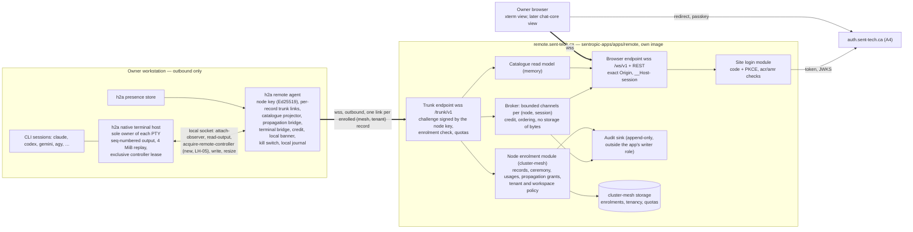
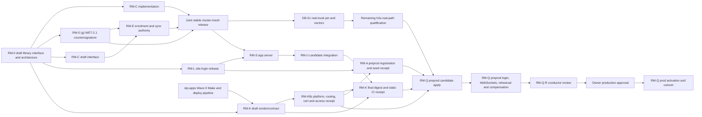

# SPEC_EVOL — Remote control at `remote.sent-tech.ca`: a multi-CLI remote on the cluster-mesh trunk, write-capable from day 1

Status **r11 — launch authorized by the owner on 21 November 2026.** Start sentropic library work and stp-apps deployment preparation immediately. The owner reported no Remote DNS record, no deployment and no RM lot started at the decision point. h2a has merged work against a simulated trunk (section 3.1). The sentropic conductor guarantees the architecture across libraries and deployments and owns the go-live review. sentropic builds the libraries and stp-apps executes app deployment. The history-rewrite freeze leaves the commit to the conductor. Section 22 reconciles the independent r10 review against the archived r10 snapshot.

## 1. Résumé propriétaire — une page

**Ce que tu as demandé (15/11, 17:50).** Un vrai contrôle à distance de toutes tes sessions d'agents — Claude Code, Codex, Gemini et les autres outils que h2a sait lancer — depuis le site `remote.sent-tech.ca`, dès le premier jour, **avec écriture** ; puis une vue redessinée, en direct dans les deux sens, « comme Claude Code en accès à distance ».

**Le premier jour, concrètement.**
- *Inscrire un poste, une fois.* Sur le poste, la commande h2a « remote » (dans l'agent : `/h2a:remote` ; dans un terminal : `h2a remote enrol`) affiche un code et une empreinte (une courte suite de caractères qui identifie la clé propre au poste). Sur le site, connecté avec ta clé d'accès à deux facteurs, tu tapes le code ; le site affiche la même empreinte ; tu valides seulement si elles sont identiques. Le poste ne reçoit ni mot de passe ni jeton (un laissez-passer numérique).
- *Ouvrir la liaison.* `h2a remote up` : c'est le poste qui appelle le site, jamais l'inverse ; rien n'écoute sur ton poste. Cette liaison unique et authentifiée est le « tronc » dont tu parlais pour pages : le même mécanisme d'inscription sert aux deux sites (une inscription par site, avec la même commande et le même geste sur le site), chaque usage autorisé à part. L'inscription vaut pour le poste entier ; sous elle, chaque exemplaire de h2a (chaque « instance », c'est-à-dire chaque enregistrement local de l'outil) peut être nommé, refusé ou retiré séparément, ce dont pages a besoin pour publier.
- *Parcourir.* Depuis ton téléphone ou un ordinateur, tu vois tes postes et leurs sessions en direct, avec l’outil et l’état de chacune. La liste affiche jusqu’à 512 sessions autorisées par poste et indique combien dépassent cette limite.
- *Ouvrir et écrire.* Tu touches une session : son terminal s'ouvre tel qu'il est sur le poste, en direct (« terminal relayé » : ce qui s'affiche dans la fenêtre du terminal du poste est recopié vers ton navigateur, qui le redessine). « Prendre la main » : ce que tu tapes arrive dans la session, y compris les réponses aux demandes d'autorisation de l'agent ; sur téléphone, une barre de touches (Échap, Tab, flèches, Ctrl-C, Entrée). Tu peux aussi arrêter une session, après confirmation.
- *Une seule main à la fois.* Le site ne prend la main que si personne n'a tapé sur le poste depuis 30 secondes. Pendant que tu as la main à distance, la fenêtre de terminal du poste qui montre la session devient une simple vue avec un bandeau « contrôle à distance actif » ; la première touche tapée dans cette vue rend la main au poste aussitôt (cette touche-là n'est pas tapée dans la session), et ton téléphone affiche « main reprise sur le poste ». Sans fenêtre ouverte sur la session, on reprend la main en rouvrant la session sur le poste (ou par l'arrêt d'urgence). Ce partage de la main n'existe pas encore dans h2a : il est construit et vérifié avant le reste, et le chantier s'arrête pour te prévenir s'il ne tient pas.

**Ce qui est pilotable.** Toute session lancée par h2a sur un poste inscrit (`h2a claude`, `h2a codex`, `h2a gemini`…). Une session ouverte sans h2a, tapée directement dans une fenêtre de terminal, est listée mais pas pilotable : son terminal appartient à un autre programme et le reprendre demanderait de déplacer le processus, ce qui est exclu. `h2a remote` te propose, avec ta confirmation, de faire démarrer tes outils par h2a sur ce poste (décision 1).

**La cible, étape suivante.** La session redessinée comme une conversation : messages, appels d'outils et résultats, demandes d'autorisation en boutons Autoriser / Refuser, une zone de saisie, tout en direct dans les deux sens ; le terminal reste à côté. Claude et Codex d'abord, puis Gemini et les autres, chacun dès que son outil fournit, de façon vérifiée, une suite de messages lisible par une machine (et pas seulement des caractères d'écran).

**Avant / après.**
```
AVANT                                  APRÈS — premier jour
Une fenêtre de terminal par agent,     Téléphone : remote.sent-tech.ca
à regarder et piloter sur place.       ┌────────────────────────────────┐
                                       │ Poste « bureau »   ● en ligne  │
Loin du poste : rien à voir,           │  claude  spec-remote  au travail│
rien à taper.                          │  codex   build-ui     bloquée   │
                                       │  gemini  revue        en attente│
                                       ├────────────────────────────────┤
                                       │ $ … le terminal, en direct …   │
                                       │ Autoriser l'outil ? 1 oui 2 non│
                                       │ [Prendre la main] [Échap][Tab] │
                                       └────────────────────────────────┘
                                       CIBLE : même session en conversation,
                                       boutons Autoriser / Refuser, saisie.
```

**La sécurité de l'écriture.** Taper à distance dans une session, c'est pouvoir faire exécuter des commandes à ton poste. Protections : à chaque ouverture du site, une vraie demande de ta clé à deux facteurs (pas seulement un souvenir d'une connexion ancienne) ; toi seul le premier jour ; un poste n'est pilotable que si tu l'as inscrit **et** que la liaison a été lancée sur le poste ; arrêt d'urgence sur le site (un poste ou tous) et sur le poste (`h2a remote kill` coupe tout, aussitôt) ; retrait d'un poste en un geste ; deux journaux à comparer — côté site, un journal où l'on ne peut qu'ajouter des lignes, tenu hors de portée du programme du site lui-même ; côté poste, un journal qui garde les empreintes de contrôle. Chacun inscrit chaque ouverture de terminal, chaque prise de main et le volume tapé (quantités seulement côté site, jamais le texte). Le journal côté site n'est pas scellé par une chaîne inviolable le premier jour : c'est un écart nommé, à ta décision. Ne quittent jamais le poste : variables d'environnement, fichiers de clés et de secrets, chemins de fichiers dans la liste. **Limites à connaître** : ce qui s'affiche dans le terminal d'une session ouverte depuis le site passe par le site ; si un agent affiche un secret à l'écran, il transite (sans être enregistré) ; et si la clé du poste était volée, un faux poste pourrait te montrer un faux écran et recevoir ce que tu y tapes — retirer le poste sur le site coupe ce risque.

**Ce qui s'écarte de règles déjà décidées**, chacun nommé (section 8.4) : l'écriture dans le terminal comme moyen de pilotage ; les réponses d'autorisation tapées ; le terminal avant la conversation structurée ; le contenu d'écran partagé avant la règle de partage prévue ; tout le poste plutôt que session par session ; le site qui lit le contenu en transit ; la liste des sessions (nom, outil, état) envoyée pendant que tu es connecté, sans autorisation signée par toi et avec plus de détails que l'ancienne règle de liste ; le journal du site sans scellement inviolable le premier jour. Les quatre premiers découlent directement de ton ordre ; les autres sont des décisions (2, 4 et 8) ou des écarts de sécurité nommés comme tels. L'adresse `remote.sent-tech.ca` au lieu de l'application Sentropic et la liaison du poste comme « tronc » viennent de tes ordres. Pour les écarts qui autorisent l'écriture, la date limite est fixée à la mise en service (60 jours après la première inscription en production) : passé cette date sans ton renouvellement enregistré, le site coupe de lui-même l'écriture et garde la consultation. Les autres écarts sont seulement revus à cette date, sans coupure automatique.

**Lancement du 21 novembre.** Le chantier démarre maintenant. À la décision, aucun chantier de cette spécification n’avait commencé et le site n’avait ni adresse DNS ni déploiement. h2a a déjà intégré les commandes locales, l’état du terminal et la liste des sessions sur une liaison simulée. La liaison réelle attend la publication commune des bibliothèques de protocole et d’inscription.

**Qui fait quoi.** Le conducteur sentropic arrête et vérifie l’architecture d’ensemble, jusqu’à l’hébergement, et son équipe publie les bibliothèques. stp-apps assemble le site, construit et déploie la même image en répétition puis en production, et gère les noms DNS. Le déploiement de production attend une répétition réussie avec ta clé d’accès, l’avis du conducteur et ton feu vert.

**Ce qui s’enchaîne.** sentropic vérifie d’abord l’assemblage technique, puis prépare en parallèle le protocole et l’inscription. Une seule version publiée réunit ces deux briques et permet à h2a de brancher la liaison réelle. Compter **265 à 407 heures-agent restantes**, socle de déploiement compris (sentropic **88 à 133**, stp-apps **135 à 204**, h2a **42 à 70**). L’adaptateur tmux ajouterait **10 à 16** heures-agent si l’inventaire le justifie. Les attentes liées à l’infrastructure, à la validation du contrat commun avec pages et à la clé de répétition restent sans date confirmée.

**Accords avant la mise en service.** Confirmer le partage par poste, le passage du texte du terminal en mémoire sur le site et l’audit par ajout de lignes pour le premier jour. Donner ensuite le feu vert à la promotion après la répétition. Si le poste ne peut pas reprendre la main de façon fiable, le changement de geste revient à ta décision. Les autres réglages sont décrits aux sections 13 et 14.


## 2. Authority, evidence and binding inputs

[JUGEMENT] This is a design specification, not a delivery receipt. `[FAIT]` marks an observation read in a source tree or a named file, with a file-and-line reference; `[JUGEMENT]` marks a proposed design, gate, estimate or future action. A tag at the start of a paragraph, list item or table row applies to its whole content. Missing evidence is `unknown`; a value quoted from another document and not re-read by this lane is `unverified`. Effort is in agent-hours only; no human-time estimate is given, and every external wait whose length this lane cannot read is `unknown`. Every deployed state is `unknown` unless a line says otherwise. Nothing was written to any deployment, branch, Track log or commit by this lane.

| Prefix | Source and pin |
|---|---|
| [FAIT] `sen:` | `/home/antoinefa/src/sentropic`, r11 local `origin/main = 768a5f4af5dcd24b44b133f9f58a8febe737eefb`. The r10 pin was `d8151a38fcda0422f6910e64a695f74e653d7859`. Both commits are dated 21 November 2026 at 09:28:47 EST (committer time) and have the identical Git tree `ef452dbb588cfd38a0eef7f4d0ae31834c401cf2`. The r9 pin was `25ba09a6…`. r11 checked the source blobs with `git show origin/main:<path>` and the source package version is `0.27.0-dev.2`. Registry and live platform state require separate evidence (§3.5). |
| [FAIT] `h2a:` | `/home/antoinefa/src/h2a`, r11 local `origin/main = c0844a886dd4a6de51a1b5bc1dc830fea19f15e2` (21 November 2026, merge of #514). The r10 pin was `a445b13974a71ab03cbe27b1e33e41326fb23685`. Older line ranges inherited from r9 retain its historical pin `fd067eea…` unless refreshed in place. Today both h2a manifests pin cluster-mesh `0.26.0` (`packages/h2a/package.json:83`, `packages/h2a-runtime/package.json:31`). For provenance, h2a pinned `0.25.0` at the r6 pin, when sentropic source was `0.27.0-dev.1`. |
| [FAIT] `R4:n` | Local archival `spec/SPEC_EVOL_REMOTE_FASTLANE.r4.md`, line `n`, SHA-256 `3dbcb23a…c7c7`. The underlying sentropic source claims used by r9 were checked directly at the r10 pin. Historical measurements, owner reports and other repositories retain their own provenance. |
| [FAIT] `RC16:n` | `.tmp/remote-ctl/plan-remote-ctl-v1.6-draft.md`, line `n`; SHA-256 `6168b73ba9b236530bde6bb4998929de1ede0c92d61aa0fc07fcd4f9983b7b18` (re-checked). A draft whose independent acceptance is open. |
| [FAIT] `CM:n` | `spec/SPEC_EVOL_CHAT_MESH_PROPOSAL.md` (working tree), line `n`; SHA-256 `21d1a10e8381d408857071c3e0aa908c54581027aa18e16bd12fa25f5c562f4c`. The launch packet names it « r3 »; the file on disk states **round 4** (`CM:3`). This document cites round 4. |
| [FAIT] `PG9:n` | `spec/SPEC_EVOL_PAGES_TRI_FRAMEWORK_DEMO.md`, **revision 9** on disk (SHA-256 `df868b0f801ed11e71de892aa7d8fb1130c085785f3dd8d5305b2465fbf704ee` at the r10 re-read; this lane checked its enrolment, federation and lot lines directly: `PG9:443`, `:456`, `:467`, `:506`, `:727` to `:733`, `:1048`, `:1381`). Revision 9 **does** define an enrolment (per instance, staged on the device code), which contradicted `WET-1`; section 6.9 lists what it must change to cite `WET-2`. `PG8:n` citations of r5 that survive unchanged keep their revision-8 meaning. |
| [FAIT] `LH:n` | `/home/antoinefa/src/h2a/tmp/h-cond/remote/PLAN-h2a-RM-H.md`, line `n`: the workstation build plan (lots `LH-00` to `LH-12`, dependency lot `DB-01`, questions `Q-01` to `Q-18` at `LH:153` to `:174`), written by the h2a conductor against r5. Lot boundaries of section 10.2 follow it. |
| [FAIT] `RV5:n` | `.h2a/reviews/remote-r5-muse.md`, line `n`: the independent review of r5, verdict REWORK (blocker `B1` at `RV5:9`, majors `M1` to `M13`, minors `m1` to `m8`). |
| [FAIT] `RV6:n` | `.h2a/reviews/remote-r6-spark.md`, line `n`: the independent review of r6 (pinned at SHA-256 `c4ba68e9…8493`), verdict REWORK (blockers `B1` to `B4` at `RV6:19` to `:25`, majors `M-A` to `M-F` at `RV6:29` to `:39`, minors `m-a` to `m-f` at `RV6:43` to `:53`). Section 18 maps each finding to its r7 fix. |
| [FAIT] `RV7:n` | `.h2a/reviews/remote-r7-spark.md`, line `n`: the independent review of r7 (pinned at SHA-256 `95ac39fe…a92b1`), verdict REWORK (blockers `B-1` and `B-2` at `RV7:35` to `:47`, majors `M-1` and `M-2` at `RV7:49` to `:61`, minors `m-1` to `m-4` at `RV7:63` to `:83`). Section 19 maps each finding folded in r8 (`B-1`, `B-2`, `m-1` to `m-4`) to its fix. |
| [FAIT] `PD4:n` | `.tmp/pages-demo-dossier/owner-decisions-r4.yaml`, line `n`: the owner answers to the pages dossier, binding. |
| [FAIT] `OA:n` | `.tmp/remote-dossier/owner-answer-r1.md`, line `n`: the owner's refusal of r4, binding. |
| [FAIT] `SA:n` | `spec/SPEC_EVOL_SENTROPIC_APPS_MONOREPO.md` (working tree), line `n`; SHA-256 `1bc1040dc89b7c7098b34974a1f49c25aecbf7566c3ced45a7f6821a4f9c4db7`. A study. [FAIT] Since 15/11 20:16 `/home/antoinefa/src/sentropic-apps` is a git repository (remote `rhanka/sentropic-apps`, public) holding `LICENSE` and `README.md` only (listing and `git log` read 16/11); wave 0 (deploy pipeline) is still not met. Repository home stays `sentropic-apps/apps/remote` (owner `APPS-1 b`). |
| [FAIT] `CR:n` | `.tmp/packets/COMMON-RULES.md`, line `n`. |
| [FAIT] `RV8:n` | `.tmp/rv/remote-r8-review-hydrogen.out`, line `n`: independent review of r8 (Hydrogen), verdict REWORK; folded in r9 (section 20). |
| [FAIT] `RV10:n` | `.h2a/reviews/remote-fastlane-neon-r10.md`, line `n`, verdict CHANGES. The reviewed file matches `.tmp/rv/remote-fastlane.r10.snapshot.md` at SHA-256 `094f8d7b66f97a9e2808cf2d52f9b62206da842f4303c43e47364c60407d8cbc`. Section 22 maps each finding to its change and evidence. |

### 2.1 Binding owner orders

[FAIT] 21/11 instructions to the r10 lane. Start Remote immediately from zero RM deployment. The sentropic conductor is accountable for the global architecture, including libraries and deployments. sentropic builds the libraries. stp-apps owns and executes the Remote app, image, DNS and Kubernetes deployment. h2a owns its workstation lots and DB-01.

[FAIT] 15/11 ~09:50: « De meme je veux pouvoir activer le remote controle asap quitte a ce que ce soit remote.sent-tech.ca basé sur cluster mesh. » (`R4:5`).

[FAIT] 15/11 ~17:50, refusing r4 (`OA:5`): « poiur remote controle je refuse le dossier pas assez ambition, je veux un vrai claude remote multi-cli des le premier jour avec un h2a remote dans les commandes de plugin pour s'enregistrer. h2a devra s'enregistrer au cluster-mesh de remote.sent-tech.ca comme sur pages.sent-tech.ca pour pouvoir synchroniser chaque session. chaque session sera complètement fonctionnelle depuis le chat sur remote.sent-tech.ca avec une vue complete de la session exécutée sur le psote de travail. le jour 1 pourrait être un parcour des session mode terminal pty forwardé mais avec accès écriture. l'idéal serait un rerender, avec streaming dans les deux sens- vraiemnt comme claude code en acces remote. »

[FAIT] Pages answers that define the trunk and the enrolment (`PD4:36`, `PD4:40`, binding): PS-O5 — the artifact MCP « sera celui de cluster-mesh. l'enrolement inter cluster mesh évitera d'avoir un mcp pour pages.sent-tech.ca ET en local h2a »; by default only the registered server is reachable, and « depuis l'admin de chaque tenant de la fédération on pourra autoriser la propagation a d'autre tenants avec la validation de l'utilisateur depuis chaque tenant sur lequel il est autorisé ». PS-O6 — « le "trunk" est cette fédération cluster-mesh … L'enrolement inter tenant peut se faire par n'importe quel utilisateur depuis son poste vers ses propres workspaces, a partir du moment ou l'utilisateur est enrolé sur le tenant. Le niveau de synchronisation dans le workspace et administré par l'administrateur du workspace et les ressources privées de chaque utilisateur peuvent être refusée par chaque utilisateur du tenant … L'admin global d'un tenant alloue des quota par défaut pour un utilisateur et des workspaces. on ajoute potentiellement la notion d'organisation au sein d'un tenant. un workspace est affecté en ressource a une organisation (et admin d'organisation) ou directement un utilsateur par défaut (admin du workspace). »

[FAIT] Repository home: the owner chose « sentropic-apps par étapes » (launch packet of this lane). The staging plan has the remote board and the pages site « built at `sentropic-apps/apps/*` » in its wave 1, after wave 0 creates the repository and its deploy pipeline (`SA:312` and the wave table that follows it); in that repository the board « gets its own image built from published `cluster-mesh` and `auth-*` packages » (`SA:185`), and a shared module that a library also needs « is a library and is published from a library repository » (`SA:207`).

### 2.2 Settled decisions carried, and what is void

[FAIT] Carried, from the remote-control plan (`RC16:50`): enrolled-2FA OIDC at session authentication; repeated explicit actions, consent changes and machine switches under the same valid login need zero additional MFA; no periodic control unlock; explicit sharing and explicit action intent; « complete structured conversation and source-issued permission context from first qualified monitoring, including at 390 px. A terminal supplements this view. » [FAIT] « deux moteurs, un registre »: h2a supervises the CLI process, the model and tool loop stays inside that CLI, cluster-mesh owns the common Sessions registry (`RC16:52`). [FAIT] Not authorized by that plan: implicit sharing, delegated human control, process migration, automatic plugin installation (`RC16:54`).

[FAIT] Carried: the A4 identity provider at `auth.sent-tech.ca`, live and accepted since 15/11 ~11:23 (`R4:79`).

[JUGEMENT] Void: the 13 owner decisions of r4 (D1 to D10, D17 to D19) as a set. Their analysis is reused where it still holds; none of their answers is assumed. The relaxations RX-1 to RX-8 of r4 are withdrawn with the watch board they qualified; section 8.4 names the relaxations r5 needs, from scratch.

[FAIT] Rules that bind this plan: owner copy in functional words with jargon explained and before/after pictures (`CR:116`); 0 Python (`CR:8`); every request and decision recorded in Track (`CR:23`); no plan adopted without an architect review at max effort (`CR:83`); reviews on Opus 5.5 (`CR:112`); wagon lanes push branches and the train lane merges (`CR:43`, `CR:55`); the client IP is not visible behind the load balancer (`CR:119`); relayed owner GOs do not count for the k8s session (`CR:139`); « No human-effort or time estimates in any document » (`CR:10`), which is why this document gives no calendar date. [FAIT] The owner decisions of 15/11 18:20 on the apps repository: `APPS-1 b` (by stages), `APPS-2 a` (a bump task on every `@sentropic/*` publish), `APPS-3 a` (one deploy package per app), `APPS-4 a`; « stages 2–3 (repo creation, pages + remote born there) = stp-apps »; `@sentropic/cluster-mesh` `0.26.0` merged by #1040 at 18:17 and publishing (`CR:131`). [FAIT] Lanes on 15/11 evening: Fable out until 22/11 09:00, author lanes on Opus 5.5 (`CR:131`); Codex out until 20/11 07:05 (`CR:107`); Muse back since 15/11 19:00 (`CR:113`); Gemini through the h2a launcher broken headless (`CR:115`).
## 3. What exists today

### 3.1 On the workstation: h2a owns the terminals, and already exposes most of what a remote needs

| Subject | Evidence |
|---|---|
| [FAIT] h2a launches every supported CLI | `run` is described as « Start a local tmux session for a host adapter, in a path », with shortcuts for `codex`, `claude`, `agy`, `gemini`, `mistral`, `muse`, `vibe`, `opencode`, `shell`, plus `attach` (« Attach this terminal to a live local or remote session »), `stop`, `ls` (`h2a:packages/h2a/src/cli-command-map.ts:268` to `:282`). The plugin host table lists eight hosts at parity, `claude`, `codex`, `gemini`, `agy`, `hermes`, `opencode`, `muse`, `vibe`, each with its own hook mechanism, e.g. `claude-settings-hook`, `codex-app-server`, `gemini-hooks`, `agy-plugin-poll` (`h2a:packages/h2a/src/hosts/plugin.ts:63` to `:71`, `:84` to `:150`). |
| [FAIT] A session runs under one of two terminal hosts; **the default for a new session is the native host** | A session's launch context records either `tmux` coordinates or an owning `nativePty` session (`h2a:packages/h2a/src/session.ts:68` to `:84`); a launch result's host is `native` or `tmux` (`h2a:packages/h2a/src/runtime/mcp/agent-launch.ts:371` to `:378`); `attach` dispatches by recorded host. [FAIT] `resolveSessionHostKind` returns `native` unless `--tmux` is passed or `H2A_SESSION_HOST=tmux` (the fleet valve) is set, and never re-routes an existing session (`h2a:packages/h2a-runtime/src/native-host.ts:49` to `:64`). The tmux wording r5 cited sits in a list marked « DOCUMENTATION ONLY. Routing never consults this list » (`h2a:packages/h2a/src/cli-command-map.ts:260` to `:262`, per `RV5:57`). [JUGEMENT] Spike (c) is therefore no longer « which host by default » but a fleet inventory: recorded host per existing session plus the valve value on the owner's workstations (helper in lot `LH-00`, section 10.2). |
| [FAIT] **The native terminal host owns the PTY** and speaks a versioned local protocol | Protocol version 1; operations `ping`, `create`, `list`, `state`, `read-output`, `attach-observer`, `acquire-controller`, `acquire-controller-if-no-recent-human`, `release-controller`, `write`, `resize`, `stop`, `stop-if-incarnation`; replay of at most 4 MiB per session; at most 64 connections (`h2a:packages/h2a-runtime/src/native-terminal/protocol.ts:6` to `:27`, `:47` to `:60`). The PTY child runs inside a guardian with process-group and memory isolation, and refuses to start if isolation fails (`h2a:packages/h2a-runtime/src/native-terminal/session-scope.ts:1` to `:12`). |
| [FAIT] Output is sequenced, replayable and gap-aware | Each output chunk is `{ seq, data }`; a replay returns chunks, a `gap { fromSeq, toSeq }` or `null`, the `latestSeq`, and a `terminalModePrefix` « immediately before the retained chunks » (`h2a:packages/h2a-runtime/src/native-terminal/replay-buffer.ts:3` to `:19`); at most 65 536 chunks per session (`:27`). The session state carries `generation`, `incarnation`, `status` (`running`, `stopping`, `exited`), `latestSeq` (`h2a:packages/h2a-runtime/src/native-terminal/host.ts:560`, `:577` to `:585`). |
| [FAIT] Input is exclusive, epoch-fenced and aware of the local human | A controller lease is `{ role: "controller", id, generation, incarnation, controllerId, epoch }`; an observer is `{ role: "observer", … controllerEpoch }` (`host.ts:613` to `:628`). The state exposes `controlled`, `controllerEpoch`, the controller's identity, and `lastHumanActivityAt`, with the rule that « callers that inject input must fail closed » on it (`host.ts:586` to `:600`); a controller is tagged `human` or `automation` (`host.ts:562`, `:563`). |
| [FAIT] **The arbitration r5 assumed does not exist** (review blocker B1) | `acquireAutomationControllerIfNoRecentHuman` refuses whenever any controller exists (`h2a:packages/h2a-runtime/src/native-terminal/host.ts:1238` to `:1240`), **before** the recent-human test (`host.ts:1241` to `:1248`); only with no holder does it grant, as `automation` (`host.ts:1249`). A local `h2a attach` holds that lease for its whole lifetime, and local take-back today is `h2a attach --takeover` at launch — the host refuses a second controller without `takeover` and names that command (`host.ts:1195` to `:1198`); the attach polls state and detaches when its epoch is fenced (`h2a:packages/h2a-runtime/src/native-terminal/op.ts:1395` to `:1410`). No keystroke-triggered takeover and no observer-mode attach view exist. The only banner surface is the attach process's own status bar (`op.ts:603` onward): with no local attach running there is no local view to banner. [JUGEMENT] Section 5.4 specifies the one mechanism r6 builds instead (lots `LH-04`/`LH-05` ahead of the agent). |
| [FAIT] PTY size and holder are exposed after LH-04 | PR #512 merged at `39e833936`. Current `h2a:packages/h2a-runtime/src/native-terminal/host.ts:587–605` and `2381–2398` expose current size, last local size and holder kind. The remote arbitration and local keystroke hand-back still require LH-05. |
| [FAIT] Replay resume is `readAfter(afterSeq)` | The buffer returns chunks with `seq > afterSeq` and a gap `afterSeq+1 .. oldest-1` (`h2a:packages/h2a-runtime/src/native-terminal/replay-buffer.ts:120` to `:136`): `afterSeq` is the last **applied** sequence, not the next wanted one. Section 7.3 uses that meaning. |
| [FAIT] Uncertain input is already dropped locally, never replayed | On a broken response path the attach drops the one in-flight chunk — « The host may have accepted the write before the response path broke… replaying it could duplicate a command » (`op.ts:1472` to `:1475`) — and logs `input-delivery-uncertain` (`op.ts:1432` to `:1441`). Exactly-once resend is therefore unattainable as r5 claimed; section 7.3 rule 2 adds the `uncertain` result and a persisted deduplication log. |
| [FAIT] A server-side screen renderer exists | `renderTerminalScreen(raw, cols, rows)` replays bytes into `@xterm/headless` and returns the visible screen (`h2a:packages/h2a-runtime/src/native-terminal/screen.ts:1` to `:16`). |
| [FAIT] A host adapter binds remote-action proofs to native terminal sessions | It reads `id`, `generation`, `incarnation`, `controllerEpoch`, `latestSeq` and the PTY pid; a proof verifies only while the session runs, on its incarnation, under the current permission mode; « No route, no transport, no effect » (`h2a:packages/h2a-runtime/src/native-terminal/remote-action-authority.ts:1` to `:15`). |
| [FAIT] h2a signs and pushes a sanitized session catalogue | `h2a remote mirror` pushes the instance registration and its live sessions, one-shot or as a daemon at `--interval-ms >= 5000`, stopping on repeated 401/403, kill switch `H2A_MIRROR_PUSH_OFF` (`h2a:packages/h2a/src/cli.ts:496`); every live session of the instance is sent (`h2a:packages/h2a/src/runtime/mirror/build.ts:84` to `:86`); nothing local reaches the body verbatim — no working directory, command line, tmux coordinates, pid, workspace path or `file://` endpoint (`build.ts:11` to `:15`); a mirrored session carries `sessionId`, `instance`, `host`, `name`, `startedAt`, `heartbeatAt`, `state`, `interests`, `subscribedTopics`, `workStatus`, `lastMcpActivityAt`, `version`, `workspace` (`h2a:packages/h2a/src/runtime/mirror/sanitize.ts:591` to `:604`). The limits of its acceptance function and of its HTTP ingester are in `R4:138`, `R4:139`. |
| [FAIT] `h2a remote` is already a verb group, for other things | `h2a remote serve`, `send`, `mirror-serve`, `mirror` (`h2a:packages/h2a/src/cli.ts:493` to `:496`); `drive`, `drive receive`, `drive serve` — the last one an inbound HTTP listener (`cli.ts:497` to `:499`). |
| [FAIT] Same-user keys prove possession, not intent | « Signatures prove active-key possession, not intent … any same-uid lane can read a principal key, so co-signature is explicit but NOT attributable to human intent » (`h2a:packages/h2a/src/runtime/drive/consent.ts:14`). Drive consent grants last one hour by default, 24 hours at most (`consent.ts:10` to `:13`). |
| [FAIT] A PTY actuator targets either host | `ActuationTarget` is `native-terminal` (session id, socket path, instance) or `tmux` (volatile pane target) (`h2a:packages/h2a/src/runtime/drive/pty-actuator.ts:24` to `:41`), implementing cluster-mesh's `PtyActuatorPort` (`:14` to `:21`). |
| [FAIT] A terminal event vocabulary exists, private | `@sentropic/remote-protocol` is `0.0.0`, `private: true` (`h2a:packages/remote-protocol/package.json:1` to `:4`); it defines `terminal.opened`, `terminal.input`, `terminal.output`, `terminal.resized`, `terminal.exited` (`h2a:packages/remote-protocol/src/constants.ts:79` to `:83`) with schemas whose data is `utf8` only (`h2a:packages/remote-protocol/src/schemas/terminal.ts:27` to `:79`) inside a sequenced envelope (`h2a:packages/remote-protocol/src/examples.ts:64` to `:75`). |
| [FAIT] The Remote skill exists in h2a source | LH-03 delivered `packages/h2a/skills/remote/SKILL.md` in PR #461. The current Claude manifest declares the skills directory (`h2a:packages/h2a/.claude-plugin/plugin.json:10`). Real enrolment and transport are separate release gates. |
| [FAIT] Presence is not the catalogue source of truth | Presence rows exist only for sessions whose MCP sidecar opened one; a mirrored workspace reference is a local h2a value `{ id, host, label }` and « None of the three transmits a path » (`h2a:packages/h2a/src/runtime/mirror/sanitize.ts:465` to `:479`): it is never a cluster-mesh workspace. The native host's own `list`/`state` is authoritative for live PTYs. [JUGEMENT] Section 5.3 defines the catalogue as a join of the two, keyed by `launchContext.nativePty.session` (`h2a:packages/h2a/src/session.ts:80` to `:84`). |

[FAIT] Workstation status on 21 November. PR #460 (`a1a8d681c`) merged LH-00. PR #461 (`dea9549af`, implementation `00c38bc20`) merged LH-01, LH-02 and LH-03. PR #512 (`39e833936`) merged LH-04. PR #515 (`a445b1397`) merged LH-06. PR #514 (`c0844a886`) merged LH-07 against the provisional trunk. LH-05, LH-08–LH-12 and DB-01 remain open in this launch plan.

[FAIT] At that h2a pin, `packages/h2a/src/runtime/remote-agent/types.ts:4,165,500` references provisional types and accepts a monolithic fixture `cat.snapshot`. `service.ts:100,217` exposes the stub effect path. `packages/h2a/test/remote-agent-lh07-catalogue.test.js` exercises the provisional catalogue path. [JUGEMENT] DB-01 waits for the joint RM-C + RM-E npm release, switches both packages' production entry points to the published contract, and runs the shared vectors. LH-06 and LH-07 close on the real path after DB-01 (§10.2).

### 3.2 In cluster-mesh: a session relay contract, closed; no server-to-server federation

| Subject | Evidence |
|---|---|
| [FAIT] The relay is a packed contract, fail-closed | « DEP-FED is a source-gap, so no mesh wiring is registered in production and every connect resolves to the typed refusal relay_grant_unavailable — all live routes, including direct B→A, stay DISABLED » (`sen:packages/cluster-mesh/src/sessions/relay.ts:9` to `:12`); exported as `./sessions/relay` (`sen:packages/cluster-mesh/package.json:59` to `:61`). |
| [FAIT] Its wire framing is defined — and caps **every** record at 8 192 encoded bytes | « every relay record on a link is 4-byte big-endian length + JCS bytes, 1..8192 per record » (`sen:packages/cluster-mesh/src/sessions/relay-wire.ts:1` to `:5`); the encoder and decoder both throw outside `1..8192` (`relay-wire.ts:9` to `:10`, `:21`). The numbers `24576 encoded / 16384 decoded` belong to a **different object**, the base64 ciphertext data frame (`sen:packages/cluster-mesh/src/sessions/relay-frames.ts:17`, `:33` to `:34`). [JUGEMENT] r5 conflated the two; trunk therefore defines its own record maximum in section 7.1 and carries terminal bytes base64-encoded, so expansion is the fixed 4/3 of base64 and never the up-to-6× of JSON string escaping (each ESC byte encodes as `\u001b`). |
| [FAIT] Its flow control is credit-based | Per link and direction the credit ledger is absolute and monotonic; a credit frame carries `receivedThroughFrame`, `receivedThroughOffset`, `sendLimitFrame`, `sendLimitOffset`; `RELAY_LINK_MAX_FRAMES = 8`, `RELAY_LINK_MAX_PAYLOAD_BYTES = 131072` (`relay-credit.ts:1` to `:25`). The stream iterator buffers at most 8 events or 131 072 encoded bytes, then emits one `relay_backpressure` and ends; mid-event EOF is `relay_protocol_refused`, never a partial record (`relay-lane-stream.ts:1` to `:8`). |
| [FAIT] Session control is routed and closed | `drive`, `wake`, `relaunch` routes (`sen:packages/cluster-mesh/src/hono/session-router.ts:115` to `:118`), with a `PtyActuatorPort` contract `isAvailable`, `probeState`, `actuate` over an opaque `commandRef` that « Actuators MUST NOT interpret » (`sen:packages/cluster-mesh/src/runtime/registration.ts:82` to `:106`); the product instruction resolver returns `null` (`R4:123`). |
| [FAIT] The session origin registry uses in-memory state and the chat module is gated | `sen:packages/cluster-mesh/src/sessions/registry.ts:67–69` constructs state using maps (`src/sessions/registry-store.ts:49–56`). `chat-server` is in the gated list (`src/modules/contracts.ts:42`). |
| [FAIT] The current cluster-mesh package scopes itself to one server and its attached workstations | `sen:packages/cluster-mesh/README.md:102–104`. The documents cited in PG8 were re-read at origin/main. `sen:spec/SPEC_DECISION_DEPLOYMENT_PLANE.md:12,56` drops D11R IdP federation. `sen:spec/SPEC_EVOL_CLUSTER_MESH_CENTRAL_CONTROL_PLANE.md:37` excludes server-to-server federation. The owner’s later PS-O5/PS-O6 orders define the planned trunk in section 6. |
| [FAIT] The existing Cowork device-code attachment issues a session token pair | `sen:api/src/routes/namespaces/session-device.ts:43–56,78–86` consumes an approved poll and accepts a session cookie or bearer for approval without an assurance or Origin check in that handler. `sen:api/src/services/device-code-store.ts:4–33,40–41` implements process-local entries with neither an instance nor a key field. `sen:api/src/services/auth/session-adapter.ts:14,29–39` defines the legacy session cookie. |
| [FAIT] Cowork carries no session relay | `@sentropic/cowork-bridge` `0.2.0`: « Portable client bridge … client core, transport-agnostic auth and local-tool protocol/permission contracts » (`sen:packages/cowork-bridge/package.json:2` to `:4`). |

### 3.3 Identity, step-up and the closed remote evidence route

| Subject | Evidence |
|---|---|
| [FAIT] Per-client passkey ACR and subject allowlist | `sen:packages/auth-hono/src/oauth/authorize-handler.ts:81–94,406–424` enforces the exact requested passkey level and checks allowed subjects. `sen:packages/auth-hono/src/oauth/token-handler.ts:465,508–515` seals `acr`, `amr` and `auth_time` into the ID token. |
| [FAIT] **« Passkey-fresh » names a session flag, not a fresh ceremony** | The ACR is derived from the IdP session's `mfaVerified` flag alone (`sen:packages/auth-hono/src/oauth/session-resolver.ts:50` to `:51`); authorize forces re-authentication only when that derived ACR is not met (`authorize-handler.ts:81` to `:83`); `authTime` is the IdP session **creation** time (`authorize-handler.ts:129`). An IdP session created with a passkey long before can therefore open a remote session with no ceremony that day. [JUGEMENT] Sections 5.2 and 8.1 now require `prompt=login` plus an `auth_time` age bound; decision 5 is reworded accordingly. |
| [FAIT] Forced re-authentication exists | `prompt=login` or `select_account` forces re-auth (`authorize-handler.ts:64` to `:69`), without forcing re-consent (`:326`). |
| [FAIT] « Enrolled 2FA » in a token is `hwk`, `user`, `mfa` | `sen:api/src/services/auth/remote-evidence.ts:41`. The evidence route refuses requests with a nonempty `Origin` or `Cookie` header and refuses outside the identity-provider role (`sen:api/src/routes/auth/remote-evidence.ts:32` to `:37`). |
| [FAIT] Passkey login on the rehearsal provider waits for a data seed | The preprod provider uses the parent RP ID `sent-tech.ca` with passkey registration disabled; « this key alone breaks passkey login until the prod-data seed lands » (`sen:deploy/k8s/overlays/preprod/patch-auth-idp-config.yaml:29` to `:32`, `:42`, `:47`). State of that seed: `unknown`. |
| [FAIT] The pages owner decision anticipates account-written content under the same parent domain | Local `PD4:67–74` records the Public Suffix List proposal for `artefacts.sent-tech.ca` and same-origin safeguards. The live artifact origin and PSL rollout are outside the source check. Sections 5.2 and 8.5 enforce exact-origin checks independently of either. |

### 3.4 Plans this document builds on

| Subject | Evidence |
|---|---|
| [FAIT] The remote-control plan's first milestone | A Claude CLI session opened from the web, « sees its live structured conversation and PTY view … sends one explicit harmless input, and sees one native effect » (`RC16:44`). |
| [FAIT] Its capture model is per-CLI and bit by bit | Five independent bits, `ptyBytes`, `structuredDeltas`, `completePermissionContext`, `literalInput`, `permissionResponse`, each `unavailable`, `contract-only` or `installed-qualified` (`RC16:495`); Claude's feasibility probes for deltas, permission context and literal input (`RC16:497` to `:503`); PTY and structured streams are different presentations whose sequence spaces are never spliced (`RC16:510`). |
| [FAIT] It forbids raw write as control | « The generic fallback is view-only … Raw `write`, approval-like bytes, ANSI prompt parsing, shell commands, resize/stop and auto-approve flags cannot become control fallbacks » (`RC16:518`); content sharing, PTY capture included, stays disabled until the R15 policy supplement (`RC16:162`); the workstation initiates every connection (`RC16:231`); the federation successor is `source-gap` (`RC16:191`). |
| [FAIT] Chat wire protocol v1 | SSE with `id:` resume and a sealed, bounded session cursor (`CM:714` to `:723`); event types `content_delta`, `tool_call_start`, `tool_call_result`, steer statuses, a capability-gated `approval_required` with `approvalId`, `toolCallId`, `argsDigest`, `expiresAt` (`CM:731` to `:745`); `Idempotency-Key` on mutating routes and a 64 KiB cap per SSE event (`CM:747` to `:769`); the neutral `session-db` (`CM:201` to `:209`). |
| [FAIT] The pages plan at revision 9 enrols per instance, staged on the device code | « An enrolment record on the mesh links `(user, h2a instance id, instance public key, device name, enrolled-at, revoked-at)`. It is created through the existing device-code lifecycle » with proof of possession as a follow-up (`PG9:506`); federation item F1 is « Step 2 (PS-P2, on the device code) » enroling « to a tenant of a mesh » (`PG9:727`); gate `G-PS-ENROL` requires per-instance refusal, an audit row naming the instance, and revoking one instance leaving the others working, priced 18–30 agent-hours in `api/src/services/**` (`PG9:1048`); risk R16 accepts attribution without possession (`PG9:1381`). [JUGEMENT] Each point contradicts `WET-1` as r5 wrote it (review M1); `WET-2` (section 6) carries the per-instance granularity as a sub-identity under the node record so both texts can hold, and section 6.9 lists the pages changes. |

### 3.5 r11 verification ledger

[FAIT] Every r9 claim about sentropic shipped code was checked against the origin/main blobs at the r10 pin. r11 rechecked the review findings on local origin/main. Section 2 dates both references and records their identical tree. The relay exports, framing and per-link credit (section 3.2) still match. The relay record codec enforces `1..8 192` both ways. `24 576 / 16 384` are ciphertext-frame bounds. The product session-control resolver remains `async () => null` (`sen:api/src/routes/namespaces/session.ts:79–82`). `createClusterMeshPlugin` composes supplied modules from runtime context and receipts, and the runtime factory accepts injected ports (`sen:packages/cluster-mesh/src/hono/plugin.ts:23–34`, `src/runtime/generation.ts:31–38`, `src/index.ts:14,28`). The IdP composition uses the product adapter (`sen:apps/auth-idp/idp-app.ts:33,178–179`). The single `/apps` slot, mount override and separate WebSocket/authority adapter in §5.5 use this seam. The registry rejects duplicate slots and the closed slot union has neither `/remote` nor `/trunk` (`sen:packages/cluster-mesh/src/runtime/namespace-registry.ts:20–39`, `sen:packages/contracts/src/cluster-mesh-namespace.ts:3–35,45–52`). The package exports PostgreSQL and SQLite storage and currently lacks `./trunk` and `./node-enrolment` (`sen:packages/cluster-mesh/package.json:59–72`).

[FAIT] Section 3.3 records the verified ACR, forced re-authentication, ID-token claims, remote-evidence handler and preprod RP ID settings. The overlay sets `https://preprod.auth.sent-tech.ca` as issuer (line 38) and disables WebAuthn registration (line 47). The source warning establishes the seed dependency. Live seed completion remains unknown. Historical A4 acceptance comes from `R4:79` and the launch notes.

[FAIT] `git show origin/main:<path>` does not resolve the local `CM`, `PG9`, `SA`, `R4`, `OA`, `PD4`, `CR` and local review documents. Section 2 identifies each as draft, archival, owner or review evidence. The two settled architecture documents in section 3.2 resolve and were checked. The design-system origin/main tree contains `AppShell.vue`, `DataTable.vue` and `MessageStatusBadge.vue` under `packages/components-vue/src` and no terminal/xterm filename. The sentropic-apps origin/main tree at `1c27a0201790538765e085abb71e0d49e02abe47` contains `LICENSE` and `README.md`. The platform repository shows a reserved `sentropic-remote` namespace and an OVH MKS BHS Traefik overlay (`poc-k8s` origin/main `577ccd5e14d45d9dec871c2eeb5183f48fa84848`, `tenants/sentropic-remote/00-namespace.yaml`, `docs/runbooks/ovh-operations.md:1–4`, `platform/overlays/ovh/20-traefik.yaml:1–9,93–97`, `platform/30-clusterissuer.yaml:25–36,64–66`). RM-K8s verifies environment-specific platform availability before apply.

## 4. Day 1, the target, and the step between them

### 4.1 Day 1 — a write-capable, multi-CLI terminal remote

[JUGEMENT] **Principle.** Multi-CLI on day 1 is a property of the transport, not of per-CLI work: every CLI that h2a launches draws on a PTY owned by an h2a terminal host (section 3.1), so forwarding that PTY serves Claude Code, Codex, Gemini, agy, Hermes, OpenCode, Muse, Vibe, Mistral and a plain shell alike. The per-CLI work (capture adapters) belongs to the target.

| Day-1 question | Answer |
|---|---|
| [JUGEMENT] Which sessions are **listed** | The first 512 eligible sessions per node in ascending `sid` order, across the enrolled account's h2a instances and CLIs. The UI shows the omitted-row count (§7.2). The catalogue is a **join**: liveness and operability from the native host's `list`/`state`, display fields from presence narrowed by the mirror allowlist (`sanitize.ts:591` to `:604`), keyed by `launchContext.nativePty.session` (section 5.3 states the missing-side behaviour). Fields: CLI host, session name, workspace label, work status, start time, last heartbeat — plus terminal host kind, which is **locally derived** by the agent and is not a member of that allowlist. The join is polled every 2 s; deltas are coalesced every 250 ms; a row disappears when the host reports the session exited or absent, and a presence-only row (no host entry) disappears 15 s after its last heartbeat, the plan's freshness bound (`RC16:396`). Stale presence alone never deletes a row whose PTY lives; it degrades its work status to `unknown`. The displayed fields exceed the settled coarse listing projection; that widening is named RX-W10 (section 8.4). |
| [JUGEMENT] Which sessions are **operable** | Eligible sessions in the authorized projection whose launch context names an owning native terminal session (`nativePty`, `session.ts:80` to `:84`) — which is the default for every new session (section 3.1). Sessions recorded under tmux are listed as « not operable (tmux) » on day 1 **unless** the fleet inventory (spike (c), helper in `LH-00`) meets the build threshold of section 10.2 (tmux share ≥ 20 % of inventoried live sessions **and at least 5 tmux sessions in absolute count** on the target workstations, or the fleet valve set to tmux — a percentage of a tiny fleet never triggers the build alone), in which case the conditional adapter RM-H3/`LH-12` is built with its degraded contract stated there; otherwise that lot is dropped with its inventory evidence recorded. Sessions with no h2a terminal host are listed with the label « open with h2a to operate » (decision 1). Sessions the owner excluded on the workstation (`h2a remote off`) are listed as « not shared ». |
| [JUGEMENT] Which **actions** | Browse; open the terminal of a session (live output, scrollback replay from the host buffer); **take control** (an exclusive controller lease), type, paste behind a paste guard, use a key bar (Esc, Tab, arrows, Ctrl-C, Ctrl-D, Enter), resize the PTY to the browser while in control; **release** control; **stop** a session behind a confirmation (`stop-if-incarnation`, so a stop never hits a relaunched process); disconnect a workstation; the emergency stop of all remote control; enrol and revoke workstations. Not on day 1: starting a new session from the site, file transfer, sharing a session with another account. |
| [JUGEMENT] Which **devices** | Any browser holding the owner's passkey; designed at 390 px first (`RC16:50`). |
| [JUGEMENT] Who | The owner alone (subject allowlist of one, at the identity provider and in the site); other accounts of the tenant come at step 2d (decision 6). |

### 4.2 The target — the re-rendered session, streaming both ways

[JUGEMENT] For each session whose CLI has the qualified bits (`RC16:495`), the site renders the session as a conversation with the chat components of the design system: user and assistant messages streaming as deltas, tool calls with their arguments and results, the CLI's own permission requests as Allow / Deny buttons carrying the exact request context, steer and stop, and a composer that delivers a literal input to the same process. The terminal stays one tap away. Both directions stream live, with resume after a network cut and no lost or duplicated event. The browser speaks **chat wire protocol v1** (`CM:686` onward) to the remote app, so the chat-core view components render a CLI session the way they render a native chat session; the trunk carries the CLI's structured events, which the app maps per CLI (section 7.6). Each mode is chosen per session from its capability bits; losing a bit closes the matching control path and labels the loss, as the plan requires (`RC16:512`).

### 4.3 From day 1 to the target

| Step | What the owner gets | Predecessors | Agent-hours |
|---|---|---|---|
| [JUGEMENT] 2a — structured view, Claude and Codex | The conversation view, read side, for Claude Code and Codex sessions; the terminal beside it. | Day 1; per-CLI capture adapters — Claude through its hooks and an incremental transcript tail qualified by the delta probe (`RC16:501`), Codex through its app-server mechanism (`plugin.ts:93` to `:99`); the design-system `chat-core` creation lots the view depends on (`CM:686` onward) and the chat-core Vue view in the app. Payloads above the 24 KiB serialized inline cap of section 7.6 are truncated with a marker at this step; by-reference delivery waits for the `session-db` of step 3. | 55–85 |
| [JUGEMENT] 2b — structured input and approvals | The composer and the Allow / Deny buttons, per CLI, each only once its `literalInput` or `permissionResponse` bit is installed-qualified (`RC16:503`); otherwise the terminal stays the input path. | 2a; the input and context probes per CLI. | 30–45 |
| [JUGEMENT] 2c — the other CLIs | Gemini, agy, Muse, Vibe, Hermes, OpenCode, each when its adapter is qualified. | 2a. | 12–20 per CLI |
| [JUGEMENT] 2d — widening | End-to-end encryption between workstation and browser (decision 4); other accounts of the tenant, each on their own workstations; start a new session from the site; phone notifications. | Day 1 in service; each its own review. | 25–40 for encryption; others `unknown` |
| [JUGEMENT] 3 — convergence | The trunk's records ride cluster-mesh relay lanes after the transport qualification in §7.7. the common Sessions registry holds the catalogue; native Sentropic chat runs appear beside CLI sessions (`/chat` slot opened by the chat-mesh plan). | The chat-mesh plan's calendar; the session-db. | `unknown` |

## 5. Architecture

### 5.1 Overview



[JUGEMENT] Three properties carry the design. **The workstation initiates every connection** (`RC16:231`): the agent dials out — maintaining one authenticated trunk link per live enrolled `(meshId, tenantId)` record (`WET-2` clauses 4, 6, 17), and carrying cross-pair transfers between its own enrolled links only when destination policy and user validation authorize them (`WET-2` clause 19) — while nothing listens on the workstation and `h2a drive serve` is not used. **The PTY has one owner**: the native terminal host on the workstation; the agent is one more client of its socket, beside a local `h2a attach`; the server and the browser hold views, never the PTY. **The server stores no terminal byte**: output and input cross the broker in bounded memory buffers (and input deduplication outcomes live in the workstation log, queried over `term.in.sync` on reconnect without server-side log storage); only bounded metadata and counts reach the site audit sink. Input digests stay in the workstation journal.
### 5.2 `remote.sent-tech.ca` as a cluster-mesh app in `sentropic-apps`

| Concern | Design |
|---|---|
| [JUGEMENT] Home | `sentropic-apps/apps/remote` owns the Hono composition root, broker, catalogue read model, browser routes and UI, application policy/configuration, image and deploy unit. `sentropic` owns the published cluster-mesh runtime/storage, `./trunk`, `./node-enrolment` and `@sentropic/auth-hono/site-login`. The app uses the published plugin and injected ports (RM-0/RM-S), with no source import from the product API or IdP application. Preprod apply follows the stp-apps Wave 0 pipeline exit (`SA:310–312`). |
| [JUGEMENT] What « on cluster-mesh » means on day 1 | The Remote root mounts one `/apps` namespace module through `createClusterMeshPlugin`, with explicit mounting and separate WebSocket handling (§5.5), and three cluster-mesh capabilities do real work: (1) the **node enrolment module** (new, section 6) with its store on cluster-mesh storage; (2) the **trunk** (new, section 7): on day 1 one outbound **node attachment link** per enrolled `(meshId, tenantId)` record between the workstation and that record's mesh — keeping the package's no-server-to-server-link topology (`sen:packages/cluster-mesh/README.md:102` to `:104`), with cross-pair propagation carried by the node itself across its own enrolled links under destination tenant-admin policy and destination user validation (`WET-2` clause 19, built in RM-E / RM-H2 (LH-07 real qualification) / RM-S) — whose records use length-prefixed JCS framing in the relay's style with trunk's own size bound (section 7.1) and the relay's credit discipline (`relay-credit.ts:11`, `:12`), while **server-to-server federation** (one mesh server dialing another mesh server, the later contract step noted in `WET-2` clause 19 and PS-O16) is not built on day 1; (3) tenancy — mesh, tenant, user, workspace and quotas — from cluster-mesh identity, with mesh/endpoint and tenant carried separately (`WET-2` clause 1). Whether a cluster-mesh runtime can be built outside `api/src` with a few dozen lines is still `unknown` (`R4:157`, `R4:267`); spike (a) of RM-0 now carries a stop condition and a named fallback (section 10.2, RM-0). |
| [JUGEMENT] Replicas on day 1: **one** | Catalogue and channels live in process memory, a node link and a browser socket must meet in one broker process, and `WET-2` clause 18 closes a revoked link within one second. The app therefore runs **exactly one replica** on day 1 (asserted in the RM-K manifests and gate); an app restart drops every link and socket, which section 7.5 already handles by reconnection. Sticky routing plus a revocation bus is the named later step if a second replica is ever needed; it is not built on day 1. |
| [JUGEMENT] Names | `https://preprod.remote.sent-tech.ca` for rehearsal and `https://remote.sent-tech.ca` for production (nested preprod rule, `R4:269`). Section 5.5 defines the Kubernetes placement and DNS publication. |
| [JUGEMENT] Login | The shared site-login module with the six requirements of `R4:274` (exact `Origin` on every state-changing route **and on every WebSocket upgrade**, no state change on `GET`, `__Host-` cookies only, `state` bound to the initiating browser, a session that carries its site and its assurance, a test contract run on both sites' policies). OIDC client `remote`, `requiredAcr = passkey-fresh`, subject allowlist of one on day 1. Because that ACR is only a session flag (section 3.3), the authorization request **always sends `prompt=login`** — this is the session authentication the settled rule requires, not a periodic unlock — and the login module **refuses an `id_token` whose `auth_time` is older than 10 minutes** at callback, then re-checks `acr` and `amr ⊇ {hwk, user, mfa}`. Site session: absolute 8 hours, no sliding renewal. RM-L publishes the reusable implementation in `@sentropic/auth-hono/site-login`. RM-S supplies environment-specific policy and wires the browser endpoints. |
| [JUGEMENT] WebSocket rather than SSE for terminals | A terminal needs low-latency input interleaved with output; the chat protocol keeps SSE for its own routes and reserves WebSocket for live canvas (`CM:695`). The browser endpoint uses one WebSocket per site tab for terminal channels; the structured view of the target uses chat wire protocol v1 over SSE and POST, unchanged (section 7.6). The upgrade request is refused unless its `Origin` equals the site origin exactly and it carries the `__Host-` session cookie: a cross-site WebSocket hijack is the classic failure of cookie-authenticated WebSockets. |
| [JUGEMENT] Storage and bootstrap | Enrolments, pending ceremonies, tenancy, quotas, propagation allow-rules / user-validation grants (`WET-2` clause 19) and per-session sharing flags in cluster-mesh storage (PostgreSQL in production); catalogue and channels in memory only; audit to a sink outside the app's database writer role (`RC16:717`). The app has its **own** cluster-mesh store (`WET-2` clause 21): provisioning its database is a named act of lot RM-K/RM-K8s (section 10.2), with stp-apps owning the request and namespaced provisioning. Shared platform grant requests follow section 13. The empty store is bootstrapped by **first-login provisioning** (lots RM-E/RM-S): when a subject on the IdP allowlist first signs in, the app idempotently creates the `owner` tenant (`tenantId = owner`, `WET-2` clause 1) in its mesh (`remote-prod` in production, `remote-preprod` on preprod) if absent, that subject's approved tenant membership, its personal workspace, the default quota rows (`WET-2` clause 13) and the subject as tenant administrator, each write audited. A subject not on the allowlist provisions nothing. The second tenant of clause 1, `isolation-fixture`, is **never** created by this bootstrap: it comes only from the RM-E/RM-S test fixture seed on test and preprod stores. The gate runs against an empty store (section 10.2, RM-S). |
### 5.3 Workstation side — `h2a remote` and its plugin command

[JUGEMENT] New sub-verbs in the existing `h2a remote` group (section 3.1), which keep `serve`, `send`, `mirror-serve` and `mirror` unchanged:

| Verb | Effect | Who may run it |
|---|---|---|
| [JUGEMENT] `h2a remote enrol [--site <url>] [--tenant <id>] [--name <device>]` | Generates the node key on first enrolment and reuses that same node key and `nodeId` on subsequent enrolments to additional `(meshId, tenantId)` pairs (`WET-2` clause 3), opens the ceremony of section 6.3 (with requested usages and workspace scope inside the signed request, clause 9), prints ceremony code, node identifier and key fingerprint, waits by signed poll for approved, denied or expired, and stores the enrolled `(meshId, tenantId, enrolmentRef, endpoint)` metadata locally. Stores no token. | An interactive terminal only (TTY check and a typed confirmation). [JUGEMENT] That check is a guard against **non-interactive invocation** only: a same-account program can allocate a PTY and type (h2a's own business is spawning PTYs), and a same-account signature proves possession, not intent (`consent.ts:14`). The human boundary is the **site-side passkey approval with fingerprint comparison** (clauses 10 to 12); the refusal text of `LH-02` says so. |
| [JUGEMENT] `h2a remote up` / `down` | Starts or stops the agent, as a user service or in the foreground; `up` opens one outbound trunk link per live enrolled `(meshId, tenantId)` record (re-arming any previously `superseded` record), shows what will be shared per enrolled record (all h2a sessions of this account for records holding `sessions.observe`, the sharing default of decision 2), and asks for confirmation the first time. | `up`: interactive terminal only. `down`: anyone. |
| [JUGEMENT] `h2a remote status` | Link state per enrolled `(meshId, tenantId)` record (including per-record `superseded` state and active clause 19 propagation grants), sessions shared, who holds control of what, last refusals. | Anyone, MCP included. |
| [JUGEMENT] `h2a remote off <session>` / `on <session>` | Per-session opt-out and back. | `off`: anyone, MCP included (it only narrows). `on`: interactive terminal only. |
| [JUGEMENT] `h2a remote kill` | Emergency stop: releases every remote controller lease, closes **every** enrolled trunk link of this node, stops the agent, and sets a local kill flag that only `h2a remote up` from a terminal clears. Also bound to the environment kill switch `H2A_REMOTE_OFF`, on the model of `H2A_MIRROR_PUSH_OFF` (`cli.ts:496`). | Anyone, MCP included. |
| [JUGEMENT] `h2a remote revoke [--enrolment <ref> \| --all]` | Asks the target site, signed by the node key, to revoke the named `(meshId, tenantId)` enrolment record (defaulting to the sole record when only one is enrolled, or every enrolled record under `--all`), removes that record's local enrolment entry on acknowledgement, and deletes the local node key once no live enrolled record remains. | Anyone. |

[JUGEMENT] **The plugin command.** A new skill `packages/h2a/skills/remote/SKILL.md`, user-invocable as `/h2a:remote` in Claude Code and through the Codex plugin manifest, explains and drives these verbs; matching MCP tools `h2a_remote_status`, `h2a_remote_off`, `h2a_remote_kill` give every CLI host the safe directions. The skill never runs `enrol`, `up` or `on` itself: it prints the command for the owner to type in a terminal. That rule keeps every agent surface on the narrowing side; the human act that bounds the risk is the site-side approval (sections 5.3 verb table, 8.5), not the terminal check alone.

[JUGEMENT] **The agent.** One process per OS account and workstation. It builds the catalogue as the join of section 4.1 — host `list`/`state` for liveness and operability, presence for display fields through the mirror allowlist, keyed by `launchContext.nativePty.session` — with this missing-side behaviour, each case a fixture of lot `LH-06`: host-only (live PTY, no presence row, e.g. a plain shell) → listed and operable, display fields minimal, work status `unknown`; presence-only (no host entry) → listed as « not operable », removed 15 s after the last heartbeat; both present → full row; stale presence with a live PTY → row kept, work status `unknown`; exited PTY → row removed at the next 2 s poll, any open channel closed with `term.exit`. It keeps **one outbound trunk link per live enrolled `(meshId, tenantId)` record** (`enrolmentRef`, `WET-2` clauses 3, 4, 6, 17; lot `LH-07`), isolating link sequence `s`, `linkGeneration`, `catSeq`, channel credit ledgers, and the per-instance lifecycle of clause 4 (`instance.bind` for local instances that must bind under that record, `instance.revoked` applied at once to that record with the behaviour of section 7.2) **per record**, and projecting the session catalogue only onto links whose record holds `sessions.observe`. **Node-carried propagation (`NodePropagationBridge` in `LH-07`, `WET-2` clause 19)**: by default (`PD4:36`), resources never cross between two links of the node; when destination link B's active authority image contains a grant for `(fromMeshId, fromTenantId)` supported by B's tenant admin rule and the user's destination validation, the `NodePropagationBridge` carries explicitly authorized resource descriptors from source link A's `(fromMeshId, fromTenantId, fromEnrolmentRef)` onto destination link B via `prop.push` / `prop.ack` (section 7.2), halting immediately on a `prop.grant` invalidation or revocation of the source record/instance. For each open terminal channel on a link holding `sessions.operate` or `sessions.observe`, the agent is a client of the native terminal host socket: `attach-observer` and `read-output` for output, the new remote-acquire operation of section 5.4 (identifying the holder per `(enrolmentRef, ch)`) then `write` and `resize` for input, `release-controller` on release, `stop-if-incarnation` for stop. While it holds a controller lease the host reports the remote holder in session state (lot `LH-05`); a local attach in observer mode renders the banner « remote control active — remote.sent-tech.ca — type to take back » from that state, outside the PTY byte stream; with no local attach open, the banner fallback is `h2a remote status`, the agent journal and a best-effort desktop notification (`unknown` per desktop environment, never gated). Spike (b) of RM-0 proves this arbitration against a real host and is a stop/go gate for lot `LH-09` (section 5.4). Its node key file is mode 0600 under the h2a configuration directory; section 8.2 states what that does and does not protect. **`superseded` and `revoked` are scoped per `(meshId, tenantId)` record (`enrolmentRef`)**: on `superseded` for a given record's link, the agent releases any remote controller leases held for that record, stops reconnecting **that record's link**, and surfaces `superseded` for that record (never fighting a newer link for that record in a reconnect loop, section 7.5), while every other enrolled `(meshId, tenantId)` record's link and channels keep running undisturbed (stopping the idle agent loop only if no other live un-superseded record remains).

[JUGEMENT] **Renewal, key loss, stop authority** (lifecycle ends left open by r5). Renewal at `renewBy` (`WET-2` clause 4) is a site-panel act: « Renew this workstation » under a live site session meeting the same assurance as the original approval for every usage the record holds; it extends `renewBy` by 180 days, keeps the node key, and is offered from 30 days before expiry (control in lot RM-U). Node-key loss is a named local state (`LH-01`): the runbook is revoke the old record(s) on each enrolled site (its fingerprint is shown there), delete the local key material, and re-enrol with a new key — never a silent re-key under the old `nodeId`. Stop (`term.stop`, section 7.2) may be sent by the controlling browser connection **or** by an observer connection of the same owner on that channel, always behind the confirmation; it is fenced by incarnation and ends the controller lease with the incarnation; the audit names which connection sent it.
### 5.4 Who owns the PTY, and how size and control are arbitrated

[JUGEMENT] **The one mechanism** (settles review blocker B1 and question Q-01). r5 described take-back by keystroke as if the host already provided it; it does not (section 3.1). r6 specifies exactly one mechanism — **an atomic host operation plus an observer-mode local attach with keystroke take-back** — built as host lots `LH-04` (size in state) and `LH-05` (arbitration and banner surface) **ahead of** the agent lots, and proven by RM-0 spike (b) as a stop/go gate (below). The existing `acquireAutomationControllerIfNoRecentHuman` is left unchanged for its current callers; nothing in this section alters its refusal semantics.

| Rule | Design |
|---|---|
| [JUGEMENT] Ownership | The native terminal host holds the PTY master and is the only writer of the output sequence (`latestSeq` per incarnation). A relaunch is a new incarnation; every channel is bound to one `(generation, incarnation)` and closes when it ends. |
| [JUGEMENT] Holder reporting (`LH-04`, `LH-05`) | Session state gains `cols`, `rows` (current PTY size), `lastLocalSize` (the size last set by a human controller), and `holderKind: none \| human \| automation \| remote` with the holder's `controllerId` and `since`. Size is set on create and on controller resize; a human resize also updates `lastLocalSize`, a remote resize never does. Older readers that ignore unknown fields still parse state. |
| [JUGEMENT] The atomic operation (`LH-05`) | New host operation `acquire-remote-controller-if-no-recent-human { id, controllerId, activityWindowMs }`, executed entirely inside the host's serialized request handler (the same atomicity the existing automation acquire documents, `host.ts:1216` to `:1220`), returning either a controller lease (with the new `epoch`) or a typed refusal. Semantics, exactly one row applies: **(i)** no holder — grant iff `lastHumanActivityAt` is null (no human activity since creation) or at least `activityWindowMs` old; missing safety signal (older host) → refuse `recent-human`, fail closed as today. **(ii)** holder `human` (a local attach) — recent activity inside the window → refuse `recent-human`; no activity inside the window → **displace**: bump `controllerEpoch`, fence the old holder (its next `write`/`resize`/`release` fails as stale and its state poll observes the epoch change), grant to the remote agent with `holderKind: remote`. **(iii)** holder `automation` (any non-remote programmatic controller) → refuse `held-by-automation`; the remote agent never displaces another automation. **(iv)** holder `remote` — same `controllerId` → refuse `already-held` with the current epoch (idempotent re-ask after a link break is handled by lease keeping, section 7.5, not by re-acquire); different `controllerId` → refuse `held-by-remote`. The window is 30 s on day 1 (decision 3) and is a host-call parameter, so tuning it needs no protocol change. |
| [JUGEMENT] Observer attach and take-back (`LH-05`) | A local `h2a attach` that finds `holderKind: remote` attaches as **observer** instead of detaching: it renders output and the banner « remote control active — remote.sent-tech.ca — type to take back » from host state. A displaced former controller transitions to that same observer view (it does not exit). The **first local keystroke** in observer mode (except the detach chord, which only detaches) calls the existing human acquire with `takeover: true`: the host bumps the epoch, fences the remote lease and restores `lastLocalSize` if set — and that take-back keystroke is **discarded, never delivered as input** (reclaiming the terminal must not type a stray character into the session); human input starts at the next keystroke. The agent observes the fencing on its next host call or state poll and emits `term.ctl.state: taken-back`; every later remote input is refused `stale-epoch` until a new acquire. With **no** local attach open there is no keystroke surface: take-back is then `h2a attach <session> --takeover` (opens and takes in one gesture), or `h2a remote kill` / `off` — the owner summary (section 1) and decision 3 say exactly this and no more. |
| [JUGEMENT] One controller, browser side | Control is bound per terminal channel to one browser connection `(siteSession, connectionId, ch)`. A second tab or device of the same owner on the same session is observer until the controlling connection releases, its socket grace expires (section 7.5), or control is taken back locally. `term.ctl.state: granted` carries the `epoch` every later `term.in` must present (section 7.2); a reconnecting browser whose `resume` presents a stale `epoch` (fenced by take-back, grace expiry or idle release) resumes as observer until a fresh `term.ctl` acquire succeeds (section 7.5). |
| [JUGEMENT] Size | The PTY has one size. The controller sets it; observers scale their view. On remote release or local take-back the host resizes the PTY back to `lastLocalSize` when set; `term.opened.size` reads `cols`/`rows` from state (`LH-04`). |
| [JUGEMENT] Idle and grace | A remote controller lease with no input for 15 minutes is released by the agent (`idle-released`); taking it again is one tap, without a new passkey prompt (settled `RC16:50`, decision 5). Across a link or browser-socket break the lease is kept, input-refusing, for 30 s, then released (`lost-link`); an explicit `term.close`, release, kill or revocation releases at once (section 7.5). |
| [JUGEMENT] Stop/go gate `G-RM-ARB` | RM-0 spike (b) is no longer a reading note: it must demonstrate, against a real native host with a scripted PTY writer, displacement of an idle local attach, refusal against a recently-typing human, observer banner rendering, keystroke take-back fencing the remote epoch (with the take-back keystroke itself discarded, not typed), and size restore. **Go** → `LH-05` is built as specified and `LH-09` may start. **Stop** (any point unbuildable without writing into the PTY stream or breaking attach/drive regression suites) → the build pauses, the owner is told before `LH-09` starts, and the fallback (documented detach/`--takeover` return only, no observer keystroke) needs a reworded decision 3; r6 does not silently fall back. |
### 5.5 Deployment architecture

[JUGEMENT] The sentropic conductor guarantees the deployment and library architecture. RM-0 records its baseline and RM-Q-R reviews the complete production change. stp-apps implements these invariants and supplies the rendered resources and evidence.

| Concern | Day-1 invariant and acceptance evidence |
|---|---|
| Placement and resource ownership | Use OVHcloud MKS in BHS with the RM-K8s-verified context. Use separate `sentropic-apps-remote-preprod` and `sentropic-apps-remote-prod` namespaces, stores, CI identities, quotas, network policies, application and audit identities. `sentropic-remote` is reserved for h2a session Pods. RM-K renders two resource sets with distinct owners for apply. RM-K8s prepares namespace, quotas, access, platform policies, exact-host route and cert-manager TLS, and assigns PostgreSQL and audit bindings. The preprod route may target the named Service before it exists. RM-K8s can prepare the production namespace, certificate and access before approval. The rendered production route stays staged for RM-Q prod. RM-Q alone applies the candidate workload set (migration Job, versioned configuration, named credential bindings, app policy, Service and Deployment) and runs functional checks. RM-K verifies static contracts and CI artefacts. RM-A verifies IdP registration and seed postconditions. |
| DNS and TLS | Preprod `preprod.remote.sent-tech.ca` first, then `remote.sent-tech.ca`. Use exact-host Traefik `websecure` Ingress and a DNS-only Cloudflare A record to the verified OVH Traefik LB IPv4. RM-K8s names stp-apps' authorized zone operator and process in its receipt. Use TTL 300 s for cutover, record the prior target and TTL or absence, and check authoritative and recursive answers, exact SNI/SAN and HTTPS. Use `letsencrypt-staging` DNS-01 first and require a browser-trusted `letsencrypt-prod` certificate in each namespace's `remote-ingress-tls` before functional acceptance. cert-manager's DNS-01 solver has a separate platform identity. The production address record is published by RM-Q prod after approvals. DNS-01 can complete before address publication. |
| Image and pins | CI builds one `ghcr.io/rhanka/sentropic-apps-remote` OCI image from merged `apps/remote`, using a pinned base image digest, frozen lockfile and exact published library versions. Record source commit, digest, pin integrities, `wet2TextHash`, wire-vector manifest SHA-256, SBOM, provenance and scan. `deploy.yml(app, env, digest)` applies by digest. Promote the preprod-qualified digest with the reviewed production configuration. Overlay differences are limited to reviewed tier bindings. A pin change rebuilds and requalifies the image. |
| Configuration and storage | Version `remote-config` with `REMOTE_PUBLIC_ORIGIN`, `REMOTE_MESH_ID`, `REMOTE_OIDC_ISSUER`, `REMOTE_OIDC_CLIENT_ID`, `REMOTE_OIDC_REDIRECT_URI`, write-policy mode and review interval, quotas and feature switches. Mesh IDs are `remote-preprod` and `remote-prod`. Credential references are `REMOTE_OIDC_CLIENT_SECRET`, `REMOTE_SESSION_KEY`, `REMOTE_DB_URL`, `REMOTE_DB_MIGRATION_URL`, `REMOTE_AUDIT_APPEND_URL`, `REMOTE_AUDIT_APPEND_CREDENTIAL` and optionally `remote-image-pull`. Receipts contain reference names and immutable versions. Conflicting origin, issuer, mesh or tenant storage bindings keep startup unready. Use one dedicated private PostgreSQL database per tier with backups, separate app and migration roles, and a separate audit writer. Catalogue and terminal buffers reside in memory. App CI has access only to its tier and workload set and has no IdP authority. |
| Cluster-mesh public interface | RM-0 fixes the Remote Hono root at `/`. It explicitly mounts `createClusterMeshPlugin` at `/` with a single enabled `/apps` namespace module, using the mount override `mounts: { '/apps': '/' }`. That module supplies enrolment HTTP subroutes under `/enrolment/v1` (ceremony open, poll, approve, renew and revoke), using RM-E's public router factory, admission and receipt ports. The root mounts RM-L's site login under `/auth` and RM-S's UI and browser routes explicitly. RM-S's Hono server WebSocket adapter installs `/trunk/v1` against RM-C's public/transport-independent connection, wire and verifier interfaces, and `/ws/v1` against the broker and site-login guard. The plugin only contributes HTTP router composition. RM-0 proves this with installed tarballs and freezes the mount map and public signatures. RM-C/RM-E deliver the typed ports, schemas and migrations in the joint tarball. RM-S wires them and checks both upgrades, endpoint/tenant refusal and the exact set of mounted routes from the tarballs alone. |
| Authority and mutual authentication | Use one immutable local `(serviceId, meshId, endpoint, admission, receiptPort)` binding per process. The reviewed config supplies `serviceId = remote`, the tier mesh and the exact `wss://<tier-host>/trunk/v1` derived from its public origin. RM-E admission resolves the enrolled tuple and current tenant policy from the tier PostgreSQL store; runtime receipts use the configured tier audit adapter. Validate endpoint, registry/store mesh, injected port compatibility and receipt readiness at startup. A node verifies TLS for the exact enrolled WSS hostname and endpoint, then proves possession of its enrolled Ed25519 key over the full WET-2 clause 17 challenge. The app binds to the admitted `(meshId, tenantId, userId, enrolmentRef, nodeId)` and completes §7.2 state sync before use. Browser OIDC/site sessions use a separate identity path. |
| Broker single replica and health | Set one replica, `Recreate`, and no HPA. `/startupz` checks binding and schema compatibility. `/readyz` requires initialized authority, database, usable audit path and accepting broker. `/livez` checks process health locally. Authority or audit failure fences mutations and drops readiness. RM-K commits numeric resource requests/limits, connection/channel caps, startup/readiness/liveness periods and thresholds, drain and termination grace in the overlays, with load budget and quota-fit checks. RM-Q measures memory, CPU and connection limits in preprod under those caps and tests shutdown: drop readiness, fence input, release reachable leases and close sockets by the rendered drain deadline. Reconnect after process replacement opens in observation with fresh acquire (§7.5). |
| Observability and audit | RM-K8s's receipt identifies the collector, scrape identity, audit sink endpoint and append identity per tier, read and admin access owners, backup/retention setting and checks that the app identity cannot update or delete events. Provision a binding through the platform operator if needed. RM-K renders collector wiring. RM-Q proves scrape, audit append and readout, update/delete denial and alerts. Count links, sockets, channels, reconnects, lag, credit stalls, truncation, protocol refusals, enrolment/revocation outcomes, release latency, failed input/audit and rollout health. Alert on readiness, audit loss, WebSocket churn, revocation over one second and certificate expiry. Keep metric labels bounded to environment, surface and outcome. Apply §8.6 data rules. |

[JUGEMENT] **IdP registration matrix.** RM-A owns the tier-specific registration through the existing authorized IdP operator identity and the versioned `oauth-register-client-job` in each **IdP namespace**, using the tier input via its existing credential provider. Keep Remote tier-local in the seed/sync configuration, register preprod and check the same policy after repeating the seed/sync. Stage production inputs for RM-Q prod under the same operator path. Verify exact policy, the passkey seed and tier-local owner mapping before issuing the preprod receipt. Request `openid` and check the client ID as the OIDC ID-token audience. The app checks issuer, audience, state/nonce, signature, bound callback and §5.2 assurance at callback. Record names and policy results only.

| Tier | Issuer | Client / ID-token audience | Only callback | Grant, PKCE and token auth | Required ACR and allowed subjects |
|---|---|---|---|---|---|
| Preprod | `https://preprod.auth.sent-tech.ca` | `remote` / `remote` | `https://preprod.remote.sent-tech.ca/auth/callback` | Authorization code, S256, `client_secret_basic` | `urn:sentropic:loa:passkey-fresh`, exactly one subject resolved at the preprod issuer |
| Prod | `https://auth.sent-tech.ca` | `remote` / `remote` | `https://remote.sent-tech.ca/auth/callback` | Authorization code, S256, `client_secret_basic` | `urn:sentropic:loa:passkey-fresh`, exactly one subject resolved at the prod issuer |

[JUGEMENT] **Flow matrix.** Default deny applies in the Remote namespaces. NetworkPolicy controls L3/L4. Verify the actual ports and selectors in the platform binding, including any Service DNAT behaviour. The IdP client pins each tier's exact HTTPS issuer and allows only its `/.well-known/openid-configuration`, `/api/v1/auth/oauth/token` and `/.well-known/jwks.json` for back-channel IdP requests. Validate TLS and refuse redirects or discovery values outside those exact destinations (`sen:apps/auth-idp/idp-app.ts:173–185`, `packages/auth-hono/src/oauth/wellknown-handler.ts:52–59`).

| Source → destination | Port and enforcement |
|---|---|
| Browser and h2a → Traefik LB → Remote Service | Public TCP 443 (TCP 80 HTTPS redirect), Traefik `websecure` (platform reference pod port 8443), then private application TCP 8080 from the Traefik namespace/workload only. Public UI, auth/enrolment and both upgrades. Disable WebSocket compression and permit messages of at least 32 772 bytes on the full route. |
| Kubelet and tier collector → Remote admin listener | Private TCP 9090. Kubelet probes use the platform's node-to-pod path. Restrict `/metrics` to the named collector and its scrape identity. No admin Service port, Ingress path or application listener handler exposes probes or metrics publicly. |
| Remote → tier IdP HTTPS entrypoint | TCP 443 to the verified tier HTTPS ingress destination via the platform-supported L3/L4 rule. The application enforces the configured host and endpoint checks above. |
| Remote → dependencies | Permit only approved cluster DNS (UDP/TCP 53), private PostgreSQL (TCP 5432), and the named audit ingress endpoint (TLS, port and selectors in the RM-K8s receipt). Separate app, migration, audit and cross-tier network/role tests. |

[JUGEMENT] **Production activation.** The approved config revision contains the production write approval and a 60-day review interval. A migration installs a per-mesh review row managed by the deployed authority. RM-S wires the RM-E transaction hook so that the first successful production enrolment persists `firstEnrolledAt` in UTC and `writeReviewAt = firstEnrolledAt + 60 days` exactly once in the same PostgreSQL transaction. A singleton key and insert-if-absent semantics protect concurrent first approvals and retry. Persisted review state survives restart, rollback, re-enrolment and revocation, including revocation of the first node. Each control acquire and mutating terminal action requires the versioned production approval, valid unexpired review state, clear rollout and kill fences, and a usable audit path. Missing, invalid or expired state fences writes and permits authorized observation. RM-Q prod records the exact timestamps and provenance in Track before its write acceptance check. The effective deadline is `writeReviewAt`, unless the active config references a persisted later deadline approved under §8.4. Extensions preserve both original timestamps. Preprod uses its isolated rehearsal approval and store with the same clock and fence evaluator, so the acceptance run can test expiry and rollback without affecting production.

[JUGEMENT] **Rollout and compensation.** RM-Q preprod applies the candidate after RM-K, RM-K8s and RM-A receipts, runs the real callback (`G-PREPROD-LOGIN`), verifies both upgraded sockets for 10 minutes with the 15 s heartbeat, then runs §10.4, drain and rollback drills. RM-Q-R reviews those receipts and the exact production digest/config and activation and compensation plan. After the owner GO, RM-Q prod journals the previous approved digest/config or their absence, versions of named credential references, schema compatibility and backup provenance, the tier IdP registration state, Ingress/certificate and DNS target/TTL or absence. Fence control via the durable operations-owned rollout fence, then run the compatible migration, apply and verify the workload, activate the reviewed IdP binding, verify routing/TLS and publish DNS. Verify readiness and owner login before clearing the rollout fence. Run first enrolment or read the original review timestamps, capture Track evidence, and run production observation and write acceptance.

[JUGEMENT] On failure, set or retain the rollout fence and release reachable leases. If authority cannot confirm the fence, take the workload out of service before compensation. Restore the previous compatible image, configuration and credential reference versions on the current compatible schema, restore the prior IdP binding via its operator and restore the prior Ingress/TLS and DNS target and TTL. Confirm each restored step from its receipt, smoke the prior release and reopen in observation. At first launch, withdraw the Remote app route and DNS, disable or remove the newly activated Remote IdP client through the same operator, verify that login/upgrade is unavailable, and retain data, original review timestamps and audit. Preprod simulates failure after each external mutation (migration, workload/config/credential binding, IdP, ingress/TLS and DNS) and a retry during compensation. Receipts prove control remains fenced and the applicable prior state is restored. Keep destructive data restore under its existing approval path.

## 6. Shared contract: workstation enrolment and trunk, version 2 (`WET-2`)

[JUGEMENT] This section is the **single source** of the shared enrolment and trunk contract, cited by both this plan and the pages plan as « `WET-2` clause n ». r11 proposes `WET-2.1` as the new revision of the `WET-2` contract family, preserving clause numbers. It replaces the r10 draft for freeze and release. Clauses 18, 19 and 22 changed, so RM-0 (g) requires a fresh Remote/pages countersignature, updated text hashes, regenerated fakes/vectors and conformance reruns. `WET-1` (r5 section 6) is superseded before any build: it contradicted pages revision 9 on the enrolled object, the ceremony, the tenant model and the build home (review M1, question Q-17). A change to a clause needs the countersignature of both plans' conductors and a new contract version. It applies the owner's PS-O5 and PS-O6 notes (section 2.1) and reuses the seven ceremony rules of r4 (`R4:296` to `:302`), which hold unchanged where not amended here. Section 6.9 lists precisely what the pages plan must change to cite this version; RM-0 exit condition (g) is that countersignature, with the SHA-256 of both texts recorded — lot RM-E does not start before it, and **RM-C's golden vectors are not frozen or published before it either**: RM-C builds the countersigned clauses too (clause 17 challenge binding, clause 24 fingerprint, section 7.1 framing), so its implementation may proceed on draft vectors but the freeze/publication waits for (g). Until then the `LH-00` contract fakes are versioned against the exact SHA-256 of this section 6 text (`wet2TextHash` carried in the fake fixtures); if the countersignature changes any clause, the fakes are regenerated and the RM-C/RM-H2 gates re-run against the countersigned text.

### 6.1 Objects

1. [JUGEMENT] **Mesh and tenant are carried separately, always as the pair `(meshId, tenantId)`, and no name is ever both.** **Mesh**: one cluster-mesh deployment, identified by `meshId` and reached at one enrolment/trunk endpoint. **Tenant**: one tenant **row inside** a mesh; its accounts are subjects of `auth.sent-tech.ca` approved for that tenant. Worked example, binding for every gate in this plan: the remote deployment is the mesh `meshId = remote-prod` (endpoint `remote.sent-tech.ca`; preprod is the separate mesh `remote-preprod`). Its **tenant inventory** is exactly two rows: `tenantId = owner` — the production tenant, created by first-login bootstrap (section 5.2) and holding the owner subject on day 1 — and `tenantId = isolation-fixture` — a **test-only** tenant created by the RM-E/RM-S fixture seed on test and preprod stores, never by production bootstrap, holding only fixture subjects so the isolation gate (sections 8.5, RM-S) can run « one user on two tenants » inside this one mesh. The pages deployment is a different mesh (`pages-prod`) with its own tenant rows, named by that plan. A `tenantId` is therefore always a row inside exactly one mesh, and `remote` / `pages` alone name deployments and sites, never tenants. Every record, challenge, link binding, quota and audit row of this contract carries both fields. The tenant's global administrator holds the switches and quotas of clause 13.
2. [JUGEMENT] **Organisation** (optional): a grouping inside a tenant with its own administrators. **Workspace**: assigned either to an organisation or directly to a user, who is then its administrator by default (`PD4:40`). A workspace id is meaningful only inside its `(meshId, tenantId)`.
3. [JUGEMENT] **Node**: the local h2a mesh of one OS account on one workstation. Identifier: a random 128-bit value chosen at first enrolment, shown as a short reference; key: Ed25519, generated on the workstation, never leaving it. One node may hold enrolments with several `(mesh, tenant)` pairs, each a separate record (clause 4). **Instance**: one h2a actor registration under that OS account, with its own instance id and its own Ed25519 instance key in the local keyring. An instance is a **sub-identity of a node record** (clause 4), never a separate enrolment: one OS account can hold very many instance registrations (26 964 counted under one account on 24/09, `R4` evidence), which is why the node — not each instance — is the enrolled object, while refusal, revocation and audit remain available per instance.
4. [JUGEMENT] **Enrolment record**, one live record per `(meshId, tenantId, user, node)`: `enrolmentRef`, `meshId`, `endpoint`, `tenantId`, `userId` (the IdP subject), `nodeId`, `publicKey`, `fingerprint` (clause 24), `deviceName`, `usages`, `workspaceScope` (default: the user's personal workspace only), `approval { client, acr, amr, authTime }`, `approvedAt`, `renewBy` (approval date + 180 days; past it the record stops authorizing links until renewed per section 5.3), `revokedAt`, `revokedBy` (`user`, `workspace-admin`, `org-admin`, `tenant-admin`, `node`), and **`instances`**: the list of instance sub-identities bound under this record, each `{ instanceId, instancePublicKey, instanceFingerprint, status: live | revoked, boundAt, revokedAt, revokedBy }`. An instance binds only by proof of possession of its instance key, presented at enrolment (clause 9) or over the node's authenticated link by the `instance.bind` record of section 7.2, answered by `instance.bound`; a later per-instance revocation is pushed on the live link as `instance.revoked` (section 7.2, clause 18). Binding, refusal and revocation of one instance never affect the node record or its other instances. Every audited act that an instance performs (a pages publication, a catalogue row's origin) names `(enrolmentRef, instanceId)`. Revoking the node record revokes all its instances with it; revoking one instance leaves the node link and the other instances working.
5. [JUGEMENT] **Usages**: `sessions.observe` (list and view sessions), `sessions.operate` (type into, resize and stop sessions), `artifacts.publish` (publish artifacts). A record may hold several; each is granted by the approval that created it, and each usage is **bound to its owning client** (clause 12): `sessions.*` only from client `remote`, `artifacts.publish` only from the pages client.
6. [JUGEMENT] **Link** (the trunk on day 1): one authenticated, outbound WebSocket from a node to one mesh endpoint, bound for its whole life to one `(meshId, tenantId, user, node)` record, carrying the records of section 7. On day 1 this is a **node attachment link** (section 5.2); « federation » names only the cross-tenant and server-to-server routes of clause 19.

### 6.2 What enrolment never does

7. [JUGEMENT] It creates no session and hands no token, cookie or bearer credential of any kind to the node; the node receives only the status of its request (pending, enrolled, denied, expired) and the `enrolmentRef`. Cowork's device-code cycle is neither called, modified nor extended (`R4:296`).
8. [JUGEMENT] It moves no secret, environment variable, file path or key body to the tenant. The public key and the fingerprint are the only key material the tenant holds.

### 6.3 Ceremony

9. [JUGEMENT] **Proof of possession, and the request names what it asks for.** The signed request carries `meshId`, `endpoint`, `tenantId`, `nodeId`, `publicKey`, `deviceName` hint, **requested usages**, **requested workspace scope**, any instance bindings requested with it (each with its own instance-key signature), and a server-issued challenge — the whole object signed by the node key. A node key or instance key the workstation does not hold cannot be enrolled or bound. This ceremony is **one ceremony for both sites**: it is not Cowork's device-code lifecycle (clause 7), and its short code is called the **ceremony code** to keep the two apart. There is no staged variant without proof of possession.
10. [JUGEMENT] **Ceremony code**: 10 characters from a 32-character alphabet (50 bits), valid 10 minutes, at most 5 wrong entries per account per 10 minutes and at most 5 attempts per code. The node prints the code, `nodeId` short reference and fingerprint. The site, once the code is typed, shows **what approval grants** before any confirm: the same three values, the device-name hint, the `(mesh, tenant)` pair, the **requested usages by name** and the **requested workspace scope**; « confirm » is enabled only after that full display. An approval grants at most what was displayed: usages or scope beyond the signed request cannot be added by the approval.
11. [JUGEMENT] **Approval** is accepted only from a site session of the shared login module, on a POST with the exact-`Origin` check; never from the legacy API's `session` cookie nor from a bearer token. The record stores the approving session's client, `acr`, `amr` and `authTime`.
12. [JUGEMENT] **Assurance per usage, usage-to-client binding, freshness bound.** `sessions.observe` and `sessions.operate` are granted only when the approving session is `passkey-fresh` with `amr ⊇ {hwk, user, mfa}`, was opened with `prompt=login`, and its `authTime` is **at most 10 minutes old** at approval (the bound section 5.2 enforces at login). `artifacts.publish` follows the pages site's own account policy, stated by that plan against this clause. A usage is grantable only from its owning client — `sessions.*` only from client `remote`, `artifacts.publish` only from the pages client — whoever else asks, and a record approved on one site never carries a usage of the other site. Renewal (section 5.3) requires the same assurance per usage held as the original approval. The 10-minute bound interacts with the 8-hour site session (section 5.2) by design: the long session covers browsing and operating, but **approving** a ceremony (or renewing) from a session whose `authTime` is older than 10 minutes is not refused dead — the approval screen keeps « confirm » disabled and first redirects through `prompt=login` for a fresh ceremony, then returns to the same pending ceremony (its own 10-minute code validity is not extended by the detour); RM-U gates exactly this (approve disabled until fresh).

### 6.4 Policy, quotas and refusals (PS-O6)

13. [JUGEMENT] **Tenant administrator**: switches each usage on or off tenant-wide; sets default quotas per user (nodes, concurrent terminal channels, bytes per second through the trunk) and per workspace; revokes any record.
14. [JUGEMENT] **Workspace or organisation administrator**: for each workspace they administer, sets the sync level per usage — `none`, `metadata`, `content`, `operate` — that a node may use in that workspace; revokes records for that workspace's scope.
15. [JUGEMENT] **User**: enrols their own nodes to their own workspaces once their account is approved on the tenant; may refuse that their private resources (sessions, artifacts) be synchronized into any shared workspace, which is the default; revokes their records.
16. [JUGEMENT] **Day-1 enforcement on remote**: the tenant switch, the per-user quotas, the personal workspace only, and user and tenant-administrator revocation (of the node record and of single instances, clause 4) are enforced; the workspace levels and organisations exist as schema and refuse everything above `none` for shared workspaces. **Workspace mapping for remote rows**: a remote session's presence workspace is a local h2a reference `{ id, host, label }` (section 3.1) and is **display only**; for authorization every remote row belongs to the record's `workspaceScope` — on day 1 the user's **personal workspace by definition** — and no code path maps a presence workspace id to a cluster-mesh workspace. The pages plan states its own day-1 subset by clause number.

### 6.5 Link authentication and revocation

17. [JUGEMENT] On each connection the mesh sends a challenge `{ nonce, meshId, endpoint, tenantId, serverTime }` whose `nonce` is **at least 128 bits, single-use, expiring 60 s after issue**; the node answers with an Ed25519 signature over the JCS form of the **full challenge plus** `{ nodeId, enrolmentRef, protocolVersions, clientTime }` — tenant and endpoint are inside the signed bytes, so a challenge relayed to another tenant or endpoint never verifies. The mesh verifies it against the record's key, checks that the record is live, within `renewBy`, and holds the usages the link will use, and binds the link to `(meshId, tenantId, user, node)` for its whole life. A record has at most one live link; a newer link closes the older with `superseded`, and the superseded agent stops and surfaces the state — it never retries in a loop (section 7.5).
18. [JUGEMENT] An authorized node-record revocation closes the link with `revoked` within one second and refuses later handshakes. The node deletes that enrolment's local state. An instance revocation is durable, immediately refuses future instance-dependent acts at the server, and pushes `instance.revoked` on the active link within one second. The node marks the instance revoked before offering another act for it and reflects the status in the next eligible catalogue update. Sibling instances and existing terminal channels remain available under clause 20. If delivery cannot be made on time, fence the link and require §7.2 synchronization on reconnect. Every initial or resumed link applies a full image of revocations and destination policy before use. The record holds at most **4 096 bound instance identities including revoked identities**. Binding at capacity returns `instance-quota-exceeded` and audits refusal. Reserve revocation state when binding an identity, so revocation at capacity always succeeds. No tombstone ages out on a live record and a revoked identity cannot rebind there. Enrolment, instance binding, approval, refusal, renewal and revocation audit rows name `(meshId, tenantId, enrolmentRef, instanceId?)` with fingerprint and without key body.

### 6.6 Several tenants — the federation of PS-O5

19. [JUGEMENT] **Propagation — the one day-1 transfer mechanism.** A node enrols separately with each `(meshId, tenantId)` pair on which its user is approved; the default is the pair the user enrolled with first (« par défaut, seul le serveur enregistré sera accessible », `PD4:36`). A resource of pair A reaches pair B only if B's tenant administrator allows propagation from A and the user validates it on B. On day 1 the **node itself carries** such a transfer between its own two links — under the worked example of clause 1, say a link bound to `(remote-prod, owner)` and a second link bound to its pages pair — which keeps the transfer model of the pages plan (`PG8:403`) and makes the trunk its carrier; the same node-carried rule applies unchanged when both pairs sit in one mesh (two tenants, still two links, still no server calling a server). **This clause carries the day-1 transfer** (pages federation item F4 maps here, section 6.9 item 6); clause 21 states deployment topology only and defines no second transfer route. Each attachment has at most **256 effective destination grant tuples** (one entry per `(fromMeshId, fromTenantId)` with a bounded set of resource kinds). A mutation that would exceed the cap is refused as `propagation-quota-exceeded` with an audit event and the current policy preserved. Disabling and revoking permissions remain available at capacity. RM-E persists an authority revision per attachment, atomically advances it with every relevant policy or revocation change, and supplies a consistent full image to §7.2. The destination rechecks current policy and validation on every transfer. An inconsistent or over-quota stored image refuses link activation with `sync-state-invalid`. A server-to-server link is a later version of this contract, reviewed against the decisions that dropped federation (`PG8:399`).

### 6.7 Consumers

20. [JUGEMENT] **Remote** uses `sessions.observe` and `sessions.operate`, the link, clauses 1 to 19 and 23 to 24, and the trunk records of section 7. Its command is `h2a remote enrol`. Catalogue rows name the origin instance where the join knows it (clause 4); operating a session needs the node record live, never a particular instance binding.
21. [JUGEMENT] **Pages** uses `artifacts.publish`, the ceremony, the policy clauses, the instance sub-identities of clause 4 (a publication must carry a live `(enrolmentRef, instanceId)` binding, refused per instance, audited per instance), and the link for its publication channel once it moves off the bearer path; its command is the pages plan's to name, and the move off the bearer path must appear as a named pages lot or the reference to the link is dropped (section 6.9). Remote and pages are two deploy units — two distinct meshes in the sense of clause 1 (`remote-prod` and `pages-prod`), each holding its own tenant rows, with their own cluster-mesh stores on day 1 (`APPS-3 a`, `CR:131`): a workstation therefore enrols once per `(mesh, tenant)` pair it uses, with the same ceremony and the same h2a client library. Cross-pair movement of resources is the node-carried propagation of clause 19 alone; no mesh server calls the other mesh here, and this clause defines no transfer route of its own. The remote mesh holding two tenants (`owner` plus the test-only `isolation-fixture`) is what lets the isolation gate run inside the remote mesh despite the two deployments keeping separate stores. A single store shared by both sites is a later convergence, not a day-1 need; at that convergence the usage-to-client binding of clause 12 is what keeps each site's approvals from granting the other's usages.
22. [JUGEMENT] **Home of the code — built once, priced once**: the record (node plus instance sub-identities), the ceremony and the link verifier are a cluster-mesh module (proposed `@sentropic/cluster-mesh/node-enrolment`, with `./trunk` for section 7), published, because both h2a (a library repository) and the apps consume them (`SA:207`). Lot RM-E builds it in `sentropic`; **no second enrolment build exists in any other plan** — the pages lot that priced instance enrolment again in `api/src/services/**` becomes consumption and site wiring only (section 6.9). h2a moves, in dependency lot `DB-01`, to the **first stable published release ≥ 0.27.0 carrying both subpaths** with the countersigned contract and vector hashes (current and historical pins in §2); the bump task of `APPS-2 a` is the intended carrier.

### 6.8 Abuse bounds on the public surfaces, fingerprint encoding

23. [JUGEMENT] **Ceremony and handshake bounds.** Opening a ceremony is unauthenticated and writes a store row, and the client IP is not visible behind the load balancer (`CR:119`), so bounds are per key and global, never per IP: at most **3 pending ceremonies per node public key**, at most **10 per approving account**, at most **1 000 pending per mesh**; a pending ceremony **expires after 10 minutes** (the code's validity) and expired rows are purged by the same sweep that enforces the caps. At any cap the open request is refused with the typed code `ceremony_busy` and writes no row. The node's status poll is **signed**: each poll carries an Ed25519 signature by the requesting node key over `{ ceremonyRef, pollNonce }`. Bootstrap and rotation of `pollNonce`: the ceremony-open response carries the first `pollNonce` (bound server-side to the `ceremonyRef` and the requesting node public key); every poll answer — pending, enrolled, denied or expired — carries the next single-use `pollNonce`, and a poll presenting a stale or unknown nonce gets the same answer as an unknown ceremony; an unsigned or wrongly-signed poll gets that same answer. Pre-authentication trunk handshakes are capped at **64 concurrent per mesh endpoint** and **5 failed signature attempts per node public key per 10 minutes**, past which handshakes for that key are refused `handshake_busy` until the window passes; every cap refusal is audited by code and fingerprint only.
24. [JUGEMENT] **Fingerprint encoding** (fixed here, vectored in RM-C/RM-E): take the SHA-256 of the **raw 32-byte Ed25519 public key** (not SPKI, not PEM); the fingerprint shows exactly the **first 10 bytes** of that hash (80 bits), encoded RFC 4648 base-32 (alphabet `A–Z2–7`, most-significant bit first, **no padding**) as 16 characters grouped `XXXX-XXXX-XXXX-XXXX` (hyphen-separated groups of 4). The remaining 22 hash bytes are never shown. The stored `fingerprint` is that 19-character string; the same rule applies to `instanceFingerprint`. Golden vectors in both consuming repositories must agree byte-for-byte, so node-printed and site-shown fingerprints cannot diverge by implementation.

### 6.9 Alignment with the pages plan — what pages must change to cite `WET-2`

[FAIT] Pages revision 9 enrols `(user, h2a instance id, instance public key, …)` « through the existing device-code lifecycle » with possession as a follow-up (`PG9:506`), stages F1 « on the device code » (`PG9:727`), prices the build in `api/src/services/**` (`PG9:1048`) and accepts attribution without possession in R16 (`PG9:1381`). [JUGEMENT] `WET-2` keeps every pages **requirement** — per-instance refusal, per-instance revocation leaving siblings working, audit naming the instance — and changes only the mechanism: the instance becomes a sub-identity of the node record (clause 4), bound by proof of possession from the start (clause 9). The pages revision that cites `WET-2` must change precisely this list (this plan does not edit the pages file; RM-Z carries the list to the pages conductor):

1. [JUGEMENT] **Record shape (§4.4 step 2, `PG9:506`)**: replace the standalone per-instance record with a citation of `WET-2` clauses 3 and 4 — node record per `(meshId, tenantId, user, node)` plus `instances[]` sub-identities. The fields pages needs (`instanceId`, instance public key, device name, enrolled/revoked timestamps) survive as sub-identity fields.
2. [JUGEMENT] **Ceremony (§4.4, F1 at `PG9:727`)**: delete « through the existing device-code lifecycle » and « on the device code »; cite `WET-2` clauses 7, 9 and 10 — one ceremony, ceremony code, proof of possession of node **and** instance keys, no token handed to the workstation. Cowork's device-code cycle stays untouched and unreferenced.
3. [JUGEMENT] **Tenant wording (F1)**: « a tenant of a mesh » is kept and made exact by `WET-2` clause 1 — mesh/endpoint and tenant carried separately in every record and signature; any pages text equating tenant with deployment is corrected.
4. [JUGEMENT] **Gate `G-PS-ENROL` and lot PS-P2 (`PG9:1048`)**: keep the gate's four assertions verbatim (enrolled by an approved code — read: ceremony code; unknown or revoked instance refused; audit names user and instance; revoking one instance leaves the others working) and re-point their implementation at the published `@sentropic/cluster-mesh/node-enrolment` module (RM-E). PS-P2's build home `api/src/services/**` and its 18–30 agent-hour enrolment build are **removed** — the double-priced build of review M1(e) — and PS-P2 is re-scoped and re-priced by the pages lane as consumption, site screens and the publication check only. This plan does not price pages lots; the pages total must drop by the removed build.
5. [JUGEMENT] **Risk R16 (`PG9:1381`)**: rewrite — attribution without possession no longer exists in the contract, since instance binding requires an instance-key signature (clause 9); the residual risk becomes « an instance key readable by any same-account process » (section 8.2), with revocation per instance as the answer.
6. [JUGEMENT] **Federation table F1–F7 (`PG9:727` to `:733`)**: F1 cites `WET-2` clauses 1 to 24 as its contract (enrolment), F4 maps to clause 19, F5 to clauses 13 to 16, F6 to clause 13, F7 to clause 2; F2 and F3 stay pages-side items that `WET-2` does not carry. The phrase « shared with remote » becomes « contract: `WET-2`, built by RM-E ».
7. [JUGEMENT] **Publication channel (clause 21)**: either add the named pages lot that moves publication off the bearer path onto the link, or delete the claim that pages uses the link; `WET-2` keeps the link available either way.
8. [JUGEMENT] **Assurance for `artifacts.publish`**: state the pages account policy against clause 12 (which client, which `acr`/`amr`, whether the 10-minute `authTime` bound applies), instead of leaving it to « the site's own policy » unnamed.
9. [JUGEMENT] **Countersignature**: record the SHA-256 of this section 6 and of the citing pages revision with explicit acceptance of the r11 `WET-2.1` state-sync and quota rules (clauses 18–19 and §7.2) in Track (RM-0 exit (g)); any later clause change follows the version rule of the section 6 preamble.

[JUGEMENT] Until that pages revision lands, RM-0 (g) is failing by construction: RM-E does not start and the RM-C vector freeze/publication does not happen (section 10.2). Implementation work does not stop meanwhile — `LH-00` to `LH-10`, RM-C's implementation and RM-L proceed against this section's current text hash (`wet2TextHash`, section 6 preamble) — but nothing built on a pre-countersignature text counts as frozen until its gates re-run after (g).

## 7. Protocol — trunk protocol v1

### 7.1 Layers and wire format

[JUGEMENT] Two hops, one record vocabulary.

| Hop | Transport | Framing |
|---|---|---|
| [JUGEMENT] Node ↔ app (the trunk) | `wss://remote.sent-tech.ca/trunk/v1` (or the enrolled record's exact `endpoint`), outbound from the node, one link per enrolled `(meshId, tenantId)` record, TLS terminated at the ingress. | Binary WebSocket messages, one record per message: 4-byte big-endian length followed by the JCS (RFC 8785) bytes of one JSON object. `TRUNK_RECORD_MAX_BYTES = 32 768` encoded JCS bytes before the prefix. `term.out` carries up to 16 384 raw bytes in `dataB64` (21 848 base64 characters plus an envelope of at most 512 bytes). `term.in` carries up to 4 096 raw bytes. Each catalogue record (`cat.snapshot.part`, `cat.snapshot.end`, `cat.delta`) has an **8 192 encoded JCS byte** cap. Every other day-1 record except `term.out` also fits in 8 192 encoded bytes. The session relay's verified 8 192-byte bound informs the catalogue limit, while the shared framing shape permits a larger trunk terminal record. Step 2 caps `sx.event` at 24 576 serialized payload bytes plus at most 512 bytes of envelope. Segment terminal output and page catalogue records before encoding. Refuse malformed or oversize wire records before application. |
| [JUGEMENT] Browser ↔ app | `wss://remote.sent-tech.ca/ws/v1`, exact `Origin`, `__Host-` session cookie. | One UTF-8 JSON record per text WebSocket message, with the same record-size accounting using JCS. Encode catalogue records as canonical JCS on both hops. The browser hop omits trunk-only link, authority sync, instance, propagation and `term.in.sync` records and adds browser-to-app `resume` (section 7.2). |

[JUGEMENT] Every record has `{ v: 1, t: <type>, ch: <channel>, s: <link sequence> }`. **Channel allocation is explicit**: channel `0` (the link itself) and channel `1` (the catalogue) are fixed and pre-allocated at handshake, and terminal channels (`ch ≥ 2`) are dynamically allocated by the requester — the app allocates `ch` in `term.open`, the node echoes the same `ch` in `term.opened`, and credit (section 7.4) is accounted per allocated `ch` (`ch = 1` and each active `ch ≥ 2`); a record on an unallocated `ch` is a protocol error that closes the link. On the browser hop the browser allocates its own `ch ≥ 2` values (in `term.open` or `resume`) and the app keeps the 1-to-1 mapping browser-`ch` ↔ trunk-`ch` for the channel's life. `s` is scoped **per hop** — it increases by exactly one per direction within one connection generation (trunk `linkGeneration` on each enrolled `(meshId, tenantId)` trunk link, browser-socket generation on the browser hop), and the app translates between the two sequence spaces; `s` is never an end-to-end number across hops with different lifetimes. A missing or repeated `s` on either hop is a protocol error that closes that connection (`relay-lane-stream.ts:5`: never a partial record). Terminal payload is the host's UTF-8 chunk text (`replay-buffer.ts:3` to `:6`) carried as `dataB64` (base64 of its UTF-8 bytes); byte limits are counted on the raw UTF-8 bytes before encoding. The type names are **aligned with** — not identical to — the `terminal.*` vocabulary of `@sentropic/remote-protocol` (`constants.ts:79` to `:83`), which is cited, not imported: that package stays private for day 1. The sentropic `@sentropic/cluster-mesh/trunk` export is the shared wire source for DB-01 and the app.
### 7.2 Record types

[JUGEMENT] **Catalogue encoding and limits.** The logical per-node `cat.snapshot` has one ceiling: **256 KiB (`262 144` encoded JCS bytes)**, with at most 512 rows. Sum the complete encoded JCS bytes of every part and the end record for one `(nodeId, snapId)` on each hop, including envelopes and delimiters. The 4-byte trunk prefixes and WebSocket overhead are outside this counter and channel `1` credit. The 8 192-byte per-record limit and the 256 KiB logical cap are independently enforced; every accepted record counts cumulatively toward the logical cap when it belongs to a snapshot. Delta records use the per-record limit and the published row quota. A logical snapshot is a sequence, with no `t: "cat.snapshot"` wire record.

[JUGEMENT] A row is at most 480 JCS bytes. Strip C0 and DEL from `name` and `workspaceLabel`; each is at most 64 UTF-8 bytes and at most 64 JCS-escaped content bytes. If either limit is exceeded, use the longest whole Unicode-scalar prefix within both 61-byte limits plus `…` (3 bytes). This counts quote and backslash as two JCS bytes each. The row schema also bounds `sid` and `instanceId` to 36 ASCII bytes, `cliHost` and `workStatus` to 16, `terminalHost` and `instanceStatus` to 8, and ISO-8601 timestamps to 24. A remove identifier is at most 36 ASCII bytes. The full record envelope outside row/item encodings, including keys, sequence numbers, identifiers, counters and all delimiters, must fit in 256 JCS bytes. Use `snapId` of at most 36 ASCII bytes and unsigned safe-integer counters with the narrower count bounds above. Allowlisted identifiers use unescaped ASCII. The validator checks encoded sizes directly on both hops. One page or delta is at most `16 × 480 + 256 = 7 936` encoded bytes. The end fits in 256 bytes. At most 32 pages and one end record put a full legal 512-row snapshot at `512 × 480 + 33 × 256 = 254 208` encoded bytes (`254 340` including trunk prefixes).

[JUGEMENT] For each authenticated attachment, the sender projects the first 512 eligible rows in ascending ASCII byte order of `sid`. It counts omitted rows as `truncatedRows`, audits changes in that count and exposes it on the affected node's browser slice. It emits one atomic replacement snapshot if the omission count changes or a change at the cap shifts the membership of a truncated slice. Coalesce changes for 250 ms. Freeze the snapshot's projection and counters until its end, then reconcile with the latest projection. Use deltas of up to 16 entries for steady-state changes within the published projection, including ordinary upserts/removals below the cap and status-only changes; split those entries over consecutive deltas. Never send omitted rows as overflow deltas or as a second overflow snapshot. A would-be snapshot still above the logical limit after sanitization and projection sends `err { ch: 1, code: catalogue-too-large, retryable: false }` before parts. The receiver checks counts and cumulative bytes before staging and at end. A bad order or budget breach discards staging and closes the offending connection, preserving the last fully applied slice. Reconnect obtains fresh authorized slices.

[JUGEMENT] At each browser WebSocket upgrade, bind the socket to exactly one authorized `(meshId, tenantId, userId)` resolved from the site session and its checked tenant membership. Resolve `nodeId` within that scope to the unique admitted `enrolmentRef` for that user. Check observation or operation permissions on the selected attachment for catalogue, terminal open, resume and subsequent actions. Internally key link, catalogue and terminal state by the authenticated attachment (including `enrolmentRef`), with `sid` scoped inside it. `(nodeId, snapId)` is the staging key only within one already-authorized connection. Tenant change closes the old socket, releases its channels, purges its visible and staged data, and opens a fresh connection. Resume and credit never cross scopes.

| Group | Type | Direction | Fields and meaning |
|---|---|---|---|
| [JUGEMENT] Link | `hello` / `auth` / `ready` | app→node / node→app / app→node | Clause 17 challenge for one authenticated attachment. After proof, bounded channel-0 `ready { linkGeneration, serverTime, bindNonce, syncGeneration, stateSync: "full" }` announces the initial authority image. The shared v1 schema fixes transport limits (§§7.1, 7.4), bounds both generations to positive safe integers, time to a 24-byte UTC ISO instant and the single-use 128-bit `bindNonce` to 22 base64url characters. The record contains no collections. |
| [JUGEMENT] Authority sync | `state.begin` / `state.part` / `state.end` | app→node | On channel 0. `state.begin { syncGeneration, stateRevision, revocationCount, grantCount, partCount }`; `state.part { syncGeneration, part, kind, entries }`; `state.end { syncGeneration, stateRevision, partCount, imageSha256 }`. All are bounded as described below. |
| [JUGEMENT] Authority sync | `state.applied` / `state.active` | node→app / app→node | Both carry `{ syncGeneration, stateRevision, imageSha256 }` on channel 0. The node acknowledges completed validation and application; the app confirms after checking current authority. |
| [JUGEMENT] Link | `ping` / `pong` | both | Every 15 s; a link without a `pong` for 45 s is closed. |
| [JUGEMENT] Link | `revoked`, `superseded`, `kill`, `bye` | app→node (`kill` also browser→app) | Revocation or replacement by a newer link **scoped to this `(meshId, tenantId)` record's link** (`revoked`, `superseded`), workstation emergency stop (`kill`, section 8.3), orderly close (`bye`). |
| [JUGEMENT] Catalogue | `cat.snapshot.part`, `cat.snapshot.end`, `cat.delta` | node→app (and app→browser) | `catSeq` starts at 1 and advances by exactly 1 over all catalogue records on channel 1 per sender direction and connection generation. On a trunk the `nodeId` (≤ 36 ASCII bytes) must match the authenticated attachment. On a browser socket the same counter and credit span every authorized node. After `state.active` plus `watch.start`, and on browser subscription, send each logical snapshot in ordered `cat.snapshot.part { catSeq, nodeId, snapId, part, rows }` pages (0–32 parts, zero-based indexes, 1–16 rows each) and one `cat.snapshot.end { catSeq, nodeId, snapId, partCount, totalRows, truncatedRows }`. Empty or offline slices use only the end record with zero parts and rows. Deltas use `{ catSeq, nodeId, upserts, removes }` with at most 16 entries total and follow the projection rules above. Joined instances contribute `instanceId` and `instanceStatus: live \| revoked` when known (clause 4). |
| [JUGEMENT] Instance | `instance.bind` | node→app | `{ instanceId, instancePublicKey, instanceFingerprint, bindNonce, sig }` on the link channel `0`: binds one instance sub-identity under the link's record (clause 4). `sig` is an Ed25519 signature **by the instance key** over the JCS form of `{ meshId, endpoint, tenantId, enrolmentRef, nodeId, instanceId, instancePublicKey, bindNonce }`, where `bindNonce` is the fresh server nonce from `ready` (single-use, rotated in every `instance.bound`); a signature by the node key alone, or over another tenant/endpoint/record, never binds. |
| [JUGEMENT] Instance | `instance.bound` | app→node | `{ instanceId, status: live \| refused, reason, bindNonce }`: the answer to a bind (and the next `bindNonce`). On `refused` (`bad-signature`, `unknown-instance`, `instance-revoked`, `record-revoked`, `instance-quota-exceeded`) the agent surfaces the refusal in `h2a remote status` and does not retry that instance in a loop; the link stays open. Every outcome writes its clause 18 audit row naming the instance. |
| [JUGEMENT] Instance | `instance.revoked` | app→node | `{ instanceId, revokedAt, revokedBy, stateRevision }` on channel 0. Push within one second through the RM-E live-link callback. The agent marks that instance revoked immediately for this attachment and rejects its next act with `instance-revoked`. Echo the status in the next catalogue update as allowed by the projection. The full image carries offline and prior revocations on each reconnect. |
| [JUGEMENT] Propagation | `prop.grant`, `prop.push`, `prop.ack` | app→node / node→app / app→node | Carried on link channel `0` (`≤ 8 192` encoded bytes per record), implementing `WET-2` clause 19 node-carried propagation across two live links of the same node. `prop.grant { stateRevision }` is a bounded policy invalidation, pushed within one second when a destination allow-rule or validation changes, with a closed link if notification cannot meet the deadline. It fences propagation for that attachment until a complete new image is active. `prop.push { xferId, fromMeshId, fromTenantId, fromEnrolmentRef, instanceId?, resourceKind, resourceId, meta }` is sent on destination link B by the agent's `NodePropagationBridge` (`LH-07`) **only** when B has a matching grant in its active authority image and the source record (and optional `instanceId`) is live on source link A; B's server (`RM-E` / `RM-S`) re-verifies both destination tenant-admin policy from `(fromMeshId, fromTenantId)` and the user's live validation grant on B, writes one audit row naming both `(meshId, tenantId, enrolmentRef)` and `(fromMeshId, fromTenantId, fromEnrolmentRef)`, and answers `prop.ack { xferId, status: accepted \| refused, reason }` (`propagation-not-allowed`, `propagation-unvalidated`, `instance-revoked`, `quota-exceeded`). |
| [JUGEMENT] Catalogue | `watch.start`, `watch.stop` | app→node | Sent after initial `state.active` when an authorized site session subscribes in the attachment's scope or ends (logout, expiry, last tab closed). A link with no watch has link maintenance and a one-line liveness row per 5 s. Catalogue rows flow only for a valid, authorized subscription, which is how the listing stays bounded by the login (`RC16:408`) without an owner-signed lease (section 8.4, RX-W7). |
| [JUGEMENT] Terminal | `term.open` | browser→app→node | `{ ch, sid, nodeId?, mode: observe \| control, afterSeq \| null, receivedSegBytes, cols, rows }`; `ch` allocates the channel on that hop (section 7.1; `nodeId` is required on `browser→app` and omitted on the already bound trunk); `afterSeq` is the host's `afterSeq` — the last **fully applied** sequence (section 7.3 rule 1), `null` for a fresh open; `receivedSegBytes` is the raw byte count already received for an in-progress segmented chunk at `afterSeq + 1` (`0` otherwise). |
| [JUGEMENT] Terminal | `resume` | browser→app | `{ ch, sid, nodeId, generation, incarnation, afterSeq, receivedSegBytes, epoch, lastAckedInSeq }` (`≤ 8 192` encoded bytes), sent by a reconnecting browser for each open terminal channel on dynamically allocated browser channel `ch ≥ 2` (section 7.5): `afterSeq` (`number \| null`) and `receivedSegBytes` (`0` or raw byte prefix buffered at `afterSeq + 1`) resume output without gaps or duplicate bytes; `epoch` is `number \| null` (`null` when already observer) and `lastAckedInSeq` (`0` when `epoch` is `null` or before the first ack in `epoch`) names the browser's highest contiguous acknowledged `inSeq`. Whenever `epoch !== null` on a matching `(generation, incarnation)`, the app forwards `term.in.sync` on the mapped trunk channel so `lastAckedInSeq` reaches the workstation log and logged input outcomes return across both hops (section 7.5). |
| [JUGEMENT] Terminal | `term.in.sync` / `term.in.synced` | app→node / node→app→browser | `term.in.sync { sid, generation, incarnation, epoch, lastAckedInSeq }` (`≤ 8 192` encoded bytes) on trunk channel `ch ≥ 2`, sent by the app on browser `resume` (when `epoch !== null`) and after `term.open` on a `Node ↔ app` reconnect when an active lease had `epoch`. Without calling the host PTY, the node advances `maxAckedInSeq` for `(sid, epoch)` to `max(maxAckedInSeq, lastAckedInSeq)` (eagerly pruning active-epoch acknowledged entries behind `maxAckedInSeq - 256` and ended-epoch acknowledged entries per section 7.3 rule 2), replays `term.in.ack { inSeq, result, reason }` in `inSeq` order for every entry with `inSeq > lastAckedInSeq` present in the workstation deduplication log for `(sid, generation, incarnation, epoch)`, and closes the batch with `term.in.synced { sid, epoch, syncedThroughInSeq, evicted }` (`syncedThroughInSeq` = highest replayed `inSeq`, or `lastAckedInSeq` when none; `evicted: true` only when `epoch` is an old ended epoch already FIFO-evicted past the 4-ended-epoch cap). |
| [JUGEMENT] Terminal | `term.opened` | node→app→browser | `{ ch, sid, generation, incarnation, status, latestSeq, gap, modePrefix, controllerEpoch, holderKind, size { cols, rows } }` from the host's replay and state (`host.ts:603` to `:611`, size and holder per `LH-04`/`LH-05`). `generation` is carried because the incarnation-fenced stop needs the pair. |
| [JUGEMENT] Terminal | `term.out` | node→app→browser | `{ sid, incarnation, firstSeq, lastSeq, seg, segLast, dataB64 }`; sequence numbers are the host's own. A record covers a contiguous run `firstSeq..lastSeq` (coalescing, section 7.4 rule 3); a single host chunk above 16 384 raw bytes is segmented with `firstSeq = lastSeq`, `seg` counting from 0 and `segLast` on the final segment (section 7.3 rule 1). |
| [JUGEMENT] Terminal | `term.gap` | node→app→browser | `{ fromSeq, toSeq }`: bytes the host no longer holds; followed by a re-sync (section 7.4). |
| [JUGEMENT] Terminal | `term.in` | browser→app→node | `{ sid, generation, incarnation, epoch, inSeq, ackThrough, origin: user \| terminal-reply, dataB64 }`, at most 4 096 raw bytes. `ackThrough` carries the browser's highest contiguous `lastAckedInSeq` (`0` before the first ack in `epoch`), letting the node eagerly prune browser-acknowledged entries during sustained typing (section 7.3 rule 2). `origin` separates owner keystrokes from the browser emulator's deterministic replies, which are allowlisted at both ends (section 8.5). |
| [JUGEMENT] Terminal | `term.in.ack` | node→app→browser | `{ inSeq, result: applied \| refused \| uncertain, reason }`; reasons include `stale-epoch`, `not-controller`, `recent-human`, `held-by-automation`, `excluded`, `killed`, `already-acked`, `log-full`. `uncertain` means the host write may have been accepted before the answer path broke: that input is **never auto-resent** (section 7.3 rule 2). Also emitted as a log-only replay (no host PTY call) between `term.in.sync` and `term.in.synced`. |
| [JUGEMENT] Terminal | `term.ctl` / `term.ctl.state` | browser→node / node→browser | `term.ctl { sid, generation, incarnation, action: acquire \| release, epoch? }` (`epoch` present on release, naming the lease given up). The 30 s activity window is **not** a browser-supplied or link-negotiated field: it is an agent-side constant (30 000 ms, decision 3) that the agent passes as the host call's `activityWindowMs` (section 5.4), so no client can shrink the local human's protection. States: `granted { epoch, generation, incarnation }` — the `epoch` every later `term.in` must present — `refused-recent-human`, `refused-held`, `taken-back`, `idle-released`, `lost-link`, `released`; a `resume` presenting a stale `epoch` receives the current loss state (alongside replayed pre-loss outcomes via `term.in.sync` / `term.in.synced`) and is treated as observer until a fresh `term.ctl` acquire succeeds (section 7.5). |
| [JUGEMENT] Terminal | `term.resize`, `term.stop`, `term.exit`, `term.close` | as named | Resize by the controller only; stop by `stop-if-incarnation`; exit code and signal; channel close. |
| [JUGEMENT] Flow | `credit` | receiver→sender, per hop | `{ ch, receivedThroughSeq, receivedThroughBytes, sendLimitSeq, sendLimitBytes }`: an absolute, monotonic ledger, the relay's credit model (`relay-credit.ts:4` to `:25`). Sequence and byte units per channel (section 7.4 rule 2): on `ch = 1` (catalogue), `catSeq` and encoded JCS record bytes; on `ch ≥ 2` (terminal output), 1-based per-channel output-record ordinal within the connection generation and raw UTF-8 terminal bytes. |
| [JUGEMENT] Errors | `err` | any | `{ ch, code, retryable }`; a typed code, never record content. |
[JUGEMENT] **Bounded authority synchronization.** Each new link starts at `syncGeneration = 1`; a replacement image on that link uses the next generation. RM-E reads a consistent full authority image at one durable, monotonic, nonnegative safe-integer `stateRevision` for the authenticated attachment. It streams revocations sorted by ASCII `instanceId`, then effective grants sorted by ASCII `(fromMeshId, fromTenantId)`. Each `state.part` holds up to 16 entries of one kind (`revocations` or `grants`), with contiguous zero-based part indexes, full pages except the last of each kind, and no empty pages. Bounds are 4 096 revocations, 256 grants and 272 parts. Revocations are `{ instanceId, revokedAt, revokedBy }`; grants are `{ fromMeshId, fromTenantId, resourceKinds }`. Use unescaped ASCII identifiers (36 bytes for instance IDs and 64 for mesh/tenant IDs), exact clause-4 actor enum, 24-byte UTC timestamps and at most 8 sorted distinct resource kinds from the release's schema (≤ 16 unescaped ASCII bytes each). Bound each entry to 384 JCS bytes and the envelope including delimiters to 512, yielding at most 6 656 JCS bytes per part. Retain the 8 192-byte wire guard on every state record. Bound the sender's queue to one pending page under the §7.4 link buffer; use incremental hashing and one bounded image in staging at the node. The hash is SHA-256 over the concatenated JCS encodings of the complete `state.begin` and ordered `state.part` records, excluding framing prefixes. An empty image still has begin, end and acknowledgement.

[JUGEMENT] Validate sequence, generation, counts, record sizes, canonical order, uniqueness, image digest and monotonic authority before atomically applying the complete image for this attachment. Advance the local applied revision only at successful end; resume always uses a fresh full image. Discard incomplete staging on failure or disconnect. Missing, stale, over-limit or invalid synchronization fails closed with `sync-state-invalid`, or times out and closes if it does not reach activation within 15 s of `ready` or refresh begin. On initial sync, pass only sync and connection maintenance/closure records until `state.active`. Keep watch/catalogue, terminal open/resume/control, instance binding and propagation closed during that interval. After `state.applied`, the app compares the revision with current authority before serializing `state.active`; if authority changed in flight, restart from a new consistent generation within the existing deadline. While active, revocations are pushed in order and checked at the server immediately. A policy invalidation schedules a full refresh and fences instance-dependent propagation until confirmed. A revocation during refresh still denies that instance immediately, never gets overwritten by an older image, and invalidates stale staging; established unrelated terminal channels can continue. Dispatch of live policy changes and activation is serialized per attachment. A stale or incomplete image grants no authority.

### 7.3 Ordering

1. [JUGEMENT] **Output** is totally ordered by the host's `seq` within one `(sid, generation, incarnation)`; the node never renumbers. Coalescing (section 7.4 rule 3) merges consecutive complete chunks into one record carrying `firstSeq` and `lastSeq`; the payload is their concatenation in sequence order. A coalesced record is **atomic at the browser**: it is applied whole or discarded whole — the browser buffers the complete record payload and only then feeds it to the terminal, advancing `appliedSeq` straight to `lastSeq`; no partial application of a coalesced record exists, and on re-delivery it either sits fully at or below `appliedSeq` (dropped) or starts exactly at `appliedSeq + 1` (applied whole). The only in-progress buffer across records is the segmented single chunk: a single chunk above 16 384 raw bytes is sent as segments (`seg` from 0, `segLast` on the last), never coalesced with neighbouring chunks; segmentation splits raw UTF-8 bytes (a multi-byte character may straddle two segments), so the browser concatenates segment **bytes** and decodes only the reassembled chunk. The browser tracks `appliedSeq` (the last fully applied host sequence) plus `receivedSegBytes` (raw bytes received and buffered so far for the in-progress segmented chunk at `appliedSeq + 1`, and `0` everywhere else — `appliedSeq` advances only when `segLast` arrives and the complete reassembled chunk is decoded and applied, resetting `receivedSegBytes` to `0`). It applies a record iff `firstSeq = appliedSeq + 1`, or — for a segmented chunk — `firstSeq = lastSeq = appliedSeq + 1` continuing its segments in `seg` order, discarding any already-received byte prefix of length `receivedSegBytes` on re-delivery. It drops any record fully at or below `appliedSeq`, and treats `firstSeq > appliedSeq + 1` as a gap it asks to fill. **Resume names `afterSeq = appliedSeq`** (plus `receivedSegBytes`), which is the host's `readAfter(afterSeq)` argument returning `seq > afterSeq` (section 3.1). For an in-progress segmented chunk (`receivedSegBytes > 0`) the node re-sends that chunk from `seg 0` and the browser discards the received prefix of length `receivedSegBytes` — output re-delivery is safe because applying terminal output twice to a reset screen is prevented by the re-sync rule (section 7.4 rule 4), never by guessing.
2. [JUGEMENT] **Input** is ordered by `inSeq`, assigned by the browser, strictly increasing from `1` within one `(sid, epoch)`. The node applies it in order and records every outcome in a **persisted deduplication log on the workstation**, keyed by `(sid, generation, incarnation, epoch, inSeq)` → `applied | refused | uncertain`, surviving agent restarts. **Explicit retention bound and eager pruning (sustained control never blocked)**: `term.in.ackThrough` (during live typing) and `term.in.sync.lastAckedInSeq` (forwarded by the app on browser `resume` and on trunk reopen, section 7.2) advance the node's monotonic `maxAckedInSeq` for `(sid, epoch)`; entries with `inSeq > maxAckedInSeq` are **unacknowledged**, and entries with `inSeq ≤ maxAckedInSeq` are **browser-acknowledged** (never resent by `resume`). **(a) Active-epoch unacknowledged entries** (`inSeq > maxAckedInSeq`) are retained in full — bounded in normal operation to at most 256 entries by the section 7.4 rule 5 window — up to a hard fail-closed cap of **512 unacknowledged entries** in the active epoch; **only** on unacknowledged overflow at 512 does the node refuse new `term.in` with reason `log-full` rather than forgetting an unacknowledged `applied` or `uncertain` entry. **(b) Active-epoch recent-acknowledged window** (`inSeq ≤ maxAckedInSeq`): at most the **most recent 256 browser-acknowledged entries** (`maxAckedInSeq - 255 .. maxAckedInSeq`) are retained for duplicate suppression, while older acknowledged entries (`inSeq ≤ maxAckedInSeq - 256`) are **eagerly pruned** as `maxAckedInSeq` advances, keeping only the scalar high-water mark `prunedThroughInSeq = maxAckedInSeq - 256` (any duplicate presenting `inSeq ≤ prunedThroughInSeq` is answered `refused: already-acked` without writing). **(c) Ended epochs**: as soon as an epoch ends (release, local take-back, idle release, or `lost-link` past the 30 s grace), **all browser-acknowledged entries of that ended epoch are pruned eagerly** during the live incarnation; unacknowledged entries of an ended epoch are kept only so a reconnecting browser's `resume` → `term.in.sync` can replay `term.in.ack` (`applied` / `refused` / `uncertain`) + `term.in.synced` from the workstation log without calling the host PTY, bounded to at most the **most recent 4 ended epochs** (≤ 512 entries each, pruned up to `lastAckedInSeq` on `term.in.sync` and evicted once synced or FIFO on a fifth ended epoch, and all cleared at incarnation end; evicting an old ended epoch sets `term.in.synced.evicted = true` and never risks a double write because every `term.in` with `epoch < controllerEpoch` is unconditionally refused `stale-epoch`). Total retained state per `(sid, incarnation)` is therefore bounded at **at most 2 816 entries** (`512` active unacked + `256` active recent-acked + `4 × 512` ended unacked) at every instant, independent of session duration, total keystrokes typed, or number of epochs. A repeated `inSeq` in the log is answered from the log without writing again. **Retry rule**: reusing an `inSeq` is only the break-recovery resend of section 7.5 (the same unacknowledged input after a cut, except `uncertain`, which is never resent); a **new human attempt** after a `refused` ack — e.g. typing again once `refused-recent-human` has cleared — allocates a **new** `inSeq`, so it is judged fresh instead of being answered `refused` from the log forever. If the agent↔host write's outcome is unknown (the socket broke during the write, no host answer), the log records `uncertain` — the same case the local attach already refuses to replay (`op.ts:1472` to `:1475`) — the ack says `uncertain`, the browser shows « may have been delivered — check the screen », and that input is **never auto-resent** by any side; the owner retypes only after looking. Exactly-once is therefore claimed only where the log proves it; both the multi-epoch sustained-typing case and the agent-restart resend case are gates of lot `LH-09`. Input carrying an older `epoch` than the host's controller epoch is refused (`stale-epoch`): a lease that changed hands cannot receive late keystrokes.
3. [JUGEMENT] **Output and input are not interleaved by the protocol**: their order on the PTY is the order in which the host applied the writes and produced the output, exactly as for a local terminal.
4. [JUGEMENT] **The catalogue** is ordered by the connection-wide channel-1 `catSeq` in its sender direction and per-hop `s`. Stage the consecutive parts for `(nodeId, snapId)` inside that authorized connection, at most one slice staged at a time. Commit only at the matching end after checking order, `partCount`, `totalRows`, distinct `sid` values, declared truncation and the 262 144-byte cumulative budget including the end. Replace only that attachment's browser slice and preserve siblings. A duplicate/gap in either sequence, delta or second snapshot interleaving into staged parts, wrong link `nodeId`, bad end or exceeded bound discards staging and closes the connection. A disconnect discards incomplete staging and the new connection starts both catalogue sequence and part indexes afresh.
### 7.4 Backpressure

1. [JUGEMENT] **The PTY is never blocked by a slow viewer.** The host keeps draining the PTY into its ring of at most 4 MiB and 65 536 chunks (`protocol.ts:7`, `replay-buffer.ts:27`), whatever any client does. A slow phone therefore costs a gap, never a stalled agent.
2. [JUGEMENT] **Two-hop credit on output and catalogue.** Each credit-controlled channel grants a window of **8 records and 128 KiB (`131 072` bytes)** (`relay-credit.ts:11`, `:12`), with sequence domain and resume defined per channel class: **(a) Terminal channels (`ch ≥ 2`)** count 1-based output-record ordinals on `ch` within the connection generation (`receivedThroughSeq`/`sendLimitSeq`) and raw UTF-8 terminal bytes (`receivedThroughBytes`/`sendLimitBytes`); the browser grants the app that window per channel, the app grants the node the smaller of its own free buffer and the browser's window, and out of credit the node stops reading that channel from the host and resumes from its last sent host `seq` (`readAfter(lastSentSeq)`) when credit returns. **(b) Catalogue channel (`ch = 1`)** counts `catSeq` (1-based catalogue record ordinal per connection generation and sender direction on `ch = 1`) and **encoded JCS record bytes** (each catalogue record is ≤ 8 192 encoded bytes, so eight consume at most 65 536 bytes of the 131 072-byte window). Node↔app channel `1` credit is granted per trunk link by the app's catalogue ingester (staging at most one 256 KiB attachment snapshot inside the 1 MiB per-link buffer of rule 6). It advances credit as validated parts enter bounded staging so a full snapshot can cross multiple windows. A slow browser cannot stall trunk catalogue ingestion. The app→browser channel `1` runs its own independent `catSeq` and 8-record / 128 KiB credit ledger per browser socket across all authorized nodes in the socket's fixed scope. Out of credit on `ch = 1` mid-snapshot, the sender pauses at `catSeq` and resumes from `catSeq + 1` (the next `cat.snapshot.part` or `cat.snapshot.end`) when `credit` advances, holding post-snapshot changes for that `nodeId` without interleaving `cat.delta`; while out of credit during steady state, it coalesces the latest bounded projection and omission count per authorized attachment. When credit returns it sends the next eligible delta or replacement snapshot by §7.2, starting at the next connection-wide `catSeq`, even when the next record is for a different node.
3. [JUGEMENT] **Coalescing.** The node merges consecutive **complete** chunks into one record up to 16 384 raw bytes or 16 ms, whichever comes first, carrying `firstSeq`/`lastSeq` (section 7.3 rule 1). A chunk that must be segmented is sent alone, unmerged. Credit on terminal channels is consumed in raw bytes and records, counted identically on both hops.
4. [JUGEMENT] **Re-sync on eviction.** If the host has evicted the bytes after the last sent `seq`, the node sends `term.gap`, then a fresh `term.opened` with the mode prefix and the retained replay; the browser resets its terminal and repaints. A visible marker « output skipped » is drawn at the gap. Resume after any break likewise restarts from the last **fully applied** `seq` (`afterSeq = appliedSeq`, plus `receivedSegBytes` for an in-progress segmented chunk): an unapplied coalesced record is re-sent whole (section 7.3 rule 1), never spliced.
5. [JUGEMENT] **Input.** At most **256 unacknowledged `term.in` records and 16 KiB raw bytes** per channel, **resends included**: every `term.in` carries `ackThrough = lastAckedInSeq` so the workstation prunes browser-acknowledged entries continuously (section 7.3 rule 2), and on `resume` the browser first waits for `term.in.synced` (which delivers replayed `term.in.ack` outcomes from the workstation log via `term.in.sync`), then re-offers remaining unlogged inputs (`inSeq > syncedThroughInSeq`) in `inSeq` order only within that 256-record / 16 KiB window and waits for `term.in.ack` acknowledgements before sending more (section 7.5); beyond the window the browser stops sending and shows « sending… ». A paste above 4 KiB asks for confirmation, and any paste is wrapped in bracketed-paste markers when the session has that mode on; the host tracks DEC mode 2004 among its terminal modes (`h2a:packages/h2a-runtime/src/native-terminal/terminal-modes.ts:2`, `:9`).
6. [JUGEMENT] **Per-link and per-tenant caps.** At most 1 MiB buffered in the app per link; per-user throughput quota from `WET-2` clause 13; beyond it the app sends zero credit and the node throttles.
### 7.5 Reconnection

| Break | Behaviour |
|---|---|
| [JUGEMENT] Node ↔ app | Scoped **per enrolled `(meshId, tenantId)` record (`enrolmentRef`)**: the broken link reconnects with backoff from 1 s, doubling, capped at 30 s, with jitter (interactive needs a faster return than the mirror daemon's 5 s to 300 s, `R4:282`), while any sibling `(meshId, tenantId)` link on the same node stays connected undisturbed. New handshake, new `linkGeneration`, complete authority sync and `state.active` before reopening, `catSeq` reset to 1, and a fresh attachment-scoped catalogue snapshot (`cat.snapshot.part` … `cat.snapshot.end`). **App reopen source for `afterSeq`, `receivedSegBytes`, and active input leases**: because `credit` on `ch ≥ 2` counts 1-based per-hop output-record ordinals rather than host `seq` (`§7.2`), the app tracks per open browser-mapped channel `(lastDeliveredSeq, deliveredSegBytes)` as `term.out` records are written to that channel's browser WebSocket — `lastDeliveredSeq` advances to `lastSeq` whenever a complete unsegmented/coalesced record or the final `segLast = true` segment is written to the browser socket (resetting `deliveredSegBytes = 0`), while in-progress segments `seg = 0..k` with `segLast = false` accumulate raw byte length in `deliveredSegBytes` without advancing `lastDeliveredSeq` (and a browser `resume` overwrites the pair with `resume.afterSeq` and `resume.receivedSegBytes`). On trunk reconnect, the app discards any half-staged `nodeId` catalogue snapshot and any unforwarded partial terminal bytes from the dead link, re-opens each terminal channel still wanted by a browser with `term.open { afterSeq: lastDeliveredSeq, receivedSegBytes: deliveredSegBytes }` (`afterSeq = null, receivedSegBytes = 0` if no complete `seq` was delivered yet; when `deliveredSegBytes > 0`, the node re-sends chunk `afterSeq + 1` from `seg 0` and the browser discards its already-received `deliveredSegBytes` prefix per section 7.3 rule 1), and — whenever that channel held an active remote controller lease `(epoch, lastAckedInSeq)` — after `term.opened` for that channel is received (never before; if `incarnation` changed, the app closes and re-opens without `term.in.sync`) (tracking the highest `ackThrough` from the browser and `resume.lastAckedInSeq`, never from an unconfirmed `node→app` `term.in.ack`) — sends `term.in.sync { sid, generation, incarnation, epoch, lastAckedInSeq }`, and the kept lease is confirmed by `term.opened` reporting `holderKind: remote` with `controllerEpoch === epoch` (within its 30 s grace) or emits the loss `term.ctl.state` alongside replayed `term.in.ack`s + `term.in.synced`. A remote controller lease is kept by the node for 30 s across the break, accepting no input; then it is released (`lost-link`). On `superseded` for that record's link there is no reconnect for **that record**: the agent releases any leases held for that record, stops that record's link and surfaces `superseded` until a human runs `up` again, without affecting other enrolled records on the node. On `revoked` (for that record) or `kill` (node-wide) likewise no reconnect. |
| [JUGEMENT] Browser ↔ app | The browser reconnects from 1 s, capped at 15 s, resets channel-1 `catSeq` to 1, verifies the same authorized browser scope before any resume, and receives fresh per-`nodeId` chunked catalogue snapshots (`cat.snapshot.part` … `cat.snapshot.end` per enrolled workstation, each atomically replacing only its own `nodeId` slice) on channel `1`, and sends `resume { ch, sid, nodeId, generation, incarnation, afterSeq, receivedSegBytes, epoch, lastAckedInSeq }` (`§7.2`) per open terminal channel (`epoch` is `null` and `lastAckedInSeq` is `0` when already observer). **Same `(generation, incarnation)` and active `epoch`**: output resumes by `readAfter(afterSeq)` (discarding `receivedSegBytes` on an in-progress segmented chunk), and the app sends `term.in.sync { sid, generation, incarnation, epoch, lastAckedInSeq }` on the mapped trunk channel; the node advances `maxAckedInSeq`, prunes acknowledged entries, and returns replayed `term.in.ack` records (without calling the host PTY) for every `inSeq > lastAckedInSeq` already present in the workstation log (including any `uncertain` entry), closed by `term.in.synced { sid, epoch, syncedThroughInSeq, evicted: false }` forwarded to the browser. After `term.in.synced`, any replayed `uncertain` outcome is surfaced as « may have been delivered — check the screen » and **never resent**, while remaining unlogged inputs (`inSeq > syncedThroughInSeq`) are re-offered in `inSeq` order **only within the section 7.4 rule 5 unacknowledged window (at most 256 records and 16 KiB raw bytes in flight)** and wait for `term.in.ack` acknowledgements before sending further buffered inputs (section 7.3 rule 2). **Stale `epoch` on `resume`**: if `resume` presents a non-null `epoch` that no longer matches an active remote lease bound to `(siteSession, connectionId, ch)` at the host's current `controllerEpoch` (because local take-back fenced it, the 30 s grace expired, the 15-minute idle timer fired, or another controller now holds the lease), the channel **resumes as observer** — output still resumes from `afterSeq` / `receivedSegBytes`, the app emits the loss `term.ctl.state` (`taken-back`, `lost-link`, `idle-released`, or `released`) **and** sends `term.in.sync { sid, generation, incarnation, epoch, lastAckedInSeq }` on the trunk channel so the node eagerly prunes browser-acknowledged entries (`inSeq ≤ lastAckedInSeq`) of that ended epoch (`§7.3` rule 2(c)) and replays `term.in.ack` records + `term.in.synced` for outcomes already recorded in the workstation log before the epoch ended without calling the host PTY, no unlogged inputs from that stale epoch are sent to the PTY (any `term.in` with the stale `epoch` is refused `stale-epoch`), and the connection stays observer until a fresh `term.ctl { action: acquire }` succeeds with a new `granted { epoch }`. New incarnation: a fresh open. **Lease timing**: a browser-socket drop (network cut, tab close — indistinguishable, and no close beacon is relied on) keeps the channel and its controller lease for the same 30 s grace, input-refusing; an explicit `term.close`, explicit release, logout or session expiry releases at once; past the grace the lease is released (`lost-link`) and control is never re-taken automatically — the owner taps again, which allocates a fresh acquire under section 5.4. Control stays bound to the original `(siteSession, connectionId, ch)` for the grace's duration; a different connection resuming the same session is observer until release or grace expiry. The upgrade rechecks exact `Origin`, the site session and authorized scope. On tenant change purge the preceding socket's catalogue and channels; open a fresh connection with no terminal resume across the boundary. |
| [JUGEMENT] App restart | Every link and browser socket drops and reconnects; no terminal state lives in the app, and the host's replay restores the view. But all broker state is gone: channels reopen **observe-only** (though a browser `resume` carrying a prior `epoch` still triggers `term.in.sync` once the node link is back so ended/expiring-epoch outcomes in the workstation log are reported and pruned without calling the host PTY) and control is **never resumed automatically** across an app restart — the node's kept lease (30 s grace above) simply expires input-refusing, and the owner takes control again with a fresh `term.ctl` acquire under section 5.4. |
| [JUGEMENT] Host restart on the workstation | The incarnation changes; every channel bound to the old one closes with `term.exit`. |
### 7.6 The target's structured channel

[JUGEMENT] Step 2 adds records `sx.event { sid, producer, cliSeq, kind, payload }` from the node, each produced by one qualified capture adapter per stream (`RC16:497`, `:512`). The inline cap fits the trunk bound of section 7.1 — **the JCS-serialized `payload` is at most 24 576 bytes (24 KiB), so the whole `sx.event` record (payload + envelope ≤ 512 bytes by schema) stays under `TRUNK_RECORD_MAX_BYTES = 32 768` for every legal record**, with no `sx` segmentation at this step and no by-reference delivery: the cap is measured on the serialized bytes (escaping included), and a larger payload is truncated by the adapter to that bound with an explicit `truncated` marker (the full content remains visible in the terminal on the workstation); by-reference delivery is deferred to step 3, where the chat-mesh `session-db` (`CM:201` to `:209`, `:747`) is the named store. The mapped chat-wire SSE event (payload plus its own envelope) likewise stays under that protocol's 64 KiB event cap (`CM:747` to `:769`) by construction. (r6's « at most 48 KiB inline » could not ride a 32 768-byte record — review B1 at `RV6:19` — and is withdrawn.) `sx.input { sid, inputId, text }` and `sx.permission { sid, requestId, decision, argsDigest }` go to the node, accepted only for sessions whose `literalInput` or `permissionResponse` bit is installed-qualified. The app maps `sx.event` to chat wire protocol v1 events (`content_delta`, `tool_call_start`, `tool_call_result`, `approval_required`, steer and `done`, `CM:731` to `:745`) and serves them on the v1 SSE routes with the sealed cursor and `Last-Event-ID` resume (`CM:714` to `:723`); `inputId` is the `Idempotency-Key` of the v1 command routes (`CM:748`). The structured sequence space is never spliced with the terminal's (`RC16:510`).

### 7.7 Versioning and conformance

[JUGEMENT] `hello` lists the versions each side speaks; the highest common one is used; a record type a side does not know closes the link unless its name starts with `x-`. The record schemas, the JCS framing, the credit arithmetic and the handshake verifier live in `@sentropic/cluster-mesh/trunk` (`WET-2` clause 22) with golden vectors; h2a and the app run the same vectors in CI. Step 3 may carry the same atomic trunk records on relay lanes only after qualifying a transport segmentation/reassembly mapping or a versioned relay limit that admits the full 32 768-byte trunk record. The current relay codec rejects JCS records above 8 192 bytes. Prove ordered reassembly, bounded memory and refusal on partial EOF before enabling that mapping. Step 3 qualification is outside DB-01.

[JUGEMENT] **WET-2.1 wire freeze.** RM-C publishes an exact-byte vector manifest for sections 7.1–7.5 alongside the countersigned `wet2TextHash` from section 6. Version the wire vectors independently and record their manifest SHA-256 in the release receipt. RM-C, h2a at DB-01 (including LH-06 and LH-07) and RM-S run the same vectors on their actual encoder/decoder paths on both hops as applicable:

1. Encoded-record guard at exactly 8 192 and at 8 193 bytes, before semantic schema checks. Legal max-shape catalogue records and an oversize framed proposal verify both schema and byte checks, including the excluded length prefix. Legacy monolithic `t: "cat.snapshot"` is refused by the real codec.
2. 0, 1, 16, 17, 512 and 513 source rows. Assert zero through 32 ordered parts, the end counters, bounded scalar and escape-dense labels, and visible `truncatedRows = 1` with an audit event for the 513th. The 512-row vector asserts the 254 208-byte upper bound with end record included. Exercise the aggregate guard independently with accumulator fixtures at 262 144 and 262 145 bytes, since valid record shapes top out below that boundary. Overflow and an overflow caused by adding the end both retain the previous slice and discard staging.
3. Exhaust the eight-record channel-1 credit with node A's 112 rows in seven parts and its end record, queue node B and advance the shared credit. B's next record is `catSeq = 9`, including across a node boundary; no send occurs at zero credit. Separately pause a longer snapshot after eight records and confirm the visible slice changes only at its end. Interrupt a snapshot mid-parts and reconnect with `catSeq = 1` and fresh slices. Refuse repeated/skipped sequences and invalid parts/end, staged interleaving and trunk node mismatch. Split a legal 17-entry steady-state delta.
4. Project 513 ordered rows, insert before the quota frontier and remove at it, and change the omission count with a change outside the visible slice. Require atomic replacements, exact visible/audited omissions and no leaked overflow delta. Reassemble two 512-row nodes on one socket without overwriting the sibling.
5. Enrol the same `nodeId` in two tenants with distinct catalogue and terminal fixtures. Prove that catalogue ingestion, terminal open and resume resolve only the authorized attachment, including a same-`sid` collision. Tenant switch clears the old slice and channels and starts a new credit domain. Attempt open and resume against an unauthorized attachment, endpoint and tenant.
6. Encode bounded `ready` including `bindNonce` and catch up from a multi-record image containing both offline revocations and grants. Interrupt before end and again after the node ack, reconnect with a full image and deny an act from a revoked instance before and immediately after activation. Test empty image, maximum counts, quota refusal without state change, revocation at quota, skipped/duplicate/tampered pages, stale revision during refresh and preservation of sibling links and terminal channels.


## 8. Security of write access from the browser

[JUGEMENT] Write access to a CLI session is remote code execution on the workstation by design: a CLI can run shell commands, and a shell session is a shell. Every control below is sized for that, not for a viewer.

### 8.1 Who may type, and when

| Condition | Rule |
|---|---|
| [JUGEMENT] Identity | A site session of the subject allowlist (the owner on day 1), opened by a login that **forced a fresh passkey ceremony**: the authorization request carries `prompt=login` and the `id_token` is refused when `auth_time` is older than 10 minutes, then `acr = passkey-fresh` and `amr ⊇ {hwk, user, mfa}` are re-checked (sections 3.3, 5.2). Absolute 8 hours; logout and expiry close every WebSocket of that session at once and send `watch.stop`. |
| [JUGEMENT] Enrolment | The node's record is live, within `renewBy`, holds `sessions.operate`, and was approved under that assurance (`WET-2` clauses 12, 17). |
| [JUGEMENT] Workstation consent | The agent runs because a human typed `h2a remote up` in a terminal of that workstation and confirmed what is shared (section 5.3); the session is not excluded by `h2a remote off`; the local kill flag is clear. |
| [JUGEMENT] Session state | The session runs under an h2a terminal host, on the incarnation the browser opened; the host grants the controller lease, which it refuses while the local human typed within the window (`host.ts:595` to `:600`, decision 3). |
| [JUGEMENT] Step-up | None **beyond** the login — but the login itself is a fresh ceremony (`prompt=login` + the 10-minute `auth_time` bound above), which is the « enrolled-2FA OIDC at session authentication » the settled decision requires (`RC16:50`); it is not a periodic unlock and no per-action prompt is added. Decision 5 asks the owner to confirm exactly this split now that the actions write. Compensations: the 8-hour absolute session, the 15-minute idle release of control, and the local banner. |
| [JUGEMENT] Tenant | `sessions.operate` is on for the tenant and within the user's quotas (`WET-2` clause 13). |

### 8.2 What leaves the workstation, and what never does

| Class | Rule |
|---|---|
| [JUGEMENT] Never | Environment variables, key and secret files, the node's private key, the h2a keyring, working directories, command lines, process identifiers, tmux coordinates and `file://` endpoints in the catalogue (the mirror allowlist, `build.ts:11` to `:15`). The agent sends no file and has no file-read operation. |
| [JUGEMENT] Catalogue | The allowlisted rows of section 4.1, only while watched. |
| [JUGEMENT] Terminal content | **Whatever the session displays**, for the sessions the owner opens on the site, while open. If a CLI prints a secret, the secret crosses the trunk and the app's memory. It is not stored, logged or put in a metric, and the audit records only counts and digests (section 8.5). No filter is claimed: pattern-based redaction of a terminal stream is unreliable and would give a false assurance. Decision 4 proposes end-to-end encryption as the next step. |
| [JUGEMENT] Key custody | The node key is a 0600 file of the OS account. Any process of that account can read it (`consent.ts:14`), agents included. A process that steals it cannot approve an enrolment (that act is site-side, clauses 10 to 12) — but the theft radius is wider than r5 stated and is stated fully here: a fake node holding the key can open a link as the node, **present a fabricated catalogue and terminal, and receive whatever the owner types into it** (passwords, commands); it can also supersede the real agent's link, at which point the real agent stops and surfaces `superseded` instead of fighting (sections 5.3, 7.5), and the site panel shows the new link's generation and connect time so the substitution is visible. Answers: revoke the workstation on the site (clause 18), per-instance revocation where only an instance key leaked (clause 4), and the key-loss runbook of section 5.3. The local kill flag and `h2a remote off` are files of the same account: they protect against mistakes, not against a hostile local process. An OS key store or hardware key for the node is a later hardening, `unknown` in cost. |

### 8.3 Kill switches and revocation

| Switch | Scope | Effect |
|---|---|---|
| [JUGEMENT] `h2a remote kill` or `H2A_REMOTE_OFF` on the workstation | That node | Remote leases released, link closed, agent stopped, local flag set; only `h2a remote up` from a terminal clears it. |
| [JUGEMENT] « Release control » in the browser | One session | Lease released at once. |
| [JUGEMENT] « Disconnect and block until a terminal `up` » on the site | One node | `kill` sent on the link; the node behaves as for the local kill — **including setting the local kill flag**, which the control's name and confirmation text state openly (the r5 name « disconnect » hid that effect). Clearing it needs `h2a remote up` typed in a terminal of the workstation; no additional site-side act is required after a kill, by design: the kill is a local safety stop, the human boundary already sits at enrolment approval, and a site-side unblock would let a compromised site lock the owner out of their own workstation's recovery. |
| [JUGEMENT] « Stop all remote control » on the site | Every node of the user | `kill` on every link of that user, in parallel. |
| [JUGEMENT] Revoke a workstation | One record | `WET-2` clause 18: the link closes with `revoked` within one second; the node forgets its enrolment. |
| [JUGEMENT] Tenant switch | Whole tenant | `sessions.operate` off: every controller lease is released and every `term.in` refused with `killed`; viewing may stay on. |
| [JUGEMENT] Review-date expiry | Whole production mesh | On missing, invalid or expired persisted deadline the site fences `sessions.operate`, releases leases and keeps authorized viewing. RM-Q records the original deadline in Track from the PostgreSQL transaction (§5.5); extension requires owner approval. |

### 8.4 Relaxations of settled decisions, named, with review dates

[JUGEMENT] The first successful production enrolment sets the durable 60-day review clock (§5.5); RM-Q records its value in Track. An owner-approved extension uses the same review process and is applied with a versioned policy receipt and persisted extension while preserving the original timestamps. Per-relaxation expiry differs and is stated per row after the table: the write-enabling relaxations (**RX-W1, RX-W2, RX-W4, RX-W6**) **auto-expire** — past the review date without an approved, recorded and applied extension, the app refuses `sessions.operate` tenant-wide on its own and viewing stays; **RX-W3, RX-W5, RX-W7, RX-W9, RX-W10, RX-W11** are **review-only** (no automatic behaviour change; the review must still happen at the review date and be recorded — for RX-W9 the recorded outcome is whether the second-host venue stays); **RX-W8** is narrowed in scope to outbound node attachment links (`WET-2` clause 6, one link per enrolled `(meshId, tenantId)` record) plus node-carried cross-pair propagation (`WET-2` clause 19, no server dialing a server), and its review trigger is named and recorded in Track at RM-Q: the specification that succeeds `WET-2` clause 19 / PS-O16 for server-to-server federation, identified by document name and version once it reaches an APPROVE review (`unknown` until such a document exists — until then RX-W8 is also re-examined at the common review date so it cannot drift unreviewed). r5's single date « 15/01/2027 for all » is withdrawn.

| ID | Settled rule relaxed | Source of the relaxation | What stays protected | Blast radius |
|---|---|---|---|---|
| [JUGEMENT] RX-W1 | Raw PTY `write` is never a control path (`RC16:518`). | Owner order of 15/11 17:50, « mode terminal pty forwardé mais avec accès écriture » (`OA:5`). Recorded, not re-asked. | Login, enrolment, local consent, lease and human-activity guard, kill switches, audit. | A compromised app or a stolen live site session types into any operable session of the owner's workstations: arbitrary command execution under the owner's OS account. |
| [JUGEMENT] RX-W2 | Approval-like bytes are not a control path (`RC16:518`). | Same order: a session is « complètement fonctionnelle » only if its permission prompts can be answered. Recorded. | The owner sees the prompt in the terminal before answering; audit counts every input. | A permission granted from a terminal view whose context may be truncated on a phone; no source-issued context (`RC16:50`) on day 1. |
| [JUGEMENT] RX-W3 | Complete structured conversation from the first qualified monitoring; the terminal only supplements it (`RC16:50`). | Same order: « le jour 1 pourrait être un parcours des sessions mode terminal ». Recorded. | Step 2a restores the structured view per CLI. | Day-1 monitoring is a terminal view only. |
| [JUGEMENT] RX-W4 | Content sharing, PTY capture included, stays off until the R15 policy supplement (`RC16:162`). | Same order. Recorded. | Per-workstation consent, per-session opt-out, no storage. | Screen content of opened sessions transits the app (section 8.2). |
| [JUGEMENT] RX-W5 | Named sessions by default; future sessions only by explicit owner choice (`RC16:406`, `RC16:941` O7). | **Decision 2.** | Listing and operating need an enrolled node, a running agent and no exclusion. | A session opened later, for another client, is listed and operable without a new act. |
| [JUGEMENT] RX-W6 | The relay carries ciphertext (`relay-frames.ts:17`). | **Decision 4.** | TLS on both hops; no storage; memory only. | Whoever controls the app process or the TLS termination reads terminal content in transit. |
| [JUGEMENT] RX-W7 | A listing lease of at most 60 s, owner-signed and bounded by login (`RC16:408`). | Design of section 7.2 (`watch.start` / `watch.stop`); recorded with the decisions. **A security-bound change, not a matter of form** (the owner summary no longer calls it one). | The node sends rows only while an owner site session watches; freshness 15 s. | The bound is asserted by the app, not signed by the owner: a compromised app can keep a watch open. |
| [JUGEMENT] RX-W10 | The coarse listing projection, which excludes session name/free text and CLI detail (`RC16:406`). | The day-1 catalogue design (sections 4.1, 5.3): the owner must tell sessions apart to operate them. | Only while watched (RX-W7); the join ships exactly the named fields — CLI host, session name, workspace label, work status, start, heartbeat, locally derived host kind, bounded to 64 UTF-8 / JCS-escaped bytes on `name` and `workspaceLabel` — and the `LH-06` gate proves no other field leaves. | Session names and workspace labels are visible to whoever holds a live site session; a name can itself disclose a client or project. |
| [JUGEMENT] RX-W11 | The audit is hash-chained with a separate checkpoint signer (`RC16:715` to `:719`). | **Decision 8**: day 1 ships an append-only sink outside the app's writer role plus the workstation journal, without the chain or checkpoint. Recorded here as a named relaxation against `RC16`; the owner summary says so. | The app cannot rewrite through its own writer role; the workstation journal (keyed digest, section 8.6) allows cross-checking counts. | Whoever controls the sink's storage or a broader database role can rewrite history undetectably until the chain is built. |
| [JUGEMENT] RX-W8 | The federation successor is a `source-gap` and no direct registration may bypass it (`RC16:191`). | Owner direction PS-O6, « le "trunk" est cette fédération cluster-mesh » (`PD4:40`). Scope: day 1 builds outbound **node attachment links** of `WET-2` clause 6 (one link per enrolled `(meshId, tenantId)` record) plus the **node-carried cross-pair propagation** of clause 19 (gated on destination tenant-admin policy and destination user validation, no server dialing a server); the successor for **server-to-server federation** stays a `source-gap` owned by the post-clause-19 / PS-O16 specification. The remote-control plan is amended accordingly (RM-Z). | One outbound link per enrolled `(meshId, tenantId)` record on the node, enrolment-bound and independently revocable; cross-pair propagation off by default and verified on destination (`prop.grant` / `prop.push`). | Server-to-server routes (one mesh server calling another without the owner's workstation links) are not covered and not implied. |
| [JUGEMENT] RX-W9 | First piloting on `sentropic.sent-tech.ca` (`RC16:44`, `RC16:939` O5). | Owner order of 15/11 09:50 (section 2.1). Recorded; **review-only trigger**: re-examined at the common review date (no automatic change), the recorded outcome being whether the second-host venue stays or folds back into the Sentropic app. | The legacy closed routes stay closed. | A second public host to secure. |

[JUGEMENT] Not relaxed: two-factor login; consent changes under the same login; outbound-only topology (`RC16:231`); no process migration; no automatic plugin installation (the `/h2a:remote` skill ships with the plugin and acts only when called; `enrol` and `up` need a human in a terminal); no secret in the browser or in a Wasm guest.
### 8.5 Threats and controls

| Threat | Control |
|---|---|
| [JUGEMENT] An artifact page, same-site under `sent-tech.ca`, drives the site | Exact-`Origin` on every state-changing route and on every WebSocket upgrade; `__Host-` cookies; no state change on `GET`; `state` bound to the initiating browser (`R4:274`). A same-site page cannot open the browser WebSocket with the owner's cookie. |
| [JUGEMENT] Script injection in the site; terminal escape policy | Strict content security policy (`default-src 'self'`, no inline script, `frame-ancestors 'none'`); the terminal renders output as terminal text, never as HTML; links in output open only `https:` URLs after a confirmation; the clipboard-write escape sequence (OSC 52) is blocked so session output cannot write the owner's clipboard. Terminal-to-host **query replies are an explicit allowlist, not all-off and not all-on** (r5 asserted all-off without evidence; several target TUIs probe the terminal and may stall with every reply suppressed): RM-U owns spike (j) and its fixtures. RM-Q preprod runs Claude Code and Codex through the chosen emulator settings and fixes the list — starting set: primary/secondary device attributes (DA1/DA2), cursor-position report, and mode reports with fixed deterministic values, generated by the browser's parser and sent as `term.in` with `origin: terminal-reply`; the agent independently refuses any `terminal-reply` payload that is not an exact allowlisted response shape, rate-limits replies to at most **10 per second per channel with a burst of 20** (past the limit replies are dropped and the count audited, never queued), and blocks OSC 52 payloads and all request-string (DCS/APC) replies at both ends. RM-Q preprod records real CLI results for the conductor. |
| [JUGEMENT] Escape sequences in input | The browser sends what the owner typed; pastes are bracketed when the mode is on and confirmed above 4 KiB (section 7.4). |
| [JUGEMENT] A local agent exposes its own workstation | Stated at its true strength: `enrol`, `up`, `on` refusing without an interactive terminal stops **non-interactive invocation** (scripts, MCP calls, piped input) — it does not bound a same-account program that can allocate a PTY and type, the adversary h2a itself embodies. The human boundary is therefore the **site-side passkey approval with fingerprint comparison showing the requested usages** (clauses 9 to 12, `prompt=login` + freshness bound); MCP tools offer only `status`, `off`, `kill`, so no agent surface can widen exposure (section 5.3). |
| [JUGEMENT] Stolen node key | Revocation on the site (clause 18) and per-instance revocation (clause 4); a fake node can harvest typed secrets through a fabricated terminal (section 8.2) — mitigations are visibility and speed of revocation, not prevention: a new link supersedes with its generation and connect time shown in the workstation panel, the genuine agent surfaces `superseded`, and handshakes are attempt-capped (clause 23). |
| [JUGEMENT] Replay of records | `s` per link generation, `inSeq` per epoch, `epoch` fencing, challenge-response per link (sections 6.5, 7.3). |
| [JUGEMENT] Cross-tenant or cross-user leakage | Every link, channel and catalogue row is keyed by the authenticated attachment, with session identity scoped to it. The broker routes only within the browser socket's fixed authorized `(meshId, tenantId, userId)`; a test fixture on the remote mesh's named tenant inventory (clause 1) — two users on tenant `owner`, and one user approved on both `owner` and the test-only `isolation-fixture` tenant of the same mesh — proves no crossing. |
| [JUGEMENT] Resource abuse | Quotas per user (nodes, channels, throughput) and per link buffer (section 7.4); the client IP is not visible behind the load balancer (`CR:119`), so limits are per account and per node. The public ceremony and pre-auth handshake surfaces are capped per clause 23. |
| [JUGEMENT] Audit tampering | Day 1 (decision 8, RX-W11): the audit sink is outside the app's database writer role (`RC16:717`) — append-only through the app, **not** hash-chained, and the owner copy says so. The workstation journal cross-checks counts (section 8.6). Building the `RC16` chain plus checkpoint signer with a tamper test remains the named alternative if the owner refuses decision 8. |

### 8.6 Audit

[JUGEMENT] One record per: login (outcome, reason, `auth_time` age); enrolment, instance binding, approval, renewal, refusal, revocation (`WET-2` clause 18); ceremony and handshake cap refusals (clause 23, code and fingerprint only); link open and close (node, generation, reason, including `superseded`); terminal channel open and close (session, mode); controller acquire, refuse, release, take-back, idle release; stop (with the sending connection); kill (source); quota refusal; catalogue truncation count changes (per attachment, with counts only). **Site side, input is recorded as counts only** per 10-second window — byte counts and record counts, **no hash of the bytes**: an unsalted SHA-256 over a window holding one typed password is dictionary-recoverable by any audit reader, so r5's window hash is withdrawn. Output is not audited beyond byte counts. The **workstation journal** keeps the same events plus, per input window, a **keyed HMAC digest whose key never leaves the workstation** (lot `LH-10`), so the owner can compare both sides' counts and verify digests locally without either side storing typed bytes. A comparison view exists on the workstation only (`h2a remote status` journal summary, `LH-10`); no site-side tool reads the workstation journal.

## 9. Gap analysis per repository

| Repository | Status | Capability | Evidence | Lot |
|---|---|---|---|---|
| [FAIT] sentropic (libraries) | EXISTS | Relay framing and credit evaluators, packed but fail-closed | Section 3.2 | RM-C reuses them inside cluster-mesh |
| [FAIT] sentropic | EXISTS | cluster-mesh storage with PostgreSQL and SQLite subpaths | `sen:packages/cluster-mesh/package.json:63` to `:72` | RM-E stores records there; its API is `unknown` to this lane |
| [FAIT] sentropic | EXISTS | Provider with per-client `passkey-fresh`, subject allowlist, `prompt=login` | Section 3.3 | RM-A |
| [JUGEMENT] sentropic | NEW | `@sentropic/cluster-mesh/trunk`: records (including `nodeId`-scoped catalogue chunks, `name`/`workspaceLabel` byte caps, `resume`, `term.in.sync`/`term.in.synced`, `prop.grant`/`prop.push`/`prop.ack`), JCS framing, credit ledger, handshake, `wet2TextHash`-stamped golden vectors | Nothing exports a link of this kind; the relay exports only its contract surface (`relay.ts:1` to `:7`) | RM-C |
| [JUGEMENT] sentropic | NEW | `@sentropic/cluster-mesh/node-enrolment`: `WET-2` records (node + instance sub-identities), ceremony with abuse bounds, policy, clause 19 destination propagation allow-rules + user-validation grants (`prop.grant` / `prop.push` verifier), revocation, audit, first-login bootstrap helpers | The device attachment hands out a session and cannot carry a node (`R4:162`) | RM-E (single build; pages PS-P2 consumes, section 6.9) |
| [JUGEMENT] sentropic | TO RESOLVE | A cluster-mesh runtime for an app outside `api/src` | `R4:157` | RM-0 (a) |
| [FAIT] h2a | EXISTS | Native terminal host with sequenced replay, exclusive lease, human-activity guard; presence; mirror allowlist; plugin with skills | Section 3.1 | RM-H0 extends; RM-H1, RM-H2 consume |
| [JUGEMENT] h2a | PARTIAL | LH-04 size and holder merged. LH-05 remote-acquire, observer-mode attach and keystroke take-back open | Section 3.1 and `G-RM-ARB` | RM-H0 before LH-09 |
| [FAIT] h2a | MERGED, SIMULATED | LH-00 to LH-03 fakes, node key, verb skeleton and Remote skill | Section 3.1, PRs #460/#461. The LH-02 test suite covers the flag and interactive gate. The shell-wrapper offer still needs its own implementation and restoration proof. | RM-H1 closes the inventory and opt-in wrapper work |
| [JUGEMENT] h2a | PARTIAL | LH-06 catalogue projector merged on fakes. LH-07 per-enrolment trunk pool and proof of possession merged at #514 on the provisional contract. Post-DB-01 LH-06/LH-07 real-path qualification, LH-08 to LH-10 terminal/lifecycle bridges and LH-11 real enrolment remain | Section 3.1 | RM-H2, DB-01, RM-HE |
| [JUGEMENT] h2a | CONDITIONAL | A tmux control-mode adapter with a **degraded** contract (section 10.2) | New sessions default to native (`native-host.ts:49` to `:64`); recorded tmux share measured by the `LH-00` inventory | RM-H3/`LH-12`, only at the section 10.2 threshold; else dropped with evidence |
| [FAIT] h2a | DEPENDENCY | Both h2a source manifests pin `@sentropic/cluster-mesh` `0.26.0`. The sentropic source manifest is `0.27.0-dev.2` | Section 2 | DB-01 takes the first stable release ≥ 0.27.0 containing both new subpaths and asserts the WET-2 and vector hashes |
| [FAIT] sentropic-apps | REPOSITORY EXISTS | `rhanka/sentropic-apps` contains `LICENSE` and `README.md` at the origin/main pin | Section 3.5 | stp-apps Wave 0 starts now and is costed separately in section 10.2 |
| [JUGEMENT] stp-apps | NEW | `apps/remote` composition, app server, UI, published site-login integration, image and deployment | Sections 5.2 and 5.5 | RM-S, RM-U, RM-K, RM-K8s, RM-A and RM-Q |
| [FAIT] design-system | MISSING | A terminal component | No file name containing `terminal` or `xterm` on `origin/main` (`git ls-tree`, count 0) | RM-U embeds `@xterm/xterm` in the app; a design-system component is a later lot. The new dependency passes the repository's dependency scan in RM-K |
| [FAIT] design-system | EXISTS | Shell, table and status badge for Vue | Current origin/main tree, section 3.5 | RM-U |
| [JUGEMENT] stp-apps | NEW | Exact DNS hosts, certificates, Remote namespace pair, app stores, WebSocket ingress and environment bindings | Section 5.5 | RM-K renders. RM-K8s prepares the platform and preprod DNS. RM-Q applies the candidate and executes production cutover. |
| [FAIT] poc-k8s | RESERVED | `sentropic-remote` namespace declaration with quotas for session Pods | `poc-k8s:tenants/sentropic-remote/00-namespace.yaml:1–27`, section 3.5 | The Remote app has dedicated namespaces (§5.5) |
## 10. Lots, gates, effort and critical path

### 10.1 Ownership and release interfaces

[JUGEMENT] `sentropic` owns the global architecture, libraries, shared-contract coordination and the conductor's go-live review. `stp-apps` owns the Remote assembly, configuration, image, DNS, identity registration and Kubernetes deployment. `h2a` owns workstation implementation and DB-01. The k8s operator provisions shared platform access through its existing interface. stp-apps owns the Remote request, DNS changes and every namespaced deployment action. A review or service dependency leaves the lot owner unchanged.

| Handoff | Producer → consumer | Required artefacts |
|---|---|---|
| Shared contract and placement | sentropic → h2a, stp-apps | RM-0 conductor design baseline, §5.5 invariants, supported runtime/storage ports, versioned wire interface, `wet2TextHash` after pages countersignature, exact protocol vector manifest contract. |
| Library release | sentropic → h2a (DB-01), stp-apps (RM-S/RM-K) | One exact stable `@sentropic/cluster-mesh` npm version ≥ 0.27.0 containing both `./trunk` and `./node-enrolment` and their supported migrations. Include CI tag, registry tarball integrity, both export import checks, `wet2TextHash` and vector manifest SHA-256. RM-L separately hands off the exact `@sentropic/auth-hono` npm version and integrity with `./site-login`. |
| Workstation release | h2a → stp-apps and conductor | DB-01 pin/conformance receipt plus compatible released h2a and h2a-runtime versions, post-DB real-trunk receipts for LH-06–LH-11, LH-05 arbitration evidence and feature-flag policy. |
| Image and environment | stp-apps → conductor (RM-Q-R) | Source commit and immutable image digest with the lock/provenance/scan record, rendered preprod/prod deployment and config revisions, names-only Secret references, service/mesh/IdP binding, DNS and TLS readiness, isolated store and audit role tests, rollout/rollback and preprod UAT receipts. |
| Promotion review | conductor → stp-apps (RM-Q prod) | Recorded APPROVE for the reviewed digest, immutable config including activation policy, and acceptance and compensation evidence. The production environment also requires the owner's approval (§13). |

### 10.2 Lot table — day 1

| Lot | Content | Owner | Remaining agent-hours | Depends on | Measurable exit gate or handoff |
|---|---|---|---|---|---|
| [JUGEMENT] RM-0 | Review and record r11 architecture and contracts for all lanes. Prove (a) a small cluster-mesh composition outside `api/src` from installed packages, with the single `/apps` mount, adapter/binding interfaces and storage profile for WET-2.1 (§5.5), (d) reuse of relay credit under the trunk bounds, and (g) obtain the renewed pages conductor's WET-2.1 countersignature against section 6.9. Review h2a evidence for (b) `G-RM-ARB` and (c) fleet inventory as it arrives. Review downstream stp-apps evidence as follow-through, after baseline exit, for (f) platform/WebSocket fit, (h) the preprod IdP seed and (j) real CLI terminal replies in its lots. | sentropic | 12–18 | Start now. (b)/(c) get h2a evidence via RM-H0/RM-H1. stp-apps starts platform and Wave 0 review in parallel | Architect review of r11 and recorded library interface/architecture baseline. On (a) failure (standalone composition needs more than ~200 lines or cannot serve the records), stop RM-E/RM-S and return with a bounded extraction proposal. On (b) STOP, hold LH-09 and refer fallback to §14. For (g) record the citing pages text hash and canonical `wet2TextHash` (SHA-256 of LF-normalized UTF-8 §6, from its `## 6.` heading up to the byte before `## 7.`). (g) gates RM-E start and RM-C vector freeze/publication. The downstream evidence (b)/(c)/(f)/(h)/(j) follows its named delivery gates and does not block the initial (a)/(d) draft or (g) countersignature. Record work in Track under existing workflow after the freeze. |
| [JUGEMENT] RM-C | `@sentropic/cluster-mesh/trunk`: record schemas (section 7.2 field-for-field, including `cat.snapshot.part`/`cat.snapshot.end`/`cat.delta` with `catSeq` and `nodeId`, deterministic 64-UTF-8-byte / 64-JCS-escaped-byte truncation of `name` and `workspaceLabel`, `resume` on browser→app, `term.in.sync`/`term.in.synced` on node↔app, `prop.grant`/`prop.push`/`prop.ack` for clause 19, `receivedSegBytes` on `term.open`/`resume`, and `ackThrough` on `term.in`), JCS framing at `TRUNK_RECORD_MAX_BYTES = 32 768` with `dataB64` payloads, channel allocation, credit ledger (terminal raw-byte and channel-`1` `catSeq`/encoded-byte domains), handshake sign and verify (clause 17, full challenge), fingerprint vectors (clause 24), bounded `ready` and authority-sync schemas and transport-independent upgrade connection/verifier ports (§§5.5, 7.2), `wet2TextHash`-stamped golden vectors | sentropic | 22–34 | RM-0 (d) and draft interface for implementation. RM-0 (g) for freeze. RM-E green for joint publication | Vectors pass under `make test-cluster-mesh ENV=test-remote`, including **escape-dense** full-screen output at the 16 384-raw-byte bound (encoder splits, never throws), **all §7.7 catalogue and authority-sync vectors**, both hops with `catSeq`/JCS credit, `firstSeq`/`lastSeq` coalescing with atomic whole-record application, segmented-chunk resume by `afterSeq`/`receivedSegBytes` including a **multi-byte UTF-8 character straddling a segment boundary** (bytes reassembled before decode), **`resume` and `term.in.sync`/`term.in.synced` schemas and vectors** (including `evicted: false` and `evicted: true`), **`prop.grant`/`prop.push`/`prop.ack` schemas and vectors** within ≤ 8 192 encoded bytes, an `sx.event` at the 24 576-byte serialized payload cap passing and one byte above refused/truncated by the adapter rule (section 7.6), the `instance.bind`/`instance.bound`/`instance.revoked` schemas with a bind signature over a second tenant/endpoint/record refused, a challenge replayed to a second tenant/endpoint refused, fingerprint vectors (first-10-bytes truncation, clause 24) byte-identical to `LH-01`'s; **`wet2TextHash` gate**: the vector manifest exports `wet2TextHash` and records it in Track, and the freeze/publication check compares that recorded `wet2TextHash` against the countersigned RM-0 (g) hash in Track, failing closed and forcing vector regeneration + full RM-C gate re-run on mismatch; the subpath uses only its declared dependencies; **joint stable npm release** with RM-E, version ≥ 0.27.0. Verify both exports, tarball integrity, public ports and wire-vector manifest SHA-256 through the pack and stable CI publishing gates below. Give the same signed-off pin to DB-01 and stp-apps (publication included) |
| [JUGEMENT] RM-E | `@sentropic/cluster-mesh/node-enrolment`: `WET-2` clauses 1 to 24 — store (node record + instance sub-identities + **clause 19 destination tenant-admin propagation allow-rules and user-validation grants**), ceremony router with signed poll and clause 23 caps, assurance and client binding per usage (clause 12), day-1 policy subset and workspace mapping (clause 16), revocation (node and per-instance) with the **live-link callback wiring** that pushes `instance.revoked` and `prop.grant` on a live link and answers `instance.bind` and `prop.push` (section 7.2), renewal, audit rows, first-login bootstrap and transactional first-enrolment review timestamp hook, PostgreSQL migration, immutable admission/receipt interfaces and the one `/apps` HTTP module factory (§5.5), quota enforcement and revisioned state image (§§6.5–6.6, 7.2), the test-only `isolation-fixture` tenant seed (clause 1) | sentropic | 34–50 | RM-0 (a) and (g), plus RM-C draft handshake/schema interface. Implementation runs alongside RM-C | Under `make test-cluster-mesh ENV=test-remote`: no route issues a session or a token; a request signed by another key is refused; approval refused without exact `Origin`, with the legacy `session` cookie, with a bearer, below `passkey-fresh`, with `authTime` older than 10 minutes, or granting a usage from the wrong client; approval display data equals the signed request (usages + scope); pending caps and 10-minute TTL refuse with `ceremony_busy` and purge; unsigned poll answers as unknown; one live record per `(meshId, tenantId, user, node)`; same `nodeId` under two users and two tenants of one mesh isolated; an unknown or revoked **instance** is refused while sibling instances and the node link keep working, and the audit row names the instance; a per-instance revocation delivers `instance.revoked` over a fake live link in ≤ 1 s through the live-link callback (and the complete §7.2 synchronization image on reconnect), and an `instance.bind` signed by the node key alone or over another `(meshId, endpoint, tenantId, enrolmentRef)` is refused while a correctly signed bind answers `instance.bound: live`; **clause 19 propagation verification**: `prop.push` on destination B is refused `propagation-not-allowed` by default and when only the user validated without B's tenant-admin allow-rule, refused `propagation-unvalidated` when only B's tenant-admin allowed `(fromMeshId, fromTenantId)` without the user's fresh-assurance validation on B, refused `instance-revoked` for a revoked source instance, and answered `prop.ack: accepted` (after complete destination authority sync, with a bounded `prop.grant` invalidation pushed within 1 s on a live policy change and one audit row naming both destination `(meshId, tenantId, enrolmentRef)` and source `(fromMeshId, fromTenantId, fromEnrolmentRef)`) only when both hold; a node revocation closes that record's fake live link in ≤ 1 s; records survive a restart; quotas and the tenant switch refuse; bootstrap on an **empty store** creates tenant, membership, personal workspace, quotas and tenant admin exactly once for an allowlisted subject and nothing for any other; one audit row per event, no key body. Verify over-quota refusals, revocation at capacity, stale authority during sync, and one durable original deadline after concurrent first enrolments, restart and re-enrolment. Supply the tested schema/migration assets and export receipt for RM-C's joint publication |
| [JUGEMENT] RM-L | Published `@sentropic/auth-hono/site-login` with reusable OIDC callback and exact-origin WebSocket guard. App-side policy and mounts live in RM-S | sentropic | 12–18 | RM-0 library interface baseline | The r4 login tests on both policies via `make test-auth-hono ENV=test-remote` (`R4:401`), plus: a callback whose `auth_time` is 11 minutes old is refused, 9 minutes accepted; an upgrade whose `Origin` is absent, `null`, a sibling or parent of `sent-tech.ca`, or vouched only by `Sec-Fetch-Site` is refused with a live session. The CI publication receipt carries the exact npm version and tarball integrity to stp-apps. |
| [JUGEMENT] RM-H0 | LH-04 merged. Remaining LH-05: prove and build remote-acquire arbitration, observer-mode attach, local keystroke take-back, banner and size restore | h2a | 8–14 | Use LH-04 main; h2a provides the spike (b) evidence for conductor `G-RM-ARB` before completing LH-05/LH-09 | `LH-04`: created size reported; controller resize updates current size, human resize also `lastLocalSize`, observer read changes neither; old readers still parse. `LH-05`, all four holder cases of section 5.4 exercised: recent-human human holder refused; idle human holder displaced and fenced (stale write/release refused); automation holder refused `held-by-automation`; no holder granted with epoch returned; displaced attach observes observer mode with banner state visible through the host read path, clearing on release/take-back/stop; first observer keystroke takes back and restores `lastLocalSize`, and that keystroke is asserted **discarded** (no byte reaches the PTY); existing attach-takeover, drive and host suites green |
| [JUGEMENT] RM-H1 | LH-00 to LH-03 merged. Complete the opt-in shell-wrapper offer and run target-workstation inventory (c): host selection, presence coverage, login shells, per-CLI launcher health and tmux count. Refresh simulated fixture coverage if the countersigned hash changes | h2a | 4–7 | Start on h2a main; send inventory to RM-0, RM-H3 and RM-Q | Flag off ⇒ no new verb starts a link and no agent code runs; **`LH-00` `wet2TextHash` gate**: contract fakes carry `wet2TextHash` (SHA-256 of the canonical LF-normalized §6 `WET-2` slice), a CI check asserts equality against the pinned §6 text, and a negative test feeding a modified §6 text asserts immediate failure on mismatch; fake handshake accepts the fixture signature, refuses a wrong key; inventory reports native/tmux/`unknown` shares and presence coverage from fixtures. Key file 0600, stable `nodeId`/fingerprint (clause 24 vectors), multi-record `(meshId, tenantId, enrolmentRef)` metadata stored beside the single node key with no token-shaped field in the tree, key loss a named state. `enrol`/`up`/`on` refuse without a TTY and typed confirmation — piped input included — with refusal text naming the site approval as the human boundary; `down`/`status`/`off`/`kill` run without a TTY; `serve`/`send`/`mirror-serve`/`mirror` byte-identical. **Wrapper offer** (decision 1): offer printed once by `up`, install only after a typed yes in a TTY, shells `bash` and `zsh` only and only where the spike (c) shell inventory recorded that shell in use (any other login shell is reported « unsupported » by name, never guessed at), changes confined to one marked block, uninstall restores the profile **byte-identical** (fixture diff empty). MCP lists exactly the three new tools; their absence for `enrol`/`up`/`on` is asserted; the skill is listed by both plugin manifests |
| [JUGEMENT] RM-H2 | **The remote agent** (`LH-06` `nodeId`-tagged catalogue join projector; `LH-07` per-record trunk client pool, link authentication and `NodePropagationBridge` for clause 19; `LH-08` output bridge; `LH-09` input bridge with persisted deduplication log and `term.in.sync` replay; `LH-10` lifecycle, kill switches, journal) LH-06 and LH-07 are merged on the provisional contract. Remaining effort covers post-DB-01 real qualification of both (including authority sync and projection changes) and LH-08–LH-10 | h2a | 22–36 | Fakes before DB-01. LH-05/`G-RM-ARB` for LH-09, DB-01 for real-trunk closure | **`wet2TextHash` gate**: the `RM-H2` test receipt records the `wet2TextHash` exercised (`LH-00` fake hash pre-`DB-01`, published `RM-C` vector hash post-`DB-01`), and lot closure / RM-Q readiness compares that recorded hash against the countersigned RM-0 (g) hash in Track, failing closed and forcing a full `RM-H2` gate re-run whenever they differ. Join fixtures for all five missing-side cases (section 5.3); a hostile fixture field (path, command line, pid, coordinates) never leaves; excluded session unopenable; plain shell listed from host state alone; **LH-06 real catalogue:** run all §7.7 vectors on the post-DB-01 stream, including 8 192-byte record checks, the 256 KiB aggregate limit and channel `1` credit. **`LH-07` multi-record links, per-record `superseded` and clause 19 `NodePropagationBridge`**: one node enrolled on two `(meshId, tenantId)` records maintains two independent live links; wrong-key and cross-tenant/endpoint challenge replays refused; duplicate/skipped link sequence closes only that link; **`superseded` or `revoked` on record A stops/closes only record A's link (no retry loop on A, asserted by call count) while record B's link and open terminal channel keep working**; zero credit pauses, then catalogue resumes at the next `catSeq` and terminal output from its last sent host sequence; `NodePropagationBridge` sends zero `prop.push` records across links by default, forwards `prop.push` onto link B only when link B's active authority image contains a matching grant (answering `prop.ack: accepted`), and stops immediately on policy invalidation until a new matching grant becomes active or the source record/instance is revoked. `LH-07` instance lifecycle: a correctly instance-signed `instance.bind` answers `live`; `instance.revoked` received mid-link marks the instance revoked locally for that record, its next presented act is refused `instance-revoked` with the audit row naming it, `cat.delta` echoes `instanceStatus: revoked`, and the node link, a sibling instance and an open terminal channel all keep working throughout; a revocation from a multi-page authority sync is applied before catalogue, terminal resume or propagation; interruption and stale-revision cases in §7.7 pass. Against a real host: output order matches a numbered-line program, duplicates dropped, and a coalesced record interrupted before application is re-sent and applied **whole** (no splice, no double paint — `LH-08`); forced eviction ⇒ one `term.gap`, fresh `term.opened`, repaint, no partial record; typed input echoes once in order; resent `inSeq` acked from the log without a second write **including across an agent restart**; **`LH-09` `term.in.sync` and sustained-control retention proof**: `term.in.sync` advances `maxAckedInSeq`, prunes ended-epoch acknowledged entries, and replays logged `applied` / `refused` / `uncertain` `term.in.ack` records + `term.in.synced` without calling the host PTY; a long session across ≥ 20 epochs and ≥ 10 000 acknowledged `term.in` records eagerly prunes browser-acknowledged entries (behind `maxAckedInSeq - 256` / `prunedThroughInSeq` in the active epoch and immediately across ended epochs), stays ≤ 2 816 entries and **never triggers `log-full`**, while unacknowledged overflow at 512 in the active epoch still refuses `log-full`; a refused input retried by the owner with a **new** `inSeq` after the refusal clears is applied once, while the same `inSeq` stays answered `refused` from the log (refused-retry, `LH-09`); a host-write break yields `uncertain`, is never resent, and surfaces as unknown delivery; `stale-epoch`, `recent-human`, non-controller resize refused; keystroke take-back observed as `taken-back`, later remote input refused until a new acquire; stop ends only the opened `(generation, incarnation)`; with zero credit for 60 s the PTY writer never blocks; link cut 20 s: no loss, no duplicate, lease kept; cut 40 s: lease released; `kill` (local, env switch, and site-sent) releases every lease, closes **every** enrolled link on the node and exits in ≤ 1 s, and no non-TTY `up` clears the flag; journal scan finds no typed bytes, path or environment value |
| [JUGEMENT] RM-HE | **Real enrolment ceremony client** (`LH-11`: signed request with usages + scope per `(meshId, tenantId)`, code/fingerprint display, signed poll, renewal wait, per-record or `--all` revoke-then-delete-key) | h2a | 5–8 | DB-01 with both published subpaths | Against the published vectors and fake verifier: other-key request refused; approval-view data (code, node reference, fingerprint, device hint, requested usages, workspace scope) identical on both sides from one fixture; expired/over-attempt code refused; below-assurance approval for `sessions.operate` refused; one live record per `(meshId, tenantId, user, node)` enforced while allowing a second `(meshId, tenantId)` record under the same node key; revocation of one record closes only that record's fake link ≤ 1 s and deletes the node key only when no live enrolled record remains (or keeps it with a stated retry state); renewal extends `renewBy` without a new key; no step writes a token |
| [JUGEMENT] DB-01 | Pin both h2a packages to the joint stable cluster-mesh npm release. Switch the real trunk path to `./trunk` and `./node-enrolment`; replace the provisional LH-06/LH-07 wire shapes with the published paging and authority sync at the production boundary; keep fakes in tests. The private `@sentropic/remote-protocol` remains a naming reference. | h2a | 3–5 | Receipt for RM-C + RM-E with both exports in the same registry tarball | Build both packages with the tested Make wrapper below and assert import boundaries, flag-off behavior and exact `wet2TextHash` parity with the countersigned RM-0 receipt. Assert the published wire-vector manifest SHA-256 and run section 7.7 on the real serializer, including rejection of the monolithic fixture shape. Deliver the pin/integrity/conformance receipt to stp-apps. |
| [JUGEMENT] RM-H3 | **Conditional** tmux control-mode adapter (`LH-12`) with its **degraded contract**: adapter-synthesized sequence ring (no host-grade replay), **no fencing of direct tmux clients** (a direct tmux write is observed, never fenced), no recent-human signal (remote acquire therefore also requires the session to show no tmux client attached, else refused `held`), size set per pane not per client | h2a | 10–16, conditional | RM-H2; **build iff** the `LH-00` inventory shows tmux ≥ 20 % of live sessions **and ≥ 5 tmux sessions in absolute count** on the target workstations, or the fleet valve is set to tmux | The `LH-08`/`LH-09` gate list against a fixture tmux server with each degraded point **asserted as degraded**; a session with no adapter target listed « not operable ». If the threshold is not met, the lot is recorded **dropped** with its inventory evidence in Track and no adapter code lands; day-1 completeness (section 10.4) is then judged on native sessions only |
| [JUGEMENT] RM-S | `apps/remote` server: trunk endpoint, broker (per-connection controller binding, `(lastDeliveredSeq, deliveredSegBytes)` tracking for trunk reopen, and `resume` ↔ `term.in.sync` bridging, sections 5.4, 7.2, 7.5), browser endpoint, catalogue (authorized attachment state, per-socket snapshot staging and shared `catSeq` credit, section 7.2), enrolment, clause 19 propagation policy/grant endpoints and login mounted, first-login bootstrap, audit sink writer (counts only, RX-W11), quotas, durable review and rollout fences, health and counters. Wire only the public library ports; §5.5 registration, authority, storage, audit and health invariants apply | stp-apps | 36–52 | Stub contract after RM-0. Real integration after joint RM-C + RM-E and RM-L npm pins | Integration tests with simulated multi-node/multi-link agents and browsers: every RM-H2 ordering, backpressure, segmentation and reconnection check end to end, **two nodes with 512 visible rows each, 513-row/truncation and frontier-change fixtures, no overflow rows, audited omission counts, channel-1 continuity across nodes, independent replacement and cross-tenant same-nodeId catalogue/terminal refusal (§7.7)**, **`Node ↔ app` break while a browser stays connected reopening `term.open` from the app's tracked `(lastDeliveredSeq, deliveredSegBytes)` (including mid-segmented-chunk reopen re-sending from `seg 0` with zero missing or duplicated bytes and `term.in.sync` keeping an active < 30 s lease)**, **active-epoch browser `resume` triggering `term.in.sync` to replay logged `applied` and `uncertain` `term.in.ack`s + `term.in.synced` without host PTY writes (`uncertain` surfaced and never resent, unlogged `inSeq > syncedThroughInSeq` applied once)**, and **stale-epoch browser `resume` (after local take-back and after 30 s grace expiry) downgraded to observer with the loss `term.ctl.state` emitted, `term.in.sync` pruning ended-epoch acked entries and replaying pre-loss logged outcomes without calling the host PTY, and any stale-epoch `term.in` refused `stale-epoch` until a fresh `term.ctl` acquire succeeds**; cross-site WebSocket hijack refused; on the clause 1 inventory, two users on tenant `owner` and one user with one node holding two live links to `(remote-preprod, owner)` and `(remote-preprod, isolation-fixture)` never cross by default, **and clause 19 node-carried propagation (`prop.push` → `prop.ack`) across those two links stays refused until both destination tenant-admin policy and destination user validation are enabled, then succeeds with its audit row and no server-to-server call**, while production bootstrap never creates `isolation-fixture`; a second browser connection on a controlled session stays observer through the 30 s socket grace and past it until release; stop-all reaches every link of the user; bootstrap on an empty store (RM-E gate) exercised through a real first login; past the persisted review date control acquire and `term.in` are refused with `killed` and viewing still works; no terminal byte, typed byte or input hash in any log line, metric label, audit record or stored row (scan test outputs). Run §7.7 using only the packed libraries, assert expected mounts/upgrades, and refuse a mismatched endpoint or tenant. Assert invalid binding fails readiness. Qualify the actual tier login and sockets in RM-Q preprod. Receipts go to RM-Q-R. |
| [JUGEMENT] RM-U | UI: workstations and sessions list (grouped by `nodeId` within one authorized socket, with per-node truncation count), CLI badge, terminal view (`@xterm/xterm` with the spike (j) reply allowlist), take and release control, uncertain-delivery state, key bar, paste guard, stop with confirmation, workstation panel (approve a ceremony after showing usages + fingerprint, renew, revoke — node record and per-instance — , validate/revoke clause 19 inbound propagation from an allowed source `(meshId, tenantId)`, disconnect-and-block), stop all, French and English, 390 px first. Owns spike (j): browser terminal reply allowlist with real Claude Code and Codex | stp-apps | 27–40 | RM-S API contract for fixture work; real stack for integration | Component tests at 390 px and desktop; multi-workstation catalogue renders each atomic replacement and omission count independently, and tenant switch purges old slices and terminal channels; no token in storage or DOM; OSC 52 blocked and only allowlisted deterministic replies emitted as `terminal-reply` — pass fixtures before apply. RM-Q preprod proves the RM-U reply allowlist against **real Claude Code and Codex sessions** through the deployed candidate (each reaches its prompt and accepts typed input); approve disabled until node reference, fingerprint, requested usages and scope are all shown, **and** disabled whenever the site session's `authTime` is older than 10 minutes — the aged path redirects through `prompt=login` and returns to the same pending ceremony with confirm then enabled (clause 12), exercised in the gate with an 11-minute-old `authTime`; renewal and clause 19 propagation validation offered only when policy permits and refused below assurance; `taken-back` and `uncertain` (« may have been delivered ») states visible within one render and `uncertain` input offers no resend button; disconnect control names the kill-flag effect. Pass fixture/component and candidate integration gates before apply; supply the final real-CLI evidence through RM-Q preprod to RM-Q-R. |
| [JUGEMENT] RM-K | Build and pin the image. Render independent platform and candidate resource sets, static ingress and binding contract, numeric resources/capacity/probes/drain settings, migration, observability and backup integration under §5.5. Supply the scripts and thresholds for spike (f). | stp-apps | 16–24 | Wave 0 targets and RM-0 baseline for draft; RM-S/U for final candidate and RM-K8s receipt for final binding verification | Static/CI exit: digest, frozen pins, names-only bindings, resource and quota fit, one replica/no HPA, `Recreate`, no public admin route, role/network isolation checks, compatible migrations, SBOM/scan/provenance, and rendered overlay/diff and rollback scripts. Submit the candidate receipt to RM-Q preprod. |
| [JUGEMENT] RM-K8s | Request platform access and prepare the §5.5 platform set for both tiers, preprod first. Own namespace, route, certificates, policy and access preparation plus DNS authority and stp-apps preprod DNS setup. Stage the prod route, TLS and DNS cutover inputs for RM-Q prod. | stp-apps | 6–10 | Start platform request from §5.5. Wave 0 manifest target and RM-K draft resource contract for platform prepare; platform operator grant if required | Receipt identifies context, grants, namespaces, verified LB, DNS-only record/TTL and trusted preprod certificate, platform quotas/port bindings, PostgreSQL/backup isolation, collector/audit identities and append-only denial, and staged prod bindings. Static routing/TLS verification can run before the candidate. No candidate workload apply. |
| [JUGEMENT] RM-A | Register Remote via the operator-owned IdP Job for the exact tier policy, verify the seed and stage the production client policy for RM-Q prod (§5.5). | stp-apps | 4–7 | RM-L interface, RM-K8s verified host mapping and preprod owner passkey seed | Preprod registration receipt has the exact issuer/client/audience/callback, code + PKCE S256, token auth, exact ACR, one tier-local subject and seed evidence. Re-run the seed/sync and prove those postconditions persist. Stage prod matrix/compensation; preprod callback is a later RM-Q preprod test. |
| [JUGEMENT] RM-Q preprod | Apply the candidate workload, verify the real callback login and both WebSockets, run §10.4 rehearsal against the isolated preprod tier including real CLI and shutdown/load tests, and drill compensation after each external mutation. | stp-apps | 10–16 | Wave 0, RM-S/U/K/K8s/A pre-apply receipts, DB-01, real h2a release and qualification receipts, RM-H3 if triggered | Candidate applied on the preprod overlay. `G-PREPROD-LOGIN` proves real owner passkey with exact issuer/client/callback and rejects stale assurance, bearer and non-allowlisted subjects. Prove 10 minutes of traffic with heartbeat on both upgraded paths, all rehearsal, quota/threshold/drain and compensation checks in §5.5, and capture digest/overlay, resulting IdP/edge and receipts for RM-Q-R. |
| [JUGEMENT] RM-Q-R | Conductor reviews the composite architecture, preprod results and exact proposed production change. | sentropic | 5–8 | Successful RM-Q preprod, RM-S/U/K/K8s/A receipts and compatible released h2a with DB-01 conformance | Check exact RM-C, DB-01 and RM-H2 WET-2.1/hash and wire-vector parity, static/rendered and functional evidence, production write policy, preprod-qualified digest plus exact production config/migrations, IdP, DNS/TLS and rehearsed rollback. Record APPROVE for that change or return blocking differences. |
| [JUGEMENT] RM-Q prod | Promote the exact digest and approved production revision. Execute staged IdP registration and production route/DNS cutover under the named authorities, §5.5 fencing/compensation and verification. | stp-apps | 6–10 | Successful RM-Q preprod, RM-Q-R APPROVE and owner-approved protected `remote-prod` environment | Live pre-change ledger and a receipt for every changed system; all §10.4 production checks. Capture the durable first-enrolment deadline and RX-W8 trigger in Track. On failure, fence and compensate, verifying pre-change state and observation or first-launch withdrawal. |
| [JUGEMENT] RM-Z | Amend the remote-control plan with RX-W1 to RX-W11 (scoped per section 8.4); carry the section 6.9 list to the pages conductor and record the citing pages revision | sentropic | 3–5 | RM-0 draft baseline; coordinate pages before (g) | Both amendments exist with their SHA-256 recorded in Track; the pages citation of `WET-2` is recorded or its absence is an open Track item naming the blocker |

| Owner | Remaining day-1 scope | Agent-hours |
|---|---|---:|
| sentropic | RM-0, RM-C, RM-E, RM-L, RM-Q-R, RM-Z | **88–133** |
| stp-apps | RM-S, RM-U, RM-K, RM-K8s, RM-A, both RM-Q phases | **105–159** |
| h2a | Remaining RM-H0/H1/H2/HE and DB-01 | **42–70** |
| **Remote total** | Before shared deployment pipeline and optional tmux | **235–362** |
| stp-apps Wave 0 | Shared deployment pipeline prerequisite (`SA:310–312`) | **30–45** |
| **Launch total including Wave 0** | stp-apps including Wave 0 is **135–204** | **265–407** |
| Optional RM-H3 | h2a only when the inventory triggers it | **+10–16** |

[JUGEMENT] The estimates cover remaining agent work. RM-H2 changes from 24–38 to 22–36: subtract 4–6 for merged LH-07 implementation/review, add 2–4 for the bounded authority-sync adaptation and real-path vectors. Keep LH-06/LH-07 qualification after DB-01. DB-01 adds 1 hour at each bound for the tested Make wrapper and published boundary checks. sentropic and stp-apps ranges include the new protocol, platform bindings and compensation gates. Platform queue, preprod seed and owner verification, pages countersignature and freeze/release waits are external elapsed-time dependencies. An extraction STOP in RM-0 requires a fresh estimate.


#### Realization increments and test entry points

[JUGEMENT] Each named increment below inherits its parent lot's sole owner. Aim for approximately 150 changed lines per increment, splitting a larger diff at independently testable boundaries. Start each increment with the named fixture and test. Run its scoped target and record the expected red below, implement the smallest change, rerun for green and capture the fixture, result and applicable version/hash in the lot receipt. Evidence increments use a missing or contradictory receipt as the red case. Paths are relative to each owning repository. Proposed test files are created in their increment. Keep the parent exit gates above as acceptance. Production execution follows preprod verification and the approvals in §13.

| Target in its owning repository | Invocation and release check |
|---|---|
| Cluster-mesh | `make test-cluster-mesh SCOPE=<test-path> ENV=test-remote`, then `make test-cluster-mesh ENV=test-remote`. Gate joint RM-C/E release on `make pack-cluster-mesh ENV=test-remote`, public import and vector checks from the packed candidate, then the stable CI `publish-cluster-mesh` path. |
| Auth-hono | `make test-auth-hono ENV=test-remote` with the RM-L files below, then `make pack-auth-hono ENV=test-remote` and the CI `publish-auth-hono` path. Check the packed site-login import. |
| stp-apps Wave 0 | Deliver and test `make test-remote ENV=test-remote`, `make test-remote-manifests ENV=test-remote`, and `make test-remote-smoke ENV=test-remote` before consumers depend on them. Support `SCOPE=<test-path>` for fixture runs. The manifest target renders both resource sets. The smoke target exercises the fixture deployment and the authorized candidate using the same assertions. Use sentropic's `k8s-deploy`, `k8s-deploy-preprod` and `k8s-smoke` as reference. Those targets apply or probe sentropic's own releases. stp-apps Wave 0 owns its separate app workflow. |
| h2a | The existing `.github/workflows/ci.yml:415–427` suite discovers `packages/h2a/test/remote-agent-lh00.test.js` through the listed LH files, including `remote-agent-lh06.test.js`, `remote-agent-lh07.test.js` and `remote-agent-lh07-catalogue.test.js`. Its native host leg runs `replay-buffer.test.ts`, `host.test.ts`, `server.test.ts` and `process.functional.test.ts` under `packages/h2a-runtime/src/native-terminal/`. DB-01 delivers a tested scoped `make test-remote ENV=test-remote` wrapper over these CI runner entry points and the paired package builds, including flag-off and import checks. The wrapper uses the isolated runner and preserves its failure status. H2/HE real-path exit uses this wrapper. |

| Lot and increment | Fixture and test file | Target and expected red |
|---|---|---|
| RM-0 (a), assembly proof | Package-only Remote root and invalid endpoint/tenant, `packages/cluster-mesh/tests/remote/assembly.spec.ts` | `test-cluster-mesh`: second mount or wrong binding slips through, or an expected upgrade fails. |
| RM-0 (d), credit proof | Relay evaluator plus Remote two-node window, `packages/cluster-mesh/tests/remote/credit.spec.ts` | `test-cluster-mesh`: the next ordinal or byte window disagrees. |
| RM-0 (g), contract baseline | Unsigned or stale pages receipt and amended §6 fixture, `packages/cluster-mesh/tests/remote/contract-receipt.spec.ts` | `test-cluster-mesh`: stale countersignature or changed text can pass. |
| RM-C codec | Max-size, byte-escaped and truncated binary frames, `packages/cluster-mesh/tests/remote/trunk-codec.spec.ts` | `test-cluster-mesh`: accepts oversize/partial or rejects a valid full frame. |
| RM-C catalogue | §7.7 JCS corpus and 513-row frontier changes, `packages/cluster-mesh/tests/remote/catalogue.spec.ts` | `test-cluster-mesh`: split/stage or omitted-row count differs. |
| RM-C credit | Two-node A→B zero-credit, next-ordinal and reconnect corpus, `packages/cluster-mesh/tests/remote/credit.spec.ts` | `test-cluster-mesh`: B starts at 1 or sends past credit. |
| RM-C handshake and ports | Wrong signed binding, bounded `ready`, partial and maximum-state images, `packages/cluster-mesh/tests/remote/state-sync.spec.ts` | `test-cluster-mesh`: bad proof or stale image accepted, or valid multipage image refused. |
| RM-C terminal wire | Split UTF-8, sync replay, eviction and coalesced records, `packages/cluster-mesh/tests/remote/terminal-wire.spec.ts` | `test-cluster-mesh`: valid bytes change or invalid order passes. |
| RM-C publication with RM-E | Tarball with missing export or different text/vector hash, `packages/cluster-mesh/tests/remote/package.spec.ts` | `test-cluster-mesh` then `pack-cluster-mesh`: one bad import/hash passes. Green goes through stable CI publish after RM-E. |
| RM-E persistence | Empty PostgreSQL, concurrent first approval, restart and old compatible schema, `packages/cluster-mesh/tests/remote/enrolment-store.spec.ts` | `test-cluster-mesh`: duplicate or reset activation clock, or migration breaks rollback. |
| RM-E ceremony | Valid, stale and wrong-key requests and capped pending queue, `packages/cluster-mesh/tests/remote/ceremony.spec.ts` | `test-cluster-mesh`: accepts a bad poll/approval or misses a typed refusal. |
| RM-E policy and revocation | Capacity, last revocation, cross-tenant and stale-image fixtures, `packages/cluster-mesh/tests/remote/authority.spec.ts` | `test-cluster-mesh`: a revoked or unscoped act succeeds, or a quota blocks revocation. |
| RM-E public mount, bootstrap and audit | One `/apps` module, empty store and failing audit writer, `packages/cluster-mesh/tests/remote/enrolment-http.spec.ts` | `test-cluster-mesh`: unexpected routes mount, bootstrap duplicates or denied act lacks audit. |
| RM-L callback and origin | Two-tier login, stale age and hostile origins, `packages/auth-hono/tests/site-login.spec.ts` | `test-auth-hono`: accepts stale auth or a non-exact origin. |
| RM-L publication | Tarball without site-login export, `packages/auth-hono/tests/site-login-package.spec.ts` | `test-auth-hono` then `pack-auth-hono`: missing import or ABI mismatch passes. |
| RM-H0 arbitration and attach | Real idle/recent host, scripted PTY and first take-back key, `packages/h2a-runtime/src/native-terminal/{host,op}.test.ts` | Native host CI leg, with the attach suite added for this gate: stale write or stray take-back key reaches PTY, or prior size is lost. |
| RM-H1 inventory and wrappers | Mixed hosts, unsupported shell, consent and modified §6, `packages/h2a/test/remote-agent-lh00.test.js`, `remote-agent-lh02.test.js` in the same directory | h2a CI suite: stale hash or unsolicited wrapper passes, or uninstall changes the original profile. |
| RM-H2 real LH-06/LH-07 | Published catalogue corpus, simultaneous links and revocation across interrupted sync, `packages/h2a/test/remote-agent-lh07-catalogue.test.js` and `remote-agent-lh07.test.js` | h2a CI suite and tested wrapper after DB-01: provisional monolithic format, mismatched scope or revoked instance gets through. |
| RM-H2 output (LH-08) | Segmented UTF-8 and eviction, `packages/h2a/test/remote-agent-lh08.test.js` | h2a CI suite: gap marker absent or a line applies twice. |
| RM-H2 input (LH-09) | Host restart, 20 epochs and uncertain write, `packages/h2a/test/remote-agent-lh09.test.js` | h2a CI suite: duplicate write, stale epoch, lost replay status or retention over cap. |
| RM-H2 lifecycle (LH-10) | Two live attachments and kill, `packages/h2a/test/remote-agent-lh10.test.js` | h2a CI suite: a link survives a node-wide kill or input appears in the journal. |
| RM-HE ceremony (LH-11) | Expiry, bad proof and per-record revoke, `packages/h2a/test/remote-agent-lh11.test.js` | h2a CI and wrapper: wrong proof enrolls, valid sibling is removed, or poll writes a token. |
| DB-01 wrapper and pin | CI runner failure and wrong packed version/hash, `packages/h2a/test/remote-dependency.test.js` | h2a CI suite, then `test-remote`: runner failure is swallowed or one package imports the provisional contract. |
| RM-H3 conditional adapter | Fixture tmux server with attached direct client and degraded replay, `packages/h2a/test/remote-agent-lh12.test.js` | h2a CI and wrapper: acquire with attached client or overstated replay capability. |
| Wave 0 target bootstrap | Green and failing app/manifest/smoke fixture and digest/source dispatch, `apps/remote/tests/pipeline.test.ts` | The three stp-apps targets: missing dispatch or failing fixture exits success. |
| RM-S composition and scope | Tarball-only mounts, real upgrades, same node and sid across tenants, `apps/remote/tests/assembly.test.ts` | `test-remote`: duplicate mounts or wrong binding/catalogue/open/resume passes. |
| RM-S catalogue and broker | B after A, 513 rows, cut during segment, replay/release, `apps/remote/tests/{catalogue,broker}.test.ts` | `test-remote`: wrong ordinal, leaked overflow, sibling overwritten or repeated input. |
| RM-S durable controls and health | Empty store, concurrent enrolment, expired clock and broken audit sink, `apps/remote/tests/activation.test.ts` | `test-remote`: timestamp resets or acquire/input succeeds through a fence. |
| RM-U catalogue and terminal | Two nodes, tenant switch, policy-blocked reply, 390 px viewport, `apps/remote/tests/{catalogue-ui,terminal-ui}.test.ts` | `test-remote`: truncation hidden, old tenant persists or blocked reply sent. |
| RM-U ceremony and controls | 11-minute auth age, pending ceremony, stale lease and uncertain input, `apps/remote/tests/controls-ui.test.ts` | `test-remote`: confirm available too early or UI offers an uncertain resend. |
| RM-K image build | CI tag/provenance fixture and mismatched lock integrity, `apps/remote/tests/image-contract.test.ts` | `test-remote-manifests`: wrong digest or pin passes. |
| RM-K overlays | Bad replica, public admin port, unbounded drain, quota overflow, `apps/remote/tests/overlay-contract.test.ts` | `test-remote-manifests`: bad render accepted. |
| RM-K qualification harness | No heartbeat, stuck readiness or broken restore fixture, `apps/remote/tests/candidate-contract.test.ts` | `test-remote-smoke`: fixture fails to detect a dead socket, bad drain or untested compensation. |
| RM-K8s platform and DNS | Missing collector/sink, wrong TLS SAN, stale DNS target or quota mismatch, `apps/remote/tests/platform-receipt.test.ts` | `test-remote-manifests`: invalid platform proof accepted before candidate apply. |
| RM-A tier registration | Seed/sync replay, wrong ACR or owner mapping, `apps/remote/tests/idp-receipt.test.ts` | `test-remote-smoke`: bad registration survives postcondition checks. |
| RM-Q preprod qualification | Candidate callback, socket heartbeat, real CLI and resource/drain scenarios, `apps/remote/tests/preprod-acceptance.test.ts` | `test-remote-smoke`: skewed callback, cut upgrade or stuck shutdown passes. |
| RM-Q preprod compensation | Fault after each external mutation and during retry, `apps/remote/tests/compensation.test.ts` | `test-remote-smoke`: a fence clears early or prior binding is not recovered. |
| RM-Q-R review | Mismatched release/activation policy or missing compensation receipt, `packages/cluster-mesh/tests/remote/release-receipt.spec.ts` | `test-cluster-mesh`: incomplete evidence accepted for exact production pair. |
| RM-Q prod cutover | Absent or previous release, exact approved digest, audit unavailable and prod clock, `apps/remote/tests/prod-acceptance.test.ts` | `test-remote-smoke` fixture prior to rollout: wrong digest or unfenced/expired write passes, or first-launch withdrawal leaves OIDC active. Green receipt includes approved live checks after cutover. |
| RM-Z contract and exception receipts | Absent pages revision or RX record, `packages/cluster-mesh/tests/remote/contract-receipt.spec.ts` | `test-cluster-mesh`: stale amendment or missing hash accepted. |

### 10.3 Critical path and ETA order



[JUGEMENT] **DB-01 priority and relative ETA.** Start RM-0 (12–18 agent-hours) and release the draft interface after its standalone/credit proofs. RM-C starts on that draft (22–34). RM-E (34–50) starts after the standalone proof, RM-C's interface draft and RM-0 (g). With two sentropic lanes, early handoff and zero external wait, budget **34–52** work-hours from kickoff to RM-C readiness and **46–68** to RM-E readiness and joint publication, then **3–5** for DB-01, or **49–73** overall. A single library lane takes **68–102** to publication and **71–107** through DB-01. RM-L can run alongside the pair.

[JUGEMENT] stp-apps starts Wave 0, platform requests, image/config contracts and app fixtures now. The overlapping production chain through RM-0 → RM-E/joint release → RM-S → RM-U final integration → RM-K final build/render → RM-Q preprod → RM-Q-R → RM-Q prod spans **115–172 agent-hours** before infrastructure, sign-off and release waits. The range includes 8–12 hours of the RM-U estimate and 4–6 of RM-K for final integration and build/render, with their other work and h2a/platform preparation overlapping. RM-A logs the required IdP/seed postcondition first. RM-Q preprod applies the candidate on these receipts and then tests its real callback and sockets. Only successful preprod, conductor APPROVE and owner GO authorize RM-Q prod.

### 10.4 Day-1 definition of done

[JUGEMENT] Day 1 is done when every check below passes on production with the owner's own passkey and own workstation; the quota boundary and destructive failure simulations use the named isolated preprod fixtures and receipts.

1. [JUGEMENT] `/h2a:remote` explains the steps; `h2a remote enrol` typed in a terminal shows a code, a node reference and a fingerprint; the site shows the same reference and fingerprint before « confirm »; afterwards the workstation's h2a files hold no token.
2. [JUGEMENT] After `h2a remote up`, the site lists the workstation and, within 5 s, the authorized projection of eligible live h2a sessions of the account, up to 512 per node in `sid` order. The acceptance set is **tied to spike (c)'s per-CLI launcher-health probe, not to a fixed list of CLI names**: on the acceptance workstation stp-apps starts one session of each CLI that the probe (re-run at RM-Q) shows startable under h2a that day — **at least three distinct working CLIs plus a plain shell** — and below the cap those and the other eligible live sessions appear with CLI badge, name, workspace label and work status. A CLI whose launcher path is broken that day (Gemini through the h2a launcher is recorded broken headless, `CR:115`, until its fix is proven by the probe) is **substituted, not required**: the check records the probe output as its evidence, names each substituted CLI and its launcher-health Track item, and passes on the working set — production is never blocked on a session that cannot start for reasons outside this build, and no CLI is silently dropped from the list either: a substituted CLI returns to the check the day its probe passes. A plain shell under h2a with no presence row is listed from host state. Below the cap a new eligible session appears within 5 s and an ended one disappears within 15 s. At the cap the UI shows the omitted count. Preprod proves 513 rows, insert and removal at the cutoff, and two separate 512-row nodes with auditable counts (§7.7).
3. [JUGEMENT] Opening a session shows its scrollback and live output; output order matches the workstation's local view (a numbered-line test program); Claude Code and Codex each reach their real prompt in the browser terminal under the spike (j) reply allowlist (no fixture).
4. [JUGEMENT] « Take control », type a command, see its effect in the session and on the workstation's local view. (The latency target — keystroke-to-echo p95 ≤ 250 ms over 100 keystrokes from the owner's phone on a mobile network — is **measured and reported** at RM-Q; it is deliberately **outside** this pass/fail list, since it depends on the carrier, and a miss is reported, not hidden.)
5. [JUGEMENT] A permission prompt of Claude Code is answered from the phone by typing; the site audit shows input **counts only**, the workstation journal its keyed digest, neither the bytes.
6. [JUGEMENT] The section 5.4 gesture, end to end: with the session open in a workstation terminal, the site is refused control while the local human typed within 30 s; after 30 s idle the site takes control and the local view shows the observer banner; **the first keystroke typed in that local observer view takes control back** (and is itself discarded — the session shows no stray character from the gesture), the phone shows « taken back », the PTY size returns to the last local size, and the site cannot retake control inside the window.
7. [JUGEMENT] A burst of 50 MiB of output does not slow the CLI; the phone shows a gap marker and repaints.
8. [JUGEMENT] Airplane mode on the phone for 20 s, then back: the terminal resumes with no missing and no duplicated line, control still held; Wi-Fi of the workstation cut for 20 s: same; cut for 60 s: control released, view resumes.
9. [JUGEMENT] `h2a remote kill` on the workstation ends remote control in ≤ 1 s; « stop all remote control » on the site does the same for every workstation; revoking a workstation closes its link in ≤ 1 s and it cannot reconnect.
10. [JUGEMENT] A session excluded with `h2a remote off` is listed as « not shared » and cannot be opened.
11. [JUGEMENT] A same-site page under `sent-tech.ca`, with the owner signed in, can neither open the site's WebSocket nor change state; another account of the provider cannot sign in.
12. [JUGEMENT] No catalogue row, log line, metric label, audit record or stored row contains a path, an environment value, typed bytes or terminal output (grep of a full test session's server-side outputs).
13. [JUGEMENT] Stop with confirmation ends the session's current incarnation only; a relaunched session with the same name is unaffected.
14. [JUGEMENT] Verify the original production review timestamps and active, approved policy (§5.5). In preprod exercise concurrent first approvals, an already-expired persisted deadline, restart, re-enrolment, revocation, rollback and audit outage. Assert the clock stays anchored, writes are fenced on expiry or authority/audit failure, and authorized viewing remains available after release of control.
15. [JUGEMENT] Input safety under failure: with the agent killed and restarted between a send and its resend, no command executes twice; an input whose delivery the break made uncertain is shown « may have been delivered », is never resent automatically, and the session screen confirms what actually ran.
16. [JUGEMENT] Per-instance control (the pages requirement, proven here because the module is shared): revoking one enrolled instance from the workstation panel pushes `instance.revoked` to the live agent (section 7.2), refuses that instance's next act and names it in the audit, while a second instance under the same node record and the node link itself keep working; binding a fresh instance over the link (`instance.bind`) with its own instance-key signature answers `live`, and the same bind signed with the node key alone is refused.

## 11. Relation to the other plans

| Plan | Relation |
|---|---|
| [JUGEMENT] Pages site (`PG9`) | Shares `WET-2` (section 6, single source; pages changes in section 6.9), the site-login module, sentropic-apps waves 0 and 1, and the k8s request procedure. The plan that needs a piece first builds it once: remote needs the enrolment and the trunk on day 1, so RM-C and RM-E are built here and pages lot PS-P2 **consumes** RM-E (its former `api/src/services/**` build is removed, section 6.9 item 4); the site-login module is needed by both at their first step and is built by RM-L, consumed by the pages sign-in lot. Federation items F4 to F7 map to `WET-2` clauses 19, 13 to 16, 13 and 2; F2/F3 remain pages items. stp-apps submits the Remote platform request on the fast-lane schedule. |
| [JUGEMENT] Remote-control plan (`RC16`) | This plan is its first activation, under the relaxations RX-W1 to RX-W11 (each scoped in section 8.4); its capture lots (probes, per-CLI adapters, action path) are the content of steps 2a and 2b; RM-Z records the amendment. |
| [JUGEMENT] Workstation build plan (`LH`) | The h2a conductor's PR-sized lots `LH-00` to `LH-12` plus `DB-01` are the execution form of RM-H0/RM-H1/RM-H2/RM-HE/RM-H3 (section 10.2); its 18 questions are answered in section 16, and no `LH` lot may silently choose a side those answers did not take. |
| [JUGEMENT] Chat-mesh proposal (`CM`) | The target view speaks its wire protocol v1 and renders with chat-core; convergence (step 3) uses its `/chat` slot and `session-db`. No day-1 dependency. |
| [JUGEMENT] T6 fast lane (paused, `CR:121`) | No dependency in either direction: remote no longer touches the legacy app. |
| [JUGEMENT] sentropic-apps staging plan (`SA`) | Remote is born in `sentropic-apps/apps/remote` per that plan; its wave 0 is on remote's critical path (section 10.3). |
| [FAIT] h2a's own « remote » | h2a also uses « remote » for cloud session Pods in the `sentropic-remote` namespace (`R4:154`) and for `attach`/`stop` of a « local or remote session » (`cli-command-map.ts:278`, `:280`). [JUGEMENT] The new verbs live under `h2a remote` as the owner asked; their help text says « remote control from remote.sent-tech.ca » to keep the two meanings apart, and no lot of this plan touches the session-Pod path. |

## 12. Risks and pre-mortem

| Risk | Likelihood / impact | Answer |
|---|---|---|
| [JUGEMENT] A compromise of the app, or a stolen live site session, types into the owner's sessions (RX-W1) | Low / severe | Section 8; kill switches on both sides; enforced review date; end-to-end encryption at step 2d bounds the read side, not the write side. |
| [JUGEMENT] A secret shown in a terminal crosses the app (RX-W4, RX-W6) | Medium / high | No storage; the « what leaves » panel says it; decision 4. |
| [JUGEMENT] Many sessions were opened outside h2a, or recorded under tmux, so « every session operable » is not met on day 1 | Medium / high — bounded by measurement: new sessions default to the native host (section 3.1), so the exposure is the recorded tmux share and the outside-h2a share | Decision 1 (wrapper offer, `LH-02`); spike (c) inventory; RM-H3 only at its stated threshold, else dropped with evidence. |
| [JUGEMENT] The section 5.4 arbitration cannot be built without writing into the PTY stream or breaking attach/drive behaviour | `unknown` until spike (b) / high | `G-RM-ARB` stop/go before `LH-05`/`LH-09`; on STOP the build pauses, the owner is told, and decision 3 is re-asked in its fallback form — never a silent scope change. |
| [JUGEMENT] Real TUIs stall or degrade under the browser terminal's reply policy, or the allowlist re-opens a reply-injection path | `unknown` until spike (j) / medium-high | Spike (j) with real Claude Code and Codex during RM-Q preprod. RM-U supplies the fixtures and the browser and agent each enforce the allowlist. |
| [JUGEMENT] The pages countersignature of `WET-2` (section 6.9) slips, blocking RM-E while other lanes proceed | Medium / medium | RM-E start and the RM-C freeze/publication wait; RM-C's implementation, RM-L and `LH-00` to `LH-10` proceed on fakes carrying `wet2TextHash` (enforced by the `LH-00` mismatch-failure gate, recorded in `RM-C` and `RM-H2` receipts, and mechanically compared against the countersigned RM-0 (g) hash in `RM-C`, `DB-01`, `RM-H2` and `RM-Q`, forcing gate re-runs whenever any §6 clause moved, section 10.2); the chain (section 10.3) already runs through RM-E, so slippage is visible at once. |
| [JUGEMENT] A 120-column CLI interface is hard to read and type into at 390 px; resizing the PTY to the phone reflows the workstation's own view | High / medium | The controller sets the size and the local size is restored at take-back (section 5.4); landscape and zoom in the UI; the structured view (step 2a) is the real phone answer. |
| [JUGEMENT] Cross-repository release skew delays real integration | Medium / schedule | One RM-C + RM-E publication unblocks both DB-01 and RM-S, then the released h2a kit and app digest meet in preprod. Section 10.1 pins every cross-owner handoff. |
| [JUGEMENT] The ingress or load balancer cuts long-lived WebSockets | `unknown` / medium | RM-Q preprod runs the upgraded-connection and heartbeat checks after apply, using RM-K/RM-K8s contracts in section 5.5. Section 7.5 qualifies reconnect and control fencing. |
| [JUGEMENT] Pages revision 9 keeps its own enrolment text instead of citing `WET-2` | Settled as a contradiction (section 3.4) / medium | RM-0 (g) + section 6.9: countersignature before RM-E starts; RM-Z records the citing revision. |
| [JUGEMENT] The preprod passkey seed has no date | `unknown` / blocks production | stp-apps resolves the provider readiness in RM-A and hands off the seed and registration receipt. RM-Q preprod supplies real passkey evidence after candidate apply and before promotion. |
| [JUGEMENT] Tenant and workspace administrators expect PS-O6 controls that day 1 enforces only partly | Medium / low | Clause 16 states the day-1 subset; refusals are explicit. |

[JUGEMENT] **Pre-mortem — « six weeks later, remote control is not used »**, and what would have caused it: the owner's sessions were mostly opened outside h2a (decision 1 not applied); typing into a Claude Code interface on a phone was too painful before the structured view (step 2a delayed); reconnection on mobile networks lost control too often (the 30 s grace too short — it is a configuration value, tuned from the day-1 measurements); the local banner disturbed work at the workstation (it is shown only while a remote controller holds the lease). Each has a measured check in section 10.4 or a decision in section 14.
## 13. Remaining owner GO

- **Production promotion.** After RM-Q-R approves the preprod-qualified digest and reviewed production configuration, the owner approves the `remote-prod` environment and the day-1 exposure in section 14. This approval covers the staged production OIDC client and Remote DNS cutover in that change.
- **Shared platform grant, only if required.** If namespace, quota or platform provisioning requires an explicit owner grant, RM-K8s routes the request directly to the platform operator and the owner approves directly there (`CR:139`). stp-apps continues the independent work while that grant is pending.

The 21/11 launch decision authorizes work to start. Pipeline setup, package publication, design review and preprod acceptance are delivery gates under their respective owners.

## 14. Product decisions and defaults

- **Decisions 2, 4 and 8 for day-1 production.** Confirm workstation-wide opt-in with per-session exclusion, terminal content crossing the app in bounded memory, and the append-only audit sink with workstation digests. Section 8.4 records the scope and expiry of each exception. This is one release decision under section 13.
- **Decision 3, only if `G-RM-ARB` stops.** Choose whether to defer write access or require an explicit local detach before browser acquire. The baseline is a single controller, a 30 s local activity window and first-keystroke local take-back (§5.4).

Day-1 defaults keep the decision numbers used elsewhere. **1** offers a reversible shell wrapper for inventoried `bash`/`zsh` with typed local consent. **5** requires a fresh passkey at each login and no per-action prompt during the authorized session. **6** restricts the site to the owner. **7** holds production until a real preprod passkey login succeeds.


## 15. r5 changes

1. [JUGEMENT] **Reorientation on the owner's refusal of r4** (`OA:5`): day 1 is a write-capable, multi-CLI terminal remote; the read-only watch board, the stop-only step 2 and the step ladder of r4 are withdrawn; the 13 r4 decisions are void.
2. [JUGEMENT] **Target and step defined**: re-rendered structured view through per-CLI capture adapters mapped to chat wire protocol v1 (sections 4.2, 4.3, 7.6).
3. [JUGEMENT] **Protocol specified**: wire format (the relay's length-prefixed JCS records over WebSocket), record types, ordering, two-hop credit backpressure, reconnection, PTY ownership by the h2a native terminal host (sections 5.4, 7).
4. [JUGEMENT] **Enrolment becomes a shared contract `WET-1`** (section 6): the enrolled object is the node, not each h2a instance; the trunk is the cluster-mesh federation link (PS-O6); tenant, organisation, workspace and user controls and quotas (PS-O6); several tenants (PS-O5); usages `sessions.observe`, `sessions.operate`, `artifacts.publish`. r4's record shared through the legacy API is withdrawn.
5. [JUGEMENT] **`h2a remote` verbs and the `/h2a:remote` plugin command** (section 5.3), with the rule that `enrol`, `up` and `on` need a human in a terminal.
6. [JUGEMENT] **Security rewritten for write access** (section 8): kill switches on both sides, revocation in one second, audit without typed bytes, enforced review date, threat table including cross-site WebSocket hijacking and terminal escape sequences.
7. [JUGEMENT] **Relaxations RX-W1 to RX-W9** replace r4's RX-1 to RX-8, each with its source and the review date 15/01/2027.
8. [JUGEMENT] **Repository home**: `sentropic-apps/apps/remote` with its own image, per the staging plan and `APPS-3 a`; r4's API-image option and its decision are void; libraries carry the contract and the enrolment.
9. [JUGEMENT] **Effort**: day 1 171–257 agent-hours (181–273 with tmux), chain 62–93; no calendar date, per `CR:10`. r4 gave 105–156 for a read-only board.
10. [JUGEMENT] **Pins moved**: `sen:` to `83ea058f…` (cluster-mesh `0.26.0` merged), `h2a:` to `32a87af9…`; the chat-mesh proposal cited at round 4; the pages plan at revision 8; its revision 9, in progress at the time of writing, does not touch the enrolment.
11. [JUGEMENT] **Seven new owner decisions** (section 14), each with one recommendation.

## 16. Answers to the workstation plan

[JUGEMENT] The workstation plan (`LH:153` to `:174`) asked 18 questions « for the r6 fold » and built no lot on an unanswered side. Each answer below is binding for both texts; section numbers point at the folded rule. Where the r5 review (`RV5`) made the same point, both sources are named.

- [JUGEMENT] **Q-01 — Controller arbitration (blocking). Settled: option (a) of decision 3.** The mechanism is the one specified in section 5.4 and no other: a new atomic host operation `acquire-remote-controller-if-no-recent-human` with the four holder cases stated there, plus an observer-mode local attach whose first keystroke takes control back; size and holder reporting from `LH-04`; banner from host state with the no-attach fallback of section 5.3. Lots `LH-04`/`LH-05` are adopted as RM-H0 **ahead of** RM-H2, with effort 10–17 agent-hours (section 10.2). RM-0 spike (b) is the stop/go gate `G-RM-ARB`; on STOP, decision 3 option (b) is re-asked — `LH-09` must not implement any other gesture meanwhile. Owner copy (section 1), decision 3 and DoD check 6 are rewritten to this gesture. (`RV5:9` B1; `LH:157`.)
- [JUGEMENT] **Q-02 — Record size and snapshot budget.** Sections 7.1–7.4 define 32 768 JCS bytes per trunk record, 8 192 per catalogue record and 262 144 total per logical per-node snapshot. The two catalogue limits use the same JCS byte unit and are independently enforced. Sections 7.2 and 7.7 define paging, refusal and release vectors. Terminal raw-byte limits and the step-2 bound remain in sections 7.1 and 7.6.
- [JUGEMENT] **Q-03 — Sequence, channel, epoch, generation. Settled in sections 7.1–7.5.** `term.out` carries `firstSeq`/`lastSeq` (coalescing of complete chunks only) plus `seg`/`segLast` for one oversized chunk; resume is `afterSeq = last fully applied` (+ `receivedSegBytes` for raw bytes buffered so far in an in-progress segmented chunk — renamed from `appliedSeqBytes`/`afterSeqBytes` in r8, review m-1 at `RV7:63`, since `appliedSeq` advances only when `segLast` arrives and the reassembled chunk is decoded and applied), matching host `readAfter`; on a `Node ↔ app` break where `credit` on `ch ≥ 2` counts record ordinals rather than host `seq`, the app derives `term.open.{afterSeq, receivedSegBytes}` from per-channel `(lastDeliveredSeq, deliveredSegBytes)` tracked on writes to the browser WebSocket (reopening an in-progress segmented chunk from `seg 0`, r9 review `MINOR-3` at `RV8:52`); channels `0` (link) and `1` (catalogue) are fixed at handshake and terminal channels `ch ≥ 2` are allocated in `term.open`/`term.opened` (and `resume` on the browser hop), with per-channel credit (`catSeq` + encoded bytes on `ch = 1`, output-record ordinal + raw bytes on `ch ≥ 2`; r8 review B-1 at `RV7:35`); `granted` carries `epoch` (+ `generation`, `incarnation`); `term.opened` and `resume` (defined in section 7.2, r9 review `MAJOR-1` at `RV8:22`) carry `generation`; browser-drop keeps the lease 30 s input-refusing, explicit close/release/logout releases at once; control is bound to `(siteSession, connectionId, ch)`, and a `resume` presenting a stale `epoch` is downgraded to observer while still forwarding `term.in.sync` to prune ended-epoch entries and return pre-loss logged outcomes via `term.in.ack` + `term.in.synced` until a fresh `term.ctl` acquire succeeds (r8 review m-4 at `RV7:80`, r9 review `MAJOR-1` at `RV8:22`). Coalesced `term.out` records are atomic at the browser (whole-record application; segment bytes reassembled before any UTF-8 decode); `term.ctl` carries `{ sid, generation, incarnation, action, epoch? }` with the 30 s window as an agent-side host-call constant, never a client field; link sequence `s` is scoped per hop, and an app restart forces a fresh acquire with no automatic control resume. `LH-00` types and `LH-08`/`LH-09` implement exactly these fields. (`RV5:24` M3; `RV6:33`, `RV6:45`, `RV6:47`; `RV7:35`, `RV7:63`, `RV7:80`; `RV8:22`, `RV8:52`; `LH:159`.)
- [JUGEMENT] **Q-04 — Input after a break. Settled: persisted log *and* `uncertain`, `term.in.sync` trunk carrier, eager pruning so sustained control never blocks.** Section 7.3 rule 2 adopts the `LH-09` persisted deduplication log (survives agent restarts; that restart case is in the RM-H2 gate and DoD check 15) and the `uncertain` ack for the host-write window the local attach already proves unresolvable (`h2a:packages/h2a-runtime/src/native-terminal/op.ts:1472` to `:1475`). Exactly-once is claimed only where the log proves it. r8 and r9 fix the retention bound and its trunk carrier (`RV7:42` B-2, `RV7:75` m-3, `RV8:22` `MAJOR-1`, replacing r7's cumulative 4 096 cap): `term.in` carries `ackThrough` (`lastAckedInSeq`), browser `resume` (section 7.2) triggers `term.in.sync { sid, generation, incarnation, epoch, lastAckedInSeq }` `app→node` which advances `maxAckedInSeq`, prunes acknowledged entries, and replays logged `term.in.ack` records + `term.in.synced` without calling the host PTY, the browser window is ≤ 256 unacknowledged records and ≤ 16 KiB raw bytes (with `resume` waiting for `term.in.synced` and re-offering only unlogged `inSeq > syncedThroughInSeq` inside that window, sections 7.4 rule 5 and 7.5), the log retains active-epoch unacknowledged entries (hard cap 512, `log-full` only on active-epoch unacknowledged overflow) plus at most 256 recent browser-acknowledged entries (older pruned eagerly behind `prunedThroughInSeq`), and eagerly prunes all browser-acknowledged entries of ended epochs during the incarnation (retaining unacked remnants of at most the last 4 ended epochs, ≤ 2 816 entries total per `(sid, incarnation)`), so sustained typing across many epochs and thousands of inputs never triggers `log-full`. Break-recovery alone reuses an `inSeq` (never `uncertain`), and a new human attempt after a `refused` ack allocates a new `inSeq`. (`RV5:28` M4; `RV6:37`, `RV6:49`; `RV7:42`, `RV7:75`; `RV8:22`; `LH:160`.)
- [JUGEMENT] **Q-05 — Fresh login. Settled: forced ceremony at login, 10-minute bound.** The site always sends `prompt=login` and refuses `auth_time` older than 10 minutes (sections 5.2, 8.1); the bound is recorded in `WET-2` clause 12 and shown by the h2a side at enrolment. No per-action prompt is added; decision 5 is reworded to this split. (`RV5:32` M5; `LH:161`.)
- [JUGEMENT] **Q-06 — Ceremony surface bounds. Settled in `WET-2` clauses 9, 10, 12, 17, 23, 24.** Pending caps 3 per node key / 10 per account / 1 000 per mesh, 10-minute pending TTL with purge, `ceremony_busy` at cap, signed poll; requested usages + workspace scope in the signed request and on the approval screen; usage-to-client binding; challenge signature over the full challenge including `(meshId, endpoint, tenantId)`, nonce ≥ 128 bits single-use 60 s; pre-auth handshake caps (64 concurrent per endpoint, 5 failed attempts per key per 10 minutes); fingerprint = the first 10 bytes of the SHA-256 of the raw 32-byte key, RFC 4648 base-32 without padding as `XXXX-XXXX-XXXX-XXXX` (truncation fixed in r7, review M-B at `RV6:31`), vectored in RM-C and `LH-01`; the first `pollNonce` rides the ceremony-open response and rotates per poll answer (r7, review m-f). (`RV5:36` M6; `RV6:31`, `RV6:53`; `LH:162`.)
- [JUGEMENT] **Q-07 — Human boundary, key radius, per-record links and `superseded`. Settled as proposed, scoped per enrolment record.** The TTY rule is restated as a non-interactive-invocation guard (sections 5.3, 8.5); the human boundary is the site passkey approval with fingerprint comparison; the first `up` after a kill needs **no** site-side act (rationale in section 8.3); the stolen-key radius now includes the fabricated-terminal harvest (section 8.2); the agent and `LH-07` maintain **one outbound trunk link per live enrolled `(meshId, tenantId)` record**, and `superseded` / `revoked` stop or close **only that record's link** without disturbing sibling records' links on the same node, never fighting in a retry loop (sections 5.1, 5.3, 7.5; `LH-07` gate, r9 review `MAJOR-3` at `RV8:32`). (`RV5:40` M7; `RV7:49`; `RV8:32`; `LH:163`.)
- [JUGEMENT] **Q-08 — App topology.** The conductor defines section 5.5 and approves its preprod evidence before go-live. stp-apps renders the workload in RM-K, prepares platform and IdP dependencies in RM-K8s/RM-A, then applies and qualifies the candidate in RM-Q preprod. Day 1 uses one replica and a dedicated PostgreSQL store per environment. First-login bootstrap is RM-E/RM-S. h2a verifies a typed refusal when the link is unprovisioned.
- [JUGEMENT] **Q-09 — Audit shape. Settled: downgrade, named (decision 8, RX-W11).** Site side counts only, no input hash; workstation journal keeps the keyed HMAC whose key never leaves the workstation (`LH-10` as planned); owner copy downgraded to « append-only sink outside the app's writer role »; the difference from `RC16:715` to `:719` is recorded as RX-W11, with chain + checkpoint as the priced alternative in decision 8. (`RV5:48` M9; `LH:165`.)
- [JUGEMENT] **Q-10 — Catalogue source, field width and paging.** LH-06 joins `list`/`state` and presence on `launchContext.nativePty.session`, with the five missing-side fixtures of section 5.3. It polls every 2 s, coalesces changes every 250 ms and expires presence-only rows at 15 s. DB-01 converts the simulated projector to the published per-node `cat.snapshot.part`/`cat.snapshot.end` and `cat.delta` schemas, preserving the section 7.2 label bounds, 512-row capacity and the 256 KiB per-node cap. The browser uses one credit ledger across all node slices in its authorized scope. §7.7 freezes the ordering, truncation and isolation vectors.
- [JUGEMENT] **Q-11 — Default terminal host. Settled on the code fact.** Native by default (`h2a:packages/h2a-runtime/src/native-host.ts:49` to `:64`); r5's `unknown` is withdrawn; spike (c) becomes the recorded-host + valve + coverage inventory; `LH-12` is built only at the threshold of section 10.2 (≥ 20 % recorded tmux **and ≥ 5 in absolute count**, or valve set — the absolute minimum added in r7, review m-f), else dropped with its evidence; spike (c) also inventories login shells and per-CLI launcher health (the probe DoD check 2 is tied to, r7 review B4); owner copy and risk table re-present the probability. (`RV5:56` M11; `LH:167`.)
- [JUGEMENT] **Q-12 — Chain and tmux gate.** The r11 ETA order is in section 10.3. RM-H3/LH-12 follows the inventory threshold. Test its adapter-synthesized sequence ring, unfenced direct clients, no-attached-client acquisition rule and per-pane size as the declared degraded contract.
- [JUGEMENT] **Q-13 — Browser escapes.** stp-apps runs spike (j) and the real CLI gate in RM-U under the section 8.5 deterministic-reply allowlist and h2a enforcement. The conductor reviews the evidence in RM-Q-R.
- [JUGEMENT] **Q-14 — Wrapper offer.** LH-02 merged the verb and interactive gate. RM-H1 completes the optional `bash`/`zsh` wrapper in decision 1. Installation requires a typed yes in a TTY and removing the marked block restores the original profile byte-for-byte.
- [JUGEMENT] **Q-15 — Lifecycle ends. Settled in section 5.3.** Renewal is the site-panel act under the original per-usage assurance (control in RM-U, offered from 30 days before `renewBy`); key loss follows the revoke-delete-reenrol runbook with no silent re-key (`LH-01` named state); stop may come from the controlling **or** an observer connection of the same owner, confirmed and incarnation-fenced; the site control is renamed « disconnect and block until a terminal `up` » so the kill-flag effect is on its face. (`RV5:78` m5; `LH:171`.)
- [JUGEMENT] **Q-16 — Runtime-outside-the-API. Settled as a gated spike, not an assumption.** Spike (a) now has the stop condition and owner-visible fallback of section 10.2 (RM-0), including who is told (owner + pages conductor, before RM-E/RM-S start) and the storage-profile choice as part of its exit; `DB-01` records the branch taken. (`RV5:80` m6; `LH:172`.)
- [JUGEMENT] **Q-17 — Shared contract vs pages. Settled by `WET-2` (section 6) as the single source, with the r11 WET-2.1 bounded state-sync revision, multi-link propagation and `wet2TextHash` mechanically gated.** Mesh/endpoint and tenant carried separately under one worked example — mesh `remote-prod` holding tenants `owner` (production, bootstrap) and `isolation-fixture` (test-only seed), pages a distinct mesh `pages-prod`; no name is both a mesh and a tenant (clause 1, rewritten in r7 for reviews B3/M-A); per-instance granularity kept as sub-identities under the node record with per-instance refusal, revocation and audit (clauses 3, 4) — pages does **not** drop its granularity, and remote does not enrol per instance — with the wire lifecycle defined in section 7.2 (`instance.bind` / `instance.bound` / `instance.revoked`, catalogue `instanceStatus`, RM-E live-link callback, `LH-07` gate; r7 review B2); cross-pair transfer is the node-carried propagation of clause 19 alone (F4 maps there), built by the `LH-07` per-record link pool + `NodePropagationBridge` over `prop.grant`/`prop.push`/`prop.ack` (section 7.2) and destination policy/user-validation verification in RM-E, RM-S and RM-U (r9 review `MAJOR-3` at `RV8:32`), while clause 21 states topology only; one ceremony with proof of possession for both sites (clauses 7, 9); workspace mapping for remote stated (clause 16); the enrolment build exists once, in RM-E, and PS-P2's double-priced build is removed (clause 22). Section 6.9 is the exact change list for the pages revision; Renewed RM-0 (g) Remote/pages countersignature gates RM-E's start **and** RM-C's vector freeze/publication, with `wet2TextHash` (canonical LF-normalized SHA-256 of §6) mechanically enforced in the `LH-00` fake mismatch gate, recorded in `RM-C` and `RM-H2` receipts, and compared against the countersigned (g) hash in `RM-C`, `DB-01`, `RM-H2` and `RM-Q` to force re-runs on mismatch (r7 review M-D, r9 review `MAJOR-4` at `RV8:37`). (`RV5:16` M1; `RV6:21`, `RV6:23`, `RV6:29`, `RV6:35`; `RV7:49`, `RV7:56`; `RV8:32`, `RV8:37`; `LH:173`.)
- [JUGEMENT] **Q-18 — Shared wire source.** `@sentropic/cluster-mesh/trunk` supplies day-1 schemas, wire limits, framing and vectors. h2a's private `@sentropic/remote-protocol` supplies naming precedent and stays private for day 1. Section 7.7 is the DB-01 conformance gate, including paged authority sync, reconnect and the shared browser catalogue credit domain. Future relay transport compatibility is qualified separately in step 3.
## 17. r6 changes

1. [JUGEMENT] **Blocker B1 settled — one arbitration mechanism** (section 5.4): atomic `acquire-remote-controller-if-no-recent-human` with four holder cases + observer-mode attach with keystroke take-back; new host lot RM-H0 (`LH-04`/`LH-05`, 10–17 agent-hours) placed ahead of the agent; RM-0 spike (b) becomes stop/go gate `G-RM-ARB`; section 1, decision 3 and DoD check 6 rewritten to the chosen gesture. New code facts recorded in section 3.1 (refusal order, missing size, banner surface).
2. [JUGEMENT] **Section 6 becomes `WET-2`, the single source** of the enrolment/trunk contract: `(meshId, tenantId)` carried separately (clause 1); per-instance sub-identities under the node record with instance key, per-instance refusal/revocation/audit (clauses 3–4); one proof-of-possession ceremony for both sites with requested usages/scope displayed at approval (clauses 9–10); usage-to-client binding and the 10-minute `authTime` bound (clause 12); remote workspace mapping (clause 16); full-challenge signature with ≥ 128-bit single-use 60 s nonce (clause 17); day-1 link renamed node attachment link, « federation » reserved to clause 19; new clause 23 (ceremony/handshake abuse bounds, signed poll) and clause 24 (fingerprint = SHA-256 of the raw key); build home priced once in RM-E (clause 22); section 6.9 lists the nine precise changes the pages plan must make to cite `WET-2`.
3. [JUGEMENT] **Protocol made implementable** (section 7): trunk's own 32 768-byte bound with base64 payloads and stated arithmetic (M2); `firstSeq`/`lastSeq` + segmentation, `afterSeq` resume semantics, explicit channel allocation, `epoch` in `granted`, `generation` in `term.opened`/`resume`, per-connection controller binding and lease timing on socket drop (M3); `uncertain` ack + persisted deduplication log, never-resend rule (M4); day-1 inline cap without by-reference delivery, `session-db` named for step 3, « aligned with » wording (m7).
4. [JUGEMENT] **Login made fresh in fact**: `prompt=login` everywhere + refusal of `auth_time` older than 10 minutes (sections 3.3, 5.2, 8.1; M5); decision 5 reworded and re-recommended on that basis.
5. [JUGEMENT] **Security claims restated at their true strength**: TTY check as non-interactive guard with the site approval named as the human boundary, first-`up`-after-kill decided (no site act), stolen-key radius including the fabricated-terminal harvest, `superseded` stop-and-surface (M7); one-replica day 1, database provisioning act, first-login bootstrap with empty-store gate (M8); audit downgraded and named RX-W11 with counts-only site records and the workstation HMAC journal (M9, decision 8); terminal replies as a spike-fixed allowlist enforced at both ends, RM-U gated on real CLIs (M13).
6. [JUGEMENT] **Catalogue defined as a join** (host liveness + presence display, keyed by `launchContext.nativePty.session`, five missing-side cases), widening named RX-W10, presence coverage added to spike (c) (M10); **native-default fact corrected** and RM-H3 re-presented as threshold-gated with a degraded contract (M11, M12).
7. [JUGEMENT] **Lots realigned on the workstation plan**: RM-H0/RM-H1/RM-H2/RM-HE/RM-H3 executed as `LH-00` to `LH-12` in that order — fakes and inventory first, host prerequisites ahead of the agent, `LH-11` waiting for the RM-E publication through new dependency lot `DB-01` (bump to first release ≥ 0.27 with both subpaths + protocol-publication decision); RM-C/RM-E/RM-S/RM-U gates extended per M2/M6/M8/M13; shell-wrapper offer assigned to `LH-02` with a byte-identical-restore gate (m3); lifecycle ends closed (m5); spike (a) stop condition and fallback (m6); chat-core predecessor added to step 2a (m7).
8. [JUGEMENT] **Effort and chain recomputed**: day 1 **209–323** agent-hours (219–339 with RM-H3 at its threshold), chain **82–122** on RM-E → RM-S (90–134 if RM-U integration cannot be absorbed); RM-0 repriced to ten spikes plus review; publication acts inside lot hours (M12, m8). DoD check 4's latency target moved outside the pass/fail list, check 2 tied to the inventory, checks 15–16 added (m4).
9. [JUGEMENT] **Relaxations re-scoped**: per-relaxation expiry (auto-off vs review-only), review date anchored to first production enrolment + 60 days set at RM-Q, RX-W7 no longer « form », RX-W8 narrowed to the attachment link, RX-W10/RX-W11 added (m1, m2). Owner decisions: 1, 3 and 5 rewritten; decision 8 (audit strength) added — eight genuine decisions remain, each with one recommendation.
10. [JUGEMENT] **Pins and homes updated**: `sen:` `25ba09a6…` (cluster-mesh `0.27.0-dev.1`), `h2a:` `fd067eea…`, pages cited at revision 9 (`PG9`), new citation prefixes `LH` and `RV5`; `sentropic-apps` repository recorded as existing (public, README only) with home unchanged at `apps/remote` (`APPS-1 b`); build lanes recorded as Muse Ember with Muse Spark 1.3 fallback, specification by Muse Wonder; section 16 answers `Q-01` to `Q-18` one by one.

## 18. r7 changes

[JUGEMENT] r7 folds **exactly** the findings of the independent review of r6 (`.h2a/reviews/remote-r6-spark.md`, verdict REWORK) — blockers B1 to B4, majors M-A to M-F, and the minors m-a to m-f, all six being cheap text fixes — and nothing else: the owner's binding input (`.tmp/remote-dossier/owner-answer-r1.md`), the r6 architecture, lot boundaries and effort (209–323 agent-hours, chain 82–122) are unchanged. Effort stays as verified by that review (`RV6:55`), since every fix below sharpens a bound, a wire schema or a gate inside already-priced lots. Each item names the finding and where its fix lives.

**Blockers**

1. [JUGEMENT] **B1 (`RV6:19`) — structured events fit the trunk.** `sx.event`'s JCS-serialized `payload` is capped at 24 576 bytes (24 KiB), envelope ≤ 512 bytes by schema, so the whole record stays under `TRUNK_RECORD_MAX_BYTES = 32 768` with no `sx` segmentation; the cap is measured on serialized bytes (escaping included), larger payloads truncate with the marker, and the mapped SSE event stays under chat-wire's 64 KiB cap by construction. r6's 48 KiB inline figure is withdrawn. Fixed in sections 7.1 (the named step-2 exception), 7.6 (bound, arithmetic, truncation rule), 4.3 (step 2a cap named), the RM-C gate (24 576 pass / +1 fail vectors), and answers Q-02/Q-18.
2. [JUGEMENT] **B2 (`RV6:21`) — per-instance lifecycle has a wire.** Section 7.2 now defines `instance.bind` (instance-key signature over `{ meshId, endpoint, tenantId, enrolmentRef, nodeId, instanceId, instancePublicKey, bindNonce }`, nonce from `ready`, rotated per answer), `instance.bound` (live/refused with reasons), `instance.revoked` (pushed ≤ 1 s through the RM-E live-link callback, else folded into `ready.revokedInstances`), catalogue `instanceId` / `instanceStatus` fields with a status-only delta echo, and the agent behaviour on each. `WET-2` clauses 4 and 18 name the wire; section 5.3 carries it agent-side; RM-E gates the callback and wrong-signer refusals; `LH-07` tests inside RM-H2 prove a revoked instance is refused with a named audit row while the node link, siblings and an open terminal keep working; DoD check 16 exercises bind and revoke on production.
3. [JUGEMENT] **B3 (`RV6:23`) — the remote tenant set is named, so the isolation gate can run.** Clause 1 is rewritten around one inventory: mesh `remote-prod` (preprod `remote-preprod`) holding tenant `owner` (production, first-login bootstrap) and tenant `isolation-fixture` (test-only, created by the RM-E/RM-S fixture seed on test/preprod stores, never in production); `remote`/`pages` name deployments only, and no name is ever both a mesh and a tenant. Section 5.2's bootstrap creates `owner` (r6's bare « `remote` tenant » is gone); sections 8.5 and RM-S run the two-users/one-user-two-tenants fixture on these named rows; clause 21 states why two separate deployment stores do not contradict a single-mesh two-tenant test.
4. [JUGEMENT] **B4 (`RV6:25`) — day-1 acceptance no longer requires a known-broken launcher path.** Spike (c) now includes a per-CLI launcher-health probe (RM-0), and DoD check 2 is tied to it, re-run at RM-Q: at least three distinct working CLIs plus a plain shell, drawn from whatever the probe shows startable; a broken-path CLI (Gemini headless, `CR:115`) is substituted with the probe output and its Track item as evidence and returns to the check when its probe passes — never silently dropped, never blocking production. Check 2's fixed four-name list is withdrawn.

**Majors**

5. [JUGEMENT] **M-A (`RV6:29`) — one vocabulary for mesh, tenant and transfer.** Clauses 1, 19 and 21 now share the clause 1 worked example: clause 19 alone carries day-1 propagation (the node carries between its own two links, same-mesh or cross-mesh alike, and pages item F4 maps there), clause 21 states deployment topology only and defines no second transfer route; section 6.9 item 3 keeps its fix, now with the example to cite.
6. [JUGEMENT] **M-B (`RV6:31`) — fingerprint truncation fixed.** Clause 24 now states exactly which bits are shown: the first 10 bytes (80 bits) of the SHA-256 of the raw key, RFC 4648 base-32, no padding, as `XXXX-XXXX-XXXX-XXXX`, the remaining hash bytes never shown; the RM-C/`LH-01` byte-identical vector gate is unchanged and now has a unique value to agree on. Q-06 updated.
7. [JUGEMENT] **M-C (`RV6:33`) — coalesced output is atomic.** Coalesced `term.out` records are applied whole or discarded whole at the browser (`appliedSeq` advances straight to `lastSeq`; `appliedSeqBytes` exists only inside a segmented chunk, whose raw bytes are concatenated before any UTF-8 decode so a straddling multi-byte character is safe). Stated in section 7.3 rule 1 and section 7.4 rule 4 (resume from the last fully applied `seq`), gated in RM-C vectors and the RM-H2/`LH-08` interrupted-coalesced case, and recorded in Q-03.
8. [JUGEMENT] **M-D (`RV6:35`) — RM-0 (g) gates the right subset.** The `WET-2` countersignature now gates RM-E's start **and** RM-C's golden-vector freeze/publication (RM-C builds clause 17, clause 24 and section 7.1 too); RM-C implementation and `LH-00` to `LH-10` proceed against fakes versioned by the section 6 text hash (`wet2TextHash`), with RM-C/RM-H2 gates re-run after (g) if any clause moved. Fixed in the section 6 preamble, section 6.9's closing paragraph, RM-0 and RM-C, the countersignature risk row, and Q-17 (r6's "gates RM-E only" withdrawn).
9. [JUGEMENT] **M-E (`RV6:37`) — refused input can be retried.** Section 7.3 rule 2 now states the retry rule: an `inSeq` is reused only by break-recovery resend of the same unacknowledged input (except `uncertain`, never resent); a new human attempt after a `refused` ack allocates a new `inSeq` and is judged fresh. The refused-retry case (new `inSeq` applied once, old one still answered from the log) is an `LH-09` case in the RM-H2 gate; Q-04 updated.
10. [JUGEMENT] **M-F (`RV6:39`) — approval freshness inside the 8-hour session.** An approval or renewal attempted with an `authTime` older than 10 minutes is not dead-refused: « confirm » stays disabled and the screen redirects through `prompt=login`, returning to the same pending ceremony (whose code validity is not extended). Stated in clause 12 and gated in RM-U with an 11-minute-old `authTime` (approve disabled until fresh).

**Minors — all six folded (each was cheap)**

11. [JUGEMENT] **m-a (`RV6:43`) — the take-back keystroke no longer types.** It is discarded, never delivered to the PTY; human input starts at the next keystroke. Fixed in section 5.4 (mechanism and `G-RM-ARB` proof list), gate RM-H0 (asserted discarded), DoD check 6, decision 3, and the owner summary (section 1) — the owner-visible behaviour, stated in the recommendation itself.
12. [JUGEMENT] **m-b (`RV6:45`) — `term.ctl` request shape stated.** `term.ctl { sid, generation, incarnation, action: acquire | release, epoch? }` in section 7.2, with the 30 s window fixed as an agent-side constant passed as the host call's `activityWindowMs` — never a browser field or link-negotiated value, so no client can shrink the local human's protection. Q-03 updated.
13. [JUGEMENT] **m-c (`RV6:47`) — sequence scope and restart binding stated.** Link sequence `s` is scoped per hop (trunk link generation / browser-socket generation, translated by the app, never end-to-end), and an app restart reopens channels observe-only with a fresh acquire — control is never resumed automatically across it. Fixed in sections 7.1 and 7.5.
14. [JUGEMENT] **m-d (`RV6:49`) — log and window bounds completed.** The deduplication log is capped in total (1 024 per epoch, 4 096 per `(sid, incarnation)`, fail-closed `log-full` refusal of new input past the cap); resume resends are batched inside the 16 KiB unacknowledged window (section 7.4 rule 5); catalogue rows are schema-capped at 512 encoded bytes and 512 rows per node, so the 256 KiB snapshot cap holds by construction, with overflow counted and audited (`truncatedRows`). Fixed in sections 7.2, 7.3 rule 2, 7.4 rule 5; Q-04 updated.
15. [JUGEMENT] **m-e (`RV6:51`) — RX-W8/W9 review triggers made actionable.** RX-W8's trigger is named (the specification succeeding `WET-2` clause 19 / PS-O16, by document name and version at its APPROVE review; `unknown` until it exists, with re-examination at the common review date meanwhile) and RM-Q records it in Track; RX-W9 gets a review-only trigger at the common review date (outcome: keep or fold the venue) instead of sitting in the table with no expiry. Fixed in section 8.4 and RM-Q.
16. [JUGEMENT] **m-f (`RV6:53`) — small-N and environment assumptions bounded.** The RM-H3 threshold gains an absolute minimum (≥ 20 % **and** ≥ 5 tmux sessions; sections 4.1, 10.2, Q-11); spike (c) inventories login shells and per-CLI launcher health, and the `LH-02` wrapper offer applies only to inventoried `bash`/`zsh` (other shells reported unsupported); terminal replies get a numeric rate limit (10/s per channel, burst 20; section 8.5); `pollNonce` bootstrap and rotation are stated (first nonce in the ceremony-open response, single-use, clause 23); multi-byte-at-a-segment-boundary vectors are in the RM-C gate; the RM-K gate asserts no autoscaler beside replicas: 1.


## 19. r8 changes

[JUGEMENT] r8 folds **exactly** the two blockers (`B-1`, `B-2`) and all four minors (`m-1` to `m-4`, each a localized protocol/gate fix) of the independent review of r7 (`.h2a/reviews/remote-r7-spark.md`, verdict REWORK): the owner's binding input (`.tmp/remote-dossier/owner-answer-r1.md`), section 6 (`WET-2`, byte-identical to r7), lot boundaries and effort (209–323 agent-hours without RM-H3, 219–339 with RM-H3, critical chain 82–122) remain unchanged. Each item maps the finding to its fix.

**Blockers**

1. [JUGEMENT] **B-1 (`RV7:35`) — catalogue snapshots and deltas chunked onto the trunk, with channel `1` credit and sequence domain specified.** Section 7.2 replaces monolithic `cat.snapshot` with an ordered run of `0..16` `cat.snapshot.part { catSeq, snapId, part, rows }` records (`1..32` rows each, `≤ 15 872 ≤ 16 384` encoded bytes, well below `TRUNK_RECORD_MAX_BYTES = 32 768`) closed by one `cat.snapshot.end { catSeq, snapId, partCount, totalRows, truncatedRows }` (`≤ 512` encoded bytes), staged and applied atomically at `cat.snapshot.end` with interleaved `cat.delta` forbidden; `cat.delta { catSeq, upserts, removes }` is capped at 32 entries and 16 384 encoded bytes per record with overflow split into consecutive `cat.delta` records. Channel `1` credit (section 7.4 rule 2, section 7.2 `credit`) uses `catSeq` (1-based catalogue record ordinal per connection generation) and encoded JCS record bytes under an independent 8-record / 128 KiB window per hop, pausing at `catSeq` on zero credit and resuming from `catSeq + 1` without stalling on slow browsers. The two universal sentences in section 7.1 (per-record bounds and encoder split/chunk rule), section 7.3 rule 4, section 7.5 reconnect, the gates of RM-C (multi-record snapshot reassembly and `cat.delta` overflow vectors), RM-H2/`LH-06` (chunked snapshot/delta and credit pause/resume fixtures), RM-S (large-store-to-identical-browser-view integration test), and answers Q-02, Q-03, Q-10 and Q-18 are updated accordingly.
2. [JUGEMENT] **B-2 (`RV7:42`) — input deduplication retention bounded with eager pruning so sustained control never blocks.** `term.in` gains `ackThrough` (`lastAckedInSeq`, section 7.2) alongside `resume.lastAckedInSeq` (section 7.5), and the browser in-flight window is bounded to at most 256 unacknowledged `term.in` records and 16 KiB raw bytes (section 7.4 rule 5). Section 7.3 rule 2 states the explicit workstation log bound per `(sid, incarnation)`: active-epoch unacknowledged entries (`inSeq > maxAckedInSeq`) are retained in full up to a hard fail-closed cap of 512 (`log-full` applies **only** to active-epoch unacknowledged overflow); active-epoch browser-acknowledged entries keep at most a 256-entry sliding window (`maxAckedInSeq - 255 .. maxAckedInSeq`), eagerly pruning older entries behind scalar `prunedThroughInSeq` (`already-acked` without writing); ended epochs eagerly prune **all** browser-acknowledged entries immediately during the live incarnation and keep unacknowledged remnants for at most the last 4 ended epochs (≤ 512 each, FIFO evicted, all cleared at incarnation end; stale-epoch `term.in` always refused `stale-epoch`), bounding total retained entries at **at most 2 816** regardless of session length, total inputs or epoch count. Gated in RM-H2/`LH-09` (≥ 20 epochs and ≥ 10 000 acknowledged inputs never triggering `log-full`, while agent restart still deduplicates resends) and recorded in Q-04.

**Minors — all four folded**

3. [JUGEMENT] **m-1 (`RV7:63`) — segmented-chunk byte counter renamed to `receivedSegBytes`.** Renamed from `appliedSeqBytes` / `afterSeqBytes` to `receivedSegBytes` across section 7.2 (`term.open`), section 7.3 rule 1, section 7.4 rule 4, section 7.5 (`resume` and trunk reopen), the RM-C gate, and Q-03: `receivedSegBytes` counts buffered raw bytes of the in-progress segmented chunk at `appliedSeq + 1` (`0` otherwise), `appliedSeq` advances only when `segLast` arrives and the reassembled chunk is decoded and applied, and the discard-prefix rule on re-delivery operates on `receivedSegBytes`.
4. [JUGEMENT] **m-2 (`RV7:68`) — snapshot row and envelope accounting stated explicitly and proven under 256 KiB.** Section 7.2 caps each serialized catalogue row at **480 encoded JCS bytes** (max 512 rows per node) and each catalogue record envelope (keys, `catSeq`, `snapId`, counters, array brackets and up to 31 commas) at **≤ 512 encoded bytes**: 16 `cat.snapshot.part` records (≤ 32 rows each, `≤ 15 872` bytes) plus 1 `cat.snapshot.end` record (`≤ 512` bytes, carrying `truncatedRows`) total at most `512 × 480 + 16 × 512 + 512 = 254 464` encoded JCS bytes (`254 532` including the seventeen 4-byte wire length prefixes) `< 262 144` bytes (256 KiB). Asserted in RM-C vectors and proven by worst-case fixture assertions in RM-H2/`LH-06`; Q-02 and Q-10 updated.
5. [JUGEMENT] **m-3 (`RV7:75`) — browser `resume` resend bounded by the unacknowledged window.** Section 7.5 states explicitly that `resume` re-offers unacknowledged inputs (`inSeq > lastAckedInSeq`, excluding `uncertain`) only within the section 7.4 rule 5 unacknowledged window (at most 256 records and 16 KiB raw bytes in flight) and waits for `term.in.ack` acknowledgements before sending further buffered inputs. Q-04 updated.
6. [JUGEMENT] **m-4 (`RV7:80`) — stale-epoch `resume` downgraded to observer until fresh acquire.** Sections 5.4, 7.2 (`term.ctl.state`) and 7.5 state that a `resume` presenting a stale `epoch` resumes output as observer, receives the loss `term.ctl.state` (`taken-back`, `lost-link`, `idle-released`, or `released`), refuses any stale-epoch `term.in` with `stale-epoch` (reporting only outcomes already logged before the epoch ended), and stays observer until a fresh `term.ctl` acquire grants a new `epoch`. Added to the RM-S integration gate (section 10.2) and Q-03.

## 20. r9 changes

[JUGEMENT] r9 folds **exactly** the four majors (`MAJOR-1` to `MAJOR-4`) and all three minors (`MINOR-1` to `MINOR-3`) of the independent review of r8 (`.tmp/rv/remote-r8-review-hydrogen.out`, cited `RV8:n`, verdict REWORK): the owner's binding input (`.tmp/remote-dossier/owner-answer-r1.md`), section 6 (`WET-2`, byte-identical to r7 and r8), section 19 (the r8 change log), lot boundaries and effort (209–323 agent-hours without RM-H3, 219–339 with RM-H3, critical chain 82–122) remain unchanged. Each item maps the finding to its fix.

**Majors**

1. [JUGEMENT] **MAJOR-1 (`RV8:22`) — `resume` added to section 7.2 and paired with a `node ↔ app` input-log sync carrier (`term.in.sync` / `term.in.synced`).** Section 7.2 adds the browser-to-app `resume { ch, sid, nodeId?, generation, incarnation, afterSeq, receivedSegBytes, epoch, lastAckedInSeq }` row and defines the trunk carrier `term.in.sync { sid, generation, incarnation, epoch, lastAckedInSeq }` (`app→node`) answered without calling the host PTY by replayed `term.in.ack` records (in `inSeq` order for every `inSeq > lastAckedInSeq` recorded in the workstation deduplication log for `(sid, generation, incarnation, epoch)`, including `uncertain`) closed by `term.in.synced { sid, epoch, syncedThroughInSeq, evicted }` (`node→app→browser`). Sections 7.1, 7.3 rule 2, 7.4 rule 5 and 7.5 specify how `term.in.sync` delivers `lastAckedInSeq` to prune active and ended-epoch entries on the workstation and reports pre-break / pre-loss logged outcomes across both active-epoch and stale-epoch `resume` (as well as < 30 s `Node ↔ app` breaks) without storing any terminal or input log on the server. Gated in RM-C (schemas and vectors), RM-H2/`LH-09` (log-only replay and ended-epoch pruning on `term.in.sync`), and RM-S (active-epoch and stale-epoch `resume` end-to-end); Q-03, Q-04 and Q-18 updated.
2. [JUGEMENT] **MAJOR-2 (`RV8:27`) — `nodeId` scoping added to catalogue snapshots and deltas so multi-workstation `app→browser` channel `1` never overwrites sibling nodes or hits the single-node 512-row ceiling.** Section 7.2 adds `nodeId` (`≤ 36` ASCII bytes) to `cat.snapshot.part`, `cat.snapshot.end` and `cat.delta`: on `node→app` `nodeId` must match the authenticated link's `nodeId` (mismatch closes the link); on `app→browser` the browser stages parts per `(nodeId, snapId)` and atomically replaces **only that `nodeId`'s slice** at `cat.snapshot.end` (forbidding interleaved `cat.delta` per `nodeId` while keeping each workstation's full `0..16`-part / 512-row capacity). Updated in sections 7.3 rule 4, 7.4 rule 2, 7.5, RM-C vectors, RM-H2/`LH-06`, RM-S (multi-node > 512-combined-row integration test), RM-U, Q-10 and Q-18.
3. [JUGEMENT] **MAJOR-3 (`RV8:32`, closing r7 `M-1` at `RV7:49` without altering §6 `WET-2`) — one outbound trunk link per enrolled `(meshId, tenantId)` record (`enrolmentRef`), per-record `superseded` scope, and built/gated clause 19 node-carried propagation.** Sections 5.1, 5.2, 5.3, 7.1, 7.2, 7.5, 8.4 (`RX-W8`) and 9 change the agent and `LH-07` from a single link per node to one outbound link per live enrolled `(meshId, tenantId)` record sharing the node key (`superseded` and `revoked` scoped per record so one record's replacement or revocation never disturbs another record's link or open terminal channels, while `kill` stays node-wide). Day-1 cross-pair propagation (`WET-2` clause 19, pages `F4`) is assigned to `NodePropagationBridge` in `LH-07` (`RM-H2`) over `prop.grant` / `prop.push` / `prop.ack` (section 7.2, `≤ 8 192` encoded bytes on channel `0`, seeded by `ready.propagationGrants`) and verified on destination by `RM-E` + `RM-S` + `RM-U`, off by default and accepted/audited only when both destination tenant-admin policy and fresh-assurance user validation on destination hold. Gated in RM-C, RM-E, RM-H1, RM-H2/`LH-07`, RM-HE, RM-S and RM-U; Q-07, Q-17 and Q-18 updated.
4. [JUGEMENT] **MAJOR-4 (`RV8:37`, closing r7 `M-2` at `RV7:56`) — `wet2TextHash` versioning mechanically gated in `LH-00`, `RM-C`, `RM-H2`, `DB-01` and `RM-Q`.** Section 10.2 defines the canonical `wet2TextHash` slice (LF-normalized UTF-8 SHA-256 of §6 `WET-2` from `## 6.` to before `## 7.`), adds a CI equality + mutated-§6 negative failure test to `RM-H1`/`LH-00`, requires `RM-C` vector manifests and `RM-H2` test receipts to record the `wet2TextHash` exercised in Track, and gates `RM-C` freeze/publication, `DB-01` pin bump, `RM-H2` closure and `RM-Q` release readiness on exact equality with the countersigned RM-0 (g) hash, mechanically forcing regeneration and gate re-runs on mismatch. Risk row in section 12 and Q-17 updated.

**Minors**

5. [JUGEMENT] **MINOR-1 (`RV8:44`) — document status header updated and r8/r9 folds referenced.** Line 3 updates the stale `proposal r7` status left in r8 to `Status: **proposal r9, launches nothing.**`, explicitly records that r8 (`spec/SPEC_EVOL_REMOTE_FASTLANE.r8.md`, mapped in section 19) folded `RV7` and r9 (mapped in section 20) folds `RV8`, adds `RV8:n` to section 2's source table, and aligns RM-0's review artifact target to `r9`.
6. [JUGEMENT] **MINOR-2 (`RV8:48`) — explicit UTF-8 and JCS-escaped byte caps and truncation rule stated for `name` and `workspaceLabel`.** Section 7.2 strips C0/DEL control characters (`U+0000..U+001F`, `U+007F`) and caps both `name` and `workspaceLabel` at **at most 64 UTF-8 bytes and at most 64 JCS-escaped string content bytes**, truncating on the highest whole Unicode scalar boundary ≤ 61 UTF-8 and ≤ 61 JCS-escaped bytes plus `…` (`U+2026`, 3 bytes) alongside explicit ASCII byte caps on sibling row fields, proving every row ≤ 467 ≤ 480 encoded JCS bytes and every envelope (with `nodeId`) ≤ 240 ≤ 512 encoded bytes. Gated in RM-C and RM-H2/`LH-06`; Q-02 and Q-10 updated.
7. [JUGEMENT] **MINOR-3 (`RV8:52`) — `Node ↔ app` reopen source for `afterSeq` and `receivedSegBytes` specified in section 7.5.** Because `credit` on `ch ≥ 2` counts per-hop record ordinals rather than host `seq`, section 7.5 specifies that the app tracks per open browser-mapped channel `(lastDeliveredSeq, deliveredSegBytes)` as `term.out` records are written to the browser WebSocket (resetting `deliveredSegBytes` to `0` on complete records or `segLast = true`, accumulating raw segment bytes while `segLast = false`, and overwritten by `resume.{afterSeq, receivedSegBytes}` on browser reconnect), reopening `term.open` from `(lastDeliveredSeq, deliveredSegBytes)` so any in-progress segmented chunk restarts at `seg 0` and deduplicates cleanly via the browser's `receivedSegBytes` prefix discard. Gated in RM-S and recorded in Q-03.

## 21. r10 changes

1. Applied the owner’s 21/11 authorization to start from zero Remote DNS and deployment. Assigned global architecture and go-live review to the sentropic conductor and app execution to stp-apps.
2. Designed the OVH MKS environment pair, ingress/DNS/TLS, immutable image promotion, config and credential names, PostgreSQL/audit isolation, mesh registration and mutual authentication, health, sizing, observability and rollout/rollback. Split conductor review (`RM-Q-R`) from rollout (`RM-Q`). Assigned RM-A and RM-K8s execution to stp-apps and RM-L library publication to sentropic.
3. Unified sections 7.1–7.4 around an 8 192-byte catalogue record cap and a single 262 144-byte logical per-node snapshot cap. Named deterministic paging, atomic replacement, oversize refusal and shared WET-2 wire vectors in section 7.7. Section 6 retains its r9 text and numbering.
4. Re-verified sentropic source facts at the r10 origin/main pin, identified draft-only citations and refreshed h2a through merged LH-06 and open PR #514. DB-01 depends on one RM-C + RM-E npm release and qualifies the real wire path against the frozen vectors.
5. Re-estimated remaining work by owner, priced the Wave 0 prerequisite and gave a relative ETA order for RM-0, RM-C and RM-E. Reduced owner approval to production exposure/promotion and conditional decisions on platform access or arbitration.

## 22. r11 changes

[JUGEMENT] All five blockers and six additional corrections from `RV10` are incorporated. The evidence below distinguishes the reviewed r10 snapshot from the source pins in §§2–3.5. The 21 November ownership and approval decisions remain binding.

[FAIT] The r11 draft's canonical §6 SHA-256 is `b3c8a8fa7f3eff0c7066d0618c6d4fae1ce7f018e4ce58439e0598f23975035c`. [JUGEMENT] RM-0 (g) records the countersigned Remote and pages hashes, then RM-C and consumers regenerate or confirm their vectors and rerun the release and conformance checks.

| Finding | Change in r11 | Evidence checked |
|---|---|---|
| B1 — one browser catalogue credit domain (`RV10:16–20`) | §§7.2–7.5 define one contiguous `catSeq` per direction, channel and connection generation. Browser socket binds to one authorized tuple, projects attachment-keyed data and clears scope on tenant change. §7.7 and RM-S prove A→B continuation, reconnect reset and catalogue/terminal isolation for the same node. | r10 §§7.2/7.4 conflict after eight records. `sen:packages/cluster-mesh/src/sessions/relay-credit.ts:4–25` establishes link/direction absolute credit; WET-2 clauses 3–6 establish separate attachment records. |
| B2 — preprod bootstrap cycle (`RV10:22–26`) | RM-K exits on static evidence, RM-K8s prepares platform resources, and RM-A exits on IdP and seed receipts. RM-Q preprod applies the sole candidate then qualifies real login/WebSockets and hands results to RM-Q-R. RM-Q prod follows the approvals. | r10 §10.2 made prior RM-K/RM-A gates depend on candidate traffic. `sen:deploy/k8s/base/36-oauth-register-client-job.yaml:1–24` and the tier ingress manifests establish separate registration and edge preparation; neither is candidate execution. |
| B3 — cluster-mesh library seam (`RV10:28–32`) | §5.5 specifies one `/apps` HTTP module mounted at Remote root, WET-2 routes, public connection/verifier and admission/receipt ports, separate Hono upgrade adapter and immutable tier binding. RM-0 proves, RM-C/E publish and RM-S qualifies packed imports, route/upgrade surface and wrong endpoint/tenant refusal. | `sen:packages/cluster-mesh/src/hono/plugin.ts:17–34`, `src/runtime/namespace-registry.ts:20–39`, and `sen:packages/contracts/src/cluster-mesh-namespace.ts:3–35,45–52` expose the mount map, duplicate guard and closed slot union. |
| B4 — activation and reproducible rollback (`RV10:34–38`) | Approve a versioned 60-day policy. Write the original timestamps once in PostgreSQL on first production enrolment. Gate writes on approval, persisted expiry, fences and audit. Journal previous digest/config/references/schema/IdP/edge, test ordered compensation and first-launch withdrawal including OIDC. | r10 §§5.5/10.2 required changing approved config after enrolment. `sen:Makefile:1657–1665` and the tier Ingress manifests show separate IdP and ingress operations; platform runbook §§5–6 show DNS has an independent operator path. |
| B5 — bounded resume authority (`RV10:40–44`) | Compact `ready` with nonce and sync generation, followed by capped full ordered state pages, validated completion and activation. Durable quotas and typed refusals in clauses 18–19 retain revocation capacity. Reconnect uses a full image and fences use until activation. RM-0 (g) renews WET-2.1 countersignature and hashes; §7.7 covers interruption and revoked acts. | r10 §7.1 caps handshakes at 8 192 bytes, r10 §7.2 sends unbounded collections and omits the first nonce from `ready`. The current relay byte guard (`sen:packages/cluster-mesh/src/sessions/relay-wire.ts:5–24`) corroborates the framing precedent. |
| IdP and DNS authority (`RV10:50`) | §5.5 records exact tier login policy, operator Job and repeat seed/sync postconditions, plus Cloudflare operator, DNS-only record, TTL, validation and compensation. App CI and ACME authority remain scoped separately. | `sen:api/src/scripts/oauth-register-client.ts:150–228`, `packages/auth-hono/src/oauth/authorize-handler.ts:366`, `token-handler.ts:508–522`, `Makefile:1657–1665`, `deploy/k8s/overlays/preprod/idp-identity-sync/client-postcondition.sql:1–13`; `poc-k8s:docs/runbooks/ovh-operations.md:82–96`. |
| Runtime health, sizing and egress (`RV10:51`) | §5.5 flow matrix separates public edge from admin probes/metrics, uses L3/L4 filtering plus application IdP endpoint validation, and requires named collector and append-only audit receipts. RM-K renders thresholds and resource fit; RM-Q tests capacity and shutdown fencing/reconnect. | `sen:deploy/k8s/overlays/{preprod,prod}/ingress.yaml` specifies `websecure`; `poc-k8s:platform/overlays/ovh/20-traefik.yaml:144–163,253–256` binds 8443. RM-K8s verifies the Remote collector/sink bindings at delivery. |
| Catalogue truncation and acceptance (`RV10:52`) | §7.2 fixes the stable 512-row projection, coalesced replacements at quota frontier or omission changes, and audited visible counts. RM-S/RM-U and §10.4 test boundary changes and independent sibling slices. | r10 §§7.2/7.3 bounded visibility but §§10.2/10.4 promised overflow or all rows. Relay record checks at `sen:packages/cluster-mesh/src/sessions/relay-wire.ts:5–24` and the verified r10 254 208-byte legal maximum support the retained layered bounds. |
| Future relay framing (`RV10:53`) | Step 3 requires transport segmentation and record-atomic reassembly, or a versioned larger relay bound. DB-01 covers the WebSocket trunk. | `sen:packages/cluster-mesh/src/sessions/relay-wire.ts:5–24` enforces 8 192 JCS bytes; §7.1 allows 32 768 on the trunk. |
| Test-first increments and Make targets (`RV10:54`) | §10.2 breaks every lot into named small increments with fixture, file, target and expected red before green, shared package gate and Wave 0 app target bootstrap. DB-01 adds a tested wrapper over h2a CI. | `sen:Makefile:1279–1286,1422–1425,1820–1825,2961–2962,4156–4174,4363–4370` and `.github/workflows/ci.yml` establish test/pack/stable publish entry points. h2a `.github/workflows/ci.yml:415–427` runs its suites and origin/main has no root Makefile. The pinned sentropic-apps tree contains only README and LICENSE. |
| h2a provenance and effort (`RV10:55`) | §§2, 3.1, 9 and 10 record merged LH-07 with provisional wiring, move historical version facts out of WET-2 clause 22, and retain real qualification of LH-06/LH-07 after DB-01. Recompute owner totals and ETA. | h2a origin/main `c0844a886` contains #514 and merges #460/#461/#512/#515; `packages/h2a/src/runtime/remote-agent/types.ts:4,165,500`, `service.ts:100,217`, the catalogue test and both `0.26.0` pins confirm provisional status. |
| sentropic source pin and verified baselines (`RV10:57–77`) | §§2 and 3.5 date both refs, record tree identity and keep source claims separate from deployment receipts. Preserve the approved ownership, limits, tarball handoffs and owner GO gates. | r11 `768a5f4af5dcd24b44b133f9f58a8febe737eefb` and r10 `d8151a38fcda0422f6910e64a695f74e653d7859` both resolve to `ef452dbb588cfd38a0eef7f4d0ae31834c401cf2`. The reviewed source probes are covered in §§3.2–3.5; platform availability, registry publishing and seed state remain delivery gates. |
