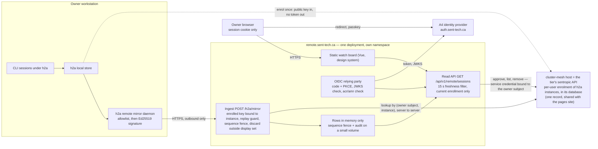
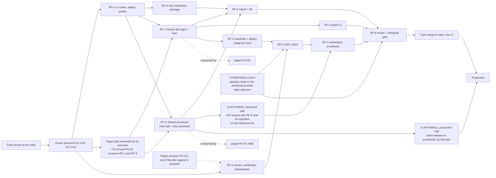

# SPEC_EVOL — Remote control fast lane: a standalone app at `remote.sent-tech.ca` on cluster-mesh

Status: **proposal r4, launches nothing.** Author: planning lane, Claude Fable 5.2, 15/11/2026. Revision r1 (SHA-256 `4ff049ab4c29a026a5d430aa799ec7dd23c8efccbe147fc823a2e53ae0e01ef2`, kept as `spec/SPEC_EVOL_REMOTE_FASTLANE.r1.md`) was reviewed by Opus 5.5 at max effort: verdict REWORK, two blockers, eight majors, twelve minors (`.h2a/reviews/remote-fastlane-opus.md`). Revision r2 folded them (section 12; SHA-256 `955512658a3463fa92b74e8ca2e9962aadcf5ac41397d831dfea1db60e1a4870`, kept as `spec/SPEC_EVOL_REMOTE_FASTLANE.r2.md`) and was reviewed in turn: verdict REWORK, no blocker, four new majors N1 to N4, ten minors (`.h2a/reviews/remote-fastlane-opus-r2.md`). Revision r3 folded those, and applied the owner's reorientation of the pages plan of 15/11 ~10:25: the site login and the per-user enrolment of h2a instances are built once and shared by both sites (section 8.2; section 13; SHA-256 `ab43fffb48f36b3932c7bc68faf2d3805c06ad2d325269f4027fdc60a39ae942`, kept as `spec/SPEC_EVOL_REMOTE_FASTLANE.r3.md`). It was reviewed in turn: verdict REWORK, no blocker, two majors P1 and P2, six minors (`.h2a/reviews/remote-fastlane-opus-r3.md`). This r4 folds those: the shared enrolment becomes a written contract (section 5.3.1), the shared login carries the same-site requirements of the pages review (section 5.2), the document is aligned line by line with revision 5 of the pages plan (section 8.2), and T3 is recorded as done. Section 14 maps each r3-review finding to the section that answers it. The r4 design review is owed before any build (section 7, lot RF-0).

Owner order, 15/11 ~09:50, verbatim: « De meme je veux pouvoir activer le remote controle asap quitte a ce que ce soit remote.sent-tech.ca basé sur cluster mesh. »

Reading used by this document: (1) remote control as soon as possible; (2) a standalone app at `remote.sent-tech.ca`, built on cluster-mesh, isolated from the legacy sentropic app and evolving on its own, is acceptable; (3) « De même » ties it to the T3 cutover: authentication goes through the A4 identity provider at `auth.sent-tech.ca`. That cutover is done: the A4 provider is live at `auth.sent-tech.ca` since 15/11 ~11:23 Montréal time and the owner accepted it (launch order of r4; section 2).

## 1. Résumé propriétaire — une page

**Ce que « contrôle à distance » veut dire le premier jour.** Un tableau de bord, ouvert depuis n'importe quel navigateur (ordinateur ou téléphone), qui montre en direct les sessions d'agents en ligne de commande des postes que tu as choisi d'y faire apparaître : leur nom, l'espace de travail, l'état de travail que l'agent déclare lui-même (au travail, en pause, travail fini, bloqué, à court de jetons — c'est-à-dire que le quota d'utilisation du modèle d'IA est épuisé) et l'âge du dernier signe de vie. Une session dont le programme s'est arrêté ne s'affiche pas comme « arrêtée » : elle disparaît de la liste. Le premier jour, tu **regardes**, et tu peux à tout moment **retirer un poste** depuis le site : ce geste coupe l'envoi de ce poste, il n'agit sur aucune session. Tu ne peux pas encore arrêter une session, lui envoyer une consigne ni approuver une demande d'autorisation : ces trois gestes agissent sur ta machine et exigent des protections qui ne sont pas encore construites. Le premier geste proposé ensuite est l'arrêt d'une session (décision 1).

**Ce que tu vois à `remote.sent-tech.ca`.** Une page de connexion qui renvoie vers ton fournisseur d'identité (`auth.sent-tech.ca`) et exige ta clé d'accès à deux facteurs. Ensuite un seul écran : la liste de tes sessions, regroupées par poste de travail (le nom du poste est celui que tu donnes au moment où tu l'inscris sur le site), avec une pastille d'état et l'âge du dernier signal. Un panneau « mes postes » sert à inscrire un poste et à le retirer. Pour inscrire, tu recopies le code que le poste affiche ; le site te montre alors le nom du poste et l'empreinte de sa clé (une courte suite de caractères qui identifie cette clé), que le poste affiche lui aussi : tu ne confirmes que si les deux sont identiques. Un panneau « ce qui est partagé » dit deux choses distinctes :
- *ce qui sort du poste* : les champs affichés, plus la fiche technique de l'agent, c'est-à-dire ce que l'agent déclare savoir faire et où le joindre (ses rôles, ses périmètres, ses capacités déclarées, ses adresses de service hors fichiers locaux, les identifiants de son compte et de son agent pilote, la version de l'outil) et, pour chaque session, les identifiants des négociations qu'elle suit et ses sujets d'abonnement ;
- *ce que le site garde* : uniquement les champs affichés ; tout le reste est jeté à la réception, avant tout enregistrement.

Ne sortent jamais du poste : le texte des conversations, les commandes, les chemins de fichiers.

**« Basé sur cluster-mesh » : ce que cela veut dire le premier jour.** Le site est assemblé avec le cadre et les conventions de cluster-mesh, et l'inscription de tes postes passe par un mécanisme d'inscription de cluster-mesh, calqué sur celui qui sert déjà aux appareils et construit une seule fois pour ce site et pour le site d'artefacts `pages.sent-tech.ca` (décision 9). La liste des postes inscrits est tenue par le serveur de l'application Sentropic actuelle. Trois règles de cette inscription : elle ne donne au poste aucun accès à ton compte (le poste dépose sa clé publique, rien ne lui est remis en retour) ; elle n'alimente ce tableau que si tu l'as approuvée connecté avec ta clé à deux facteurs ; une inscription approuvée sur le site d'artefacts sans cette clé ne compte pas ici. Le transport des sessions, leur vérification et leur tri viennent de l'outil de coordination des agents (h2a) ; la connexion est le mécanisme standard de ton fournisseur d'identité. La partie « sessions » de cluster-mesh existe mais elle est fermée aujourd'hui ; elle n'entre qu'aux étapes suivantes. C'est la décision 3.

**Avant / après.**

```
AVANT (aujourd'hui)                       APRÈS (première étape)
Téléphone : aucun écran à ouvrir.         Téléphone : remote.sent-tech.ca
                                          ┌───────────────────────────────┐
Poste : une fenêtre de terminal           │ Mes sessions      mis à jour  │
par agent, à regarder sur place.          │                   il y a 3 s  │
                                          │ Poste « bureau »              │
Assistant IA connecté au service          │  ● au travail   spec-remote   │
de coordination : peut répondre           │    sentropic · signal : 4 s   │
« quelles sessions existent »,            │  ▲ bloqué       build-ui      │
sans écran, sans clé à deux               │    sentropic · signal : 9 s   │
facteurs.                                 │ [ Ce qui est partagé ]        │
                                          └───────────────────────────────┘
```

- *Avant, vérifié le 15/11* : un service hébergé de coordination des agents existe déjà à l'adresse `h2a-mcp.sent-tech.ca`. Il est fait pour qu'un assistant IA connecté puisse lister instances et sessions, en lecture seule ; il n'a pas d'écran, et sa connexion repose sur un secret d'opérateur, pas sur ta clé à deux facteurs. Au moment de la vérification, aucun envoi vers ce service ne tournait sur ce poste. Ce que ce service contient aujourd'hui pour tes autres postes est `unknown`. L'application Sentropic contient des portes prévues pour le contrôle à distance, toutes fermées, sans écran.
- *Après la première étape* : depuis ton téléphone, tu ouvres `remote.sent-tech.ca`, tu te connectes avec ta clé, et tu vois quelles sessions tournent, lesquelles sont bloquées ou à court de jetons. Une session dont le poste se tait disparaît de la liste au bout de 15 secondes. Si tu appuies sur « Retirer ce poste », depuis ton téléphone et sans passer par un opérateur, ses envois sont refusés, ses lignes disparaissent tout de suite, et le programme d'envoi du poste s'arrête de lui-même après trois refus. Pour le faire réapparaître, tu l'inscris à nouveau.
- *Ce que la première étape ajoute réellement* : un écran lisible sur téléphone, ta connexion à deux facteurs, et un retrait de poste que tu fais toi-même et qui se vérifie. Si le service existant reçoit déjà tes sessions, le gain se limite à ces trois points ; la comparaison « réutiliser le service existant » contre « nouveau site » est dans la décision 1.
- *Étapes suivantes, dans l'ordre proposé* : arrêter une session ; voir le terminal en direct en lecture seule ; envoyer une consigne ; approuver ou refuser une demande d'autorisation.

**Ce qui est coupé de la première étape.** L'arrêt, le terminal en direct, la conversation structurée, l'envoi de consignes, l'approbation, les alertes sur téléphone, les sessions de conversation natives de Sentropic, le passage par une machine intermédiaire, le choix session par session de ce qui apparaît (c'est poste par poste), et l'écran « Sessions » dans l'application Sentropic historique (le site autonome le remplace comme premier lieu d'activation).

**Les risques.**
1. La première étape montre mais ne pilote pas : elle peut décevoir si « contrôle » est attendu dès le premier jour. L'alternative « arrêt dès le premier jour » est chiffrée dans la décision 1, avec ce qu'elle coûte en sécurité.
2. La première étape s'écarte du plan de contrôle à distance sur six points (décisions 2 et 6). Chaque écart a une date de revue, une date de fin après laquelle le site refuse de fonctionner sans ton renouvellement, et la description de ce qui arrive s'il est exploité.
3. Le passage de la connexion vers `auth.sent-tech.ca` est fait, et tu l'as accepté le 15/11 : ce n'est plus une condition. La mise en production dépend encore de deux actes d'infrastructure (nom de domaine, certificat), d'une mise à jour du serveur de l'application Sentropic (c'est elle qui apporte l'inscription des postes) et de l'intégration dans la branche principale par le train de livraison (plusieurs branches regroupées, intégrées et testées ensemble avant d'entrer dans la branche principale).
4. L'adresse de répétition ne sert à rien tant que ta clé d'accès n'y fonctionne pas : la connexion par clé y dépend d'une reprise de données dont l'état est `unknown`. **Cette reprise conditionne aussi la production** : le contrôle final avant la mise en production se fait sur l'adresse de répétition, avec ta clé. Sans elle, pas de date de production (décision 7).
5. Le mot « remote » désigne déjà, dans l'hébergement, un espace **en service** (sessions et services de coordination des agents, un volume de données de 93 Gi). Il ne faut ni le réutiliser ni y toucher ; le nouveau site reçoit un espace au nom différent.
6. Le morceau de code qui vérifie les envois vit dans l'outil de coordination des agents, qui entraîne avec lui un grand nombre de dépendances, dont une deuxième version de cluster-mesh. L'importer tel quel est un risque probable sur la chaîne d'approvisionnement ; la proposition est d'en extraire un petit paquet sans dépendance avant de construire.
7. Deux pièces sont désormais communes avec le site d'artefacts `pages.sent-tech.ca` : la connexion au site et l'inscription des postes. Elles sont construites une seule fois et utilisées par les deux sites. Cela évite deux mécanismes de sécurité parallèles, mais ajoute du travail avant la première mise en service et lie les deux calendriers. Le site dépend aussi, pour savoir quels postes sont inscrits, du serveur de l'application Sentropic actuelle, qui tient cette liste : le site est séparé de cette application par son code, son hébergement et ses secrets, mais pas par cette dépendance. Si ce serveur ne répond pas, ou pendant une de ses mises à jour, le tableau se vide au lieu d'afficher des postes non vérifiés ; les lignes reviennent d'elles-mêmes, en cinq minutes au plus après son retour.
8. Des pages écrites par d'autres comptes sont servies, ou le seront, sous des adresses qui se terminent par `sent-tech.ca` (les artefacts). Pour un navigateur, ces adresses appartiennent « au même site » que `remote.sent-tech.ca` : une page malveillante pourrait tenter d'agir à ta place sur le tableau, ou de te connecter à ton insu sous un autre compte. Le tableau s'en protège sans compter sur cette parenté : chaque geste n'est accepté que s'il part exactement de l'adresse du tableau, aucun geste ne passe par un simple lien, et ses cookies (les petits fichiers qui tiennent ta connexion) ne peuvent pas être écrasés depuis une autre adresse. Le plan du site d'artefacts te propose de déplacer ces pages sur un nom de domaine séparé ; tant que tu n'as pas tranché cette question, le risque reste inscrit ici.

**Décisions à prendre maintenant — une recommandation chacune.**
1. *Par quoi commencer ?* Trois voies : (a) regarder d'abord, puis l'arrêt d'une session comme premier geste, avant le terminal ; (b) regarder et arrêter dès le premier jour ; (c) ne rien construire et utiliser le service de coordination existant à travers un assistant IA. **Recommandation : (a).** La voie (b) ajoute 45 à 70 heures-agent, repousse la première mise en service d'une durée `unknown` tant que la session responsable de l'outil de coordination n'a pas chiffré sa part, et ouvre vers ton poste un premier chemin d'action avant les protections prévues par le plan : si le site était compromis, quelqu'un pourrait arrêter tes sessions à répétition (perte de travail en cours, pas de fuite ni de commande injectée). La voie (c) ne coûte rien mais n'offre ni écran ni connexion à deux facteurs.
2. *Accepter cinq écarts temporaires par rapport au plan de contrôle à distance ?* Tous valent pour toi seul, sont revus le 15/12/2026 et prennent fin le 15/01/2027. **Recommandation : oui aux cinq.** Tu peux en refuser un sans refuser les autres.
   - a. *Alimenter la liste par le canal signé qui existe déjà entre tes postes et un service hébergé, en attendant le canal prévu par le plan.*
   - b. *Accepter qu'un poste inscrit montre toutes ses sessions, y compris celles ouvertes plus tard, au lieu d'un accord session par session.* Le plan prévoit un choix voisin (un poste et un espace de travail, avec le minimum d'informations) sans le prendre par défaut ; ce qui est proposé ici est plus large : tout le poste, avec les noms.
   - c. *Accepter que le site reçoive les envois sans autorisation signée par toi renouvelée chaque minute.* Deux garde-fous : le site ne conserve rien quand tu n'es pas connecté, et une ligne disparaît après 15 secondes sans signal.
   - d. *Accepter que l'envoi contienne plus que la liste minimale du plan, le site jetant le surplus à la réception.* Le surplus est décrit plus haut.
   - e. *Afficher le nom de la session, le nom de l'espace de travail et l'état de travail, au lieu d'identifiants anonymes.* Autre possibilité offerte : des surnoms que tu choisis toi-même pour chaque poste, sans qu'aucun nom réel ne s'affiche.
3. *Accepter que « basé sur cluster-mesh » veuille dire, le premier jour, « assemblé avec le cadre de cluster-mesh, postes inscrits par un mécanisme d'inscription de cluster-mesh calqué sur celui des appareils », la partie sessions venant ensuite ?* **Recommandation : oui.**
4. *Ouvrir d'abord une adresse de répétition (`preprod.remote.sent-tech.ca`), puis l'adresse définitive ?* **Recommandation : oui**, mêmes fichiers de déploiement pour les deux.
5. *Autoriser les actes d'infrastructure : deux noms de domaine, deux certificats, un espace d'hébergement dédié nommé sans le mot « remote », l'inscription du site auprès du fournisseur d'identité ?* **Recommandation : oui.** Deux précisions. Ton accord se donne directement à la session qui gère l'hébergement : elle n'accepte pas un accord relayé. Et la demande n'est groupée avec celle du site d'artefacts `pages.sent-tech.ca` que si ton choix du nom de domaine de ses pages est déjà fait ; sinon la demande de ce site part seule, pour ne pas attendre un nom qui n'existe pas encore.
6. *Confirmer que la première activation se fait sur `remote.sent-tech.ca` et non dans l'application Sentropic, comme le plan le prévoyait ?* **Recommandation : oui** ; c'est ce que dit ton ordre du 15/11, la confirmation permet de l'inscrire au plan.
7. *Que faire si la reprise de données qui rend ta clé utilisable sur l'adresse de répétition n'a pas de date ?* Deux voies : (a) attendre cette reprise, et la production attend avec elle ; (b) faire le tout premier essai de connexion directement à l'adresse définitive, le site étant fermé à tout autre que toi, avec un retour arrière préparé. **Recommandation : (a).** La voie (b) gagne du temps mais fait de la production le premier endroit où ta connexion est essayée ; elle te sera reproposée si, une fois la construction terminée, la reprise n'a toujours pas de date.
8. *Comment le site est-il emballé pour être déployé ?* (a) Dans le même paquet logiciel que l'application et le fournisseur d'identité : c'est ce qui se fait déjà, donc aucune nouvelle chaîne de fabrication à valider. Le code du site reste séparé, mais le mélange joue dans les deux sens : le paquet du site contient le code de l'application sans s'en servir, et le paquet de l'application et du fournisseur d'identité embarque le code du tableau et ce dont il a besoin. (b) Dans un paquet propre au site : séparation complète, au prix d'une chaîne de fabrication, de contrôle et de publication nouvelle, sans précédent dans le dépôt, et de 6 à 10 heures-agent de plus. **Recommandation : (a).**
9. *Construire une seule fois la connexion au site et l'inscription des postes, pour ce site et pour `pages.sent-tech.ca` ?* **Recommandation : oui, construites par ce plan, qui en a besoin le premier, puis réutilisées telles quelles par le site d'artefacts.** Conséquence : ces deux pièces pèsent environ 41 à 62 heures-agent dans la première étape, dont 16 à 26 étaient déjà prévues dans le plan du site d'artefacts et en sortent. Le plan du site d'artefacts, dans sa version actuelle, ne connaît pas encore ce choix et prévoit de construire ces deux pièces lui-même : c'est ta réponse qui tranche, et aucune des deux pièces ne démarre avant que ce plan-là soit corrigé.

Aucune ouverture de publication publique n'est nécessaire : le site est privé, derrière ta connexion. Estimation de la première étape : 105 à 156 heures-agent (une heure-agent est une heure de travail d'un agent IA, pas une heure de ton temps). Visible en répétition au plus tôt le mardi 24/11, à condition que ta clé d'accès fonctionne sur l'adresse de répétition ; sinon la date est `unknown`. À l'adresse définitive au plus tôt le jeudi 26/11, plus probablement dans la semaine du 30/11 ou la suivante, et seulement une fois réunies trois conditions : ta connexion par clé vérifiée sur l'adresse de répétition, le serveur de l'application Sentropic mis à jour avec l'inscription des postes, l'intégration faite par le train de livraison. Si l'une des trois n'a pas de date, la production n'en a pas non plus.

## 2. Authority, evidence and binding inputs

[JUGEMENT] This document is a design specification: a first increment, a path, an architecture, a gap analysis, a lot list and the open owner decisions. It is not a delivery receipt. `[FAIT]` marks an observation read in a source tree or a document, with a file-and-line reference. `[JUGEMENT]` marks a proposed design, gate, estimate or future action. A tag at the start of a paragraph, list item or table row applies to its whole content. Missing evidence is written `unknown`; a value quoted from another document and not re-read by this lane is `unverified`. Effort is in agent-hours, then wall-clock with the lanes available. Every deployed state is `unknown` unless a line says otherwise. Three read-only observations were made for r2 on 15/11 and are cited as `[FAIT] probe` with their command: a name lookup (`getent hosts <name>`), a process listing on the authoring workstation (`ps -eo pid,etimes,args`), and one unauthenticated `curl` GET, which returned no HTTP answer and therefore proves nothing. Nothing was written to any deployment. Every source line that the r1 review cites against r1 was re-read by this lane at the pins below before being reused here. For r3 the pins were re-checked: `sen:`, `h2a:`, `k8s:` and `RC16` are unchanged; `ds:` has moved (see its row). This lane re-read at those pins the lines the r2 review cites for N1 to N4 and m5 to m7: `sen:deploy/k8s/base/35-auth-idp.yaml:99` to `:104`, `sen:deploy/k8s/overlays/prod/kustomization.yaml:28`, `:39`, `sen:Makefile:86`, `sen:packages/cluster-mesh/src/device.ts:1` to `:36`, `sen:packages/cluster-mesh/README.md:100` to `:104`, `sen:api/src/services/cluster-mesh-adapter.ts:31` to `:36`, `:78` to `:84`, `sen:apps/auth-idp/RP_SESSION_GLUE.md:1` to `:20`, `sen:deploy/k8s/overlays/preprod/patch-auth-idp-config.yaml:26` to `:48`, `h2a:packages/h2a/src/cli.ts:496`, `h2a:packages/h2a/src/runtime/mirror/accept.ts:128` to `:160`, `h2a:packages/h2a/src/runtime/mirror/push-daemon.ts:28` to `:34`, `:110` to `:118`, and `k8s:requests/README.md:24` to `:45`. The pages specification r4 and the owner answers it applies were read in full in the working tree.

[FAIT] For r4 the four pins were checked again and none has moved since r3. This lane read, at those pins, what the r3 review read and r3 had left `unknown`: `sen:api/src/routes/namespaces/session-device.ts:1` to `:101`, `sen:api/src/services/device-code-store.ts:1` to `:199`, `sen:api/src/services/auth/session-adapter.ts:13` to `:39`, `sen:api/Dockerfile:271` to `:272`, `:334` to `:337`, `:437` to `:450`, `:464` to `:467`, `:506` to `:508`, and `h2a:packages/h2a/src/runtime/mirror/push-daemon.ts:101` to `:117`. It read the blocker B1 of the pages r4 review (`OR4:39` to `:42`) and, in revision 5 of the pages plan, the sections on enrolment, security, names, lots, dates and owner decisions (`PG5:264` to `:286`, `:386` to `:411`, `:437` to `:446`, `:512` to `:514`, `:640` to `:659`, `:798` to `:809`, `:913` to `:928`); the rest of that revision was not read by this lane and is `unknown` here. A search of revision 5 for `D19`, `RF-1`, `RF-E`, `REMOTE_FASTLANE` and `remote.sent-tech.ca` returns no line (`grep -c`, 0).

[FAIT] T3 is done. The launch order of r4 states: A4 identity provider live at `auth.sent-tech.ca` since 15/11 ~11:23 Montréal time, accepted by the owner. The rules file records the post-acceptance arrangements with the k8s session at 11:25 (`CR:131`). This lane read no deployment and takes the acceptance from the launch order. The state of the rehearsal provider's passkey seed is a different matter and stays `unknown` (section 3.3).

| Prefix | Source and pin |
|---|---|
| [FAIT] `sen:` | `/home/antoinefa/src/sentropic`, `origin/main` = `913e3bcbc9dec9ff5f9db36eb3a1ef5a3dd11b7a`, read with `git show origin/main:<path>`. |
| [FAIT] `h2a:` | `/home/antoinefa/src/h2a`, `origin/main` = `1f57127dee0bf671e559c347cd86960180cd64c9`. |
| [FAIT] `k8s:` | `/home/antoinefa/src/poc-k8s`, `origin/main` = `1534733fdcb18c44a90f216a8104594b698000a8`. |
| [FAIT] `ds:` | `/home/antoinefa/src/sent-tech-design-system`, `origin/main` = `81083403e58dd1810bd1bd4f639882d226375d97` for r1 and r2. At the r3 check `origin/main` is `25ce442b69133c8c91a407a6abc34dbcba63d187`, of which the earlier pin is an ancestor. The two `ds:` observations this document uses were re-checked at the new head and hold: the three Vue files exist, and no file name contains `terminal` or `xterm`. |
| [FAIT] `RC16:n` | `.tmp/remote-ctl/plan-remote-ctl-v1.6-draft.md`, line `n`; SHA-256 `6168b73ba9b236530bde6bb4998929de1ede0c92d61aa0fc07fcd4f9983b7b18`. A draft: v1.6 independent acceptance is open (`RC16:38`). |
| [FAIT] `R1:n` | `sen:spec/REMOTE_CONTROL_RC1.md`, line `n`. |
| [FAIT] `T6:n` | `spec/SPEC_EVOL_T6_FASTLANE.md` (working tree), line `n`. |
| [FAIT] `CM:n` | `spec/SPEC_EVOL_CHAT_MESH_PROPOSAL.md` (working tree), line `n`. |
| [FAIT] `PG5:n` | `spec/SPEC_EVOL_PAGES_TRI_FRAMEWORK_DEMO.md` (working tree), **revision 5**, line `n`; SHA-256 `0df04b25acb7f7e69cb493ebf76733064d0eba78d77fa14ff3b31a31f4facd0c`. Revision 5 folds the review of revision 4 and has not been reviewed itself (`PG5:3`). It is the current pages plan; where this document states what the pages plan requires today, it cites `PG5`. A source line quoted through `PG5:n` is that document's claim and is `unverified` by this lane unless this section lists it as re-read. |
| [FAIT] `OR4:n` | `.h2a/reviews/pages-r4-opus.md`, line `n`; SHA-256 `600ae3e8e547ee0e8e93316802be602185d5dae47cd0deb47577a1c88da583b4`. The Opus 5.5 review of pages revision 4: verdict REWORK, one blocker B1. |
| [FAIT] `PG4:n` | `spec/SPEC_EVOL_PAGES_TRI_FRAMEWORK_DEMO.r4.md` (working tree; until r3 of this document the same bytes were at the unsuffixed path), **revision 4**, line `n`; SHA-256 `6070a2b6bad36a3608a5be9da9f95bdc59e711e97d49e38efcd770cd8bf78d33`. Kept for the citations r3 made; superseded by revision 5 wherever the two differ. Revision 4 was a reorientation by the owner; it was then reviewed with verdict REWORK (`OR4`). A source line quoted through `PG4:n` is that document's claim and is `unverified` by this lane unless section 2 lists it as re-read. The `PG §…` references of r2 pointed into revision 3 and are all replaced. |
| [FAIT] `OD:n` | `.tmp/pages-demo-dossier/owner-decisions-r3.yaml`, line `n`; SHA-256 `88526c48ce5400b741fbb180f1f7d7e822fe04d42f738d10f8b0acb13decec3b`. The owner answers of 15/11 ~10:25 on the pages plan. |
| [FAIT] `WD:n` | `spec/SPEC_EVOL_WASM_DEPLOYMENT.md` (working tree), line `n`. |
| [FAIT] `CR:n` | `.tmp/packets/COMMON-RULES.md`, line `n`. |

[FAIT] Settled owner decisions carried from the remote-control plan (`RC16:50`): enrolled-2FA OIDC at session authentication; repeated explicit actions, consent changes and machine switches under the same valid login need no additional MFA; no periodic control unlock; explicit sharing and explicit action intent. [FAIT] The plan does not authorize implicit sharing, delegated human control, process migration or automatic plugin installation (`RC16:54`). [FAIT] The owner direction « deux moteurs, un registre » separates CLI sessions supervised by h2a from the native chat loop (`RC16:52`).

[FAIT] Rules that bind this plan: owner copy uses functional words, no lot codes, jargon explained, before/after pictures (`CR:116`); 0 Python (`CR:8`); every request and decision is recorded in Track (`CR:23`); no plan is adopted without an architect review at max effort (`CR:83`); Codex is out until 20/11 07:05 (`CR:107`, `CR:113`) and Muse until 15/11 19:00 (`CR:113`); reviews run on Opus 5.5, max for design and high for code (`CR:112`); wagon lanes push branches without a pull request and the train integration lane merges them, one pull request and one CI run per train (`CR:43`, `CR:55`); the client IP is not visible behind the load balancer (`CR:119`); the T6 fast lane is paused (`CR:121`).

[JUGEMENT] One rule conflict is recorded rather than resolved here: `CR:10` forbids time estimates in documents, while the launch packet of this lane asks for agent-hours and wall-clock dates. This document follows the launch packet.

[FAIT] A second inconsistency sits inside the rules file itself. `CR:107` (14/11 08:40) says « Fable is out until 19/11 17:00 » and routes authoring to Muse; `CR:109` (owner routing, 14/11 10:40) names Fable 5.2 as the author and operations model; `CR:125` (14/11 19:30) records a Fable quota hit until 09:00 on 15/11. [JUGEMENT] This document reads the later owner routing (`CR:109`) as superseding `CR:107` for Fable, which is also what the launch of this lane on Fable implies; the conductor confirms it in RF-0. Likewise `CR:24` and `CR:69` forbid Opus without owner authorization while `CR:112` routes reviews to Opus 5.5: the review of r1 ran on Opus under `CR:112`.

## 3. What exists today

### 3.1 The remote-control plan and its closed doors

| Subject | Evidence |
|---|---|
| [FAIT] The plan's first visible milestone is not dispatchable | A Claude CLI session opened from `sentropic.sent-tech.ca`, with live structured conversation, terminal view and one harmless input (`RC16:44`); its status is « non-dispatchable; no installed/hosted receipt is established » (`RC16:839`). It joins the contract, federation, native train, Claude capability probes, store, relay, UI, action path and release mechanism (`RC16:851`). |
| [FAIT] The plan already has a « watch first » default | If Claude does not allow safe input in the current interactive session, the plan's default is to open the authorized consultation with control disabled while the capability is qualified; « cela permet de voir l'avancement mais ne clôt pas le premier jalon de pilotage » (`RC16:940`, choice O6, default B). |
| [FAIT] The plan defines no qualified remote stop | The generic fallback is view-only; raw `write`, approval-like bytes, shell commands, « resize/stop » and auto-approve flags « cannot become control fallbacks » (`RC16:518`). |
| [FAIT] The plan's lots from RC2 on are open | RC2 to final production are `OPEN` (`RC16:101` to `RC16:112`); RC0 and RC1 are done at their recorded scope (`RC16:99`, `RC16:100`). |
| [FAIT] The inter-instance federation contract is a source gap | « FED6 is unaccepted »; the route class, installation principal and transit grants are `source-gap` even for the direct pair, and the plan refuses to « silently take a direct RC0-registration bypass around federation » (`RC16:191`); the accepted federation successor is `source-gap` (`RC16:885`, `RC16:888`). |
| [FAIT] Content sharing is disabled until a policy supplement lands | Without the R15 policy-purpose supplement, content sharing « stays disabled, including fallback PTY capture » (`RC16:162`); on the h2a side the content-policy surface is `accepted: false` (`h2a:packages/h2a-runtime/src/session-content-v3-api.ts:10` to `:13`) and `canCapture` is the constant `false` (`h2a:packages/h2a-runtime/src/session-content-consent.ts:13`). |
| [FAIT] RC1 is an authority layer without effect | « No action routes or provider effects are enabled by RC1 » (`R1:3`); the product root answers `403 authority_refused` (`sen:api/src/routes/auth/remote-evidence.ts:35`; mounted at `sen:api/src/app.ts:452`). |
| [FAIT] The receiver of the legacy API is mounted and closed | The 38-route table is frozen against a sealed contract manifest (`sen:api/src/routes/session-content/route-table.ts:15`, `:60`, `:61`); five browser routes exist (`:92` to `:96`); the product wiring sets `approvedTarget: null`, `endpointAuthority: null`, `registry: null`, `handlers: {}` (`sen:api/src/routes/session-content/product.ts:23`, `:24`, `:51`, `:52`), so every route without an injected handler refuses (`sen:api/src/routes/session-content/receiver.ts:79` to `:83`); it is mounted at `sen:api/src/app.ts:490`. |
| [FAIT] The cluster-mesh relay is packed and fail-closed | `@sentropic/cluster-mesh/sessions/relay` is an export (`sen:packages/cluster-mesh/package.json:59` to `:61`); « no mesh wiring is registered in production and every connect resolves to the typed refusal `relay_grant_unavailable` — all live routes, including direct B→A, stay DISABLED » (`sen:packages/cluster-mesh/src/sessions/relay.ts:9` to `:12`). |
| [FAIT] The cluster-mesh session registry exists, in process memory | `createSessionOriginRegistry` (`sen:packages/cluster-mesh/src/sessions/registry.ts:67`) over a state made of in-memory maps (`sen:packages/cluster-mesh/src/sessions/registry-store.ts:37` to `:40`). Its durable store binding: `unknown` (not read). |
| [FAIT] The h2a side consumes that registry and refuses | The registry-bearing cluster-mesh archive is unpublished, so every dispatch refuses with `relay_grant_unavailable` (`h2a:packages/h2a-runtime/src/mesh-consumer-origin.ts:12` to `:15`). |
| [FAIT] Session control routes are declared and closed | `drive`, `wake`, `relaunch` are routed (`sen:packages/cluster-mesh/src/hono/session-router.ts:115`); the product instruction resolver returns `null` (`sen:api/src/routes/namespaces/session.ts:79` to `:82`), and so does the h2a one (`h2a:packages/h2a/src/runtime/drive/cluster-mesh-outer.ts:31` to `:36`). |
| [FAIT] The `/chat` slot of cluster-mesh is gated | `'chat-server'` is in the gated module list (`sen:packages/cluster-mesh/src/modules/contracts.ts:42`); the chat-mesh proposal plans to open it (`CM:157`). |
| [FAIT] Cowork packages do not carry a session relay | `@sentropic/cowork-bridge` 0.2.0 is a « portable client bridge … client core, transport-agnostic auth and local-tool protocol/permission contracts » (`sen:packages/cowork-bridge/package.json:3`, `:4`). |

[FAIT] The plan's listing stage, as written. A listing grant issued by the site's listing authority « only after explicit owner approval under current enrolled-login lineage », whose scope is « an exact session/incarnation set, or explicitly approved future sessions »; named sessions are the default and the future-session scope needs the owner's explicit choice (`RC16:406`, `RC16:941`). The signed lease is at most 60 seconds, « bounded by current login », and logout, owner withdrawal, key revocation or expiry fence further projection (`RC16:408`). The source « projects before serialization, never serializes a full registry row for A to scrub » (`RC16:412`). Freshness is a separately signed record that expires no later than 15 000 ms after issue, emitted every 5 000 ms (`RC16:396`).

[JUGEMENT] Reading. That listing stage rides the relay, and the relay waits on a federation contract with no accepted successor. No part of the plan's first milestone can be activated « ASAP » without either that contract or explicit owner relaxations; section 4.3 names six of them for step 1.

### 3.2 What already works between a workstation and a hosted service

| Subject | Evidence |
|---|---|
| [FAIT] h2a has a signed, metadata-only push of live sessions | `h2a remote mirror --url <u> --instance <id> --private-key <pem>`, one-shot by default, a live daemon with `--interval-ms >= 5000` (`h2a:packages/h2a/src/cli.ts:496`; floor at `h2a:packages/h2a/src/runtime/mirror/push-daemon.ts:101`). The payload is the instance's own registration, its live sessions and its sub-agent bindings (`h2a:packages/h2a/src/runtime/mirror/build.ts:44` to `:66`). The sessions are **every** live session of the instance, with no per-session selection: `listPresence(...).filter((s) => s.instance === instance)` (`build.ts:84` to `:86`). A selection flag on the daemon: none in the usage line (`cli.ts:496`). The daemon backs off on transient errors and stops on repeated 401/403 « because re-enrollment is required »; the same usage line recommends an interval of 15 000 to 30 000 ms (`cli.ts:496`). The stop threshold is three consecutive authentication rejections (`h2a:packages/h2a/src/runtime/mirror/push-daemon.ts:30` to `:34`, `:112` to `:118`). The mirror was built so that a hosted h2a's « read-only surface (`h2a_discover_instances`) reflects this live agent » (`build.ts:2` to `:4`). |
| [FAIT] The send boundary is an allowlist | « nothing local reaches the body verbatim »: the working directory, the command line, tmux coordinates, the pid, the workspace path and `file://` endpoints do not travel, and sanitizing happens before signing (`h2a:packages/h2a/src/runtime/mirror/build.ts:11` to `:15`). A mirrored session carries `sessionId`, `instance`, `host`, `name`, `startedAt`, `heartbeatAt`, `state`, `interests`, `subscribedTopics`, `workStatus`, `lastMcpActivityAt`, `version`, `workspace` (`h2a:packages/h2a/src/runtime/mirror/sanitize.ts:591` to `:604`); a mirrored workspace is `id`, `host`, `label` (`:475` to `:478`), where `host` is a CLI name such as `claude` or `codex`, not a machine name (`:472`, `:473`). |
| [FAIT] What leaves the workstation is wider than a display row | Session: besides the fields above, `interests` carries `scopes` and `negotiations` identifiers (`sanitize.ts:547` to `:550`) and `version` carries the CLI and skill versions (`h2a:packages/h2a/src/session.ts:146` to `:151`). Registration: `id`, `instance`, `roles`, `scopes`, `capabilities`, `declaredCapabilities`, `endpoints` (kind and URI, `sanitize.ts:707` to `:710`), `publicKeys`, `acceptedPolicies`, `createdAt`, `principal`, `conductor`, `agentUuid`, `name`, `workspace` (`sanitize.ts:795` to `:811`). The work status values are `working`, `paused`, `done`, `blocked`, `out-of-tokens` (`session.ts:53` to `:59`). |
| [FAIT] The acceptance function trusts the union of two key sources | The envelope must verify against « a registry key for the signer OR an operator-enrolled key » (`h2a:packages/h2a/src/runtime/mirror/accept.ts:8` to `:10`); the code builds `candidates` from `resolvePublicKeys(signer)` and `enrolledKeys` together and refuses only when that union is empty or no candidate verifies (`accept.ts:138` to `:141`). A registration is applied only if its `publicKeys` contains the verified key (`:146` to `:149`); the instances the key « owns » are then read from the registrations' own `instance` or `id` field (`:178`), so the verified key is not tied to a pre-declared instance identifier. Records are narrowed after verification (`:16` to `:35`, `:160` to `:198`). Two limits of the function matter for a caller: the signer identifier is read from the envelope before anything is verified (`accept.ts:133`), and the sequence fence is applied only when the body carries a numeric `seq` (`accept.ts:156` to `:158`), so a push without `seq` passes it. `acceptMirrorEnvelope` is re-exported by `runtime/mirror/index.ts` (`:36` to `:40`) and by the package root (`h2a:packages/h2a/src/index.ts:1135`). |
| [FAIT] The supplied HTTP ingester makes key removal ineffective | It wires `resolvePublicKeys: (signer) => store.listInstanceKeys(signer)` and `applyRegistration: (reg) => store.registerInstance(reg)` (`h2a:packages/h2a/src/runtime/mirror/serve.ts:169`, `:184`). `listInstanceKeys` returns the keys of the stored registration plus keyring additions, minus revoked ones (`h2a:packages/h2a/src/runtime/local-files/store.ts:540` to `:554`); the registry is append-only and an existing row is never replaced (`serve.ts:177` to `:183`). So after the first accepted push the instance's public key lives in the hosted registry, and taking it out of the enrolled list refuses nothing: only a keyring revocation does. The ingester also overwrites every presence record with `state: "live"` (`serve.ts:190`, `:191`), and adds a durable per-instance sequence fence and a 256 KiB body cap (`serve.ts:59` to `:85`, `:94`). |
| [FAIT] A hosted h2a service is already described, and its name resolves | The deploy kit serves `h2a-mcp.sent-tech.ca` with `/h2a/mirror` routed to a mirror port (`h2a:deploy/scw/ingress.yaml:15` to `:28`), a `mirror-ingester` sidecar running `mirror-serve` on the same volume (`h2a:deploy/scw/deployment.yaml:88` to `:99`), and a read-only MCP surface behind its own OAuth server, whose consent page takes an operator secret (`h2a:deploy/scw/README.md:3` to `:6`, `:126` to `:129`). The tenant namespace admits Traefik to the mirror port (`k8s:tenants/h2a-mcp/00-namespace.yaml:70` to `:88`). `[FAIT] probe`: `getent hosts h2a-mcp.sent-tech.ca auth.sent-tech.ca preprod.auth.sent-tech.ca` returns `51.79.100.177` for all three, while the kit is a Scaleway one and the preprod ingress comment names a Scaleway load balancer `51.159.11.157` (`sen:deploy/k8s/overlays/preprod/ingress.yaml:3`): the kit and that comment may be stale. `[FAIT] probe`: no `h2a … remote mirror` or `mirror-serve` process on the authoring workstation at 15/11 (`ps -eo pid,etimes,args`, filtered). Whether the hosted service runs, and what it holds for other workstations: `unknown` (the `curl` GET returned no HTTP answer). |
| [FAIT] h2a drives and mirrors from CLI to CLI | `h2a remote mirror-serve`, `h2a remote mirror`, `h2a drive`, `drive receive`, `drive serve` (`h2a:packages/h2a/src/cli.ts:495` to `:499`). `drive serve` is an HTTP listener on the driven side (`:499`), an inbound topology, while the plan requires that the workstation initiates every connection (`RC16:231`). |
| [FAIT] The local terminal host has observe, write and stop operations | `attach-observer`, `write`, `stop`, `stop-if-incarnation` (`h2a:packages/h2a-runtime/src/native-terminal/protocol.ts:47` to `:60`); the plan forbids raw `write`, `resize/stop` and approval-like bytes as remote control fallbacks (`RC16 §3.4.1`, lines 493 to 519). |
| [FAIT] The native verifier of remote actions exists as pure primitives | `@sentropic/h2a-runtime/remote-action`: « No network, no store, no effect » (`h2a:packages/h2a-runtime/src/remote-action.ts:1` to `:8`). |

### 3.3 Identity, hosting and the name « remote »

| Subject | Evidence |
|---|---|
| [FAIT] The identity provider is a standalone OIDC service | Issuer `https://auth.sent-tech.ca` (`sen:deploy/k8s/base/35-auth-idp.yaml:28`); it composes cluster-mesh namespace modules, importing adapters from `api/src` (`sen:apps/auth-idp/idp-app.ts:30` to `:43`, `:178` to `:188`). The preprod tier is `preprod.auth.sent-tech.ca`, by the owner-ratified nested-host rule (`sen:deploy/k8s/overlays/preprod/ingress.yaml:1` to `:6`). |
| [FAIT] A relying party can demand two-factor at authorization | A client row may set a minimum assurance `urn:sentropic:loa:passkey-fresh`: « authorize forces re-auth and refuses bearer sessions » (`sen:api/src/db/schema.ts:179` to `:182`; check at `sen:packages/auth-hono/src/oauth/authorize-handler.ts:411` to `:416`), and a subject allowlist (`sen:api/src/db/schema.ts:183`, `:184`). Both are parameters of the production registration script (`sen:api/src/scripts/oauth-register-client.ts:44` to `:47`), run as a Job by `make oauth-register-client-job` (`sen:Makefile:1654` to `:1657`). |
| [FAIT] The relying-party last mile is a recipe, not a package | Callback, `id_token` verification against the JWKS and the RP's own session cookie are described as a copy-paste recipe (`sen:apps/auth-idp/RP_SESSION_GLUE.md:3` to `:17`). The recipe says every relying party must implement that last mile, « starting with `design-system` » (`:13`), and that a shared helper is « a later-phase decision » (`:16`, `:17`). |
| [FAIT] RC1 defines what « enrolled 2FA » means in a token | Evidence issuance requires `amr` to contain `hwk`, `user` and `mfa` (`sen:api/src/services/auth/remote-evidence.ts:41`). |
| [FAIT] The hostname procedure is the one the pages plan uses | A tenant request file reviewed by the cluster owner (`k8s:requests/README.md:24` to `:45`); no `requests/sentropic.md` exists in `k8s:requests/` (listing read: `geo`, `matchid`, `openerp`, `radar-immobilier`, `sentropic-remote`, `surch`); records created by hand and certificates issued first on the staging issuer, then on the production issuer (`PG4:399`, which cites `k8s:platform/30-clusterissuer.yaml:25` to `:26`, `unverified` by this lane; `sen:deploy/k8s/overlays/preprod/ingress.yaml:3` and the pages spec name two different load-balancer addresses; the name lookup of section 3.2 shows the existing `sent-tech.ca` names on `51.79.100.177` today, and the k8s session confirms the target before any record is created). |
| [FAIT] « remote » names a namespace that is in service, and an active h2a vocabulary | A namespace `sentropic-remote` with quotas for session Pods (`k8s:tenants/sentropic-remote/00-namespace.yaml:1` to `:27`), requested for a control plane that provisions CLI session Pods (`k8s:requests/sentropic-remote.md:4` to `:15`), administered by the sentropic tenant (`k8s:docs/runbooks/tenant-operating-model.md:94`). Only the old *repository* is deprecated: its README says the sessions, k8s and tunnel runtime moved into `@sentropic/h2a-runtime` (`/home/antoinefa/src/remote/README.md:1` to `:14`). The h2a orchestrator still targets the namespace: `namespace: "sentropic-remote"` (`h2a:packages/remote-k8s-orchestrator/src/k8s/spec.ts:292`), and the sidecar defaults follow the « `sentropic-remote` tenant contract » (`h2a:packages/h2a/src/runtime/deploy/k8s-sidecar.ts:63`). The cluster's standby plan keeps `sentropic-remote`, its NFS server, `h2a-mcp` and `mcp-wave` running « afin de préserver les sessions et services de coordination en cours » (`k8s:docs/finops/b3-8-service-plan.md:64`, `:65`); the July inventory lists a `control-plane` and an `llm-gateway` Deployment there (`k8s:docs/migrations/inventory-2026-07-13.md:23`) and a 93 Gi shared volume attached to h2a (`k8s:docs/migrations/ovh-canada-migration-plan.md:29`, `:80`). `h2a remote serve`, `send`, `mirror-serve` and `mirror` are current CLI verbs (`h2a:packages/h2a/src/cli.ts:493` to `:496`). Live content of the namespace today: `unknown`. |
| [FAIT] The identity token carries the assurance claims | The `id_token` is signed with `acr` and `amr` (`sen:packages/auth-hono/src/oauth/token-handler.ts:508` to `:513`); `amr` is `hwk`, `user`, `mfa` when `acr` is `passkey-fresh` and no explicit `amr` was sealed (`:465`). The site can therefore re-check two-factor on the token itself. |
| [FAIT] Passkey login on the rehearsal provider has a prerequisite whose state is unknown | On `origin/main` the preprod provider's WebAuthn RP ID is the parent `sent-tech.ca` and passkey registration is disabled (`sen:deploy/k8s/overlays/preprod/patch-auth-idp-config.yaml:42`, `:47`); the same file states that this setting « breaks passkey login until the prod-data seed lands » and that preprod receives credentials only through the identity sync (`:29` to `:32`, `:44` to `:46`). State of that seed: `unknown`. The owner's subject identifier on the preprod provider: `unknown`. |
| [FAIT] `createClusterMeshPlugin` is a thin router and needs a runtime | It mounts the routers of the namespace modules it is given and passes each `runtime.context` and `runtime.receiptPort` (`sen:packages/cluster-mesh/src/hono/plugin.ts:23` to `:34`). A runtime is built by `createClusterMeshRuntime` from a generation identifier, a config, a verified-invocation context port, a registration gate and a receipt port (`sen:packages/cluster-mesh/src/runtime/generation.ts:31` to `:38`), both exported by the package root (`sen:packages/cluster-mesh/src/index.ts:14`, `:28`). The identity provider obtains its runtime from `api/src` (`sen:apps/auth-idp/idp-app.ts:33`, `:178`, `:179`). A minimal implementation of the three ports outside `api/src`: `unknown`, none read. |
| [FAIT] `@sentropic/h2a` is not a dependency of sentropic and is heavy | `git grep '"@sentropic/h2a"' origin/main -- '*package.json'` returns nothing. The package depends on `@sentropic/cluster-mesh` `0.25.0`, `engram`, `llm-gateway`, `llm-mesh`, `mcp-platform`, `track`, `focus`, the MCP SDK and others (`h2a:packages/h2a/package.json:76` to `:92`), while the workspace cluster-mesh is `0.26.0-dev.27` (`sen:packages/cluster-mesh/package.json:3`). |
| [FAIT] Standalone-host Make targets and the image registry rule have precedents | `typecheck-llm-gateway-process`, `lint-llm-gateway-process`, `test-llm-gateway-process SCOPE=…` (`sen:Makefile:2914` to `:2920`). A new tenant-owned image « must target Scaleway Container Registry unless the request argues an explicit exception » (`k8s:requests/README.md:30` to `:32`); whether that registry rule still holds now that the names resolve elsewhere is `unknown`, and this document writes « the cluster's container registry » for whatever the k8s session confirms. |
| [FAIT] The identity provider has no image of its own | Its Deployment runs the API image with another command: `image: ghcr.io/rhanka/sentropic-api:main`, `workingDir: /workspace`, `command: ["node", "apps/auth-idp/dist/index.js"]`, under the comment « the SAME api image, run as the IdP » (`sen:deploy/k8s/base/35-auth-idp.yaml:99` to `:104`). In production the `api` and `auth-idp` Deployments are each pinned by digest on that same repository, with two different digests (`sen:deploy/k8s/overlays/prod/kustomization.yaml:28`, `:39`): one image repository, one rollout per Deployment. The four `apps/*` directories are inputs of the API image version hash (`sen:Makefile:86`). The Dockerfiles on `origin/main` are `api/`, `ui/`, `e2e/`, `apps/auth-idp/web/`, `apps/sandbox-node/k8s/` and `tools/scw-tem-mock/` (`git ls-tree`): none builds a standalone backend app. Every sentropic image reference read is on `ghcr.io`, while the request rule above names another registry. An app typecheck target through the API container exists: `typecheck-idp` (`sen:Makefile:3408`, `:3409`). How `apps/auth-idp/dist` gets into the API image, read for r4: the image installs « only the api dependency closure (20 workspaces) » from a pruned lockfile (`sen:api/Dockerfile:271`, `:272`); the app directories are copied into the build stage (`:334` to `:337`); the provider is bundled by esbuild into `apps/auth-idp/dist/index.js` (`:464` to `:467`) and copied into the production stage (`:506`, `:507`); the provider's screens have a build stage of their own, « NOT a root workspace member », with its own `npm ci` and audit (`:437` to `:450`), whose output is copied too (`:508`). r2 cited « the identity provider's image and manifests » as a precedent for an image of the app's own; that precedent does not exist. |
| [FAIT] cluster-mesh has a per-user attachment of a local workstation | `LocalDeviceAttachmentPort`: `issueDeviceCode(deviceName?)`, `pollDeviceCode(deviceCode)`, `approveDeviceCode(userCode, userId, role, deviceName?)`, with an approved outcome carrying `userId`, `role`, `deviceName` (`sen:packages/cluster-mesh/src/device.ts:13` to `:35`). The port has no parameter for an instance identifier or a public key. The package's stated topology is « one Sentropic server, its attached local workstations, local signed projections, and the existing device-code lifecycle » (`sen:packages/cluster-mesh/README.md:102` to `:104`). The implementation behind the port lives in `api/src`: the adapter imports the three functions from `./device-code-store` (`sen:api/src/services/cluster-mesh-adapter.ts:32` to `:36`) and exposes them as app dependencies (`:79` to `:84`). |
| [FAIT] That attachment cycle exists to hand a session token pair to a browserless binary, and it cannot carry an instance enrolment as it is | Read for r4. **It issues credentials.** The store's header says the binary « obtains a session token pair via a device-code handshake », step 3 being « consume on approval -> token pair » (`sen:api/src/services/device-code-store.ts:4` to `:8`); on an approved poll the route calls `createSession(outcome.userId, outcome.role, …)` and answers with `sessionToken` and `refreshToken` (`sen:api/src/routes/namespaces/session-device.ts:46` to `:56`). **Its approval accepts any session and reads a cookie.** `approve` takes the token from the `session` cookie or from a `Bearer` header, calls `validateSession`, and approves (`session-device.ts:78` to `:86`); nothing checks an assurance level, and nothing checks an `Origin` header. That cookie is named `session`, has no `__Host-` prefix and is `SameSite=Lax` (`sen:api/src/services/auth/session-adapter.ts:14`, `:29` to `:39`). **Its store is process memory.** Two maps, « process-scoped … entries do not survive server restarts » (`device-code-store.ts:10`, `:11`, `:40`, `:41`); codes live 10 minutes (`:35`), an approved code is consumed by the poll that delivers it (`:178` to `:187`). **It has no field for an instance or a key**: an entry holds the codes, a status, a device name, the approving user and role (`:16` to `:33`). The user code is `PAIR-` followed by four characters of a 32-character alphabet (`:38`, `:52` to `:56`). So a durable record `(user, instance, key, …)` has no counterpart: it needs persistent storage in the API and a database migration. |
| [FAIT] Untrusted pages are, or will be, same-site with `remote.sent-tech.ca` | The pages r4 review found that artifacts are code written by any publishing account, served with inline scripts allowed (`OR4:40`, citing `headers.ts:21`), under sub-domains of `sent-tech.ca`; such a page can set a cookie for the parent domain, « la protection `SameSite` est nulle, puisque l'attaquant est same-site », and « un `Sec-Fetch-Site: same-site` passe tout filtre « même site » » (`OR4:41`). Revision 5 of the pages plan answers by proposing a separate registrable domain for user content, an owner decision not yet answered (`PG5:390` to `:395`, decision PS-O11 at `PG5:917`), and keeps three requirements on a site session in either case: `__Host-` prefix, exact-`Origin` check, no state change on `GET` (`PG5:395`). It also notes that the artifact origins of the sentropic application itself sit under `sentropic.sent-tech.ca` (`PG5:397`), and that an immo wildcard `*.pages.immo.sent-tech.ca` was created on 14/11 (`PG5:514`). Those two lines are that document's claims, `unverified` by this lane; whether any of those origins serves account-written pages today is `unknown`. |
| [FAIT] The pages plan was reoriented by the owner on 15/11 and now needs the same two pieces | Owner note: « On utilisera le service pour publier nos artefact avec h2a local donc cluster mesh trunk et enrolement des instances par utiliseur possible » (`OD:4`); « Les utilisateur de auth.sent-tech.ca ont tous acces. Cluster mesh gere leur workspace dans pages et permet de sync avec d autres cluster mesh » (`OD:10`); « je veux un vrai site completement fonctionnel » (`OD:11`). Revision 4 of the pages plan makes the site a signed-in one: authorization code with PKCE exchanged server-side, a host-only HttpOnly session cookie, no token in the browser (`PG4:335`), built by its lot PS-H3, 16–28 agent-hours, whose existing shape it calls `unknown` (`PG4:439`, `PG4:520`). It designs a per-user enrolment of h2a instances: a record `(user, h2a instance id, instance public key, device name, enrolled-at, revoked-at)` created through the device-code lifecycle, `h2a sentropic enrol` showing a user code approved in the site, listing and one-click revocation in the site (`PG4:256`), as lot PS-P2 at its step 2, 16–26 agent-hours split 10–16 for sentropic and 6–10 for h2a (`PG4:534`). It reads « trunk » as the single authenticated channel between a local h2a and its home cluster-mesh server, a word that names no existing component (`PG4:247`). The h2a sign-in it builds on is an unmerged pull request whose only environment is preprod (`PG4:240` to `PG4:242`, `unverified` by this lane). **Revision 5 keeps all of this and changes four things that matter here**: the site session cookie is `__Host-`-prefixed and has the audience `pages`, refused on every namespace outside a route allow-list (`PG5:403`, `PG5:404`); « every account » becomes « every account signs in, the artifact functions open to approved accounts » (`PG5:918`); the sign-in lot PS-H3 is re-priced to 20–32 agent-hours (`PG5:643`); and the artifact origins are proposed on a separate registrable domain (`PG5:390` to `:395`). The enrolment lot PS-P2 is unchanged: step 2, 16–26 agent-hours, after PS-P1 and PS-H3 (`PG5:659`), approved « in the site, signed in » (`PG5:286`). Revision 5 still builds both pieces itself and does not know decision D19 of this document (section 2). |
| [FAIT] The design system has list and shell parts, no terminal | `AppShell`, `DataTable`, `MessageStatusBadge` exist for Vue, Svelte and React (`ds:packages/components-vue/src/AppShell.vue`, `DataTable.vue`, `MessageStatusBadge.vue`); a search of the `ds:` tree for `terminal` or `xterm` in file names returns nothing. |

## 4. The smallest safe first increment, and the path after it

### 4.1 Step 1 — the watch board (lots RF-0 to RF-8)

[JUGEMENT] **Scope.** One private web app at `remote.sent-tech.ca`. After a two-factor login at the A4 identity provider, the owner sees the list of CLI sessions whose workstation instance was explicitly opted in. Each row shows: the workstation label, the session name, the workspace label, the self-reported work status, the start time and the age of the last accepted signal. The workstation label has no source field in the feed (section 3.2): it is the device name of that instance's enrolment record, given by the owner when the workstation is enrolled (section 5.3). An ended session is not shown as ended: the supplied feed lists live sessions only, so the row disappears. The list is read-only; the one gesture offered beside it is « remove this workstation », which revokes the enrolment and acts on no session. No conversation text, no terminal bytes, no command, no path and no permission detail leave the workstation; what does leave, beyond the displayed fields, is listed in section 3.2 and discarded by the site before storage (section 5.3).

| Day-1 question | Answer |
|---|---|
| [JUGEMENT] Which sessions | Every live CLI session supervised by h2a under an instance the owner enrolled under their own account and for which the owner started the mirror daemon, including sessions opened later under that instance (relaxation RX-4). There is no per-session choice in step 1. Native Sentropic chat runs are not listed (path step 6). |
| [JUGEMENT] Which actions | Watch, enrol a workstation, and remove a workstation from the board. The last two act on the feed, not on a machine or a session. Stop, steer and approve are absent from the screen, not disabled buttons. |
| [JUGEMENT] Which devices | Any browser holding the owner's passkey, desktop or phone; the screen is designed at 390 px first, as the plan requires for its own views (`RC16:50`). |

[JUGEMENT] **Why watch-first is the proposed start, and what it is weighed against.** It reuses the signing, replay guard and allowlists that exist in h2a (section 3.2), with a stricter key rule than the supplied ingester (section 5.3); it adds no inbound connection to the workstation, moves no content and enables no effect. The plan itself takes « consultation open, control disabled » as its default when safe input is not qualified (`RC16:940`). It is not the only possible start. Three alternatives are put to the owner in decision D1.

| Alternative | What the owner gets | Cost and date | Safety cost |
|---|---|---|---|
| [JUGEMENT] A — watch first, then stop as the first action (recommended) | Step 1 as scoped here; step 2 is stop-only, ahead of the terminal view. | Step 1: 105–156 agent-hours. Step 2: 45–70 agent-hours, low confidence. | Step 1: the six relaxations of section 4.3, all on read-only data. Step 2 adds RX-8 (below), decided when step 1 runs. |
| [JUGEMENT] B — minimal control on day 1 | Watch plus a stop button from the first day. | 150–226 agent-hours before the first visible result; first date `unknown` until h-cond sizes the new workstation code. That part can run beside the site lots, so the extra hours do not turn mechanically into the « two weeks » r2 wrote. | RX-8 taken now, before anything was observed in service: a first effect path into the workstation exists before the plan's action path (journal, one-time claim, native verification, durable consumption; `RC16:106`, `RC16:107`), and against the plan's rule that stop cannot be a control fallback (`RC16:518`). |
| [JUGEMENT] C — build nothing, reuse the hosted h2a read surface | Session listing through an AI assistant connected to `h2a-mcp.sent-tech.ca`. | 0 agent-hours of build; its live state must first be probed (RF-0). | No screen, no two-factor login (its own OAuth server and an operator secret, section 3.2), and key withdrawal that does not cut the feed (section 3.2). Not a remote-control venue. |

[JUGEMENT] **The stop-only design, so that B and step 2 are concrete.** The workstation pulls; nothing listens on it. After a two-factor login, the owner presses stop on one row; the site records a stop intent: session and incarnation identifiers, a one-time identifier, an expiry of 60 seconds, signed with a site key whose public half the workstation pinned at enrollment. The workstation daemon fetches pending intents on its outbound connection, verifies the signature, the expiry, the one-time identifier against a durable local record, and that the incarnation is still the running one, then calls the terminal host's `stop-if-incarnation` (`h2a:packages/h2a-runtime/src/native-terminal/protocol.ts:47` to `:60`) and reports the outcome. The intent carries no text. Blast radius if the site or its signing key is compromised: any enrolled session can be stopped, repeatedly — loss of availability and of in-flight work; no content leaves, nothing is typed into a session, no approval is given. What it costs beyond that: a new signing secret on the site; new workstation code in h2a; a second, smaller action path that must be deleted when the plan's one opens (`CR:13`); and a named departure from `RC16:518` (RX-8).

[JUGEMENT] **Order of the following steps.** r1 put the read-only terminal (90–130 agent-hours) ahead of stop and steer. r2 inverts it for stop only: stop needs no content, so it does not wait for the R15 supplement that the terminal view needs (`RC16:162`), and it is the cheapest answer to the word « contrôle » in the owner order. Steering stays after the terminal view, because typing into a session without seeing it is not a usable control.

### 4.2 Conformance to the settled owner decisions

| Settled decision | Step 1 behaviour |
|---|---|
| [JUGEMENT] Enrolled-2FA OIDC at session authentication (`RC16:50`) | The site is an OIDC client registered with the minimum assurance `passkey-fresh` and a subject allowlist of one (the owner). The site's backend re-checks, on the verified `id_token`, that `acr` is `passkey-fresh` and that `amr` contains `hwk`, `user`, `mfa` — the same triple RC1 requires (`sen:api/src/services/auth/remote-evidence.ts:41`). A bearer session (magic link, federation) is refused at the provider and again at the site. |
| [JUGEMENT] No periodic unlock; machine switch without extra MFA (`RC16:50`) | One login opens one site session with an absolute lifetime (proposed 8 hours, no sliding renewal, no step-up prompt). All enrolled workstations appear under that one login. |
| [JUGEMENT] Explicit sharing (`RC16:50`, `RC16:54`) — **met per workstation instance, relaxed per session (RX-4)** | Nothing appears by default. Two explicit acts **by the owner** are needed per instance: enrolling it under the owner's account (h2a shows a user code, the instance identifier and the key fingerprint on the workstation; the owner approves it on this site, inside the two-factor session, after comparing them; section 5.3.1), and starting `h2a remote mirror --interval-ms 5000` for it. Consent is withdrawn by the owner too, from the site, under the same login and with no further MFA, as the plan provides for consent changes (`RC16:50`) and for an owner withdrawal that fences projection (`RC16:408`): « remove this workstation » revokes the enrolment, the site refuses that instance's next push with 403 and stops serving its rows at once, and the daemon stops itself after three refusals (section 3.2). r2 made that withdrawal an operator rollout; the r2 review corrected it. Stopping the daemon removes the rows within 15 seconds. The plan's default of named sessions is not met. |
| [JUGEMENT] Finite leases (`RC16:408`) — **not met, relaxed (RX-5)** | The plan's lease is an owner-approved, signed authorization of at most 60 seconds, bounded by the current login. Step 1 has no such authorization: the site accepts pushes on the strength of the enrolled key alone. Two compensations: a row is served only while a signed push for it was accepted during the last 15 seconds on the site's clock, the plan's freshness bound (`RC16:396`), with a 5-second push interval; and the site holds rows in process memory only and drops every push received while no owner site session is live. This is a data-freshness window, not a lease, and this document no longer calls it one. |
| [JUGEMENT] Metadata-only listing first (`RC16:223`, `RC16:414`) — **met for content, relaxed for the allowlist (RX-2, RX-6)** | The feed carries no content and the site exposes no content, action or result route. The wire payload is wider than the plan's coarse allowlist and is narrowed by the site, not by the source alone. |

### 4.3 Relaxations, named as owner decisions

[JUGEMENT] Step 1 departs from the plan on six points. None is taken silently: each is an owner decision in section 10.1, with a review date, an expiry date and a blast radius. r1 named three and presented the other three as conformance; the r1 review corrected that.

[JUGEMENT] **Expiry is enforced by the site, not by a calendar reminder.** The site configuration carries one date per relaxation. Past the date of RX-1, RX-4, RX-5 or RX-6 the ingest route refuses every push with a typed reason and the list is empty; past the date of RX-2 the site stops showing session names and workspace labels: a row then shows the workstation's device name, which the owner chose at enrolment, an opaque short reference the site derives from the session identifier, as the plan allows (`RC16:454`), and the work status; an alias entered by the owner replaces the opaque reference where one exists. An expiry refusal is a 403, so the daemons stop themselves (section 3.2) and the sources stop sending. Renewal is a new owner decision recorded in Track, a configuration change, and a restart of the daemons, which the runbook says. All review dates are 15/12/2026 and all expiry dates 15/01/2027, so that the six are reviewed together.

| ID | Departure from the plan | What stays protected | Blast radius if exploited or if it misbehaves | Removal trigger |
|---|---|---|---|---|
| [JUGEMENT] RX-1 — interim feed | The list is fed by the h2a signed mirror, not by the plan's listing stage (a listing grant signed by the site's authority, a source acknowledgement, the relay; `RC16:406` to `RC16:412`), which waits on the federation contract (`RC16:191`). | Outbound-only pushes; trust in enrolled keys only, each bound to one instance identifier; replay guard; sequence fence; narrowing at both ends. | A stolen workstation key shows false or stale rows for that one instance until the owner removes the workstation on the site; no effect on any machine; no other instance can be impersonated. A compromised site sees the pushed metadata of section 3.2. | The plan's listing stage is activated; the mirror feed is then deleted (`CR:13`). |
| [JUGEMENT] RX-2 — readable rows | Rows show the session name, the workspace label and the work status. The plan's listing-only row is opaque references, engine class and running/ended/unknown, with « no CLI/model detail, agent role or permission state » (`RC16:454`), and its owner default says no title leaves (`RC16:941`). | Single viewer; two-factor login; no path, prompt or conversation text. | A session name or workspace label that itself reveals a client or project name is visible to whoever holds a live owner session on the site (at most 8 hours), and transits the site process. | Same as RX-1. The plan allows « a display label … generated locally from those opaque refs » (`RC16:454`): owner-chosen aliases are the alternative offered in D6. |
| [JUGEMENT] RX-3 — venue | The first activation happens at `remote.sent-tech.ca`, not on `sentropic.sent-tech.ca` as the plan's milestone and its owner default say (`RC16:44`, `RC16:939`). | The closed routes of the legacy API stay closed and unmodified (section 3.1). | A second public host to secure and operate; none on data. | None: it is the new venue. Asked as D10 so that the plan amendment rests on a recorded answer; no expiry. `RC16:939` is about where the « premier pilotage limité » happens, and step 1 pilots nothing: D10 therefore also fixes that the stop-only action of step 2, which is a control act in that sense, is activated on this site. |
| [JUGEMENT] RX-4 — scope of sharing | An enrolled instance mirrors all its live sessions, present and future (`h2a:packages/h2a/src/runtime/mirror/build.ts:84` to `:86`). The plan defaults to named sessions and keeps future sessions for an explicit owner choice, O7-B (`RC16:406`, `RC16:941`). Step 1 is close to O7-B and wider: O7-B is an explicit agreement for one workstation **and one workspace**, with the minimal metadata; step 1 is one instance whatever its workspaces (the link between an instance and a workspace is `unknown`), with names (RX-2). | Opt-in per instance; one viewer; metadata only. | A session the owner did not think of — opened later, for another client, under the same instance — appears on the board and in the site process without a new act. Bounded to the metadata of section 3.2. | A per-session selection exists at the source (new h2a work, not in step 1), or the plan's grant scope replaces the feed. |
| [JUGEMENT] RX-5 — no signed lease | No owner-signed listing authorization of at most 60 seconds is issued or renewed, and reception is not bounded by the owner's login as `RC16:408` requires. | 15-second freshness window; rows in memory only; pushes received while no owner session is live are verified, then dropped. | The workstation keeps sending metadata to the site after the owner logged out, until the daemon is stopped or the owner removes the workstation on the site, which stops the source itself within three refused pushes; a compromised site could keep what it is told to drop. A logout alone does not stop the source. | The plan's grant and lease replace the feed. |
| [JUGEMENT] RX-6 — narrowing at the receiver | The source sends the full sanitized registration and session records; the site discards everything outside the display set before storage. The plan requires that the source projects the coarse allowlist before serialization and « never serializes a full registry row for A to scrub » (`RC16:412`). | The h2a send allowlist (no path, command, pid, tmux coordinate or `file://` endpoint); TLS; discard before storage, verified by test. | Roles, scopes, capabilities, non-file endpoint URIs, principal, conductor, agent identifier, negotiation identifiers, subscribed topics and tool versions are readable by the site process and by whatever terminates TLS in front of it. They are not stored and not served. | A projecting sender exists in h2a, or the plan's projection replaces the feed. |

[JUGEMENT] Not relaxed in step 1: two-factor login; consent given under that login, the approval of an enrolment included — an enrolment feeds the board only if it was approved in a `passkey-fresh` session, so the r3 review's « RX-9 » (an enrolment approved elsewhere without two-factor counting here) is not taken and does not exist (section 5.3.1); explicit consent before any content leaves; no content before the R15 supplement is accepted; no remote effect; no credential in the browser or in a Wasm guest. Two further relaxations are named now for later steps and decided later (section 10.2): RX-7, a direct view-only link for the terminal view, and RX-8, stop-only ahead of the plan's action path. Without RX-8, « no raw terminal stop as a control path » (`RC16:518`) stands in every step.

### 4.4 The path after step 1

| Step | What the owner gets | Predecessors | Size and date |
|---|---|---|---|
| [JUGEMENT] 2 — stop only | Stop one listed session, by the pull design of section 4.1: previewed, signed, single-use, journaled, no text. | Owner decision RX-8 (D16), which departs from `RC16:518`; new workstation code in h2a under h-cond (`RC16:141`); a site signing key; an audit sink independent of the app volume (`RC16:717`); a design review of its own. | 45–70 agent-hours, low confidence. Two to three weeks after step 1 runs in production, bound to h-cond's availability: date `unknown` until h-cond sizes it. |
| [JUGEMENT] 3 — live terminal, read-only | For one opted-in session: the terminal as it scrolls, labelled « Terminal view — structured capture unavailable » as the plan prescribes for a PTY-only view (`RC16:460`). | The R15 supplement accepted on both sides (`RC16:162`); per-session consent on the workstation; a content transport: either the federation contract, or the owner exception RX-7 (a direct single link from the workstation to the site, view-only, one owner, with review and expiry dates); a terminal view component (none in the design system, section 3.3); durable storage and replay cursor. | 90–130 agent-hours. With RX-7: three to four weeks after step 1. Without RX-7: `unknown`, bound to the federation contract. |
| [JUGEMENT] 4 — steer | Send one explicit instruction to a session that is ready for input. Each action previewed, authorized, journaled, executed once. | The plan's action path on both sides (`RC16:106`, `RC16:107`); the Claude input feasibility probe (`RC16:871`); step 3, so that the owner sees what is typed into. The stop-only path of step 2 is deleted here. | 130–200 agent-hours, low confidence; date `unknown` until the probe result. |
| [JUGEMENT] 5 — approve or refuse | Answer one permission request with its complete context displayed. | The plan's permission lot (`RC16:108`). | `unknown`; after step 4. |
| [JUGEMENT] 6 — native chat runs | Sentropic's own chat runs listed in the same board, with their existing stop and steer (`T6:180`). | The `/chat` slot of cluster-mesh opened by the chat-mesh proposal (`CM:157`) and its wire protocol v1 (`CM:14`). | Bound to that proposal's calendar (`CM:15`). |
| [JUGEMENT] 7 — convergence | The mirror feed is replaced by the plan's listing stage; the structured conversation replaces the terminal-only view; phone alerts. | Federation contract; the plan's capture lots (`RC16:102`). | `unknown`. |

## 5. Architecture

### 5.1 Overview



[JUGEMENT] The app is one Node/TypeScript Hono service in the sentropic repository at `apps/session-board/` (proposed path), deployed on its own, in its own namespace pair `sentropic-board` and `sentropic-board-preprod` (proposed names), from the image decided in D18 (recommended: the existing API image run with the app's own command, as the identity provider is; section 5.6). Neither the path nor the namespaces carry the word « remote »: that word names a namespace in service and a family of h2a verbs and packages (section 3.3), and an operator must not be able to confuse them. Only the public hostname keeps it, because the owner order names it. The app imports published packages only; it does not import `api/src`, unlike the identity provider shell (`sen:apps/auth-idp/idp-app.ts:30` to `:43`). That is what « isolated from the legacy app » means here: its own source tree, process, namespace and secrets. The isolation is not complete, and the word must not be read as such: the « cluster-mesh host » that holds the enrolment is the tier's existing sentropic API — the paths of the pages lots PS-H3 and PS-P2 are under `api/src/**` (`PG5:643`, `PG5:659`). The app therefore has one runtime dependency on the legacy API, the enrolment lookup of section 5.3, declared and fail-closed: on every push whose cached lookup has expired, the board depends on that API being up, and on its rollouts. Under D18 (a) it also shares its image.

### 5.2 `remote.sent-tech.ca` as a cluster-mesh app

| Concern | Design |
|---|---|
| [JUGEMENT] Composition | The service mounts its routers through `createClusterMeshPlugin`, the composition entry the identity provider and h2a already use (`sen:apps/auth-idp/idp-app.ts:178`; `h2a:packages/h2a/src/runtime/drive/cluster-mesh-outer.ts:106` to `:110`), with a health router. The plugin needs a runtime built from a context port, a registration gate and a receipt port (section 3.3); the identity provider takes them from `api/src`, which this app may not import. Whether a minimal in-app implementation of those three ports is a few dozen lines or a copy of `api/src` adapters is `unknown`. It is resolved in RF-0, by reading, **before any date is committed**. If the answer is « a copy of `api/src` », the app mounts plain Hono routers and takes from cluster-mesh only its conventions and contracts; the owner is told so before the build starts. |
| [JUGEMENT] What « on cluster-mesh » covers on day 1 | Composition and conventions, plus the enrolment of workstations through a cluster-mesh enrolment port (section 5.3.1): the one cluster-mesh capability step 1 really uses, and the one the pages site uses too. That port is **new**. It is modelled on cluster-mesh's device attachment and sits beside it; the device attachment itself is not reused, because it issues a session token pair (section 3.3), and it stays untouched for Cowork. The app mounts no cluster-mesh module of its own: the feed, its verification and its narrowing are h2a's; the login is a standard OIDC relying party. The cluster-mesh session relay and registry are not used in step 1: both are fail-closed or unpublished today (section 3.1), and filling their gaps locally is what their own sources forbid (`sen:packages/cluster-mesh/src/sessions/relay.ts:12`). They enter from step 3 on and at convergence. This is said in plain words in section 1 and is owner decision D7. |
| [JUGEMENT] Bound hostname | Production `remote.sent-tech.ca`; rehearsal `preprod.remote.sent-tech.ca`, the nested form required by the owner-ratified rule (`sen:deploy/k8s/overlays/preprod/ingress.yaml:1` to `:6`). One Ingress host each, one certificate each, issued in two steps (staging issuer, then production issuer; `PG4:399`). |
| [JUGEMENT] No publication opening | The site is not served by the artifact content host and publishes nothing anonymous. The opening the pages site needs for its own scope (`PG4:563`) does not apply. The static UI is served by the app itself on the same origin. |
| [JUGEMENT] A4 authentication | An `oauth_clients` row `remote` (confidential client, `client_secret_basic`, authorization code + PKCE), `requiredAcr = passkey-fresh`, subject allowlist = the owner, exact redirect URI `https://remote.sent-tech.ca/auth/oauth/callback`; a second row or a second redirect URI for the rehearsal tier on `preprod.auth.sent-tech.ca`. Registration by `make oauth-register-client-job` (`sen:Makefile:1654` to `:1657`). The backend mounts the shared site-login module of the next row, which implements the recipe's last mile (`sen:apps/auth-idp/RP_SESSION_GLUE.md:27` to `:44`): state and nonce check, code exchange, JWKS signature check, `iss`/`aud`/`exp`/`nonce`, then `acr`/`amr`, which the token carries (section 3.3). On the rehearsal tier the client cannot be exercised until the owner's passkey works there and the owner's preprod subject identifier is known (section 3.3): both are preconditions of RF-5. |
| [JUGEMENT] Site session | An HttpOnly, Secure, `__Host-` prefixed, `SameSite=Strict` cookie carrying an opaque session reference; absolute lifetime 8 hours; logout is a POST with an exact-Origin check (next row). `SameSite=Strict` is kept but is **not** what protects the site: an artifact served under `sent-tech.ca` is same-site, and `SameSite` does nothing against it (section 3.3). The callback answers with a same-origin page that then loads the board, so that the Strict cookie is sent on a same-site request. The short-lived cookie that carries the OIDC state, nonce and PKCE verifier across the redirect is HttpOnly, Secure, `__Host-` prefixed and `SameSite=Lax`, because the callback is a top-level navigation coming back from the provider's origin; it lives 10 minutes and is cleared at the callback. The `state` is bound to the browser that started the login, not merely carried: the module keeps a pre-login record under an opaque random identifier held in that `__Host-` cookie, the `state` sent to the provider is tied to that record, and the callback refuses unless the cookie is present, its record exists and is unused, and the returned `state` matches it. A login started in another browser cannot be completed in the owner's, whatever `SameSite` does; and a `__Host-` cookie cannot be planted from a sibling sub-domain. Whether the provider offers a back-channel logout the site could subscribe to is `unknown`; until known, the 8-hour bound is the revocation ceiling of the site session, and removing the client row or the allowlist entry stops new logins at once. |
| [JUGEMENT] One site login for two sites | The last mile is not written inside the app. It is one module, built once by lot RF-1 and mounted by both sites: here by `apps/session-board`, there by the cluster-mesh host for the pages site origin (lot PS-H3 of the pages plan, `PG4:520`). It holds the redirect to the provider with state, nonce and PKCE; the callback with the server-side code exchange; the `id_token` checks; the opaque session and its cookie; logout with the Origin check. What differs between the two sites is configuration, not code: the client and its redirect URI; the assurance policy (here `passkey-fresh` with the `hwk`, `user`, `mfa` triple and an allowlist of one; there any account of the provider); the session lifetime; the session store, behind a small port. Both sites want the same cookie: host-only, HttpOnly, Secure, and no token in the browser (`PG4:335`). The module's home must be importable both by an app that does not import `api/src` and by the API, so it is a package under `packages/`. Whether that is `packages/auth-hono`, the `@sentropic/auth-client` helper the recipe names as the later decision (`sen:apps/auth-idp/RP_SESSION_GLUE.md:16`, `:17`), or neither, is `unknown` and read in RF-0. A second implementation in either plan is refused: it would be security code written twice in the same week (section 8.2). |
| [JUGEMENT] Requirements of the shared login module, whatever the policy | They are written in the module's contract in RF-0 and are properties of the module, not of a site's configuration, because the same code serves the pages site, where the allowlist of one does not exist. They carry blocker B1 of the pages review (`OR4:39` to `:42`) and are the three requirements revision 5 of the pages plan keeps in every case (`PG5:395`), plus three. (1) **Exact-`Origin` check on every state-changing route**: the `Origin` header must be present and equal to the site's own origin, scheme, host and port; a missing header, `null`, a sibling or parent sub-domain, and any « same-site » test — `Sec-Fetch-Site: same-site` included — are refused. The module exports that guard, and a site mounts it on its own state-changing routes too. (2) **No state change on `GET`**, and none on `HEAD` or `OPTIONS`: login start and callback are the only `GET` routes that write, and they write only the pre-login record and the session they create. (3) **`__Host-` cookies only**: Secure, HttpOnly, `Path=/`, no `Domain`; the module cannot be configured to emit a cookie without the prefix. (4) **The `state` bound to the initiating browser** (previous row), so that the defence against a forced login does not rest on `SameSite`. (5) **A session carries its site and its assurance**: the audience (the client it was issued for), the subject, `acr`, `amr` and the authentication time; a session of one site is refused on the other, which is what the pages plan asks of its audience `pages` (`PG5:403`). The assurance is what an enrolment approval reads (section 5.3.1). (6) **A test contract run on both policies**: every requirement above has a test that runs once with this site's strict policy and once with the pages policy; a site may not ship the module with a policy the contract does not run. What stays specific to each site, outside the module: the route allow-list at the edge and the waiting state of an account that is not approved, which are the pages plan's (`PG5:404`, `PG5:918`); the allowlist of one, which is this site's. |

### 5.3 Session relay and observability

| Concern | Step 1 | Later steps |
|---|---|---|
| [JUGEMENT] Feed | `POST /h2a/mirror`: the h2a mirror acceptance function run in process, called by the app's own handler, never through the supplied HTTP ingester. The `mirror-serve` container fallback of r1 is withdrawn: it is the ingester whose registry makes key removal ineffective (section 3.2). The handler refuses a push whose body carries no numeric `seq`: the acceptance function applies its sequence fence only when one is present (section 3.2), and its replay guard lives in memory. | The cluster-mesh relay lanes (`sen:packages/cluster-mesh/src/sessions/relay.ts:1` to `:7`) once wired; content on the content lane only. |
| [JUGEMENT] Key rule — enrolled keys only | The site keeps no key and no enrolment table of its own. For each push the handler reads the signer instance from the envelope and asks the enrolment port (next row) for the record of the pair **(configured owner subject, that instance)** — never for « the record of that instance », which is ambiguous as soon as a second account enrols the same locally chosen identifier (`PG4:244`). The answer is at most one live record: `(user, instance identifier, public key, device name, usages, approval assurance, revoked-at)`. It calls the acceptance function with `resolvePublicKeys: () => []` and `enrolledKeys` reduced to that record's key — or to nothing when there is no record for that pair, when the record is revoked, when its usages do not include the session feed, or when its approval assurance is not `passkey-fresh` with `hwk`, `user`, `mfa` (section 5.3.1). A record another account holds for the same instance identifier is never returned and changes nothing here. The union of section 3.2 is then the enrolled key alone, and an unknown or revoked instance is refused. The handler then drops every registration, session and sub-agent record whose instance is not the record's instance identifier, so a key cannot publish under another name. `applyRegistration` writes to no registry that could later serve keys. | The plan's grants and the cluster-mesh registry's own key authority. |
| [JUGEMENT] One enrolment for two sites | The record is the one the pages plan designs (`PG4:256`, unchanged at `PG5:286`), built once by lot RF-E and used by both sites; its ceremony is the contract of section 5.3.1, which is **not** the existing device-code cycle: that cycle hands the workstation a session token pair and approves under any session (section 3.3). h2a shows a user code, the instance identifier and the key fingerprint on the workstation; the owner, signed in on a site, sees the same identifier and fingerprint and approves; the record binds the user, the instance identifier, the instance public key, a device name, the usages granted and the assurance of the approval; it is listed and revoked in one click. It lives in the database of the cluster-mesh host, which is the tier's sentropic API, behind a new cluster-mesh enrolment port. This site reaches it server to server, never from the browser, through four operations, each scoped to one subject: resolve `(subject, instance)`, list for a subject, approve a user code for a subject, revoke `(subject, instance)`. A lookup is cached for at most 15 seconds, the freshness window; the cache entry is dropped at once when the revocation is made on this site, and a revocation made on the pages site takes effect here within 15 seconds. If the host does not answer, the ingest route answers 503, not 401 or 403: the daemon then backs off and resumes by itself instead of stopping (section 3.2), and the board serves no row it could not check. The return is not immediate: the daemon's backoff starts at 5 000 ms, doubles at each consecutive failure and is capped at 300 000 ms (`h2a:packages/h2a/src/runtime/mirror/push-daemon.ts:106` to `:110`), so after a long outage the rows can take up to 5 minutes, plus one push interval, to come back. The two points r3 left `unknown` here — how the record receives the instance identifier and the key, and what stands behind the port — are now read (section 3.3) and answered by the contract of section 5.3.1. Two points stay `unknown` and are read in RF-0 before any date: the technical form of the server-to-server credential, and whether the h2a command needs the sign-in of the unmerged h2a pull request; the contract is written so that it does not (the command presents no user token). The configuration table of r2 is withdrawn: it would be a second enrolment mechanism beside this one. | The same record names the instance on each publication of the pages site (`PG4:256`); later, the plan's own grants. |
| [JUGEMENT] Withdrawal — by the owner, from the site | Each enrolled workstation has a « remove this workstation » control on the board. It is a POST with the exact-Origin check of section 5.2, inside the two-factor site session, behind a confirmation. It revokes the enrolment record, empties that instance's rows in memory, and is journaled with the subject, the instance and the time. From then on the next push of that instance is refused with 403 and the read API serves none of its rows. The daemon stops itself after three consecutive refusals (section 3.2): the gesture stops the source, not only the display. Coming back is a new enrolment and a restart of the daemon. No rollout and no operator are involved. This is acceptance checks 4 and 9 and an exit gate of RF-2, RF-3 and RF-7. | The plan's revocation floor (`RC16:408`). |
| [JUGEMENT] Discard at ingest | Of each accepted session record the site keeps: session identifier, instance, name, start time, work status, workspace label, and its own receive time. Of the registration it keeps the instance identifier only. Everything else listed in section 3.2 — roles, scopes, capabilities, endpoints, principal, conductor, agent identifier, interests, subscribed topics, versions, sub-agent bindings — is dropped before any storage or log line. | The plan's source-side projection (`RC16:412`). |
| [JUGEMENT] Read model | A list held in process memory: the instances currently enrolled by the owner, their live sessions, the age of the last accepted push. A row older than 15 seconds is not served. A push that arrives while no owner site session is live is verified, advances the sequence fence, is counted, and is dropped. A restart empties the list; it refills within one push interval. The session state the sender declares is not shown; an ended session simply stops being pushed. | The cluster-mesh session registry (`sen:packages/cluster-mesh/src/sessions/registry.ts:67`) with its own grants and freshness. |
| [JUGEMENT] Expiry of the relaxations | The four feed relaxations carry one expiry date in the site configuration (section 4.3). Past it, ingest refuses with 403 and a typed reason, the daemons stop themselves, and the list is empty until a renewed date is deployed and the daemons are restarted. | Not applicable once the plan's listing stage feeds the board. |
| [JUGEMENT] Browser update | Polling every 5 seconds; no stream in step 1. | Server-sent events with a cursor, the pattern of the plan's viewer routes (`sen:api/src/routes/session-content/route-table.ts:96`). |
| [JUGEMENT] Observability of the app itself | Health route; counters for accepted and refused pushes by reason (the ingester's closed reason set, `h2a:packages/h2a/src/runtime/mirror/accept.ts:57` to `:68`); logins by outcome; no identifier of a session in a metric label. | Route health and stream lag, as the plan lists (`RC16:458`). |
| [JUGEMENT] Where the verification code comes from | Decided before RF-1, in RF-0, not during the build. Importing `@sentropic/h2a` whole is refused: it is not a sentropic dependency today, it would put a second cluster-mesh version (`0.25.0` beside `0.26.0-dev.27`) inside an app that claims cluster-mesh, and it drags a large graph through the image scan (section 3.3). Copying the verification files into the app is refused too: it forks security code. Retained option: h2a publishes a small package holding the envelope signature check, the replay guard, the mirror acceptance function and the narrowing plans, with **no runtime dependency**, and the app pins its exact version. That is an h2a act, owned by h-cond (lot RF-H). Its size depends on the import closure of `accept.ts`, which imports from the package root and from `build.ts` and `ingest.ts` (`h2a:packages/h2a/src/runtime/mirror/accept.ts:37` to `:55`): `unknown` until RF-0 reads it. If the closure cannot be made dependency-free, the build does not start and the owner is asked again. | Same package, or the plan's own verifier (`h2a:packages/h2a-runtime/src/remote-action.ts:1` to `:8`). |
| [JUGEMENT] Storage | One small volume holding two files: the sequence fence and an append-only audit file. Session rows are never written to disk. No PostgreSQL in step 1. | cluster-mesh storage (`sen:packages/cluster-mesh/package.json:63` to `:73` export `./storage`, `./storage/postgres`, `./storage/sqlite`; their API is `unknown` to this lane). |

### 5.3.1 The enrolment contract (lot RF-E)

[JUGEMENT] r3 said « the ceremony of the device attachment » and left what stands behind it `unknown`. It is now read (section 3.3), and it cannot be reused as it is. This contract is text; RF-0 freezes its route names and field names, and the author of the pages design note countersigns it. Seven rules.

1. [JUGEMENT] **A new kind of grant, which creates no session and hands out no token.** Instance enrolment has its own routes and its own cluster-mesh port (proposed name `InstanceEnrolmentPort`), beside `LocalDeviceAttachmentPort`. It never calls `createSession`. The only thing the workstation ever receives is the status of its request: pending, enrolled, denied or expired, with the enrolment's public reference. No session token, no refresh token, no bearer credential of any kind reaches the workstation, and h2a stores nothing secret from this exchange. Cowork's cycle (`/auth/device/*`, `sen:api/src/routes/namespaces/session-device.ts`) is not modified, not called and not extended; a test asserts that its three handlers and its store are byte-identical after RF-E.
2. [JUGEMENT] **The workstation proves it holds the key it enrols.** The request that opens an enrolment carries the instance identifier, the Ed25519 public key and a device-name hint, and is signed with the matching private key over those fields and a server-issued challenge. A key one does not hold cannot be enrolled, under any account. The user code of this grant is longer than the existing `PAIR-` plus four characters (section 3.3); its length and its attempt limit are fixed in RF-0.
3. [JUGEMENT] **The owner approves what they can see.** The workstation prints the user code, the instance identifier and the key fingerprint (a short form of the SHA-256 of the public key). The approval form of a site, once the code is typed, shows the instance identifier, the fingerprint and the device-name hint that the server holds for that code. The owner confirms only if both match. A code typed for someone else's request — the phishing case — shows an identifier and a fingerprint the owner's workstation is not displaying.
4. [JUGEMENT] **The approval is never authorized by the API's `session` cookie or by a bearer session token.** It is accepted from two callers only: a site session issued by the shared login module, on a route with the exact-Origin check (the pages case, where the site backend is the API itself; that route enters the pages allow-list at its step 2, `PG5:404`); or the delegated service call of rule 6 (this site). The existing `approve` handler, which reads the `session` cookie and checks no `Origin` (section 3.3), is not on the path.
5. [JUGEMENT] **The record carries the assurance of its approval and the usages it grants.** Fields: user, instance identifier, public key, key fingerprint, device name, usages, the `acr` and `amr` of the session that approved it, the site (client) it was approved on, approved-at, revoked-at. Two usages exist: `session-feed` (this board) and `artifact-publish` (the pages site). The host — not only the board — grants `session-feed` only when the approving session is `passkey-fresh` with `hwk`, `user`, `mfa`. An enrolment approved on the pages site under a session without two-factor is a valid record with `artifact-publish` alone: the board does not accept it, does not list its sessions, and offers the owner to approve it again here, in the two-factor session, with the same comparison of identifier and fingerprint. The settled decision — consent under the enrolled login (`RC16:406`, `RC16:50`) — is therefore met at enrolment too, and no relaxation is asked.
6. [JUGEMENT] **The delegation of the board's service credential is bounded on the host, by subject, by operation and by usage.** The board holds no proof of the user, and the host cannot re-verify the user's presence: r3's sentence « the cluster-mesh host checks that subject again on its side » promised more than a service credential can give. What the host does check: the credential is registered on the host for **one subject**, the configured owner subject, and for the four operations of section 5.3; a call naming any other subject is refused whatever the board says; an approval made with this credential can grant `session-feed` only, never `artifact-publish`; the board states the assurance of the live site session in the call, and the host records it as « asserted by the board ». Blast radius if this credential is stolen: its holder can list, approve and revoke enrolments of the owner, for the board only — false rows on the board, or rows removed — and nothing on any other account, nothing on a publication of the pages site, and no session of any kind. Its technical form — an access token of the A4 provider obtained by client credentials for a dedicated audience, if the provider offers that grant, or a static secret otherwise — is `unknown` and read in RF-0; the bounds above hold in both forms.
7. [JUGEMENT] **Lookup and uniqueness.** At most one live record exists per `(user, instance identifier)`; enrolling again replaces the key only through a new approval. An instance identifier is not unique across accounts and does not need to be: every lookup names its subject (section 5.3), so a second account that enrols the same identifier neither blocks the owner's pushes nor pre-empts the identifier. Pending requests and records both live in the API's PostgreSQL, so that nothing depends on a process restart or on the number of API replicas (`unknown`); that is a new table and a migration, delivered with an API release (section 7.3, gate G-API-ENROL).

[JUGEMENT] The exploitation chain the r3 review describes — an artifact, same-site, drives the existing `approve` by its cookie and enrols an attacker's instance under the owner's account — is closed four times: the new approval does not read that cookie (rule 4); it requires an exact Origin (section 5.2); a record so obtained on the pages site would not carry `session-feed` (rule 5); and the board resolves only records of the configured subject with that usage (section 5.3). The existing `approve` route itself keeps its exposure for Cowork: that is a finding for the sentropic conductor, not a lot of this plan, like the one the pages plan hands over at `PG5:397`.

### 5.4 Workstation side

[JUGEMENT] Step 1 needs one new workstation command, the enrolment of lot RF-E (`h2a sentropic enrol` in the pages plan's naming, `PG4:256`), and no change to the mirror daemon. The command signs its request with the instance key, prints the user code, the instance identifier and the key fingerprint, waits, and ends on enrolled, denied or expired; it receives and stores no token (section 5.3.1). After enrolling, the owner starts one `h2a remote mirror --url https://remote.sent-tech.ca/h2a/mirror --instance <id> --private-key <pem> --interval-ms 5000` per opted-in instance (`h2a:packages/h2a/src/cli.ts:496`). The runbook imposes 5 000 ms: the interval the usage line recommends, 15 000 to 30 000 ms, is as long as or longer than the 15-second freshness window, and rows would blink. The daemon's reaction to a refusal is known (section 3.2): after a removal or an expiry it stops, and it is restarted after a new enrolment or a renewal; after a 503 it resumes alone. The private key stays on the workstation (`h2a:packages/h2a/src/runtime/mirror/build.ts:7` to `:9`). An instance already mirroring to another hosted ingester runs a second daemon; whether one daemon can push to two URLs is `unknown`. Two points follow from section 3.2. The daemon sends every live session of the instance: the owner's choice is per instance, and the runbook says so before the daemon is started. And an instance that also mirrors to `h2a-mcp.sent-tech.ca` stays listed there after it is withdrawn from this site: withdrawal there is a keyring revocation in that service's store, a separate act the runbook names without performing it.

[JUGEMENT] Step 2 (stop-only) adds one workstation piece, the intent poller and verifier of section 4.1, built in h2a. From step 3 on, the workstation side is the plan's: the per-CLI plugin surface shared with the memory hooks, with the h2a terminal view as the mandatory view-only fallback (`RC16:42`, `RC16 §3.4.1`). `h2a drive serve` is not used in any step: it listens on the driven machine (section 3.2).

### 5.5 Security boundary

| Boundary | Rule |
|---|---|
| [JUGEMENT] Browser | Holds one opaque HttpOnly session cookie. No token, no key, no workstation credential reaches script. Responses carry a strict content security policy (`default-src 'self'`, `frame-ancestors 'none'`, no inline script) and `Cache-Control: no-store` on API answers. |
| [JUGEMENT] Wasm guests | Step 1 runs no guest. When a part of the app is later compiled to a component, this document adopts the rule that two open proposals put forward, neither of which is an accepted platform rule yet: a guest imports only explicitly admitted interfaces, with filesystem, SQL, HTTP, shell, clock and randomness absent unless admitted (`WD:97`), on the one shared runtime (`WD:95`), and no secret enters a guest on any host (`CM:13`). Identity-provider secrets, enrolled keys and the session key stay in the native host. |
| [JUGEMENT] Ingest route | Refuses any request carrying a Cookie or an Origin header before reading the body, the pattern of the RC1 evidence route (`sen:api/src/routes/auth/remote-evidence.ts:36`); body cap 256 KiB; signature against the one enrolled key bound to the signer instance, with no registry key source (section 5.3); a numeric `seq` required; replay guard; durable sequence fence; narrowing after verification, then discard outside the display set. Refusals carry a typed reason and no record content (`h2a:packages/h2a/src/runtime/mirror/serve.ts:42` to `:46`). |
| [JUGEMENT] Authorization | Every browser route requires a live site session whose subject equals the configured owner subject; the allowlist is enforced twice (provider row and site configuration). Step 1 has three state-changing browser routes: logout, approve a workstation's user code, remove a workstation. Each is a POST with the exact-Origin check of section 5.2 — equality with `https://remote.sent-tech.ca` (or the rehearsal origin), never « same site » — and each is journaled; no `GET` changes state. The site acts on the enrolment record only for the subject of the live session; on its side the host does not re-verify the user, it bounds the site's service credential to that one subject, to four operations and to the `session-feed` usage (section 5.3.1, rule 6). |
| [JUGEMENT] Same-site untrusted origins | Pages written by other accounts under `sent-tech.ca` are treated as hostile and same-site (section 3.3), today and whatever the owner answers to the pages decision PS-O11. Against them the site relies on four things, none of which is `SameSite`: `__Host-` cookies, which a sub-domain cannot overwrite; the exact-Origin check on the three state-changing routes; the `state` bound to the initiating browser; and the allowlist of one, which refuses a login forced under any other account. The ingest route takes no cookie at all. What such a page can still do: plant, on the parent domain, a cookie of another name — it is ignored by this site — and overwrite the unprefixed `session` cookie of the legacy application (section 3.3), which is outside this site and is the risk the pages plan names (`PG5:394`). |
| [JUGEMENT] Audit | Append-only records for: login accepted or refused with the reason; every enrolment approval and every removal (subject, instance identifier, key fingerprint, device name); the enrolled instances seen at each start; every refused push (instance, reason, no payload). The instance named in a refusal record is the sender's own declaration, read before any verification (section 3.2): it is written only if it matches a short identifier pattern — letters, digits, `.`, `_`, `:`, `-`, at most 128 characters — and as « unknown instance » otherwise, so that a push cannot inject text into the audit file. Two high-volume events are aggregated, not written one by one: list reads, one record per site session per 5-minute window with a count (a 5-second poll over 8 hours would otherwise write about 5 760 lines per session), and accepted pushes, one record per instance per 5-minute window with a count. In step 1 the audit file shares the app's volume, so it does not protect against a compromise of the app itself; from the first step with an effect (step 2), every action is one journaled record with a one-time identifier (`RC16:106`) and the audit goes to a sink the app cannot rewrite, as the plan requires (`RC16:717`). |
| [JUGEMENT] Network | Default-deny ingress in the namespace; Traefik admitted to the app port only; egress limited to DNS, the identity provider and the enrolment route of the cluster-mesh host (the tier's own sentropic API; its form, public name or in-cluster service, is fixed with the k8s session in RF-4 like the provider's). How the pod reaches the provider is `unknown` and is fixed in RF-4 with the k8s session: either back through the public load balancer at `https://auth.sent-tech.ca`, which needs an egress rule to that address on 443, or through the provider's in-cluster service, which needs a cross-namespace rule on both sides and still requires that the issuer in the token and the discovery document read `https://auth.sent-tech.ca` (`sen:deploy/k8s/base/35-auth-idp.yaml:28`). The first form is the default proposed, because it changes nothing in the provider's namespace. No client-IP control exists behind the load balancer (`CR:119`), so limits are per enrolled key and per session, plus a Traefik in-flight cap, the tenant self-service on Ingresses and middlewares the pages spec relies on (`PG4:483`, `unverified` by this lane). |
| [JUGEMENT] Secrets | Three secrets, in the namespace only: the OIDC client secret, the cookie key, and the server-to-server credential of the enrolment lookup. The third is not a user credential and proves no user: its bounds and its blast radius are rule 6 of section 5.3.1. No workstation holds a credential of the site or of the API either: the enrolment hands out no token (rule 1). The site holds no key material of a workstation: public keys live in the enrolment record on the cluster-mesh host, whose alteration would admit a foreign key and which that host audits (the pages plan requires an audit row for each enrolment and revocation, `PG4:342`). Names only in documents; values through the owner's `.env` procedure (`CR:9`). |

### 5.6 Image and deployment chain

[JUGEMENT] r2 planned an image of the app's own and took its target names from « the identity provider's image and manifests ». The identity provider has no image of its own (section 3.3): that precedent does not exist. The two options are put to the owner as D18.

| Option | What it is | Grounding | Cost | What it gives up |
|---|---|---|---|---|
| [JUGEMENT] (a) Run the app from the API image — recommended | A Deployment in the app's namespace with `image: ghcr.io/rhanka/sentropic-api@<digest>` and `command: ["node", "apps/session-board/dist/index.js"]`. | The identity provider's exact pattern (`sen:deploy/k8s/base/35-auth-idp.yaml:99` to `:104`), with one digest pin per Deployment (`sen:deploy/k8s/overlays/prod/kustomization.yaml:28`, `:39`), so the app rolls out on its own. No new image, no new build, scan or publication job, no new registry. | RF-4 at 12–18 agent-hours (r3 said 8–12 before the Dockerfile was read): `apps/session-board` added to the image version inputs (`sen:Makefile:86`, a forbidden path, by scope exception); `api/Dockerfile` modified in four places, on the provider's model (section 3.3) — a `COPY` of the app, an esbuild bundle of its entry, a build stage of its own for the Vue board with the design system's Vue package, and two `COPY` lines into the production stage; the app's dependencies — the h2a verification package and the shared login package — entering the pruned install closure of the image; manifests; network policy; the deploy step. | **In both directions.** The app's container carries `api/src`, which the app does not import. And the image that runs the API **and the identity provider in production** now carries the board's bundle, its static files and its dependencies: a defect or a compromised dependency of the board sits inside the provider's image, though on none of its routes, and every board release rebuilds the image the provider runs. What bounds it: the verification package has no dependency (RF-H), the login package is one the API needs anyway for the pages site, the board's UI stage is self-contained like the provider's screens (`sen:api/Dockerfile:437` to `:450`), and each Deployment keeps its own digest pin, so a board release does not roll the provider. Isolation holds at source and at run time (own process, namespace and secrets), not at image level; an import-boundary test in RF-1 fails the build if any file of the app resolves into `api/`. An app change ships with a rebuild of the API image. The new namespace must be allowed to pull that image from `ghcr.io`: `unknown`, asked of the k8s session in RF-0. |
| [JUGEMENT] (b) An image of the app's own | A new Dockerfile, a CI build, scan and publication job, a digest pin. | **New: no precedent in the repository** for a standalone backend app image (section 3.3). | RF-4 at 18–28 agent-hours, low confidence; a registry decision, since every sentropic image read is on `ghcr.io` while the request rule names another registry unless an exception is argued (`k8s:requests/README.md:30` to `:32`); one more image to validate, which the pages plan rules out for its own lots (« no lot adds a container image », `PG4:494`). | Nothing on isolation at image level, in either direction; it costs time (6–10 agent-hours more than (a)) and a new chain to keep. The enrolment still needs an API release in both options (gate G-API-ENROL). |

[JUGEMENT] The recommendation is (a) for step 1. It is revisited when the app gains an effect path (step 2): a smaller image may then be worth its chain. Neither option is confirmed by the k8s session yet: the pull of the API image from the new namespace under (a), and the registry under (b), are owed by that session in RF-0, and this lane cannot confirm them.

## 6. Gap analysis per repository

### 6.1 sentropic

| Status | Capability | Evidence | Lot |
|---|---|---|---|
| [FAIT] EXISTS | OIDC provider with per-client minimum assurance and subject allowlist; production registration Job | `sen:api/src/db/schema.ts:179` to `:184`; `sen:api/src/scripts/oauth-register-client.ts:13` to `:47`; `sen:Makefile:1654` to `:1657` | RF-5 uses it |
| [FAIT] EXISTS | cluster-mesh composition entry; a standalone app precedent | `sen:apps/auth-idp/idp-app.ts:178` to `:188` | RF-1 |
| [FAIT] EXISTS, closed | Receiver, relay, registry, evidence and control routes of the plan | Section 3.1 | Untouched by step 1 |
| [JUGEMENT] NEW, shared | The site-login module in a package under `packages/` (section 5.2), mounted by this app and by the pages site | A recipe only today, which names the shared helper as a later decision (`sen:apps/auth-idp/RP_SESSION_GLUE.md:13` to `:17`); the pages plan finds no counterpart either (`PG4:439`) | RF-1, owned by this plan; consumed by PS-H3 |
| [JUGEMENT] NEW, shared | The per-user enrolment of h2a instances on the cluster-mesh host, by the contract of section 5.3.1: a new enrolment port in `packages/cluster-mesh`, a durable table with its migration, the token-less ceremony, list, revoke, the subject-scoped server-to-server operations and the bounded service credential | The device attachment port and its `api/src` implementation exist but issue a session token pair, approve under any session and keep their codes in process memory (section 3.3; `sen:api/src/routes/namespaces/session-device.ts:46` to `:56`, `:78` to `:86`; `sen:api/src/services/device-code-store.ts:10`, `:11`); no record links a user to an h2a instance (`PG4:441`) | RF-E, owned by this plan; it is the pages plan's PS-P2 moved forward. Cowork's cycle is left as it is |
| [JUGEMENT] NEW | `apps/session-board/`: Hono service mounting the shared login, ingest handler with the enrolled-key rule over the enrolment port, read API, the enrol and remove routes, audit | Recipe only today (`sen:apps/auth-idp/RP_SESSION_GLUE.md:13` to `:17`); no such app in `sen:apps/` (listing read: `artifact-content`, `auth-idp`, `llm-gateway`, `sandbox-node`) | RF-1, RF-2 |
| [JUGEMENT] TO RESOLVE FIRST | A cluster-mesh runtime for an app that does not import `api/src` | `sen:packages/cluster-mesh/src/runtime/generation.ts:31` to `:38`; `sen:apps/auth-idp/idp-app.ts:33`, `:178`, `:179` | RF-0 |
| [JUGEMENT] NEW | Watch board UI (Vue, design-system parts), served by the app | No Sessions route on main (`RC16:103`) | RF-3 |
| [JUGEMENT] NEW | Manifests (base and two overlays), network policy, the deploy step, and named Make targets: `typecheck-session-board-process`, `lint-session-board-process`, `test-session-board-process SCOPE=…`, on the model of the gateway host (`sen:Makefile:2914` to `:2920`; `typecheck-idp` at `sen:Makefile:3408` is the nearer precedent for an app typecheck). The image is the existing API image under D18 (a), or a new chain with no precedent under D18 (b) (section 5.6). The name of a manifest self-test target is `unknown`, read in RF-0 | `sen:deploy/k8s/base/` has no manifest for this app (listing read). `Makefile` and compose files are forbidden paths by default: a scope exception `BRxx-EXn` is required (project rules, Branch Scope Control) | RF-4 |
| [JUGEMENT] NEW | Merge path: the branch is a wagon, pushed without a pull request and merged by the train integration lane; production deploys from `main` only | `CR:43`, `CR:55` | RF-8 |
| [JUGEMENT] NEW, later | Open the plan's listing stage, content lanes, action path | `sen:api/src/routes/session-content/product.ts:8` to `:17` | Steps 3 to 7 |
| [JUGEMENT] DECIDED in r3 | The relying-party glue is shared from its first line, not written in the app and extracted later | The recipe names that later decision (`sen:apps/auth-idp/RP_SESSION_GLUE.md:16`, `:17`); the pages site needs the same mile the same week (`PG4:520`) | RF-1; owner decision D19 |

### 6.2 h2a

| Status | Capability | Evidence | Lot |
|---|---|---|---|
| [FAIT] EXISTS | Signed mirror push daemon, allowlist, ingest acceptance, HTTP ingester | Section 3.2 | RF-2, RF-7 |
| [FAIT] EXISTS, not a model | Hosted service kit: a Scaleway kit with the `mirror-serve` sidecar, while the names resolve to another address today | `h2a:deploy/scw/ingress.yaml:15` to `:28`; `h2a:deploy/scw/deployment.yaml:88` to `:99`; section 3.2 probes | Not reused. Its live state is probed in RF-0 for decision D1 |
| [FAIT] RISK | `@sentropic/h2a` as a dependency: a second cluster-mesh version and a heavy graph | `h2a:packages/h2a/package.json:76` to `:92` | Refused (section 5.3) |
| [JUGEMENT] NEW | A dependency-free package holding the mirror verification (signature check, replay guard, acceptance, narrowing plans), published by h2a | `h2a:packages/h2a/src/runtime/mirror/accept.ts:37` to `:55` for its imports; closure `unknown` | RF-H, h-cond |
| [JUGEMENT] NEW, shared | The enrolment command: h2a signs its request with the instance key, shows a user code, the instance identifier and the key fingerprint, waits for the approval, and records which account the instance is enrolled under. It receives no token. One command for both sites | An h2a instance is a local registration with no IdP subject (`PG4:244`, `PG4:470`, `unverified` by this lane); the sign-in it may build on is an unmerged pull request (`PG4:240`) | RF-E, h2a half, h-cond |
| [JUGEMENT] NEW, small | Runbook: enrol an instance, start the daemon at 5 000 ms, stop it, remove the workstation on the site and see the daemon stop, enrol again and restart; what an expiry does; and the separate keyring revocation that applies to `h2a-mcp.sent-tech.ca` | No runbook for this target | RF-7 |
| [JUGEMENT] NEW, later | Per-session selection or a projecting sender in the mirror daemon (ends RX-4 and RX-6); the stop-intent poller and verifier (step 2) | None today (`h2a:packages/h2a/src/runtime/mirror/build.ts:84` to `:86`) | After step 1 |
| [FAIT] NOT READY | Content capture, consent successor, mesh consumer | `h2a:packages/h2a-runtime/src/session-content-consent.ts:13`; `h2a:packages/h2a-runtime/src/mesh-consumer-origin.ts:12` to `:15` | Steps 3 and later, h-cond's lots in the plan (`RC16:141`) |
| [FAIT] NOT USABLE | `drive serve` as a remote control path | Inbound listener (`h2a:packages/h2a/src/cli.ts:499`) against the outbound-only rule (`RC16:231`) | None |

### 6.3 design-system

| Status | Capability | Evidence | Lot |
|---|---|---|---|
| [FAIT] EXISTS | Shell, table and status badge for Vue | `ds:packages/components-vue/src/AppShell.vue`, `DataTable.vue`, `MessageStatusBadge.vue` | RF-3 consumes the published Vue package; its published version is `unknown` to this lane |
| [FAIT] MISSING | A terminal view component | No `terminal`/`xterm` file name on `ds:` | Step 2; a design-system lot to open then |
| [JUGEMENT] NONE for step 1 | No design-system change is required by the watch board | A list, badges, a panel | — |

### 6.4 poc-k8s

| Status | Capability | Evidence | Lot |
|---|---|---|---|
| [FAIT] EXISTS | Tenant request procedure; Traefik; certificate issuers; tenant self-service on Ingress, network policy and middlewares | `k8s:requests/README.md:24` to `:45`; `PG4:483` (`unverified` by this lane beyond the request procedure) | RF-6 |
| [FAIT] EXISTS, in service, out of scope | Namespace `sentropic-remote`: the h2a session orchestrator's target, kept running by the standby plan, with a 93 Gi shared volume | Section 3.3 | **Not touched, not reused, not deleted** by any lot of this plan |
| [JUGEMENT] NEW | A request file for the sentropic tenant covering both `remote` hostnames. Whether the pages names go in the same pull request **depends on the pages decision PS-O11**: under its recommended answer the artifact wildcards move to a separate registrable domain that does not exist yet — three owner acts precede it, and whether the cluster's issuers can serve a second zone is `unknown` (`PG5:514`, `PG5:606`). The request is grouped only if PS-O11 is answered when D9 is; otherwise the `remote` request goes alone, two names under `sent-tech.ca`, and waits for nothing. A dedicated namespace pair `sentropic-board` / `sentropic-board-preprod` with default-deny, a quota, a CI deployer credential and the right to pull the API image (D18 a), or a registry decision for a new image (D18 b; `k8s:requests/README.md:30` to `:32`) | No `requests/sentropic.md` (`k8s:requests/` listing) | RF-6, owner GO |
| [JUGEMENT] NEW | Two A records and two certificates, each issued in two steps | `PG4:399` | RF-6, owner GO |
| [FAIT] CONSTRAINT | T3 is accepted, and what follows it constrains RF-6. The k8s session takes the owner's GOs directly: « relayed GOs do not count for k8s ». The burst node is deleted at acceptance, and without it the two nodes return to about 92–94 % of CPU requests, so the k8s session may ask for a trim of the sentropic requests (about 410m) through a rightsizing lot queued after T3 | `CR:131`; `CR:119`, `CR:122` | RF-6 opens two namespaces with a quota: it may have to wait for that rightsizing lot. Asked of the k8s session in RF-0 |

## 7. Lots

### 7.1 Lanes and models available on 15/11

[FAIT] Codex (Astra, Sol) is out until 20/11 07:05 (`CR:107`, `CR:113`); Muse returns on 15/11 at 19:00 (`CR:113`). Authoring runs on Fable 5.2 (`CR:109`; see section 2 for the conflict with `CR:107`); reviews run on Opus 5.5, max for design, high for code (`CR:112`). Gemini through the h2a launcher is broken headless, and a direct agy launcher from the conductor is not allowed (`CR:115`); the tmux launchers of `CR:125` were named for authoring while the h2a launcher was down, not for builds. Build routing while Codex is out is Muse Spark 1.3 xhigh (`CR:107`). At most two sentropic build/test lanes run at once (`CR:19`) on three Docker slots (`CR:50`). [FAIT] T3 is done and accepted since 15/11 (section 2). [JUGEMENT] It no longer holds the conductor, the identity files or the Docker slots; its aftermath holds part of the k8s session (burst node removed, quotas restored, a rightsizing lot; `CR:131`).

[JUGEMENT] Model routing for this plan: author and operations = Fable 5.2 xhigh; build = Muse Spark 1.3 xhigh, from 15/11 19:00, with no Gemini build lane (r1 planned Argon through tmux, which no rule covers); Codex is back on 20/11 at 07:05 (`CR:107`) and joins from then as a second builder for whatever is still open — at the earliest dates, the review fixes of RF-8 and the production wave; h2a lot = h-cond's routing; design review = Opus 5.5 max; code review = Opus 5.5 high, never the builder's own model. An Opus build lane is not planned (`CR:24`, `CR:69`).

### 7.2 Step 1 lot table

| Lot | Content | Lane / model | Agent-hours | Depends on | Verifiable exit gate | Owner GO |
|---|---|---|---|---|---|---|
| [JUGEMENT] RF-0 | (a) The 15/11 order and this plan recorded in Track **now**, before the decisions are answered: the order exists only as a `.tmp` file, which the rules call a defect (`CR:23`). (b) r4 design review. (c) Five read-only spikes: the cluster-mesh runtime ports for an app outside `api/src`; the import closure of the h2a mirror verification; the name of a manifest self-test target and how a branch reaches the rehearsal tier's API before the train (D18, G-API-ENROL) — how the app enters the API image is read (section 3.3); the home of the shared site-login module and its contract, with the six requirements of section 5.2 and the pages policy of revision 5 (audience `pages`, sign-in for every account, artifact functions for approved accounts) as one of its cases; the enrolment contract of section 5.3.1 frozen to route names, field names, table and migration, with the technical form of the bounded service credential and whether the h2a command needs the unmerged sign-in. (d) Four probes asked of the sessions that own them: whether two more namespaces with a quota fit before the rightsizing lot that follows T3 (k8s session, `CR:131`); the live state and content of `h2a-mcp.sent-tech.ca` (h2a and k8s sessions); the state of the preprod passkey seed with the owner's preprod subject identifier, **answered with a date or with the word `unknown` by its owner** (conductor, T3 lane); whether the new namespace may pull the API image, or which registry a new image goes to (k8s session). (e) `BRANCH.md` from the template with the scope exception for Make and CI paths. (f) **Entry condition of RF-1 and RF-E, no longer a notice.** Revision 5 of the pages plan was closed without decision D19 (section 2): it still builds the sign-in and the enrolment itself. Once the owner has answered D19, the pages plan's conductor has that plan amended by its own lane — PS-H3 and PS-P2 as consumers of RF-1 and RF-E, the list of section 8.2 — and RF-1 and RF-E do not start before that amendment exists with its SHA-256 recorded | Opus 5.5 max (review); conductor (Track, probes, the pages amendment); Fable (spikes) | 7–10 | Owner answers D1 to D10 and D17 to D19 for (e) and (f); nothing for (a) to (d) | Track items present for the order and the plan; a review file `.h2a/reviews/remote-fastlane-opus-r4.md` with verdict APPROVE; a spike note with file-and-line answers to the five questions, whose login and enrolment contracts are countersigned by the author of the pages design note; the four probe answers written down, or `unknown` confirmed with its owner; **an amended pages specification, named by its SHA-256, in which PS-H3 and PS-P2 consume RF-1 and RF-E and no lot builds a second sign-in or a second enrolment** | Decisions D1 to D10, D17 to D19 |
| [JUGEMENT] RF-H | h2a publishes a dependency-free mirror verification package: signature check, replay guard, acceptance function, narrowing plans, types; the existing h2a tests for these modules move with them | h2a session (h-cond), h-cond's routing; code review Opus 5.5 high | 8–14, low confidence until the closure is read | RF-0 spike (c); h-cond's agreement | The published package's manifest has an empty `dependencies` block; h2a's own mirror tests pass against it; an exact version is published and its tarball hash recorded; `@sentropic/h2a` appears in no manifest of the sentropic repository | h2a release act, under h-cond's rules |
| [JUGEMENT] RF-1 | **Shared lot, owned by this plan.** The site-login module in its package — redirect, callback, server-side exchange, `id_token` checks, session with its audience and assurance, `__Host-` cookies, logout, the exported exact-Origin guard — configurable by policy; then the `apps/session-board/` host that mounts it: composition as decided in RF-0, health, strict headers, audit writer with aggregation | sentropic build lane; Muse Spark 1.3 xhigh | 15–22 | RF-0, its entry condition (f) included | The module's own tests, on the Make target of its package (name fixed in RF-0 with its home), pass for two policies: the strict one of this site, and the pages one — any account of the provider signs in, audience `pages`. **On both policies**: a state-changing request is refused when its `Origin` is absent, `null`, a sibling sub-domain of `sent-tech.ca`, the parent domain, or when only `Sec-Fetch-Site: same-site` vouches for it, and accepted on exact equality; no `GET`, `HEAD` or `OPTIONS` route changes state, asserted route by route from the router's table; every cookie the module emits has the `__Host-` prefix, `Secure`, `HttpOnly`, `Path=/` and no `Domain`, and a configuration asking for anything else fails at start; a callback whose `state` was minted in another browser session is refused, with the cookie absent and with a cookie of another pre-login record; a session of one audience is refused under the other. `make test-session-board-process SCOPE=tests/auth.test.ts`: bearer-level `id_token` refused; `acr` other than `passkey-fresh` refused; `amr` missing `hwk`, `user` or `mfa` refused; wrong `aud`, `iss`, `nonce`, expired token refused; subject outside the allowlist refused; both cookies' flags asserted, `SameSite` included; no route answers without a session except health, login, callback and ingest. `make typecheck-session-board-process` and `make lint-session-board-process` pass; an import-boundary test fails if any file of the app resolves into `api/` | — |
| [JUGEMENT] RF-E | **Shared lot, owned by this plan: it is the pages plan's PS-P2 moved forward** (`PG4:534`). The contract of section 5.3.1. On the cluster-mesh host: a new enrolment port in `packages/cluster-mesh`; the durable record `(user, instance identifier, public key, fingerprint, device name, usages, approval assurance, approved-on, approved-at, revoked-at)` and the pending requests in a new table with its migration; the token-less ceremony with proof of possession; list, revoke; the four subject-scoped server-to-server operations; the bounded service credential; one audit row per enrolment and per revocation. In h2a: the enrolment command. The pages plan keeps its delta only: the instance check on a publication and the instance named in its audit row | sentropic build lane (host half); h2a session, h-cond (command half); code review Opus 5.5 high | 26–40 = 18–28 + 8–12. The pages plan prices the same lot at 16–26 = 10–16 + 6–10 (`PG5:659`): that part moves here and is not counted twice. The 10–14 on top is what the r3 review found and neither plan had priced: persistent storage and its migration, a grant separate from Cowork's, proof of possession, the assurance and usage rules, the bounded delegation and their tests | RF-0 spike and its entry condition (f); h-cond's agreement; the unmerged h2a sign-in **only if** the spike finds the command needs it | Tests first, on the host's existing API test targets (`make test-api-unit SCOPE=… ENV=test-rf-e`, the form the pages plan cites at `PG4:505`). **No session, no token**: no code path of the new routes calls `createSession`; the poll answer of an approved request contains a status and a public reference and no token field; Cowork's `session-device.ts` and `device-code-store.ts` are unchanged in the diff and their existing tests stay green. **Proof of possession**: a request signed with another key than the one it carries is refused. **Approval**: refused when authorized by the API's `session` cookie alone or by a bearer session token; refused without an exact `Origin`; the approval view returns the instance identifier and the fingerprint bound to the code. **Assurance and usage**: an approval under a session that is not `passkey-fresh` yields a record without `session-feed`, and the board's lookup for it answers « no record »; an approval through the service credential can never yield `artifact-publish`. **Lookup and uniqueness**: with the same instance identifier enrolled by two accounts, each lookup returns its own subject's record and neither enrolment is refused or replaced; a second live record for one `(user, instance)` cannot exist. **Delegation**: the service credential is refused for any subject other than the one it is bound to, for any operation outside the four, and when absent. **Durability**: a record and a pending request survive a restart of the API process. A revoked instance resolves as revoked at once; revoking one instance leaves the others working; an account cannot list, approve for, or revoke the instances of another account; every enrolment and every revocation writes one audit row, with the fingerprint and no key body. On the h2a side, under that repository's own test flow (`unknown` to this lane): the command prints the code, the instance identifier and the fingerprint, ends cleanly on approval, denial or expiry, and writes no token to disk | The migration ships with an API release (G-API-ENROL) |
| [JUGEMENT] RF-2 | Ingest handler and read model: the enrolment port with its 15-second cache and its 503 when the host is unreachable, the enrolled-keys-only call, instance binding, a numeric `seq` required, discard outside the display set, sequence fence, 15-second freshness filter, drop while no owner session, relaxation expiry, list API, counters | sentropic build lane | 12–16 | RF-1 skeleton; RF-H published; RF-E's lookup contract (a contract double until it is live) | `make test-session-board-process SCOPE=tests/ingest.test.ts`: unknown key 401; bad signature 401; replayed push refused; request with Cookie or Origin refused before body; a raw record with a path is narrowed; **after a first accepted push, the instance is revoked and the next push with the same key gets 403 and the API serves none of its rows**; a push without a numeric `seq` is refused; with the enrolment host unreachable the answer is 503 and no row is served; the lookup is made for the pair (configured owner subject, signer instance) and for nothing else; an instance enrolled by another account only is refused, and the same identifier enrolled by another account as well changes nothing for the owner's pushes; a record without the `session-feed` usage, or approved below `passkey-fresh`, is treated as no record; a refusal whose declared instance does not match the identifier pattern is journaled as « unknown instance »; a key enrolled for instance A that signs a registration for instance B has that record dropped; a field outside the display set appears in no stored structure and no log line; a row disappears from the API 16 seconds after its last push; a push with no live owner session is stored nowhere; past the expiry date every push is refused with the typed reason | — |
| [JUGEMENT] RF-3 | Watch board UI: list grouped by workstation label, work-status badges, signal age, empty and unavailable states, the two-part « what is shared » panel (what leaves the workstation, what the site keeps), the expiry date of the interim feed shown, the workstation panel (enrolled workstations, the user-code approval form, « remove this workstation » with its confirmation), 390 px layout, French and English. The approval form shows, for the code typed, the instance identifier, the key fingerprint and the device-name hint, and asks for the confirmation only after showing them; an enrolment approved elsewhere without two-factor is listed as « not active on this board » with the control to approve it here | sentropic UI lane; Muse Spark 1.3 xhigh | 12–17 | RF-1 API contract (fixtures first) | `make test-session-board-process SCOPE=tests/ui`: component tests at 390 px and desktop; no script-readable credential (test asserts no token in storage or DOM); the list shows no field outside the display set; the panel's « leaves the workstation » list equals the field list of section 3.2, compared against a fixture generated from the verification package's types; the remove control calls the removal route once, after confirmation, and that workstation's rows leave the list in the same render, at 390 px; the approval form refuses an empty or malformed code, and its confirm control is absent until the instance identifier and the fingerprint are displayed | — |
| [JUGEMENT] RF-4 | Under D18 (a): the app added to the API image's inputs and build — `api/Dockerfile` modified on the provider's model, a build stage for the Vue board, the app's dependencies in the image's install closure (section 5.6) — one Deployment per tier running the app's command from that image, pinned by digest. Under D18 (b): a new Dockerfile with its build, scan and publication job — a chain with no precedent in the repository (section 5.6). In both cases: manifests for both tiers; network policy with the egress forms agreed with the k8s session (provider and cluster-mesh host); in-flight cap; the deploy step; the Make targets of section 6.1 | sentropic build lane | 12–18 under (a); 18–28 under (b), low confidence | RF-1; RF-0 spike and k8s probe; D18 | The three `-session-board-process` targets run in CI with the same command lines as locally (the CI job calls `make`, nothing else); the manifest self-test target passes offline; under (a) no new image exists, the API image's existing scan stays green with the app inside, the image's dependency closure grows by the named packages and by nothing else (compared before and after), and the `api` and `auth-idp` Deployments start unchanged from the rebuilt image; under (b) the new image's scan passes under the repository security rules with no new exception; the image reference in both overlays is a digest | Scope exception recorded in `BRANCH.md` |
| [JUGEMENT] RF-5 | Register the OIDC client on the rehearsal provider, then on production; store the client secret by name | conductor operations; Fable | 1–2 | RF-4 manifests; owner GO; **on the rehearsal tier: gate G-PREPROD-LOGIN (section 7.3), that is the passkey seed landed and the owner's preprod subject identifier known; on production: the rehearsal half of RF-8 passed** (T3, which r3 listed here, is accepted) | Observed on the rehearsal tier with the owner's own passkey: the authorize endpoint refuses a bearer session and a non-allowlisted subject for this client, and accepts the owner | **Yes**: a write on the production identity provider and a production secret |
| [JUGEMENT] RF-6 | Request file; namespace pair `sentropic-board` / `sentropic-board-preprod`; two A records; two certificates in two steps. `sentropic-remote` is not touched | k8s session, under its own rules | 2–3 | Owner GO **given to the k8s session directly** — a relayed GO does not count for it (`CR:131`); room on the nodes for two namespaces with a quota, or the rightsizing lot that follows T3 (`CR:131`); the pages decision PS-O11 only if the request is grouped (section 6.4) | Browser-trusted HTTPS on both names; default-deny verified by a refused connection from another namespace; quota recorded in the contract table; `sentropic-remote` manifests unchanged in the pull request diff | **Yes**: DNS, certificates, namespaces |
| [JUGEMENT] RF-7 | The owner enrols each workstation and starts its daemon at 5 000 ms; runbook with the removal check | h2a session (h-cond) for the runbook; the owner for the enrolment | 2–4 | RF-4 deployed on the rehearsal tier; RF-E live there, that is the rehearsal half of G-API-ENROL; G-PREPROD-LOGIN | The owner enrols a workstation after seeing the same instance identifier and fingerprint on the workstation and on the site, and the workstation's h2a files hold no token from it. A session started on the workstation appears within one push interval; stopping the daemon removes it within 15 seconds; **with the daemon still running, the owner removes the workstation on the site, from a phone: the next push gets 403, that workstation's list is empty at once, and the daemon exits by itself after three refusals**; a captured push body contains no path | Owner enrols and starts the daemons: the consent acts, per instance |
| [JUGEMENT] RF-8 | Code review of the final diff; end-to-end check on the rehearsal tier; hand the wagon to the train integration lane; after the train's merge to `main` and its CI, the production deploy and the same check | Opus 5.5 high (review); conductor (checks); train integration lane (merge); Codex from 20/11 for review fixes | 8–10 | RF-1 to RF-7; a train open to this wagon; **G-PREPROD-LOGIN**; for production, the production half of **G-API-ENROL** | Review APPROVE; the ten checks of section 7.4 pass on the rehearsal tier **with the owner's own passkey** — test fixtures do not satisfy this gate; the train's single CI run is green on the merged head (`CR:55`); the ten checks pass on production | **Yes**: production deploy |
| | **Total step 1, under D18 (a)** | | **105–156** | | | |

[JUGEMENT] No lot of step 1 needs a publication opening or a security exception to an existing guard. The six relaxations of section 4.3 are owner decisions on the plan, answered before the build starts. The exceptions foreseen on the path are RX-8 at step 2 and RX-7 at step 3.

[JUGEMENT] What r1 left out and r2 adds to the dependencies: the r2 review cycle itself; the h2a package (RF-H); the registry rule for a new image; the train merge to `main` before any production deploy; the passkey seed on the rehearsal provider; the runtime-contract answer before any date.

[JUGEMENT] What r2 left out and r3 adds: the preprod login gate in front of production (N1); the image decision, with the withdrawn precedent (N2); the two lots shared with the pages plan, RF-1 and RF-E (N3); the owner's removal gesture (N4). r3's total was 88–132.

[JUGEMENT] What r3 left out and r4 adds: the enrolment as a contract of its own, with persistent storage, a migration and an API release on each tier (P1); the same-site requirements in the shared login, and the pages amendment as an entry condition (P2); the real cost of putting the app into the API image (p1). Arithmetic of the total: `7+8+15+26+12+12+12+1+2+2+8 = 105` and `10+14+22+40+16+17+18+2+3+4+10 = 156`, in the row order RF-0, RF-H, RF-1, RF-E, RF-2, RF-3, RF-4, RF-5, RF-6, RF-7, RF-8. Against r3's 88–132 the difference is 17–24: RF-E +10 to +14, RF-4 +4 to +6, RF-1 +1 to +2, RF-0 +1, RF-3 +1. Of the total, 16–26 is the part of RF-E that leaves the pages plan's step 2. Under D18 (b), add 6–10.

### 7.3 Critical path and dates



[JUGEMENT] T3 was a node of this graph in r3. It is accepted (section 2) and leaves it. Three nodes enter.

[JUGEMENT] **Gate G-API-ENROL.** The enrolment lives in the sentropic API and its database (section 5.3.1), so the board cannot check a single push on a tier whose API does not contain RF-E. The gate has two halves. *Rehearsal half*: an API release containing RF-E, with its migration applied, runs on the rehearsal tier; it stands in front of RF-7. *Production half*: the same release runs on production, delivered from `main` by the train like any API change; it stands in front of the production deploy of the board, and it must precede or accompany it, never follow it. How a branch that is not merged reaches the rehearsal tier's API is `unknown` and read in RF-0: if the rehearsal tier deploys from `main` only, RF-E's host half must ride a train **before** the rest of this plan, and the dates below move by the wait for that train. A rollout of the API on either tier empties the board for its duration: the lookup answers 503, and the rows return alone (section 5.3).

[JUGEMENT] **The pages amendment.** RF-1 and RF-E do not start before the pages plan is amended (RF-0 (f)). Its owner is the pages plan's conductor and lane; its date is `unknown` and depends on the owner's answer to D19 and on that plan's own review cycle.

[JUGEMENT] **Gate G-PREPROD-LOGIN.** It is passed when, on `preprod.auth.sent-tech.ca`, the owner completes a passkey login with their own authenticator and the owner's subject identifier there is written down. It cannot be passed with a test account: passkey registration is disabled on the rehearsal provider and credentials reach it only through the identity sync (section 3.3), so no account holds a passkey there before the prod-data seed lands. Its owner is the conductor with the identity lane that ran T3; its state on 15/11 is `unknown`: the acceptance of T3 is about the production provider and says nothing of the rehearsal provider's seed. r2 placed this condition in front of RF-5 only. It also stands in front of RF-7 and of RF-8, and RF-8 stands in front of the train and of production: **the production date depends on the preprod data takeover.** r2's fallback, « the rehearsal is done … on test fixtures only », is withdrawn, because RF-8's gate does not admit it.

[JUGEMENT] The one way around the gate is an owner decision, D17 (b). The rehearsal tier then proves only what needs no login: the deployment, TLS, default-deny, the ingest refusal paths. CI proves the login and the board against a provider double. The login-dependent checks of section 7.4 run for the first time in production, behind the allowlist of one, before the owner is told the site is open. The rollback is named in advance — scale the Deployment to zero and remove the production client row — and loses nothing, since the site stores no row. This document recommends (a): keep the gate.

[JUGEMENT] Critical chain in agent-hours: RF-0 (7–10) → the longest of RF-1 (15–22), RF-H (8–14) and RF-E (26–40) → RF-2 (12–16), with RF-4 (12–18) beside it → RF-5 and RF-7 (3–6) → RF-8 (8–10) = **56–82 agent-hours in series** (`7+26+12+3+8` and `10+40+16+6+10`; r3: 45–67). RF-E is now clearly the longest branch, and it is followed by a wait that is calendar time, not agent-hours: the API release of G-API-ENROL on each tier. Only two sentropic lanes build at once (`CR:19`): RF-1 and the host half of RF-E take them first; then, of RF-2, RF-3 and RF-4, one waits, which adds 8–16 hours of lane time. RF-H and the command half of RF-E run in the h2a repository and take no sentropic lane, but both depend on h-cond's own queue.

[JUGEMENT] The « earliest » column assumes every condition is met the same day, that the pages amendment exists by Tuesday 17/11, and that an unmerged branch can be deployed on the rehearsal tier's API. The « conditional » column is what follows if the named conditions hold; where a condition's state is `unknown`, so is the date. r1's « realistic » dates were earliest dates and are withdrawn.

| Milestone | Earliest | Conditional estimate | Conditions |
|---|---|---|---|
| [JUGEMENT] Order in Track; decisions D1 to D10 and D17 to D19 answered; r4 verdict; spikes and probes answered; pages plan amended | Tue 17/11 | Wed 18/11 to Fri 20/11, or `unknown` | Owner available; an Opus max review slot; h-cond and the k8s session answer; the runtime spike does not conclude « copy of `api/src` »; the enrolment contract is frozen and countersigned; **the pages plan's lane amends that plan after D19** — its date is not this lane's to give |
| [JUGEMENT] h2a verification package published | Wed 18/11 | Fri 20/11 | h-cond accepts the lot and has a lane; the closure is dependency-free |
| [JUGEMENT] Shared site login and shared enrolment green in a test environment | Fri 20/11 | Wed 25/11, or `unknown` | The row above; two sentropic lanes from Tuesday; h-cond takes the command half; if the command needs the unmerged h2a sign-in, that merge, whose date is `unknown` |
| [JUGEMENT] Build complete, local gates green | Mon 23/11 | Thu 26/11 | The row above; Muse quota holds; the package is published before RF-2 ends; D18 (a) — under (b), `unknown` until the registry is decided |
| [JUGEMENT] Rehearsal tier visible to the owner | Tue 24/11 | Mon 30/11, or `unknown` | RF-6 done by the k8s session, on a GO the owner gives it directly, with room on the nodes or after the rightsizing lot that follows T3 (`CR:131`); the rehearsal half of **G-API-ENROL** — if the rehearsal tier deploys from `main` only, the date follows the train that carries RF-E; **G-PREPROD-LOGIN passed** — if not, no date can be given and nothing replaces it |
| [JUGEMENT] `remote.sent-tech.ca` in production | Thu 26/11 | Week of 30/11 or of 07/12, or `unknown` | **G-PREPROD-LOGIN passed and the ten checks seen on the rehearsal tier with the owner's passkey**, or D17 (b) taken by the owner; the production half of **G-API-ENROL**, that is an API release with RF-E and its migration on production before or with the board; a train open to this wagon and its CI green; owner GO on RF-5 and RF-8 |

[JUGEMENT] The dates slip one for one with the owner decisions, with the pages amendment, with the k8s session's availability and the room on the nodes after T3, with the date of the preprod data takeover, with the API release that carries the enrolment, and with the train calendar. Against r3 the earliest dates move by one working day (rehearsal 23/11 → 24/11, production 25/11 → 26/11): the enrolment is larger than r3 priced and needs an API release on each tier. The acceptance of T3 removes a condition and frees the identity files and two lanes; it does not bring a day back, because T3 was a condition of production only and was not on the earliest path of the build. Against r2 the earliest dates move by two working days (rehearsal 19/11 → 23/11, production 23/11 → 25/11): that is the price of building the login and the enrolment once for two sites instead of a private copy here. Nothing in this table is a commitment before RF-0 closes.

### 7.4 Step 1 acceptance checks

1. [JUGEMENT] A login with a magic link or a federated session is refused; a passkey login of the owner succeeds.
2. [JUGEMENT] Another approved account of the provider is refused at authorization.
3. [JUGEMENT] An opted-in session appears within one push interval; its row shows only the display set.
4. [JUGEMENT] Stopping the daemon removes the row within 15 seconds. Then, with the daemon running again and at least one push already accepted, the owner removes the workstation on the site: the next push fails with 403, the list of that workstation is empty at once, and the daemon exits by itself after three refusals. Enrolling the instance again and restarting the daemon restores the rows; the entry alone does not, because the daemon has stopped.
5. [JUGEMENT] A captured push body and every API answer contain no path, command, prompt or conversation text; every API answer and the audit file contain no field outside the display set.
6. [JUGEMENT] The browser holds one HttpOnly cookie and no token; the page loads no third-party resource.
7. [JUGEMENT] The audit file shows the login, the aggregated reads and pushes of the test, each refused push, and no payload.
8. [JUGEMENT] After logout, pushes are still answered but the site holds no row: a fresh login shows an empty list for up to one push interval, then the live rows.
9. [JUGEMENT] From a phone, with no operator and no rollout, the owner enrols a workstation by approving its user code, sees its sessions, and removes it; the audit file shows the approval and the removal with the subject and the instance. Before approving, the owner sees on the site the instance identifier and the key fingerprint the workstation displays; after it, the workstation holds no token. With the cluster-mesh host made unreachable for 60 seconds, pushes get 503, the board is empty, the daemon keeps running, and the rows come back by themselves within 60 seconds of the host answering again; the runbook states the general bound, which is the daemon's backoff: at most 300 seconds plus one push interval after a long outage (section 5.3).
10. [JUGEMENT] On each of the three state-changing routes, a POST whose `Origin` is a sibling sub-domain of `sent-tech.ca`, the parent domain, `null` or absent is refused, with a live owner session in the browser; the same request with only `Sec-Fetch-Site: same-site` is refused; a `GET` on each changes nothing. A cookie named like the site's session cookie but set with `Domain=sent-tech.ca` is not accepted as a session. An instance enrolled under the owner's account without two-factor — a fixture standing for an approval on the pages site — feeds no row and is shown as not active on this board.

## 8. Relation to the paused T6 fast lane and to the pages site

### 8.1 T6 fast lane (paused)

[FAIT] The T6 fast lane is paused by the owner (`CR:121`). Its remote scope was: native runs re-hosted in the Vue chat centre, CLI sessions not delivered, and as the smallest follow-up the plan's metadata-only listing stage, with a publisher on the workstation and real handlers in the legacy API, estimated at 16–24 agent-hours plus a security review (`T6:357` to `T6:359`).

| Point | Relation |
|---|---|
| [JUGEMENT] Same intent, other venue | Step 1 here is that « smallest follow-up », moved out of the legacy API into the standalone app. The legacy handlers in `sen:api/src/routes/session-content/product.ts` are not written; the closed routes stay closed. |
| [JUGEMENT] Why the estimate is higher | 105–156 agent-hours against 16–24: the standalone app pays for its own login, manifests, deploy step and names, which the legacy app already had, for the h2a verification package, and for the login and the enrolment built as shared pieces (section 8.2). In exchange it does not wait for the paused Vue shell and does not touch the legacy deploy guards. |
| [JUGEMENT] What T6 keeps | Native chat runs (stop, steer, a second device attaching to a running answer; `T6:357`) stay with the chat centre and the chat-mesh proposal. They join the board at step 6. |
| [JUGEMENT] Shared pieces | The Vue design-system parts; the session-guard behaviour the T6 spec proposes for its shell — read the session, navigate to the login on 401, one re-login prompt and no loop (`T6:363`, a proposal about that shell, not a statement about any provider); the rule that the Vue shell adds no control capability (`T6:180`). |
| [JUGEMENT] Order | Independent. Step 1 neither needs nor unblocks the T6 lots. If the T6 lane resumes, its remote follow-up is struck and points here. |

### 8.2 Pages site (`pages.sent-tech.ca`), revision 5

[FAIT] The pages plan is at revision 5 (section 2): a fold of the review of its revision 4, which keeps the orientation below. Revision 5 does not contain decision D19: it was closed with its own sign-in lot (PS-H3, `PG5:643`) and its own enrolment lot (PS-P2, `PG5:659`). The two documents therefore disagree today on who builds these two pieces. Neither has precedence over the other: r3 wrote « this one is the later », which is not a rule. **Only the owner's answer to D19 decides**, and until the pages plan is amended on that answer RF-1 and RF-E do not start (RF-0 (f)). The alignment table at the end of this section states, line by line, what revision 5 requires and where this document meets it.

[FAIT] r2 described the pages plan as « an anonymous public site » and cited sections of its revision 3. Both are stale. The owner reoriented that plan on 15/11 at about 10:25 (`OD:11`), and its revision 4 (`PG4:3`) specifies a real artifact site: every account of `auth.sent-tech.ca` signs in and lands in its own workspace (`PG4:13`, `OD:10`); our artifacts are published from local h2a (`PG4:18`, `OD:4`); h2a instances are enrolled per user, listed and revoked in the site (`PG4:256`); the sync between meshes is a user-triggered transfer carried by h2a (`PG4:234`). Section 3.3 gives the lines.

[JUGEMENT] The two sites therefore need the same two security pieces, and r2 had each plan write its own. r3 builds each **once**.

| Shared piece | One implementation | Owning plan and lot | The other plan |
|---|---|---|---|
| [JUGEMENT] Site login | The site-login module of section 5.2: server-side code exchange, host-only HttpOnly session cookie, no token in the browser, policy by configuration. | **This plan, lot RF-1.** It needs the piece first, and its policy is the stricter of the two, so the module is tested from the start on both policies. | The pages lot PS-H3 (`PG5:643`, 20–32 agent-hours in revision 5) mounts the module on the cluster-mesh host for the pages site origin and keeps its delta: the wiring on that host, the route allow-list at the edge and in the API, the waiting state of an account that is not approved, the workspace landing, the client secret and its rotation, and its own gate. The part of that gate that is a property of the module — `__Host-` cookie, exact Origin, no state change on `GET`, a session refused on the other origin — is tested once, in RF-1, on the pages policy. Its price is re-estimated by its own lane; this document does not re-price it. |
| [JUGEMENT] Enrolment of h2a instances per user | The record `(user, instance identifier, public key, device name, enrolled-at, revoked-at)` on the cluster-mesh host, with the usages it grants and the assurance of its approval, its token-less ceremony through a new cluster-mesh enrolment port, list, one-click revocation, subject-scoped server-to-server operations, and the single h2a enrolment command (section 5.3.1). | **This plan, lot RF-E.** It is the pages lot PS-P2 (`PG5:659`, 16–26 agent-hours) moved forward from that plan's step 2 to this plan's step 1. Its price here is 26–40: the pages figure, plus what neither plan had priced (section 7.2). | The pages plan keeps the delta of PS-P2: a publication carries the instance, the host refuses an instance that is unknown, revoked or without the `artifact-publish` usage for that user, and the audit row of a publication names it. Its site approves, lists and revokes through the same routes, under its own session and the exact-Origin check; an approval there grants `artifact-publish`, and grants `session-feed` too only if that session is `passkey-fresh`. Its step 2 gets lighter by the part moved. |
| [JUGEMENT] The channel from a workstation to its home mesh (« trunk ») | Not built by this plan. The pages plan reads « trunk » as the single authenticated channel between a local h2a and its home cluster-mesh server, and asks the owner to confirm that reading (`PG4:247`, its decision PS-O6). | The pages plan. | Step 1 here uses that channel for the enrolment only. The session feed stays on the interim mirror (RX-1) and moves onto the trunk at convergence (step 7), when the plan's listing stage replaces it. Whether the trunk should carry the feed earlier is asked with D19. |
| [JUGEMENT] Names and certificates | One tenant request file for the `remote` names. The pages names join it **only if the pages decision PS-O11 is answered** when D9 is: under its recommended answer the artifact wildcards are on a separate registrable domain that the owner must first name, register and delegate, and whose certificate path is `unknown` (`PG5:514`, `PG5:606`). Otherwise two requests, and the `remote` one does not wait. | The k8s session, on a GO the owner gives it directly (`CR:131`). | The pages site origin stays under `sent-tech.ca` in both answers (`PG5:442`); only its artifact origins move. |
| [JUGEMENT] Other | The Traefik in-flight cap pattern; the design-system parts; the Opus review capacity. | — | — |

[JUGEMENT] Not shared: the artifact library, the content host, the frame exception, the comments, the compile kit, the AI panel and the workspaces are the pages plan's alone; the mirror feed, its verification package and the board are this plan's alone. Different site languages do not prevent the sharing: the pages shell is written in Svelte (`PG4:57`, its decision 7) and this board in Vue, but both shared pieces are server-side.

[JUGEMENT] **Why this plan owns both shared lots.** It is the first consumer of each. Its first online date (earliest 24/11 on the rehearsal tier) precedes the pages plan's (27/11 to 05/12 in revision 5, `PG5:802`), and the pages plan itself schedules the enrolment only at its step 2, 02/12 to 14/12 (`PG5:803`). Left in the pages plan, the enrolment would either hold this site back by a week or more, or be bypassed by a private table here, which is the duplicate to avoid. The risk of the choice — a piece shaped by its first, single-user consumer — is treated at the contract: RF-0 writes both contracts with the pages cases in them, and the author of the pages design note (PS-D1, `PG4:517`) countersigns them before RF-1 and RF-E start.

[JUGEMENT] **Order.**

1. T3 is done and accepted (section 2): it no longer holds the identity files or the Docker slots. Its aftermath holds part of the k8s session (`CR:131`).
2. The owner answers D19, and PS-O11 on the pages side. RF-0: the two shared contracts, countersigned; the pages plan amended by its own lane; the k8s request, grouped or not as PS-O11 allows.
3. RF-1 (shared login) and RF-E (shared enrolment), in parallel, in this plan, once the amended pages plan exists.
4. The rest of this plan's step 1, on the rehearsal tier, then production.
5. The pages lots that consume them: PS-H3 after RF-1's gate, the PS-P2 delta after RF-E's gate and after its own PS-P1. The pages lots that depend on neither — its design note, its design-system lots, its profile and content-host lots — are not held by this plan and start on their own entry conditions (`PG4:643`).

[JUGEMENT] If the owner ranks the pages site first, the order of 3 and 5 does not change — the shared pieces are still built once and first — but this plan's lots RF-2 to RF-8 wait for the sentropic lanes the pages host lots take. Two files are owed outside this lane's scope: the pages specification must be amended by its own lane (PS-H3 and PS-P2 as consumers, its effort ledger reduced by the part moved; the rows marked « owed » below), and the conductor act PS-K2 that freezes shared file lists (`PG4:572`; in revision 5, a dependency of PS-D1 at `PG5:640`) gains two entries, the login package and the enrolment files. Until that amendment exists, the two documents disagree on who builds these two pieces, and neither prevails: the owner's answer to D19 decides, and RF-1 and RF-E wait for the amendment (RF-0 (f)).

[JUGEMENT] **Alignment with revision 5 of the pages plan, line by line.** « Met » means this document's contract already contains the requirement; « owed » names an amendment the pages lane must make, which this lane cannot write.

| What revision 5 says | Where | This document | State |
|---|---|---|---|
| [JUGEMENT] Blocker B1: artifacts are untrusted, same-site code; `SameSite` and a « same-site » filter protect nothing | `OR4:39` to `:42`; `PG5:386` to `:388` | Taken as a fact of the threat model of both sites (section 3.3) and as risk R23; the board's defences do not rest on `SameSite` (section 5.5) | Met |
| [JUGEMENT] A site session: `__Host-` prefix, exact-`Origin` check, no state change on `GET`, in every answer to PS-O11 | `PG5:394`, `PG5:395`; gate of PS-H3 at `PG5:643` | Requirements 1 to 3 of the shared login module, tested on both policies in RF-1 (section 5.2) | Met |
| [JUGEMENT] Decision PS-O11: artifact origins on a separate registrable domain; the site origin stays under `sent-tech.ca` | `PG5:390` to `:397`, `PG5:442`, `PG5:917` | Not this plan's decision. `remote.sent-tech.ca` stays under `sent-tech.ca` in both answers. The answer changes the residual risk (R23) and whether the k8s request is grouped (section 6.4); it changes no code of this plan, because the requirements above hold in both answers | Met; the decision is the owner's, on the pages side |
| [JUGEMENT] A site session has the audience `pages` and is refused elsewhere; a session of the application is refused on the site | `PG5:403`, `PG5:643` | Requirement 5 of the module: a session carries its audience; the board's session has its own and is refused on the pages site, and the reverse | Met |
| [JUGEMENT] Every account signs in; the artifact functions open to approved accounts; a waiting state otherwise | `PG5:918` (PS-O12), `PG5:643` | The pages policy of the module's test contract is « any account of the provider signs in »; approval and the waiting state stay in PS-H3's delta, outside the module | Met; r3 said « any account of the provider », which revision 5 refines |
| [JUGEMENT] A route allow-list on the site origin, at the edge and in the API | `PG5:404` | Pages-specific, outside the module. The board serves its own routes from its own process and exposes no API namespace | Not shared |
| [JUGEMENT] The site's sign-in is built by PS-H3, 20–32 agent-hours, under `api/src/routes/namespaces/auth/**` | `PG5:643` | D19: built once by RF-1 as a package; PS-H3 mounts it and keeps its delta | **Owed**: PS-H3 rewritten as a consumer of RF-1, its paths and price revised by its lane |
| [JUGEMENT] The enrolment is built by PS-P2 at step 2, through « the existing device-code lifecycle », approved « in the site, signed in » | `PG5:286`, `PG5:659`, `PG5:924` (PS-O6) | D19: built once by RF-E, by the contract of section 5.3.1, which does **not** reuse the existing cycle (it issues a session token pair), records the assurance of the approval and separates two usages | **Owed**: PS-P2 reduced to its delta; the sentence « through the existing device-code lifecycle » corrected in `PG5:286` and `PG5:924`; the usage `artifact-publish` and the approval route under the pages session and the exact-Origin check added |
| [JUGEMENT] At step 2 the device-code approval enters the allow-list of the site origin | `PG5:404` | The approval route of RF-E is the one that enters it; the legacy `/auth/device/approve`, which reads the unprefixed `session` cookie, must not | **Owed**: named explicitly in the pages allow-list |
| [JUGEMENT] Dates: step 1 live in preprod 27/11 to 05/12; step 2 02/12 to 14/12 | `PG5:802`, `PG5:803` | RF-1 and RF-E are due earlier (section 7.3), so neither holds the pages dates; if they slip, PS-H3 slips with RF-1 | Compatible, and coupled (R18) |
| [JUGEMENT] Conductor act PS-K2 freezes shared file lists | `PG5:640` | Two entries are added: the login package and the enrolment files | **Owed**, by the pages conductor |

### 8.3 Relation to the remote-control plan itself

[JUGEMENT] This fast lane does not replace the plan. It adds an earlier, smaller milestone in front of the plan's first one and moves the venue. The plan needs an amendment (v1.7) recording, each with its review and expiry dates: the interim feed and its removal trigger (RX-1); the field set (RX-2); the venue change (RX-3), by which the plan's owner default « first activation on `sentropic.sent-tech.ca` » (`RC16:939`) is superseded once D10 is answered; the per-instance scope, which is close to the plan's choice O7-B and wider than it (RX-4, `RC16:941`); the absence of a signed lease (RX-5); the receiver-side narrowing (RX-6). The amendment also records two things r2 did not ask of it: that the stop-only action of step 2, a control act in the sense of `RC16:939`, is activated on this site (D10, D16); and that the enrolment of a workstation is the per-user record shared with the pages site, approved for the board only under the enrolled two-factor login (`RC16:406`), with the owner's own withdrawal from the site, which is how step 1 meets the plan's owner withdrawal (`RC16:408`). Step 1 is compatible with the plan's default for choice O6 (`RC16:940`) without being it: O6-B opens the authorized consultation of a session, content included, with control disabled, while step 1 is a metadata list. Like O6-B it « ne clôt pas le premier jalon de pilotage ». h-cond stays the native lead for the workstation side of every later step (`RC16:141`).

## 9. Risks and pre-mortem

| # | Risk | Likelihood | Effect | Mitigation |
|---|---|---|---|---|
| [JUGEMENT] R1 | The owner expected to act on day 1 | High | Step 1 read as a miss | Decision D1 puts the stop-on-day-1 alternative and its cost before any build; the screen shows no dead buttons; stop-only is step 2 |
| [JUGEMENT] R2 | The interim feed becomes permanent | Medium | Two listing paths, drift from the plan | Review 15/12/2026; expiry 15/01/2027 enforced by the site (section 4.3); deletion of the feed is an exit gate of convergence |
| [JUGEMENT] R3 | A compromised or lost workstation key pushes false rows | Low | Misleading board for that one instance, no effect on any machine | Each enrolled key is bound to one instance identifier and one account; the site takes keys from the enrolment record only, so the owner's removal on the site cuts the feed and stops the daemon (section 5.3) — with the supplied h2a ingester it would not (section 3.2); the withdrawal is tested in RF-2, RF-7 and check 4 |
| [JUGEMENT] R4 | Session names or workspace labels reveal something sensitive | Medium | Disclosure to whoever holds the owner's passkey session | Single viewer; two-factor; 8-hour session; decision D6 offers owner-chosen aliases instead |
| [JUGEMENT] R5 | Supply chain: the mirror verification can only be had by importing `@sentropic/h2a` | **Probable** if nothing is done | A second cluster-mesh version in the app, a large unreviewed graph in a new image, a scan failure or, worse, a scan pass on code nobody read | Treated as a precondition, not a mid-build check: the whole import is refused; a dependency-free package is published by h2a first (RF-H); the build does not start without it (section 5.3) |
| [JUGEMENT] R6 | T3, accepted on 15/11, is rolled back afterwards | Low | No production login for the site until the provider is back | T3 is no longer a condition (section 2); a rollback would be an incident of the identity plan, and the site fails closed without its provider. The rehearsal tier is a separate matter: passkey login there depends on a seed whose state is `unknown` (section 3.3). r1 cited `T6:363` for the opposite claim; that line says nothing about the rehearsal provider |
| [JUGEMENT] R7 | The k8s session is busy with the aftermath of T3, the nodes are near their CPU-request ceiling (about 92–94 % once the burst node is gone, `CR:131`), or the owner's GO reaches it by relay | Medium | RF-6 late or waiting for a rightsizing lot; rehearsal date slips | The capacity question is a probe of RF-0, asked before any date; the GO is given by the owner to the k8s session directly; the request is not held by the pages domain decision (section 6.4) |
| [JUGEMENT] R8 | An operator confuses the new site with the `sentropic-remote` namespace, which is in service | Medium | An act on the wrong namespace: live sessions, coordination services or a 93 Gi volume damaged | No path, namespace, image or Make target of this plan carries « remote »; only the hostname does; RF-6's gate checks that `sentropic-remote` manifests are unchanged; no lot inspects, resizes or deletes that namespace |
| [JUGEMENT] R9 | The site session outlives a logout at the provider | Medium | Up to 8 hours of read access after a provider logout | Absolute 8-hour bound; read-only data; a back-channel logout is examined in RF-1 and adopted if the provider has it |
| [JUGEMENT] R10 | Fable, Opus or Muse quota runs out mid-build | Medium | Lane stops | Lots are small and independently resumable; the routing names two builders; quota is read at RF-0 and at each wave |
| [JUGEMENT] R11 | The terminal view stalls on the R15 supplement or on the federation contract | High | The board stays a list for weeks | Stop-only (step 2) needs neither; RX-7 is prepared as a dated owner exception; the R15 supplement is authored in parallel with step 1 |
| [JUGEMENT] R12 | A second writer appears on shared files (Makefile, CI, deploy) during a release train | Medium | Conflicts, a blocked train | One branch, one scope exception, wagon rules (`CR:43`, `CR:55`) |
| [JUGEMENT] R13 | The owner cannot log in on the rehearsal tier | `unknown`, plausibly high | No rehearsal with the owner's passkey, therefore no RF-8 gate, **therefore no production date** | Gate G-PREPROD-LOGIN is named and placed in front of RF-5, RF-7, RF-8 and production (section 7.3); RF-0 probe (d) asks for a date or `unknown`; the date table says `unknown` rather than a day; the way round is the owner's alone (D17) |
| [JUGEMENT] R14 | h-cond cannot take the h2a package lot this week | Medium | RF-2 blocked; every date slips by the wait | Asked in RF-0 before any date; no in-app copy of the verification code as a way round |
| [JUGEMENT] R15 | A session the owner did not mean to show appears (RX-4) | Medium | Its name and workspace label on the board and in the site process | Per-instance consent stated in the runbook before the daemon starts; aliases (D6) remove the names; per-session selection is the named removal trigger |
| [JUGEMENT] R16 | The cluster-mesh runtime cannot be built outside `api/src` without copying adapters | `unknown` | « On cluster-mesh » shrinks to conventions and the workstation enrolment, or RF-1 grows | Read in RF-0; the owner is told before the build (D7) |
| [JUGEMENT] R17 | A shared piece is shaped by its first consumer and does not fit the second | Medium | The pages plan forks the login or the enrolment after all: two security implementations, the outcome r3 exists to prevent | Both contracts are written in RF-0 with the pages cases in them and countersigned by the pages design-note author; RF-1's gate runs the « any account » policy; RF-E's gate runs several accounts; a fork needs an owner decision |
| [JUGEMENT] R18 | The shared lots tie two calendars | Medium | A slip of RF-1 or RF-E delays both sites; a late change asked by the pages plan reopens a lot of this one | The contracts are frozen at RF-0; after that a change is a new lot, not a reopening; the pages lots that need neither piece are not held (section 8.2) |
| [JUGEMENT] R19 | The cluster-mesh host is unreachable from the site | Medium | The board is empty although the workstations are sending | Fail-closed by design; the ingest answers 503, so the daemons back off and resume alone instead of stopping — within the backoff, at most 300 seconds plus one push interval after a long outage; a counter and the health route show the cause; the runbook states the bound; acceptance check 9. The host is the legacy API, so each of its rollouts is such an outage, short |
| [JUGEMENT] R20 | The enrolment is built by bending the existing device-code cycle instead of beside it | Medium, because the existing routes are close at hand | A session token pair on the workstation, an approval under any session and by cookie: the r3 review's finding P1 | Read for r4 (section 3.3) and settled by contract: a separate grant, port, routes and table (section 5.3.1); RF-E's gate asserts that no new code path creates a session and that Cowork's files are unchanged. The record needs a migration, not a change of the identity provider |
| [JUGEMENT] R21 | Under D18 (a) the app's release is tied to the API image, in both directions: the app's container carries code it does not use, and the image of the API and of the production identity provider carries the board and its dependencies | Medium | A slower release of an app fix; a larger attack surface inside the container than the app needs; a defective or compromised board dependency present in the provider's image | Own digest pin per Deployment, so a board release does not roll the provider; import-boundary test; no secret of the API in the app's namespace; a dependency-free verification package; the image's closure compared before and after in RF-4's gate; D18 revisited at step 2 |
| [JUGEMENT] R22 | The removal control is pressed by mistake on a phone | Medium | The workstation's daemon stops and must be enrolled and restarted from the workstation, which the owner may not be near | A confirmation that says so in plain words; the gesture is journaled; no bulk removal |
| [JUGEMENT] R23 | A page written by another account, served under `sent-tech.ca`, attacks the board from the same site: a forged POST, a forced login, a planted cookie | Medium until the pages decision PS-O11 is answered and applied; lower after, not nil — the application's own artifact origins and the immo wildcard are under `sent-tech.ca` too (section 3.3) | An enrolment approved or a workstation removed without the owner; a login under another account | The six requirements of the shared login (section 5.2), which do not rest on `SameSite`; the allowlist of one; the enrolment approval that ignores the API's `session` cookie (section 5.3.1); acceptance check 10. The risk stays open in this register until PS-O11 is answered; the inventory of cookie names under `sent-tech.ca` is the pages plan's (`PG5:640`) and this plan adds none without the `__Host-` prefix |
| [JUGEMENT] R24 | The pages plan goes on with its own sign-in and its own enrolment: its revision 5 does not know D19 | High if nothing is done — it is the state of the two documents today | Two security implementations, or two enrolment records for the same workstation, built the same weeks | D19 is asked of the owner; the pages amendment is an entry condition of RF-1 and RF-E, with its SHA-256 recorded (RF-0 (f)); the alignment table of section 8.2 lists what is owed |
| [JUGEMENT] R25 | The API release that carries the enrolment is late on a tier, or its migration is held | Medium | No push can be checked on that tier: the rehearsal or the production of the board waits, although the board itself is ready | Gate G-API-ENROL named in the graph and the date table; the way a branch reaches the rehearsal tier is read in RF-0; the migration is additive, one new table, and touches no existing one |
| [JUGEMENT] R26 | The board's service credential is stolen | Low | Enrolments of the owner listed, approved or revoked for the board: false rows, or rows removed. No other account, no publication, no session | Bound on the host to one subject, four operations and the `session-feed` usage (section 5.3.1, rule 6); in the app's namespace only; every use journaled on the host; the owner sees and removes any enrolment on the board |

[JUGEMENT] **Pre-mortem.** « On 4/12 the site is still not in production. » The most plausible stories: (a) the owner decisions were never asked in the owner's own session, so nothing started — the conductor raises them with its question tool and verifies they were raised (`CR:63`); (b) the build was green but the names and certificates waited a week behind the aftermath of T3 on the k8s side, or behind a GO that was relayed instead of given directly — the k8s request goes out the day the decisions are answered, before the build; (c) the h2a package waited in h-cond's queue, or its closure was not dependency-free — both are asked and read in RF-0, and the build does not start on a hope; (d) no train was open, or the API release carrying the enrolment waited on one — production waits by design, and the rehearsal tier is where the result is shown meanwhile, if the owner can log in there (T3, the other half of this story in r3, is accepted); (e) the build was green and T3 accepted, but the preprod data takeover had no date, so the owner's passkey never worked on the rehearsal tier and the last gate could not run — the takeover is a named gate with an owner, asked for a date in RF-0, and D17 gives the owner the way round; (f) the shared login or the shared enrolment was reopened twice by the second site's needs — the contracts are countersigned before the build and a later change is a new lot; (g) the owner answered D19, but the pages plan was not amended for a week, so RF-1 and RF-E never started — the amendment has an owner, the pages conductor, and is asked the day D19 is answered.

## 10. Owner decisions — one recommendation each

### 10.1 Needed now

[JUGEMENT] The identifiers D1 to D19 keep their meaning; r4 renumbers the owner summary only, where the five dated relaxations are asked as one decision with five parts. Summary decision 1 is D1; decision 2, parts a to e, is D2, D3, D4, D5 and D6 in that order; decisions 3, 4, 5 and 6 are D7, D8, D9 and D10; decisions 7, 8 and 9 are D17, D18 and D19. Each part of decision 2 can be refused alone. The identifiers D11 to D16 keep their r2 meaning in section 10.2, so that no reference changes. Sections 12 and 13 are records of r2 and r3 and use the summary numbering of their own revision. Every relaxation carries: review 15/12/2026, expiry 15/01/2027 enforced by the site, and the blast radius of section 4.3.

| ID | Question, with its context | Recommendation | Review / expiry | Blast radius |
|---|---|---|---|---|
| [JUGEMENT] D1 | Where to start. (a) Watch first, then stop as the first action, ahead of the terminal view. (b) Watch and stop on day 1. (c) Build nothing and use the existing hosted coordination service through an AI assistant. The plan's own default, when safe input is not qualified, is consultation with control disabled (`RC16:940`). | **(a).** (b) costs 45–70 agent-hours more, a delay that is `unknown` until h-cond sizes the workstation part (it can run beside the site lots), and opens an effect path to the workstation before the plan's protections. The gesture nearest to « control » that is safe on day 1 is in (a) already: removing a workstation, which acts on the feed and not on a machine. (c) has no screen and no two-factor login. | Revisited when step 1 runs in production | (a): read-only data. (b): any enrolled session can be stopped repeatedly if the site is compromised. |
| [JUGEMENT] D2 (RX-1) | The plan feeds the list through a channel that waits on an inter-site contract not yet accepted. The existing signed push can feed it now. Is that interim feed accepted? | **Yes**, for the owner alone, deleted when the plan's channel opens. | 15/12/2026 / 15/01/2027 | False or stale rows for one instance if its key is stolen, until its entry is removed. |
| [JUGEMENT] D3 (RX-4) | The plan shows only sessions named one by one unless the owner chooses otherwise. The existing push sends all live sessions of an enrolled instance, including later ones. Is that accepted, instance by instance? | **Yes.** It is close to the plan's second choice (`RC16:941`, B) and wider than it: that choice is one workstation and one workspace with the minimal metadata, this one is the whole instance, with names. A per-session choice needs new workstation code. | 15/12/2026 / 15/01/2027 | A session the owner did not think of appears, with its name and workspace label. |
| [JUGEMENT] D4 (RX-5) | The plan requires an owner-signed authorization of at most 60 seconds, tied to the login, before a source may list. Step 1 has none: the enrolled key is the only authority. Is that accepted, with a 15-second freshness window and no row kept while the owner is logged out? | **Yes.** | 15/12/2026 / 15/01/2027 | The workstation keeps sending after a logout; a compromised site could keep what it should drop. |
| [JUGEMENT] D5 (RX-6) | The plan requires that the workstation sends only the minimal list. The existing push sends the wider sanitized records of section 3.2 and the site discards the surplus before storage. Is that accepted? | **Yes.** | 15/12/2026 / 15/01/2027 | Roles, scopes, capabilities, non-file endpoints, account and agent identifiers, negotiation identifiers and versions are readable in transit by the site process. |
| [JUGEMENT] D6 (RX-2) | The plan shows anonymous rows before any content sharing. Which is shown: (a) the session name, the workspace label and the work status; (b) aliases the owner chooses per workstation and per workspace at enrollment, plus the work status, as the plan allows (`RC16:454`)? | **(a)**, to the owner alone. Anonymous rows cannot be told apart; (b) is the fallback if any name is sensitive. | 15/12/2026 / 15/01/2027 | A revealing name is visible to whoever holds a live owner session, for at most 8 hours. |
| [JUGEMENT] D7 | On day 1 « built on cluster-mesh » means: assembled with the cluster-mesh frame and conventions, with the workstations enrolled through a new cluster-mesh enrolment port modelled on its device attachment, in the same record the pages site uses; the device attachment itself is not reused, because it hands out a session token pair. The session feed, its verification and its storage are not cluster-mesh's; the cluster-mesh session parts are closed today and enter later. Is that meaning accepted? | **Yes.** The alternative is to wait for the cluster-mesh relay, which waits on the inter-site contract: date `unknown`. | Revisited at step 3 | None on data; a naming expectation. |
| [JUGEMENT] D8 | The identity cutover the production name depended on is done and accepted (section 2). Is a rehearsal name still opened first, then the production name? | **Yes**: `preprod.remote.sent-tech.ca` first, `remote.sent-tech.ca` once the ten checks are seen there, same manifests. | — | The owner may be unable to log in on the rehearsal name (section 3.3). |
| [JUGEMENT] D9 | The site needs two names, two certificates, a dedicated hosting space named without the word « remote » (`sentropic-board`), the right to run the existing API image there (or a registry for a new image, D18), and one client entry at the identity provider restricted to the owner with two-factor required. Are these acts authorized? | **Yes.** The GO is given by the owner to the k8s session itself: it does not take a relayed GO (`CR:131`). The request is grouped with the pages site's names only if the pages decision PS-O11 is answered by then; otherwise it goes alone (section 6.4). The production provider entry is written after the rehearsal half of RF-8. | — | A new public host; two more namespaces on nodes close to their CPU-request ceiling. |
| [JUGEMENT] D10 (RX-3) | The plan's default venue for the first activation is the Sentropic app (`RC16:939`). The 15/11 order names `remote.sent-tech.ca`. Is the venue change confirmed, so that the plan can be amended on a recorded answer? | **Yes**, for step 1 and for the stop-only action of step 2 alike: `RC16:939` is about where the first limited control happens, and that is step 2. | No expiry: it is the new venue | A second site to operate. |
| [JUGEMENT] D17 (summary decision 7) | The last gate before production runs on the rehearsal tier with the owner's own passkey. That needs the preprod data takeover, whose state is `unknown` (gate G-PREPROD-LOGIN, section 7.3). (a) Keep the gate: production waits for the takeover. (b) Replace it: the login-dependent checks run for the first time in production, behind the allowlist of one, with the rollback of section 7.3 named in advance. | **(a).** (b) is asked again if the takeover still has no date on the day the build is green. | Revisited the day the build is green | (a): none on safety; a production date that may stay `unknown`. (b): a login defect is first met in production; the site is closed to everyone else and stores no row, so the exposure is a site that does not open. |
| [JUGEMENT] D18 (summary decision 8) | How the app is packaged for deployment (section 5.6). (a) The existing API image, run with the app's own command, as the identity provider is; `api/Dockerfile` is modified to build the app into it. (b) An image of the app's own: a new build, scan and publication chain with no precedent in the repository, and a registry decision. | **(a).** | Revisited at step 2 | (a), in both directions: the app's container carries API code the app does not use, and the image that runs the API and the production identity provider carries the board and its dependencies; a defect on either side sits inside the other's container, though on none of its routes. (b): one more image and chain to keep validated; 6–10 agent-hours more. |
| [JUGEMENT] D19 (summary decision 9) | This site and the pages site both need a site login and a per-user enrolment of h2a instances. Is each built once, and by which plan? | **Yes, once each, both owned by this plan** (RF-1 and RF-E) and consumed by the pages plan (PS-H3, and the delta of PS-P2), in the order of section 8.2. The session feed stays on the interim mirror and moves to the workstation-to-mesh channel only at convergence. **The answer is what settles the disagreement with revision 5 of the pages plan**, which builds both pieces itself and does not know this decision; on a « yes », the pages plan is amended by its own lane before RF-1 and RF-E start. An enrolment feeds the board only if approved under two-factor (section 5.3.1): the sharing lowers no assurance. | Revisited when step 1 of the pages site is accepted | The two shared lots weigh 41–62 agent-hours of step 1 (RF-1 15–22, RF-E 26–40), of which 16–26 leaves the pages plan; against r2, the earliest dates move by three working days; the two calendars are tied; the site depends at run time on the legacy sentropic API for the enrolment lookup, and on an API release on each tier. |

### 10.2 Later, named so that they are not decided by default

| ID | Question | Recommendation |
|---|---|---|
| [JUGEMENT] D11 (RX-7) | For the live terminal view, is a direct link from the workstation to the site accepted before the inter-site contract, view-only, for the owner alone, with a review date and an expiry date set when it is asked? | **Yes, view-only and dated**; never for an action. Decided when step 1 is in production. |
| [JUGEMENT] D12 | Does the Sessions screen planned inside the legacy app remain a goal once the standalone site exists? | **No**: one venue; the plan's amendment records it. |
| [JUGEMENT] D13 | The existing `sentropic-remote` hosting space. | **Out of scope: not touched.** It is in service for the agent coordination tool (section 3.3). r1's « delete if empty » is withdrawn. Any change to it belongs to the h2a and k8s sessions, not to this plan. |
| [JUGEMENT] D14 | Do other approved people ever see the board? | **Not before** the plan's sharing rules are active; the site stays single-owner. The enrolment record is per user from step 1, so opening the board to another account later needs no new enrolment mechanism. |
| [JUGEMENT] D15 | The plan's own remaining choices (`RC16:935` to `RC16:941`) | Unchanged, with three exceptions named above: the venue default (`RC16:939`, D10); the session scope (`RC16:941`, choice B taken for step 1 by D3); and choice O6 (`RC16:940`), with whose default B step 1 is compatible without being it: O6-B opens a session's consultation, content included, with control disabled; step 1 lists metadata. |
| [JUGEMENT] D16 (RX-8) | For stop-only at step 2: is a signed, single-use, pulled stop accepted before the plan's full action path, against the plan's rule that stop is not a control fallback (`RC16:518`)? Blast radius: sessions stopped repeatedly if the site or its signing key is compromised; no leak, no injected input. | **Yes, stop only, dated**, decided on its own design review when step 1 is in production; deleted when the plan's action path opens. Venue: this site, as D10 fixes for every control act of the fast lane. |

## 11. Unknowns, evidence handoff and review boundary

| Unknown or unverified item | Where it is resolved |
|---|---|
| [JUGEMENT] T3 cutover: **no longer an unknown** — done and accepted on 15/11 (section 2), taken from the launch order of r4 and not observed by this lane | Removed from the conditions of RF-5, RF-6, RF-E and production. What remains of it: the k8s capacity after the burst node (next row) |
| [JUGEMENT] Whether two more namespaces with a quota fit on the nodes before the rightsizing lot that follows T3 (`CR:131`) | k8s session, RF-0 probe; a condition of RF-6 |
| [JUGEMENT] How a branch that is not merged reaches the rehearsal tier's API, and how many API replicas run on each tier | RF-0 spike; decides whether RF-E's host half must ride an earlier train (gate G-API-ENROL) |
| [JUGEMENT] The owner's answer to the pages decision PS-O11 (where user artifacts are served), and the name of that domain | The owner, on the pages plan; it decides whether the k8s request is grouped and how long risk R23 stays at its present level |
| [JUGEMENT] Whether `h2a-mcp.sent-tech.ca` runs, and whether it already holds the owner's sessions from other workstations | h2a and k8s sessions, RF-0 probe, **before** D1 is closed |
| [JUGEMENT] State of the passkey seed on the rehearsal provider; the owner's subject identifier there | Conductor with the T3 lane, RF-0 probe, answered with a date or `unknown`; gate G-PREPROD-LOGIN: a condition of RF-5, RF-7, RF-8 and of production |
| [JUGEMENT] Home of the shared site-login module (`packages/auth-hono`, the `@sentropic/auth-client` helper, or neither) and its Make target | RF-0 spike, countersigned by the pages design-note author |
| [JUGEMENT] The device-code store behind the device attachment port, and how a record could receive an instance identifier and a key: **no longer unknown**. Read for r4 (section 3.3): the cycle issues a session token pair, approves under any session, keeps its codes in process memory and has no field for either. The answer is the contract of section 5.3.1 | Closed by reading; frozen to names in RF-0 |
| [JUGEMENT] The technical form of the board's bounded service credential (a client-credentials token of the provider for a dedicated audience, or a static secret); whether the provider offers that grant; whether the h2a command needs the unmerged h2a sign-in; the length and attempt limit of the enrolment's user code | RF-0 spike, before any date |
| [JUGEMENT] Whether, and when, the pages specification is amended so that PS-H3 and PS-P2 consume RF-1 and RF-E. Its revision 5 does not (section 2) | The pages plan's lane and conductor, after the owner's answer to D19. **An entry condition of RF-1 and RF-E** (RF-0 (f)) |
| [JUGEMENT] Live content of the `sentropic-remote` namespace | Not resolved by this plan: out of scope (D13) |
| [JUGEMENT] Load-balancer address for the new A records (the existing names resolve to `51.79.100.177`; two other values appear in the sources) and whether the registry rule of the request procedure still names the right registry | k8s session, RF-6 |
| [JUGEMENT] Import closure of the h2a mirror verification, and whether it can be dependency-free | RF-0 spike; RF-H |
| [JUGEMENT] Pushing to two URLs from one daemon. The daemon's reaction to a refusal and its recommended interval are no longer unknown (section 3.2) | RF-7 |
| [JUGEMENT] Minimal context port, registration gate and receipt port for a cluster-mesh runtime outside `api/src` | RF-0 spike, before any date |
| [JUGEMENT] How `apps/auth-idp/dist` gets into the API image is read (section 3.3) and no longer unknown. Still open: the name of a manifest self-test target; whether the new namespace may pull the API image, or which registry a new image would go to | RF-0 spike and k8s probe; RF-4. The registry is **not confirmed** by the k8s session at the time of writing |
| [JUGEMENT] How the pod reaches the identity provider, and the network rule that allows it | RF-4 with the k8s session |
| [JUGEMENT] Whether h-cond can take RF-H and the command half of RF-E this week; the size of stop-only on the workstation side | h-cond, RF-0 |
| [JUGEMENT] Whether an open train can take this wagon, and its calendar | Train integration lane, RF-8 |
| [JUGEMENT] Whether the identity provider offers a back-channel logout | RF-1 |
| [JUGEMENT] Published version of the Vue design-system package | RF-3 |
| [JUGEMENT] API of the cluster-mesh storage exports and the durable binding of the session registry | Step 2 design |
| [JUGEMENT] Acceptance state of plan v1.6 (`RC16:38`) and of the federation successor (`RC16:885`) | h-cond and the plan's owners |

[JUGEMENT] Review boundary. This lane read sources and wrote this file and its `.done` marker only. It ran no test, changed no other file, wrote to no deployment and recorded nothing in Track. Its only observations of live state are the three read-only probes of section 2. The Track record of the 15/11 order and of this plan is owed by the conductor **now** (`CR:23`), as the first act of RF-0 and before the decisions are asked. Every `[FAIT]` cites a file and line read at the pins of section 2, which were re-checked for r2 and again for r3 and are unchanged except the design-system one, which moved and whose two observations were re-checked (section 2); statements quoted from the pages, T6, chat-mesh and Wasm specs are those documents' own claims at the cited lines, and proposals among them are called proposals. The pages specification is cited at its revision 5 (`PG5`), which is itself unreviewed (`PG5:3`) and of which this lane read the sections listed in section 2 only; the `PG4` citations kept from r3 point to the preserved revision 4. r1, r2 and r3 were each reviewed at max effort with verdict REWORK; r4 has not been reviewed: nothing here is approved. For r4 this lane wrote this file and its `.done` marker only, ran no test and no build, and observed no deployment: that T3 is done and accepted is taken from the launch order. This lane did not edit the pages specification: the amendment that section 8.2 calls for is owed by that plan's own lane, and until it exists the two documents disagree on who builds the site login and the enrolment. Neither document prevails; the owner's answer to D19 does.

## 12. r2 changes — each review finding and the section that answers it

[JUGEMENT] This section is the record of r2 as it was written. Where it names the site enrollment table, an operator rollout for withdrawal, an image of the app's own, the 65–95 estimate or the pages demo, section 13 supersedes it; section 14 supersedes both where they differ.

[FAIT] Findings are those of `.h2a/reviews/remote-fastlane-opus.md` (Opus 5.5, max effort, verdict REWORK). [JUGEMENT] Every finding is accepted; none is refused. « Verified » means this lane re-read the cited source lines before writing the fix.

| Finding | What r2 does | Where |
|---|---|---|
| [JUGEMENT] **B1** — removing an enrolled key did not cut the feed | Verified (`accept.ts:138`; `serve.ts:169`, `:184`; `store.ts:540` to `:554`). The wrong `[FAIT]` is replaced by two rows that state the union of key sources and the supplied ingester's behaviour. The site now calls the acceptance function with enrolled keys only, each bound to one instance identifier in a site table, and drops records for any other instance. The `mirror-serve` container fallback is withdrawn. Withdrawal is a tested gate: after a first accepted push, entry removed, next push 401, no row served. The separate revocation needed at the existing hosted service is named in the runbook lot. | 3.2; 4.2; 4.3 RX-1; 5.3 (feed, key rule, withdrawal); 5.4; 5.5; 7.2 RF-2 and RF-7; 7.4 check 4; 9 R3 |
| [JUGEMENT] **B2** — three relaxations presented as conformance | Verified (`build.ts:84` to `:86`; `RC16:406`, `:408`, `:412`, `:396`, `:941`). Three relaxations added: RX-4 scope (the plan's O7-B), RX-5 no signed lease, RX-6 receiver-side narrowing. The word « lease » is dropped for the freshness window, which goes from 60 to 15 seconds to match the plan's freshness bound. All six step-1 relaxations get an owner decision, a review date, an expiry date enforced by the site, and a blast-radius column. The step-2 exception of r1 is renumbered RX-7. | 3.1; 4.2; 4.3; 5.3 (read model, expiry); 8.3; 10.1 D2 to D6, D10; 10.2 D11 |
| [JUGEMENT] **M1** — no « minimal control » alternative against the ASAP order | Three alternatives in D1 with cost, date and safety cost; a concrete stop-only design (pulled, signed, single-use, journaled, no text) with its blast radius and its departure from `RC16:518` named RX-8; the path is reordered so that stop-only precedes the terminal view, with the reason; `RC16:940` is cited. | 1 (decision 1); 3.1; 4.1; 4.4; 10.1 D1; 10.2 D16 |
| [JUGEMENT] **M2** — the « before » was not verified | Three read-only probes: the hosted h2a name resolves; no mirror daemon runs on the authoring workstation; the HTTP probe was inconclusive. The summary's « before » now says what the existing service is and what remains `unknown`, and states the real gain of step 1. « Reuse the existing service » is alternative (c) of D1. The remaining probe moves from RF-6 to RF-0. | 1 (before/after); 2; 3.2; 4.1; 7.2 RF-0; 11 |
| [JUGEMENT] **M3** — day-1 « cluster-mesh » is composition and conventions only | Verified (`plugin.ts:23` to `:34`; `generation.ts:31` to `:38`). Said in plain words in the summary; owner decision D7; the runtime contract is read in RF-0 before any date, with the outcome « conventions only » stated in advance. | 1; 3.3; 5.2; 7.2 RF-0; 9 R16; 10.1 D7 |
| [JUGEMENT] **M4** — `sentropic-remote` is not a retired product | Verified (`spec.ts:292`; `k8s-sidecar.ts:63`; `b3-8-service-plan.md:64`, `:65`; inventory and migration plan lines). Section 3.3 and the risk are requalified; « delete if empty » is withdrawn and replaced by « out of scope, not touched »; the namespace pair and the app path are named without « remote » now. | 1 (risk 5, decision 9); 3.3; 5.1; 6.4; 7.2 RF-6; 9 R8; 10.1 D9; 10.2 D13 |
| [JUGEMENT] **M5** — rehearsal date with a false citation and a missing login dependency | Verified (`T6:363`; `patch-auth-idp-config.yaml:29` to `:32`, `:42`, `:47`). The false citation is removed and said to be false; the passkey seed and the owner's preprod subject are a `[FAIT]` row, a condition of RF-5, a node of the critical path, a milestone condition, a risk and an unknown. T3 is treated as in progress, not accepted. | 1 (risk 4); 3.3; 5.2; 7.2 RF-5; 7.3; 8.1; 9 R6, R13; 11 |
| [JUGEMENT] **M6** — the `@sentropic/h2a` import as a probable supply-chain risk | Verified (`git grep` empty; `package.json:76` to `:92`; cluster-mesh `0.26.0-dev.27`). The whole import and an in-app copy are both refused; the retained option is a dependency-free package published by h2a (lot RF-H, h-cond), decided before RF-1, with its cost and a no-start rule if it fails. Risk R5 is rated probable. | 1 (risk 6); 3.3; 5.3; 6.2; 7.2 RF-H; 7.3; 9 R5, R14 |
| [JUGEMENT] **M7** — the summary overstated what stays on the workstation | Verified (`sanitize.ts:547` to `:550`, `:707` to `:710`, `:795` to `:811`; `session.ts:146` to `:151`). The summary and the panel now separate what leaves the workstation from what the site keeps; the site discards everything outside the display set before storage, with a test; the surplus is the blast radius of RX-6. | 1; 3.2; 4.1; 4.3 RX-6; 5.3 (discard); 7.2 RF-2, RF-3; 7.4 check 5 |
| [JUGEMENT] **M8** — unverifiable gates and missing dependencies | Make targets are named on the gateway-host model; gates name the target and the observable result; the registry rule, the train merge to `main` and the r2 review cycle are added; r1's « realistic » dates are withdrawn for an earliest column and a conditional column. | 2; 3.3; 6.1; 7.2; 7.3 |
| [JUGEMENT] m1 — RX-3 not in section 10 | Asked as D10. | 4.3; 10.1 |
| [JUGEMENT] m2 — no source field for « workstation » | Site enrollment table `key → instance → label`; binding enforced at ingest. | 4.1; 5.3 |
| [JUGEMENT] m3 — « terminé » promised | The summary distinguishes the self-reported « travail fini » from an ended session, which disappears. | 1; 4.1; 5.3 |
| [JUGEMENT] m4 — citations | `RC16:853` → `RC16:851`; `WD:95`, `WD:97`, `CM:13` called proposals; the `CR:107` / `CR:109` / `CR:125` conflict on Fable and the `CR:24` / `CR:112` one on Opus are stated. | 2; 3.1; 5.5; 7.1 |
| [JUGEMENT] m5 — Argon build through tmux not covered | No Gemini build lane; build on Muse Spark 1.3 xhigh. | 7.1; 7.2 |
| [JUGEMENT] m6 — review file name | The r1 review is cited under its real name; the r2 gate names `remote-fastlane-opus-r2.md`. | Header; 7.2 RF-0 |
| [JUGEMENT] m7 — the order exists only in `.tmp` | The Track record is the first act of RF-0, before the decisions. This lane cannot write Track. | 7.2 RF-0; 7.3; 11 |
| [JUGEMENT] m8 — `SameSite`, audit volume, audit sink | `SameSite=Strict` for the session cookie, `Lax` for the OIDC state cookie; reads and accepted pushes aggregated; an independent sink required from the first step with an effect. | 5.2; 5.5 |
| [JUGEMENT] m9 — egress to the identity provider | Two forms described, the public one proposed, fixed in RF-4 with the k8s session. | 5.5; 11 |
| [JUGEMENT] m10 — unexplained words, no screen sketch | « jetons » and « heures-agent » explained; a before/after screen sketch added. | 1 |
| [JUGEMENT] m11 — the h2a kit may be stale | The kit is called a Scaleway kit, the names are shown to resolve elsewhere, and it is no longer a model for the manifests. | 3.2; 6.2 |
| [JUGEMENT] m12 — owner-chosen aliases not offered | Offered as option (b) of D6 and as the fallback at RX-2 expiry. | 1 (decision 6); 4.3; 10.1 D6 |

[JUGEMENT] Changes not asked by the review, made because a fix required them: the step-1 estimate goes from 49–71 to 65–95 agent-hours; the path gains a step (stop-only) and its later steps are renumbered; session rows are held in memory only, so the app's volume carries the sequence fence and the audit file and nothing else.

## 13. r3 changes — each r2-review finding and the section that answers it

[JUGEMENT] This section is the record of r3 as it was written. Its summary decision numbers (11, 12, 13), its figures (88–132, 45–67, the dates), « the ceremony over cluster-mesh's device attachment », « eight to nine » acceptance checks and « T3 in progress » are those of r3; section 14 supersedes them.

[FAIT] Findings are those of `.h2a/reviews/remote-fastlane-opus-r2.md` (Opus 5.5, max effort, verdict REWORK, no blocker, four majors N1 to N4, ten minors), reviewing r2 at SHA-256 `955512658a3463fa92b74e8ca2e9962aadcf5ac41397d831dfea1db60e1a4870`. A second input is the owner's reorientation of the pages plan (`OD:2` to `OD:11`) and its revision 4 (`PG4:3`), which the launch order of r3 binds this plan to: one site login and one enrolment of h2a instances for both sites, no parallel duplicate. [JUGEMENT] Every finding is accepted; none is refused. « Verified » means this lane re-read the cited source lines at the pins of section 2 before writing the fix.

| Finding | What r3 does | Where |
|---|---|---|
| [JUGEMENT] **N1** — production depends, without saying so, on the preprod data takeover | Verified (`patch-auth-idp-config.yaml:29` to `:32`, `:44` to `:47`). The condition becomes a named gate, G-PREPROD-LOGIN, with an owner and a state (`unknown`), placed in front of RF-5, RF-7, RF-8 **and production**: in the lot table, in the critical-path graph, in the date table and in the owner summary. r2's fallback « on test fixtures only » is withdrawn, because RF-8's gate does not admit it. A replacement gate (first login checks in production, behind the allowlist of one, with a named rollback) is described and put to the owner as D17; the recommendation is to keep the gate. | 1 (risk 4, decision 11, closing paragraph); 7.2 RF-0, RF-5, RF-7, RF-8; 7.3; 9 R13, pre-mortem (e); 10.1 D17; 11 |
| [JUGEMENT] **N2** — the image and manifests lot cited a precedent that does not exist | Verified (`35-auth-idp.yaml:99` to `:104`; `prod/kustomization.yaml:28`, `:39`; `Makefile:86`; the Dockerfile listing). The false precedent is said to be false. The fact row states what exists: the identity provider runs the API image with its own command, one digest pin per Deployment. Two options with their cost: (a) the same pattern for this app, grounded, recommended; (b) an image of the app's own, **marked new, with no precedent**, 10–16 agent-hours more and a registry decision. RF-0 spike (c) and RF-4 are rewritten for both. The registry is **not** confirmed: this lane cannot confirm it, and the probe is owed by the k8s session in RF-0. | 1 (decision 12); 3.3; 5.1; 5.6 (new); 6.1; 6.4; 7.2 RF-0, RF-4; 7.3; 9 R21; 10.1 D9, D18; 11 |
| [JUGEMENT] **N3** — the relation with pages was stale: two site logins and two enrolments planned in parallel | The pages specification is pinned at revision 4 by SHA-256 and was read in full; every `PG §…` reference is replaced by a `PG4:n` line. Section 8.2 is rewritten: the pages site is a signed-in artifact site for every account, not an anonymous demo. **One site login**: a module in a package, owned by this plan (RF-1), consumed by the pages lot PS-H3. **One enrolment of h2a instances per user**: the pages plan's own record and ceremony over cluster-mesh's device attachment (`device.ts:23` to `:35`), owned by this plan (new lot RF-E, which is PS-P2 moved forward), consumed by the pages plan's delta. The site's configuration table of r2 is withdrawn as the duplicate. The owning plan, the reason and the order are stated; the choice is owner decision D19. Day-1 « on cluster-mesh » now includes the workstation enrolment (D7). The amendment owed to the pages specification is named; this lane did not write it. | Header; 1 (cluster-mesh paragraph, risk 7, decisions 7 and 13); 2; 3.3; 4.1; 5.1; 5.2; 5.3; 5.5; 6.1; 6.2; 7.2 RF-0, RF-1, RF-E, RF-2; 7.3; 8.2; 9 R17 to R20; 10.1 D7, D19; 11 |
| [JUGEMENT] **N4** — the owner could not withdraw consent from the site | Verified (`cli.ts:496`; `push-daemon.ts:112` to `:118`; `RC16:50`, `RC16:408`). « Remove this workstation » is added to step 1: a POST with an Origin check inside the two-factor session, journaled, which revokes the shared enrolment record. The next push gets 403, the rows leave at once, and the daemon stops itself after three refusals, so the source stops; this also narrows the blast radius of RX-5. No rollout and no operator. Its cost is inside RF-2 and RF-3, whose increase of 3–4 agent-hours also covers the user-code approval form. The summary sentence is corrected: the owner acts, from a phone. | 1; 4.1; 4.2; 4.3 RX-1, RX-5; 5.3 (withdrawal); 5.5; 7.2 RF-2, RF-3, RF-7; 7.4 checks 4 and 9; 9 R3, R22; 8.3 |
| [JUGEMENT] m1 — « at least two weeks » for alternative (b) not derived | Withdrawn: the delay is `unknown` until h-cond sizes the workstation part, which can run beside the site lots. | 1 (decision 1); 4.1; 10.1 D1 |
| [JUGEMENT] m2 — equivalence with O7-B overstated | « Close to O7-B and wider »: O7-B is one workstation and one workspace with minimal metadata; step 1 is one instance, with names. | 1 (decision 3); 4.3 RX-4; 8.3; 10.1 D3 |
| [JUGEMENT] m3 — « default B is what step 1 already is » | « Compatible with », with the difference stated: O6-B opens a session's consultation, content included. | 8.3; 10.2 D15 |
| [JUGEMENT] m4 — `RC16:939` is about the first limited control | D10 and the v1.7 amendment now also fix the venue of the stop-only action of step 2. | 4.3 RX-3; 8.3; 10.1 D10; 10.2 D16 |
| [JUGEMENT] m5 — the daemon's behaviour is known | Stated as a fact; the unknown is lifted; check 4 no longer claims that putting an entry back restores the rows without a restart; an expiry is a 403 that stops the daemons, and a renewal includes their restart; the runbook imposes `--interval-ms 5000`. | 3.2; 4.3; 5.3; 5.4; 7.2 RF-7; 7.4 check 4; 11 |
| [JUGEMENT] m6 — `seq` is optional in the acceptance function | Verified (`accept.ts:156` to `:158`). The site's handler refuses a push without a numeric `seq`; tested in RF-2. | 3.2; 5.3 (feed); 5.5; 7.2 RF-2 |
| [JUGEMENT] m7 — a refusal logs a sender-declared instance | Verified (`accept.ts:133`). The value is written only if it matches a bounded identifier pattern, and as « unknown instance » otherwise; tested in RF-2. | 5.5 (audit); 7.2 RF-2 |
| [JUGEMENT] m8 — what a row shows at RX-2 expiry without aliases | The device name chosen at enrolment, an opaque reference derived by the site (`RC16:454`) and the work status; an alias replaces the reference where one exists. | 4.3 |
| [JUGEMENT] m9 — Codex returns on 20/11 | Added as a second builder from 20/11 07:05 for the review fixes of RF-8 and the production wave. | 7.1; 7.2 RF-8 |
| [JUGEMENT] m10 — two expressions of the summary unexplained | « fiche technique de l'agent » and « train de livraison » are explained in place. The summary grows by three decisions and one risk and is longer than one page; nothing was cut to hide that. | 1 |

[JUGEMENT] Changes not asked by the review, made because a fix or the pages reorientation required them:

- The step-1 estimate goes from 65–95 to 88–132 agent-hours (arithmetic in section 7.2). Of the difference, 16–26 is the enrolment lot, which leaves the pages plan; the rest is the login written as a shared module, the enrolment port and the removal gesture, less 2 agent-hours on RF-4 under D18 (a).
- The critical chain goes from 37–52 to 45–67 agent-hours. The earliest dates move by two working days: rehearsal 19/11 → 23/11, production 23/11 → 25/11; the conditional production estimate becomes the week of 30/11.
- The site gains a run-time dependency on the cluster-mesh host, the enrolment lookup: fail-closed, answered 503 so that daemons resume alone, with its own risk (R19) and acceptance check (9). The site holds no key any more, and its secrets become three.
- The state-changing browser routes go from one to three (logout, approve a user code, remove a workstation); acceptance checks go from eight to nine.
- Owner decisions: D17, D18 and D19 are added to those needed now (summary decisions 11 to 13); D11 to D16 keep their numbers and meaning.
- Alternative B of decision D1 is re-priced to 133–202 agent-hours, since it contains step 1.

[JUGEMENT] Not done by r3, and said so: the pages specification is not amended (this lane writes this file only); the registry and the image pull are not confirmed by the k8s session; the date of the preprod data takeover is not known; the shape of the enrolment record behind the device attachment port is not read. Each is an item of section 11 with the session that owns it, and none of the dates of section 7.3 is a commitment before RF-0 closes.


## 14. r4 changes — each r3-review finding and the section that answers it

[FAIT] Findings are those of `.h2a/reviews/remote-fastlane-opus-r3.md` (Opus 5.5, max effort, verdict REWORK, no blocker, two majors P1 and P2, six minors p1 to p6; SHA-256 `1f3c33632175596db892d714c9e05186e085d7f4744c61a345365d5b63c62a3a`), reviewing r3 at SHA-256 `ab43fffb48f36b3932c7bc68faf2d3805c06ad2d325269f4027fdc60a39ae942`. Two further inputs come from the launch order of r4: the pages plan is at revision 5 (SHA-256 `0df04b25acb7f7e69cb493ebf76733064d0eba78d77fa14ff3b31a31f4facd0c`), with which this document must be aligned explicitly; and T3 is done, the A4 provider being live at `auth.sent-tech.ca` since 15/11 ~11:23 Montréal time and accepted by the owner. [JUGEMENT] Every finding is accepted; none is refused. Each major is folded as its « Attendu en r4 » says, item by item. « Verified » means this lane re-read the cited source lines at the pins of section 2 before writing the fix.

| Finding | What r4 does | Where |
|---|---|---|
| [JUGEMENT] **P1 (i)** — the reused cycle hands the workstation a session token pair | Verified (`session-device.ts:46` to `:56`; `device-code-store.ts:4` to `:8`). The enrolment is a new kind of grant with its own port, routes and table. It creates no session and hands out no token: the workstation receives a status and a public reference. Cowork's cycle is neither modified nor called, and RF-E's gate asserts both. | 3.3 (new fact row); 5.3; 5.3.1 rule 1; 5.4; 5.5 (secrets); 6.1; 6.2; 7.2 RF-E; 9 R20; 10.1 D7 |
| [JUGEMENT] **P1 (ii)** — an approval under a session without two-factor would feed the board | Verified (`session-device.ts:78` to `:86`: no assurance check). The record carries the `acr` and `amr` of its approval and the usages it grants. The host grants the `session-feed` usage only under `passkey-fresh` with `hwk`, `user`, `mfa`; the board treats any other record as no record. An enrolment approved on the pages site without two-factor is valid there and inactive here until approved again in the two-factor session. No relaxation RX-9 is taken. | 1 (cluster-mesh paragraph); 4.2; 4.3; 5.3 (key rule); 5.3.1 rule 5; 7.2 RF-E, RF-2, RF-3; 7.4 check 10; 8.2; 8.3 |
| [JUGEMENT] **P1 (iii)** — « resolve by instance » is ambiguous across accounts | The lookup is made for the pair (configured owner subject, instance). At most one live record per `(user, instance)`; an identifier is not unique across accounts and need not be. A second account enrolling the same identifier neither blocks nor pre-empts. | 5.1 (graph); 5.3 (key rule, enrolment row); 5.3.1 rule 7; 7.2 RF-E, RF-2 |
| [JUGEMENT] **P1 (iv)** — server-to-server delegation undefined | Written. The board holds no proof of the user and the host cannot re-verify the user: r3's sentence that it did is withdrawn. The service credential is bound on the host to one subject, four operations and the `session-feed` usage; its blast radius is stated; its technical form stays `unknown` and is read in RF-0, the bounds holding in either form. Tested in RF-E's gate. | 5.1 (graph); 5.3.1 rule 6; 5.5 (authorization, secrets); 7.2 RF-E; 9 R26; 11 |
| [JUGEMENT] **P1 (v)** — phishing by user code | The workstation prints the instance identifier and the key fingerprint; the approval form shows the ones the server holds for the code typed, before the confirm control exists. The request is signed with the instance key, so a key one does not hold cannot be enrolled. The user code is longer than the existing one. | 1 (« mes postes »); 4.2; 5.3.1 rules 2 and 3; 5.4; 7.2 RF-E, RF-3, RF-7; 7.4 check 9 |
| [JUGEMENT] **P1 (vi)** — RF-E under-priced; the API release missing from the graph | Verified (`device-code-store.ts:10`, `:11`, `:40`, `:41`: process memory). The record is durable, in a new table with a migration. RF-E goes from 16–26 to 26–40 agent-hours. A new gate, G-API-ENROL, enters the graph and the date table in two halves: an API release with RF-E on the rehearsal tier before RF-7, and on production before or with the board. How an unmerged branch reaches the rehearsal tier's API is `unknown` and read in RF-0. | 1 (risk 3, closing paragraph); 5.3.1 rule 7; 7.2 RF-E, RF-7, RF-8; 7.3 (graph, gate, chain, dates); 9 R25; 11 |
| [JUGEMENT] **P1 (vii)** — two `unknown` that were readable | Both are replaced by the facts read: the store behind the port, and how a record could receive an instance and a key. | 3.3; 5.3; 11 |
| [JUGEMENT] **P2 (a)** — blocker B1 of the pages review not carried into the shared login contract | `OR4:39` to `:42` is cited. The shared login module has six requirements whatever the policy: exact-`Origin` check on every state-changing route, never « same site »; no state change on `GET`; `__Host-` cookies only; the `state` bound to the initiating browser; a session that carries its audience and assurance; a test contract run on both policies. RF-1's gate tests them on both. The board's three routes use the same guard. | 3.3 (new fact row); 5.2 (session, new requirements row); 5.3 (withdrawal); 5.5 (authorization, new row); 7.2 RF-1; 7.4 check 10 |
| [JUGEMENT] **P2 (b)** — no risk on same-site origins | Risk R23, open until the pages decision PS-O11 is answered and applied, and not nil after it. It is risk 8 of the owner summary. | 1 (risk 8); 5.5; 9 R23; 11 |
| [JUGEMENT] **P2 (c)** — the grouped k8s request must depend on the pages domain choice | It does: the request is grouped only if PS-O11 is answered when D9 is; otherwise the `remote` request goes alone and waits for nothing. | 1 (decision 5); 6.4; 7.2 RF-6; 7.3 (graph); 8.2; 10.1 D9 |
| [JUGEMENT] **P2 (d)** — D19 not received by the pages plan | Verified: revision 5 contains no occurrence of D19, RF-1 or RF-E (section 2). It was already closed, so the review's fallback applies: RF-0 (f) becomes an entry condition of RF-1 and RF-E, with the amended pages plan named by its SHA-256 in RF-0's gate. « This one is the later » is withdrawn: only the owner's answer to D19 decides. An alignment table states, line by line, what revision 5 requires, what is met and what is owed by the pages lane. Transmitting D19 to the pages conductor is a conductor act, outside this file. | Header; 1 (decision 9); 2; 3.3; 7.2 RF-0, RF-1, RF-E; 7.3; 8.2; 9 R24, pre-mortem (g); 10.1 D19; 11 |
| [JUGEMENT] p1 — how the app enters the API image was readable; D18 (a) described in one direction | Verified (`api/Dockerfile:271`, `:272`, `:334` to `:337`, `:437` to `:450`, `:464` to `:467`, `:506` to `:508`). The fact is stated; D18 (a) is described in both directions — the image of the API and of the production identity provider carries the board and its dependencies; RF-4 goes from 8–12 to 12–18 agent-hours and its gate compares the image's closure before and after. The gap to option (b) becomes 6–10. | 1 (decision 8); 3.3; 5.6; 7.2 RF-0, RF-4; 9 R21; 10.1 D18; 11 |
| [JUGEMENT] p2 — the « cluster-mesh host » is the legacy API | Said in plain words in the summary, in the overview graph and where « isolated » is defined. | 1 (cluster-mesh paragraph, risk 7); 5.1; 9 R19; 10.1 D19 |
| [JUGEMENT] p3 — the return after a 503 can take 5 minutes | Verified (`push-daemon.ts:106` to `:110`). The bound is stated; check 9 is bounded with a 60-second outage; the runbook states the general bound. | 1 (risk 7); 5.3; 7.4 check 9; 9 R19 |
| [JUGEMENT] p4 — GOs go to the k8s session directly; capacity after T3 | Verified (`CR:131`). Both are dependencies of RF-6, conditions of the rehearsal row, a probe of RF-0 and a risk; the summary says the GO is given to the hosting session itself. | 1 (decision 5); 6.4; 7.2 RF-0, RF-6; 7.3; 9 R7; 10.1 D9; 11 |
| [JUGEMENT] p5 — summary too long; « bascule d'identité » unexplained | The five dated relaxations are asked as one decision with five parts, each refusable alone: thirteen decisions become nine. « Bascule d'identité » is replaced by what it is, and is now done. The summary is still longer than one page: the two majors each add text to it, and nothing was cut to hide that. | 1; 10.1 (mapping) |
| [JUGEMENT] p6 — the `state` must be bound to the browser session | Written as requirement 4 of the module and in the session row; tested in RF-1. | 5.2; 7.2 RF-1 |

[JUGEMENT] Changes made because T3 is done:

- T3 leaves the dependency graph, the conditions of RF-5, RF-6 and RF-E, the production row of the date table and the closing paragraph of the summary. Risk R6 becomes a rollback risk rated low. Decision D8 no longer waits for the cutover.
- What T3 leaves behind enters: the k8s session takes the owner's GOs directly, and the nodes are close to their CPU-request ceiling once the burst node is gone (`CR:131`).
- Gate G-PREPROD-LOGIN is unchanged: the acceptance of T3 is about the production provider, and the state of the rehearsal provider's passkey seed is still `unknown`.

[JUGEMENT] Changes not asked by the review, made because a fix required them:

- The step-1 estimate goes from 88–132 to 105–156 agent-hours (arithmetic in section 7.2). The critical chain goes from 45–67 to 56–82.
- The earliest dates move by one working day: rehearsal 23/11 → 24/11, production 25/11 → 26/11; the conditional production estimate becomes the week of 30/11 or of 07/12, or `unknown`.
- Alternative B of decision D1 is re-priced to 150–226 agent-hours, since it contains step 1.
- Acceptance checks go from nine to ten. Risks R23 to R26 are added; R20 is rewritten, its `unknown` being read.
- The pages plan is cited at revision 5 under a new prefix `PG5`; the `PG4` citations of r3 are kept and point to the preserved revision 4. The pages review is cited as `OR4`.
- « Through cluster-mesh's device attachment » becomes « through a new cluster-mesh enrolment port modelled on it », in the summary, in section 5.2 and in decision D7: day-1 « on cluster-mesh » is the same claim, and the piece is new, not reused.

[JUGEMENT] Not done by r4, and said so: the pages specification is not amended, and D19 is not transmitted to its conductor (this lane writes this file only); the technical form of the service credential, the way a branch reaches the rehearsal tier's API, the k8s capacity, the registry and the image pull, and the date of the preprod data takeover are not known. Of pages revision 5, this lane read the sections listed in section 2 and not the rest. Each open point is an item of section 11 with the session that owns it, and none of the dates of section 7.3 is a commitment before RF-0 closes.
