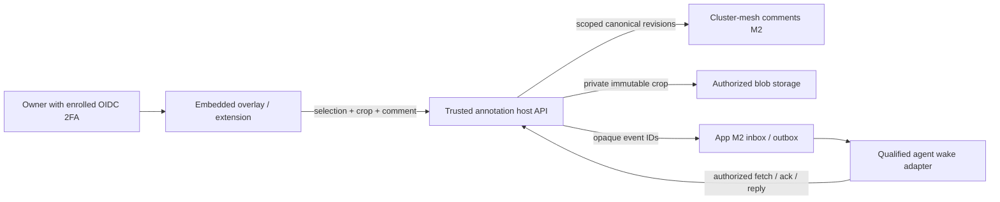

# SPEC EVOL — Deployed UI annotation overlay

**Status:** specification consolidated from the reviewed scratch spec v2; implementation not started. The six implementation lanes A–F below are proposed branches, not worktrees or reservations. No code, deployment, publication, Git, or Track write beyond this document is delivered here.

**Provenance.** Source scratch spec: `spec-ui-annotate-overlay-v2.md`, sha256 `5717b057b5d4ea78c78ffb7d77c71e50c198012b1219662b599c624e87543b11` (2026-10-17). Astra targeted re-review returned **GO**: all seven findings R1–R7 and the non-blocking corrections are closed at specification level; only the DV3 owner decision was open at review time and is now closed by the owner decision recorded in section 10. Host evidence baseline: `origin/main = 1472d961e098908e64ef60b83835af357888d031`, read through Git objects; the root checkout is not the implementation baseline. [PR #684](https://github.com/rhanka/sentropic/pull/684) (M2 comments contracts) remains a dispatch dependency: C/D use current main plus merged #684 contracts; its merge status is rechecked at dispatch. Working-tree links are navigation aids; pinned objects are authoritative.

Related specs:
- [Shared comments and annotations](SPEC_EVOL_COMMENTS_ANNOTATIONS.md) — canonical immutable annotation/thread/comment model consumed here; this overlay spec supplies the deployed-UI consumer capability and does not fork that model.
- [Application MCP provider platform](SPEC_EVOL_APP_MCP_PROVIDER_PLATFORM.md) — generic MCP provider platform; the explicit `/api/v1/artifacts-mcp` audience widening in section 6 stays gated by the E0 contract/security review recorded there and here.
- [App control-plane model and catalog projection](SPEC_EVOL_APP_CATALOG.md) — app template, instance and bindings cited at each use in sections 4 and 6; catalogue display is never authorization.
- Per-app MFA and recovery (`spec/SPEC_EVOL_IDP_PER_APP_MFA_RECOVERY.md`, PR #695) — method-neutral MFA level consumed in section 3; this overlay does not define a second policy evaluator.
- Seat-credential custody (`spec/SPEC_STUDY_GITHUB_SEAT_CREDENTIAL_CUSTODY.md`, PR #596) — custody secrets stay outside the annotation serialization path in sections 4 and 10.
- [Cluster Mesh as the Single Lazy Integration Surface](SPEC_EVOL_CLUSTER_MESH_LAZY_SURFACE.md) — lazy integration surface and MCP composition conventions referenced by the routing design.
- [Login-A amendment](SPEC_AMENDMENT_D11R_LOGIN_A.md) — DV3/DV4/DV5 seed and access-control context for the DV3 annotation copy policy in section 10.

The owner can point, draw a rectangle, or circle/lasso a live UI, add a private comment, and send it to the responsible repository's agent or conductor. Each saved annotation includes DOM evidence, a screenshot crop, page/deployment/viewport context, and verified OIDC identity enrolled with 2FA. The portable target is any managed screen on request; Sentropic delivery is first in sequence (`https://preprod.sentropic.sent-tech.ca`, then `https://sentropic.sent-tech.ca`), not the scope limit, and every other managed app attaches through the same host-adapter contract (embedded or extension). Lasso satisfies « cercle/entourer »; a dedicated circle tool is optional later (+1–2 h). Bookmarklet deferred.

**Historical estimate, not calibrated for the 2026-10-19 decisions: 88–140 active agent-hours.** The former A–D private-capture estimate was **66–100 h**; E **+10–21 h** and F **+12–18 h**. C included +6–10 h shared storage; E included a conditional +3–5 h F0 adaptation. The selected DS transfer, stable anchor contract, promotions and dual-hosting qualification require re-estimation at dispatch; the former 6–10 h transfer delta is also uncalibrated. The lane/lot figures below retain that historical provenance, not a revised total or elapsed-time promise. Upstream work, owner waits, infrastructure and app-replacement M2 were excluded. No implementation or qualification is delivered by this spec.

## 1. Evidence and boundaries

Paths below are relative to the Sentropic repository unless absolute. Proposed paths/targets are marked new. S2–S4/S6 retain the source snapshots audited in v1/review; host decisions below use pinned main evidence.

| Ref | Read source / observed state | Consequence |
|---|---|---|
| S1 | Scratch v2 packet; `1472d961e:rules/{workflow,MASTER,subagents,testing,security,architecture,data,components,design-system,conductor}.md`; `1472d961e:PLAN.md`, `plan/BRANCH_TEMPLATE.md` | `.cursor/rules/*.mdc` absent; current `rules/*.md` supply the contract. No BRANCH.md at this baseline in the scratch spec directory. Dispatch updates PLAN; this spec writes only this specification. |
| S2 | Diag annotate source `packages/annotate/src/types.ts`, `src/svelte/AnnotationLayer.svelte`, `package.json`; checkout HEAD `3164ff79119821712eacc7eb103dd4039b0b8c79` | `0.1.0`, raw source exports, no package build/publish lane; synchronous in-memory store. Conductor reports unpublished. Current lasso retains a freeform trace but clears target highlights; rectangle retains a group. Screenshot capture is a port, not a working live-page pipeline. |
| S3 | Diag UAT history, migration decision (2026-06-02), DS backlog | Preserve point/rectangle/lasso, shortcuts, numbered primary pins, yellow trace, blue highlights and **all intersected targets**. G3 of 2026-10-19 supersedes the June package destination: presentation goes to DS; Sentropic retains the data model and host adapters. The backlog documents the DS 0.10.3 packaging defect. |
| S4 | DS manifest `packages/components-svelte/package.json`, Svelte config; checkout HEAD `22421ed82f69737825b962e5a0e448482733eaca` | Current source is `@sentropic/design-system-svelte@0.35.0`, uses `svelte-package` and `vitePreprocess`. This is evidence of a source fix, not a verified published-tarball consumer result. Do not declare the historical bug still present or closed from source alone. |
| S5 | Host main `1472d961e`; [PR #684](https://github.com/rhanka/sentropic/pull/684) review snapshot OPEN, head `57eca41349e496fddfdd93444be70ed93bba9784` | C/D use current main plus merged #684 M2 contracts; recheck merge status at dispatch. Pin source/package versions and tarball integrity, install locally via `file:../packages/*`; publication is not a B/C/D predecessor. |
| S6 | #684 `packages/comments/src/anchors.ts`, `revisions.ts`, `geometry.ts`, `commands.ts`, `packages/cluster-mesh/src/comments/index.ts`, `revision-command.ts`, `hono/comments-router.ts` | Canonical immutable annotation/thread/comment revisions, UI/text/capture anchors, box/circle geometry, scoped grants, CAS and idempotency already exist. There is no canonical lasso shape, generic metadata property, page-list endpoint or open/resolved revision field. Host mapping below supplies those without changing the frozen package contract. |
| S7 | Replace-Claude v2.1 plan, source outside this repository at `/home/antoinefa/src/sentropic/.tmp/app-replace-claude/plan-replace-claude-v2.1.md`, sha256 `7aff8f30561b32ed67dec44f201c165a9c192f7f6741b4ade659ef9efee76188` (digest file concordant); lot map: F0 binding/event freeze, F2a inbox/outbox + provider, F2w wake adapter, F3 same-idle-agent qualification, N0/N1 notifications, deferred F1 on #684 mesh comments; especially F0/F2a/F2w/F3, N0/N1 and deferred F1 | Reuse durable inbox/outbox and the qualified running-agent wake adapter. Its M2 is the answer/remark loop; it does **not** deliver UI section annotations. This spec supplies that consumer capability; remote keyboard/control M3/M4 are not prerequisites. The locator and digest are evidence for the handoff gates in sections 6 and 10; they do not assert upstream F0 acceptance. |
| S8 | `ui/chrome-ext/manifest.json`, `content.ts`, `tool-executor.ts`; deployment README; Makefiles and E2E config | MV3 extension already has `activeTab`, scripting, screenshot capture and a shadow-root UI, but also broad existing host permissions. Preprod has its own namespace/IdP. Ordinary `test-e2e` seeds a stack: it must never be pointed at deployed preprod. |

**Additional main evidence:** `api/src/services/session-manager.ts`, `packages/auth-hono/src/oauth/session-resolver.ts` and `api/tests/api/auth/passkey-mfa-session.test.ts` establish the MFA gates below. `spec/SPEC_AMENDMENT_D11R_LOGIN_A.md` establishes DV3/DV4/DV5. `api/src/services/cluster-mesh-adapter.ts` has runtime/cutover PG adapters but no generic storage/comments installation. `api/src/app.ts` owns product composition; `api/src/routes/api/index.ts` is inert. `api/package.json` consumes local mesh/comments; `ui/package.json` already consumes DS `^0.34.40`.

**Scope in:** reusable package, DOM/capture adapter, embedded owner toggle, canonical persistence, private routing/status, mobile UAT, later extension; annotation seed-policy specification/witness. **Scope out:** generic drawing editor, arrow expansion, arbitrary page execution, public/team sharing, second comment store, automatic code changes, remote keyboard control, historical Diag migration, executing production reseeds and optional bookmarklet.

## 2. Reuse and package ownership

**Owner decisions, 2026-10-19.** The authoritative record is `/home/antoinefa/src/sentropic/.tmp/spec-review-v3/OWNER-DECISIONS-2026-10-19.md` (SHA-256 `a81bfd3812f7dd6db4fff1308464ff31d93c88cf872e552ec234c3df2fe741d3`). It supersedes earlier open choices in the r4 dossier and reconciliation. The per-PR consequences come from `/home/antoinefa/src/sentropic/.tmp/focus-spec-review-kit/dossier.json` (SHA-256 `01384c6774dbaee1a7b54710141895f35616f971963ec86ada3440136f61db9d`), rendered by `dist/spec-review-r4-portable.html`; governance clauses below refer to `/home/antoinefa/src/sentropic/.tmp/governance-unification/study.md`.

**G1 — closed, 2026-10-19:** “G1 = option 1”. Apply the federated contract with one accountable owner per act (C-01/C-03/C-09/C-15). Each project retains its code, release and data authorities; shared boundaries are jointly frozen with `arch` advice, and only unresolved material conflicts go to the owner. This decision grants no merge, publication, deployment or consumer acceptance.

| Act | Accountable owner and boundary |
|---|---|
| Annotate presentation | Design-system component maintainer: picker, markers, thread/state presentation and proposal events; G3 defines the data boundary below. |
| Capture and anchor resolution | Sentropic annotation host maintainer: trusted screen/source identity, `AnchorResolver`, crop capture, redaction and canonical mapping; app operators configure and qualify each host. |
| Annotation model and persistence | Sentropic comments maintainer owns anchors, threads and versioned contracts; the C-lane storage owner implements the authorized installation. Runtime operators and data controllers remain recorded per app. |
| Agent delivery | h2a delivery-contract maintainer owns inbox/wake semantics; Sentropic's host maintainer owns routing bindings, grants and delivery mediation. Neither can substitute for the other's authorization. |
| Work promotion | h2a/Track maintainer owns the authorized Track write route and work/acceptance record. |
| Memory promotion | Engram memory maintainer owns capture/admission and the canonical D3 lifecycle; Sentropic owns authorized MCP mediation. |
| Catalogue and consumer acceptance | DS declares its presentation descriptor; Sentropic owns the central catalogue/MCP registry and comments provider descriptor. Each app owner accepts its installed consumer separately from a package release. |

Before implementation crosses these boundaries, their owners jointly freeze `AnchorResolver`, proposal/write and delivery interfaces from the last accepted versions. Pin package SemVer, schema/profile versions and digests, deployment bindings, policy generations, fixtures and compatibility receipts separately (C-06/C-08). Unknown contracts fail explicitly. Transfer records name source obligation, receiving role, accepted destination, reciprocal links, release/exit obligation and outstanding consumer acceptance; the source custodian remains responsible until acknowledgement (C-11). No transfer completion is claimed by this amendment.

**G2 — closed, 2026-10-19:** “G2 = option 1”. Engram governs diagram profiles, schemas, fixtures, composition and migrations; DS retains and publishes the generic `diagram-core` executor and owns rendering/layout. Annotation consumes their compatible pinned versions; it creates no second diagram model or executor.

**G3 — closed, 2026-10-19:** “g3 = a ok”. Option (a) means **DS owns annotate presentation only; Sentropic owns the data model, anchors, threads and persistence**. This is the r4 option (a), superseding the older option lettering and package-home alternatives. The DS position is `/home/antoinefa/src/sentropic/.tmp/spec-review-v3/DS-POSITION-G3-2026-10-19.md` (SHA-256 `888baaef3142161a718c93d580aee7794b8fabac38d34af5352bcc71efa45e39`): DS stores nothing, resolves no anchor, receives an opaque `{label, kind}` plus typed payload and emits proposal events. Its picker preserves Tiptap selection and keyboard/screen-reader equivalents; it presents markers and thread states. Contract details remain open under Sentropic ownership in FL-ANCHOR; the ownership choice is closed.

| Keep | Adapt / add | Boundary |
|---|---|---|
| Presentation geometry (`Point`, `Rect`, selection bounds/corner pins) and its tests in DS; `AnchorResolver` and `SelectionCapture`/`CaptureFn` in the Sentropic host adapter | Host DOM/semantic resolver, polygon membership, viewport/crop transforms and canonical mapping | DS receives opaque anchors and host-resolved display data. Diag `Anchor` is not a competing canonical model; Sentropic maps evidence explicitly. |
| Existing Svelte layer's tool presentation, draft/pin rendering, primary/yellow/blue semantics and keyboard vocabulary | Replace Tailwind utility dependency with scoped component CSS on DS CSS variables; fixed viewport layer/document-scroll transforms; pointer/touch handling, lasso highlights, mobile composer and async save | Diag `AnnotationLayer.svelte` depends on host Tailwind/`primary` and unconditionally sets `pointer-events:auto` over `context.host`. Remove drawing layer/listeners when unarmed; this is a required port. |
| In-memory fixtures as a DS demo/test adapter only | Sentropic async application adapter: load, submit, reply, resolve, retry and subscribe/refetch | DS emits proposals and displays host receipts; it performs no persistence. A local fixture row cannot mean durable save; keep the composer until a server receipt arrives. |
| DS tokens and approved primitives | Verify the installed DS package; consume working primitives, retain token styling where no primitive exists | No copied DS components or dependency on framework internals such as React/Svelte debug metadata. |

| Selected home | Authority | Consequence |
|---|---|---|
| **Design-system: `@sentropic/annotate` presentation**, pure presentation helpers + `./svelte` | DS component/release maintainer, G3 | A owns the acknowledged transfer, build/pack and release evidence. Exact DS package paths/exports are frozen at A0; no Sentropic-owned presentation package or resolver export. |
| **Sentropic: canonical `@sentropic/comments` model and host adapters** | Sentropic comments/annotation host maintainers, G3 | B owns capture/resolution adapters; C owns canonical mapping and persistence; D/E/F consume DS presentation. Catalogue/MCP remain in Sentropic. No model transfer to Engram or second store. |

DS publishes compiled JavaScript/types and preprocessed Svelte output through its governed release lane; inspect the actual tarball in a clean SvelteKit consumer. Declare Svelte as a required peer; the pure presentation entry has no Svelte runtime imports. A records source/destination acknowledgement, source revision, package version/integrity, compatibility/migration and rollback evidence. Diag adopts the pinned release in its separately owned follow-up; the transfer is not complete until its receiving obligation and consumer acceptance are recorded.

B/D/F consume a DS-produced archive pinned by source revision, version and integrity, with receipt and packed-consumer proof; a qualified prepublication archive can unblock local integration. C can still consume locally built Sentropic comments/mesh packages through app `file:` dependencies. Public package dependency maps use plain semver. Published availability and consumer adoption remain separate gates. FL-DS is A2's installed-host Popover/Tabs check; the annotate packed-consumer gate is also required. `annotationsForAI` has no ACL: demo-only, never used for agent routing.

## 3. Attachment, identity and privacy



| Surface | Attachment and authority | Limits |
|---|---|---|
| Sentropic prod/preprod | Lazy-load `AnnotationOverlay.svelte` from the root layout only after a server capability response. Owner activates an Annotate toggle; inactive overlay does not intercept page interaction. UI and API use the same origin. | UI visibility is convenience; every list/read/crop/write/stream rechecks owner and scope. A query parameter or DOM attribute cannot enable authority. |
| Any managed screen on request (embedded or extension) | The host adapter, not the framework, supplies trustworthy screen identity, observed release, allowed origin and capability response: page registration, build manifest (or the observed-snapshot fallback with explicitly unknown deployment metadata in section 5), and embedded-or-extension attachment as delivery mechanisms. Explicit click injects selection on demand via `scripting.executeScript`/`activeTab` for the allowed origin/tab/document. Isolated-world selector; closed shadow root for annotation chrome, no private text. Composer/history/auth remain in the side panel; background owns API calls. | Add `https://preprod.sentropic.sent-tech.ca/*` to existing static-script exclusions alongside prod. No new static annotation content script. Validate extension ID, tab/frame/document generation and operation; `<all_urls>` does not authorize collection. SvelteKit `route.id` is the Sentropic binding only, not the universal screen-identity definition. Onboarding rows cover the managed-app inventory; each row stays `unverified` until its host qualifies. |
| Bookmarklet | Deferred optional item, 4–6 h excluded. | Requires separate exact-origin one-use handoff/CSP review; no implementation or qualification in F. |
| Generated artifact pages | Support both per-app H1 modes below through the exact-origin reader profile and release binding, or the extension's trusted side panel. | Qualify app-subdomain and distinct-domain origins independently. Artifact read authority is not automatically annotation-write, routing or owner-approval authority. This is later-app integration, not an M1 prerequisite. |

**H1 — closed, 2026-10-19:** “H1: il faut prevoir les 2 - pour une app sentropic donnée, permettre du stockage d'artefact en sous-domaine ou un autre domaine”. For each Sentropic app, support artifact storage/views on **a subdomain of that app or a distinct domain**. Sentropic designs/manages the standard; `@sentropic/artifacts` owns the hosting pattern specified by PR #692. The overlay consumes the app's configured mode, authorized storage, exact view/API origins, environment and tenant/workspace/namespace bindings; it hard-codes no app or domain. The service domain determines neither a shared business database nor a storage engine.

| Configured hosting mode | Annotation capture and delivery requirements |
|---|---|
| App subdomain | Bind the actual artifact-view origin and observed resource/release, separately from the app API origin. Same-site placement grants no session or cookie sharing, annotation permission or CSRF exemption. Qualify cookie isolation, exact Origin/CORS/CSRF and CSP with readers of different rights. |
| Distinct domain | Bind the separately configured content origin to the same authoritative app instance/resource/release and namespace. Use the qualified reader grant/session mediation from #692 or the trusted extension side panel; never forward an app/IdP cookie or infer authority from a redirect. Qualify cross-site denial and explicit authorized access. |

In both modes, Data = C retains the reader's business rights; every annotation action additionally rechecks its own capability, current ACL, namespace, MFA level, expiry/revocation and delivery grant. Unknown domain/host/environment/tenant and wildcard authorization fail closed. Capture records the observed view/source/release and sanitized origin; delivery uses the trusted host registry, never the artifact URL. A hosting-mode change preserves canonical annotation identities/history and exact original capture evidence; #692 must qualify link, session and browser-storage transition/rollback before reuse at the new origin. Nothing assumes that sessions survive the change. Custody credentials stay outside artifact bundles/browser storage.

**Still open:** concrete domain names per app/environment, then owner GO on the exact DNS records, zones, any wildcard, TLS responsibilities and rollback. Illustrative addresses are not approvals. D5's developer-UAT isolation rationale is security input only; it does not select an artifact mode or authorize DNS. This amendment neither chooses names nor performs DNS or deployment work.

**OIDC/2FA — « je veux toujours un oidc enrolé 2fa sur sent-tech.ca » (consumption of the per-app MFA contract):** prod issuer `https://auth.sent-tech.ca`; preprod issuer `https://preprod.auth.sent-tech.ca`. This overlay consumes the method-neutral level in `spec/SPEC_EVOL_IDP_PER_APP_MFA_RECOVERY.md` sections 4.1, 5.1, 5.3 and 10.1 (PR #695 head) and defines no second policy evaluator. The permanent exact-`passkey-fresh` requirement is superseded: a client requires the MFA level, satisfied by any qualifying method, with the method carried in signed `amr`. A relying party checks only that signed `amr` contains `"mfa"` after standard OIDC validation; freshness and step-up follow the per-client policy in that contract, including its compatibility phases. Embedded annotation routes (capability, list, crop and SSE included) require verified server-session evidence from the auth layer showing trust, generation and freshness; the historical session boolean alone does not prove those facts. Email-only enrolment never satisfies a protected account. While a qualifying session remains valid, no extra per-annotation ceremony is added. The overlay and the extension are listed in the M-3 consumer qualification in that contract before issuer emission changes. Validate signature, exact issuer/audience, code+PKCE/state/nonce, expiry and live revocation. Refuse magic-link, device-code, federation-only and UV=false passkey access; never infer strength from login labels or email. Bind owner to verified `(iss, sub)` and tenant/workspace. Store opaque assurance references, never tokens. Agent delivery uses a verified workload principal plus the owner's exact delivery grant below, not human authentication.

Questions propriétaire restant ouvertes — aucune réponse n'est décidée dans cette spécification, et la consommation ci-dessus suit le contrat MFA sans trancher ces points :

- D-P1 — Fenêtre de fraîcheur MFA pour `kvm-gateway`. Question : quelle durée maximale entre la cérémonie MFA et l'émission d'un nouveau code OAuth pour `kvm-gateway` ? Options : (i) 300 secondes ; (ii) quelques heures, avec 8 heures comme valeur proposée par la spécification ; (iii) 24 heures. Conséquences : (i) contient au plus court la réutilisation d'une session IdP dérobée pour obtenir un nouveau jeton, mais multiplie les cérémonies WebAuthn lors des réémissions ; (ii) équilibre friction et exposition, avec une fenêtre de réémission plus longue ; (iii) laisse une journée de réémission à une session dérobée. Ce choix ne fixe ni la durée du cookie de session côté `kvm-gateway`, ni la borne administrative distincte de 900 secondes pour les mutations de sécurité IdP. Source : [PR #695 §15, D-P1](https://github.com/rhanka/sentropic/blob/ef956c306be72b066f2a316d79fd6b0f8b1c4d68/spec/SPEC_EVOL_IDP_PER_APP_MFA_RECOVERY.md#L844) (revision `ef956c306be72b066f2a316d79fd6b0f8b1c4d68`; section anchor `#15-décisions-propriétaire`).
- D-P2 — Codes de récupération pour le compte propriétaire KVM. Question : faut-il construire les codes de récupération, et sous quelle forme ? Options : (i) différer les codes : deux authentificateurs indépendamment récupérables en prérequis, plus la réinitialisation d'urgence par le Job opérateur ; (ii) construire les codes avec liaison en attente : le code ouvre la demande et crée un authentificateur en attente, sans jamais activer seul un accès MFA ; (iii) activation autonome code plus délai, qui consigne une racine de récupération plus faible. Conséquences : (i) garde la surface minimale, avec une récupération de perte totale dépendante de la disponibilité du recours opérateur ; (ii) ajoute un confort et une surface (émission sous session MFA fraîche, hachages liés au sujet et à la génération, consommation unique atomique) sans chaîne directe du code vers le MFA, l'activation indépendante restant requise ; (iii) rend le vol du code éventuellement suffisant après le délai et doit être assumé comme un affaiblissement explicite de la propriété de récupération, avec amendement de la spécification. Source : [PR #695 §15, D-P2](https://github.com/rhanka/sentropic/blob/ef956c306be72b066f2a316d79fd6b0f8b1c4d68/spec/SPEC_EVOL_IDP_PER_APP_MFA_RECOVERY.md#L846) (revision `ef956c306be72b066f2a316d79fd6b0f8b1c4d68`; section anchor `#15-décisions-propriétaire`); recovery contract §6, R-REC-6. Recommandation de la spécification : (i).
- D-P3 — Portée du durcissement des comptes. Question : à quels comptes la protection stockée s'applique-t-elle, celle qui ferme la récupération par le seul courriel ? Options : (i) protection activée explicitement aux transitions prévues (entrée en liste d'autorisation d'un client forcé, première émission vers un client MFA sans liste, ou activation opérateur), après les prérequis de confiance et de récupération ; (ii) durcissement de tout compte dès son premier passkey, y compris pour les applications sans exigence MFA. Conséquences : (i) préserve la récupération par courriel pour les usages non forcés et borne le changement et le risque de perte d'accès aux comptes protégés ; (ii) ferme pour davantage de comptes la création de credentials, la session sans appareil et les mutations sensibles par email seul, même sans exigence MFA applicative, mais élargit les préparatifs de récupération et le risque de perte d'accès. La migration conserve les prérequis de confiance et de récupération. Pour un compte protégé avec appareils, le login email `bearer` vers un client non-MFA reste possible (§4.2) : la protection ne force pas chaque connexion. Source : [PR #695 §15, D-P3](https://github.com/rhanka/sentropic/blob/ef956c306be72b066f2a316d79fd6b0f8b1c4d68/spec/SPEC_EVOL_IDP_PER_APP_MFA_RECOVERY.md#L857) (revision `ef956c306be72b066f2a316d79fd6b0f8b1c4d68`; section anchor `#15-décisions-propriétaire`). Recommandation de la spécification : (i).

**Private by default:** owner-only read/write until an explicit Send to agent action grants that exact annotation/revision to an eligible repo principal. Private ACLs apply to history, list indexes, captures, exports, SSE and agent fetches. No public URL or ambient workspace-reader inheritance. Owner may revoke delivery/read access; purge follows the existing lifecycle and capture-retention policy, not “resolve.”

**Per-annotation mediation (R1):** M2 `CapabilityCheckPort` sees only `ResourceRef[]`; A and B on page P share the resource. Agents receive no canonical page grant and no direct canonical router. Host checks `{annotationId, revision, recipient, bindingGeneration}` and live revocation, verifies requested thread/comment/crop IDs belong to that exact annotation and permitted revision, then constructs only that chain's read/reply inside `withContext`. The request-local capability closure checks grant principal, operation and page; it cannot independently distinguish A/B, so immutable host-selected IDs and the pre-call chain check are mandatory. Never reuse this context for caller-supplied selectors, bulk reads or another request. List/SSE/export/crop paths filter by the same grant before emitting IDs/bytes; later private revisions are not automatically included. Replies retain agent principal and AI attribution. Test **A ≠ B on the same page**: grant A; deny listing, reading, crop access, reply and SSE visibility for B, including B created later, guessed/mismatched IDs and revoked/stale grants.

**Cross-namespace isolation.** Colliding IDs across two namespaces and across two tenants/workspaces must fail closed on read, list, search, crop, SSE, reply, export and replay. The A-versus-B same-page mediation test above is retained and extended with namespace-mismatch cases: a grant or query valid in one namespace exposes nothing in another, even when the bare ID collides ([Shared comments and annotations](SPEC_EVOL_COMMENTS_ANNOTATIONS.md) complete-identity queries; tenant resolution in [ARCH11 tenant reconciliation](SPEC_EVOL_ARCH11_TENANT_RECONCILIATION.md)). No URL, bucket prefix or display name supplies the namespace; the namespace comes only from the authoritative tenant/workspace resolution and the stored binding.

**CSP source-gap:** main has no deployed-UI CSP configuration (the extension under `ui/vscode-ext` is separate). B0 must qualify capture under a target policy allowing `img-src 'self' data: blob:` and no `unsafe-eval`; record exact policy and unsupported cases, never claim an existing deployed policy was verified.

**CSP and data:** bundle embedded code locally; no remote `eval`, wildcard CORS or CSP relaxation. Keep auth in HttpOnly/Secure host sessions or extension-owned storage. Exclude password/OTP fields, input values, secret-marked regions and authentication pages from capture/quotes; mask before upload and let the owner redact the crop preview. Sanitize page URLs by dropping userinfo/query/fragment except explicitly allowlisted route parameters; preserve the navigable non-secret page identity. Do not serialize the whole DOM, hidden content, localStorage, cookies or environment values. Comments/quotes are untrusted text, including when an agent reads them; no raw HTML execution or instruction-to-shell interpretation. Private responses use `Cache-Control: no-store`; logs carry IDs/status, not text, crops or credentials.

## 4. Canonical data mapping

**Stable anchor boundary (G2/G3, open contract details owned by Sentropic).** Sentropic must specify and version the single contract consumed by DS: text uses W3C Web Annotation `TextQuoteSelector`; blocks use Focus node identity (#378), including FE-2 paragraph IDs; diagrams carry `{diagramId, targetIds[], frame, geometry}`. DS changes its anchor type in one types location and treats the payload as opaque. Sentropic owns resolution, validation, thread binding and persistence. Exact schema, versioning/migration rules and mapping to frozen M1 bytes remain a C0/FL-ANCHOR deliverable jointly frozen with consumers; these field requirements do not silently extend the hashed model. Until qualified, unsupported kinds remain explicit and cannot be saved as if supported.

For diagram canvases, the host `AnchorResolver` binds document and semantic-element identities from the existing `SemanticDocument`/`ViewDocument`, the observed semantic source, pinned Engram profile/version/digest and DS render revision. Layout geometry and DOM selectors are hints, never semantic identity. Profile migrations and render changes preserve or explicitly invalidate the recorded binding; no graph copy or new diagram evaluator is introduced. Fixtures must cover text/block/diagram round trips, semantic-ID stability across layout changes, deleted/ambiguous targets, profile-version mismatch and namespace/revocation denial, then qualify the installed DS consumer against the same canonical annotation.

Consume `createCommentsModule`, `createCommentsPostgresRegistration`/installed generic storage binding and its `withContext(grant, ...)`/`store.transaction().run(...)` interfaces from #684. Reuse the same canonical module Immo consumes, with independent authorized scope. No new `contextType` enum member, legacy `pg-comment-store` route or edits to frozen `packages/comments/src/**`.

**Namespace binding on every record.** Every stored or transported annotation/comment-related record carries an authoritative, non-null `(tenantId, workspaceId, namespace, kind, id)` association, checked at persistence and at transport before any data exposure: annotation aggregates and revisions, threads and structural revisions, comments, review and lifecycle records, captures and blob metadata, page indexes, intents, delivery grants and outbox rows, and import/export receipts. A missing or mismatched namespace refuses the operation before exposure ([Shared comments and annotations](SPEC_EVOL_COMMENTS_ANNOTATIONS.md) section 4.1 identity and complete-identity queries; namespace-aware storage authorization in `spec/SPEC_EVOL_CLUSTER_MESH_MODULE_STORAGE.md`). Frozen M1 hashed bytes stay unchanged: the binding is validated in the storage/transport envelope or retained reference; if that carrier cannot meet the invariant, the change goes through the versioned contract-amendment procedure and never as a silent field addition to hashed bytes. The namespace is necessary and is never sufficient authorization; grant, ACL and capability checks still apply at each use.

**Screen vocabulary.** In this spec, *page* means an addressable screen inside a managed app instance or a rendered artifact, identified by its authoritative resource plus observed source, build and release ([Shared comments and annotations](SPEC_EVOL_COMMENTS_ANNOTATIONS.md) section 4.2 anchors). A mutable URL and a DOM selector are hints only and never carry that identity. Every screen reference names its app instance alongside the screen; artifact, release, app template and app instance keep the shared glossary meanings adopted for the catalogue. Verbatim owner quotations, including the DV3 record in section 10, stay untouched by this vocabulary pass.

| Required data | Canonical representation / host contract |
|---|---|
| Tenant/workspace/page | `ResourceRef = {scope:{tenantId,workspaceId}, namespace:'sentropic.ui', kind:'page', id:pageId}`. The reference names its app instance (appId/tier) alongside the screen. The host adapter derives registry identity from its own trustworthy route binding plus allowlisted normalized params, checked against the served build's route manifest and app/tier; for Sentropic that binding is SvelteKit `route.id`. Never accept a client-chosen pageId. Retain registered page records across deletion/renaming; different identity means a new annotation. |
| Deployed source | `RevisionTargetBinding.source` and every anchor's `source` use `SourceVersionIndicator`. `observed` binds an immutable build manifest/asset digest and observation evidence. Record release ID, commit, app and tier in the profile. Embedded pages carry their own served build ID; verify against deployment records, not merely the API's latest version. Old browser assets during rollout remain distinguishable. |
| DOM target | `UiAnchor` with stable `surfaceKey`, `renderVersion`, resource/source and `captureRef`. Prefer application-owned `data-annotate-id`; instrument important controls in D. Store selector, bounded exact quote + surrounding text, ancestor hints and position in the host profile. CSS selectors/coordinates are hints, never authority or stable identity. |
| Text range, when applicable | Add `TextAnchor` only when Unicode code-point offsets are known against the recorded text source. Otherwise retain quote evidence in the profile; do not invent offsets. |
| Screenshot crop | Immutable `CaptureAnchor`: `blobId`, digest, PNG/WebP MIME, intrinsic width/height, capturedAt and source. Bytes use private host blob storage; annotation records persist references. Every read checks the annotation ACL. No base64 image embedded in comment bodies. |
| Selection | `visualAnchors[]` with ordered `shapeId`, capture-bound frame/digest and canonical quantized **box/circle**. Persist actual lasso points in the versioned host profile as described below; a box is only its bounding representation. Group members each retain DOM evidence and selection order. Members on one page share its ResourceRef; `secondary=[]` unless there are distinct authorized resource identities, never duplicate page refs. Without a stable element key, bind the UI anchor to the stable page surface and retain element hints with explicit drift uncertainty. |
| Comment/thread | One `AnnotationRevisionRecord`, initial `ThreadStructureRevisionRecord` (`initial-registration`, same primary, annotationId), and `CommentRevisionRecord` pinned to exact structure hash/annotation revision. User prose only in comment `body.text`. Annotation `body.text` is non-empty deterministic non-secret text, e.g. `UI annotation · lasso · 3 targets`, alongside profile metadata; never duplicate private prose. Replies bind to the same discussion. |
| Author | Server creates `RevisionProvenance.attribution` (`human`, subject reference, assertion class, evidence reference); module stamps `registration.principal/registeredAt` from the verified grant. Agent replies use their authorized principal and AI attribution; never impersonate the human. |
| Open/resolved + PR | Discussion `open`/`resolved` state, resolved actor/time and optional `{repoId, number, url, commit}` PR link live in the host discussion projection backed by the canonical operation-audit chain ([canonical model](SPEC_EVOL_COMMENTS_ANNOTATIONS.md) sections 4.1/4.4/5), never in the hashed `SemanticProfile` or annotation content. Resolve/reopen appends an audited discussion-state operation only: no new `AnnotationRevisionRecord`, no head advance, no validation change; CAS applies to the discussion aggregate version and only the `resolve-discussion` capability is enforced. The canonical review verdict and lifecycle archive are different concepts. Linked PR is independent of resolution; merging a PR does not auto-resolve. This aligns the v2 wording with the canonical contract; no canonical model amendment is claimed. |
| Delivery | Host outbox/index references canonical annotation/thread/revision IDs, repo binding generation and receipt state. It stores delivery metadata, not a second authoritative copy of comment content. |

**Host profile:** introduce `schemaId='sentropic.ui-annotation'`, version `1`, with a digest-pinned schema accepted by the host. `SemanticProfile.fields` only permits scalars, safe integers and nested objects: **no arrays or fractional numbers**. Encode ordered members/points as `members.m0000`, `points.p0000={xQ,yQ}`, explicit counts and zero-padded order; coordinates use integer millionths, viewport/scroll values integer thousandths of CSS pixels, DPR/visual scale integer thousandths. Preserve tool, polygon, selected members, normalized/document rectangle, quote, CSS selector, URL, build, locale, viewport, crop transform/capture method and assurance reference. No undeclared `metadata` property on canonical records.

**Geometry (R4):** crop = selection bbox plus 8 CSS px margin, clamped to the captured area. Point uses the resolved element's positive-area box intersected with that area, or a 4 CSS px minimum marker box when no element resolves; shift/shrink the marker inside the frame and show the adjusted preview. Reject an empty intersection/collapsed quantized box. Rect/lasso canonical shape is the positive-area bbox of the visibly clipped selection, never a bounding circle. Clip polygon/member shapes to the capture frame with visible feedback before integer quantization; validate positive area and `[0,1]` bounds again after quantization. Canonical circles, if later used, must have `r > 0` and their entire circumference inside the frame. No silent clipping by M2. Tests cover point/viewport corners, zero-size elements, lasso edge overflow and empty annotation text.

**Authority versus drift (R5):** `ResourceResolverPort` answers only for the retained page registry resource and its source: registered pages return `exact` or `source-changed`, even when absent from the current build. ACL checks remain separate. DOM missing/ambiguous/changed outcomes are host-profile/UI evidence and never enter that authority port. A removed page retains authorized read, reply and resolve operations with its original crop; only an actual authorization/resource-retention denial makes it unavailable. New page registration validates the served manifest; historical operations resolve the retained record, not today's route existence.

**Shared PG installation (R6):** the **C lane owner** is the sole implementation owner of generic mesh storage setup shared with app-replacement A1. New `api/src/services/cluster-mesh/storage.ts` composes the PG profile, module registrations, roles and one executor/journal; `api/src/app.ts` installs it once. Host schema/catalog changes use `api/src/db/schema.ts`, migration directory `api/drizzle/` (one new SQL migration plus matching journal metadata; numeric filename allocated at dispatch), and `spec/DATA_MODEL.md`. Do not invent a second migration runner or confuse existing runtime/cutover adapters with this installation. App-replacement A1 depends on that shared installation and adds artifact registration through its exported seam after C lands. C-storage is **+6–10 h**. If A1 has already delivered the same qualified installation at dispatch, formally transfer sole ownership to A1, make C depend on it and remove C-storage cost/work; never parallel-write these paths or double-count the prerequisite. C's host comment service is also the substrate for deferred app-replacement **F1**, adding `sentropic.artifact` beside `sentropic.ui` through adapters, not a second host mapping.

**Serialization lineage.** The canonical form is versioned bytes plus verified hashes with typed/indexed projections and receipts; `jsonb` output is not the hash codec (`spec/SPEC_EVOL_CLUSTER_MESH_MODULE_STORAGE.md` injected installation and comments transport; [Shared comments and annotations](SPEC_EVOL_COMMENTS_ANNOTATIONS.md) sections 6 and 7.2). The C-lane PostgreSQL installation is the comments store via generic module storage under the sole-owner rule above; the single host migration authority and the C/A1 sole-owner handoff stay. In this spec, *serialization* (canonical bytes and hashes), *SQL serializable transaction* (isolation of a database transaction), and *database sharing* (several apps using one database service) are three distinct concepts; only the first is specified here. Explicit non-goal: no shared-database management across apps is specified or required by this overlay.

Proposed host limits: comment 8 KiB UTF-8, profile 64 KiB canonical JSON, 512 lasso points, 31 selected members plus primary resource, 128 visual anchors maximum, selectors 2 KiB and quote/context 2 KiB total per member, crop 2 MiB/4 megapixels. These are admission ceilings, not simultaneous guarantees: enforce every bound, including the installed M2 capacity descriptor and depth ≤8. Show excess-selection feedback before save; never silently truncate targets. Simplification must preview the resulting lasso and preserve its selected set. Unknown profile versions refuse mutation and retain a readable unsupported-version state.

**Commit flow:** authenticate → validate page/source/ACL/profile → allocate annotation/thread/comment IDs and durably register a scoped creation intent → stage and verify the redacted crop → commit annotation/thread/first-comment together in one canonical module transaction → finalize the catalog/intent → return durable IDs/hashes. The intent holds IDs, page binding and payload digest, not a competing copy of the comment. Recovery can discover committed records by those preallocated IDs after a crash. Retries use stable scoped idempotency keys and exact expected heads; mismatched replay/stale revision returns conflict with the draft intact. Crop upload is not a cross-store transaction: staged objects have short orphan expiry, and referenced objects cannot be collected. Do not display Saved until all three canonical records and a verified crop reference exist. Routing has its own durable intent keyed by committed revision; recovery covers crash-before-outbox without assuming an atomic transaction across unrelated stores. Only an explicit authorized Send intent permits delivery; recovering a private save cannot create one. A failed wake never loses the saved annotation.

**Queries:** #684 exposes chain reads, not a page-wide listing API. C adds a scoped page→annotation/thread catalog with the creation intent; repair incomplete intents after crashes and verify each result through canonical reads/current ACL. Catalog/status caches are rebuildable projections, never the source of comment content. Its repair test must demonstrate discovery after a crash, not only direct lookup by a remembered ID.

**Host API, new:** `/api/v1/ui-annotations` provides capability/page-list/read/create operations; explicit subroutes handle capture staging/read, replies, re-anchor, status and routing. C0 freezes request schemas. The browser supplies bounded selection evidence, prose, expected revision and idempotency key; the host derives authoritative scope, principal, deployment binding and provenance. Enforce exact Origin/CSRF on cookie-backed writes. If the canonical operation requires decision evidence, issue/resolve it for the explicit owner action and exact base/proposed-content binding; never accept page-supplied authority or bypass required evidence with an empty reference.

## 5. Anchoring, screenshot and mobile behavior

| Situation | Required behavior |
|---|---|
| Initial point / region | Resolve stable application key, then a unique escaped CSS selector checked against tag/role/quote; gather normalized quote with prefix/suffix and position fallback. For rectangle/lasso, find **every intersected eligible leaf/control**, deduplicate nested wrappers and exclude overlay/hidden/sensitive nodes. A closed lasso uses polygon intersection, not its bounding box. Explicitly preview the member set. |
| Same release after scroll/layout | Recompute pins/highlights on scroll containers, resize/visualViewport, relevant mutations and SPA route changes, coalesced per frame. Include DPR, browser zoom and mobile visual viewport offsets in crop transforms. Never leave an intercepting invisible layer when mode is off. |
| Later deployment | Resolve stable key → validated selector → unique quote/context → position suggestion. Report host DOM drift `exact`, `source-changed`, `unresolved` or `unavailable`, separate from M2 authority. Ambiguity is unresolved; position-only matches are suggestions. Changed deployment stays source-changed even with the same key. No silent nearest-element attachment. |
| Manual re-anchor | Owner inspects original crop, chooses the current target and confirms. Append annotation and `reanchoring` thread-structure revisions; old comments retain their original pins. Concurrent changes conflict. Preserve original capture/source and add new evidence; do not rewrite history. |
| Missing/opaque content | Deleted or duplicate target: unplaced annotation in the list, with crop. Closed shadow DOM/cross-origin iframe: outer host/frame + geometric evidence only; explain that the inner DOM is inaccessible and fabricate no inner-DOM anchor. Extension pixel capture can still depict visible content without asserting an inner anchor. Unmounted/virtualized content is not automatically scrolled into or clicked. |
| Crop, embedded/mobile | Capture only on explicit selection, locally, via the qualified `CaptureFn` DOM rasterizer (evaluate a pinned html-to-image/snapdom-class implementation in B0). Temporarily exclude overlay controls; preserve the yellow shape separately. Use one capture epoch for selection/build/scroll/crop; invalidate and retry if any changes. Preview actual output before save. |
| Capture fidelity / unsupported API | DOM rasterization is reconstructed rendering and can fail on fonts, foreignObject, tainted canvas, video or cross-origin assets; mark method/fidelity. No automatic server browser given user cookies and no requirement for desktop-only `getDisplayMedia`. If automatic capture fails, retain the draft and offer a device screenshot upload with explicit crop/alignment confirmation, or extension capture. A final annotation still requires a crop; unsupported capture is never silently saved as success. |
| Extension capture | Reuse `captureVisibleTab`; verify the same foreground tab/document/viewport before and after capture, then crop/mask locally and discard full-frame bytes. A tab switch or navigation cancels. Preview and authorized upload remain in the side panel. |
| Unverified third-party version | No trusted deployment manifest: deployment/commit metadata stays explicitly unknown in host profile evidence; never fabricate a commit and never use the canonical `unknown` variant for the new durable anchor. The new anchor binds `observed` to the immutable captured snapshot (capture blob digest + frame digest + observed URL/time) as the authorized snapshot under [canonical model](SPEC_EVOL_COMMENTS_ANNOTATIONS.md) section 4.2; current-source applicability stays unasserted until a manifest or explicit reanchoring qualifies it. If that immutable snapshot cannot be stored and digest-verified, keep the draft local and refuse durable save. Later app onboarding requires a manifest for full deployment-traceability acceptance. |

**Phone flow (390 px, also 320 px):** tap Annotate → choose Point/Rectangle/Lasso in a bottom toolbar with ≥44 px targets → touch/drag to circle the UI → release into a bottom-sheet composer → inspect targets/crop, redact, type → Save privately → optionally Send to agent. One pointer draws only while armed; scroll/pinch remains available outside draw mode. A second pointer or `pointercancel` cancels the active stroke safely. Keyboard opening/orientation changes keep Save/Cancel reachable. Save retries preserve text/selection; navigation warns on an unsaved draft. Initial implementation retains drafts in memory; no silent durable storage of private drafts on shared devices.

While armed only: `touch-action:none`, `user-select:none`, `-webkit-user-select:none`, `-webkit-touch-callout:none`; suppress contextmenu/long-press on the drawing surface. Slop: 4 CSS px mouse/pen, 10 CSS px touch. Point-mode drag cancels/requires retry, never falls through into lasso. Inset drawing starts 20 CSS px from left/right viewport edges with a visible safe-zone hint for iOS back/forward gestures. Outside armed mode restore browser scrolling, selection and context menus. Verify gesture-state tests and WebKit mobile E2E, plus real iOS/Android UAT.

Desktop: Alt+Shift+A toggles Annotate outside editable controls; **Ctrl+click point, Ctrl+drag lasso, Ctrl+Shift+drag rectangle only while armed**. No document-level Ctrl interception when disabled; native link-new-tab/contextmenu gestures remain intact. Escape cancels; keyboard users select a focused target without drawing. Announce save/failure/count with accessible text; retain numbered DS-primary pins, yellow trace and blue highlights.

## 6. Repository routing and discussion state

The server registry maps `{appId,tier,pageId,releaseId}` to `{repoId,workspaceId,conductorPrincipal,agentInstance?,bindingGeneration}`. The owner sees the proposed recipient and can choose from authorized repo targets. Page content, URL parameters and display names cannot select an arbitrary recipient. Unknown mapping saves privately as unrouted; unavailable agents leave the item queued. Rebinding requires an explicit authorized operation, invalidates the old delivery grant and preserves audit history. Each use cites its app template, instance and bindings ([App control-plane model and catalog projection](SPEC_EVOL_APP_CATALOG.md) resource schema) and rechecks provider visibility and authorization at invocation ([Application MCP provider platform](SPEC_EVOL_APP_MCP_PROVIDER_PLATFORM.md) deny-as-missing and per-request recheck); catalogue selection, artifact content grant and MFA assurance stay three distinct facts. A private save creates no delivery; only the explicit Send creates a delivery generation, and each delivery generation is audited with its binding generation and receipt state.

| Event / state | Behavior |
|---|---|
| Save privately → `open` | No agent notification or content grant. |
| Send → `pending` → `notified` | Authorize `submit-to-ai` for exact IDs/revision/crop, commit durable intent and enqueue an opaque event ID. Deduplicate by annotation/revision/recipient generation. |
| Agent `fetched` → `acknowledged` → `replied` | Fetch/ack/reply recheck live ACL and binding. Transport delivery alone never means acknowledged. Replies append canonical AI-authored comments. Revoked/deleted annotations are not retried into a new recipient. |
| Linked PR | Agent proposes a repo-bound PR URL/number; server validates allowed repo/origin. Show link independently of discussion status. Existing repository mandates govern implementation and PR creation; a feedback event alone grants no tool, merge or approval authority. |
| Resolve / reopen | Owner resolves after verifying the fix; reopen reverses it. Both change discussion state only through the audited operation in section 4: neither creates an annotation revision nor alters review/validation applicability. Agent may propose resolution; automatic resolution authority is not granted by default. Verification (C1/D2): resolve then reopen and assert an identical annotation head hash, an unchanged validation projection, and a two-entry discussion audit trail. |

E reuses app-replacement M2 F2a inbox/outbox and F2w's qualified wake boundary, with namespaced `ui.annotation.available` events and provider handlers for authorized list/fetch/ack/reply. Bind the handler names to the existing provider at E0; do not create a competing MCP endpoint or duplicate native wake engine. Notify only opaque IDs; fetched comment/DOM text remains untrusted data. Busy/permission-prompt states defer safely. No comment bytes are pasted into a shell/PTY or used as approval. Qualification requires **the same already-running idle agent** to wake, fetch, acknowledge and reply without restart/manual prompt/Claude Remote Control. Existing N0/N1 may display reply notifications; phone push is optional and outside this estimate.

**Cross-plan F0 request / E0 gate:** freeze a generic F2a envelope `{eventId, kind, targetRef, recipientRef, bindingGeneration, schemaVersion}`: namespaced `kind`, opaque `targetRef`, no artifact-only IDs required and no private payload in notifications. Artifact answer sets retain their existing handler semantics; UI annotations resolve through C's grant mediator. App-replacement F0 owner accepts this contract before E1; otherwise E1 carries **+3–5 h** adapter/refactor work and both artifact/UI regression suites. This is a recorded handoff, not a claim that F0 was changed.

**Explicit MCP audience widening:** add UI annotation handlers to **`/api/v1/artifacts-mcp`**, whose existing accepted audience is artifact-scoped. Keep the exact tier-specific resource URI, explicitly widen its accepted tool/resource purpose to UI annotations, and register separately granted `ui-annotations:read` / `ui-annotations:reply` scopes (proposed names frozen at E0). Artifact-only tokens gain no annotation permissions; annotation-only tokens gain no artifact permissions. Exact audience + scope + per-annotation delivery grant are all required. E0 obtains cross-plan contract/security review of this delta before E1; no wildcard audience, silent scope expansion or second endpoint.

**Separate downstream promotions (G1, C-15; F07).** After a canonical save, two independent, explicit authorized actions may reference its exact namespace, annotation/thread IDs and revision: promote to work through Track's authorized CLI/write route (Track MCP remains read-only), or request memory capture/admission through Engram MCP via cluster-mesh. Each action has its own scope recheck, idempotency key and durable receipt or explicit failure. Engram capture does not mean admission. Saving, sending, agent reply, discussion resolution and PR merge trigger neither promotion automatically; resolving a discussion does not close a Track item. Receipts point to the canonical annotation, never a second annotation store or a copied Track journal.

**Trace handoff (G1, C-02/C-10/C-14; F08).** The h2a trace maintainer owns the seven joins `demand → work/scope → decision/architecture → PR/commit → verification/review → artifact/release → deployment → acceptance`. E supplies the canonical annotation/delivery/promotion references; Track, Git/CI, artifacts and the deployment operator retain their own records and receipts. Joins carry exact revisions and authorization context; unavailable, denied or missing proof remains explicit. Global M5 qualification depends on those owners and actual deployment/consumer acceptance; a catalogue entry or package publication cannot close it.

## 7. Branches, dependencies and scope

These are proposed branches, not worktrees/reservations. Multi-branch mode; ≤4 concurrent branches including upstream. Dispatch rechecks current main/#684 and the qualified DS archive. A is DS-owned presentation work; B–F are Sentropic host work. A0/C0 jointly freeze the open anchor boundary before integration; D waits for A/B/C. E's shared inbox edits serialize with app-replacement F/N, and E edits the host `AnnotationThread.svelte` adapter only after D merges and transfers ownership.

| Lane / branch | Allowed implementation paths, plus named tests below | Depends on | Agent-hours |
|---|---|---|---:|
| A `feat/annotate-package` (DS repository) | Proposed DS `packages/annotate/**`, manifests/lock and release wiring, exact paths frozen by DS at A0; Sentropic consumer-proof file transferred to B | G3 transfer acknowledgement; A0/C0 stable contract freeze | 8–12, historical |
| B `feat/annotate-dom` (Sentropic) | New `ui/src/lib/annotations/{dom,capture}/**`, `package-proof.ts`, `ui/tests/annotations/**`; `e2e/fixtures/ui-annotation/**`, `e2e/tests/components/ui-annotation.spec.ts`, `e2e/tests/components/ui-annotation-capture.spec.ts`; capture dependency in the host | A1 archive + C0 anchor contract unlock B0 consumer proof; its A2 receipt unlocks B1–B3 | 16–24, historical |
| C `feat/ui-annotation-service` | `api/src/services/ui-annotations/**`, `api/src/routes/ui-annotations.ts`, `api/src/services/cluster-mesh/storage.ts`, `api/src/app.ts`, `api/src/db/schema.ts`, `api/drizzle/` one SQL migration/journal metadata, `spec/DATA_MODEL.md` | #684 merged/locally installed; OIDC/private blobs; sole shared storage owner per section 4 | 26–40 |
| D `feat/ui-annotation-overlay` | Host state/adapters in `ui/src/lib/annotations/**`, wrappers of DS presentation in `ui/src/lib/components/annotations/**`; `ui/src/routes/+layout.svelte`; specific `data-annotate-id` attributes on qualified controls; public build-manifest wiring | A + B + C; deployed identity/capture gates | 16–24 |
| E `feat/ui-annotation-routing` | C's `routing.ts`/`delivery.ts`, existing F/N inbox/provider seams named at E0; `ui/src/lib/components/annotations/AnnotationThread.svelte` only after D merges | C + app-replacement **M2 F2a/F2w/F3**; D before UI edits/final witness | 10–21 |
| F `feat/ui-annotation-extension` | `ui/chrome-ext/{background,content,tool-executor,extension-auth}.ts`, new `annotation-bridge.ts`, manifest exclusions, trusted side-panel composer paths frozen F0 | B/C/D; E if sending to agent | 12–18 |

For Sentropic lanes, default forbidden: unrelated app/package code, Diag/DS/h2a source, `packages/comments/src/**`, `packages/cluster-mesh/src/**`, root runtime data, secrets, other branches' plans. A declares its own DS scope/release exceptions; it creates no Sentropic presentation package. Conditional Sentropic exceptions: C named schema/migration/composition and package pins; B consumer archive/pins and **B/D/E/F** E2E inventory/Make wiring; D build-manifest wiring; F manifest permissions. Record exact paths/reason/impact/rollback as `BR<lane>-EXn` at dispatch. Shared Make/CI/lockfile edits have one writer per wave. App A1 and C serialize storage/composition/migration paths; any required frozen-model amendment is a separately reviewed Sentropic contract change.

**Waves:** W0 A0/C0 contract freeze and transfer/capture scoping; W1 DS A1 ∥ Sentropic C (C waits for #684; C-storage precedes app A1); W2 B0 consumer proof completes A2, then B1–B3 and C completion; W3 D ∥ E backend-only on disjoint files; after D merges, E takes the host `AnnotationThread.svelte` wrapper and deployed qualification spec; W4 private preprod qualification then owner production rollout, E loop qualification when F2a/F2w/F3 land; W5 F. No D/E parallel edits to thread UI. Private capture does not depend on E or Remote Control M3/M4.

At dispatch the conductor **updates root `PLAN.md` with all six lanes**, registering A as a DS-owned external dependency and B–F as Sentropic lanes, with shared storage owner, file handoffs, slots and statuses. Each owner creates its isolated `tmp/<slug>/BRANCH.md` from the template. Preserve section order and workflow's checkbox-only/no-`###` rule, copying per-lot files/commands/UAT below. No PLAN edit, Track import or harness recorder is created by this spec amendment beyond this branch's own `BRANCH.md`.

## 8. Lots and file-level verification

`N` = new, `U` = updated, `E` = existing regression retained. Unless stated, other API/UI/E2E files for that lot: none. UI unit tests remain TypeScript; rendered **component behavior is covered by browser fixture specs**, not a new Svelte component-test runner. Paths are Sentropic-relative except explicitly marked DS paths, finalized by A0. Each lane finishes its listed docs/UAT and full affected suites once; development reruns only evolving files.

| Lot / hours | Work and exact tests | Gate / step-level UAT |
|---|---|---|
| A0 · 1–2 | DS/Sentropic freeze source/license/exports, transfer receipt and proposal/anchor boundary with C0; exact DS test paths and migration/rollback obligations. | G3 ownership is decided; transfer acknowledgement and stable contract details are still due. |
| A1 · 4–6 | DS presentation geometry, picker, markers/thread states, scoped CSS/tokens and gesture proposals; build/dist/exports/CI. DS tests: `packages/annotate/tests/{geometry,gesture-state,package-exports}.test.ts` (proposed). | GA: no persistence/resolver in DS; opaque typed anchors, preserved Tiptap selection and keyboard/screen-reader equivalence; pure entry imports without Svelte runtime, packaged Svelte entry renders. |
| A2 · 3–4 | DS archive/release receipt and consumer handoff; B owns Sentropic `ui/tests/annotations/package-consumer.test.ts` and `package-proof.ts`. | GA + GU: pinned DS archive renders/builds; installed-host Popover/Tabs work; record acknowledgement and remaining Diag/Immo adoption. No claimed npm publication from local build evidence. |
| B0 · 2–3 | First produce A2's Sentropic `package-proof.ts`/`package-consumer.test.ts` receipt from A1's archive. N: `ui/tests/annotations/capture-capabilities.test.ts`; real rasterization N: `e2e/tests/components/ui-annotation-capture.spec.ts`, extended with B3 fixtures later. | Consumer proof completes A2 without waiting for B1–B3. Fonts/SVG/scrollers/phone under target CSP; blank/tainted capture fails into manual crop. Node/jsdom cannot prove rendering fidelity. |
| B1 · 5–7 | Host DOM/semantic resolution, mutation and polygon membership. N: `ui/tests/annotations/{dom-anchor,dom-drift,region-intersection,semantic-anchor}.test.ts`. Inject dimensions/layout for unit tests; browser fixtures validate layout. | GU: Unicode/duplicate targets/drift/opaque roots; G2 diagram IDs and pinned profile/render revisions; text/block/diagram round trips under C0; lasso excludes bbox-only intersections. |
| B2 · 5–8 | Host wiring of DS proposal events, async receipts, transforms/redaction. N: `ui/tests/annotations/{gesture-adapter,capture-transform,async-submit}.test.ts`. | GU: DS gestures preserve 4/10 px slop, armed-only behavior and 20 px inset; second pointer/cancel/epoch change preserve draft; host validates positive geometry, clipping and quantization. |
| B3 · 4–6 | Component fixture and browser proof in A's disposable packed-consumer harness. N: `e2e/fixtures/ui-annotation/index.html`, `e2e/fixtures/ui-annotation/entry.ts`, `e2e/tests/components/ui-annotation.spec.ts`. | GB-B: compile/mount the actual packaged Svelte layer; toolbar → draw → all blue targets → composer → reject/save → pins; keyboard-only cancel/comment; 320/390 px orientation and virtual keyboard. Document portable adapter. |
| C0 · 2–3 | Sentropic specifies the stable anchor contract and mapping, jointly freezes with DS/Focus/Engram consumers, then schema/profile digest, capacity/ACL/blob/catalog contracts and module tuple. N: `api/tests/unit/ui-annotation-profile.test.ts`, `ui-annotation-anchor-contract.test.ts`. | GC-unit: text quote/Focus block/diagram contract fixtures and compatibility; no arrays/floats/unknown fields in frozen profiles; bounds/Unicode/source distinctions; canonical box/circle plus lasso profile round-trip. |
| C-storage · 6–10 | Shared PG profile/roles/registration/executor/journal in section 4 paths; handoff to app A1. N: `api/tests/api/cluster-mesh-storage.test.ts`. | GC-storage: real disposable PG, concurrent boot runs migration once; restart/idempotence, role denial and failure recovery; comments/artifacts registrations share one journal, no second runner. Removed only if A1 delivers this prerequisite first. |
| C1 · 6–9 | Canonical transaction/catalog/CAS and grant mediator. N: `api/tests/api/ui-annotations.test.ts`, `api/tests/api/ui-annotation-recovery.test.ts`. E: `packages/comments/tests/annotation-anchors.spec.ts`, `annotation-revisions.spec.ts`, `revision-hash.spec.ts`, `annotation-conformance.spec.ts`; `packages/cluster-mesh/tests/comments-transactions.spec.ts`, `comments-router.spec.ts`. | GC: restart/idempotency/crash repair; page absent in build B still permits owner read/reply/resolve; forged pageId rejected; point/edge geometry valid, empty annotation text rejected. |
| C2 · 7–10 | OIDC/owner gates, blob stage/read/cleanup and sanitization. N: `api/tests/security/ui-annotations.test.ts`, `api/tests/api/ui-annotation-captures.test.ts`. E: `api/tests/api/auth/oauth-authorize.test.ts`, `oauth-token.test.ts`, `session.test.ts`, **`passkey-mfa-session.test.ts`**; `api/tests/api/comments.test.ts`, `comments-wire.test.ts`. | GC-security: magic-link/device-code/federation-only/UV=false fail; verified server-session evidence at the MFA level succeeds, forged JWT claim fails; OAuth token below level or without signed `"mfa"` in `amr` fails; cross-owner/tenant/tier/revoked reads fail; image validation and referenced-crop GC safe. |
| C3 · 5–8 | PG/blob integration, schema/runbook, final suites; N: `api/tests/api/ui-annotation-seed.test.ts`; extend C1/C2 files. | GC-final: retries/revoke/recovery and crop survive restart; synthetic source→target fixture validates the closed DV3 = B policy (section 10) for canonical chains/catalog/capture prefix and no prod grants survive. Seed-policy implementation proceeds under the closed decision; no owner answer is awaited. |
| D0 · 2–3 | Owner capability/toggle/build metadata. N: `ui/tests/annotations/access.test.ts`, `deployment.test.ts`. Register group **06** annotation specs once in E2E inventory (components and deployed qualification separately); no renumbering later. | GU: MFA gate, no unauthorized activation/history; observed old-UI/current-API build; no tier mixing. |
| D1 · 6–9 | Full-page overlay/mobile sheet/crop preview/masking/manual crop/persist. N: `ui/tests/annotations/overlay-state.test.ts`, `capture-preview.test.ts`, `store-adapter.test.ts`; `e2e/tests/06-ui-annotation-overlay.spec.ts`. | GD: WebKit mobile asserts touch-action, slop, Point drag, long-press/menu suppression and iOS edge inset; phone draw/type/save/reload; mode off restores scroll/forms/link Ctrl gestures. Keyboard toggle + cancel and offline draft retention. |
| D2 · 4–6 | Drift review, manual re-anchor and discussion status/PR display. N: `ui/tests/annotations/drift.test.ts`, `thread-state.test.ts`; N: `e2e/tests/06-ui-annotation-drift.spec.ts`. E: `ui/tests/utils/comments.test.ts`, `ui/tests/chat/comment-adapter.test.ts`. | GD: save at release A, deploy fixture B, inspect source-changed/missing/ambiguous targets, re-anchor explicitly, inspect original history; resolve/reopen separate from PR link. |
| D3 · 4–6 | Deployed runner, guide/rollout/rollback and DV3 witness. N: `e2e/playwright.ui-annotations-preprod.config.ts`, `e2e/tests/qualification/ui-annotations-preprod.spec.ts`. | GP: real preprod OIDC MFA/phone; record image/build/schema and the closed DV3 = B policy; inspect authorized seed rehearsal evidence for tables/catalog/capture prefix and overwrite consequences. Runner never seeds/resets or targets prod. |
| E0 · 2–3 | Freeze repo binding, generic F0 envelope, exact MCP audience/scope delta; cross-plan contract/security review. N: `api/tests/unit/ui-annotation-routing.test.ts`. | GE-unit: spoof cannot reroute; unknown binding private; exact grant; accepted audience/scope delta recorded before E1. |
| E1 · 5–8 (+3–5 if F0 adapter needed) | Durable intent/outbox, fetch/ack/reply/PR via C mediator. N: `api/tests/api/ui-annotation-delivery.test.ts`, `api/tests/security/ui-annotation-routing.test.ts`, `ui/tests/annotations/delivery.test.ts`. E after app F lands: `api/tests/unit/artifact-feedback-routing.test.ts`, `api/tests/api/artifact-feedback.test.ts`, `artifact-feedback-mcp.test.ts`. | GE: **A ≠ B on same page** denies list/read/crop/reply/SSE, including later B; revoke/generation/revision mismatch denies; artifact-only vs annotation-only scope separation; crash/dedupe preserve distinct receipt states. |
| E2 · 3–5 | Real agent/phone loop and docs. N: `e2e/tests/06-ui-annotation-routing.spec.ts`; extend preprod qualification file under D→E ownership transfer. | GE/GP: same idle agent wakes, fetches and replies; busy/permission state defers; owner opens linked PR then explicitly resolves; existing app-M2 artifact feedback still works. |
| F0 · 2–3 | Allowed origins/tab generations and signed `amr` membership check, exact side-panel paths. N: `ui/tests/chrome-ext/annotation-bridge.test.ts`. | GF: preprod/prod exclusions; activeTab on-demand only; closed shadow root/no private text; forged page messages cannot fetch content/credentials. |
| F1 · 6–9 | Side-panel composer, isolated selection, capture/redaction, current-tab binding. N: `ui/tests/chrome-ext/annotation-capture.test.ts`; U: `ui/tests/upstream/chrome-host-adapter.test.ts`. N: `e2e/tests/06-ui-annotation-extension.spec.ts`. | GF: explicitly activate second app, lasso/capture/send; tab switch cancels; ordinary tab tools and auth regressions pass. |
| F2 · deferred, 4–6 excluded | Optional bookmarklet; no files/tests/commands in this dispatch. | Requires a separate scope/decision before implementation. |
| F3 · 4–6 | Other-app documentation, exact extension build and browser matrix. E: `e2e/tests/03-chat-chrome-extension.spec.ts`, `03-chat-chrome-extension-auth.spec.ts`; extend F browser files and the H1 fixtures below. | GF-final: same app qualifies in both H1 modes, then a second app without a fork; phone retains embedded flow. Capture and authorized delivery retain namespace/resource/release/reader binding; no desktop-extension promise on mobile Safari. |

**H1 fixture allocation (future qualification):** C2 extends `api/tests/security/ui-annotations.test.ts` for both exact view origins, rights/namespace/tier/revocation failures and no implicit cookie sharing; E1 extends `api/tests/security/ui-annotation-routing.test.ts` and `api/tests/api/ui-annotation-delivery.test.ts` for authorized delivery and denial in each mode. D1/E2/F1 extend their `06-ui-annotation-{overlay,routing,extension}.spec.ts` suites with artifact views in both modes, two releases, two tenants and readers with different rights; F3 repeats on a second app. Controlled fixture origins prove capture/reload/send/reply, CORS/CSRF/CSP denial and mode-change rollback. Deployment qualification additionally depends on #692's hosting contract and the separate name/DNS GO; these planned tests provide no current receipt.

## 9. Make commands and environments

No command below was executed during planning. All run from their future isolated worktree; `ENV` is last. `DS_ANNOTATE_WORKTREE` names A's DS-owned worktree with its qualified targets; all other commands run in Sentropic. Slot formula: `9000/5200/1100 + nn*5 + slot`; proposed numbers avoid app-replacement 121–125 and #684's occupied 124/0. Conductor must register ownership, verify free ports and exact OAuth callbacks before starting anything; these are not live availability claims.

| Lane | Proposed nn | Test slot 0 API/UI/Maildev | E2E slot 1 API/UI/Maildev | ENV suffix |
|---|---:|---|---|---|
| A | 126 | 9630 / 5830 / 1730 | 9631 / 5831 / 1731 | annotate-package |
| B | 127 | 9635 / 5835 / 1735 | 9636 / 5836 / 1736 | annotate-dom |
| C | 128 | 9640 / 5840 / 1740 | 9641 / 5841 / 1741 | ui-annotation-service |
| D | 129 | 9645 / 5845 / 1745 | 9646 / 5846 / 1746 | ui-annotation-overlay |
| E | 130 | 9650 / 5850 / 1750 | 9651 / 5851 / 1751 | ui-annotation-routing |
| F | 131 | 9655 / 5855 / 1755 | 9656 / 5856 / 1756 | ui-annotation-extension |

**Target availability:** main API `test-api-unit/endpoints/security` accept space-separated file lists; UI/package `SCOPE` is one file/pattern per invocation. Existing `test-comments` ignores `SCOPE`, so use it as a full regression gate. UI/API quality/build/test, `build-ext-chrome` and `check-e2e-inventory` exist on the historical main baseline `1472d961e`; dispatch rechecks current targets. #684's `test-cluster-mesh` alone skips PG-gated cases without `CM_PG_URL`; use its PG targets below. **Proposed, blocked until their owners qualify them:** DS A's `typecheck-annotate`, `lint-annotate`, `test-annotate`, `build-annotate`, `pack-annotate`; Sentropic B's `test-annotate-consumer`; D's `test-ui-annotations-preprod`. Targets are Docker-only: A checks the DS package; B consumes its pinned archive with `E2E_SPEC` selecting Chromium/WebKit fixtures; D uses a non-seeding runner with strict URL/tier checks. No proposed target is presented as currently runnable.

GA in DS, then GU / GB-B in Sentropic; run each remaining B unit file above with the same one-file `SCOPE` form:

```sh
make -C "$DS_ANNOTATE_WORKTREE" typecheck-annotate lint-annotate test-annotate build-annotate pack-annotate API_PORT=9630 UI_PORT=5830 MAILDEV_UI_PORT=1730 ENV=test-annotate-package
make test-ui SCOPE=tests/annotations/package-consumer.test.ts API_PORT=9635 UI_PORT=5835 MAILDEV_UI_PORT=1735 ENV=test-annotate-dom
make test-ui SCOPE=tests/annotations/dom-anchor.test.ts API_PORT=9635 UI_PORT=5835 MAILDEV_UI_PORT=1735 ENV=test-annotate-dom
make test-ui SCOPE=tests/annotations/semantic-anchor.test.ts API_PORT=9635 UI_PORT=5835 MAILDEV_UI_PORT=1735 ENV=test-annotate-dom
make test-ui SCOPE=tests/annotations/capture-transform.test.ts API_PORT=9635 UI_PORT=5835 MAILDEV_UI_PORT=1735 ENV=test-annotate-dom
make typecheck-ui lint-ui test-ui API_PORT=9635 UI_PORT=5835 MAILDEV_UI_PORT=1735 ENV=test-annotate-dom
make test-annotate-consumer E2E_SPEC=tests/components/ui-annotation-capture.spec.ts WORKERS=1 RETRIES=0 API_PORT=9636 UI_PORT=5836 MAILDEV_UI_PORT=1736 ENV=e2e-annotate-dom
make test-annotate-consumer E2E_SPEC=tests/components/ui-annotation.spec.ts WORKERS=1 RETRIES=0 API_PORT=9636 UI_PORT=5836 MAILDEV_UI_PORT=1736 ENV=e2e-annotate-dom
```

GC scoped and final gates:

```sh
make up-api-test test-api-unit SCOPE="tests/unit/ui-annotation-profile.test.ts tests/unit/ui-annotation-anchor-contract.test.ts" API_PORT=9640 UI_PORT=5840 MAILDEV_UI_PORT=1740 ENV=test-ui-annotation-service
make up-api-test test-api-endpoints SCOPE="tests/api/cluster-mesh-storage.test.ts tests/api/ui-annotations.test.ts tests/api/ui-annotation-recovery.test.ts tests/api/ui-annotation-captures.test.ts tests/api/ui-annotation-seed.test.ts tests/api/comments.test.ts tests/api/comments-wire.test.ts tests/api/auth/oauth-authorize.test.ts tests/api/auth/oauth-token.test.ts tests/api/auth/session.test.ts tests/api/auth/passkey-mfa-session.test.ts" API_PORT=9640 UI_PORT=5840 MAILDEV_UI_PORT=1740 ENV=test-ui-annotation-service
make up-api-test test-api-security SCOPE=tests/security/ui-annotations.test.ts API_PORT=9640 UI_PORT=5840 MAILDEV_UI_PORT=1740 ENV=test-ui-annotation-service
make test-comments API_PORT=9640 UI_PORT=5840 MAILDEV_UI_PORT=1740 ENV=test-ui-annotation-service
make cluster-mesh-pg-test -f Makefile -f packages/cluster-mesh/tests/storage/postgres.mk SCOPE=tests/comments-transactions.spec.ts API_PORT=9640 UI_PORT=5840 MAILDEV_UI_PORT=1740 ENV=test-ui-annotation-service
make cluster-mesh-pg-test -f Makefile -f packages/cluster-mesh/tests/storage/postgres.mk SCOPE=tests/comments-router.spec.ts API_PORT=9640 UI_PORT=5840 MAILDEV_UI_PORT=1740 ENV=test-ui-annotation-service
make cluster-mesh-comments-test -f Makefile -f packages/cluster-mesh/tests/storage/postgres.mk API_PORT=9640 UI_PORT=5840 MAILDEV_UI_PORT=1740 ENV=test-ui-annotation-service
make cluster-mesh-pg-down -f Makefile -f packages/cluster-mesh/tests/storage/postgres.mk API_PORT=9640 UI_PORT=5840 MAILDEV_UI_PORT=1740 ENV=test-ui-annotation-service
make typecheck-api lint-api test-api API_PORT=9640 UI_PORT=5840 MAILDEV_UI_PORT=1740 ENV=test-ui-annotation-service
```

GD / GE / GF; for each evolving UI file use the exact `ui/`-relative file from section 8 as the single `SCOPE`, then run the lane's full UI suite at its final gate:

```sh
make test-ui SCOPE=tests/annotations/overlay-state.test.ts API_PORT=9645 UI_PORT=5845 MAILDEV_UI_PORT=1745 ENV=test-ui-annotation-overlay
make typecheck-ui lint-ui test-ui API_PORT=9645 UI_PORT=5845 MAILDEV_UI_PORT=1745 ENV=test-ui-annotation-overlay
make build-api build-ui-image check-e2e-inventory API_PORT=9646 UI_PORT=5846 MAILDEV_UI_PORT=1746 ENV=e2e-ui-annotation-overlay
make test-e2e E2E_SPEC=tests/06-ui-annotation-overlay.spec.ts WORKERS=1 RETRIES=0 API_PORT=9646 UI_PORT=5846 MAILDEV_UI_PORT=1746 ENV=e2e-ui-annotation-overlay
make test-e2e E2E_SPEC=tests/06-ui-annotation-drift.spec.ts WORKERS=1 RETRIES=0 API_PORT=9646 UI_PORT=5846 MAILDEV_UI_PORT=1746 ENV=e2e-ui-annotation-overlay
make up-api-test test-api-unit SCOPE="tests/unit/ui-annotation-routing.test.ts tests/unit/artifact-feedback-routing.test.ts" API_PORT=9650 UI_PORT=5850 MAILDEV_UI_PORT=1750 ENV=test-ui-annotation-routing
make up-api-test test-api-endpoints SCOPE="tests/api/ui-annotation-delivery.test.ts tests/api/artifact-feedback.test.ts tests/api/artifact-feedback-mcp.test.ts" API_PORT=9650 UI_PORT=5850 MAILDEV_UI_PORT=1750 ENV=test-ui-annotation-routing
make up-api-test test-api-security SCOPE=tests/security/ui-annotation-routing.test.ts API_PORT=9650 UI_PORT=5850 MAILDEV_UI_PORT=1750 ENV=test-ui-annotation-routing
make test-ui SCOPE=tests/annotations/delivery.test.ts API_PORT=9650 UI_PORT=5850 MAILDEV_UI_PORT=1750 ENV=test-ui-annotation-routing
make typecheck-api lint-api typecheck-ui lint-ui test-api test-ui API_PORT=9650 UI_PORT=5850 MAILDEV_UI_PORT=1750 ENV=test-ui-annotation-routing
make build-api build-ui-image check-e2e-inventory API_PORT=9651 UI_PORT=5851 MAILDEV_UI_PORT=1751 ENV=e2e-ui-annotation-routing
make test-e2e E2E_SPEC=tests/06-ui-annotation-routing.spec.ts WORKERS=1 RETRIES=0 API_PORT=9651 UI_PORT=5851 MAILDEV_UI_PORT=1751 ENV=e2e-ui-annotation-routing
make test-ui SCOPE=tests/chrome-ext/annotation-bridge.test.ts API_PORT=9655 UI_PORT=5855 MAILDEV_UI_PORT=1755 ENV=test-ui-annotation-extension
make build-ext-chrome typecheck-ui lint-ui test-ui API_PORT=9655 UI_PORT=5855 MAILDEV_UI_PORT=1755 ENV=test-ui-annotation-extension
make build-api build-ui-image check-e2e-inventory API_PORT=9656 UI_PORT=5856 MAILDEV_UI_PORT=1756 ENV=e2e-ui-annotation-extension
make test-e2e E2E_SPEC=tests/06-ui-annotation-extension.spec.ts WORKERS=1 RETRIES=0 API_PORT=9656 UI_PORT=5856 MAILDEV_UI_PORT=1756 ENV=e2e-ui-annotation-extension
```

At each browser lane's final gate run its registered E2E groups plus the explicitly listed regression files; the inventory must include new component/annotation specs and avoid depending on the unnumbered preprod suite being found automatically. Quality/lint before UAT, full affected security scans/CI before closure, no timeout increases. Example local final browser/cleanup block (expand with each lane's mapping at dispatch):

```sh
make clean test-e2e E2E_GROUPS="02 06" WORKERS=1 RETRIES=0 API_PORT=9646 UI_PORT=5846 MAILDEV_UI_PORT=1746 ENV=e2e-ui-annotation-overlay
make test-security API_PORT=9646 UI_PORT=5846 MAILDEV_UI_PORT=1746 ENV=e2e-ui-annotation-overlay
make clean API_PORT=9646 UI_PORT=5846 MAILDEV_UI_PORT=1746 ENV=e2e-ui-annotation-overlay
make down ps API_PORT=9645 UI_PORT=5845 MAILDEV_UI_PORT=1745 ENV=test-ui-annotation-overlay
make down ps API_PORT=9646 UI_PORT=5846 MAILDEV_UI_PORT=1746 ENV=e2e-ui-annotation-overlay
```

**GP, new non-seeding target only after D3:**

```sh
make test-ui-annotations-preprod UI_BASE_URL=https://preprod.sentropic.sent-tech.ca API_BASE_URL=https://preprod.sentropic.sent-tech.ca QUALIFICATION_ENV_FILE=.env.ui-annotations-preprod E2E_SPEC=tests/qualification/ui-annotations-preprod.spec.ts WORKERS=1 RETRIES=0 API_PORT=9646 UI_PORT=5846 MAILDEV_UI_PORT=1746 ENV=e2e-ui-annotation-overlay
```

The new runner must not depend on `up-e2e`, `db-seed-test`, ordinary global setup, deploy, reset or clean targets. It consumes protected test-session references without printing them, refuses production hosts, requires expected release/schema/module pins, and creates/deletes only uniquely identified synthetic-owner fixtures. Preprod uses its own enrolled OIDC identity; real phone 2FA stays a witnessed human step. Run Chromium/WebKit mobile projects and real iOS/Android phone UAT; desktop extension tests remain Chromium. Do not transfer a prod cookie into preprod or reuse the root `ENV=dev`.

## 10. Feedback Loop, owner decision DV3, and acceptance

Handoffs are recorded here only; no external message, Track item, branch or reservation was created by the scratch specification. Owners are roles until the conductor assigns people/sessions.

| ID / status | Owner | Evidence, bounded action and observable closure |
|---|---|---|
| FL-CM2 · **blocked C production persistence** | #684 maintainer + C | Recheck/merge #684, install local pinned tuple, run canonical/PG/HTTP/recovery gates. No npm publication predecessor for C; no frozen comments 0.3.0 mutation. |
| FL-DS · **attention A2 check** | A | Main already consumes DS `^0.34.40`; check Popover/Tabs in that installed host. Historical 0.10.3 failure does not justify a separate DS clean-consumer gate. Escalate to DS owner only on reproduced failure. |
| FL-HOME · **G3 ownership closed; A0 transfer open** | DS component maintainer + Sentropic annotation host maintainer + Diag source custodian | Implement the selected DS presentation/Sentropic data boundary; record accepted destination, reciprocal links, release/exit and consumer obligations, migration/rollback and acknowledgement. Source responsibility continues until acknowledgement. No package-home option remains open. |
| FL-ANCHOR · **open, blocks A/B/C integration** | Sentropic comments/anchor maintainer; DS, Focus and Engram consumers | Specify/version the stable text/block/diagram contract and frozen-M1 mapping from section 4. Co-freeze fixtures, profile/render compatibility and migration rules at A0/C0; qualify B1/B3/C0 against the pinned DS archive. DS changes its opaque anchor type in one types location; no persistence or resolution is delegated to DS. |
| FL-H1 · **two-mode support decided; qualification and names/DNS open** | Sentropic artifacts/hosting maintainer (#692), annotation host maintainer, app operator and owner | C2/D1/E1/E2/F1/F3 qualify section 3's two-mode capture/delivery contract, reader rights and no shared session assumption. #692 supplies mode/transition contracts; concrete domains and exact DNS/TLS/rollback GO remain owner decisions. No record or domain is provisioned by this spec. |
| FL-CAPTURE · **blocked automatic-capture claim until B0/B3** | B + D | Source only supplies a port. Qualify actual crop fidelity/masking on supported phone browsers and page features, including failure→manual crop. All saved records have a crop; no browser-API assumption substitutes for witness. |
| FL-HOST · **attention C0/D0** | C + deploy/auth/blob operators | Bind verified server-session evidence at the method-neutral MFA level, owner, release manifest, private crops, retention/backup/GC and retained page registry. Verify wrong tier/owner/weak session and forged pageId fail safely. |
| FL-STORAGE · **blocked C1/app A1 composition** | **C lane owner, sole writer** | Install shared PG storage/roles/executor/journal at section 4 exact paths, +6–10 h; app A1 consumes it serially. If A1 delivers first, record owner transfer/dependency/cost removal at dispatch. Real PG boot/restart/role-denial witness; no duplicate executor. Deferred app F1 reuses C host mapping. |
| FL-DV3 · **closed — owner decision DV3 = B recorded below; C3 seed implementation and D3 witness remain future evidence** | Owner (decision); C + deployment seed operator execute the B policy | Scope: canonical annotation/thread/comment chains, host catalog/intents/outbox/grants and capture prefix. The B policy below is the selected policy; a synthetic rehearsal validates it and GP reads evidence without running a seed. No further owner answer is awaited for the policy choice. |
| FL-F0 · **attention before E1** | App-replacement F0 owner | Accept generic F2a envelope (section 6), preserving artifact handlers. Otherwise E adds +3–5 h. Cross-plan request recorded here only; no external message sent. |
| FL-G1 · **open boundary qualification before E completion** | Sentropic annotation host maintainer + h2a/Track + Engram maintainers | E0 co-freezes the two promotion routes; E1 extends `api/tests/api/ui-annotation-delivery.test.ts` and `api/tests/security/ui-annotation-routing.test.ts` for separate authorization, receipts, retries and revocation; E2 extends `e2e/tests/06-ui-annotation-routing.spec.ts` for explicit actions and no automatic promotion. h2a's trace maintainer retains the global M5 handoff; no qualification receipt is claimed here. |
| FL-AUDIENCE · **blocked E1 until E0 review** | E + app F0/security reviewers | Review explicit `/api/v1/artifacts-mcp` purpose/scope widening; artifact-only and annotation-only tokens remain separated, each annotation requires C delivery grant. No second MCP endpoint. |
| FL-M2 · **blocked E final agent loop** | App-replacement F2a/F2w/F3 owners + E | S7: reusable inbox/wake is planned work. Consume its qualified tuple; pass same-running-agent wake/fetch/ack/reply and revoked/busy/duplicate tests. Remote-control M3/M4 are not substitutes or prerequisites. |
| FL-RUNNER · **blocked deployed E2E until D3** | D + CI maintainer | S8 ordinary target seeds data. Implement the separate target/config, exact URL allowlist, no-seed static dependency check and synthetic-fixture cleanup; demonstrate real preprod without touching prod. |
| FL-REVIEW · **v2 reviewed; dispatch revalidation** | Conductor | Supplied Astra GO review reconciled; two independent read-only reviews (security/canonical and execution/mobile) found no remaining spec blockers. Revalidate actual upstream pins/shared paths at dispatch. This is not product-test evidence. The DV3 policy decision is closed by the owner record below. |
| FL-ENV · **attention at dispatch** | Conductor | Register actual branch slots, shared writers, exact tests/Make availability and build capacity. Scope-check with harness in each real worktree; verify port ownership before service start. |

**Owner decision DV3 — closed 2026-10-18, option B (Inclure).** Question asked verbatim: « quand on recopie la prod vers la preprod pour tester, est-ce qu'on copie aussi tes annotations privées (texte et captures d'écran) ? ». Owner answer verbatim: « Tout copier » = option B (Inclure). This record closes the DV3 policy choice; no pending owner question remains and no default is inferred beyond this answer.

Context: DV3 copies real prod data, PII included; DV4 imports users/passkeys and DV5 excludes sessions/tokens (see [Login-A amendment](SPEC_AMENDMENT_D11R_LOGIN_A.md)). The annotations can contain private prod text and captures. The decision covers all their canonical revisions, the catalog, and the blob prefix `ui-annotations/<tier>/` (proposed), with associated indexes/intents.

B consequences and controls (normative):
- Copy the chains, the text, the catalog and the captures into private preprod storage. Parity for testing this data, with duplication of private content among operators and in non-prod backups accepted by the decision. The copy executes as a DL-8 enumeration over the annotation scope (canonical chains, catalog, intents, outbox, grants and capture objects) exported as the DL-13 signed archive with per-family `payloadSchemaVersion`, proven complete by the verified terminal chain/count ([Data lifecycle](SPEC_EVOL_DATA_LIFECYCLE.md) DL-8, DL-13, DL-17; [Shared comments and annotations](SPEC_EVOL_COMMENTS_ANNOTATIONS.md) section 7.2). An intermediate page or prefix never claims a complete copy.
- Access controls qualified before any copy: the DV3 access-control gate (non-public ingress / IP-allowlist, NetworkPolicy + RBAC, locked-down exec/port-forward, audited PII access, encrypted backups) must be qualified before any annotation copy runs.
- Projections rebuilt for the target tier: rebuild authorized projections for the preprod tier; grants, sessions, routing rights and trusted MFA state are rebuilt or excluded at import and are never copied as authority. Do not copy any active grant, session, pending delivery, or prod routing right. The owner must re-authorize any send from preprod. The DL-17 deletion re-application runs at restore so an overwrite cannot resurrect erased data.
- Re-seed overwrites preprod annotations: each re-seed replaces the preprod base and overwrites its local annotations.
- Verification: an isolated test and the operator witness verify tables/catalog/capture prefix, overwrite, and absence of cross-access; the GP runner never runs a seed.

Options A (Exclure) and C (Inclure sans les captures) were presented in scratch v2 and are **not selected**; they are retained here only as the decision record. The specification and independent lots proceed; C3 implements the B policy and D3/GP acceptance verifies its evidence. No seed is executed by this specification.

Acceptance checklist:

- [ ] H1: qualify one app successively on an app subdomain and a distinct domain, then a second app without a fork; capture and delivery preserve namespace, observed resource/release and reader rights across two tenants/releases. Denied origins/rights, CORS/CSRF/CSP, cookie isolation, expiry/revocation, prod/preprod separation and mode-change rollback pass. Concrete names and exact DNS GO remain separately recorded prerequisites for deployment.
- [ ] G2/G3: Sentropic's stable contract is jointly frozen and qualified for text, Focus blocks and diagrams; DS presents opaque anchors and emits proposals only. Pinned Engram profile/DS executor/render revisions, semantic-ID stability, incompatible versions and namespace/revocation failures are covered; transfer acknowledgement and consumer adoption remain separately evidenced.
- [ ] G1: record the joint interface freeze and acknowledged transfers; qualify work and memory promotions independently, including denied/revoked/retried actions and no promotion on save/send/reply/resolve. Link the seven trace joins to their authoritative receipts or explicit missing/denied states.
- [ ] Owner on a real phone signs in with the correct tier's enrolled OIDC 2FA, opens a deployed page, points/rectangles/lassos targets, previews/redacts the crop and saves privately.
- [ ] Reload/restart retains exact comment, all selected members, crop, sanitized page URL, observed served commit/version, viewport and verified author; duplicate submission produces one logical annotation.
- [ ] Non-owner/weak/cross-tenant/cross-tier access fails across API/list/crop/history/stream/agent fetch. Grant A never exposes B on the same page; annotation mode off preserves native navigation and selection.
- [ ] Deployment A→B shows explicit DOM drift; a deleted page remains authorized for owner read/reply/resolve; re-anchor preserves history. Point/edge shapes satisfy non-zero area/frame bounds and annotation body text is non-empty.
- [ ] Owner sends to the bound repo; the same running agent wakes, fetches, acknowledges and replies; receipt/retry/revocation behavior survives restart. PR link and open/resolved states behave independently.
- [ ] Clean packed package, file-level tests, browser component tests, private PG/blob integration, non-seeding preprod E2E and real phone UAT pass on recorded immutable versions; no timeout inflation.
- [ ] Production rollout enables the owner-only feature after preprod acceptance. Rollback disables new activation/writes/routing and restores a previously qualified app while retaining authorized history and immutable crops; no deletion/migration reversal implied.
- [ ] Owner DV3 choice B is recorded above; C3 isolated seed tests and D3/GP witness cover canonical chains/catalog/capture prefix, preprod overwrite and no copied prod authority.
- [ ] Later F qualifies activeTab injection, prod/preprod exclusions, closed shadow root, the signed `amr` membership check and unknown-deployment metadata with observed captured-snapshot binding (no durable save on the canonical `unknown` variant)/opaque-DOM limits. Bookmarklet remains deferred.
- [ ] Future qualification: the portable contract is shown on Sentropic plus one differently integrated managed app; each onboarding row stays `unverified` until its host qualifies.
- [ ] Future qualification: namespace checks and cross-tier failures pass on read, list, search, crop, SSE, reply, export and replay.
- [ ] Future qualification: export and import preserve identities and history without reviving grants, sessions, routing rights or trusted MFA state.
- [ ] Future qualification: both MFA migration phases behave as specified in the per-app MFA contract, with the overlay and the extension qualified as consumers before issuer emission changes.

Review closure map: R1 section 3/C1/E1; R2 section 3/C2; R3 this section/C3/D3 (decision closed as B above); R4 section 4/B2/C1; R5 sections 4–5/C1; R6 section 4/C-storage/FL-STORAGE; R7 section 7/B3/D→E/PLAN. Non-blocking corrections: CSS/interception/DS/local consumption section 2; armed shortcuts/mobile section 5; browser/layout seams B0/B1; generic events/audience/F1 sections 4/6; extension section 3/F0; CSP section 3/B0; bookmarklet deferred section 1/F2; circle wording section 1; E2E inventory D0.

Historical scratch validation covered its pinned sources, two independent reviews, 38 then-proposed Make commands, 23 local links and pre-decision lane sums. It does not qualify the 2026-10-19 amendments or their new cross-repository gates. No product tests were executed for this specification. Current documentation checks are recorded in `BRANCH.md`; implementation, transfer, publication and consumer qualification remain distinct future evidence.
