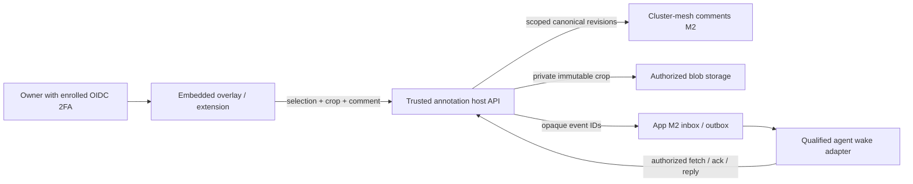

# SPEC EVOL — Deployed UI annotation overlay

**Status:** specification consolidated from the reviewed scratch spec v2; implementation not started. The six implementation lanes A–F below are proposed branches, not worktrees or reservations. No code, deployment, publication, Git, or Track write beyond this document is delivered here.

**Provenance.** Source scratch spec: `spec-ui-annotate-overlay-v2.md`, sha256 `5717b057b5d4ea78c78ffb7d77c71e50c198012b1219662b599c624e87543b11` (2026-10-17). Astra targeted re-review returned **GO**: all seven findings R1–R7 and the non-blocking corrections are closed at specification level; only the DV3 owner decision was open at review time and is now closed by the owner decision recorded in section 10. Host evidence baseline: `origin/main = 1472d961e098908e64ef60b83835af357888d031`, read through Git objects; the root checkout is not the implementation baseline. [PR #684](https://github.com/rhanka/sentropic/pull/684) (M2 comments contracts) remains a dispatch dependency: C/D use current main plus merged #684 contracts; its merge status is rechecked at dispatch. Working-tree links are navigation aids; pinned objects are authoritative.

Related specs:
- [Shared comments and annotations](SPEC_EVOL_COMMENTS_ANNOTATIONS.md) — canonical immutable annotation/thread/comment model consumed here; this overlay spec supplies the deployed-UI consumer capability and does not fork that model.
- [Application MCP provider platform](SPEC_EVOL_APP_MCP_PROVIDER_PLATFORM.md) — generic MCP provider platform; the explicit `/api/v1/artifacts-mcp` audience widening in section 6 stays gated by the E0 contract/security review recorded there and here.
- [Cluster Mesh as the Single Lazy Integration Surface](SPEC_EVOL_CLUSTER_MESH_LAZY_SURFACE.md) — lazy integration surface and MCP composition conventions referenced by the routing design.
- [Login-A amendment](SPEC_AMENDMENT_D11R_LOGIN_A.md) — DV3/DV4/DV5 seed and access-control context for the DV3 annotation copy policy in section 10.

The owner can point, draw a rectangle, or circle/lasso a live UI, add a private comment, and send it to the responsible repository's agent or conductor. Each saved annotation includes DOM evidence, a screenshot crop, page/deployment/viewport context, and verified OIDC identity enrolled with 2FA. First: `https://preprod.sentropic.sent-tech.ca`, then `https://sentropic.sent-tech.ca`; other apps follow through the extension. Lasso satisfies « cercle/entourer »; a dedicated circle tool is optional later (+1–2 h). Bookmarklet deferred.

**Estimate: 88–140 active agent-hours.** A–D private capture on preprod/prod: **66–100 h**; E agent loop: **+10–21 h**, blocked by app-replacement F2a/F2w/F3; F other apps: **+12–18 h**. E costs 10–16 h with the generic envelope, or 13–21 h including +3–5 h adaptation. Endpoint sums give 88–139 h; 140 is the rounded planning ceiling. C includes +6–10 h for shared storage installation. Includes tests/docs/review; excludes upstream completion, owner waits, infrastructure provisioning and app-replacement M2. No code, deployment, publication, Git or Track writes in this spec.

## 1. Evidence and boundaries

Paths below are relative to the Sentropic repository unless absolute. Proposed paths/targets are marked new. S2–S4/S6 retain the source snapshots audited in v1/review; host decisions below use pinned main evidence.

| Ref | Read source / observed state | Consequence |
|---|---|---|
| S1 | Scratch v2 packet; `1472d961e:rules/{workflow,MASTER,subagents,testing,security,architecture,data,components,design-system,conductor}.md`; `1472d961e:PLAN.md`, `plan/BRANCH_TEMPLATE.md` | `.cursor/rules/*.mdc` absent; current `rules/*.md` supply the contract. No BRANCH.md at this baseline in the scratch spec directory. Dispatch updates PLAN; this spec writes only this specification. |
| S2 | Diag annotate source `packages/annotate/src/types.ts`, `src/svelte/AnnotationLayer.svelte`, `package.json`; checkout HEAD `3164ff79119821712eacc7eb103dd4039b0b8c79` | `0.1.0`, raw source exports, no package build/publish lane; synchronous in-memory store. Conductor reports unpublished. Current lasso retains a freeform trace but clears target highlights; rectangle retains a group. Screenshot capture is a port, not a working live-page pipeline. |
| S3 | Diag UAT history, migration decision (2026-06-02), DS backlog | Preserve point/rectangle/lasso, shortcuts, numbered primary pins, yellow trace, blue highlights and **all intersected targets**. The June owner decision selects migration into `sentropic/packages/*`. The backlog documents the DS 0.10.3 packaging defect. |
| S4 | DS manifest `packages/components-svelte/package.json`, Svelte config; checkout HEAD `22421ed82f69737825b962e5a0e448482733eaca` | Current source is `@sentropic/design-system-svelte@0.35.0`, uses `svelte-package` and `vitePreprocess`. This is evidence of a source fix, not a verified published-tarball consumer result. Do not declare the historical bug still present or closed from source alone. |
| S5 | Host main `1472d961e`; [PR #684](https://github.com/rhanka/sentropic/pull/684) review snapshot OPEN, head `57eca41349e496fddfdd93444be70ed93bba9784` | C/D use current main plus merged #684 M2 contracts; recheck merge status at dispatch. Pin source/package versions and tarball integrity, install locally via `file:../packages/*`; publication is not a B/C/D predecessor. |
| S6 | #684 `packages/comments/src/anchors.ts`, `revisions.ts`, `geometry.ts`, `commands.ts`, `packages/cluster-mesh/src/comments/index.ts`, `revision-command.ts`, `hono/comments-router.ts` | Canonical immutable annotation/thread/comment revisions, UI/text/capture anchors, box/circle geometry, scoped grants, CAS and idempotency already exist. There is no canonical lasso shape, generic metadata property, page-list endpoint or open/resolved revision field. Host mapping below supplies those without changing the frozen package contract. |
| S7 | Replace-Claude v2.1 plan, especially F0/F2a/F2w/F3, N0/N1 and deferred F1 | Reuse durable inbox/outbox and the qualified running-agent wake adapter. Its M2 is the answer/remark loop; it does **not** deliver UI section annotations. This spec supplies that consumer capability; remote keyboard/control M3/M4 are not prerequisites. |
| S8 | `ui/chrome-ext/manifest.json`, `content.ts`, `tool-executor.ts`; deployment README; Makefiles and E2E config | MV3 extension already has `activeTab`, scripting, screenshot capture and a shadow-root UI, but also broad existing host permissions. Preprod has its own namespace/IdP. Ordinary `test-e2e` seeds a stack: it must never be pointed at deployed preprod. |

**Additional main evidence:** `api/src/services/session-manager.ts`, `packages/auth-hono/src/oauth/session-resolver.ts` and `api/tests/api/auth/passkey-mfa-session.test.ts` establish the MFA gates below. `spec/SPEC_AMENDMENT_D11R_LOGIN_A.md` establishes DV3/DV4/DV5. `api/src/services/cluster-mesh-adapter.ts` has runtime/cutover PG adapters but no generic storage/comments installation. `api/src/app.ts` owns product composition; `api/src/routes/api/index.ts` is inert. `api/package.json` consumes local mesh/comments; `ui/package.json` already consumes DS `^0.34.40`.

**Scope in:** reusable package, DOM/capture adapter, embedded owner toggle, canonical persistence, private routing/status, mobile UAT, later extension; annotation seed-policy specification/witness. **Scope out:** generic drawing editor, arrow expansion, arbitrary page execution, public/team sharing, second comment store, automatic code changes, remote keyboard control, historical Diag migration, executing production reseeds and optional bookmarklet.

## 2. Reuse and package ownership

| Keep | Adapt / add | Boundary |
|---|---|---|
| `Point`, `Rect`, `Selection`, `AnchorResolver`, lazy `SelectionCapture`/`CaptureFn` seams; `geometry.ts` bounds/corner-pin functions and their tests | DOM resolver with selector/quote/position evidence; polygon intersection; viewport/crop transforms | Reuse existing geometry where its behavior matches. Diag `Anchor` and canonical comments `Anchor` are different types; map explicitly. |
| Existing Svelte layer's tool presentation, draft/pin rendering, primary/yellow/blue semantics and keyboard vocabulary | Replace Tailwind utility dependency with scoped component CSS on DS CSS variables; fixed viewport layer/document-scroll transforms; pointer/touch handling, lasso highlights, mobile composer and async save | Diag `AnnotationLayer.svelte` depends on host Tailwind/`primary` and unconditionally sets `pointer-events:auto` over `context.host`. Remove drawing layer/listeners when unarmed; this is a required port. |
| In-memory store and `comment-store.test.ts` as a demo/test adapter | Async application adapter: load, submit, reply, resolve, retry and subscribe/refetch | A synchronous `add()` returning a local row cannot mean durable save. Change the submit seam explicitly; keep the composer until a server receipt arrives. |
| DS tokens and approved primitives | Verify the installed DS package; consume working primitives, retain token styling where no primitive exists | No copied DS components or dependency on framework internals such as React/Svelte debug metadata. |

| Home | Decision authority | Cost / consequence |
|---|---|---|
| **Planning baseline: `sentropic/packages/annotate`, published as `@sentropic/annotate`** with pure root + `./dom` + `./svelte` exports | Sentropic conductor/package maintainer records ownership/publication lane, consistent with the owner migration decision | A: 8–12 h for packaging/consumer proof. Independent release cadence; B follows local build/pack qualification. DS primitives use A2's installed-host check. |
| Move ownership under the design-system repository, still exposing a distinct annotation package | Sentropic conductor and DS maintainer propose the transfer; the owner decides if it changes the recorded monorepo governance decision | Same build/consumer qualification plus an estimated **6–10 h transfer/alignment delta**, DS release coordination and packaging verification. Persistence/auth/routing remain host adapters. No implication that annotations already live in DS. |

Publish compiled JavaScript/types and preprocessed Svelte output; inspect the actual tarball in a clean SvelteKit consumer. Declare Svelte as a required package peer; the pure entry has no Svelte runtime imports (npm peer installation and runtime independence are distinct). Wire CI validation/pack/publish and semver bumps; publication uses the repository's governed OIDC lane. Diag flips to a pinned released dependency in a separately owned follow-up; no edits in that repository here.

In-repo B/C/D consume local built packages through app `file:` dependencies; no npm publish wait. Public package dependency maps still use plain semver. Publication qualifies external Diag/Immo adoption. FL-DS is an A2 Popover/Tabs check using the host's installed DS version, not a separate clean-consumer blocker; annotation packed-consumer tests remain. `annotationsForAI` has no ACL: demo-only, never used for agent routing.

## 3. Attachment, identity and privacy



| Surface | Attachment and authority | Limits |
|---|---|---|
| Sentropic prod/preprod | Lazy-load `AnnotationOverlay.svelte` from the root layout only after a server capability response. Owner activates an Annotate toggle; inactive overlay does not intercept page interaction. UI and API use the same origin. | UI visibility is convenience; every list/read/crop/write/stream rechecks owner and scope. A query parameter or DOM attribute cannot enable authority. |
| Other apps: extension, later | Explicit click injects selection on demand via `scripting.executeScript`/`activeTab` for the allowed origin/tab/document. Isolated-world selector; closed shadow root for annotation chrome, no private text. Composer/history/auth remain in the side panel; background owns API calls. | Add `https://preprod.sentropic.sent-tech.ca/*` to existing static-script exclusions alongside prod. No new static annotation content script. Validate extension ID, tab/frame/document generation and operation; `<all_urls>` does not authorize collection. |
| Bookmarklet | Deferred optional item, 4–6 h excluded. | Requires separate exact-origin one-use handoff/CSP review; no implementation or qualification in F. |
| Generated artifact pages | Integrate through the app-replacement plan's exact-origin reader profile and release binding, or use the extension's trusted side panel. | Keep generated content on its separate registrable domain. Artifact read authority is not automatically annotation-write, routing or owner-approval authority. This is later-app integration, not an M1 prerequisite. |

**OIDC/2FA — « je veux toujours un oidc enrolé 2fa sur sent-tech.ca »:** prod issuer `https://auth.sent-tech.ca`; preprod issuer `https://preprod.auth.sent-tech.ca`. Every embedded annotation route (including capability/list/crop/SSE) reads the current server session row and requires `session.mfaVerified === true`; the session JWT has no assurance claim. Every OAuth annotation client, including extension, requires verified token `acr === 'urn:sentropic:loa:passkey-fresh'` and client `required_acr` set to that value. Validate signature, exact issuer/audience, code+PKCE/state/nonce, expiry and live revocation. Refuse magic-link, device-code, federation-only and UV=false passkey access; never infer strength from login labels/email. Bind owner to verified `(iss, sub)` and tenant/workspace. Store opaque assurance references, never tokens. No new UV ceremony per annotation. Agent delivery uses a verified workload principal plus the owner's exact delivery grant below, not weak human authentication.

**Private by default:** owner-only read/write until an explicit Send to agent action grants that exact annotation/revision to an eligible repo principal. Private ACLs apply to history, list indexes, captures, exports, SSE and agent fetches. No public URL or ambient workspace-reader inheritance. Owner may revoke delivery/read access; purge follows the existing lifecycle and capture-retention policy, not “resolve.”

**Per-annotation mediation (R1):** M2 `CapabilityCheckPort` sees only `ResourceRef[]`; A and B on page P share the resource. Agents receive no canonical page grant and no direct canonical router. Host checks `{annotationId, revision, recipient, bindingGeneration}` and live revocation, verifies requested thread/comment/crop IDs belong to that exact annotation and permitted revision, then constructs only that chain's read/reply inside `withContext`. The request-local capability closure checks grant principal, operation and page; it cannot independently distinguish A/B, so immutable host-selected IDs and the pre-call chain check are mandatory. Never reuse this context for caller-supplied selectors, bulk reads or another request. List/SSE/export/crop paths filter by the same grant before emitting IDs/bytes; later private revisions are not automatically included. Replies retain agent principal and AI attribution. Test **A ≠ B on the same page**: grant A; deny listing, reading, crop access, reply and SSE visibility for B, including B created later, guessed/mismatched IDs and revoked/stale grants.

**CSP source-gap:** main has no deployed-UI CSP configuration (the extension under `ui/vscode-ext` is separate). B0 must qualify capture under a target policy allowing `img-src 'self' data: blob:` and no `unsafe-eval`; record exact policy and unsupported cases, never claim an existing deployed policy was verified.

**CSP and data:** bundle embedded code locally; no remote `eval`, wildcard CORS or CSP relaxation. Keep auth in HttpOnly/Secure host sessions or extension-owned storage. Exclude password/OTP fields, input values, secret-marked regions and authentication pages from capture/quotes; mask before upload and let the owner redact the crop preview. Sanitize page URLs by dropping userinfo/query/fragment except explicitly allowlisted route parameters; preserve the navigable non-secret page identity. Do not serialize the whole DOM, hidden content, localStorage, cookies or environment values. Comments/quotes are untrusted text, including when an agent reads them; no raw HTML execution or instruction-to-shell interpretation. Private responses use `Cache-Control: no-store`; logs carry IDs/status, not text, crops or credentials.

## 4. Canonical data mapping

Consume `createCommentsModule`, `createCommentsPostgresRegistration`/installed generic storage binding and its `withContext(grant, ...)`/`store.transaction().run(...)` interfaces from #684. Reuse the same canonical module Immo consumes, with independent authorized scope. No new `contextType` enum member, legacy `pg-comment-store` route or edits to frozen `packages/comments/src/**`.

| Required data | Canonical representation / host contract |
|---|---|
| Tenant/workspace/page | `ResourceRef = {scope:{tenantId,workspaceId}, namespace:'sentropic.ui', kind:'page', id:pageId}`. Server derives registry identity from SvelteKit `route.id` plus allowlisted normalized params, checked against the served build's route manifest and app/tier. Never accept a client-chosen pageId. Retain registered page records across deletion/renaming; different identity means a new annotation. |
| Deployed source | `RevisionTargetBinding.source` and every anchor's `source` use `SourceVersionIndicator`. `observed` binds an immutable build manifest/asset digest and observation evidence. Record release ID, commit, app and tier in the profile. Embedded pages carry their own served build ID; verify against deployment records, not merely the API's latest version. Old browser assets during rollout remain distinguishable. |
| DOM target | `UiAnchor` with stable `surfaceKey`, `renderVersion`, resource/source and `captureRef`. Prefer application-owned `data-annotate-id`; instrument important controls in D. Store selector, bounded exact quote + surrounding text, ancestor hints and position in the host profile. CSS selectors/coordinates are hints, never authority or stable identity. |
| Text range, when applicable | Add `TextAnchor` only when Unicode code-point offsets are known against the recorded text source. Otherwise retain quote evidence in the profile; do not invent offsets. |
| Screenshot crop | Immutable `CaptureAnchor`: `blobId`, digest, PNG/WebP MIME, intrinsic width/height, capturedAt and source. Bytes use private host blob storage; annotation records persist references. Every read checks the annotation ACL. No base64 image embedded in comment bodies. |
| Selection | `visualAnchors[]` with ordered `shapeId`, capture-bound frame/digest and canonical quantized **box/circle**. Persist actual lasso points in the versioned host profile as described below; a box is only its bounding representation. Group members each retain DOM evidence and selection order. Members on one page share its ResourceRef; `secondary=[]` unless there are distinct authorized resource identities, never duplicate page refs. Without a stable element key, bind the UI anchor to the stable page surface and retain element hints with explicit drift uncertainty. |
| Comment/thread | One `AnnotationRevisionRecord`, initial `ThreadStructureRevisionRecord` (`initial-registration`, same primary, annotationId), and `CommentRevisionRecord` pinned to exact structure hash/annotation revision. User prose only in comment `body.text`. Annotation `body.text` is non-empty deterministic non-secret text, e.g. `UI annotation · lasso · 3 targets`, alongside profile metadata; never duplicate private prose. Replies bind to the same discussion. |
| Author | Server creates `RevisionProvenance.attribution` (`human`, subject reference, assertion class, evidence reference); module stamps `registration.principal/registeredAt` from the verified grant. Agent replies use their authorized principal and AI attribution; never impersonate the human. |
| Open/resolved + PR | Host profile `discussion.status = open\|resolved`, resolved actor/time and optional `{repoId, number, url, commit}` PR link, written as a new annotation revision under CAS. Enforce `resolve-discussion` plus revision permission. The canonical review verdict and lifecycle archive are different concepts. Linked PR is independent of resolution; merging a PR does not auto-resolve. |
| Delivery | Host outbox/index references canonical annotation/thread/revision IDs, repo binding generation and receipt state. It stores delivery metadata, not a second authoritative copy of comment content. |

**Host profile:** introduce `schemaId='sentropic.ui-annotation'`, version `1`, with a digest-pinned schema accepted by the host. `SemanticProfile.fields` only permits scalars, safe integers and nested objects: **no arrays or fractional numbers**. Encode ordered members/points as `members.m0000`, `points.p0000={xQ,yQ}`, explicit counts and zero-padded order; coordinates use integer millionths, viewport/scroll values integer thousandths of CSS pixels, DPR/visual scale integer thousandths. Preserve tool, polygon, selected members, normalized/document rectangle, quote, CSS selector, URL, build, locale, viewport, crop transform/capture method and assurance reference. No undeclared `metadata` property on canonical records.

**Geometry (R4):** crop = selection bbox plus 8 CSS px margin, clamped to the captured area. Point uses the resolved element's positive-area box intersected with that area, or a 4 CSS px minimum marker box when no element resolves; shift/shrink the marker inside the frame and show the adjusted preview. Reject an empty intersection/collapsed quantized box. Rect/lasso canonical shape is the positive-area bbox of the visibly clipped selection, never a bounding circle. Clip polygon/member shapes to the capture frame with visible feedback before integer quantization; validate positive area and `[0,1]` bounds again after quantization. Canonical circles, if later used, must have `r > 0` and their entire circumference inside the frame. No silent clipping by M2. Tests cover point/viewport corners, zero-size elements, lasso edge overflow and empty annotation text.

**Authority versus drift (R5):** `ResourceResolverPort` answers only for the retained page registry resource and its source: registered pages return `exact` or `source-changed`, even when absent from the current build. ACL checks remain separate. DOM missing/ambiguous/changed outcomes are host-profile/UI evidence and never enter that authority port. A removed page retains authorized read, reply and resolve operations with its original crop; only an actual authorization/resource-retention denial makes it unavailable. New page registration validates the served manifest; historical operations resolve the retained record, not today's route existence.

**Shared PG installation (R6):** the **C lane owner** is the sole implementation owner of generic mesh storage setup shared with app-replacement A1. New `api/src/services/cluster-mesh/storage.ts` composes the PG profile, module registrations, roles and one executor/journal; `api/src/app.ts` installs it once. Host schema/catalog changes use `api/src/db/schema.ts`, migration directory `api/drizzle/` (one new SQL migration plus matching journal metadata; numeric filename allocated at dispatch), and `spec/DATA_MODEL.md`. Do not invent a second migration runner or confuse existing runtime/cutover adapters with this installation. App-replacement A1 depends on that shared installation and adds artifact registration through its exported seam after C lands. C-storage is **+6–10 h**. If A1 has already delivered the same qualified installation at dispatch, formally transfer sole ownership to A1, make C depend on it and remove C-storage cost/work; never parallel-write these paths or double-count the prerequisite. C's host comment service is also the substrate for deferred app-replacement **F1**, adding `sentropic.artifact` beside `sentropic.ui` through adapters, not a second host mapping.

Proposed host limits: comment 8 KiB UTF-8, profile 64 KiB canonical JSON, 512 lasso points, 31 selected members plus primary resource, 128 visual anchors maximum, selectors 2 KiB and quote/context 2 KiB total per member, crop 2 MiB/4 megapixels. These are admission ceilings, not simultaneous guarantees: enforce every bound, including the installed M2 capacity descriptor and depth ≤8. Show excess-selection feedback before save; never silently truncate targets. Simplification must preview the resulting lasso and preserve its selected set. Unknown profile versions refuse mutation and retain a readable unsupported-version state.

**Commit flow:** authenticate → validate page/source/ACL/profile → allocate annotation/thread/comment IDs and durably register a scoped creation intent → stage and verify the redacted crop → commit annotation/thread/first-comment together in one canonical module transaction → finalize the catalog/intent → return durable IDs/hashes. The intent holds IDs, page binding and payload digest, not a competing copy of the comment. Recovery can discover committed records by those preallocated IDs after a crash. Retries use stable scoped idempotency keys and exact expected heads; mismatched replay/stale revision returns conflict with the draft intact. Crop upload is not a cross-store transaction: staged objects have short orphan expiry, and referenced objects cannot be collected. Do not display Saved until all three canonical records and a verified crop reference exist. Routing has its own durable intent keyed by committed revision; recovery covers crash-before-outbox without assuming an atomic transaction across unrelated stores. Only an explicit authorized Send intent permits delivery; recovering a private save cannot create one. A failed wake never loses the saved annotation.

**Queries:** #684 exposes chain reads, not a page-wide listing API. C adds a scoped page→annotation/thread catalog with the creation intent; repair incomplete intents after crashes and verify each result through canonical reads/current ACL. Catalog/status caches are rebuildable projections, never the source of comment content. Its repair test must demonstrate discovery after a crash, not only direct lookup by a remembered ID.

**Host API, new:** `/api/v1/ui-annotations` provides capability/page-list/read/create operations; explicit subroutes handle capture staging/read, replies, re-anchor, status and routing. C0 freezes request schemas. The browser supplies bounded selection evidence, prose, expected revision and idempotency key; the host derives authoritative scope, principal, deployment binding and provenance. Enforce exact Origin/CSRF on cookie-backed writes. If the canonical operation requires decision evidence, issue/resolve it for the explicit owner action and exact base/proposed-content binding; never accept page-supplied authority or bypass required evidence with an empty reference.

## 5. Anchoring, screenshot and mobile behavior

| Situation | Required behavior |
|---|---|
| Initial point / region | Resolve stable application key, then a unique escaped CSS selector checked against tag/role/quote; gather normalized quote with prefix/suffix and position fallback. For rectangle/lasso, find **every intersected eligible leaf/control**, deduplicate nested wrappers and exclude overlay/hidden/sensitive nodes. A closed lasso uses polygon intersection, not its bounding box. Explicitly preview the member set. |
| Same release after scroll/layout | Recompute pins/highlights on scroll containers, resize/visualViewport, relevant mutations and SPA route changes, coalesced per frame. Include DPR, browser zoom and mobile visual viewport offsets in crop transforms. Never leave an intercepting invisible layer when mode is off. |
| Later deployment | Resolve stable key → validated selector → unique quote/context → position suggestion. Report host DOM drift `exact`, `source-changed`, `unresolved` or `unavailable`, separate from M2 authority. Ambiguity is unresolved; position-only matches are suggestions. Changed deployment stays source-changed even with the same key. No silent nearest-element attachment. |
| Manual re-anchor | Owner inspects original crop, chooses the current target and confirms. Append annotation and `reanchoring` thread-structure revisions; old comments retain their original pins. Concurrent changes conflict. Preserve original capture/source and add new evidence; do not rewrite history. |
| Missing/opaque content | Deleted or duplicate target: unplaced annotation in the list, with crop. Closed shadow DOM/cross-origin iframe: outer host/frame + geometric evidence only; explain that the inner DOM is inaccessible. Extension pixel capture can still depict visible content without asserting an inner anchor. Unmounted/virtualized content is not automatically scrolled into or clicked. |
| Crop, embedded/mobile | Capture only on explicit selection, locally, via the qualified `CaptureFn` DOM rasterizer (evaluate a pinned html-to-image/snapdom-class implementation in B0). Temporarily exclude overlay controls; preserve the yellow shape separately. Use one capture epoch for selection/build/scroll/crop; invalidate and retry if any changes. Preview actual output before save. |
| Capture fidelity / unsupported API | DOM rasterization is reconstructed rendering and can fail on fonts, foreignObject, tainted canvas, video or cross-origin assets; mark method/fidelity. No automatic server browser given user cookies and no requirement for desktop-only `getDisplayMedia`. If automatic capture fails, retain the draft and offer a device screenshot upload with explicit crop/alignment confirmation, or extension capture. A final annotation still requires a crop; unsupported capture is never silently saved as success. |
| Extension capture | Reuse `captureVisibleTab`; verify the same foreground tab/document/viewport before and after capture, then crop/mask locally and discard full-frame bytes. A tab switch or navigation cancels. Preview and authorized upload remain in the side panel. |
| Unverified third-party version | Record observed URL/time/capture digest and `source.variant='unknown'` with classification if no trusted deployment manifest exists. Never fabricate a commit. Later app onboarding requires a manifest for full deployment-traceability acceptance. |

**Phone flow (390 px, also 320 px):** tap Annotate → choose Point/Rectangle/Lasso in a bottom toolbar with ≥44 px targets → touch/drag to circle the UI → release into a bottom-sheet composer → inspect targets/crop, redact, type → Save privately → optionally Send to agent. One pointer draws only while armed; scroll/pinch remains available outside draw mode. A second pointer or `pointercancel` cancels the active stroke safely. Keyboard opening/orientation changes keep Save/Cancel reachable. Save retries preserve text/selection; navigation warns on an unsaved draft. Initial implementation retains drafts in memory; no silent durable storage of private drafts on shared devices.

While armed only: `touch-action:none`, `user-select:none`, `-webkit-user-select:none`, `-webkit-touch-callout:none`; suppress contextmenu/long-press on the drawing surface. Slop: 4 CSS px mouse/pen, 10 CSS px touch. Point-mode drag cancels/requires retry, never falls through into lasso. Inset drawing starts 20 CSS px from left/right viewport edges with a visible safe-zone hint for iOS back/forward gestures. Outside armed mode restore browser scrolling, selection and context menus. Verify gesture-state tests and WebKit mobile E2E, plus real iOS/Android UAT.

Desktop: Alt+Shift+A toggles Annotate outside editable controls; **Ctrl+click point, Ctrl+drag lasso, Ctrl+Shift+drag rectangle only while armed**. No document-level Ctrl interception when disabled; native link-new-tab/contextmenu gestures remain intact. Escape cancels; keyboard users select a focused target without drawing. Announce save/failure/count with accessible text; retain numbered DS-primary pins, yellow trace and blue highlights.

## 6. Repository routing and discussion state

The server registry maps `{appId,tier,pageId,releaseId}` to `{repoId,workspaceId,conductorPrincipal,agentInstance?,bindingGeneration}`. The owner sees the proposed recipient and can choose from authorized repo targets. Page content, URL parameters and display names cannot select an arbitrary recipient. Unknown mapping saves privately as unrouted; unavailable agents leave the item queued. Rebinding requires an explicit authorized operation, invalidates the old delivery grant and preserves audit history.

| Event / state | Behavior |
|---|---|
| Save privately → `open` | No agent notification or content grant. |
| Send → `pending` → `notified` | Authorize `submit-to-ai` for exact IDs/revision/crop, commit durable intent and enqueue an opaque event ID. Deduplicate by annotation/revision/recipient generation. |
| Agent `fetched` → `acknowledged` → `replied` | Fetch/ack/reply recheck live ACL and binding. Transport delivery alone never means acknowledged. Replies append canonical AI-authored comments. Revoked/deleted annotations are not retried into a new recipient. |
| Linked PR | Agent proposes a repo-bound PR URL/number; server validates allowed repo/origin. Show link independently of discussion status. Existing repository mandates govern implementation and PR creation; a feedback event alone grants no tool, merge or approval authority. |
| Resolve / reopen | Owner resolves after verifying the fix; reopen is a new authorized revision. Agent may propose resolution; automatic resolution authority is not granted by default. |

E reuses app-replacement M2 F2a inbox/outbox and F2w's qualified wake boundary, with namespaced `ui.annotation.available` events and provider handlers for authorized list/fetch/ack/reply. Bind the handler names to the existing provider at E0; do not create a competing MCP endpoint or duplicate native wake engine. Notify only opaque IDs; fetched comment/DOM text remains untrusted data. Busy/permission-prompt states defer safely. No comment bytes are pasted into a shell/PTY or used as approval. Qualification requires **the same already-running idle agent** to wake, fetch, acknowledge and reply without restart/manual prompt/Claude Remote Control. Existing N0/N1 may display reply notifications; phone push is optional and outside this estimate.

**Cross-plan F0 request / E0 gate:** freeze a generic F2a envelope `{eventId, kind, targetRef, recipientRef, bindingGeneration, schemaVersion}`: namespaced `kind`, opaque `targetRef`, no artifact-only IDs required and no private payload in notifications. Artifact answer sets retain their existing handler semantics; UI annotations resolve through C's grant mediator. App-replacement F0 owner accepts this contract before E1; otherwise E1 carries **+3–5 h** adapter/refactor work and both artifact/UI regression suites. This is a recorded handoff, not a claim that F0 was changed.

**Explicit MCP audience widening:** add UI annotation handlers to **`/api/v1/artifacts-mcp`**, whose existing accepted audience is artifact-scoped. Keep the exact tier-specific resource URI, explicitly widen its accepted tool/resource purpose to UI annotations, and register separately granted `ui-annotations:read` / `ui-annotations:reply` scopes (proposed names frozen at E0). Artifact-only tokens gain no annotation permissions; annotation-only tokens gain no artifact permissions. Exact audience + scope + per-annotation delivery grant are all required. E0 obtains cross-plan contract/security review of this delta before E1; no wildcard audience, silent scope expansion or second endpoint.

## 7. Branches, dependencies and scope

These are proposed branches, not worktrees/reservations. Multi-branch mode; ≤4 concurrent branches including upstream. Baseline: main `1472d961e` plus merged #684, locally installed and qualified. A/B serialize package edits; D waits for B/C. E's shared inbox edits serialize with app-replacement F/N, and E edits `AnnotationThread.svelte` only after D merges and transfers ownership.

| Lane / branch | Allowed implementation paths, plus named tests below | Depends on | Agent-hours |
|---|---|---|---:|
| A `feat/annotate-package` | New `packages/annotate/**`; workspace manifests/lock; minimal new `ui/src/lib/annotations/package-proof.ts` import | Conductor package ownership | 8–12 |
| B `feat/annotate-dom` | `packages/annotate/src/{dom,svelte}/**`, `types.ts`, package tests/manifest; `e2e/fixtures/ui-annotation/**`, `e2e/tests/components/ui-annotation.spec.ts`, `e2e/tests/components/ui-annotation-capture.spec.ts`; capture dependency confined to package | A local build/pack proof; A2 DS check | 16–24 |
| C `feat/ui-annotation-service` | `api/src/services/ui-annotations/**`, `api/src/routes/ui-annotations.ts`, `api/src/services/cluster-mesh/storage.ts`, `api/src/app.ts`, `api/src/db/schema.ts`, `api/drizzle/` one SQL migration/journal metadata, `spec/DATA_MODEL.md` | #684 merged/locally installed; OIDC/private blobs; sole shared storage owner per section 4 | 26–40 |
| D `feat/ui-annotation-overlay` | New `ui/src/lib/annotations/**`, `ui/src/lib/components/annotations/**`; `ui/src/routes/+layout.svelte`; specific `data-annotate-id` attributes on qualified controls; public build-manifest wiring | B + C; deployed identity/capture gates | 16–24 |
| E `feat/ui-annotation-routing` | C's `routing.ts`/`delivery.ts`, existing F/N inbox/provider seams named at E0; `ui/src/lib/components/annotations/AnnotationThread.svelte` only after D merges | C + app-replacement **M2 F2a/F2w/F3**; D before UI edits/final witness | 10–21 |
| F `feat/ui-annotation-extension` | `ui/chrome-ext/{background,content,tool-executor,extension-auth}.ts`, new `annotation-bridge.ts`, manifest exclusions, trusted side-panel composer paths frozen F0 | B/C/D; E if sending to agent | 12–18 |

Default forbidden: unrelated app/package code, Diag/DS/h2a source, `packages/comments/src/**`, `packages/cluster-mesh/src/**`, root runtime data, secrets, other branches' plans. Conditional exceptions: A build/publish `Makefile`/`.github/workflows/ci.yml`; C named host schema/migration/composition and package pins; **B/D/E/F** E2E inventory/Make wiring; D build-manifest wiring; F manifest permissions. Record exact paths/reason/impact/rollback as `BR<lane>-EXn` at dispatch. Shared Make/CI/lockfile edits have one writer per wave. App A1 and C serialize storage/composition/migration paths; DS/h2a changes stay with their owners.

**Waves:** W0 ownership/contracts/capture scoping; W1 A ∥ C (C waits for #684; shared C-storage precedes app A1); W2 B and C completion; W3 D ∥ E backend-only on disjoint files; after D merges, E takes `AnnotationThread.svelte` and the deployed qualification spec; W4 private preprod qualification then owner production rollout, E loop qualification when F2a/F2w/F3 land; W5 F. No D/E parallel edits to thread UI. Private capture does not depend on E or Remote Control M3/M4.

At dispatch the conductor **updates root `PLAN.md` with all six lanes**, dependencies, shared storage owner, file handoffs, slots and statuses; then creates each isolated `tmp/<slug>/BRANCH.md` from the template. Preserve section order and workflow's checkbox-only/no-`###` rule, copying per-lot files/commands/UAT below. No BRANCH.md, PLAN edit, Track import or harness recorder is created by this spec-only promotion beyond this branch's own `BRANCH.md`.

## 8. Lots and file-level verification

`N` = new, `U` = updated, `E` = existing regression retained. Unless stated, other API/UI/E2E files for that lot: none. UI unit tests remain TypeScript; rendered **component behavior is covered by browser fixture specs**, not a new Svelte component-test runner. Paths are full repository-relative paths. Each lane finishes its listed docs/UAT and full affected suites once; development reruns only evolving files.

| Lot / hours | Work and exact tests | Gate / step-level UAT |
|---|---|---|
| A0 · 1–2 | Freeze source/license/export/ownership matrix and publishable peer contract. No test additions. | Conductor confirms package lane and allowed paths; no unresolved publish identity. |
| A1 · 4–6 | Copy reusable contracts/geometry/store; build/dist/exports/CI wiring. Copied E: `packages/annotate/tests/geometry.test.ts`, `packages/annotate/tests/comment-store.test.ts`. N: `packages/annotate/tests/package-exports.test.ts`. | GA: packed entry imports work without source paths; no Svelte runtime import in root entry; Svelte entry renders in the consumer and missing peers produce clear failure. |
| A2 · 3–4 | Real app consumer proof, README/license/release runbook. N: `ui/tests/annotations/package-consumer.test.ts`. | GA + GU: annotation tarball renders/builds; Popover/Tabs work with host's installed DS. Local `file:` install/build evidence unlocks B, no npm publication gate. |
| B0 · 2–3 | Capture capability unit test N: `packages/annotate/tests/capture-capabilities.test.ts`. Real rasterization N: `e2e/tests/components/ui-annotation-capture.spec.ts`, using B3 fixtures in packed-consumer harness, Chromium + WebKit. | Fonts/SVG/scrollers/phone under target CSP; blank/tainted capture fails into manual crop. Node/jsdom cannot prove rendering fidelity. |
| B1 · 5–7 | DOM selectors/quote/position, mutation and polygon membership. N: `packages/annotate/tests/dom-anchor.test.ts`, `dom-drift.test.ts`, `region-intersection.test.ts`; U: `geometry.test.ts` in same directory. Use jsdom/happy-dom with **injected dimensions/rect/layout provider**; browser fixture validates real layout. | GA: duplicate IDs/labels, DOM reorder, deployment drift, opaque roots, Unicode; lasso excludes bbox-only intersections. Never trust jsdom zero-size `getBoundingClientRect` as real geometry. |
| B2 · 5–8 | Scoped CSS/tokens, armed-only pointer/keyboard/touch, async submit, transforms/redaction. N: `packages/annotate/tests/gesture-state.test.ts`, `capture-transform.test.ts`, `async-submit.test.ts`. | GA: 4/10 px pointer slop, Point drag never lasso, armed-only touch-action/selection/menu suppression and 20 px edge exclusion; second pointer/cancel/epoch change preserve draft; positive point shapes, visible clipping and post-quantization bounds. |
| B3 · 4–6 | Component fixture and browser proof in A's disposable packed-consumer harness. N: `e2e/fixtures/ui-annotation/index.html`, `e2e/fixtures/ui-annotation/entry.ts`, `e2e/tests/components/ui-annotation.spec.ts`. | GB-B: compile/mount the actual packaged Svelte layer; toolbar → draw → all blue targets → composer → reject/save → pins; keyboard-only cancel/comment; 320/390 px orientation and virtual keyboard. Document portable adapter. |
| C0 · 2–3 | Freeze schema/profile digest, capacity/ACL/blob/catalog contracts and module tuple. N: `api/tests/unit/ui-annotation-profile.test.ts`. | GC-unit: no arrays/floats/unknown fields; bounds/Unicode/source distinctions; canonical box/circle plus lasso profile round-trip. |
| C-storage · 6–10 | Shared PG profile/roles/registration/executor/journal in section 4 paths; handoff to app A1. N: `api/tests/api/cluster-mesh-storage.test.ts`. | GC-storage: real disposable PG, concurrent boot runs migration once; restart/idempotence, role denial and failure recovery; comments/artifacts registrations share one journal, no second runner. Removed only if A1 delivers this prerequisite first. |
| C1 · 6–9 | Canonical transaction/catalog/CAS and grant mediator. N: `api/tests/api/ui-annotations.test.ts`, `api/tests/api/ui-annotation-recovery.test.ts`. E: `packages/comments/tests/annotation-anchors.spec.ts`, `annotation-revisions.spec.ts`, `revision-hash.spec.ts`, `annotation-conformance.spec.ts`; `packages/cluster-mesh/tests/comments-transactions.spec.ts`, `comments-router.spec.ts`. | GC: restart/idempotency/crash repair; page absent in build B still permits owner read/reply/resolve; forged pageId rejected; point/edge geometry valid, empty annotation text rejected. |
| C2 · 7–10 | OIDC/owner gates, blob stage/read/cleanup and sanitization. N: `api/tests/security/ui-annotations.test.ts`, `api/tests/api/ui-annotation-captures.test.ts`. E: `api/tests/api/auth/oauth-authorize.test.ts`, `oauth-token.test.ts`, `session.test.ts`, **`passkey-mfa-session.test.ts`**; `api/tests/api/comments.test.ts`, `comments-wire.test.ts`. | GC-security: magic-link/device-code/federation-only/UV=false fail; true server-row MFA succeeds, forged JWT claim fails; OAuth missing/bearer/wrong acr fails; cross-owner/tenant/tier/revoked reads fail; image validation and referenced-crop GC safe. |
| C3 · 5–8 | PG/blob integration, schema/runbook, final suites; N: `api/tests/api/ui-annotation-seed.test.ts`; extend C1/C2 files. | GC-final: retries/revoke/recovery and crop survive restart; synthetic source→target fixture validates the closed DV3 = B policy (section 10) for canonical chains/catalog/capture prefix and no prod grants survive. Seed-policy implementation proceeds under the closed decision; no owner answer is awaited. |
| D0 · 2–3 | Owner capability/toggle/build metadata. N: `ui/tests/annotations/access.test.ts`, `deployment.test.ts`. Register group **06** annotation specs once in E2E inventory (components and deployed qualification separately); no renumbering later. | GU: MFA gate, no unauthorized activation/history; observed old-UI/current-API build; no tier mixing. |
| D1 · 6–9 | Full-page overlay/mobile sheet/crop preview/masking/manual crop/persist. N: `ui/tests/annotations/overlay-state.test.ts`, `capture-preview.test.ts`, `store-adapter.test.ts`; `e2e/tests/06-ui-annotation-overlay.spec.ts`. | GD: WebKit mobile asserts touch-action, slop, Point drag, long-press/menu suppression and iOS edge inset; phone draw/type/save/reload; mode off restores scroll/forms/link Ctrl gestures. Keyboard toggle + cancel and offline draft retention. |
| D2 · 4–6 | Drift review, manual re-anchor and discussion status/PR display. N: `ui/tests/annotations/drift.test.ts`, `thread-state.test.ts`; N: `e2e/tests/06-ui-annotation-drift.spec.ts`. E: `ui/tests/utils/comments.test.ts`, `ui/tests/chat/comment-adapter.test.ts`. | GD: save at release A, deploy fixture B, inspect source-changed/missing/ambiguous targets, re-anchor explicitly, inspect original history; resolve/reopen separate from PR link. |
| D3 · 4–6 | Deployed runner, guide/rollout/rollback and DV3 witness. N: `e2e/playwright.ui-annotations-preprod.config.ts`, `e2e/tests/qualification/ui-annotations-preprod.spec.ts`. | GP: real preprod OIDC MFA/phone; record image/build/schema and the closed DV3 = B policy; inspect authorized seed rehearsal evidence for tables/catalog/capture prefix and overwrite consequences. Runner never seeds/resets or targets prod. |
| E0 · 2–3 | Freeze repo binding, generic F0 envelope, exact MCP audience/scope delta; cross-plan contract/security review. N: `api/tests/unit/ui-annotation-routing.test.ts`. | GE-unit: spoof cannot reroute; unknown binding private; exact grant; accepted audience/scope delta recorded before E1. |
| E1 · 5–8 (+3–5 if F0 adapter needed) | Durable intent/outbox, fetch/ack/reply/PR via C mediator. N: `api/tests/api/ui-annotation-delivery.test.ts`, `api/tests/security/ui-annotation-routing.test.ts`, `ui/tests/annotations/delivery.test.ts`. E after app F lands: `api/tests/unit/artifact-feedback-routing.test.ts`, `api/tests/api/artifact-feedback.test.ts`, `artifact-feedback-mcp.test.ts`. | GE: **A ≠ B on same page** denies list/read/crop/reply/SSE, including later B; revoke/generation/revision mismatch denies; artifact-only vs annotation-only scope separation; crash/dedupe preserve distinct receipt states. |
| E2 · 3–5 | Real agent/phone loop and docs. N: `e2e/tests/06-ui-annotation-routing.spec.ts`; extend preprod qualification file under D→E ownership transfer. | GE/GP: same idle agent wakes, fetches and replies; busy/permission state defers; owner opens linked PR then explicitly resolves; existing app-M2 artifact feedback still works. |
| F0 · 2–3 | Allowed origins/tab generations/OAuth acr, exact side-panel paths. N: `ui/tests/chrome-ext/annotation-bridge.test.ts`. | GF: preprod/prod exclusions; activeTab on-demand only; closed shadow root/no private text; forged page messages cannot fetch content/credentials. |
| F1 · 6–9 | Side-panel composer, isolated selection, capture/redaction, current-tab binding. N: `ui/tests/chrome-ext/annotation-capture.test.ts`; U: `ui/tests/upstream/chrome-host-adapter.test.ts`. N: `e2e/tests/06-ui-annotation-extension.spec.ts`. | GF: explicitly activate second app, lasso/capture/send; tab switch cancels; ordinary tab tools and auth regressions pass. |
| F2 · deferred, 4–6 excluded | Optional bookmarklet; no files/tests/commands in this dispatch. | Requires a separate scope/decision before implementation. |
| F3 · 4–6 | Other-app documentation, exact extension build and browser matrix. E: `e2e/tests/03-chat-chrome-extension.spec.ts`, `03-chat-chrome-extension-auth.spec.ts`; extend F browser files. | GF-final: allowed Chrome app qualifies; phone retains embedded flow; no promise of Chrome desktop-extension support on mobile Safari. Document unknown version/opaque DOM and private rollback. |

## 9. Make commands and environments

No command below was executed during planning. All run from their future isolated worktree; `ENV` is last. Slot formula: `9000/5200/1100 + nn*5 + slot`; proposed numbers avoid app-replacement 121–125 and #684's occupied 124/0. Conductor must register ownership, verify free ports and exact OAuth callbacks before starting anything; these are not live availability claims.

| Lane | Proposed nn | Test slot 0 API/UI/Maildev | E2E slot 1 API/UI/Maildev | ENV suffix |
|---|---:|---|---|---|
| A | 126 | 9630 / 5830 / 1730 | 9631 / 5831 / 1731 | annotate-package |
| B | 127 | 9635 / 5835 / 1735 | 9636 / 5836 / 1736 | annotate-dom |
| C | 128 | 9640 / 5840 / 1740 | 9641 / 5841 / 1741 | ui-annotation-service |
| D | 129 | 9645 / 5845 / 1745 | 9646 / 5846 / 1746 | ui-annotation-overlay |
| E | 130 | 9650 / 5850 / 1750 | 9651 / 5851 / 1751 | ui-annotation-routing |
| F | 131 | 9655 / 5855 / 1755 | 9656 / 5856 / 1756 | ui-annotation-extension |

**Target availability:** main API `test-api-unit/endpoints/security` accept space-separated file lists; UI/package `SCOPE` is one file/pattern per invocation. Existing `test-comments` ignores `SCOPE`, so use it as a full regression gate. UI/API quality/build/test, `build-ext-chrome` and `check-e2e-inventory` exist on main `1472d961e`. #684's `test-cluster-mesh` alone skips PG-gated cases without `CM_PG_URL`; use its `cluster-mesh-pg-test`/`cluster-mesh-comments-test` from `packages/cluster-mesh/tests/storage/postgres.mk` below. **New, blocked until their owning lots implement them:** A's `typecheck-annotate`, `lint-annotate`, `test-annotate`, `build-annotate`, `pack-annotate`, `test-annotate-consumer`; D's `test-ui-annotations-preprod`. New target semantics: Docker-only, TypeScript/Svelte checks, scoped package tests, isolated packed consumer with `E2E_SPEC` selecting B's Chromium/WebKit specs; preprod uses a separate non-seeding runner with strict URL/tier checks. No proposed target is presented as currently runnable.

GA / GU / GB-B, then each remaining B package file listed above with the same one-file `SCOPE` form:

```sh
make typecheck-annotate lint-annotate test-annotate build-annotate pack-annotate test-annotate-consumer API_PORT=9630 UI_PORT=5830 MAILDEV_UI_PORT=1730 ENV=test-annotate-package
make test-ui SCOPE=tests/annotations/package-consumer.test.ts API_PORT=9630 UI_PORT=5830 MAILDEV_UI_PORT=1730 ENV=test-annotate-package
make test-annotate SCOPE=tests/dom-anchor.test.ts API_PORT=9635 UI_PORT=5835 MAILDEV_UI_PORT=1735 ENV=test-annotate-dom
make test-annotate SCOPE=tests/capture-transform.test.ts API_PORT=9635 UI_PORT=5835 MAILDEV_UI_PORT=1735 ENV=test-annotate-dom
make typecheck-annotate lint-annotate test-annotate build-annotate pack-annotate API_PORT=9635 UI_PORT=5835 MAILDEV_UI_PORT=1735 ENV=test-annotate-dom
make test-annotate-consumer E2E_SPEC=tests/components/ui-annotation-capture.spec.ts WORKERS=1 RETRIES=0 API_PORT=9636 UI_PORT=5836 MAILDEV_UI_PORT=1736 ENV=e2e-annotate-dom
make test-annotate-consumer E2E_SPEC=tests/components/ui-annotation.spec.ts WORKERS=1 RETRIES=0 API_PORT=9636 UI_PORT=5836 MAILDEV_UI_PORT=1736 ENV=e2e-annotate-dom
```

GC scoped and final gates:

```sh
make up-api-test test-api-unit SCOPE=tests/unit/ui-annotation-profile.test.ts API_PORT=9640 UI_PORT=5840 MAILDEV_UI_PORT=1740 ENV=test-ui-annotation-service
make up-api-test test-api-endpoints SCOPE="tests/api/cluster-mesh-storage.test.ts tests/api/ui-annotations.test.ts tests/api/ui-annotation-recovery.test.ts tests/api/ui-annotation-captures.test.ts tests/api/ui-annotation-seed.test.ts tests/api/comments.test.ts tests/api/comments-wire.test.ts tests/api/auth/oauth-authorize.test.ts tests/api/auth/oauth-token.test.ts tests/api/auth/session.test.ts tests/api/auth/passkey-mfa-session.test.ts" API_PORT=9640 UI_PORT=5840 MAILDEV_UI_PORT=1740 ENV=test-ui-annotation-service
make up-api-test test-api-security SCOPE=tests/security/ui-annotations.test.ts API_PORT=9640 UI_PORT=5840 MAILDEV_UI_PORT=1740 ENV=test-ui-annotation-service
make test-comments API_PORT=9640 UI_PORT=5840 MAILDEV_UI_PORT=1740 ENV=test-ui-annotation-service
make cluster-mesh-pg-test -f Makefile -f packages/cluster-mesh/tests/storage/postgres.mk SCOPE=tests/comments-transactions.spec.ts API_PORT=9640 UI_PORT=5840 MAILDEV_UI_PORT=1740 ENV=test-ui-annotation-service
make cluster-mesh-pg-test -f Makefile -f packages/cluster-mesh/tests/storage/postgres.mk SCOPE=tests/comments-router.spec.ts API_PORT=9640 UI_PORT=5840 MAILDEV_UI_PORT=1740 ENV=test-ui-annotation-service
make cluster-mesh-comments-test -f Makefile -f packages/cluster-mesh/tests/storage/postgres.mk API_PORT=9640 UI_PORT=5840 MAILDEV_UI_PORT=1740 ENV=test-ui-annotation-service
make cluster-mesh-pg-down -f Makefile -f packages/cluster-mesh/tests/storage/postgres.mk API_PORT=9640 UI_PORT=5840 MAILDEV_UI_PORT=1740 ENV=test-ui-annotation-service
make typecheck-api lint-api test-api API_PORT=9640 UI_PORT=5840 MAILDEV_UI_PORT=1740 ENV=test-ui-annotation-service
```

GD / GE / GF; for each evolving UI file use the exact `ui/`-relative file from section 8 as the single `SCOPE`, then run the lane's full UI suite at its final gate:

```sh
make test-ui SCOPE=tests/annotations/overlay-state.test.ts API_PORT=9645 UI_PORT=5845 MAILDEV_UI_PORT=1745 ENV=test-ui-annotation-overlay
make typecheck-ui lint-ui test-ui API_PORT=9645 UI_PORT=5845 MAILDEV_UI_PORT=1745 ENV=test-ui-annotation-overlay
make build-api build-ui-image check-e2e-inventory API_PORT=9646 UI_PORT=5846 MAILDEV_UI_PORT=1746 ENV=e2e-ui-annotation-overlay
make test-e2e E2E_SPEC=tests/06-ui-annotation-overlay.spec.ts WORKERS=1 RETRIES=0 API_PORT=9646 UI_PORT=5846 MAILDEV_UI_PORT=1746 ENV=e2e-ui-annotation-overlay
make test-e2e E2E_SPEC=tests/06-ui-annotation-drift.spec.ts WORKERS=1 RETRIES=0 API_PORT=9646 UI_PORT=5846 MAILDEV_UI_PORT=1746 ENV=e2e-ui-annotation-overlay
make up-api-test test-api-unit SCOPE="tests/unit/ui-annotation-routing.test.ts tests/unit/artifact-feedback-routing.test.ts" API_PORT=9650 UI_PORT=5850 MAILDEV_UI_PORT=1750 ENV=test-ui-annotation-routing
make up-api-test test-api-endpoints SCOPE="tests/api/ui-annotation-delivery.test.ts tests/api/artifact-feedback.test.ts tests/api/artifact-feedback-mcp.test.ts" API_PORT=9650 UI_PORT=5850 MAILDEV_UI_PORT=1750 ENV=test-ui-annotation-routing
make up-api-test test-api-security SCOPE=tests/security/ui-annotation-routing.test.ts API_PORT=9650 UI_PORT=5850 MAILDEV_UI_PORT=1750 ENV=test-ui-annotation-routing
make test-ui SCOPE=tests/annotations/delivery.test.ts API_PORT=9650 UI_PORT=5850 MAILDEV_UI_PORT=1750 ENV=test-ui-annotation-routing
make typecheck-api lint-api typecheck-ui lint-ui test-api test-ui API_PORT=9650 UI_PORT=5850 MAILDEV_UI_PORT=1750 ENV=test-ui-annotation-routing
make build-api build-ui-image check-e2e-inventory API_PORT=9651 UI_PORT=5851 MAILDEV_UI_PORT=1751 ENV=e2e-ui-annotation-routing
make test-e2e E2E_SPEC=tests/06-ui-annotation-routing.spec.ts WORKERS=1 RETRIES=0 API_PORT=9651 UI_PORT=5851 MAILDEV_UI_PORT=1751 ENV=e2e-ui-annotation-routing
make test-ui SCOPE=tests/chrome-ext/annotation-bridge.test.ts API_PORT=9655 UI_PORT=5855 MAILDEV_UI_PORT=1755 ENV=test-ui-annotation-extension
make build-ext-chrome typecheck-ui lint-ui test-ui API_PORT=9655 UI_PORT=5855 MAILDEV_UI_PORT=1755 ENV=test-ui-annotation-extension
make build-api build-ui-image check-e2e-inventory API_PORT=9656 UI_PORT=5856 MAILDEV_UI_PORT=1756 ENV=e2e-ui-annotation-extension
make test-e2e E2E_SPEC=tests/06-ui-annotation-extension.spec.ts WORKERS=1 RETRIES=0 API_PORT=9656 UI_PORT=5856 MAILDEV_UI_PORT=1756 ENV=e2e-ui-annotation-extension
```

At each browser lane's final gate run its registered E2E groups plus the explicitly listed regression files; the inventory must include new component/annotation specs and avoid depending on the unnumbered preprod suite being found automatically. Quality/lint before UAT, full affected security scans/CI before closure, no timeout increases. Example local final browser/cleanup block (expand with each lane's mapping at dispatch):

```sh
make clean test-e2e E2E_GROUPS="02 06" WORKERS=1 RETRIES=0 API_PORT=9646 UI_PORT=5846 MAILDEV_UI_PORT=1746 ENV=e2e-ui-annotation-overlay
make test-security API_PORT=9646 UI_PORT=5846 MAILDEV_UI_PORT=1746 ENV=e2e-ui-annotation-overlay
make clean API_PORT=9646 UI_PORT=5846 MAILDEV_UI_PORT=1746 ENV=e2e-ui-annotation-overlay
make down ps API_PORT=9645 UI_PORT=5845 MAILDEV_UI_PORT=1745 ENV=test-ui-annotation-overlay
make down ps API_PORT=9646 UI_PORT=5846 MAILDEV_UI_PORT=1746 ENV=e2e-ui-annotation-overlay
```

**GP, new non-seeding target only after D3:**

```sh
make test-ui-annotations-preprod UI_BASE_URL=https://preprod.sentropic.sent-tech.ca API_BASE_URL=https://preprod.sentropic.sent-tech.ca QUALIFICATION_ENV_FILE=.env.ui-annotations-preprod E2E_SPEC=tests/qualification/ui-annotations-preprod.spec.ts WORKERS=1 RETRIES=0 API_PORT=9646 UI_PORT=5846 MAILDEV_UI_PORT=1746 ENV=e2e-ui-annotation-overlay
```

The new runner must not depend on `up-e2e`, `db-seed-test`, ordinary global setup, deploy, reset or clean targets. It consumes protected test-session references without printing them, refuses production hosts, requires expected release/schema/module pins, and creates/deletes only uniquely identified synthetic-owner fixtures. Preprod uses its own enrolled OIDC identity; real phone 2FA stays a witnessed human step. Run Chromium/WebKit mobile projects and real iOS/Android phone UAT; desktop extension tests remain Chromium. Do not transfer a prod cookie into preprod or reuse the root `ENV=dev`.
