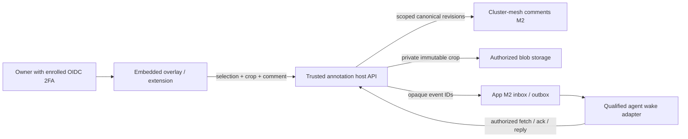

# SPEC EVOL — Deployed UI annotation overlay

**Status:** specification consolidated from the reviewed scratch spec v2; implementation not started. The six implementation lanes A–F below are proposed branches, not worktrees or reservations. No code, deployment, publication, Git, or Track write beyond this document is delivered here.

**Provenance.** Source scratch spec: `spec-ui-annotate-overlay-v2.md`, sha256 `5717b057b5d4ea78c78ffb7d77c71e50c198012b1219662b599c624e87543b11` (2026-10-17). Astra targeted re-review returned **GO**: all seven findings R1–R7 and the non-blocking corrections are closed at specification level; only the DV3 owner decision was open at review time and is now closed by the owner decision recorded in section 10. Host evidence baseline: `origin/main = 1472d961e098908e64ef60b83835af357888d031`, read through Git objects; the root checkout is not the implementation baseline. [PR #684](https://github.com/rhanka/sentropic/pull/684) (M2 comments contracts) remains a dispatch dependency: C/D use current main plus merged #684 contracts; its merge status is rechecked at dispatch. Working-tree links are navigation aids; pinned objects are authoritative.

Related specs:
- [Shared comments and annotations](SPEC_EVOL_COMMENTS_ANNOTATIONS.md) — canonical immutable annotation/thread/comment model consumed here; this overlay spec supplies the deployed-UI consumer capability and does not fork that model.
- [Application MCP provider platform](SPEC_EVOL_APP_MCP_PROVIDER_PLATFORM.md) — generic MCP provider platform; the explicit `/api/v1/artifacts-mcp` audience widening in section 6 stays gated by the E0 contract/security review recorded there and here.
- [Cluster Mesh as the Single Lazy Integration Surface](SPEC_EVOL_CLUSTER_MESH_LAZY_SURFACE.md) — lazy integration surface and MCP composition conventions referenced by the routing design.
- [Login-A amendment](SPEC_AMENDMENT_D11R_LOGIN_A.md) — DV3/DV4/DV5 seed and access-control context for the DV3 annotation copy policy in section 10.

The owner can point, draw a rectangle, or circle/lasso a live UI, add a private comment, and send it to the responsible repository's agent or conductor. Each saved annotation includes DOM evidence, a screenshot crop, page/deployment/viewport context, and verified OIDC identity enrolled with 2FA. First: `https://preprod.sentropic.sent-tech.ca`, then `https://sentropic.sent-tech.ca`; other apps follow through the extension. Lasso satisfies « cercle/entourer »; a dedicated circle tool is optional later (+1–2 h). Bookmarklet deferred.

**Estimate: 88–140 active agent-hours.** A–D private capture on preprod/prod: **66–100 h**; E agent loop: **+10–21 h**, blocked by app-replacement F2a/F2w/F3; F other apps: **+12–18 h**. E costs 10–16 h with the generic envelope, or 13–21 h including +3–5 h adaptation. Endpoint sums give 88–139 h; 140 is the rounded planning ceiling. C includes +6–10 h for shared storage installation. Includes tests/docs/review; excludes upstream completion, owner waits, infrastructure provisioning and app-replacement M2. No code, deployment, publication, Git or Track writes in this spec.

## 1. Evidence and boundaries

Paths below are relative to the Sentropic repository unless absolute. Proposed paths/targets are marked new. S2–S4/S6 retain the source snapshots audited in v1/review; host decisions below use pinned main evidence.

| Ref | Read source / observed state | Consequence |
|---|---|---|
| S1 | Scratch v2 packet; `1472d961e:rules/{workflow,MASTER,subagents,testing,security,architecture,data,components,design-system,conductor}.md`; `1472d961e:PLAN.md`, `plan/BRANCH_TEMPLATE.md` | `.cursor/rules/*.mdc` absent; current `rules/*.md` supply the contract. No BRANCH.md at this baseline in the scratch spec directory. Dispatch updates PLAN; this spec writes only this specification. |
| S2 | Diag annotate source `packages/annotate/src/types.ts`, `src/svelte/AnnotationLayer.svelte`, `package.json`; checkout HEAD `3164ff79119821712eacc7eb103dd4039b0b8c79` | `0.1.0`, raw source exports, no package build/publish lane; synchronous in-memory store. Conductor reports unpublished. Current lasso retains a freeform trace but clears target highlights; rectangle retains a group. Screenshot capture is a port, not a working live-page pipeline. |
| S3 | Diag UAT history, migration decision (2026-06-02), DS backlog | Preserve point/rectangle/lasso, shortcuts, numbered primary pins, yellow trace, blue highlights and **all intersected targets**. The June owner decision selects migration into `sentropic/packages/*`. The backlog documents the DS 0.10.3 packaging defect. |
| S4 | DS manifest `packages/components-svelte/package.json`, Svelte config; checkout HEAD `22421ed82f69737825b962e5a0e448482733eaca` | Current source is `@sentropic/design-system-svelte@0.35.0`, uses `svelte-package` and `vitePreprocess`. This is evidence of a source fix, not a verified published-tarball consumer result. Do not declare the historical bug still present or closed from source alone. |
| S5 | Host main `1472d961e`; [PR #684](https://github.com/rhanka/sentropic/pull/684) review snapshot OPEN, head `57eca41349e496fddfdd93444be70ed93bba9784` | C/D use current main plus merged #684 M2 contracts; recheck merge status at dispatch. Pin source/package versions and tarball integrity, install locally via `file:../packages/*`; publication is not a B/C/D predecessor. |
| S6 | #684 `packages/comments/src/anchors.ts`, `revisions.ts`, `geometry.ts`, `commands.ts`, `packages/cluster-mesh/src/comments/index.ts`, `revision-command.ts`, `hono/comments-router.ts` | Canonical immutable annotation/thread/comment revisions, UI/text/capture anchors, box/circle geometry, scoped grants, CAS and idempotency already exist. There is no canonical lasso shape, generic metadata property, page-list endpoint or open/resolved revision field. Host mapping below supplies those without changing the frozen package contract. |
| S7 | Replace-Claude v2.1 plan, especially F0/F2a/F2w/F3, N0/N1 and deferred F1 | Reuse durable inbox/outbox and the qualified running-agent wake adapter. Its M2 is the answer/remark loop; it does **not** deliver UI section annotations. This spec supplies that consumer capability; remote keyboard/control M3/M4 are not prerequisites. |
| S8 | `ui/chrome-ext/manifest.json`, `content.ts`, `tool-executor.ts`; deployment README; Makefiles and E2E config | MV3 extension already has `activeTab`, scripting, screenshot capture and a shadow-root UI, but also broad existing host permissions. Preprod has its own namespace/IdP. Ordinary `test-e2e` seeds a stack: it must never be pointed at deployed preprod. |

**Additional main evidence:** `api/src/services/session-manager.ts`, `packages/auth-hono/src/oauth/session-resolver.ts` and `api/tests/api/auth/passkey-mfa-session.test.ts` establish the MFA gates below. `spec/SPEC_AMENDMENT_D11R_LOGIN_A.md` establishes DV3/DV4/DV5. `api/src/services/cluster-mesh-adapter.ts` has runtime/cutover PG adapters but no generic storage/comments installation. `api/src/app.ts` owns product composition; `api/src/routes/api/index.ts` is inert. `api/package.json` consumes local mesh/comments; `ui/package.json` already consumes DS `^0.34.40`.

**Scope in:** reusable package, DOM/capture adapter, embedded owner toggle, canonical persistence, private routing/status, mobile UAT, later extension; annotation seed-policy specification/witness. **Scope out:** generic drawing editor, arrow expansion, arbitrary page execution, public/team sharing, second comment store, automatic code changes, remote keyboard control, historical Diag migration, executing production reseeds and optional bookmarklet.

## 2. Reuse and package ownership

| Keep | Adapt / add | Boundary |
|---|---|---|
| `Point`, `Rect`, `Selection`, `AnchorResolver`, lazy `SelectionCapture`/`CaptureFn` seams; `geometry.ts` bounds/corner-pin functions and their tests | DOM resolver with selector/quote/position evidence; polygon intersection; viewport/crop transforms | Reuse existing geometry where its behavior matches. Diag `Anchor` and canonical comments `Anchor` are different types; map explicitly. |
| Existing Svelte layer's tool presentation, draft/pin rendering, primary/yellow/blue semantics and keyboard vocabulary | Replace Tailwind utility dependency with scoped component CSS on DS CSS variables; fixed viewport layer/document-scroll transforms; pointer/touch handling, lasso highlights, mobile composer and async save | Diag `AnnotationLayer.svelte` depends on host Tailwind/`primary` and unconditionally sets `pointer-events:auto` over `context.host`. Remove drawing layer/listeners when unarmed; this is a required port. |
| In-memory store and `comment-store.test.ts` as a demo/test adapter | Async application adapter: load, submit, reply, resolve, retry and subscribe/refetch | A synchronous `add()` returning a local row cannot mean durable save. Change the submit seam explicitly; keep the composer until a server receipt arrives. |
| DS tokens and approved primitives | Verify the installed DS package; consume working primitives, retain token styling where no primitive exists | No copied DS components or dependency on framework internals such as React/Svelte debug metadata. |

| Home | Decision authority | Cost / consequence |
|---|---|---|
| **Planning baseline: `sentropic/packages/annotate`, published as `@sentropic/annotate`** with pure root + `./dom` + `./svelte` exports | Sentropic conductor/package maintainer records ownership/publication lane, consistent with the owner migration decision | A: 8–12 h for packaging/consumer proof. Independent release cadence; B follows local build/pack qualification. DS primitives use A2's installed-host check. |
| Move ownership under the design-system repository, still exposing a distinct annotation package | Sentropic conductor and DS maintainer propose the transfer; the owner decides if it changes the recorded monorepo governance decision | Same build/consumer qualification plus an estimated **6–10 h transfer/alignment delta**, DS release coordination and packaging verification. Persistence/auth/routing remain host adapters. No implication that annotations already live in DS. |

Publish compiled JavaScript/types and preprocessed Svelte output; inspect the actual tarball in a clean SvelteKit consumer. Declare Svelte as a required package peer; the pure entry has no Svelte runtime imports (npm peer installation and runtime independence are distinct). Wire CI validation/pack/publish and semver bumps; publication uses the repository's governed OIDC lane. Diag flips to a pinned released dependency in a separately owned follow-up; no edits in that repository here.

In-repo B/C/D consume local built packages through app `file:` dependencies; no npm publish wait. Public package dependency maps still use plain semver. Publication qualifies external Diag/Immo adoption. FL-DS is an A2 Popover/Tabs check using the host's installed DS version, not a separate clean-consumer blocker; annotation packed-consumer tests remain. `annotationsForAI` has no ACL: demo-only, never used for agent routing.

## 3. Attachment, identity and privacy

| Surface | Attachment and authority | Limits |
|---|---|---|
| Sentropic prod/preprod | Lazy-load `AnnotationOverlay.svelte` from the root layout only after a server capability response. Owner activates an Annotate toggle; inactive overlay does not intercept page interaction. UI and API use the same origin. | UI visibility is convenience; every list/read/crop/write/stream rechecks owner and scope. A query parameter or DOM attribute cannot enable authority. |
| Other apps: extension, later | Explicit click injects selection on demand via `scripting.executeScript`/`activeTab` for the allowed origin/tab/document. Isolated-world selector; closed shadow root for annotation chrome, no private text. Composer/history/auth remain in the side panel; background owns API calls. | Add `https://preprod.sentropic.sent-tech.ca/*` to existing static-script exclusions alongside prod. No new static annotation content script. Validate extension ID, tab/frame/document generation and operation; `<all_urls>` does not authorize collection. |
| Bookmarklet | Deferred optional item, 4–6 h excluded. | Requires separate exact-origin one-use handoff/CSP review; no implementation or qualification in F. |
| Generated artifact pages | Integrate through the app-replacement plan's exact-origin reader profile and release binding, or use the extension's trusted side panel. | Keep generated content on its separate registrable domain. Artifact read authority is not automatically annotation-write, routing or owner-approval authority. This is later-app integration, not an M1 prerequisite. |

**OIDC/2FA — « je veux toujours un oidc enrolé 2fa sur sent-tech.ca »:** prod issuer `https://auth.sent-tech.ca`; preprod issuer `https://preprod.auth.sent-tech.ca`. Every embedded annotation route (including capability/list/crop/SSE) reads the current server session row and requires `session.mfaVerified === true`; the session JWT has no assurance claim. Every OAuth annotation client, including extension, requires verified token `acr === 'urn:sentropic:loa:passkey-fresh'` and client `required_acr` set to that value. Validate signature, exact issuer/audience, code+PKCE/state/nonce, expiry and live revocation. Refuse magic-link, device-code, federation-only and UV=false passkey access; never infer strength from login labels/email. Bind owner to verified `(iss, sub)` and tenant/workspace. Store opaque assurance references, never tokens. No new UV ceremony per annotation. Agent delivery uses a verified workload principal plus the owner's exact delivery grant below, not weak human authentication.

**Private by default:** owner-only read/write until an explicit Send to agent action grants that exact annotation/revision to an eligible repo principal. Private ACLs apply to history, list indexes, captures, exports, SSE and agent fetches. No public URL or ambient workspace-reader inheritance. Owner may revoke delivery/read access; purge follows the existing lifecycle and capture-retention policy, not “resolve.”

**Per-annotation mediation (R1):** M2 `CapabilityCheckPort` sees only `ResourceRef[]`; A and B on page P share the resource. Agents receive no canonical page grant and no direct canonical router. Host checks `{annotationId, revision, recipient, bindingGeneration}` and live revocation, verifies requested thread/comment/crop IDs belong to that exact annotation and permitted revision, then constructs only that chain's read/reply inside `withContext`. The request-local capability closure checks grant principal, operation and page; it cannot independently distinguish A/B, so immutable host-selected IDs and the pre-call chain check are mandatory. Never reuse this context for caller-supplied selectors, bulk reads or another request. List/SSE/export/crop paths filter by the same grant before emitting IDs/bytes; later private revisions are not automatically included. Replies retain agent principal and AI attribution. Test **A ≠ B on the same page**: grant A; deny listing, reading, crop access, reply and SSE visibility for B, including B created later, guessed/mismatched IDs and revoked/stale grants.

**CSP source-gap:** main has no deployed-UI CSP configuration (the extension under `ui/vscode-ext` is separate). B0 must qualify capture under a target policy allowing `img-src 'self' data: blob:` and no `unsafe-eval`; record exact policy and unsupported cases, never claim an existing deployed policy was verified.

**CSP and data:** bundle embedded code locally; no remote `eval`, wildcard CORS or CSP relaxation. Keep auth in HttpOnly/Secure host sessions or extension-owned storage. Exclude password/OTP fields, input values, secret-marked regions and authentication pages from capture/quotes; mask before upload and let the owner redact the crop preview. Sanitize page URLs by dropping userinfo/query/fragment except explicitly allowlisted route parameters; preserve the navigable non-secret page identity. Do not serialize the whole DOM, hidden content, localStorage, cookies or environment values. Comments/quotes are untrusted text, including when an agent reads them; no raw HTML execution or instruction-to-shell interpretation. Private responses use `Cache-Control: no-store`; logs carry IDs/status, not text, crops or credentials.

## 4. Canonical data mapping

Consume `createCommentsModule`, `createCommentsPostgresRegistration`/installed generic storage binding and its `withContext(grant, ...)`/`store.transaction().run(...)` interfaces from #684. Reuse the same canonical module Immo consumes, with independent authorized scope. No new `contextType` enum member, legacy `pg-comment-store` route or edits to frozen `packages/comments/src/**`.

| Required data | Canonical representation / host contract |
|---|---|
| Tenant/workspace/page | `ResourceRef = {scope:{tenantId,workspaceId}, namespace:'sentropic.ui', kind:'page', id:pageId}`. Server derives registry identity from SvelteKit `route.id` plus allowlisted normalized params, checked against the served build's route manifest and app/tier. Never accept a client-chosen pageId. Retain registered page records across deletion/renaming; different identity means a new annotation. |
| Deployed source | `RevisionTargetBinding.source` and every anchor's `source` use `SourceVersionIndicator`. `observed` binds an immutable build manifest/asset digest and observation evidence. Record release ID, commit, app and tier in the profile. Embedded pages carry their own served build ID; verify against deployment records, not merely the API's latest version. Old browser assets during rollout remain distinguishable. |
| DOM target | `UiAnchor` with stable `surfaceKey`, `renderVersion`, resource/source and `captureRef`. Prefer application-owned `data-annotate-id`; instrument important controls in D. Store selector, bounded exact quote + surrounding text, ancestor hints and position in the host profile. CSS selectors/coordinates are hints, never authority or stable identity. |
| Text range, when applicable | Add `TextAnchor` only when Unicode code-point offsets are known against the recorded text source. Otherwise retain quote evidence in the profile; do not invent offsets. |
| Screenshot crop | Immutable `CaptureAnchor`: `blobId`, digest, PNG/WebP MIME, intrinsic width/height, capturedAt and source. Bytes use private host blob storage; annotation records persist references. Every read checks the annotation ACL. No base64 image embedded in comment bodies. |
| Selection | `visualAnchors[]` with ordered `shapeId`, capture-bound frame/digest and canonical quantized **box/circle**. Persist actual lasso points in the versioned host profile as described below; a box is only its bounding representation. Group members each retain DOM evidence and selection order. Members on one page share its ResourceRef; `secondary=[]` unless there are distinct authorized resource identities, never duplicate page refs. Without a stable element key, bind the UI anchor to the stable page surface and retain element hints with explicit drift uncertainty. |
| Comment/thread | One `AnnotationRevisionRecord`, initial `ThreadStructureRevisionRecord` (`initial-registration`, same primary, annotationId), and `CommentRevisionRecord` pinned to exact structure hash/annotation revision. User prose only in comment `body.text`. Annotation `body.text` is non-empty deterministic non-secret text, e.g. `UI annotation · lasso · 3 targets`, alongside profile metadata; never duplicate private prose. Replies bind to the same discussion. |
| Author | Server creates `RevisionProvenance.attribution` (`human`, subject reference, assertion class, evidence reference); module stamps `registration.principal/registeredAt` from the verified grant. Agent replies use their authorized principal and AI attribution; never impersonate the human. |
| Open/resolved + PR | Host profile `discussion.status = open\|resolved`, resolved actor/time and optional `{repoId, number, url, commit}` PR link, written as a new annotation revision under CAS. Enforce `resolve-discussion` plus revision permission. The canonical review verdict and lifecycle archive are different concepts. Linked PR is independent of resolution; merging a PR does not auto-resolve. |
| Delivery | Host outbox/index references canonical annotation/thread/revision IDs, repo binding generation and receipt state. It stores delivery metadata, not a second authoritative copy of comment content. |

**Host profile:** introduce `schemaId='sentropic.ui-annotation'`, version `1`, with a digest-pinned schema accepted by the host. `SemanticProfile.fields` only permits scalars, safe integers and nested objects: **no arrays or fractional numbers**. Encode ordered members/points as `members.m0000`, `points.p0000={xQ,yQ}`, explicit counts and zero-padded order; coordinates use integer millionths, viewport/scroll values integer thousandths of CSS pixels, DPR/visual scale integer thousandths. Preserve tool, polygon, selected members, normalized/document rectangle, quote, CSS selector, URL, build, locale, viewport, crop transform/capture method and assurance reference. No undeclared `metadata` property on canonical records.

**Geometry (R4):** crop = selection bbox plus 8 CSS px margin, clamped to the captured area. Point uses the resolved element's positive-area box intersected with that area, or a 4 CSS px minimum marker box when no element resolves; shift/shrink the marker inside the frame and show the adjusted preview. Reject an empty intersection/collapsed quantized box. Rect/lasso canonical shape is the positive-area bbox of the visibly clipped selection, never a bounding circle. Clip polygon/member shapes to the capture frame with visible feedback before integer quantization; validate positive area and `[0,1]` bounds again after quantization. Canonical circles, if later used, must have `r > 0` and their entire circumference inside the frame. No silent clipping by M2. Tests cover point/viewport corners, zero-size elements, lasso edge overflow and empty annotation text.

**Authority versus drift (R5):** `ResourceResolverPort` answers only for the retained page registry resource and its source: registered pages return `exact` or `source-changed`, even when absent from the current build. ACL checks remain separate. DOM missing/ambiguous/changed outcomes are host-profile/UI evidence and never enter that authority port. A removed page retains authorized read, reply and resolve operations with its original crop; only an actual authorization/resource-retention denial makes it unavailable. New page registration validates the served manifest; historical operations resolve the retained record, not today's route existence.

**Shared PG installation (R6):** the **C lane owner** is the sole implementation owner of generic mesh storage setup shared with app-replacement A1. New `api/src/services/cluster-mesh/storage.ts` composes the PG profile, module registrations, roles and one executor/journal; `api/src/app.ts` installs it once. Host schema/catalog changes use `api/src/db/schema.ts`, migration directory `api/drizzle/` (one new SQL migration plus matching journal metadata; numeric filename allocated at dispatch), and `spec/DATA_MODEL.md`. Do not invent a second migration runner or confuse existing runtime/cutover adapters with this installation. App-replacement A1 depends on that shared installation and adds artifact registration through its exported seam after C lands. C-storage is **+6–10 h**. If A1 has already delivered the same qualified installation at dispatch, formally transfer sole ownership to A1, make C depend on it and remove C-storage cost/work; never parallel-write these paths or double-count the prerequisite. C's host comment service is also the substrate for deferred app-replacement **F1**, adding `sentropic.artifact` beside `sentropic.ui` through adapters, not a second host mapping.

Proposed host limits: comment 8 KiB UTF-8, profile 64 KiB canonical JSON, 512 lasso points, 31 selected members plus primary resource, 128 visual anchors maximum, selectors 2 KiB and quote/context 2 KiB total per member, crop 2 MiB/4 megapixels. These are admission ceilings, not simultaneous guarantees: enforce every bound, including the installed M2 capacity descriptor and depth ≤8. Show excess-selection feedback before save; never silently truncate targets. Simplification must preview the resulting lasso and preserve its selected set. Unknown profile versions refuse mutation and retain a readable unsupported-version state.

**Commit flow:** authenticate → validate page/source/ACL/profile → allocate annotation/thread/comment IDs and durably register a scoped creation intent → stage and verify the redacted crop → commit annotation/thread/first-comment together in one canonical module transaction → finalize the catalog/intent → return durable IDs/hashes. The intent holds IDs, page binding and payload digest, not a competing copy of the comment. Recovery can discover committed records by those preallocated IDs after a crash. Retries use stable scoped idempotency keys and exact expected heads; mismatched replay/stale revision returns conflict with the draft intact. Crop upload is not a cross-store transaction: staged objects have short orphan expiry, and referenced objects cannot be collected. Do not display Saved until all three canonical records and a verified crop reference exist. Routing has its own durable intent keyed by committed revision; recovery covers crash-before-outbox without assuming an atomic transaction across unrelated stores. Only an explicit authorized Send intent permits delivery; recovering a private save cannot create one. A failed wake never loses the saved annotation.

**Queries:** #684 exposes chain reads, not a page-wide listing API. C adds a scoped page→annotation/thread catalog with the creation intent; repair incomplete intents after crashes and verify each result through canonical reads/current ACL. Catalog/status caches are rebuildable projections, never the source of comment content. Its repair test must demonstrate discovery after a crash, not only direct lookup by a remembered ID.

**Host API, new:** `/api/v1/ui-annotations` provides capability/page-list/read/create operations; explicit subroutes handle capture staging/read, replies, re-anchor, status and routing. C0 freezes request schemas. The browser supplies bounded selection evidence, prose, expected revision and idempotency key; the host derives authoritative scope, principal, deployment binding and provenance. Enforce exact Origin/CSRF on cookie-backed writes. If the canonical operation requires decision evidence, issue/resolve it for the explicit owner action and exact base/proposed-content binding; never accept page-supplied authority or bypass required evidence with an empty reference.
