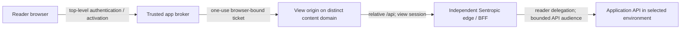

# PROPOSAL — Sentropic-managed artifact view addresses and application access

**Status: proposal, 2026-10-18; amendment to PR #692.** This document specifies a generic package contract, not shipped behavior or a DNS authorization. It complements [the registry/artifacts specification](SPEC_EVOL_CLUSTER_MESH_MCP_REGISTRY_ARTIFACTS.md), preserves its historical baseline, and does not silently supersede Architecture D5. Configuration names below are proposed API names unless identified as existing.

## 1. Owner orientation, correction and decided responsibility

Source: owner words relayed by radar-immobilier in order in the author brief `AGENT_SIG:7f3a9c2e1b`; the explanations following them are this proposal, not additional owner quotations.

> « Mais connard on a deja arbitré tu te fous de moi ? »
>
> « C t un truc comme uuid.preprod.immo.sent-tech.ca ou dans le gout. L idee est que l artefact puisse taper sur les api preprod... »
>
> « Non pas c est noté. Le design sentropic doit prevoir qqchose connard »
>
> « Le mecanisme dns doit qyand meme etre un standard designe et manage oar sentropic pas par immo... la lib artefact de sentropic doit etre maitress du pattern »

The owner's subsequent correction overrides any earlier reading of the example as an arbitration:

> « Je n ai als donne le pattern / C un orientation. Sentropic doit le contraposer »

**[FACT — orientation, not a decision]:** `uuid.preprod.immo.sent-tech.ca` and direct access to preproduction APIs are inputs to challenge. Neither the label pattern, the `sent-tech.ca` suffix nor direct browser access is ratified. §2 proposes a pattern; §6 compares it with the orientation and submits the remaining choices.

**[FACT — decided responsibility]:** Sentropic designs **and manages** the mechanism; `@sentropic/artifacts` is master of the pattern, including the DNS/wildcard/certificate contract. Immo and every other host consume configuration and injected resources; they invent no domain construction or provisioning logic. This ownership is not an open owner decision.

The #861 dossier already retains business reads **and writes** under the reader's rights, excluding administration. This proposal does not reopen that choice, substitute the author's rights, or reduce the pilot to synthetic/read-only data.

## 2. Address and package configuration contract — proposed

`@sentropic/artifacts` owns normalization, validation, URL construction, parsing and the provisioning specification. The host selects its registered application/environment and injects configuration through cluster-mesh's artifacts integration; it does not interpolate hostnames itself.

**[JUDGMENT — counter-proposal B]:** a stable view link `https://<artifactId>.<env>.<app>.<content-domain>/` resolves to execution at `https://<releaseId>.pinned.<env>.<app>.<content-domain>/`; `<content-domain>` is a registrable domain distinct from every application/IdP site. Retain readable environment/application grouping and one UUID per label because these fit the package's parser and SPA root `/`; change the trust boundary, execution origin and API transport. The concrete domain name remains open. Shared-path URLs would share an origin; concatenated artifact/release UUIDs exceed a label's 63-byte limit. This entire scheme is proposed, not attributed to the owner.

| Surface | Contract |
|---|---|
| `viewAddress` | `{ registrableBaseDomain, environment, appSlug, isolationPolicyRef }`; a reviewed deployment binding, never artifact/LLM input. Labels are canonical lowercase DNS labels; reject invalid lengths, separators, unknown app/environment combinations and unapproved domain policy. The package verifies the registrable-domain relationship against the app/IdP origins; a subdomain is not a new registrable domain. |
| Derived content base | `contentBaseDomain = <environment>.<appSlug>.<registrableBaseDomain>`, injected into the **existing** `ContentHandlerDeps.baseDomain`. B yields `preprod.immo.<content-domain>`; the orientation yields `preprod.immo.sent-tech.ca` and requires a D5 amendment. No Immo default or host-defined pattern in the library. |
| Stable view URL | `https://<artifactId>.<contentBaseDomain>/`; edge resolves the current release and redirects to its pinned origin before activation. Under B, no custom code or business API session is served on this stable alias. This redirect behavior is a proposed integration change to the current stable content handler; resolution never replaces reader authorization. |
| Pinned execution URL | Preserve the existing package route `https://<releaseId>.pinned.<contentBaseDomain>/`; immutable release, separate activation. B proposes it for every API-enabled execution. Bind an immutable approved profile revision to that release; widening it requires a new release and activation. |
| Identity binding | Reserve `{ registrableBaseDomain, appSlug, environment }` to one host instance; the trusted registry maps exact origin to `{ hostInstance, tenant, environment, artifactId, releaseId }`. DNS existence is not authorization. Unknown, withdrawn or mismatched bindings fail closed. Forwarded host headers are trusted only from the configured ingress. |
| `applicationAccess` | Inject trusted control/broker origin, verified-reader resolver, session/ticket/key stores and approved API profiles: fixed upstream references, audience, environment, route/method/data policy and revision. Reuse cluster-mesh exchange/auth ports. No arbitrary upstream URL, identity or credentials from the view bundle. |
| `provisioning` | Inject DNS zone/provider binding, edge target, TLS issuer/secret references and infrastructure adapter. Package emits versioned desired state and consumes observed readiness; credentials stay in infrastructure secret custody, not browser config, manifests or LLM context. |

**Reconciliation with #861:** the annex proposes stable execution per view for rapid iteration and persistent localStorage/IndexedDB, while asking the team to explain if execution per version is necessary. B proposes that deviation: arbitrary old/new scripts on one origin cannot be separated by a shared cookie or a JavaScript-supplied release ID. The stable bookmark survives, but session and browser storage do not transfer to the next release; keep durable preferences in reader-authorized app storage. Pinned origins plus exact-origin enforcement separate releases, not sibling sites. This changes neither the annex nor the package by itself and is part of the address decision in §8.

## 3. Provisioning ownership — proposed realization of the decided boundary

- **Sentropic / `@sentropic/artifacts`:** owns the pattern and lifecycle policy, produces idempotent DNS/TLS/edge desired state, validates bindings, observes drift/readiness and defines withdrawal/recovery. Installing/importing the package performs no infrastructure write. The contract is provider-neutral; non-k8s hosts inject another adapter.
- **k8s lane:** operates cluster-wide infrastructure and reconciles the package contract through its approved adapter: DNS records, ingress, cert-manager certificates, issuer integration and renewal. It does not own or redefine the pattern. Host app operators supply deployment configuration; they do not implement a parallel DNS controller.
- **Wildcards:** request `*.<contentBaseDomain>` **and** `*.pinned.<contentBaseDomain>` routing/certificate coverage. A TLS wildcard covers one label and does not cover pinned release hosts two labels below the base. No DNS record per view is required; issuance and host admission still require registry validation.
- **Owner GO:** before DNS creation/change, present exact zone, record name/type/target, wildcard scope, environment, certificate/issuer references and rollback. GO for one environment is not GO for another. k8s reports `*.preprod.immo.sent-tech.ca` feasible with the existing Cloudflare DNS-01 issuer; that relay is feasibility evidence, not a created record or approval.
- **Activation gate:** observed DNS resolution, edge binding and valid certificate must match desired state before links become usable. Revocation rejects content/API access independently of DNS caches; retain UUID reservations, prevent dangling targets and audit changes. Routine certificate renewal under the approved binding is operations, not a new domain decision.

## 4. Reader-authorized application calls — proposed model

**Recommendation: a view-owned session and relative BFF, using the #861 boundary.** Domain placement and API delegation are separate choices: this relay works on a distinct site (option b) or a same-site view origin, but the latter still needs the D5 decision in §6.

1. Resolve the stable alias to the selected pinned origin first; initialize the host-only browser transaction there, then redirect to the trusted application broker. Verify reader identity, tenant, environment, live view ACL, release and approved API profile; perform identity/MFA policy there. The broker remains outside the untrusted content origin; the stable alias cannot carry or redeem the pinned session.
2. Return a single-use activation ticket to that exact pinned host, bound to its browser transaction, reader, artifact, release and `channel=pinned`. Consume atomically, establish the host-only view session and redirect to a clean URL before executing custom code. Never put an application cookie, bearer or refresh token in the bundle, URL or browser-readable storage. Browser/origin transaction binding is additional integration work beyond #703's release/channel ticket binding.
3. The bundle calls relative `/api/*` on its own execution origin. The host-deployed, Sentropic-provided edge/BFF authenticates the view session, derives release/profile from the registered origin and checks current authorization, then calls a fixed application upstream on behalf of the **reader**. Effective authority is the intersection of current reader rights, tenant/environment, activated profile and route/method/data policy. Publication/sharing never grants another person's API authority.
4. For an OAuth upstream, use cluster-mesh's RFC 8693 exchange for the proper API audience and bounded scopes; keep delegated credentials server-side. Do not pass through the application cookie or a raw bearer, fall back to a privileged service account, or trust `Authorization`/identity supplied by view JavaScript. The API enforces the same policy on direct bearer calls; hiding routes in the BFF is insufficient.
5. Reserve `/api/*` and session/control routes ahead of static files/fallback. Canonicalize paths, bound requests, restrict redirects/egress to approved upstreams, strip upstream `Set-Cookie`, and enforce prod/preprod separation. Attribute writes to reader + artifact + release + profile + operation, without recording secrets or response data.

Keep the separate data plane: content and application traffic traverse the independently deployable edge, not the Sentropic product control API. Authorization refresh rechecks revocation and policy; target the existing 55-second grant plus 5-second cutoff budget, terminate streams at expiry, and deny renewal on failure. The current package still rechecks content ACL/lifecycle per request; do not remove that check by documenting a future stateless edge. API revocation enforcement and external session-state capacity need qualification, not a claim that a short content grant shortens every upstream token.

**Alternative (a), option A in §6:** direct browser calls from a same-site HTTPS view to the application API with `credentials: 'include'`. SameSite=Lax permits eligible same-site requests; the browser sends an API host-only cookie to the **API host**, never to the view. Credentialed CORS controls reading the response, not authorization or CSRF. Each admitted view can exercise the reader's cookie authority; without additional server-enforced scoping this is broader than the activated view profile. Require an exact active-origin registry allowlist, `Access-Control-Allow-Credentials: true`, `Vary: Origin`, bounded methods/headers, no `*`, no `null` and no arbitrary Origin reflection, plus independent CSRF defenses and a CSP change from `connect-src 'self'`. This changes the #861 relative-BFF contract; same-site placement alone does not make the app's cookie available to a different API hostname.

## 5. Cookies, CORS, CORP and content headers

Baseline checked at PR #703 HEAD `62aba25ea7f9bf42119a3ebaa0f49648071afec6`, `packages/artifacts/src/content/{headers,handler,routing,grants}.ts`. This open PR includes content hardening as well as packaging; it is not evidence of a DNS controller, application relay or deployed version.

| Surface | Existing fact and proposed rule |
|---|---|
| Cookies | Existing `__Host-artifacts_grant`: `Secure; HttpOnly; Path=/; SameSite=Lax`, no `Domain`. Retain it for content; it is not an API bearer. New view-session/init cookies must also use the `__Host-` prefix and those attributes, preventing parent-domain cookie shadowing; reject ambiguous duplicates. App/IdP sessions stay on their own hosts. Lax does not isolate siblings. No parent-domain cookies or `SameSite=None` workaround to share the app session. |
| CORS / CSRF | Relative BFF needs no cross-origin credential permission: no credentialed CORS to sibling views or the control origin. On BFF/session requests, require exact origin when present, `Sec-Fetch-Site: same-origin` and CSRF protection for mutations; absent Fetch Metadata fails closed unless a narrow authenticated client policy exists. Top-level login/landing has a bounded transaction-bound exception. CORS denial alone does not prevent a cross-origin request from causing a side effect. |
| CORP | **Existing `contentHeaders` emits `Cross-Origin-Resource-Policy: same-origin` at the checked #703 revision.** Preserve it on served files; extend it to session/BFF responses and denials with proxy preservation. `same-site` would permit sibling views for covered requests. CORP controls cross-origin `no-cors` resource use; it grants neither API rights nor CORS access and does not block top-level navigation. Uniform error/session/BFF coverage remains proposed integration work. |
| CSP / framing | Preserve current HTML policy: `default-src 'self'`, `connect-src 'self'`, `base-uri 'none'`, `form-action 'none'`, `frame-ancestors 'none'`; current inline script/style allowances remain baseline facts. Preserve `X-Frame-Options: DENY`. Top-level `page` is the pilot; private embedding is not made functional by CORS/CORP or Lax cookies. |
| MIME / caches / referrer | Preserve manifest-declared MIME, `X-Content-Type-Options: nosniff`, `Referrer-Policy: no-referrer`, HTML `no-store`, and explicit private non-HTML caching only. Sessions, activation and API responses require `private, no-store`, including errors. Current handler activation/error paths do not uniformly apply `contentHeaders`; that extension is proposed, not delivered. |

Same-origin policy, host-only cookies and a BFF do not make hostile code harmless: code can exercise the rights deliberately exposed to its view, and sibling origins can still cause same-site CSRF or parent-domain cookie flooding. Enforce API origin/CSRF policy even if CORP is present, bound ingress headers and keep recovery on a trusted origin. A wildcard certificate provides transport security, not tenant isolation.

## 6. Options, consequences and D5 reconciliation — submitted proposal

[Architecture D5](SPEC_EVOL_ARCHITECTURE.md#63-owner-decisions) currently selects registered endpoints, signed grants and a separate stateless edge on a **distinct registrable domain**; see lines 368–376, 648–649, 676 and 778. `*.preprod.immo.sent-tech.ca` has the registrable domain `sent-tech.ca`, like the app/IdP: neither its UUID, extra labels, host-only cookies nor a relay satisfies that domain clause. Durable custom UI must not be silently exempted by renaming a preview. No D5 amendment is enacted here.

| Option | Address and API model | Strongest case for | Strongest case against | Cost / reversal | When it wins |
|---|---|---|---|---|---|
| A — technical realization closest to the orientation | `<uuid>.<env>.<app>.sent-tech.ca`; direct reader cookie + credentialed CORS (a) | Familiar app namespace and existing login; avoids a separate view-session relay | D5 amendment; same-site/IdP adjacency; admitted views acquire ambient cookie authority unless APIs add independent view scoping; changes #861/CSP | Less relay infrastructure, more API/CORS policy work; later domain migration loses browser storage/session continuity | Owner accepts the broader trust boundary and APIs can enforce every required restriction directly |
| B — recommended counter-proposal | Stable artifact link → pinned release origin (§2) on `<distinct-content-domain>`; view session + relative BFF (b) | Keeps D5 and #861's relative calls; isolates app cookies and separates release authority | New domain/zone, ticket/session integration and relay availability/latency; changes #861's stable execution/storage continuity | Highest provisioning/auth integration cost; fresh activation/storage origin per release; domain migration costly once links circulate | Untrusted custom UI and generic multi-host adoption require the existing isolation boundary |
| C — same-site relay compromise | B's stable/pinned scheme under `<env>.<app>.sent-tech.ca`; view session + relative BFF | Familiar namespace and existing zone path; keeps relative API calls and scoped delegation | Pays relay and pinned-origin migration costs while retaining same-site CSRF/cookie/IdP adjacency; still needs D5 amendment | Avoids new registrable-domain setup, retains BFF work; later move requires URL/session migration | Namespace continuity outweighs isolation and owner accepts a bounded D5 exception |

**[JUDGMENT] Recommend B:** preserve the existing trust boundary while delivering the owner's intended access to the application's APIs under the reader's rights. The strongest objection is its additional authentication/provisioning work and a relay whose failure blocks business calls. A requirement for the official namespace, or evidence that only equally trusted code will execute and direct API restrictions are sufficient, could overturn this recommendation; DNS feasibility alone cannot.

**D5 disposition:** B keeps D5's distinct-domain rule, registered endpoints, signed grants and separate data plane; select the concrete domain without reopening D5=B. A or C requires an explicit bounded managed-artifact exception defining apps/environments/content trust, controls and accepted same-site/IdP risks. Amend the normative rule, invariant, decision table, Wave-0/domain references and diagram together; preserve D5 for other previews and the separate data plane. This file enacts no exception.

**Cost and reversibility:** this documentation is reversible; deployed URLs, bookmarks and origin storage are not moved transparently. A later domain switch requires new DNS/TLS, fresh activation and an audited redirect/retirement plan; revoke old grants and retain UUID reservations. No delivery estimate is asserted before broker/adapter qualification. **Pre-mortem:** the design fails if a relay silently broadens reader rights, stale grants survive revocation or an unmanaged DNS target outlives its view; §7 makes those measurable refusal cases. **Presenter interest:** reusing existing package routes and D5 reduces authoring effort; the owner benefit is a common, qualified mechanism, not that convenience.

Security/identity/authorization and their observability belong to the exposure system, Sentropic/cluster-mesh, separately from LLM selection or judging. An LLM, generated manifest or publishing author cannot authorize domains, profiles, DNS writes or another reader's rights. The k8s adapter executes infrastructure operations; it acquires no ownership of the artifact pattern.

## 7. Evidence and implementation acceptance

- #692 baseline and amendments: [registry/artifacts spec](SPEC_EVOL_CLUSTER_MESH_MCP_REGISTRY_ARTIFACTS.md), especially §5.5, §6, §7 and the #688 dated update. #703 source baseline: [content headers](https://github.com/rhanka/sentropic/blob/62aba25ea7f9bf42119a3ebaa0f49648071afec6/packages/artifacts/src/content/headers.ts); package routing retains the `pinned` label rather than the annex's earlier release-host example.
- Read-only Immo source: `radar-immobilier/.worktrees/{861a,861c-h1}/docs/spec/reports/dossier-artefacts-ui/`: `DOSSIER-DECISION.md` labels itself v12; `ANNEXE-TECHNIQUE.md` still labels itself v11. Relevant annex sections are A/B/C and E1–E4: per-view execution, relative BFF, host-only cookies, reader business writes. This amendment reports that source-version discrepancy, preserves reader-rights/business-write and hosting-ownership decisions, and explicitly proposes the execution-origin change in §2.
- Governance sources: Sentropic `.tmp/governance-unification/owner-feedback-diagram/OWNER-FEEDBACK-RAW.md` and `.tmp/governance-unification/reconciliation.md`: security separate from LLM, exposure in Sentropic/cluster-mesh, k8s as infrastructure integration. k8s feasibility and all five owner quotations above come from the task brief, not a deployment receipt.
- Before implementation can claim readiness: qualify two host configurations without app-specific domain code; stable and pinned wildcard/TLS coverage; refusal of unknown host/tenant/environment; two readers with different rights; two tabs/releases without authority widening; ticket replay/wrong-origin refusal; revocation/expiry and prod/preprod denial; exact CORS/CSRF/CORP/CSP behavior including errors and sibling origins; DNS dry-run/GO/readiness/rollback. These are future acceptance requirements; this spec-only change runs no runtime qualification and provisions nothing.

## 8. Only the open owner decisions

1. Accept B's proposed address scheme and reader-session/BFF model, choose A or C, or amend the proposal. The label pattern and direct API mechanism remain open; Sentropic/package ownership and Immo's configuration-only role do not.
2. Select the concrete content domain for B, or explicitly approve the bounded D5 amendment required by A/C. No change to D5 is inferred from the orientation.
3. After that design choice, give GO on the exact DNS change set in §3. Reusing the issuer needs operational validation; a new/replaced cluster-wide issuer or broader DNS credentials needs explicit infrastructure approval. Pattern ownership stays with Sentropic; the k8s lane operates the infrastructure.
