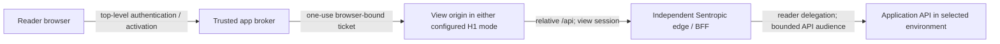

# SPEC — Sentropic-managed artifact view addresses and application access

**Status: H1 owner decision applied, 2026-10-19; amendment to PR #692.** The common mechanism must support both app-subdomain and distinct-domain artifact storage/views, configurable per application. Concrete domain names and DNS GO remain open. API transport, pinned execution and configuration field names below remain implementation proposals unless identified as existing; H1 does not ratify them. This specifies a generic package contract, not shipped behavior or infrastructure authorization. It complements [the registry/artifacts specification](SPEC_EVOL_CLUSTER_MESH_MCP_REGISTRY_ARTIFACTS.md#15-owner-decision-amendment-2026-10-19) and preserves its historical baseline.

## 1. Owner orientation, correction and decided responsibility

**H1 — owner decision, 2026-10-19, verbatim:**

> H1: il faut prevoir les 2 - pour une app sentropic donnée, permettre du stockage d'artefact en sous-domaine ou un autre domaine

Source: `/home/antoinefa/src/sentropic/.tmp/spec-review-v3/OWNER-DECISIONS-2026-10-19.md`; per-PR consequences in `.tmp/focus-spec-review-kit/dossier.json` and `dist/spec-review-r4-portable.html`. This supersedes the exclusive A/B choice and recommendation in earlier revisions. Both modes are required in the package; each app configures its deployment mode. The preceding owner orientation and corrections below remain provenance, not open alternatives to H1.

Source: owner words relayed by radar-immobilier in order in the author brief `AGENT_SIG:7f3a9c2e1b`; the explanations following them are this proposal, not additional owner quotations.

> « Mais connard on a deja arbitré tu te fous de moi ? »
>
> « C t un truc comme uuid.preprod.immo.sent-tech.ca ou dans le gout. L idee est que l artefact puisse taper sur les api preprod... »
>
> « Non pas c est noté. Le design sentropic doit prevoir qqchose connard »
>
> « Le mecanisme dns doit qyand meme etre un standard designe et manage oar sentropic pas par immo... la lib artefact de sentropic doit etre maitress du pattern »

The owner's subsequent correction overrides any earlier reading of the example as an arbitration:

> « Je n ai als donne le pattern / C un orientation. Sentropic doit le contraposer »

**[FACT — earlier orientation]:** `uuid.preprod.immo.sent-tech.ca` and direct access to preproduction APIs were inputs to challenge. H1 now requires the subdomain capability alongside the distinct-domain capability; it does not ratify the label pattern, the `sent-tech.ca` suffix or direct browser access. §2 proposes a common configuration; §6 records each mode's security and cost.

**[FACT — decided responsibility]:** Sentropic designs **and manages** the mechanism; `@sentropic/artifacts` is master of the pattern, including the DNS/wildcard/certificate contract. Immo and every other host consume configuration and injected resources; they invent no domain construction or provisioning logic. This ownership is not an open owner decision.

**[FACT — final correction, overriding the intervening D5 reading]:** the same brief then relays the request to find the earlier decision in context, followed by the owner's response to that context:

> « Non la decision etait pas prise ds radard immo mais on l avais deja posee ici. Recherche la deicion dans son contexte stp »
>
> « Lol. Le 7 juin les artefacts existaient pas »

D5 decided developer-controlled UAT/preview hosting on 2026-06-07, not the later artifact-view case. Its origin-isolation rationale is a security argument to evaluate here, not an owner decision on artifacts. The #861 dossier's retained domain scheme and current package routing are prior analysis and code, not domain ratification; their wording does not override this correction (source ledger §7).

**[FACT — decided Data = C]:** business reads **and writes** use the reader's rights (`D/DECISIONS-OWNER.md:9-10,36-43,79-80`; `D/ANNEXE-TECHNIQUE.md:489,501-505`, with `D` defined in §7). This proposal preserves that scope, including the exclusion of administration, and does not substitute the author's rights or synthetic/read-only data.

## 2. Address and package configuration contract — proposed

`@sentropic/artifacts` owns normalization, validation, URL construction, parsing and the provisioning specification. The host selects its registered application/environment and injects configuration through cluster-mesh's artifacts integration; it does not interpolate hostnames itself.

**[DECIDED capability; proposed address realization]:** use one package contract for mode A (a subdomain of the configured app host) and mode B (a registrable content domain distinct from the app/IdP sites). Both expose stable links `https://<artifactId>.<contentBaseDomain>/` and pinned links `https://<releaseId>.pinned.<contentBaseDomain>/`. Readable app/environment grouping and one UUID per label fit the existing parser and SPA root `/`; shared-path URLs would share an origin and concatenated artifact/release UUIDs exceed a label's 63-byte limit. Exact labels and domain names remain unapproved. Redirecting stable links to pinned execution is a separate proposal for either mode, not a consequence of H1.

| Surface | Contract |
|---|---|
| `viewAddress` | `{ mode: 'app-subdomain' or 'distinct-domain', appOrigin, contentDomain?, environment, appSlug, isolationPolicyRef }`; a reviewed deployment binding, never artifact/LLM input. Labels are canonical lowercase DNS labels; reject invalid lengths, separators, unknown app/environment combinations and unapproved domains. A must be beneath the configured app hostname; B must use a registrable domain distinct from the configured app/IdP sites. A subdomain alone is not a new site. |
| Derived content base | Proposed A: `<environment>.<appHost>` from trusted `appOrigin`; proposed B: `<environment>.<appSlug>.<contentDomain>`. The package constructs/validates `contentBaseDomain` and injects the **existing** `ContentHandlerDeps.baseDomain`. No Immo defaults or host-written hostname logic. D5 does not select either mode for artifacts. |
| Stable view URL | `https://<artifactId>.<contentBaseDomain>/`; edge resolves the current release. The proposed pinned-execution profile redirects before activation and serves no custom code or business API session on this alias, in either mode. This is an integration change to the current handler; resolution never replaces reader authorization. |
| Pinned execution URL | Preserve the existing package route `https://<releaseId>.pinned.<contentBaseDomain>/`; immutable release, separate activation. Proposed for API-enabled execution in either mode: bind an immutable approved profile revision to that release; widening it requires a new release and activation. |
| Identity binding | Reserve `{ contentBaseDomain, appSlug, environment }` to one host instance; map exact origin to verified `{ hostInstance, tenant, workspace, namespace, environment, artifactId, releaseId }` through the §15.1 registry-spec contract. For a stable origin, `releaseId` is the current routing target, not proof of the calling code's version. Unknown, withdrawn or mismatched bindings fail closed; DNS existence is not authorization. Trust forwarded host headers only from configured ingress. |
| Storage/publication binding | Per app/environment, inject authorized storage binding and publication-policy references, with the verified tenant/workspace/resource namespace. Bind manifests, artifact/release IDs, stable links, effective origins and headers to that configuration. Recheck scope for read/write/list/export/restore; a domain mode chooses neither a database engine nor a shared business database. Secrets and physical storage credentials never enter bundles. |
| `applicationAccess` | Independently configure trusted app/API/IdP origins, verified-reader resolver and approved API profiles: fixed upstreams, audience, environment, route/method/data policy and revision. The relay proposal adds broker/session/ticket/key ports and cluster-mesh exchange/auth; the direct-call proposal needs exact-origin CORS/CSRF admission at the API. A can use a relay too; B never relies on ambient app cookies. No bundle-supplied upstream URL, identity or credentials. |
| `provisioning` | Inject DNS zone/provider binding, edge target, TLS issuer/secret references and infrastructure adapter. Package emits versioned desired state and consumes observed readiness; credentials stay in infrastructure secret custody, not browser config, manifests or LLM context. |

**Reconciliation with #861:** the annex proposes stable execution per view for rapid iteration and persistent localStorage/IndexedDB, while asking the team to explain if execution per version is necessary (`D/ANNEXE-TECHNIQUE.md:130-155,272-313`). The pinned-execution proposal deviates because arbitrary old/new scripts on one origin cannot be separated by a shared cookie or a JavaScript-supplied release ID. The stable bookmark survives, but session and browser storage do not transfer to the next release; keep durable preferences in reader-authorized app storage. Exact-origin enforcement separates releases, not sibling sites. Both modes can use pinned execution; its continuity cost remains an open design detail independent of H1.

**Mode/domain migration:** qualify the new binding, DNS/TLS and storage authorization before cutover. Preserve artifact/release identities only under the same verified namespace; changing domain grants no storage transfer. Explicitly map old stable links to new links, permit only approved redirects and retain old DNS/TLS for the declared transition. Revoke old origin/session/grant authority and require fresh activation at the new origin; never copy cookies or silently transfer localStorage/IndexedDB. Durable reader-owned preferences may migrate through authorized app storage. Rollback restores a qualified binding with fresh authorization, not revoked grants; retire obsolete routes without dangling targets and retain UUID reservations. Acceptance must cover link continuity and browser-data loss/export handling.

## 3. Provisioning ownership — proposed realization of the decided boundary

- **Sentropic / `@sentropic/artifacts`:** owns the pattern and lifecycle policy, produces idempotent DNS/TLS/edge desired state, validates bindings, observes drift/readiness and defines withdrawal/recovery. Installing/importing the package performs no infrastructure write. The contract is provider-neutral; non-k8s hosts inject another adapter.
- **k8s lane:** operates cluster-wide infrastructure and reconciles the package contract through its approved adapter: DNS records, ingress, cert-manager certificates, issuer integration and renewal. It does not own or redefine the pattern. Host app operators supply deployment configuration; they do not implement a parallel DNS controller.
- **Wildcards:** in either mode, request `*.<contentBaseDomain>` **and** `*.pinned.<contentBaseDomain>` routing/certificate coverage for stable and pinned links. A TLS wildcard covers one label and does not cover pinned release hosts two labels below the base. Use wildcard certificates only, avoiding UUID disclosure in per-view certificates (`D/ANNEXE-TECHNIQUE.md:153-157`). No DNS record per view is required; issuance and host admission still require registry validation.
- **Owner GO:** before DNS creation/change, present exact zone, record name/type/target, wildcard scope, environment, certificate/issuer references and rollback. GO for one environment is not GO for another. k8s reports `*.preprod.immo.sent-tech.ca` feasible with the existing Cloudflare DNS-01 issuer; that relay is feasibility evidence, not a created record or approval.
- **Activation gate:** observed DNS resolution, edge binding and valid certificate must match desired state before links become usable. Revocation rejects content/API access independently of DNS caches; retain UUID reservations, prevent dangling targets and audit changes. Routine certificate renewal under the approved binding is operations, not a new domain decision.

## 4. Reader-authorized application calls — proposed model

**Proposed relay model: a view-owned session and relative BFF, following #861's technical analysis.** This proposal is usable in either H1 mode; a same-site relay retains app/IdP site adjacency while paying the relay cost. Domain placement does not decide API delegation. §6 compares the direct-call and relay integration costs without selecting a domain capability; D5 mandates neither for artifacts.

1. Resolve the stable alias to the selected pinned origin first; initialize the host-only browser transaction there, then redirect to the trusted application broker. Verify reader identity, tenant, environment, live view ACL, release and approved API profile; perform identity/MFA policy there. The broker remains outside the untrusted content origin; the stable alias cannot carry or redeem the pinned session.
2. Return a single-use activation ticket to that exact pinned host, bound to its browser transaction, reader, artifact, release and `channel=pinned`. Consume atomically, establish the host-only view session and redirect to a clean URL before executing custom code. Never put an application cookie, bearer or refresh token in the bundle, URL or browser-readable storage. Add a signed application-route grant bound to issuer, edge audience, exact origin, reader/session, tenant/environment, artifact/release, upstream/profile revision, actions and absolute expiry (`D/ANNEXE-TECHNIQUE.md:472-485`). This grant and browser/origin transaction binding are additional work: #703's content-read grant and release/channel ticket are not API authorization.
3. The bundle calls relative `/api/*` on its own execution origin. The host-deployed, Sentropic-provided edge/BFF authenticates the view session, derives release/profile from the registered origin and checks current authorization, then calls a fixed application upstream on behalf of the **reader**. Effective authority is the intersection of current reader rights, tenant/environment, activated profile and route/method/data policy. Publication/sharing never grants another person's API authority.
4. For an OAuth upstream, integrate cluster-mesh's RFC 8693 exchange for the proper API audience and bounded scopes; keep delegated credentials server-side. The host must supply an accepted reader subject token and qualify that exchange plus the API receiver; a browser login or the existing MCP exchange does not prove this flow. Do not pass through the application cookie, fall back to a privileged service account, or trust `Authorization`/identity supplied by view JavaScript. The API enforces the same policy on direct bearer calls; hiding routes in the BFF is insufficient.
5. Reserve `/api/*` and session/control routes ahead of static files/fallback. Canonicalize paths, bound requests, restrict redirects/egress to approved upstreams, strip upstream `Set-Cookie`, and enforce prod/preprod separation. Attribute writes to reader + artifact + release + profile + operation, without recording secrets or response data.
6. Supply a package-owned `/me/login/logout` compatibility adapter using configured host identity mappings, not unrestricted forwarding of application auth routes (`D/ANNEXE-TECHNIQUE.md:491`). [FACT] Immo's `/api/v1/auth/me` reads only its session cookie (`radar-immobilier/.worktrees/861c-h1/api/src/routes/auth.ts:446-462`); a delegated bearer alone cannot make that endpoint recognize the reader. Qualify identity display, login, logout and account changes without introducing an ambient app cookie at the view.

Keep the separate data plane: content and application traffic traverse the independently deployable edge, not the Sentropic product control API. Authorization refresh rechecks revocation and policy; target the existing 55-second grant plus 5-second cutoff budget, terminate streams at expiry, and deny renewal on failure. The current package still rechecks content ACL/lifecycle per request; do not remove that check by documenting a future stateless edge. API revocation enforcement and external session-state capacity need qualification, not a claim that a short content grant shortens every upstream token.

**Separate direct-call proposal for mode A:** direct browser calls from a same-site HTTPS view to the application API with `credentials: 'include'`. SameSite=Lax permits eligible same-site requests; the browser sends an API host-only cookie to the **API host**, never to the view. Credentialed CORS controls reading the response, not authorization or CSRF. Each admitted view can exercise the reader's cookie authority; without additional server-enforced scoping this is broader than the activated view profile. Require an exact active-origin registry allowlist, `Access-Control-Allow-Credentials: true`, `Vary: Origin`, bounded methods/headers, no `*`, no `null` and no arbitrary Origin reflection, plus independent CSRF defenses and a CSP change from `connect-src 'self'`. Actual API calls must authenticate the reader and recheck view ACL/profile/environment; unauthenticated preflight grants no business action. Same-site placement alone does not make the app's cookie available to a different API hostname. The H1 subdomain mode does not require this transport.

**Stable-origin release-attribution limit:** an old tab and new code on the same stable origin share `Origin` and the same session authority. A registry pointer or JavaScript-supplied release ID cannot prove the caller's version or isolate its profile. Reliable per-release attribution/scoping requires pinned execution or another independently qualified mechanism in either domain mode; pinned execution has the same storage/reactivation cost in both. Never record the current release against every write as proof of the caller's version.

## 5. Cookies, CORS, CORP and content headers

Baseline checked at PR #703 HEAD `62aba25ea7f9bf42119a3ebaa0f49648071afec6`; precise file:line references are in §7. Its then-open hardening/packaging work is not evidence of a DNS controller, application relay or deployed version. The following proposed relay rules apply in either domain mode; direct-call CORS/CSP changes are in §4 and §6. Content CORP remains `same-origin` in both modes.

| Surface | Existing fact and proposed rule |
|---|---|
| Cookies | Existing `__Host-artifacts_grant`: `Secure; HttpOnly; Path=/; SameSite=Lax`, no `Domain`. Retain it for content; it is not an API bearer. New view-session/init cookies must also use the `__Host-` prefix and those attributes, preventing parent-domain cookie shadowing; reject ambiguous duplicates. App/IdP sessions stay on their own hosts. Lax does not isolate siblings. No parent-domain cookies or `SameSite=None` workaround to share the app session. |
| CORS / CSRF | Relative BFF needs no cross-origin credential permission: no credentialed CORS to sibling views or the control origin. On BFF/session requests, require exact origin when present, `Sec-Fetch-Site: same-origin` and CSRF protection for mutations; absent Fetch Metadata fails closed unless a narrow authenticated client policy exists. Top-level login/landing has a bounded transaction-bound exception. CORS denial alone does not prevent a cross-origin request from causing a side effect. |
| CORP | **Existing `contentHeaders` emits `Cross-Origin-Resource-Policy: same-origin` at the checked #703 revision.** Preserve it on served files; extend it to session/BFF responses and denials with proxy preservation. `same-site` would permit sibling views for covered requests. CORP controls cross-origin `no-cors` resource use; it grants neither API rights nor CORS access and does not block top-level navigation. Uniform error/session/BFF coverage remains proposed integration work. |
| CSP / framing | Preserve current HTML policy: `default-src 'self'`, `connect-src 'self'`, `base-uri 'none'`, `form-action 'none'`, `frame-ancestors 'none'`; current inline script/style allowances remain baseline facts. Preserve `X-Frame-Options: DENY`. Top-level `page` is the pilot; private embedding is not made functional by CORS/CORP or Lax cookies. |
| MIME / caches / referrer | Preserve manifest-declared MIME, `X-Content-Type-Options: nosniff`, `Referrer-Policy: no-referrer`, HTML `no-store`, and explicit private non-HTML caching only. Sessions, activation and API responses require `private, no-store`, including errors. Current handler activation/error paths do not uniformly apply `contentHeaders`; that extension is proposed, not delivered. |

Same-origin policy, host-only cookies and a BFF do not make hostile code harmless: code can exercise the rights deliberately exposed to its view, and sibling origins can still cause same-site CSRF or parent-domain cookie flooding. Enforce API origin/CSRF policy even if CORP is present, bound ingress headers and keep recovery on a trusted origin. A wildcard certificate provides transport security, not tenant isolation.

## 6. Required modes, security and D5 reconciliation

[FACT] [Architecture D5](SPEC_EVOL_ARCHITECTURE.md#63-owner-decisions) selects registered endpoints, signed grants and a separate stateless edge on a **distinct registrable domain for developer UAT/previews** (`spec/SPEC_EVOL_ARCHITECTURE.md:366-376,648-649,664-676,775-780,825-828`). It does not adjudicate artifact views. `*.preprod.immo.sent-tech.ca` shares the app/IdP registrable domain, `sent-tech.ca`; UUID labels, host-only cookies and a relay do not change that fact. [JUDGMENT] The phishing, cookie-scope and WebAuthn rpID-adjacency argument merits applying here, but cannot establish owner consent or imply that same-site code automatically obtains an IdP credential.

**[FACT — cookie-tossing risk, radar-immobilier input]:** verbatim contribution from radar-immobilier (Opus 5.5 max), relayed in the 2026-10-19 author brief `AGENT_SIG:7f3a9c2e1b`; this is technical input, not a new owner decision:

> « si la base de contenu est sous sent-tech.ca, une page de contenu peut écraser le cookie radar_session (cookie tossing), parce que ce cookie n'a pas le préfixe __Host-. Une garde CSRF côté app ne couvre pas ce cas. »

The checked Immo source confirms the unprefixed `radar_session` name (§7). More precisely, a content page under `sent-tech.ca` can set a same-name parent-domain cookie, creating duplicate/shadowing cookies at the app; which value the app consumes depends on cookie ordering and parsing. This does not require reading its HttpOnly cookie or forging its signed session. A host-only app cookie alone does not prevent that ambiguity, and an app-side CSRF guard does not intercept cookie creation in the browser. CORS, CORP and pinned release origins do not remove the shared parent-domain scope.

**[PROPOSED mitigation and cost for A]:** migrate affected application authentication cookies to `__Host-` names (e.g. `__Host-radar_session`), with `Secure`, `Path=/` and no `Domain`; retain HttpOnly and the appropriate SameSite policy. Prefix enforcement prevents a sibling from setting a parent-domain cookie with the protected name. Cover session, refresh and authentication-flow cookies where used, across every affected app/IdP host sharing the parent domain, not only Immo or the artifact grant. Coordinate all issuers/readers, renewal, logout/deletion, proxies and cookie-dependent clients/tests; retire acceptance of the old names, expire their known scopes and budget fresh login at cutover. Qualify HTTPS in each environment; HTTP-only development, path-scoped cookies and any intentional cross-host cookie sharing need explicit adaptation. This is app/identity integration work beyond `@sentropic/artifacts`, with per-app feasibility below, not a configuration-only library change. The prefix does not solve same-site CSRF, cookie flooding or overbroad reader authority.

Under B, the browser rejects attempts by content on a distinct registrable domain to set `Domain=sent-tech.ca`: this specific artifact-to-app cookie-tossing path is removed without first migrating every app cookie. B still needs protected view cookies and sibling controls (§5); it neither repairs existing app-cookie weaknesses against other siblings nor eliminates activation/relay cost. Both capabilities remain required; this difference determines qualification for the configured deployment.

| Required mode | Address capability | Security benefit | Exposure to qualify | Cost / reversal |
|---|---|---|---|---|
| A — app subdomain | Stable/pinned links beneath the configured app host (§2); direct calls or relay require separate qualification | Familiar app namespace; can retain existing reader login with qualified direct calls | App/IdP site adjacency, same-site CSRF, unprefixed app-cookie tossing; direct calls additionally expose ambient API-cookie authority | API/CORS work for direct calls or relay integration cost; per-app cookie migration where required; domain/pinned-origin changes affect storage/session continuity |
| B — distinct domain | Stable/pinned links on a registrable content domain distinct from app/IdP sites (§2) | Separates the app-cookie/site boundary; delegated view authority can be bounded explicitly | View-sibling attacks, activation and revocation; relay must not broaden reader rights | Domain/zone/TLS setup and qualified delegation; relay adds runtime/latency cost; origin changes require fresh activation and explicit browser-data handling |

**Consequences by concern — [JUDGMENT] qualification matrix and qualitative cost, not implementation receipts:** the columns below examine A with the direct-call proposal and B with the relay proposal. A may instead use the relay; it then inherits §4–§5's relay requirements while retaining its shared-site risks. Transport and pinned execution are not fixed by H1.

| Concern | A with proposed direct API | B with proposed grants and relay |
|---|---|---|
| Cookies, CORS and writes | `SameSite=Lax` allows eligible HTTPS same-site API requests with `credentials: include`; API host-only cookie stays on API host. Exact active-origin admission, credentials, preflight and CSRF policy are required at the API. CORS is no defense against already-admitted hostile code exercising reader rights. | App cookies are never sent to the content domain or forwarded upstream. Host-only view session + same-origin `/api` avoids credentialed API CORS; grant/profile checks constrain reader writes. Hostile code can still misuse the business authority deliberately granted to its view. |
| Cookie tossing and migration | Shared parent-domain scope exposes unprefixed app cookies even with an app CSRF guard. The proposed `__Host-` mitigation adds app-by-app authentication changes, HTTPS qualification and session cutover; changing only artifact cookies is insufficient. | Distinct registrable-domain scope blocks content from setting app-domain cookies. App-wide migration is not a prerequisite for removing this path; view-cookie hardening and relay/session qualification remain required. |
| CORP, CSP and sibling sites | Preserve #703 content `CORP: same-origin`; add only the approved API origin to `connect-src`. CORP does not prohibit an authorized CORS fetch or prevent same-site CSRF; app-site cookie flooding/adjacency remain. | Preserve #703 `CORP: same-origin` and `connect-src 'self'`. Distinct domain isolates the app site, not views from each other: sibling CSRF/cookie flooding still needs §5 controls. No assumed Public Suffix List registration. |
| DNS, wildcard and certificates | Existing `sent-tech.ca` zone and reported DNS-01 issuer can reduce setup. Both stable/pinned wildcards need coverage; credentials and certificate renewal remain Sentropic-managed via k8s, with record GO. | Same wildcard count; adds distinct-domain selection/ownership and zone/solver permission validation. Existing issuer reuse is conditional on access to that zone; no per-view record/certificate. Both modes need drift, withdrawal and recovery. |
| Developer and agent experience | Existing API URL/SDK and login are familiar. Stable per-view storage helps forks only if per-release attribution can be qualified (§4); pinned A has B's continuity cost. Generated code must use the configured API origin/credentials; every host API needs cross-origin integration and useful CORS/CSRF errors. | Generated views use relative paths and no tokens or domain construction. The package must supply a local-dev adapter/API guide and actionable activation/relay errors. Pinned origins add reactivation and preference-migration friction; the relay must support required uploads/streams without changing business semantics. |
| Incremental work in `@sentropic/artifacts` | Reuse routing/content grants; add generic address/config validation and DNS/TLS desired/observed adapter contract (common to both). Add a controlled CSP API-origin option, shared active-origin admission/CORS/CSRF middleware and host API qualification. Direct API calls do not eliminate content ACL/activation. | Same address/provisioning work; retain current content headers. Add stable-to-pinned redirect, transaction-bound activation, application-route grants, view-session lifecycle, bounded relay, API-guide/dev adapter and revocation/audit integration; qualify browser-to-subject-token and API receiver contracts with cluster-mesh/hosts. None is supplied by #703's content-read grant. |
| Reversibility | Library configuration can change before publication. Afterwards, domain migration requires DNS/TLS, redirects and new login/storage; withdrawing server-side origin authorization rejects future calls but cannot recover data already read. | Domain migration also requires redirects/new sessions/storage. Relay policies can evolve centrally without embedding API origins in bundles; pinned origins impose the session/storage change at each release even without domain migration. |

**App-cookie migration feasibility — [JUDGMENT, not qualification]:** coverage follows the managed-app matrix in [the registry specification §11](SPEC_EVOL_CLUSTER_MESH_MCP_REGISTRY_ARTIFACTS.md#11-second-host-the-sentropic-app). Source observations for Immo and Sentropic are pinned in §7; the other rows have no cookie implementation/deployment receipt in this comparison. Each cost is work to assess or perform, not a day estimate or an assertion that the app currently uses a vulnerable cookie.

| App / binding | Feasibility of the proposed `__Host-` migration and cost |
|---|---|
| Immo / radar-immobilier | Technically feasible in the checked source: the session name is centralized, its cookie already has `Path=/`, no `Domain`, and `Secure` for an HTTPS app URL. Rename session and OAuth-flow cookies consistently across mint/slide/read/delete paths and fixtures; qualify login, account switch and logout plus HTTPS environments and fresh login at cutover. Not implemented or deployment-qualified here. |
| Sentropic app | Technically feasible, with a broader integration cost: the session adapter owns `session` / `refresh_token`, but login/federation also hardcode cookie handling. Update every path, remove development `Domain=localhost` use for prefixed cookies, and adapt federation's narrower cookie paths to `/` while preserving callback binding/SameSite behavior. Qualify browser and cookie-dependent client flows; package cookie-name configuration alone is insufficient. |
| OpenERP | Not established: its own identity authority and standalone/brokered instances require an inventory of cookie names, framework controls and cross-host dependencies. Cost belongs to its auth/session integration and per-instance rollout; an RFC 8693 binding does not establish cookie feasibility. |
| nc-fullstack | Not established: inventory any SvelteKit and FastAPI cookie issuers/readers and TLS termination, then coordinate their cutover and tests. No Hono-only migration or shared backend is assumed. |
| CV — `spa-transpose-cv` | Not established for this binding: inventory its session/flow cookies, host/path requirements and HTTPS setup; cost is its own auth integration and qualification, not inherited from another CV app. |
| CV — `scalian-transpose-cv` | Not established for this separate binding: verify its deployed auth middleware and any cross-host cookie dependency; budget its own cutover and login/logout checks. |
| CV — Sentropic profiles feature | Shares the Sentropic-app assessment only when served by that app's checked authentication paths; qualify the deployed binding and profile access. A separate host/auth path needs its own inventory. |
| Diag | Not established: repository/deployment evidence is unverified in the managed-app matrix. Inventory cookie ownership, attributes and clients before estimating migration or declaring feasibility. |
| Design-system surface | Not established: public/PKCE mode alone does not prove absence of cookies. If no app authentication cookie exists, app-cookie migration is inapplicable; otherwise qualify the RP/session implementation. IdP cookies remain a separate assessment. |
| Geo and each further declared consumer | Not established per consumer: inventory its own auth/session and HTTPS contract; record migration work or evidenced absence of relevant cookies for each declared instance. No blanket feasibility claim. |

The IdP and KVM gateway are identity actors, not managed-app rows; their cookie authorities also need separate qualification if they share the exposed parent domain. A's migration cost remains unresolved wherever this evidence is missing. Missing qualification blocks activation of that deployment, not the required subdomain capability. B also remains unqualified until its own infrastructure, authentication and delegation evidence exists.

**Common admission contract:** for either configured mode, authenticate the reader and bind every operation to the verified app instance, tenant, workspace, resource namespace, environment and release/profile. Independently authorize content, business read/write, annotation/delivery, export and required MFA; recheck rights and revocation at action time. Unknown bindings and stale/expired grants fail closed. Data=C excludes implicit administration. Capability support, configuration, deployment, qualification and acceptance remain separate states.

**D5 disposition:** keep the 2026-06-07 developer UAT/preview decision unchanged. H1 explicitly requires both artifact modes; A needs no exception to D5 as originally scoped. D5's isolation rationale informs the security matrix without overriding H1 or selecting concrete artifact domains. Preview-domain naming remains a separate deliverable.

**Cost and reversibility:** two modes require two qualification paths and one shared configuration contract. Deployed URLs, bookmarks and origin storage do not move transparently; §2 defines migration and rollback obligations. Costs name work and operational dependencies, not day estimates (`D/DECISIONS-OWNER.md:48`; `D/DOSSIER-DECISION.md:109,125`). Failure cases in either mode include activation friction preventing UI iteration, broadened reader rights, stale grants after revocation or unmanaged DNS targets outliving their views; §7 supplies acceptance/refusal cases.

Security/identity/authorization and their observability belong to the exposure system, Sentropic/cluster-mesh, separately from LLM selection or judging. An LLM, generated manifest or publishing author cannot authorize domains, profiles, DNS writes or another reader's rights. The k8s adapter executes infrastructure operations; it acquires no ownership of the artifact pattern.

## 7. Evidence and implementation acceptance

- #692 historical baseline: `spec/SPEC_EVOL_CLUSTER_MESH_MCP_REGISTRY_ARTIFACTS.md:148-190` (content grants, exchange and injected host resources). D5's scope/decision provenance: `spec/SPEC_EVOL_ARCHITECTURE.md:366-376,648-649,664-676,775-780,825-828`; this amendment does not rewrite that source.
- #703 checked at `62aba25ea7f9bf42119a3ebaa0f49648071afec6`: [content headers](https://github.com/rhanka/sentropic/blob/62aba25ea7f9bf42119a3ebaa0f49648071afec6/packages/artifacts/src/content/headers.ts#L14), `packages/artifacts/src/content/headers.ts:14-24,35-54` (CSP/CORP/cookie); `routing.ts:4-11,20-31` in that directory (stable/pinned); `grants.ts:4-28` (55-second read-only grant, 60-second cutoff, current ticket TTL 120 seconds); `handler.ts:37-64,110-149` (injected ports, activation, per-request ACL, incomplete error/activation headers). All refer to that PR revision, not deployment evidence.
- Cookie-migration source observations, not deployment receipts: Immo worktree `radar-immobilier/.worktrees/861c-h1` at `fe96b310f88fc5124f6a4f31d882a79fce921868`, `api/src/services/auth/session.ts:9-10` (`radar_session`), `api/src/routes/auth.ts:41-42,68-93,100-114,197-203,234,256-259,439,456,635` (session/flow attributes and lifecycle). Sentropic at `871384be7236fd663a3b8d9b2aa87801e6367ab6`: `api/src/services/auth/session-adapter.ts:29-64`, `api/src/routes/namespaces/auth/authentication.ts:91-104`, `api/src/routes/namespaces/auth/federation.ts:120-135,218-224,270-275`, `packages/auth-hono/src/router.ts:10-12,75-78`. The verbatim cookie-tossing contribution in §6 comes from the 2026-10-19 author brief, not from D5 or an owner domain decision.
- Read-only source alias **`D`** = `/home/antoinefa/.cache-tmp/claude-1000/-home-antoinefa-src-radar-immobilier/6f96395b-9d47-4d92-bd2f-314d91f89e6f/scratchpad/enabler-artefacts/dossier`. `D/RETOURS-OWNER.md:35-41,86-87` supplies the original URL alternatives and Sentropic DB/S3/library request; `D/DECISIONS-OWNER.md:5-10,26-43,54-55,79-80,96-106` supplies Hosting=B, Data=C and the MCP exchange decision. These do not ratify a domain.
- `D/DOSSIER-DECISION.md:3,9-15,116,131-135` is v12 and retains the UUID/distinct-domain analysis. `D/ANNEXE-TECHNIQUE.md:3,42,63-78,130-157,272-313,472-505,563,573` still labels itself v11: SPA URLs/wildcards, stable execution, activation/grants, relative BFF, cookie protections and qualification. Its attribution of the artifact domain to D5 is prior analysis superseded by the final owner correction in §1. Read-only worktree copy checked at `radar-immobilier/.worktrees/861c-h1/docs/spec/reports/dossier-artefacts-ui/ANNEXE-TECHNIQUE.md:130-155,272-313,472-505`.
- Governance, rooted at `/home/antoinefa/src/sentropic/`: `.tmp/governance-unification/owner-feedback-diagram/OWNER-FEEDBACK-RAW.md:6-10` separates security/observability from LLM and places k8s in integration; `.tmp/governance-unification/reconciliation.md:15,43` places exposure in Sentropic/cluster-mesh and separates cluster operations. The seven quotations in §1 and the k8s feasibility report in §3 are preserved from the owner task brief `AGENT_SIG:7f3a9c2e1b`, not invented file evidence or deployment receipts.
- Before implementation can claim readiness: qualify **the same application successively in both modes, then a second application without a fork**, using two tenants, readers with different rights and two releases. Cover stable/pinned wildcard/TLS; unknown host/tenant/workspace/namespace/environment refusal; business writes and MFA; ticket replay/wrong-origin refusal; expiry/revocation and prod/preprod denial; exact CORS/CSRF/CORP/CSP including errors/siblings; absence of cookie leakage; DNS dry-run/GO/readiness/rollback. Exercise mode/domain migration (§2), stable-link continuity, fresh sessions, browser-data handling and unchanged authorized storage scope. Measure publication/activation, repeated UI iteration and required API streams/uploads (`D/ANNEXE-TECHNIQUE.md:571-573`). Receipts remain `unverified`; this specification provisions nothing and claims no runtime qualification.
- Cookie-tossing acceptance: for each affected app/identity host, exercise duplicate-name parent-domain injection and cookie parsing; under A, prove protected names cannot be injected from a content sibling, old names are no longer accepted, and login/refresh/account-switch/logout work after migration in every environment. Under B, prove content cannot set app-domain cookies and view siblings cannot shadow protected view cookies. Both modes retain CSRF and cookie-flooding checks; these are future browser qualification cases, not tests run by this amendment.

## 8. Remaining open items

1. **Owner — concrete domain names:** select the actual app/environment bases and distinct content domains. Examples are not approved addresses. Both modes are already required; there is no exclusive A/B question. D5's preview-domain naming remains separate.
2. **Owner — exact DNS GO:** after names and mechanism are defined, present §3's exact records, zones, targets, wildcard/TLS scope, responsibilities and rollback for approval. Issuer reuse needs operational validation; new cluster-wide issuers or broader DNS credentials need infrastructure approval. Sentropic owns the pattern; k8s operates the infrastructure.
3. **Maintainers — implementation contracts and evidence:** jointly freeze API transport, pinned-execution/profile policy, field names and migration fixtures under G1, then qualify both modes. These proposals are not ratified by H1. The G3 stable anchor-contract details remain owned by Sentropic with DS/Focus/Engram consumers ([registry spec §15.3](SPEC_EVOL_CLUSTER_MESH_MCP_REGISTRY_ARTIFACTS.md#153-g3--ds-presentation-sentropic-annotation-model)); this hosting amendment does not define or close them.
