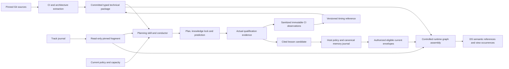

# SPEC STUDY — CI timing knowledge for conductor integration planning

Status: **STUDY — draft repository artifact, 2026-10-18**. The approved paper design permits reversible drafting. This document proposes implementation contracts and gates; it records no owner selection, implementation, deployment qualification or cross-owner design freeze.

Lineage: consolidated from the approved study [S1], its adopted reconciliation [S3] and round-two review [S4]. Track: WP9 item `01M57FSNB4ZYA7N55GEWAN2016`, parent `01KYNH2CTQXQSGHD731H19T3XX`. Drafting base: Sentropic `8c3a44c176ee06c9e2d1666158079c23a8b731ab`; the historical measurement baseline below is distinct. Follow [the branch plan](../BRANCH.md), [workflow rules](../rules/workflow.md) and [the branch template](../plan/BRANCH_TEMPLATE.md).

Recommendation: commit a typed repository knowledge package with reproducible timing references and CI/CD and architecture subgraphs. Have the conductor and source planning skill consume an exact revision with Track, proposed changes and resource constraints. Capitalise bounded lessons through the existing Engram authority and qualified host seam. The Git-backed planner remains useful while that seam is unavailable.

## 0. Binding owner request

Verbatim from [S0], including its original spelling:

> séparément: track et lance l'étude suivante : la référence des temps estimée devra être une connaissance utilisée par le conductor pour l'optimisation des plan d'intégration et ameliorre la skill de planification. idéalement voir comment avec gr-conductor comment gérer ce type de knowledge spécifique a capitaliser pour le repo. poru moi CI CD et graphes d'archi devraient être commités et intégrés au graphe de connaissance (committés comme sous-graphe typé - pour le diag voir le meta model du design system aussi)

The required outcome is committed technical subgraphs, timing-informed integration planning, a source-level planning-skill change and a bounded gr-conductor seam. Only [D1](#d1) and conditional [D2](#d2) remain owner questions. Their answers are unnecessary for this documentation work.

## 1. Evidence baseline and limits

All numbers in this section are inherited historical evidence or explicitly modelled scenarios, not measurements of the drafting branch. [S1 §1; S2:15–39; E1]

| Input | Pinned identity or population | Interpretation |
|---|---|---|
| Repository extraction | `94a38286eae4dbbff1cde192faa4f332abe60efa` | 66 jobs, 171 `needs` links, 43 component roots and 72 consumer pairs. |
| Separate CI Lot 1 reference | PR #696, `38a3b8e5ad0e14136082f309c29f22fde6467779` | Measurement protocol snapshot; not the extraction revision. |
| Raw historical corpus | 1,558 workflow runs; 48,065 allocated job records | Keep run, attempt and job denominators separate. |
| Replay and pricing | 554 ancestry-valid diffs; 266 successful priced runs in an earlier comparison | These are distinct from per-job sample populations. |
| `validate-cluster-mesh` | Median 4.717 min, p90 5.567 min, 378 samples | Job service time, not integration completion. |
| Isolated cluster-mesh PRs | Lifecycle median 25 min, p90 41.683 min; 26 runs | Runner-work median 146.233 min; gate-delay statistics have their own denominator. |
| `validate-harness` | Median 0.617 min, p90 0.750 min; 709 samples | No isolated harness PR cohort; job observations do not fill that gap. |
| Isolated UI PRs | One run, approximately 13.983 min lifecycle | Insufficient evidence of a stable tail. |
| Archived presentation scenes | 67 jobs / 169 `needs`; 47 components / 163 typed edges over 77 relations | Historical view counts; never substitute them for the pinned extraction counts. |

The existing extractors cover workflow predicates/matrices, imports, manifests, Make prerequisites, Docker inputs/stages and test routing, with unresolved inputs and parse errors. The dossier's smaller PR-condition evaluator is bounded; it is not a general Actions interpreter. Reuse the extractors and fixtures rather than infer complete semantics from diagrams. [S2:39; E2]

Historical path filters select the same jobs for patch, additive and breaking changes. A root-lock change can select the wide profile (13.05 wall / 134.52 runner-minutes plus unmeasured artifact validation). Eighteen libraries lack dedicated validation lanes, and `apps/llm-gateway` lacks a CI lane in that baseline. Missing coverage is not a saving. [S1:24–30]

S1/S2/S3 remain future CI-strategy scenarios, respectively classification, consumer contracts with workspace consumption, and contracts with immutable artifacts. Their budgets and sums of historical medians are not measured percentiles. The common-guard allowance of 1.50 minutes remains `measured: false` even though the historical median happens to match. [S1:32–36; S2:37]

For illustration, compatible `comments` is modelled at 1.97 wall / 3.60 runner-minutes under S3 qualification, or 2.38 / 4.02 including indicative publication. `cluster-mesh` reaches 5.75 / 7.38, or 6.68 / 8.32 with publication. Combining them cannot establish a five-minute train. Those scenarios do not gate this knowledge program or authorize narrower qualification. [S1:34–36, 144, 324]

## 2. Timing contract

### 2.1 Distinct records and quantities

| Record | Required content |
|---|---|
| `TimingObservation` | Repository/provider/workflow identity, run and attempt, job and canonical matrix tuple, step identity where present, events/timestamps, result, execution mode, runner profile, actually attested source/head/base/tested revisions, locator and digest; explicit missing fields. |
| `TimingSeries` | Subject/metric, inclusion and exclusion predicate, compatible configuration regime, window and immutable sample manifest, run/attempt/usable-value counts, estimator and quantile-method versions, units, samples/distribution, missing and censored counts. |
| `TimingEstimate` | Series reference, p50/tail statistics and their denominators, applicability fingerprint, freshness, support level and limitations; historical bootstrap and matched current support are distinct. |
| `TimingBudget` | Subject, target/bound, rationale and decision reference, owner and revisit trigger; no empirical sample count or confidence claim. |
| `PlanPrediction` | Candidate/base pins, selected graph, timing digest, policy and resource snapshot, proposed order, gate/release delay, runner work, uncertainty method, unknown terms, phase intervals and selection rationale. |

`JobPrice`, cohort, selection-profile, strategy and publication-price displays are views over these records, not additional numerical authorities. Critical path and affected closure are derived values. Store durations in seconds with explicit units; keep service, wall, queue, step and runner quantities separate from money, provider calls, tokens and seat consumption. Provider-cost estimates require their own usage evidence and versioned pricing. [S1 §2.1; S2:41–51]

Measured statistics name their population, window, sample count and method. Modelled estimates combine evidence and explicit budgets and carry `measured: false`. Unknown (`NM`) stays symbolic with a reason and a measurement obligation; never substitute zero or a library average. Job quantiles cannot establish a workflow quantile by addition or a critical-path calculation. [S1:72–100]

### 2.2 Stable identity, regimes and clocks

Use repository key + workflow path + stable job ID + canonical matrix values. Steps use an explicit ID, otherwise a stable extractor key based on normalized command/action identity and occurrence. Keep display labels separate. Renames or ambiguous mappings need an explicit alias/migration or a new series; never pool similarly named jobs across workflows or repositories. [S2:53]

The regime fingerprint covers workflow/called-action digests, Make/test command closure, effective dependency locks, runner/OS/toolchain/container profile, shards, execution mode and relevant provider/model settings. Preserve unknown runner/cache information. Import existing prices as `historical-bootstrap`; do not manufacture distinctions missing from their evidence. [S2:55]

Keep four clocks: execution, evidence collection, reference publication and source/configuration applicability. Record the analyzed revision in the manifest; consumers record the containing publication commit afterward, avoiding a self-referential commit hash. Prior predictions remain immutable. [S2:57–63]

Successful service distributions, failure/cancellation rates and unsuccessful-attempt work remain separate. Link retries; treat interrupted jobs as censored observations, not completed short jobs. Distinguish skipped, allocated-empty, setup-only and active modes. Retry cost stays unknown or explicitly modelled until its failure classes and policy are supported. [S2:35, 59]

### 2.3 Applicability and permitted use

| Status | Condition | Permitted use |
|---|---|---|
| `applicable` | Compatible transitive regime fingerprint and sufficient inputs for the stated prediction | Drive scheduling and applicable timing gates with declared uncertainty; matching applicability is not a deterministic completion guarantee. |
| `conditional-historical` | Only historical/bootstrap or pre-change prices exist | Compare scenarios and discuss ordering; never supply a conservative completion bound or satisfy a timing gate. |
| `incomplete` | Missing reference or unknown required terms | Show known subtotal, symbolic terms and named measurement tasks; retain an untimed dependency plan. |

An unrelated commit with an unchanged transitive fingerprint preserves applicability. A changed runner/command/shard/dependency regime invalidates affected prices immediately; age alone cannot restore them. A workflow SHA change triggers fingerprint review, not blanket invalidation of unaffected jobs. Full-suite selection is conservative about coverage only. These three cases are mandatory consumer fixtures. [S1:148; S3 rows 9/13 and review treatment 4]

## 3. Publication, refresh and reproduction

Commit a compact manifest with `schemaVersion`, `repoKey`, analyzed revision, input-manifest digest, extractor/estimator/profile versions, observation-window manifest, typed subgraph paths/digests, superseded reference and freshness policy. Use SHA-256 for evidence and semantic payloads. Sanitize observations before persistence; raw jobs/steps remain in immutable evidence storage with committed compact manifests and small reproducibility fixtures. Scratch paths are bootstrap sources, not the durable storage contract. [S2:61–80]

| Trigger | Response |
|---|---|
| Workflow/action, Make closure, Docker input, test routing, matrix, runner or resolved dependency change | Refresh structural facts and invalidate affected regimes; expose dynamic/unresolved inputs. |
| Manifest/import/contract/deployment or architecture decision change | Refresh typed edges and CI-to-component links, retaining extraction versus reviewed declaration. |
| Completed CI attempt | Deduplicate by run/attempt/job, reconcile pending records and update observations outside the integration critical path. |
| Comparable prediction drift | Attribute service, capacity/queue, retry or closure error; publish a new reference and refresh affected recommendations. |
| Merge/rebase, candidate reorder or base advance | Rebuild for actual combined inputs; recompute remaining closure, acceptance and predictions. |
| Track head change | Refresh its read-only fragment and applicable blockers/decisions; collectors do not write realization events. |
| Engram eligibility/lifecycle change | Invalidate controlled runtime projections; do not alter committed technical facts. |
| Generator, estimator, profile or mapping change | Version the contract, replay golden fixtures and publish semantic differences. |

Reversible pilot defaults: daily collection, a rolling 30-day compatible window and weekly reference publication, plus immediate refresh on semantic changes. Require at least 20 compatible observations spanning seven days for a provisional baseline; mark tail support separately. A longer low-volume window preserves regime identity. Commit review thresholds for price movements and new unknowns. No sample-count threshold alone establishes a strong p95 guarantee. [S2:65; S1 §9]

Reuse the Lot 1 collection/comparison protocol, closing its cited snapshot gaps in K1: the dossier's `floor(n*q)` quantile differs from nearest rank; `minDays` was recorded but completeness checked run count alone; usable gate delays need their own minimum; `summarizeWindow` sums `llmMinutes` discarded by `redactJob`. Preserve historical methods and version changes. Do not infer elapsed-window coverage or measured zero LLM usage. Recheck the actual implementation before making fixes. [S2:80; E3]

Identical pinned inputs must produce identical semantic bytes. Generated facts are corrected through their source or generator, then regenerated and checked by CI diff; handwritten profiles/declarations remain reviewable source inputs. The integrator rebuilds the merged snapshot rather than choosing one branch's generated files. Retain evidence for the declared reproduction horizon and accepted-decision references; unavailable evidence explicitly means reproduction unavailable. [S1 §4.4; S2:63, 78]

## 4. Typed subgraphs and the design-system contract

### 4.1 One semantic profile, separate views

Use the actual `@sentropic/diagram-core` contracts pinned at DS `25c0f3d33c258fc2b906a4b85219ffce5f67eccc`: [SemanticDocument](https://github.com/rhanka/sent-tech-design-system/blob/25c0f3d33c258fc2b906a4b85219ffce5f67eccc/packages/diagram-core/src/document.ts#L127) holds entities, relations, ports, resources and versioned profiles; [ViewDocument](https://github.com/rhanka/sent-tech-design-system/blob/25c0f3d33c258fc2b906a4b85219ffce5f67eccc/packages/diagram-core/src/view.ts#L126) holds occurrences, geometry, grouping and presentation. The focus kit's SvelteFlow scenes are presentation instances, not the semantic schema. [S2:82–94; S3 row 18]

Declare one `repo-knowledge@1` profile with CI/CD, architecture and shared timing/provenance modules. The manifest separately types its subgraphs. The pinned [profile validator](https://github.com/rhanka/sent-tech-design-system/blob/25c0f3d33c258fc2b906a4b85219ffce5f67eccc/packages/diagram-core/src/profile.ts#L174) requires endpoint `entityTypes` to be declared in the same profile; a future profile split needs an explicit join contract. Attribute sets remain K0/K2 work with DS maintainers. [S4 finding 2]

| Module | Entity vocabulary | Principal relations and roles |
|---|---|---|
| Shared provenance/timing | Repository, SourceArtifact, EvidenceWindow, TimingReference, ExternalAnchor | `derivedFrom` (result, source), `supports` (evidence, claim), `supersedes` (new, previous), `references` (source, target). |
| CI/CD | Workflow, Job, JobVariant, Step, TestSuite, BuildArtifact, Environment, ResourcePool | `contains`, `precedes` (predecessor, successor), `awaitsResult` (producer, gate), `executes`, `producesArtifact`, `consumesArtifact`, `deploysTo`, `requiresResource`, `hasTiming` (subject, reference). |
| Architecture | Component, Package, Service, Interface, Contract, SourceFile, BuildTarget, Image | `dependsOn` (consumer, provider), `implements`, `providesInterface`, `consumesInterface`, `builtFrom`, `validates` (suite anchor, component/contract). |

Every relation has stable identity, named endpoint roles/cardinalities, provenance, source locators, extraction/declaration basis and confidence. Keep runtime/dev/peer/import/test/protocol dependency categories. Explicitly convert the historical extractor's provider-to-consumer direction into the declared role convention. `awaitsResult` remains an execution wait even for an observing gate. Architecture cycles are valid findings; only selected execution predecessors must form a DAG. Proposed controls carry explicit proposed/inferred state and never masquerade as implemented edges. [S1 §5.2; S2:90–94]

Timing attributes include metric, mode, support, sample count, p50/p90, quantile method, window and evidence resource. Declare their types and units; missing estimates omit numeric attributes and state why. DS reference validation is complemented by repository checks for regime compatibility, conditional invariants, samples and required validation closure. A valid drawing schema alone proves no CI coverage. [S2:94]

### 4.2 Explicit, versioned adapters

Assign collision-checked stable DS slugs/hashes, preserving canonical external keys as typed attributes. Arbitrary slash-bearing graph IDs cannot be copied directly into restricted nominal `EntityRef`s. Cross-document references use declared `ExternalAnchor` entities bound to exact resource, revision and key; unresolved anchors remain visible and cannot justify smaller test selection. Resource resolution belongs to the repository adapter; DS itself does not fetch `artifact:` URIs. [S2:156–158; DS refs.ts:34, 57 at the pin above]

The committed semantic documents are the common CI/architecture source for downstream consumers, still derived from pinned Git and reviewed declarations. Timing attributes are generated from `timings.json` in the same publication transaction; the manifest and consistency checks prevent independently maintained prices. Generate Graphify fragments and renderer inputs from these sources. Never maintain parallel handwritten dependency lists. [S2:167]

Graphify's inspected loader uses `multi:false`, merges edges by endpoints and skips absent endpoints. Preserve each semantic relation as a uniquely identified relation node with role-labelled incidence edges and its original `RelationRef`; materialize anchors before assembly. Verify every relation and incidence survives, including parallel semantic relations. Raw edge-count equality across representations is not the invariant. A future multigraph replacement needs separate compatibility qualification. [S2:169; G1]

DS semantic declarations and the Engram ontology/extraction mapping are different artifacts. Generate and version the latter explicitly; use existing free-string `node_type`/`relation`, `extract --semantic`, `merge-graphs` and profile validation without adding an Engram core type. Its assertion-family registry is not an ontology import. [S5:9–12; S6:14–18]

Require `source_owner`, `source_id`, `observed_at`, `source_hash` and `adapter_version` at node/relation granularity, including source revision and ownership. Use SHA-256 for evidence/trust comparisons; DS's non-cryptographic FNV helper is not suitable. Topology weight never means duration. [S2:171; G1]

K2 fixtures separately assert source counts (66 jobs / 171 `needs` / 43 roots / 72 pairs), semantic endpoint/role validity, Graphify relation/incidence conservation and view occurrence references. Include a job-to-timing relation and a CI-to-architecture relation within the single profile. A view may repeat an entity; deleting an occurrence or changing layout cannot change semantic facts or the knowledge digest. Inspect provenance in the rendered detail view on desktop and mobile. [S4 findings 2 and 6]

### 4.3 Repository layout and ownership

These are proposed implementation paths, not files produced by this study. Maintainers may reuse equivalent existing locations in other repositories, while preserving the contract and recording the mapping. [S2:173–187; S3 row 27]

| Path or surface | Content | Owner |
|---|---|---|
| `knowledge/manifest.json` | Repo identity, schema/profile/source pins, graph/reference digests, window, publication lineage | Repository knowledge maintainer; conductor coordinates final merged snapshot. |
| `knowledge/profiles/*.json` | Reviewed domain profiles and compatibility declarations | Domain maintainers with DS review. |
| `knowledge/ci/graph.json` | CI/CD semantic document, including validation/publication/deployment | CI extractor and owning maintainers. |
| `knowledge/ci/timings.json` | Distinct series, estimates and budgets | Measurement adapter and normal repository review. |
| `knowledge/architecture/graph.json` | Components, contracts, build/runtime relations | Architecture extractor and maintainers. |
| `knowledge/evidence/manifests/*.json` | Immutable evidence locators, digests and selection rules; small golden fixtures | Collector/CI operations. |
| `knowledge/views/*.json` | Optional curated view documents; geometry is excluded from semantic digest | Diagram author. |
| `plan/<integration>/knowledge-lock.json` | Candidate/base, Track cursor, graph/timing/policy digests, capacity, prediction and unknowns | Source planning skill/conductor. |
| `scripts/ci/knowledge/**` | Proposed generator, validator and repository adapters | Repository tooling owner. |
| `.track/events.jsonl` | Existing realization, decisions and acceptance | Designated single writer. |
| `.engram/` or configured graph cache | Rebuildable technical fragments and audience-authorized current runtime projections | Assembly host; `.graphify/` may remain a configured/read compatibility path. |
| Host-owned Engram store | Canonical memory and lifecycle | gr-conductor and qualified host owner. |
| Immutable CI evidence store | Full sanitized observations retained for reproduction | CI operations. |

## 5. Authority boundary and capitalisation flow

gr-conductor identifies four surfaces: committed project sources (profiles, registries, mappings and reviewed declarations); generated `.engram/` state; canonical memory journal; and ontology lifecycle (proposal → deterministic validation → decision journal → `needs_update`). A generated graph stays derived even when tracked. Git/CI establish technical facts, Track establishes work/decision/acceptance state, and Engram's immutable records plus lifecycle journal are the sole memory authority. [S5; S6:3–26]

The committed technical package contains **no memory body, identifier, digest, citation, relation or existence signal**; pending candidates, private journals, authorization receipts and revocable projections are excluded too. Memory metadata and indirect influence fall within D10. A text-only allowlist cannot establish this boundary. Review the entire package and its derivation. Every committed fact must regenerate from Git, sanitized CI evidence or an explicitly pinned Track projection, never from the Engram memory journal. [S1 §4.3; S4 findings 1 and 8]

Memory-to-snapshot citations live only on the memory side or in an authorized runtime assembly, with no reciprocal committed reference. Eligibility loss invalidates that assembly; an old technical snapshot cannot restore excluded memory information. Any distinct durable-publication contract for memory references requires its own gr-conductor specification and qualification. [S4 finding 1; M1 M10]

Read the committed package at the branch base, validate and predict, then compare actual outcomes. Publish revised technical references through the source/generator review loop. Submit only bounded, reusable lessons through memory admission: for example, an integration underestimated consumer qualification and a shared publication window, with immutable evidence and a scoped revised rule. Avoid creating one memory per job execution; arithmetic always resolves to the pinned numerical reference. [S1 §4.4; S2:234–240]
